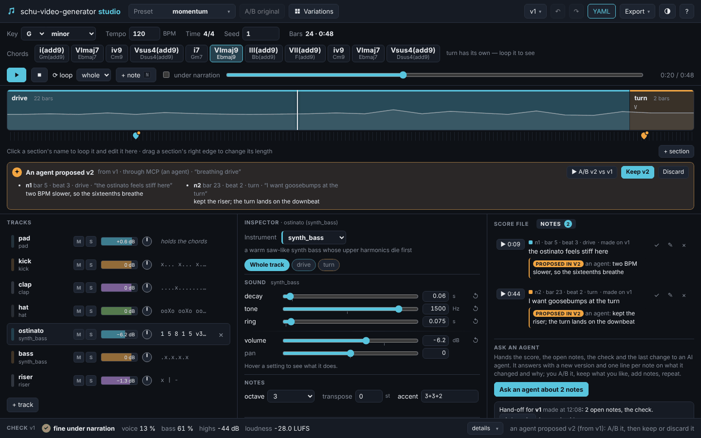

# schu-video-generator config reference

This is the reference of every key. How to make a *good* video with them (the working loop,
pacing, which scene type, good vs bad examples) is the author guide: [AGENTS.md](../AGENTS.md),
also `vidgen guide`.

A project is a folder with one config file: `video.yaml` (or `video.yml` / `video.json`), UTF-8.
Unknown keys are an error everywhere except inside `params`, `theme.colors`, `theme.sizes` and
the bodies of `variants`, so typos are caught by `vidgen validate`. Paths are relative to the
project folder. Contents: [top level](#top-level), [scenes and beats](#scenes-and-beats),
[format](#format-and-preview), [variants](#variants), [theme](#theme), [voice](#voice-voice),
[narration](#narration-narration), [narration audio](#narration-audio-elevenlabs),
[multiple voices](#multiple-voices-voices), [characters](#characters-characters), [pronunciation](#pronunciation-pronunciation),
[readback (speech to text)](#readback-vidgen-readback),
[generated images](#generated-images-imagegen-vidgen-imagegen),
[languages and translations](#languages-and-translations),
[sound effects](#sound-effects-sfx), [background music and loudness](#background-music-music),
[transitions](#transitions-transition), [thumbnail](#thumbnail-thumbnail-vidgen-thumbnail),
[GIF and clip export](#export-gif-and-clip-vidgen-export), [built-in scene types](#built-in-scenes), [beat actions](#beat-actions), [overlays](#overlays),
[JSON Schema](#json-schema-vidgen-schema), [frame stills](#frame-stills-vidgen-render---frames),
[storyboard](#storyboard-vidgen-storyboard), [lint](#lint-vidgen-lint),
[drafting from an outline](#drafting-from-an-outline-vidgen-plan),
[JSON output of commands](#json-output---json).

## Top level

| key | default | |
|---|---|---|
| `title` | required | the video's title (the MP4's title tag and `timings.json`; not drawn by itself) |
| `output` | folder name | base name of the output files: `<output>.mp4`, `<output>.srt`, `<output>_chapters.txt`, `<output>_thumbnail.png`, `<output>_preview.mp4`, `<output>_draft.mp4`, `<output>_<variant>.mp4`, all in the [output folder](#output-folder-output_dir---output-dir); no path separators |
| `output_dir` | `output` | the [output folder](#output-folder-output_dir---output-dir) of those files: relative to the project folder, or absolute |
| `format` | `{width: 1920, height: 1080, fps: 30}` | final render (`vidgen render`) |
| `preview` | `{width: 854, height: 480, fps: 15}` | `vidgen render --preview` |
| `draft` | 240 px on the shorter side, 8 fps | `vidgen render --draft`: `{width, height, fps}`, each optional; see [drafts](#drafts-vidgen-render---draft) |
| `variants` | `{}` | named overrides, see [variants](#variants) |
| `include` | `[]` | files (YAML / JSON, relative to this file, e.g. `../shared/cast.yaml`) whose `characters`, `voices` and `sets` this config starts from; this config's own entries win; see [shared casts and sets](#shared-casts-and-sets-include-and-sets) |
| `sets` | `{}` | named `stage` sets (`name: {background, layers, props, marks, light, wind...}`) a stage scene uses with `set: NAME`; see [shared casts and sets](#shared-casts-and-sets-include-and-sets) |
| `theme` | see [theme](#theme) | preset, colors, sizes, font, background, code style |
| `voice` | see [voice](#voice-voice) | the narration voice: ElevenLabs (default), OpenRouter, or Kokoro running locally (free; extra `schu-video-generator[kokoro]`; [Kokoro](#kokoro-on-this-computer-provider-kokoro)) — one provider per video ([narration providers](#narration-providers)) |
| `voices` | `{}` | named voices for dialogue, picked by scenes and beats with `voice: NAME`, see [multiple voices](#multiple-voices-voices) |
| `characters` | `[]` | cartoon characters `{name, voice, look, colors}`, declared once and used by any scene; see [characters](#characters-characters) |
| `host` | none | a cartoon host beside the content of every scene (not `stage` or `card` scenes): a character name, or `{character, side, size, place, floor, floor_color, facing, speaks, pose, expression, auto_direct}`; see [a host beside any scene](#a-host-beside-any-scene-host) |
| `subtitles` | `{speakers: off}` | `speakers: name` puts the speaker's label before their lines in the SRT, see [multiple voices](#multiple-voices-voices) |
| `narration` | see [narration](#narration-narration) | beat padding, duration estimate |
| `pronunciation` | `{}` | how the narrator says terms (TTS text only), see [pronunciation](#pronunciation-pronunciation) |
| `terms` | `{}` | one colour per concept: `{loss: tertiary, gradient: "#E07A5F"}` (theme colour tokens or hex), or `{term: {color, tex}}`; the term is drawn in its colour wherever it is on-screen text, its `tex` parts in equations; see [one colour per concept](#one-colour-per-concept-terms) |
| `pronunciation_file` | none | YAML/JSON file(s) with more pronunciation entries |
| `pronunciation_defaults` | `true` | use schu-video-generator's [built-in pronunciation list](#built-in-pronunciation-lists) of each beat's TTS engine and language (`false`: only the project's entries) |
| `language` | none (English rules) | the video's language, a BCP-47 tag (`en`, `pt-BR`, `es-419`): caption and SRT line breaks, the `narration_speed` lint, ElevenLabs `language_code`, the MP4's audio language; see [languages and translations](#languages-and-translations) |
| `translations` | none | a translation file (YAML, `vidgen translate-template`) whose texts replace beat texts and on-screen texts, usually in a variant; see [languages and translations](#languages-and-translations) |
| `extensions` | `[extensions]` | folders whose `*.py` files and packages are imported (see docs/EXTENDING.md); the default may be missing, a folder you list must exist |
| `lint` | see [lint](#lint-vidgen-lint) | thresholds and severities of `vidgen lint` |
| `overlays` | `[]` | lower thirds, a watermark, ... drawn over the scenes, see [overlays](#overlays) |
| `sfx` | `{auto: false, gain: 0}` | sound effects of the whole video: automatic sounds for built-in animations, overall level; see [sound effects](#sound-effects-sfx) |
| `music` | none | background music: a bed name (`calm`, `pulse`, `bright`, `cartoon`, `lullaby`, `discovery`, `breakthrough`, `enigma`, `momentum`, `lab`, `ascent`, `horizon`, `beacon`, `neon`, `tidewater`, `skyline`, `time_of_flight`), a project piece or a file, a cue `{source, volume, ...}`, or a list of cues with `from` / `to` scenes; see [background music](#background-music-music) |
| `soundfont` | none (GeneralUser GS 2.0.3, downloaded once) | the SoundFont (`.sf2` / `.sf3`, relative to the project) composed music is played with; see [SoundFont](#soundfont-soundfont-vidgen-soundfont) |
| `audio` | `{normalize: auto, target_lufs: -16, true_peak: -1.5}` | loudness of the final mix; see [loudness](#loudness-of-the-final-mix-audio) |
| `transition` | none (cuts) | the default transition between scenes: `cut`, `crossfade`, `fade_color`, `push`, `wipe` or `{type, duration, color, direction, soft}`; see [transitions](#transitions-transition) |
| `chapters` | `{metadata: true, youtube: true, intro: Intro}` | what the render writes about the chapters: MP4 chapter entries, the YouTube list `<output>_chapters.txt`, the chapter at 0:00; see [chapters in the outputs](#chapters-in-the-outputs-chapters-metadata) |
| `citations` | `{show: footer, card_seconds: 4, description: true}` | how scenes' [`references`](#references-and-figure-credits-references-figure_credit-citations) show on screen: a `footer` line, a `marker` (`[1, 2]`), a `card` at the scene's end, or `none`; `description`: the numbered list in `<output>_chapters.txt` |
| `metadata` | `{}` (title: the `title`) | tags of the MP4: `title`, `artist`, `album`, `comment`, `description`, `copyright`, `date`, `genre`; see [chapters in the outputs](#chapters-in-the-outputs-chapters-metadata) |
| `thumbnail` | none | the thumbnail `<output>_thumbnail.png`, written by `vidgen render` and `vidgen thumbnail`: a scene's frame `{scene, beat, at, overlays}` or a designed card `{title, subtitle, icon, image, preset, background}`, + `{jpeg, auto}`; see [thumbnail](#thumbnail-thumbnail-vidgen-thumbnail) |
| `stt` | `{provider: faster_whisper}` | speech to text for `vidgen readback` (the narration transcribed and compared with the beat texts): `{provider, model, language, device}`; see [readback](#readback-vidgen-readback) |
| `imagegen` | `{provider: openai, model: gpt-image-1, size: auto}` | image generation for `generate:` params and `vidgen imagegen`: `{provider (openai \| openrouter), model, size, quality, resolution, style, negative, svg_model}`; see [generated images](#generated-images-imagegen-vidgen-imagegen) |
| `cartoon_style` | none | style words added to every `generate:` prompt of [`stage`](#generated-backgrounds-cartoon_style) scenes, so a cartoon's backgrounds look alike (`"flat colours, thick outlines, soft shadows"`); part of those pictures' cache key; a variant may change it |
| `cartoon_motion` | `lively` | how characters move: `lively`, `calm` or `none` ([animation principles](#animation-principles-cartoon_motion)); a stage's or a character's own setting wins |
| `motion_effects` | `true` | dust, speed lines, impact stars and whoosh arcs the moves on `stage` scenes add while `cartoon_motion` is not `none`; `false`: none; a stage's `motion_effects` param wins; see [motion effects](#motion-effects-motion_effects) |
| `drawing` | none (`normal`, `flat`, `none`: as drawn) | how the cartoons are drawn: `{outline: thin \| normal \| bold, shading: flat \| soft, texture: none \| paper \| storybook, seed}` on `stage` scenes (the host: outline and shading); a stage's `drawing` param wins key by key; a variant may change it; see [drawing style](#drawing-style-drawing) |
| `foley` | `true` | sounds for the characters' actions on `stage` scenes (footsteps, whoosh, boing, pop); `false`: none; a stage's `foley` param wins; see [foley](#foley-and-music-stings) |
| `ambience` | `true` | a sound bed chosen from each `stage` scene's set while foley is on: a room tone in a room (and on an indoor iso place), birdsong outdoors while the light is `day` or `morning` and it does not rain, crickets outdoors on an [iso place](#isometric-places-iso) while it is `sunset` or `night`; `false`: none unless a stage's `ambience` param names one; see [ambience](#ambience-and-door-sounds-ambience-knock) |
| `auto_direct` | `false` | automatic directing on `stage` scenes: listeners look at whoever speaks and react after lines, speakers gesture on stressed words, short punchy lines get a close-up; `true`, `false` or `{looks, reactions, gestures, closeups, effects}`; a stage's or a beat's `auto_direct` wins; see [automatic directing](#automatic-directing-auto_direct) |
| `reframe` | none | on `stage` scenes wider than the frame: `speaker` moves the camera to whoever speaks (a 9:16 frame then crops the stage laid out as wide as the 16:9 one), `none` leaves the camera to the beats' own camera actions; none: `speaker` when a stage's characters do not fit in one view; a stage's `reframe` wins; see [vertical cartoons](#vertical-cartoons-reframe) |
| `cut` | none | a shorter video made of chosen scenes and beats of this one (usually in a variant: one per Short or teaser): `{scenes, beats, hook, end_card}`; the beats keep their ids and audio; see [cuts and Shorts](#cuts-and-shorts-cut-shorts) |
| `shorts` | none | the video is a vertical Short: `true` or `{max_seconds: 60, bottom: 0.2, right: 0.15, top: 0, left: 0}`: captions, lower thirds and the hook keep out of the parts the phone app covers, lint checks them (`shorts_safe_area`) and the length (`shorts_length`); see [cuts and Shorts](#cuts-and-shorts-cut-shorts) |
| `character_size` | none (`medium`) | how big the characters are on `stage` scenes: `small` (a wide landscape, for cinema), `medium` (TV / YouTube) or `large` (big characters, for phones and Shorts); on a platform level the tiles and props scale with them; captions, on-screen text and speech bubbles keep their size; a stage's `character_size` or `size` wins; a variant may change it; see [character size](#character-size-character_size) |
| `scenes` | required | the scenes in order, at least one |

### Output folder (`output_dir`, `--output-dir`)

`vidgen render` and `vidgen thumbnail` write the deliverables — the MP4, the SRT, the YouTube
chapter list and the thumbnail (`<output>[_<variant>][_preview].mp4`, `.srt`, `_chapters.txt`,
`_thumbnail.png` / `.jpg`) — into **`<project>/output/`**, created when missing. `vidgen export`,
and `vidgen slides` (the PDF title page's thumbnail) read them from there. Where it is:

1. `--output-dir DIR` on `vidgen render`, `thumbnail`, `export` and `slides`: a relative `DIR`
   is relative to the **current directory**, like any command-line path;
2. else `output_dir:` in `video.yaml` (a variant may set its own): a relative path is relative
   to the **project folder** (not the current directory), an absolute path is used as is;
3. else `output`.

```yaml
output_dir: ../renders     # <project>/../renders/<output>.mp4
```

The intermediate files stay in `build/` and the GIFs, clips and slide decks of `vidgen export`
and `vidgen slides` in `exports/`, wherever the output folder is. The `--json` documents give
the absolute paths. Under `vidgen mcp`, `output_dir:` must stay inside the allowed folder.

## Scenes and beats

```yaml
scenes:
  - id: intro                 # required, unique; letters, digits and _ only
    type: title               # a built-in or extension scene type (`vidgen list-scenes`)
    params: {title: "Hello"}  # checked against the type's params (tables below)
    beats:                    # what the narrator says, in order
      - text: "Welcome."      # required, non-empty
        id: intro_b1          # optional; default <scene id>_b<n> (1-based); unique in the video
      - text: "Let's start."
        actions: []           # optional per-beat actions on the scene's targets (see "Beat actions")
  - id: pause
    type: text_card
    params: {text: "Part 2"}
    duration: 2               # a silent scene: no beats, a duration in seconds
```

| key | default | |
|---|---|---|
| `id` | required | names the scene in `--scene`, build files and errors |
| `type` | required | scene type name |
| `params` | `{}` | free-form for types without a params model |
| `beats` | `[]` | each beat is narrated into `audio/<beat id>.mp3`; its animation lasts as long as its audio plus `narration.pad` |
| `duration` | none | seconds; required on a scene without beats and not allowed on a scene with beats |
| `lint_ignore` | `[]` | `vidgen lint` findings to skip in this scene, see [lint](#lint-vidgen-lint) |
| `overlays` | `true` | the video's [overlays](#overlays) on this scene: `false` for none, or per overlay id `false` / option overrides, or an overlay of this scene only |
| `chapter` | none | a new [chapter](#chapters) starts at this scene: its title, or `{title, number}` |
| `voice` | none (the base `voice:`) | who says this scene's beats: a name from [`voices:`](#multiple-voices-voices) or `default` |
| `sfx` | `[]` | sound effects at seconds from the scene's start (silent scenes too), see [sound effects](#sound-effects-sfx) |
| `music` | `true` | the [background music](#background-music-music) during this scene: `false` for none, `{volume: dB}` to change its level here; under [music that follows the video](#music-that-follows-the-video) also `{mood, key, tempo, instruments, seed}` from this scene's first bar |
| `transition` | the video's `transition` | how the video passes into this scene from the one before it, see [transitions](#transitions-transition) |
| `carry` | `[]` | objects of the scene before that this scene starts with, where they ended (a match cut), then moves into its own targets: target names, or `"NAME -> NAME"`; see [continuity](#continuity-carrying-objects-into-the-next-scene-carry) |
| `set` | none | a `stage` scene's set: a name from [`sets:`](#shared-casts-and-sets-include-and-sets) or a [built-in set](#ready-made-sets-set-city_street) (`city_street`, `park`, `beach`, `forest`, `snowy_hills`; rooms: `classroom`, `kitchen`, `shop`, `living_room`, `bedroom`) whose params this scene starts from; its own `params` win |
| `host` | the video's | the [host](#a-host-beside-any-scene-host) beside this scene's content: `false` for none, a character name, or a mapping of the keys that change here (`{side: left}`, `{expression: thinking}`; with `character` when the video has no host) |
| `terms` | `true` | `false`: this scene draws the video's [terms](#one-colour-per-concept-terms) in their usual colours (its captions too) |
| `references` | `[]` | sources of what the scene shows: `{label, doi \| pmid \| isbn \| url, id}` (at most 12), numbered across the video, shown as small citations and listed in the description; see [references](#references-and-figure-credits-references-figure_credit-citations) |
| `figure_credit` | none | who made a real image the scene shows (a micrograph, a structure): its text, or `{text, license, doi \| pmid \| isbn \| url}` |

Beat `id`s name the audio files: keep them when you edit the text (only that beat is
re-voiced). A beat `text` is spoken as written; it is also the subtitle. `*word*` in it marks a
stressed word for [automatic directing](#automatic-directing-auto_direct): the asterisks are not
spoken or shown. `[laugh]`, `[gasp]`, `[sigh]`, `[hmm]`, `[giggle]`, `[groan]` and `[beep]` in it are
[voice sounds](#voice-sounds): made at that point, not shown. A beat's `actions`
(default `[]`) point at parts of the scene while it is spoken — reveal, dim, highlight — see
[beat actions](#beat-actions). A beat's `voice` (default: its scene's) picks another speaker for
that beat — a dialogue inside one scene, see [multiple voices](#multiple-voices-voices). A beat's
`sting` (default none) plays a short music sting on it: `reveal`, `comic` or `sad`, or `{kind, at,
gain}`, see [music stings](#foley-and-music-stings). A beat's `music_pause` (default none) stops
[composed music that follows the video](#music-that-follows-the-video) just before it (a
punchline) until the next bar line after it: `true`, or `false` to stop the automatic pause before
a `card` scene's first beat or a short last line. A beat's `auto_direct` (default: its scene's,
else the video's) turns [automatic directing](#automatic-directing-auto_direct) on or off for that
beat of a `stage`. A beat's `shot` (default none) frames characters of a `stage` for that beat:
`closeup kit`, `two_shot`, `over_shoulder kit pip`, ... or `{kind, of, move, run_time}`, see
[shots](#shots-shot). A beat's `overlap` (seconds, default none) starts it before the line of
the beat before has ended, and `interrupt: true` (default `false`) cuts that line off, see
[overlapping lines](#overlapping-lines-overlap-interrupt); not on a scene's first beat. A beat's
`emotion` (default: its voice's, else none) says how the line feels — `excited`, `sad`,
`whisper`... — and changes how it is spoken (Kokoro: speed, pitch, loudness and pauses;
ElevenLabs: an audio tag or voice settings; OpenRouter: an instruction), see [voices with
feeling](#voices-with-feeling-emotion). A beat's `cite` (default `[]`) names the scene's references it cites (ids or 1-based places): while it plays, the citation shows only their numbers, see [references](#references-and-figure-credits-references-figure_credit-citations).

## Chapters

A video can be divided into chapters. A chapter starts at every [`chapter`](#chapter) scene (its
`title` and `number` params) and at every scene with a `chapter:` key, which marks a new chapter
without a divider card:

```yaml
scenes:
  - id: intro                 # before the first chapter: no chapter
    type: title
    params: {title: "Engines"}
    beats: [{text: "..."}]
  - id: part1
    type: chapter             # a divider card starts chapter 1 "Setup"
    params: {number: 1, title: "Setup"}
    duration: 3.5             # about 3.5 s, so viewers can read the number and title
  - id: data                  # still chapter 1
    type: text_card
    params: {text: "Data"}
    beats: [{text: "..."}]
  - id: results
    type: bullets
    chapter: Results          # chapter 2 starts here, no card (long form: {title: Results, number: 2})
    params: {heading: "Results", items: ["Faster", "Smaller"]}
    beats: [{text: "..."}]
```

| key | default | |
|---|---|---|
| `title` | required | the chapter's name (the short form `chapter: Results` gives only this) |
| `number` | none | its number as shown (an integer, or text like `"Part II"`); without one, indicators show its position (1, 2, ...) |

On a `chapter` scene, `chapter:` renames the chapter in lists and indicators (e.g. a shorter
title than the card's) and keeps the card's number unless it gives one. A chapter lasts until
the next one starts (the last until the video's end). `vidgen validate` rejects the same
chapter twice (same title and number; a card starts its chapter by itself, the scenes after it
need no `chapter:`), integer numbers that do not increase, and a scene with `chapter:` right
after a chapter card (the card would be a chapter of its own; give the card the `chapter:`
instead). The [`progress_bar`](#progress_bar) marks chapters, the
[`chapter_indicator`](#chapter_indicator) names the current one; extensions read the list with
`video_chapters(project)` (docs/EXTENDING.md). `vidgen render` also writes them into the MP4 and
a YouTube chapter list (next section).

### Chapters in the outputs (`chapters`, `metadata`)

`vidgen render` writes the chapters into the MP4 (players such as VLC, mpv, QuickTime and most
video editors list them and jump to them) and next to it a chapter list for a YouTube
description, `<output>_chapters.txt` (`<output>_<variant>[_preview]_chapters.txt` for variants
and previews):

```text
0:00 Intro
0:12 Setup
1:05 Results
```

```yaml
chapters:              # optional; the defaults
  metadata: true       # chapter entries in the MP4
  youtube: true        # <output>_chapters.txt, and warnings when YouTube would ignore it
  intro: Intro         # the chapter at 0:00 before a later first chapter; false: none
metadata:              # optional tags of the MP4 (unset ones are not written)
  artist: "Jane Doe"
  comment: "Made with vidgen"
```

| key | default | |
|---|---|---|
| `metadata` | `true` | write the chapters into the MP4 (`false`: the MP4 has none; its tags are still written) |
| `youtube` | `true` | write the chapter list into `<output>_chapters.txt` (`false`: none; without [references](#references-and-figure-credits-references-figure_credit-citations) either, an old file is removed) and check YouTube's rules; the scenes' references and figure credits follow the list in the same file |
| `intro` | `Intro` | title of the chapter added at 0:00 when the first chapter starts later (the video opens with a title scene); `false`: no intro chapter, the first chapter starts at 0:00 instead |

- **Times** are where the chapter's scene starts in the joined video, with transitions: a
  crossfade, push or wipe into a chapter card starts the chapter where the transition starts
  (the plan's times, `video_chapters(project, intro=True)`; equal to the render for built-in
  scenes). In the MP4 they are milliseconds (FFMETADATA `[CHAPTER]` entries, time base 1/1000);
  the last chapter ends at the end of the video.
- **Titles** are the chapter titles on one line (a card title's line breaks become spaces),
  without their numbers.
- **The intro chapter.** YouTube needs the first chapter at 0:00, and a player's chapter menu
  should cover the whole video, so when the first chapter starts later both lists begin with a
  chapter titled `intro` (only in these outputs: the [`chapter_indicator`](#chapter_indicator)
  and [`progress_bar`](#progress_bar) still show nothing before the first chapter). For a short
  opening (a few seconds of title before chapter 1) set `intro: false`: the first chapter then
  starts at 0:00.
- **YouTube's rules** (it ignores the whole list otherwise): the first timestamp is 0:00, there
  are at least 3 chapters, each at least 10 s long. Timestamps are whole seconds rounded down (a
  click lands at the chapter's first frame or just before it), so a chapter's length is
  measured between its rounded timestamps. `vidgen validate` (planned times) and `vidgen render`
  (the joined video) warn about each broken rule, e.g. `chapters: 'Intro' (0:00-0:03) lasts 3.0
  s; YouTube ignores the whole chapter list when a chapter is shorter than 10 s (...)`; the file
  is written anyway. Paste the file into the video's description on YouTube.
- Without chapters no list is written (and an old one is removed) and the MP4 has no chapters.
- **Tags** (`metadata:`): `title` (default the top-level `title`), `artist`, `album`,
  `comment`, `description`, `copyright`, `date` (e.g. `2026` or `2026-10-07`) and `genre`, all
  text; they are written to every render (variants can override them).
- `timings.json` and `vidgen render --json` list the chapters as published (with the intro
  chapter), `{title, number, scene, start, end, index, count, card, intro}`, also when
  `metadata` and `youtube` are off. Changing `chapters:` or `metadata:` re-renders no scene.

## References and figure credits (`references`, `figure_credit`, `citations`)

A scene can name the sources of what it shows. Each reference has a short `label` (shown on
screen and in the description) and at least one identifier, **copied from the source, never
made up**: a `doi`, a PubMed ID (`pmid`), an `isbn` or a `url`. Formats are checked offline (no
look-ups): a DOI is `10.<registrant>/<suffix>` (a `doi:` or `https://doi.org/` prefix is taken
off), a PMID 1–8 digits, an ISBN-10 or ISBN-13 with a correct check digit (hyphens allowed), a
URL `http(s)://host/...`. An `id` lets beats cite it by name.

```yaml
scenes:
  - id: er
    type: cell
    params: {...}
    references:               # placeholders in valid formats: copy the real identifiers from your sources
      - {id: book, label: "Example textbook (placeholder)", isbn: "978-0-00-000000-2"}
      - {label: "Example review (placeholder)", doi: "10.0000/example"}
    figure_credit: {text: "Micrograph: Example Lab (placeholder)", license: "CC BY 4.0", url: "https://example.org/micrograph"}
    beats:
      - text: "Ribosomes on the rough ER make secreted proteins."
        cite: [book]          # this beat shows [1]; a beat without cite shows none while others cite
```

- **Numbers** are the video's: references are numbered in order of first appearance, scene by
  scene; the same reference in another scene (the same DOI, PMID, ISBN or URL) keeps its number.
- **On screen** (`citations:` at the top level): `show: footer` (default) draws a small line at
  the bottom of the scene, `[1] Label · [2] Label` (and the figure credit), on a plate, at the
  readable text size; `marker` only the numbers (`[1, 2]`, `[1–3]`) and the credit in the lower
  right corner; `card` the numbers, then for the scene's last `card_seconds` (default 4, at most
  half the scene) a card listing the references; `none` nothing on screen. The footer and the
  marker keep the scene's layout clear of them (like an overlay with `reserve: true`); the card
  lies over the scene's end. When a scene's beats `cite`, each beat shows only what it cites.
  Scenes without references or a credit are unchanged (and keep their render fingerprints).
- **In the description**: with `citations.description: true` (default) the render appends
  `References` (`[n] Label https://doi.org/…`, `PMID: …`, `ISBN …`) and `Figure credits` to the
  description file `<output>_chapters.txt`, after the YouTube chapter list (the file is written
  for references alone too).
- `figure_credit` (any scene; meant for an [`image`](#image) of a real micrograph or structure)
  is its text or `{text, license, doi | pmid | isbn | url}`; it is shown with the citations (its
  text and licence) and listed in the description.

```yaml
citations: {show: footer, card_seconds: 4, description: true}
```

## Thumbnail (`thumbnail`, `vidgen thumbnail`)

The video's thumbnail, `<output>_thumbnail.png` (`<output>_<variant>[_preview]_thumbnail.png`),
is either a **frame of a scene** or a **designed title card**. With a `thumbnail:` section,
`vidgen render` writes it after the video (`auto: false`: only `vidgen thumbnail` does);
`vidgen thumbnail` writes it alone. Its size follows the video's `format`: **1280x720** for a
16:9 video (YouTube's recommended size), **1080x1920** for 9:16 (Shorts, Reels, a vertical
variant), 1080x1080 for a square one; a frame of another shape is cropped to it (centred).

```yaml
thumbnail:                    # a designed card: big bold title, legible when shown small
  title: "Saving 77% of the parameters"   # default: the video's title
  subtitle: "in large language models"
  icon: cpu                   # or image: assets/cover.jpg (beside the title; above it in 9:16)
  preset: bold_neon           # optional: this preset's colours and fonts instead of the video's theme
  background: surface         # optional: a theme colour or hex
  jpeg: true                  # also <output>_thumbnail.jpg, under 2 MB
```

```yaml
thumbnail:                    # a frame of a scene
  scene: results
  beat: 2                     # its id or number (from 1); default: the scene's last beat
  at: 1.5                     # seconds into the beat (into the scene without beat); default: the beat's end
  overlays: false             # without captions, watermark, ... (default true)
```

| key | default | |
|---|---|---|
| `scene` | none | frame thumbnail: the scene; its frame comes from the scene's render (`build/<final\|preview>[_<variant>]/scenes/<scene>.mp4`), which is rendered first when it is missing or stale (fingerprint, as for `vidgen storyboard`) |
| `beat` | the scene's last beat | frame thumbnail: a beat of the scene, its id or its number from 1 (not on a silent scene) |
| `at` | the beat's last frame | frame thumbnail: seconds into the beat, or into the scene without `beat`. Default: the beat's last frame (narration + `narration.pad`, the "end of beat" of [frame stills](#frame-stills-vidgen-render---frames)); a silent scene's frame just before its fade-out |
| `overlays` | `true` | frame thumbnail: with the video's [overlays](#overlays). `false` renders the scene once more without any overlay into `build/..._bare/` (kept for the next time; the scene lays out without the room overlays `reserve`) |
| `title` | the video's `title` | designed: the title, bold, as large as fits in 3 lines (4 in 9:16), font role `heading` |
| `subtitle` | none | designed: a line under the title (font role `body`, the first of the theme's `highlight`, `primary`, `accent` that reaches 4.5:1 on the background, else the title's colour) |
| `icon` | none | designed: an icon (`vidgen list-icons`) in `primary` on a `surface` disc, right of the text (above it in 9:16 / square) |
| `image` | none | designed: a picture (path relative to the project) filling the right part (the top part in 9:16 / square); `icon` or `image`, not both |
| `preset` | the video's theme | designed: a [theme preset](#theme-presets)'s colours and fonts alone (not the video's own theme values) |
| `background` | the theme's | designed: background colour (theme token or hex); the title is `text`, or black / white when `text` would not reach 4.5:1 on it |
| `jpeg` | `false` | also write `<output>_thumbnail.jpg`: the best JPEG quality (92 down to 55) under YouTube's 2 MB limit; without it an old JPEG is removed |
| `auto` | `true` | write the thumbnail at the end of every `vidgen render` (`false`: only `vidgen thumbnail`) |

A thumbnail is either a frame (`scene`, `beat`, `at`, `overlays`) or a designed card (`title`,
`subtitle`, `icon` / `image`, `preset`, `background`); mixing the two is a config error, and
`vidgen validate` checks the scene, beat, icon, image, preset and colour. Without a `thumbnail:`
section `vidgen thumbnail` draws a designed card of the video's title (and `render` writes none).
Changing `thumbnail:` re-renders no scene.

```
vidgen thumbnail [PROJECT] [--variant NAME] [--preview] [--scene ID [--beat ID|N] [--at SECONDS]
                 [--no-overlays]] [--jpeg] [--jobs N|auto] [--output-dir DIR] [--json]
```

`--scene` (with `--beat`, `--at`, `--no-overlays`) takes a frame instead of what the config says;
`--preview` takes frames from the preview render (fast, but scaled up: an `info` says so) and
names the files `..._preview_thumbnail.png`; `--jpeg` also writes the JPEG. The files go to the
[output folder](#output-folder-output_dir---output-dir) (`output/`; `--output-dir DIR`).

**Legibility.** YouTube shows thumbnails at about 320x180 in its grids (and smaller beside a
video). Every run also writes that size, `build/<final|preview>[_<variant>]/thumbnail/<name>_small.png`:
look at it (an AI author: open it as an image) before publishing. A designed card is checked like
[`vidgen lint`](#lint-vidgen-lint) checks a frame, at that small size (long side 320 px):

| rule | severity | |
|---|---|---|
| `min_font` | warning | the title is under 14 px (any other text under 10 px) at the small size: shorten it so it can be set larger |
| `fit` | warning | the title does not fit even at the smallest size (about 14 px small) and was cut with `…` |
| `contrast` | warning | title or subtitle below 4.5:1 (WCAG AA) on the background |
| `max_words` | info | more than 6 words in the title (thumbnails read best with a few) |
| `file_size` | warning | the PNG (or, with `jpeg`, the JPEG) is over YouTube's 2 MB limit |
| `resolution` | info | a frame thumbnail from a render smaller than the thumbnail (e.g. `--preview`) is scaled up |

`vidgen thumbnail` prints them; `vidgen render` logs the warnings (`render --json`: `warnings`).
A frame thumbnail's text is not measured: check it at the small size, or check the scene with
`vidgen lint`.

## Export: GIF and clip (`vidgen export`)

```
vidgen export gif|clip [PROJECT] [--scene ID] [--from SECONDS] [--to SECONDS] [--variant NAME]
              [--preview] [--width PX] [--fps F] [--max-mb MB] [--with-audio] [--output FILE]
              [--output-dir DIR] [--json]
```

Writes a part of the **rendered video** (`<output>[_<variant>][_preview].mp4` in the
[output folder](#output-folder-output_dir---output-dir), `--output-dir DIR` to read it elsewhere, and its
`build/.../timings.json`; render it first) as an animated GIF or an MP4 clip, by default to
`<project>/exports/<output>[_<variant>][_preview]_<scene>[_<from>-<to>s].gif|mp4` (`video` in
place of the scene without `--scene`; `--output FILE` writes elsewhere). With `--scene`,
`--from` / `--to` are seconds from the scene's start (default: the whole scene, kept within it,
including a transition out of it); without it they are times in the video (default: all of it).

- **GIF**: width `--width` (default 480, 270 for a 9:16 video, never wider than the video),
  `--fps` (default 12, at most the video's), loops forever. One palette of 256 colours is made
  for the clip's frames (FFmpeg `palettegen`) and applied with Sierra dithering (`paletteuse`),
  re-dithering only the changed rectangle of each frame, so still parts do not shimmer.
  `--max-mb MB` sets a size budget: while the file is bigger, the frame rate is lowered (down to
  5 fps) and the width with it (down to 160 px), at most 6 encodes; still too big, it keeps the
  smallest and warns (export a shorter part). The JSON lists every attempt.
- **Clip** (MP4): **stream-copied** — exact pixels, instant — when it starts on a keyframe of
  the video (a scene's start, in a video joined without crossfades, pushes or wipes) and keeps
  the video's size and frame rate; otherwise **re-encoded** (H.264 CRF 18, frame-accurate
  start). `--width` / `--fps` re-encode at that size / rate. Silent unless `--with-audio` (the
  sound is then encoded as AAC, cut at the exact start). No chapters.

## Slides (`vidgen slides`)

```
vidgen slides [PROJECT] [--format html|pdf] [--variant NAME] [--preview | --final] [--mode beat|scene] [--per-beat N]
              [--overlays | --no-overlays] [--no-dedupe] [--image-format webp|jpeg|png] [--quality Q]
              [--max-width PX] [--audio] [--separate] [--output FILE] [--jobs N|auto] [--force]
              [--output-dir DIR] [--json]
```

Writes the video as a **slide deck** (a PDF with `--format pdf`, [below](#pdf-deck---format-pdf)): one HTML file, by default
`<project>/exports/<output>[_<variant>][_preview]_slides.html`, that opens in any browser
without network access. Every slide picture is embedded (a `data:` URI, WebP at quality 80 by
default: about 15–40 KB per 854x480 slide, 60–150 KB at 1920x1080), and so are the page's styles
and script.

**Which frames.** The slides are the frame stills of
[`vidgen render --frames`](#frame-stills-vidgen-render---frames), reused like the
[storyboard](#storyboard-vidgen-storyboard)'s: a scene is rendered (with stills) only when its
stills are missing, made at another count or format, or stale.

- `--mode beat` (the default): **one slide per beat**, the beat's last frame: for scenes that
  reveal something per beat (bullets, charts, diagrams...) that is the fully built state of the
  beat, so the deck builds up like a presentation. A silent scene gives its frame before the
  fade-out. `--per-beat N`: N slides per beat (evenly spaced, the last at the beat's end).
- `--mode scene`: **one slide per scene**, the end of its last beat; its notes are all the
  scene's beats.
- Consecutive slides of a scene that look the same (a beat that changes nothing on screen: at
  most 0.05 % of the pixels differ, compared 320 px wide) are **merged** into one slide with both
  beats' notes; `--no-dedupe` keeps them.
- `--preview` (the default, fast; often already rendered by `storyboard` / `lint`) or `--final`
  (full-size, sharp slides for presenting). `--overlays` (the default) shows the video's
  [overlays](#overlays) as they are in the video; `--no-overlays` takes the slides from renders
  without them (captions duplicate the notes on a slide), made in `build/<...>_bare` like a
  [frame thumbnail](#thumbnail-thumbnail-vidgen-thumbnail) without overlays.
- `--variant`: a language variant gives the deck in that language: its translated pictures and
  notes, and the page's `lang`.

**Speaker notes** are the narration of the beats on the slide (the text as written, not the
[pronunciation](#pronunciation-pronunciation)), with the slide's chapter, scene and time in the
video. Pictures get alt text: the scene type, its title and the start of the narration.

**In the browser:**

| key / gesture | |
|---|---|
| `→` `↓` `Space` `PageDown` `Enter`, click on the right two thirds, swipe left | next slide |
| `←` `↑` `Shift+Space` `PageUp` `Backspace`, click on the left third, swipe right | previous slide |
| `Home` / `End` | first / last slide |
| a number, then `Enter` | go to that slide |
| `S` or `N` | speaker notes beside the slide (below it on a narrow or portrait screen), with the next slide; remembered |
| `O` | overview: every slide in a grid, grouped by [chapter](#chapters); click one to go there |
| `F` | fullscreen (the bars hide while the mouse rests) |
| `P` | play / pause: the slides follow the video's timing (each slide from the frame before it to its own); with `--audio`, the narration plays along |
| `?` | the keys |
| `Esc` | close the overview / help, stop playing |

The slide number is in the URL (`deck.html#12` opens slide 12). Slides are scaled to the window
and letterboxed on a dark backdrop; the slide change is a short fade, none with the system's
reduced-motion setting. Printing the page prints one slide per page.

**Options:** `--image-format webp|jpeg|png` and `--quality Q` (1–100; PNG is lossless),
`--max-width PX` scales the pictures down; `--audio` embeds the beats' MP3s (`audio/`, or the
variant's folder) for a narrated deck (a few MB per minute); `--separate` writes the pictures
(and MP3s) into `<name>_files/` beside the page instead of embedding them (keep the folder with
the page); `--output FILE` (`.html`) writes elsewhere; `--jobs`, `--force` as for the
storyboard. A page over 50 MB gets a warning.

### PDF deck (`--format pdf`)

```
vidgen slides [PROJECT] --format pdf [--notes] [--title-page] [--paper a4|letter]
              [--image-format jpeg|png] [--quality Q] [--max-width PX] [--output FILE]
              (+ the frame options above: --variant, --preview | --final, --mode, --per-beat,
               --overlays | --no-overlays, --no-dedupe, --jobs, --force, --json)
```

The same slides as a PDF, by default `exports/<output>[_<variant>][_preview]_slides.pdf`
(`_notes.pdf` with `--notes`). Needs the optional extra **`pip install "schu-video-generator[pdf]"`**
([fpdf2](https://py-pdf.github.io/fpdf2/), pure Python); without it the command says so.

- **Slides** (the default): one slide per page, the page in the video's aspect ratio (16:9:
  960 x 540 pt = 13.33 x 7.5 in, like a widescreen presentation; 9:16: 540 x 960 pt), the
  picture filling it.
- **`--notes`**: a notes page per slide on A4 (or `--paper letter`), portrait: a header with
  the chapter and the video's title, the slide (full width, at most half the page high for
  portrait videos), a line `Slide N / M · <scene title> · <time> in the video`, the narration
  of the slide's beats (in a language variant: the translation) wrapped in Inter, a page number
  `N / total`. Long narration continues on the next page.
- **`--title-page`**: a first page with the thumbnail made by
  [`vidgen thumbnail`](#thumbnail-thumbnail-vidgen-thumbnail) (`<output>[_<variant>][_preview]_thumbnail.png`,
  this quality's or else the other's; run it first) — on a slide page the thumbnail fills it —
  else the title, the thumbnail's `subtitle`, author and date set in type; on a notes title page
  also the number of slides and the narration's length.
- **Bookmarks** (the outline, shown when the PDF opens): the title page, each
  [chapter](#chapters) with its slides under it (`2. <scene title>`); slides before the first
  chapter at the top level.
- **Document properties** from [`metadata:`](#chapters-in-the-outputs-chapters-metadata): title (default the video's
  `title`), author (`artist`), subject (`description`, else `comment`), keywords (`album`,
  `genre`); the language (`language:`); creator `vidgen <version>`.
- **Pictures**: JPEG at quality 85 by default (embedded as is: a 854x480 slide is about
  30–60 KB, 1920x1080 about 100–250 KB), `--quality Q`, or lossless `--image-format png`
  (larger); `--max-width PX` scales them down. Pictures carry alt text.
- Text is set in the bundled Inter (a subset embedded): Latin (accents: pt-BR, es, fr, de...),
  Greek and Cyrillic; scripts Inter lacks (CJK, Arabic, Hebrew, Devanagari) are not drawn.
- `--audio` / `--separate` are HTML-only and `--notes` / `--title-page` / `--paper` PDF-only
  (errors otherwise); the HTML deck always carries the notes. `--output FILE` must end in `.pdf`.

## Format and preview

`format` and `preview` have the same keys: `width` (default 1920 / 854), `height` (1080 / 480)
and `fps` (30 / 15), all positive integers; `width` and `height` must be even (H.264). Any
aspect ratio works: the shorter side of the frame is always 8 Manim units, so 9:16 gives a frame
8 units wide and 14.22 high.

### Drafts (`vidgen render --draft`)

`vidgen render --draft` (MCP `render` with `draft: true`) is the fastest way to check a cartoon's
timing and staging: everything is where and when it will be, without what only decorates.

- **Size and frame rate**: 240 pixels on the shorter side at the format's shape (426x240 for
  16:9, 240x426 for 9:16, 240x240 for 1:1; never larger than `format`), 8 fps (never more than
  `format`'s). `draft: {width, height, fps}` sets them: `width` and `height` together (even),
  `fps` alone or with them. A variant's `format` gives its drafts its shape.
- **Left out**: idle motion (breathing, swaying, blinking; a host's too), the wind's swaying props
  and trailing pieces (balloons and blown props still drift with it), shadows, motion effects
  (dust, speed lines, stars, whoosh arcs, rocket smoke), particles (rain, snow, leaves...: none
  drawn), puddles, settling snow, fog, lightning's flash and bolt, and the light's colour grade
  (the set is drawn as by day; a `light` change still takes its time, stars and window skies still
  follow it), the [drawing style](#drawing-style-drawing)'s soft shading and texture (its outline
  weight stays).
- **Kept**: every beat, action, position and walk, the lip sync (mouths change at the draft's
  frame rate), effect symbols, bubbles, captions, overlays, cards, living props, birds, water,
  rainbows, and every sound (narration, foley, thunder, splashing steps, ambience and music).
  Beat starts fall on whole frames, as at every frame rate, so over a scene they may run a frame or
  two of the draft (up to about 0.2 s) apart from the preview's.
- **Files**: renders go to `build/draft[_<variant>]/` and the video to
  `<output>[_<variant>]_draft.mp4` (with `_draft.srt`, `_draft_chapters.txt`,
  `_draft_thumbnail.png`); a draft never reuses or replaces a preview or final render, nor they a
  draft. `vidgen lint` and `vidgen storyboard` never use drafts.

Measured on one scene of each Phase K / L example, without audio (word-count timing), one
render at a time: `cartoon-rain-check` `storm` (23 s of rain, wind and a light change) 21.5 s at
preview (640x360, 15 fps) → 8.1 s as a draft; `cartoon-muffin-mystery` `morning` (31 s indoors)
25.4 s → 12.7 s.

## Variants

A variant is a named set of overrides deep-merged onto the config: mappings merge key by key,
anything else (lists such as `scenes`, strings, numbers) replaces the base value. The result is
validated like a normal config; a variant cannot contain `variants`. `vidgen validate` checks
every variant.

```yaml
variants:
  vertical:                                   # vidgen render --variant vertical
    format: {width: 1080, height: 1920}       #   -> <output>_vertical.mp4
    preview: {width: 480, height: 854}
  spanish:
    language: es                              # see "Languages and translations"
    translations: translations/spanish.yaml   # beat and on-screen texts: own audio folder audio/spanish/
    voice: {voice_id: "XXXXXXXXXXXXXXXXXXXX"}
  short:
    scenes: [...]                             # a list replaces the whole base list
```

Renders of a variant go to `build/<final|preview>_<variant>/`. Audio sharing rules are under
[narration audio](#narration-audio-elevenlabs). A variant that shows only some scenes and beats
(a Short, a teaser) is easier written as a [`cut`](#cuts-and-shorts-cut-shorts) than as a new
`scenes` list.

### Cuts and Shorts (`cut`, `shorts`)

A **cut** is a shorter video made of chosen scenes and beats of the full one — usually one
variant per Short or teaser. The cut's beats keep their ids (a beat without an `id` keeps
`<scene>_b<n>` of the full video), so their narration audio is the full video's: nothing is
voiced again unless the cut changes a line's text, voice or emotion.

```yaml
variants:
  short1:
    format: {width: 1080, height: 1920}
    preview: {width: 360, height: 640}
    shorts: true
    audio: {target_lufs: -14, bitrate: 256k}
    music: {source: horizon, volume: -5}
    overlays: [{type: captions, style: karaoke, speakers: color}]
    cut:
      scenes:
        - workshop                                         # a whole scene
        - {scene: rescue, beats: [rescue_b2, rescue_b3]}   # some beats, in this order
        - {scene: rescue, beats: {from: rescue_b5, to: rescue_b6}}   # a run of beats ...
          # (a scene shown twice needs another id: {scene: rescue, id: rescue_end, ...})
        - {scene: finale, params: {light: night, characters: [{name: kit, at: door}]}, transition: crossfade}
      beats:                                               # changes by beat id
        rescue_b2: {shot: {kind: closeup, of: [kit, pip], clear: true}}
        rescue_b6: {actions: [{zoom: kite, scale: 3, at: 0.4, hold: true}]}
      hook: "Can a kite carry a cat?"
      end_card: "Full video on the channel"
```

`cut:` keys:

| key | default | |
|---|---|---|
| `scenes` | required | the scenes shown, in order: a scene id (the whole scene), or `{scene, beats, ...}`: `beats` a list of beat ids (shown in that order) or `{from, to}` (both included; either may be left out); any other key changes the scene in this cut: `params` merge into the scene's params (mappings key by key; `characters`, `props` and `layers` entries by name, as a [set's](#shared-casts-and-sets-include-and-sets); `{name: ben, drop: true}` leaves that one out of the cut; an empty list clears), anything else (`id`, `set`, `transition`, `music`, `overlays`, `duration`...) is merged (mappings) or replaced; `overlays: {readout: {drop: true}}` leaves one of the scene's own overlays out (one timed `at` a beat the cut leaves out). A scene may come twice with another `id`. The first scene's transition is dropped (the scene it came from is not in the cut) unless its entry gives one |
| `beats` | `{}` | changes to the cut's beats by beat id (`shot`, `actions`, `emotion`, `voice`, `text`...): mappings merge, lists (a beat's `actions`) replace |
| `hook` | none | a [`hook`](#hook) overlay: its text, or its options (`{text, seconds, position, size, ...}`) |
| `end_card` | none | a card at the end: its line, with the video's `title` above it; or `{text, title, seconds: 3, type: end_card \| card, id: cut_end, params, transition}` (`card`: a [cartoon title card](#card) with the title as its text and the line as its subtitle; `params` are more of the scene's params) |

What a cut leaves out is gone with its actions: a stage scene starts as its params say, so put the
characters where the kept beats need them (`params: {characters: [{name: kit, at: door}]}`), and
give the actions that need it again (a left-out beat's `alarm: start`). An `until` naming a beat
the cut leaves out, a first beat with `overlap` / `interrupt`, a music cue `from` / `to` a
left-out scene are reported by `vidgen validate` with the variant's name: change them in
`cut.beats` or give the variant its own `music`. `vidgen validate` checks every cut; a scene or
beat id the video does not have is reported at `cut...`. Named voices a cut leaves unused are not
reported. Other problems of a cut's scenes are reported at their place in the cut (`scenes[0]`
is the cut's first scene).

**Shorts.** `shorts: true` (or `{max_seconds: 60, bottom: 0.2, right: 0.15, top: 0, left: 0}`:
shares of the frame) says the video is a vertical Short. The phone app puts its title, channel
and description over the bottom of the frame and its buttons down the right side:

- [captions](#captions), [lower thirds](#lower_third) and the [hook](#hook) keep out of those
  parts (bottom captions sit a small margin, `lift: 0.03`, above the bottom part; a `lift`
  replaces it). `karaoke` captions show a short phrase on one line in a Short — up to five
  words in `body` size, the spoken word highlighted (`max_words`, `max_lines`, `size` change it);
  title-size words fit only one or two at a time in the narrow clear part;
- the scenes' safe area leaves them out too, so built-in scenes lay their text out of them, and a
  [`card`](#card)'s words keep to the clear part (its colour and burst still fill the frame);
- a [`hud`](#hud)'s meters stand above the captions (a band of 13 % of the clear part's height
  over its bottom edge) and never in the app's parts, `compact` too;
- `vidgen lint` checks three stills per beat with `shorts_safe_area` (text or a face in those parts,
  an overlay over a face — for captions, any caption of the line being spoken, not only the
  one in the still; for an overlay that keeps off faces, a `hud`, only its texts and panels) and the length with `shorts_length` (an error over `max_seconds`);
- `vidgen validate` warns when the format is not vertical or the planned length is over
  `max_seconds`.

Re-stage for 9:16 in `cut.beats`: a wide view of a room, or a two-shot of characters far apart,
is small in a tall frame. Give the kept beats closer framings — a `closeup` / `medium` of one to
three characters, a `zoom` on the characters and props that matter (`hold: true` keeps it to the
end of the scene, so a scene can end on a close view; `at: 0, cut: true` in a scene's first beat
opens the scene on the close view, so the hook is not shown over a wide establishing view) — and look at `vidgen storyboard --variant
short1 --per-beat 2`. Shorts are usually mixed louder than long videos (`audio: {target_lufs:
-14, bitrate: 256k}`: at that loudness the AAC encode at 192k can push the peaks over 0 dBTP). Render long variants in steps with `vidgen render --variant short1 --max-scenes N`.
A change in `cut.beats` re-renders only the scene it changes; a change of the `hook` (an overlay
over the whole video) re-renders every scene of the cut, so settle the hooks before the final
renders. The hook is not checked by `lint` while it shows: look at a still at about 1 s (a hook
of two lines covers less of a face near the top than one of three or four). Busy scenes (rain,
many lights) make larger files: re-encode one over a size budget (`ffmpeg -c:v libx264 -crf 23
-c:a copy`).

## Shared casts and sets (`include:` and `sets:`)

A cartoon series keeps its characters, voices and places in shared files, and each episode
starts from them:

```yaml
# an episode's video.yaml (like examples/cartoon_series/episode_2, shortened)
title: "Nib and Olla: The Weather Hat"
include: [../shared/cast.yaml, ../shared/sets.yaml]   # relative to this file
characters:                                           # this episode only: olla gets a scarf
  - name: olla
    look: {accessories: [hat, scarf]}
scenes:
  - id: bench
    type: stage
    set: workshop                                     # from sets.yaml
    params:
      light: night                                    # the scene's own params win
      characters: [nib, {name: olla, at: 0.75}]
    beats: [...]
```

```yaml
# shared/cast.yaml
voices:
  nib_voice: {voice: af_sarah}
characters:
  - name: nib
    voice: nib_voice
    look: {body: round, hair: curly}
```

```yaml
# shared/sets.yaml
sets:
  workshop:
    background: ["#E9DCC9", "#F6EFE4"]
    light: indoor
    marks: {bench: 0.3}
    props: [{prop: table, name: bench, at: bench}, lamp]
```

- **`include:`** a file name or a list. An included file holds only `characters`, `voices`,
  `sets` and its own `include` (relative to it; a file reached twice is merged once). The files
  merge in order, a file's includes before the file, the project's own config last:
  mappings (`voices`, `sets`, a character's `look`) merge key by key; a `characters` entry with a
  name already declared changes that character (its keys win), a new name is added; anything
  else replaces. File paths in an included file (a character's `look.svg`, a set's `image`,
  `layers[].image`, `props[].svg`) are relative to that file. A missing or circular include is
  an error naming the chain (`video.yaml -> ../shared/sets.yaml -> old.yaml: include 'x.yaml' not
  found`). A variant cannot contain `include` (it may change what the includes gave, as usual).
- **`sets:`** named [`stage`](#stage) params: `background` / `image` / `generate`, `ground`,
  `ground_color`, `layers`, `props`, `marks`, `light`, `wind`, `particles`, `width`, even
  `characters` (a shopkeeper always behind the counter). A stage scene's **`set: NAME`** starts
  its params from the set, then its own params win:
  - `image`, `generate` and `background` are one choice: a scene that gives any of them drops
    all three of the set's;
  - mappings (`marks`) merge key by key;
  - `characters`, `props`, `layers` and `particles` add to the set's (the set's first). A scene
    entry named like a set entry changes that entry (its keys win): a character by its name, a
    prop or layer by `name:` equal to the set entry's own or default name (`{name: tree, at:
    0.3}` moves the set's first unnamed `tree`, `tree_2` the second). An unnamed scene prop is
    always added. An empty list (`props: []`) clears the set's;
  - anything else (`light: night`, `width`) replaces the set's value.
- **`vidgen validate`** prints `included:` with the files, and each problem says where its value
  is written: `characters[0].voice (in ../shared/cast.yaml): unknown voice ...`; a problem in a
  set's value points at the set (`sets.workshop.props[1].prop (in ../shared/sets.yaml)`), once
  however many scenes use it; a scene's own entry is named by its place in the scene's params.
  `--json` problems carry `file` (`null`: the project's config file). No line numbers.
- Renders, `vidgen tts` and `vidgen imagegen` see the merged config: editing a character, voice
  or set in an included file re-renders the scenes that use it, makes the audio of a changed
  voice stale and gives a changed `generate:` prompt a new picture; a set no scene uses changes
  nothing. SVGs and pictures an included file names outside `assets/` count like assets.
- **`vidgen screenplay --cast FILE`** reuses a cast (see
  [cartoons from a screenplay](#cartoons-from-a-screenplay-vidgen-screenplay)); `vidgen cast
  --random N` writes a new one whose characters differ clearly ([a random cast](#a-random-cast-vidgen-cast)).

`examples/cartoon_series/` is a series of two episodes on one shared cast and two sets.

### Ready-made sets (`set: city_street`)

schu-video-generator comes with sets of its own. A `set: NAME` that the project's `sets:` (with its includes)
does not define uses the built-in set of that name; a project set of the same name wins. The
scene's params override a built-in set by the same rules as any set (above): `light: night`
replaces, `marks` merge, `props: [{name: shop_2, color: tertiary}]` changes the second shop,
`props: []` or `particles: []` clears them, a `background` / `image` / `generate` replaces the
sky. Every built-in set leaves two marks clear for two characters at depth 0, `stand_left` and
`stand_right`; with them it lints clean.

```yaml
scenes:
  - id: corner
    type: stage
    set: city_street                   # no sets: needed
    params:
      characters: [{name: pip, at: stand_left}, {name: kit, at: bus_stop}]
      light: sunset
```


| set | what is in it | own marks | light, ambience |
|---|---|---|---|
| `city_street` | blocks of buildings behind two `shop` fronts across a `road`, a `lamp` post, a `bench`, a `bus_stop`; a pavement ground | `stand_left` 0.3, `stand_right` 0.68, `bench` 0.5, `bus_stop` 0.9 | `day`, `city` |
| `park` | hills, a `path`, a `fence` at the back, a `tree`, a `fountain`, a `bench`, two `flowers` beds; grass | `stand_left` 0.3, `stand_right` 0.7, `fountain` 0.5, `bench` 0.84 | `day`, `auto` (birdsong by day) |
| `beach` | the sea on the horizon and in front on the left ([`water`](#water-and-air-vehicles-water-land) from 0 to 0.3, with waves: a boat floats there), sand, the `sun`, a `beach_umbrella`, two `shell`s | `stand_left` 0.4, `stand_right` 0.84, `umbrella` 0.63, `shore` 0.15 (on the water) | `day`, none (no sea sound yet) |
| `forest` | far pine shapes, `tree`s and `pine`s at several depths, a `bush`, a `log` (seats two), two clusters of `mushroom`s | `stand_left` 0.32, `stand_right` 0.68, `log` 0.5 | `morning`, `auto` (birdsong by day) |
| `snowy_hills` | white hills, `pine`s, a `rock`, light snow falling whose layer lies on the ground and the props from the start ([`settle`](#snow-that-settles-settle), `settled: 60`) | `stand_left` 0.34, `stand_right` 0.68 | `day`, none |

The props are named by kind and numbered in the order the set lists them, as on any stage (the
forest's: `pine`, `pine_2`, `tree`, `tree_2`, `pine_3`, `tree_3`, `bush`, `log`, `mushroom`,
`mushroom_2`); `src/vidgen/data/sets/outdoors.yaml` in the package lists every set. Their props
are shown under [Props](#props). `vidgen validate` reports an unknown set with the project's and the
built-in names (`unknown set 'beech'; did you mean 'beach'? sets: none (...); built-in sets:
classroom, kitchen, shop, living_room, bedroom, city_street, park, beach, forest, snowy_hills`). A
built-in set is part of the scene's params, so a newer schu-video-generator that changes a set renders the
scenes using it again.

### Ready-made rooms (`set: classroom`)

Five built-in sets are [rooms](#rooms-room): a wall, a floor, a door (`door`, a mark too: `enter`
/ `exit` with `door: door`), windows, furniture against the wall, `light: day` in the classroom, kitchen and shop (a day sky in the windows), `light: indoor` in the living room and bedroom (lamplight;
the windows show the evening sky) and `ambience: room_tone`. They work like the outdoor sets
above, with the same two clear marks `stand_left` and `stand_right` at depth 0. The room merges
key by key (`room: {wallpaper: dots}` keeps the set's door and windows; `room: {windows: []}`
removes the windows), `light: day` makes it daytime, and a `background` / `image` / `generate`
replaces the room (its `against: wall` props then need a room of the scene's own).

The furniture against the wall stands at the wall's depth, 0.4: a character on `stand_left` sits
or leans on it after walking there (`- walk_to: pip, to: {mark: sofa, depth: 0.4}`, then `-
sit_on: pip, to: sofa`; `vidgen validate` says so when the walk is missing). Each seat has a mark
of its own at its x.

```yaml
- id: lesson
  type: stage
  set: classroom
  params:
    characters: [{name: pip, at: stand_left}, {name: kit, at: stand_right}]
  beats:
    - text: "Kit takes a seat."
      actions:
        - {walk_to: kit, to: {mark: pupil, depth: 0.25}}
        - {sit_on: kit, to: school_desk, at: 0.6}
```


| set | what is in it | seats and leans (depth) | own marks |
|---|---|---|---|
| `classroom` | a `blackboard` on the wall, the teacher's `desk` (with its chair), two pupils' `school_desk`s facing the board, a window, the door on the right; boards | `desk` (0.4), `school_desk` and `school_desk_2` (0.25, the pupils face left) | `stand_left` 0.27, `stand_right` 0.69, `blackboard` 0.47, `teacher` 0.12, `pupil` 0.6, `pupil_2` 0.8 |
| `kitchen` | a `fridge`, a `counter` with a `kettle` on it (`lift: 0.18`), a `clock`, a window over a `table` with two `chair`s facing each other; striped wall, tiles | `chair`, `chair_2` (0.2); lean on `fridge`, `counter` (0.4) | `stand_left` 0.27, `stand_right` 0.73, `counter` 0.3, `table` 0.5, `chair` 0.395, `chair_2` 0.605 |
| `shop` | two `shelf_with_goods` at the wall, a `counter` in front (depth 0.2) with a `till` on it, a wide shop window; tiles, a ceiling | lean on `shelf_with_goods`, `shelf_with_goods_2` (0.4), `counter` (0.2); a shopkeeper stands behind the counter at depth 0.3 | `stand_left` 0.27, `stand_right` 0.8, `counter` 0.55, `behind_counter` 0.5 |
| `living_room` | a `lamp` (on), a `sofa` under a `picture`, the door in the middle, a `tv` under the window, an `armchair` (depth 0.25), a `rug`; striped wall, boards | `sofa` (two places, 0.4), `armchair` (0.25) | `stand_left` 0.38, `stand_right` 0.66, `sofa` 0.21, `tv` 0.8, `armchair` 0.93 |
| `bedroom` | a bedside `lamp` (on), a `bed` under a window with curtains, the door, a `wardrobe`, a `rug`; dotted wall, boards | `bed` (two places, 0.4); lean on `wardrobe` (0.4) | `stand_left` 0.42, `stand_right` 0.72, `bed` 0.24, `wardrobe` 0.86 |

Every door is a lean too. `src/vidgen/data/sets/indoors.yaml` in the package lists the rooms; their
new props are shown under [Props](#props).

## Theme

```yaml
theme:
  preset: light_academic    # optional: a named set of theme values (see below)
  background: "#0E1116"     # frame background
  font: Inter               # sans family: body text and every role not set below (bundled)
  font_serif: Source Serif 4  # serif family, the `serif` font token (bundled)
  font_mono: JetBrains Mono NL  # monospace family, the `mono` token: code listings (bundled)
  fonts: {heading: serif}   # optional: font per role (see "Fonts" below)
  code_style: github-dark   # Pygments style of `code` listings
  colors:                   # tokens; these are the defaults, add any name you like
    text: "#E8EAED"
    dim: "#838B98"
    accent: "#FF6B6B"
    highlight: "#FFD166"
    primary: "#58C4DD"
    secondary: "#F2A541"
    tertiary: "#83C167"
    surface: "#161B24"      # panels, code window
    # brand: "#7C3AED"      # your own tokens work in every color param
  palette: ["#58C4DD", "#F2A541", "#C792EA", "#83C167"]   # series colors (charts), in order
  scale: auto               # type scale: compact, standard, large or auto (see below)
  sizes: {title: 56, subtitle: 42, heading: 36, body: 32, caption: 24, small: 20}  # font points
```

You only write what you change: `colors` and `sizes` are merged over the preset and the
defaults (and over tokens registered by extensions); `palette` replaces the list. Colors are hex
(`#RGB`, `#RRGGBB` or `#RRGGBBAA`, quoted in YAML because of the `#`); token names use letters,
digits and `_`. Sizes are positive numbers. `code_style` is any installed Pygments style
(`vidgen schema` lists them); a `code` scene's own `style` param wins over it.

**Precedence** (highest first): the values written under `theme:` (after merging a variant) >
the preset (and its base preset) > defaults registered by extensions
(`register_theme_defaults`, docs/EXTENDING.md) > the built-in defaults shown above (the
`dark_tech` look). Without `preset` the preset level is simply empty, so an existing project
looks exactly as before. `vidgen list-themes` shows every preset with its values (below), and
`vidgen validate` warns (without failing) when the project's own theme has a colour pair below
WCAG AA (`warning: theme contrast: colors.dim #6B7280 on background #0E1116: 3.91:1 (needs
4.5:1, too low)`; same check as the presets' tests, see below).

### Fonts

schu-video-generator ships three open-licence font families (SIL OFL 1.1; licences in
`src/vidgen/data/fonts/`, list in `THIRD_PARTY_NOTICES.md`) and registers them for its own
renders, so they need **no installation** on Windows, macOS or Linux: **Inter** (sans; Regular,
Bold, Italic), **Source Serif 4** (serif; Regular, Bold, Italic) and **JetBrains Mono NL**
(monospace without coding ligatures, so code shows the characters as typed; Regular, Bold).
Any installed font works too: write its family name (`font: Segoe UI`). A bundled family that is
also installed system-wide is fine (either copy is used; they are the same font).

The theme has three family tokens: `font` (sans; default Inter), `font_serif` (default Source
Serif 4) and `font_mono` (default JetBrains Mono NL). Built-in scenes ask for a font by
**role**, and `fonts` maps a role to a token — `sans`, `serif`, `mono` — or directly to a family
name:

| role | used for | default |
|---|---|---|
| `body` | all other text (subtitles, bullets, captions, labels...) | `sans` |
| `heading` | `title` title, `bullets` heading, chart and `code` titles, `end_card` title | `sans` (`serif` in `light_academic`, `warm_editorial`) |
| `quote` | `quote` text | `sans` (`serif` in `warm_editorial`) |
| `quote_mark` | the large mark of `quote` | `serif` |
| `code` | `code` listings and their line numbers | `mono` |

```yaml
theme:
  preset: warm_editorial
  font_serif: Georgia            # an installed serif instead of the bundled one
  fonts: {quote: sans, heading: "Playfair Display"}   # roles: token or family name
```

`fonts` merges over the preset's roles per role; extension scenes can use any role name
(`current_theme().font_for("kicker")`, unknown roles are `sans`). A scene's own font param
(`code.font`, `quote.mark_font`) wins over the role.

Changed in Step 18: `font` is the sans family; a `font` written in `video.yaml` no longer
overrides the roles a preset sets (headings of `light_academic` stay serif; write `fonts:
{heading: sans}` for all-sans). `code` listings use JetBrains Mono NL (was the system's
`Monospace`), the quote mark Source Serif 4 (was Georgia / DejaVu Serif).

### Type scales

`scale` sets the six built-in sizes at once (font points):

| scale | `title` | `subtitle` | `heading` | `body` | `caption` | `small` | for |
|---|---|---|---|---|---|---|---|
| `compact` | 48 | 36 | 32 | 28 | 22 | 20 | dense slides, long lists |
| `standard` | 56 | 42 | 36 | 32 | 24 | 20 | 16:9 video (the defaults) |
| `large` | 66 | 50 | 44 | 38 | 30 | 26 | vertical/mobile video, accessibility |
| `auto` | | | | | | | `large` when the video (`format`) is portrait (taller than 1:1.2), else `standard` |

A scale is shorthand for those six `sizes` at the level where it is chosen: `theme.sizes`
still override single sizes (`{scale: large, sizes: {title: 60}}`), a `scale` written under
`theme:` replaces the preset's scale (and its `sizes` for those six tokens), and a preset's own
`sizes` sit above its scale. Without any `scale` (in the config or the preset) the default is
`auto`, so a `vertical` variant (`format: {width: 1080, height: 1920}`) automatically gets the
larger text a phone needs, while 16:9 output is unchanged; write `scale: standard` to keep
the old sizes in portrait. `auto` follows the variant's final `format` (a `--preview` render
uses the same sizes, so previews show the final layout). Text never overflows because of a
scale: built-in scenes fit text into their regions (wrapping, then shrinking).

Changed in Step 17: portrait projects without a scale get `large` sizes (`auto`), and
`high_contrast` uses `large` (was `caption: 26`, `small: 24`).

### Theme presets

`theme: {preset: NAME}` selects a named set of values; anything else under `theme:` still
wins, so `{preset: light_academic, colors: {primary: "#0B5FFF"}}` is the light look with your
blue. A variant can switch presets: `variants: {light: {theme: {preset: light_academic}}}`.
Mind that values written in the base `theme:` also override the variant's preset (a base
`background: "#0E1116"` would keep a light variant dark): write in the base only what every
variant shares, or select the default look with `preset: dark_tech` there instead.

| preset | background | text / dim | accents (`accent`, `highlight`, `primary`, `secondary`, `tertiary`) | `surface` | palette | `code_style` | scale |
|---|---|---|---|---|---|---|---|
| `dark_tech` (the default look) | `#0E1116` | `#E8EAED` / `#838B98` | `#FF6B6B`, `#FFD166`, `#58C4DD`, `#F2A541`, `#83C167` | `#161B24` | `#58C4DD`, `#F2A541`, `#C792EA`, `#83C167` | `github-dark` | `auto` |
| `light_academic` | `#F8F7F3` (off-white) | `#1F2328` / `#59606B` | `#B42318`, `#A64B00`, `#1D4ED8`, `#C2410C`, `#15803D` | `#FFFFFF` | `#1D4ED8`, `#C2410C`, `#9D2F8F`, `#15803D` | `xcode` | `auto` |
| `high_contrast` | `#000000` | `#FFFFFF` / `#C9CED6` | `#FF7A7A`, `#FFE14D`, `#4DD2FF`, `#FFAA4D`, `#7EE787` | `#141414` | `#4DD2FF`, `#FFAA4D`, `#FF8FD8`, `#7EE787` | `github-dark` | `large` |
| `warm_editorial` | `#F6F0E4` (cream paper) | `#2B2118` / `#6A5A4A` | `#9B1D3A`, `#8F5700`, `#1F5E6E`, `#B4441B`, `#37704F` | `#FFFBF4` | `#1F5E6E`, `#B04A16`, `#8D4AAB`, `#1A7C4D`, `#8C2024` | `default` | `auto` |
| `brand_neutral` | `#F4F5F7` (light grey) | `#15181D` / `#596270` | `#C42B3B`, `#A35200`, `#0B57C2`, `#4A5565`, `#0E7C66` | `#FFFFFF` | `#0B57C2`, `#C2410C`, `#08775A`, `#A04A8A`, `#5B6068` | `xcode` | `auto` |
| `soft_pastel` | `#252238` (dusky plum) | `#F3EEFA` / `#B0A8C4` | `#F7879F`, `#FCE38A`, `#86BDFF`, `#FFC27F`, `#9BEBC9` | `#2C2843` | `#86BDFF`, `#FFC27F`, `#9E8BEF`, `#9BEBC9`, `#F7879F` | `zenburn` | `auto` |
| `bold_neon` | `#0B0614` (violet-black) | `#F7F4FF` / `#A59CC2` | `#FF2E8B`, `#F4FF3A`, `#00C8FF`, `#FF8A1F`, `#39FF9C` | `#170F27` | `#00C8FF`, `#FF2E8B`, `#F4FF3A`, `#8C5BFF`, `#39FF9C` | `monokai` | `large` |

What they are for: `dark_tech` technical explainers; `light_academic` papers and lectures;
`high_contrast` accessibility; `warm_editorial` essays and storytelling; `brand_neutral` a quiet
base for a company colour (`{preset: brand_neutral, colors: {primary: "#..."}}` or a project
preset based on it); `soft_pastel` friendly tutorials; `bold_neon` short social clips.

All presets use the bundled families (Inter, Source Serif 4, JetBrains Mono NL);
`light_academic` sets headings and `warm_editorial` headings and quotes in the serif (see
[Fonts](#fonts)). Every built-in preset
passes WCAG AA (tested): `text` and `dim` at least 4.5:1 on the background and on `surface`,
the accent tokens at least 3:1 on the background and the palette at least 4.5:1 (charts label
series in palette colours; `high_contrast`: 7:1 for all of them). The palettes are ordered and
stay distinguishable for colour-blind viewers: every pair of colours differs by at least 7.5
CIEDE2000 under normal vision and simulated protanopia, deuteranopia and tritanopia (except
`dark_tech`, which keeps the historical default palette; its blue and purple are close for
deuteranopes, so put them apart or use another preset when that matters). Projects can add their own
presets (e.g. a brand look based on `light_academic`) with `register_theme_preset` in an
extension (docs/EXTENDING.md); `vidgen validate` reports an unknown preset name, and
`vidgen schema` lists the built-in and the project's presets.

Changed in Step 17: the third palette colour of `light_academic` (`#7E22CE` → `#9D2F8F`) and
`high_contrast` (`#D7A8FF` → `#FF8FD8`): the old purples were nearly identical to the blue for
deuteranopes.

Changed in Step 16: the default `dim` is `#838B98` (was `#6B7280`, 3.9:1 on the default
background, below WCAG AA); dim captions, axis labels and sources are a little lighter.

### `vidgen list-themes`

`vidgen list-themes [PROJECT] [--json] [--swatches PNG]` lists every preset (built-in, then the
project's own) with its resolved values in this project (background, colours, palette, fonts
and the family of each built-in role, `code_style`, scale and the sizes it gives here), the contrast check (minimum ratios, any
failing pair), the palette's smallest colour difference and for which vision, and the type
scales. `--swatches PNG` (alias `--sheet`, as in `list-icons`) also writes a picture of all presets (one row each: name and
description in its text colours, accent chips, a `surface` panel, the palette as bars), so an
AI author can compare them by opening one image. JSON shape: [below](#vidgen-list-themes---json).

## One colour per concept (`terms`)

A concept the video talks about keeps one colour wherever it is written: the viewer learns that
red means *loss* and finds it again in the next scene, the equation and the chart.

```yaml
terms:
  loss: tertiary                    # a theme colour token...
  gradient: "#E07A5F"               # ...or hex
  learning rate: {color: secondary, tex: '\eta'}   # TeX parts that stand for it in equations
  weights: {color: primary, tex: [w, W]}
scenes:
  - id: recap
    type: text_card
    terms: false                    # this scene keeps the usual colours
    params: {text: "The loss is not the gradient."}
    beats: [{text: "A recap in plain colours."}]
```

| key | | |
|---|---|---|
| `terms.<term>` | colour | the term's colour: a theme colour token (`accent`, `primary`...) or hex |
| `terms.<term>.color` | colour | the same, in the long form |
| `terms.<term>.tex` | str \| list | TeX parts of equations that stand for the term (`L`, `'\nabla L'`), each whole TeX tokens with balanced braces; coloured in [`equation`](#equation) and [`equation_derivation`](#equation_derivation) steps that contain them |

- **Where**: all text the scenes write with schu-video-generator's text helpers: titles, bullets, cards,
  quotes, tables, chart titles, axis labels, legends and category labels, diagram and process
  labels, timeline entries, captions (karaoke too: the spoken word still takes the highlight
  while it is said), lower thirds; a `line_chart` series whose whole name is a term is drawn in
  its colour (unless the series has its own `color`); a `callout` whose label says a term takes
  its colour for the mark and the plate (unless the callout has its own `color`; the label's text
  keeps the colour that reads on the plate); a `function_plot` function whose name or label is a
  term is drawn in its colour, and an area whose label says one is filled with it, as are a
  `function_plot` point, vector or mark and a `number_line` point, interval or jump whose label
  says one (unless they have their own `color`). Code listings are not coloured (their syntax
  colours would clash), nor text inside pictures.
- **Matching**: whole words, any case, a plural `s` / `es` included (`loss` also colours
  `Losses`, not `glossy`); a term of several words matches them with any spaces or a line break
  between; a longer term wins over a shorter one inside it. Words are matched as written on
  screen: a [translated](#languages-and-translations) variant gives its own `terms:` in its
  language.
- **What wins**: a scene's own colour for a part of its text (a title's `highlight`, a chart's
  `highlight`, an `equation_derivation`'s `colors`, a `highlight` action) wins over the term's
  colour; `vidgen lint` warns when they differ ([`concept_colors`](#lint-vidgen-lint)).
- **Captions**: a term's colour is used when it keeps the `contrast` rule's ratio on the caption
  plate; the plate is made more opaque (up to 1) for it, and a colour that still does not read
  stays in the caption's text colour (a warning in the render log).
- **Choosing colours**: prefer colours the scenes do not already use for another role. `accent`
  is also the default colour of `function_plot` tangents and angle marks, `number_line` jumps
  and the `terminal` prompt; `highlight` is the spoken word of karaoke captions and the code
  highlight band; `primary` is the bullets' marker. A term in `accent` makes a tangent look like
  that concept (give the tangent its own `tangent_color`, or the term another colour).
- **Checks**: `vidgen validate` names a colour that is not a theme colour (`terms.loss: unknown
  theme color 'acent'`), two keys that are one term (`loss` and `Loss`) and unbalanced braces in
  `tex`; `vidgen lint`'s `concept_colors` rule warns about more than 5 different colours (none
  stands out), a colour below 4.5:1 contrast on the theme background, and a scene setting that
  colours a term otherwise.

## Icons

schu-video-generator ships 200 line icons (from [Lucide](https://lucide.dev), ISC licence), 25 in each
category `tech`, `data`, `science`, `business`, `people`, `ui` (arrows and interface),
`nature`, `education`, chosen for what explainer videos show; the full list with aliases and
tags is the [icon catalogue](ICONS.md). Built-in scenes take them as params: `icon` on
[`title`](#title), [`chapter`](#chapter), [`stat`](#stat) and [`end_card`](#end_card), `{text,
icon}` items of [`bullets`](#bullets), columns and points of [`comparison`](#comparison),
events of [`timeline`](#timeline), nodes of [`diagram`](#diagram), stages and the token of
[`process`](#process), and the [`icon_grid`](#icon_grid) scene. Extension scenes draw them with `icon(name, ...)` (see
docs/EXTENDING.md "Icons"); scene params that take an icon name are typed `icon` in
`vidgen list-scenes` and checked by `vidgen validate` (an unknown name gets suggestions).

**Aliases.** Some icons have other names that work everywhere a name does: Lucide's old names
of renamed icons (`home` → `house`, `pie-chart` → `chart-pie`, `smile` →
`face-slightly-smiling`, `filter` → `funnel`) and a few synonyms (`idea` → `lightbulb`, `ai`
→ `brain-circuit`, `warning` → `triangle-alert`, `bar-chart` → `chart-column`, `money` →
`banknote`). A project icon with an alias's name replaces the alias.

**Project icons.** Put SVG files in `assets/icons/`: `assets/icons/<name>.svg` adds the icon
`<name>` or replaces the built-in icon of that name (letters, digits, `-` and `_`). Draw them on
a square `viewBox` (Lucide's is 24 x 24, with about 2 units of padding) with strokes or fills in
`currentColor`, so they size and recolour like the built-ins. An optional
`assets/icons/icons.json` gives them a category and search tags:

```json
{"icons": [{"name": "bicycle", "category": "transport", "tags": ["bike", "cycling"]}]}
```

Entries need a `name` whose SVG exists; `category` defaults to `project`, `tags` to none.
Problems (bad file names, a broken `icons.json`) are reported by `vidgen validate` under
`assets/icons`.

### `vidgen list-icons`

`vidgen list-icons [PROJECT] [--search TEXT] [--category NAME] [--sheet PNG [--theme [PRESET]]] [--json]` lists
the icons available in the project (built-in and `assets/icons`; without a PROJECT and no
config in the current folder: built-ins only), one line each: name, category, `[project]` for
project icons, `(alias: ...)`, tags. `--search` keeps icons whose name, aliases, tags or
category contain every word of TEXT (case-insensitive; best first: name, alias, whole words of
a name or alias, tags, whole words of a tag, then words merely contained in a name or tag, so
`--search ai` lists `brain-circuit` and `bot` before `rain`): `--search "chart"`,
`--search computer`. Tags include the concepts an icon stands for
in a script, so search by idea: `money`, `growth`, `security`, `speed`, `AI`, `team`.
`--category` keeps one category (unknown → error listing them). `--sheet PNG` also draws the
listed icons, labelled with name and category, on a 1280 px wide contact sheet (8 per row; a
long list continues in `<stem>-2.png`, ... ), drawn by the same code as a render: open it to
choose icons by eye. It is black on white; `--theme` draws it in the project's theme (its
background, icons in `primary`, names in `text`) and `--theme warm_editorial` in a preset's
(built-in or the project's), to see icons as a video shows them. JSON shape:
[below](#vidgen-list-icons---json).

## Voice (`voice:`)

```yaml
voice:
  provider: elevenlabs              # elevenlabs (default), openrouter or kokoro: see "Narration providers"
  voice_id: nPczCjzI2devNBz1zQrb    # ElevenLabs voice id
  model_id: eleven_multilingual_v2
  output_format: mp3_44100_128      # ElevenLabs output_format query parameter
  settings:                         # sent as voice_settings
    stability: 0.55                 # 0..1
    similarity_boost: 0.75          # 0..1
    style: 0.0                      # 0..1
    use_speaker_boost: true
  context: true                     # send the neighbouring beats' text for smoother intonation
  timestamps: false                 # also fetch when each character is spoken (karaoke captions)
  language_code: null               # ElevenLabs language_code (ISO 639-1) or false; null: auto
  model: null                       # provider openrouter only (required there): the TTS model id
  voice: null                       # openrouter / kokoro: the voice name
  instructions: null                # openrouter: how to speak (models that read it)
  speed: null                       # openrouter / kokoro: speed multiplier 0.25-4 (openrouter: not sent when null; kokoro: 1)
  lang: null                        # kokoro: language letter (a, b, e, f, h, i, j, p, z); null: from voice / language
  device: cpu                       # kokoro: cpu, cuda or auto
  emotion: null                     # how this voice's beats feel (excited, sad, whisper...); every provider
  effect: null                      # a sound effect on the voice (hall, robot, otherworldly...): see "Voice effects"
  dub: null                         # this voice in other languages, {pt: pf_dora}: see "Dubbing"
  label: null                       # speaker name in subtitles / captions (none: not tagged)
  color: null                       # speaker colour in captions (theme token or hex; none: text colour)
```

All keys are optional; the values shown are the defaults. Unknown keys are an error. Changing
`voice_id`, `model_id`, `output_format` or `settings` re-voices every beat of this voice on the
next `vidgen tts`; `label` and `color` only name the speaker (they change no audio). `context`
sends the neighbouring beats only when they have the same voice (see
[multiple voices](#multiple-voices-voices)).

`timestamps: true` makes `vidgen tts` use ElevenLabs' *with-timestamps* endpoint (same voice,
same price): besides `audio/<beat_id>.mp3` it stores `audio/<beat_id>.align.json`, when each
character is spoken, and burned-in [`captions`](#captions) and the SRT then time every word
exactly. Without it word times are estimated (see `captions`). It is not part of the audio hash:
turning it on does not re-voice anything; `vidgen tts --force` fetches the timings for existing
beats (paid again).

`language_code` is ElevenLabs' language enforcement (an ISO 639-1 code such as `pt`). By default
(`null`: auto) schu-video-generator sends the video's [`language`](#languages-and-translations) to the models
that accept one (`eleven_turbo_v2_5`, `eleven_flash_v2_5`; others reject the field, and
`eleven_multilingual_v2` detects the language from the text). A code sends it with any model,
`false` never sends one. When a code is sent it is part of the audio hash (re-voicing those
beats); without one the hash is as before. A named voice may set its own (`voices.<name>.language_code`).

These keys are ElevenLabs'. With `provider: openrouter` the voice is `model`, `voice`,
`instructions` and `speed` instead, with `provider: kokoro` `voice`, `speed`, `lang` and `device`
(see [narration providers](#narration-providers)); the keys of the provider not in use are
ignored.

## Narration providers

One TTS provider voices the whole video: **ElevenLabs** (the default; everything above),
**OpenRouter**, which reaches many TTS models (Mistral Voxtral, Kokoro, Gemini TTS, MiniMax,
ElevenLabs' own models, Microsoft MAI-Voice...) with one key, or **Kokoro** run on your own
computer, free ([below](#kokoro-on-this-computer-provider-kokoro)). Nothing changes for a project
that does not set `voice.provider` (likewise OpenAI stays the default image provider).

```yaml
voice:
  provider: openrouter
  model: mistralai/voxtral-mini-tts-2603     # required: an OpenRouter TTS model id
  voice: en_paul_neutral                     # the model's voice name (each model lists its own)
  instructions: "warm, unhurried explainer; slight pause before numbers"   # optional
  speed: 1.0                                 # optional, 0.25-4: not sent when absent
```

| key | default | |
|---|---|---|
| `provider` | `elevenlabs` | `openrouter`: `POST https://openrouter.ai/api/v1/audio/speech`, key in `OPENROUTER_API_KEY` |
| `model` | (required) | an OpenRouter TTS model id (`author/name`); the list: <https://openrouter.ai/models?output_modalities=speech> |
| `voice` | the model's default, if it has one | the model's voice name (`en_paul_neutral` for Voxtral, `af_heart` for Kokoro, `Kore` for Gemini, `en-US-Harper:MAI-Voice-2.1` for MAI-Voice...); most models need one |
| `instructions` | none | how to speak: tone, pace, accent, language. OpenRouter documents it for Gemini TTS and OpenAI TTS models; others ignore it (the dry run notes that) |
| `speed` | none (not sent) | playback speed multiplier; OpenRouter documents it for OpenAI TTS; other models ignore it or refuse a value other than 1 |
| `label`, `color`, `timestamps` | | as in [`voice:`](#voice-voice) (`timestamps` has no effect, see below) |

**Choosing.** ElevenLabs gives the most natural narration, word timings for karaoke captions and
neighbouring-beat context for smooth intonation; it bills characters against a monthly plan.
OpenRouter pays per use from one balance: per input character for most models (Kokoro
$0.000004, Voxtral $0.0000176, ElevenLabs v3 through OpenRouter $0.00004 per character on
2026-10-08, the highest of each model's providers), while Gemini TTS and Seed Audio also bill the
generated audio (no estimate). `vidgen tts --dry-run` prints the current price per character of
the model and the estimated cost of the run (from OpenRouter's public model list, a free lookup;
offline: "price unknown"). The estimate uses the highest price of the model's providers, so the
real charge can be lower (Kokoro's cheapest provider asks $0.00000062 per character). A real run
then prints what OpenRouter reports it charged: OpenRouter writes each request's cost record a
few seconds after the audio, so schu-video-generator asks again for up to 15 s; when the records are still
missing it says `cost not reported by openrouter yet (why; see https://openrouter.ai/activity)`
— the audio is stored all the same, and the activity page shows the cost later.

**One provider per video.** A named voice of [`voices:`](#multiple-voices-voices) may change
`voice`, `instructions`, `speed` (and `model`) but not `provider`: `voices.ana.provider:
elevenlabs` in an OpenRouter video, or ElevenLabs keys such as `voices.ana.voice_id` (OpenRouter
keys in an ElevenLabs video), are config errors naming the key. A [variant](#variants) may switch
the provider of the whole video (`variants: {cheap: {voice: {provider: openrouter, model: ...,
voice: ...}}}`); its audio then goes to `audio/<variant>/` like any other voice change.

**What differs from ElevenLabs.**
- No neighbouring-beat context (the API has none): each beat is voiced on its own.
- No word timings: `voice.timestamps: true` is a `vidgen validate` warning; captions and the SRT
  use estimated word times within each MP3's speech.
- No `language_code`: the language follows the text (a model's voice usually belongs to one
  language; MAI-Voice voices carry their locale). `instructions` can name the language or accent
  ("Brazilian Portuguese, São Paulo accent") on models that read them.
- Not supported: voice cloning from reference audio (`input_references`) and multi-speaker input
  (one request voicing several speakers): schu-video-generator voices one beat per request.

**Audio.** schu-video-generator asks for MP3 (`response_format: mp3`); models that return only raw PCM (Gemini
TTS: 16-bit mono 24 kHz) are asked for PCM and converted to MP3 with ffmpeg, so `audio/` always
holds `<beat_id>.mp3` + `<beat_id>.hash`. The hash covers the spoken text (pronunciation applied)
and `provider`, `model`, `voice`, `instructions` and `speed`: changing any of them re-voices that
voice's beats. ElevenLabs projects keep their hashes.

**Checks.** `provider: openrouter` without `model`, or a model id without `/`, is a config error.
`vidgen validate` warns (no network, OpenRouter's list bundled with schu-video-generator, dated) about a model
not in the list (with a suggestion), a `voice` the model does not list and a missing `voice` for a
model that lists some; lists may be incomplete, so these are warnings. `vidgen tts --dry-run` and
a real run check OpenRouter's live list: a model it does not have is refused before any paid
request (`problem:`), an unlisted voice or an `instructions` / `speed` the model may ignore is a
`note:`.

**Key and privacy.** The same `OPENROUTER_API_KEY` as the [OpenRouter image
provider](#openrouter-provider-provider-openrouter), read from the environment only, never stored.
If your account requires Zero Data Retention (or excludes providers that keep or train on
prompts), choose a model with a ZDR endpoint: a model without one fails with a clear message that
links the privacy settings and lists the TTS models with a ZDR endpoint (on 2026-10-08 27 of 32,
e.g. `hexgrad/kokoro-82m`, `mistralai/voxtral-mini-tts-2603`, the ElevenLabs, Gemini TTS, Deepgram
and MAI-Voice models; not MiniMax, Qwen or Grok). Both `hexgrad/kokoro-82m` (voice `af_alloy`)
and `google/gemini-3.8-flash-lite-tts` (voice `Kore`) voiced a beat live on 2026-10-09 with an
account requiring ZDR. To check a model: look for its id among the `model_id`s of
`https://openrouter.ai/api/v1/endpoints/zdr` (public, no key), or, from a source checkout, run
`python tools/live_check_openrouter.py --tts --zdr`.

### Kokoro on this computer (`provider: kokoro`)

[Kokoro-82M](https://huggingface.co/hexgrad/Kokoro-82M) (Apache-2.0) is a small open-weight voice
model that runs locally: free, no key, no account, offline after the first download. It is an
optional extra (PyTorch is large), installed with `pip install ".[kokoro]"` from a checkout or
`pip install "schu-video-generator[kokoro]"` (install steps for Windows and Linux in the README).

```yaml
voice:
  provider: kokoro
  voice: af_heart        # optional: a Kokoro voice (default: the best voice of lang)
  speed: 1.0             # optional, 0.25-4 (default 1; 0.8-1.2 sounds natural)
  lang: a                # optional: a b e f h i j p z (default: voice's first letter, else language:)
  device: cpu            # optional: cpu (default), cuda, auto
```

| key | default | |
|---|---|---|
| `voice` | the language's default (below) | a voice name; a blend `af_bella,af_heart` averages voices (Kokoro's own feature); `af_heart+af_bella:0.6` mixes them by weight (0.4 af_heart, 0.6 af_bella; voices without a weight share what the others leave; all weighted: in proportion) |
| `speed` | 1 | speaking speed multiplier |
| `lang` | the first letter of `voice`, else from the video's `language` | Kokoro's language letter; it decides the pronunciation rules |
| `device` | `cpu` | `cuda`: an NVIDIA GPU (needs a CUDA build of PyTorch); `auto`: the GPU if PyTorch sees one. Not in the audio hash |
| `label`, `color`, `timestamps` | | as in [`voice:`](#voice-voice) (`timestamps` is not needed: English timings are always stored) |

**Languages and voices** (Kokoro-82M v1.0, 54 voices, list bundled with schu-video-generator, dated 2026-10-09;
grades from the model's [VOICES.md](https://huggingface.co/hexgrad/Kokoro-82M/blob/main/VOICES.md)):

| `lang` | language | from `language:` | default voice | other voices |
|---|---|---|---|---|
| `a` | American English | `en` (none set), `en-US`... | `af_heart` (A) | `af_bella` (A-), `af_nicole`, `am_michael`, `am_fenrir`, `am_puck`... (20) |
| `b` | British English | `en-GB`, `en-IE`, `en-AU`, `en-NZ` | `bf_emma` (B-) | `bm_george`, `bm_fable`, `bf_isabella`... (8) |
| `e` | Spanish | `es` | `ef_dora` | `em_alex`, `em_santa` |
| `f` | French | `fr` | `ff_siwis` (B-) | (only one) |
| `h` | Hindi | `hi` | `hf_alpha` | `hf_beta`, `hm_omega`, `hm_psi` |
| `i` | Italian | `it` | `if_sara` | `im_nicola` |
| `j` | Japanese | `ja` | `jf_alpha` | `jf_gongitsune`, `jf_nezumi`, `jf_tebukuro`, `jm_kumo` |
| `p` | Brazilian Portuguese | `pt` (also `pt-PT`) | `pf_dora` | `pm_alex`, `pm_santa` |
| `z` | Mandarin Chinese | `zh` | `zf_xiaobei` | 7 more `zf_` / `zm_` |

A video `language:` Kokoro does not speak (German, say) without `lang` / `voice` is a config error.
`j` needs `pip install "misaki[ja]"`, `z` `pip install "misaki[zh]"` besides the extra. `e`, `f`,
`h`, `i`, `p` are read through espeak-ng (and English uses it for words missing from its
dictionary); misaki loads the espeak-ng library bundled in the `espeakng-loader` wheel (Windows,
Linux, macOS), so no system package is needed normally.

**First run: downloads.** The model is fetched from Hugging Face the first time: `kokoro-v1_0.pth`
(327 MB, SHA256 `496dba11...`) plus ~0.5 MB per voice used, into the Hugging Face cache
(`~/.cache/huggingface/hub`, on Windows `%USERPROFILE%\.cache\huggingface\hub`; `HF_HOME` or
`HF_HUB_CACHE` move it). English voices also make misaki install spaCy's `en_core_web_sm`
(12.8 MB) with pip on first use. schu-video-generator bundles none of these. After that no network is needed
(`HF_HUB_OFFLINE=1` makes sure nothing is asked). `vidgen tts --dry-run` says whether the
download is still to come.

**Speed.** The model loads once per `vidgen tts` run (one pipeline per language, all voices
sharing it): a few seconds to import PyTorch and ~6-10 s to load the model and the English
phonemizer. Then, measured on a 2-core cloud CPU, a 12-word sentence (4.8 s of speech) took 3.6 s
and a 2-word line 1.1 s: about 0.7x real time, so a 5-minute narration takes ~4 minutes. A laptop
CPU is usually faster, a GPU much faster.

**Python.** The `kokoro` package (0.9.4) declares Python 3.10-3.12. On 3.13 the extra installs
nothing and `vidgen tts` prints a command that installs it anyway (it worked on 3.13 here): `pip
install --ignore-requires-python "kokoro>=0.9.4" "misaki[en]>=0.9.4" "spacy>=3.8,<4"
"spacy-curated-transformers<0.4"`.

**Word timings.** For English (`lang` a / b) Kokoro says when each word is spoken: schu-video-generator stores
them as `audio/<beat_id>.align.json` for every beat (free, so `timestamps` is not needed) and
burned-in [`captions`](#captions) and the SRT time every word from them (through the
pronunciation, as with ElevenLabs). Other languages have no timings: word times are estimated
within each MP3's speech (`timestamps: true` there is a `vidgen validate` warning).

**Same rules as the other providers.** One provider per video: a named voice may change `voice`,
`speed` and `lang` (a named voice that sets `voice` gets that voice's language unless it sets
`lang`); a [variant](#variants) may switch the whole video to Kokoro (`variants: {local: {voice:
{provider: kokoro}}}`, own `audio/<variant>/`). Audio goes to `audio/<beat_id>.mp3` (Kokoro's 24
kHz samples encoded with ffmpeg, 128 kb/s) + `.hash`; the hash covers the spoken text
(pronunciation applied) and `provider`, the model (`hexgrad/Kokoro-82M`, `kokoro-v1_0.pth`),
`voice`, `lang` and `speed` (not `device`), and a beat's [emotion](#voices-with-feeling-emotion)
when it has one: changing any of them re-voices that voice's beats.
No neighbouring-beat context. Readback and the narration-speed lint work on its MP3s as on any.

**Cost.** None: the dry run says `cost: free (local): Kokoro-82M runs on this computer`, `tts
--json` has `estimated_cost: 0`, `unknown_cost: 0`, and each beat / voice `provider: kokoro`,
`model: hexgrad/Kokoro-82M`, `provider_voice`, `speed`, `lang`, `device`. Over MCP, `tts` with
`dry_run: false` needs no `confirm_cost` for a Kokoro project (it is still asked for when the
project does not load, or uses another provider).

**Checks.** `vidgen validate` warns (no network, nothing loaded) about a voice not in the bundled
list (with a suggestion), a voice of another language than `lang` ("`bf_emma` is a British
English voice but lang is a"), a `lang` that is not the video's language, `timestamps` with a
language without timings, and the extra (or `misaki[ja]` / `[zh]`) not installed. `vidgen tts`
refuses with the install command when the extra is missing, names espeak-ng when it cannot be
loaded, and says what failed when the first download cannot reach Hugging Face.

**Choosing.** ElevenLabs still sounds the most natural and expressive (and uses neighbouring
beats for intonation); Kokoro is clear and pleasant in English (`af_heart`, `af_bella`,
`bf_emma`), thinner in the other languages, weaker on very short lines (under ~10 words) and may
rush very long ones. It is ideal for drafts, internal videos and projects with no budget, and
costs nothing to re-voice while a script changes.

### Voices with feeling (`emotion`)

Kokoro reads every line in the same even tone. `emotion:` on a beat says how the line feels, and
`vidgen tts` changes how it is spoken (ElevenLabs and OpenRouter: an audio tag, voice settings
or an instruction, [below](#emotion-with-elevenlabs-and-openrouter)). With Kokoro: the speed (Kokoro's own speed control), the pitch (a shift
in semitones by ffmpeg after synthesis that keeps the length), the loudness (gain in dB; a boost
is soft-limited so it never clips) and the pauses at commas and full stops inside the line.

```yaml
voices:
  pip: {voice: af_bella, emotion: happy}     # pip's default feeling (not inherited by other voices)
scenes:
  - id: storm
    type: stage
    beats:
      - {text: "Rain! Grab the basket!", voice: pip, emotion: excited}
      - {text: "Our sandwiches are soup.", voice: pip, emotion: sad}
      - {text: "Quick, under the tree.", emotion: {like: whisper, gain: -6}}   # a row with changes
```

| `emotion` | speed | pitch (semitones) | gain (dB) | pauses |
|---|---|---|---|---|
| `neutral` | 1 | 0 | 0 | 1 |
| `happy` | 1.05 | +1 | +1.5 | 0.9 |
| `excited` | 1.12 | +2 | +3 | 0.7 |
| `sad` | 0.86 | -1.5 | -3 | 1.5 |
| `angry` | 1.06 | -0.5 | +3 | 0.8 |
| `worried` | 1.04 | +0.7 | -1.5 | 1.3 |
| `scared` | 1.1 | +1.5 | -1 | 1.2 |
| `surprised` | 1.04 | +2.5 | +2 | 1 |
| `calm` | 0.93 | -0.5 | -1.5 | 1.2 |
| `doubtful` | 0.92 | -0.3 | -1 | 1.4 |
| `sleepy` | 0.8 | -2 | -4 | 1.6 |
| `whisper` | 0.92 | -1 | -9 | 1.2 |
| `shout` | 1.06 | +2.5 | +5 | 0.8 |

- **Where it comes from**: the beat's `emotion`, else its voice's (`voice.emotion` for the
  narrator, `voices.<name>.emotion` for a speaker — a character's default through its voice). A
  named voice does not inherit the base voice's `emotion`; a beat's `emotion: neutral` speaks a
  line plainly in a voice that has one.
- **The mapping form** `{like, speed, pitch, gain, pauses}` starts from the row `like` (default
  `neutral`) and changes the numbers given: `speed` 0.5-2 (times the voice's `speed`), `pitch`
  -3 to 3, `gain` -12 to 6, `pauses` 0.25-3.
- **Pauses**: above 1, silence is added in the middle of each pause at `,` `;` `:` `—` and
  `.` `!` `?` `…` inside the line, `pauses - 1` times the longer of Kokoro's own pause and a
  narrator's usual one (0.2 s at a comma, 0.4 s after a sentence), so `sad` (1.5) adds 0.1 s at a
  comma and 0.2 s after a sentence; below 1, the middle of Kokoro's pause is cut. The pause after
  the last word is the beat's padding (`narration.pad`), not changed. Pauses use Kokoro's word
  timings, so they change in English (`lang` a / b) only; the other numbers work in every language.
- **Timings and lip sync**: the word timings (`.align.json`, karaoke captions) and the
  phonemes of the [viseme track](#lip-sync) move with the edited pauses; the pitch shift keeps
  the length, so nothing else moves.
- **Audio hash**: a beat with an emotion has the emotion's name and its four numbers in its hash
  (changing them re-voices that beat only); a beat without one, or with `neutral`, keeps its
  hash, so existing audio stays up to date.
- **Measured** (`af_heart`, a 15-word line, 2026-10-13): neutral 5.20 s, 202 Hz, -25.7 LUFS;
  `excited` 4.85 s, 228 Hz, -22.7 LUFS; `sad` 6.16 s, 185 Hz, -28.9 LUFS, comma pause 0.05 →
  0.15 s; `whisper` 5.69 s, 189 Hz, -34.7 LUFS; `shout` 5.00 s, 232 Hz, -20.7 LUFS; `sleepy`
  7.01 s, 178 Hz. `whisper` is a quiet, slower, lower voice, not a breathy one (Kokoro cannot
  whisper).
- **ElevenLabs and OpenRouter** speak an emotion in their own way (below); without an
  `emotion` nothing changes, also not the audio hash.
- **Screenplays**: a manner word in brackets (`PIP (cross): ...`, `NARRATOR (whispering): ...`)
  becomes the beat's `emotion` as well as the speaker's expression: the names above and words
  such as cheerful, proud (happy), thrilled (excited), upset, crying (sad), cross, furious
  (angry), nervous, shy (worried), frightened (scared), shocked (surprised), gentle, deadpan
  (calm), puzzled, unsure (doubtful), tired (sleepy), whispers, quietly (whisper), shouting,
  yelling (shout).
- `vidgen tts --dry-run` names a beat's emotion (`would generate pip_b2.mp3 (24 chars, voice
  pip, sad)`).

#### `emotion` with ElevenLabs and OpenRouter

These providers take words or settings rather than numbers, so they use the emotion's **name**
(a mapping's `like`); its numbers count only where schu-video-generator changes the audio itself.

| `emotion` | ElevenLabs `eleven_v3` tag | other ElevenLabs models: stability, style | OpenRouter instruction (added) |
|---|---|---|---|
| `happy` | `[happy]` | -0.10, +0.20 | Speak in a happy, warm and cheerful tone. |
| `excited` | `[excited]` | -0.25, +0.45 | Speak with excitement: energetic, upbeat and a little faster. |
| `sad` | `[sad]` | -0.15, +0.30 | Speak sadly: a soft, low and slower voice with longer pauses. |
| `angry` | `[angry]` | -0.25, +0.45 | Speak angrily: firm, tense and forceful. |
| `worried` | `[nervous]` | -0.15, +0.30 | Speak in a worried, anxious tone, a little hesitant. |
| `scared` | `[nervous]` | -0.25, +0.40 | Speak as if scared: tense, breathy and a little shaky. |
| `surprised` | `[surprised]` | -0.20, +0.35 | Speak with surprise: bright and astonished, the pitch raised. |
| `calm` | `[calm]` | +0.15, 0 | Speak calmly: relaxed, even and unhurried. |
| `doubtful` | `[thoughtful]` | -0.10, +0.20 | Speak doubtfully: unsure and hesitant, with thoughtful pauses. |
| `sleepy` | `[tired]` | +0.10, 0 | Speak sleepily: slow, low and drowsy, as if about to yawn. |
| `whisper` | `[whispers]` | -0.10, +0.20 | Whisper: speak very quietly and breathily. |
| `shout` | `[shouting]` | -0.30, +0.50 | Shout: speak loudly and forcefully, projecting the voice. |

- **ElevenLabs `eleven_v3`** (models whose id starts `eleven_v3`, the ones that read
  [voice sounds](#voice-sounds) as audio tags): the tag goes before the line's text (`[excited]
  Rain! Grab the basket!`), before any voice sound at its start; captions, subtitles and
  `vidgen readback` leave it out. The voice settings are not changed. `[whispers]` and
  `[excited]` are tags ElevenLabs documents for v3; the others are emotion words of its examples,
  and v3 reads a tag it does not list as a direction too — it may follow some of them less
  than others.
- **Other ElevenLabs models** read no tags: the text is not changed, and the voice's
  `settings` change instead — the stability (lower: more varied, more expressive) and the style
  exaggeration by the amounts above, each kept within 0-1. A beat's emotion is in its hash
  through these settings.
- **OpenRouter models that take `instructions`** (OpenAI and Gemini TTS, the ones OpenRouter
  documents them for): the sentence above is added after the voice's own `instructions`
  (`instructions: Warm narrator` → `Warm narrator. Speak sadly: ...`). The hash gains the
  emotion's name and sentence.
- **Other OpenRouter models** take no instructions: schu-video-generator changes the returned audio with the
  emotion's numbers instead, as for Kokoro but without the pauses (OpenRouter returns no word
  timings): the speed (ffmpeg `atempo`, the pitch kept), the pitch (the length kept) and the
  loudness (a boost soft-limited). The hash gains the name, speed, pitch and gain. `vidgen
  validate` says so (`emotion: mistralai/voxtral-mini-tts-2603 takes no instructions, so the
  emotion of ... changes only the speed, pitch and loudness of the audio, not its tone or pauses`).
- **Numbers on a name-only provider**: `{like: sad, pitch: -2}` on ElevenLabs or an
  instructions model speaks as `sad`; `{like: neutral, ...}` speaks plainly. `vidgen validate`
  warns that the numbers are ignored.

## Multiple voices (`voices:`)

More than one speaker: an interview, a dialogue, a quoted voice. `voices:` names extra voices;
each is the base `voice:` with the keys it gives changed (`settings` merge value by value). A
scene's `voice:` picks one for its beats, a beat's `voice:` for itself; `default` is the base
voice (to hand a line back to the narrator inside a scene of another voice).

```yaml
voice: {voice_id: nPczCjzI2devNBz1zQrb, label: Host}   # the narrator (label: tag it in subtitles too)
voices:
  ana:
    voice_id: 21m00Tcm4TlvDq8ikWAM   # what is not given comes from voice:
    settings: {stability: 0.4}       # merged over voice.settings
    label: "Dr. Ana"                 # default: the name, first letter capital ("Ana")
    color: secondary                 # theme token or hex; default: the palette colour of its place here
subtitles:
  speakers: name                     # SRT: "Dr. Ana: ..." where the speaker changes
scenes:
  - id: interview
    type: quote
    params: {text: "Small models can be sparse too."}
    voice: ana                       # every beat of this scene...
    beats:
      - text: "We were surprised by the results."
      - text: "What surprised you most?"
        voice: default               # ...except this one: the narrator asks
      - text: "That the small models were sparse too."
```

| key (`voices.<name>`) | default | |
|---|---|---|
| `voice_id`, `model_id`, `output_format` | the base voice's | as in [`voice:`](#voice-voice) (ElevenLabs videos) |
| `model`, `voice`, `instructions`, `speed` | the base voice's | as in [narration providers](#narration-providers) (OpenRouter videos) |
| `provider` | the base voice's | only the base voice's: one provider per video (another one is an error; a variant may switch it) |
| `settings` | the base voice's | `stability`, `similarity_boost`, `style`, `use_speaker_boost`; each one not given is the base voice's |
| `context`, `timestamps` | the base voice's | as in [`voice:`](#voice-voice) |
| `label` | the name (`dr_ana` → `Dr ana`) | the speaker's name in subtitles and captions; not inherited from `voice.label` |
| `color` | palette colour by position | the speaker's colour in captions (`speakers: color` / `both` / the `name` tag); not inherited |
| `emotion` | none | how this speaker's beats feel unless a beat says otherwise ([voices with feeling](#voices-with-feeling-emotion)); not inherited from `voice.emotion` |
| `effect` | none | a sound effect on this speaker's voice ([voice effects](#voice-effects-effect)): a hall, a robot, a radio, a voice from another world; not inherited from `voice.effect` |
| `dub` | none | this speaker's voice in other languages (`{pt: pf_dora}`); without one: the base voice's when this voice keeps it, else chosen automatically ([dubbing](#dubbing-dub---all-languages)) |

- **Names**: letters, digits and `_`; `default` is reserved for the base voice. An unknown name in
  a scene or beat is a config error with a suggestion (`scenes[2].beats[1].voice: unknown voice
  'anna'; did you mean 'ana'?`); a voice no beat uses is a `vidgen validate` warning, an unknown
  colour token an error. `vidgen validate` prints `voices: default (12 beats), ana (4 beats)`.
- **Audio**: each beat is hashed with its own voice (see [narration audio](#narration-audio-elevenlabs)),
  so beats of the base voice keep their hash when `voices:` is added, editing one voice re-voices
  only its beats, and moving a beat to another voice re-voices that beat. `label` / `color` are
  not part of the audio.
- **Context**: with `context: true` a beat gets its neighbours' text as `previous_text` /
  `next_text` only when they are spoken by the **same voice**; at a change of speaker it gets none.
  ElevenLabs uses the context as this voice's own surrounding speech (to stitch generations of one
  speaker smoothly), so another speaker's line there could carry its intonation over (an answer
  read with the question's rising tone). Lines of one speaker separated by another's reply are not
  joined either: the turn breaks the flow, as in a real conversation.
- **`vidgen tts --dry-run`** shows the voice of every beat (`would generate s2_b1.mp3 (48 chars,
  voice ana)`) and the beats and characters per voice; `vidgen tts --voice ana` (repeatable;
  `default` for the base voice) generates only that speaker's beats.
- **Variants** deep-merge `voices:` like any mapping (`variants: {fr: {voices: {ana: {voice_id:
  ...}}}}` changes one speaker); a variant gets its own audio folder as soon as one shared beat's
  effective voice differs, and copies every unchanged beat from `audio/`.
- **Subtitles / captions**: `subtitles.speakers: name` writes `Label: ` before the first cue of
  each beat whose voice differs from the beat before (the first beat included) and that has a
  label (named voices always do; the base voice only with `voice.label`); `off` (default) writes
  the text only. Burned-in [`captions`](#captions) follow it, or set their own `speakers` (`name`,
  `color`, `both`, `off`).
- **Pronunciation**: the project's entries are one dictionary for all voices (the hash covers each
  beat's spoken text and its voice); the [built-in list](#built-in-pronunciation-lists) under them
  follows each beat's voice (a British Kokoro voice gets the British list). There are no per-voice
  project entries: write a variant (`pronunciation:` in it) when a voice of another language needs
  other spoken forms.

### Voice effects (`effect`)

A voice can sound through an effect: a robot's flat buzz, a big hall, a loudspeaker's echo, a
radio, a giant or a being from another world. `effect` on a voice (`voice:` or a named voice of
`voices:`) runs every beat of that voice through it after it is spoken, with any provider
(Kokoro, ElevenLabs, OpenRouter): it is plain audio processing with ffmpeg, nothing is sent to
the provider.

```yaml
voices:
  ship_ai: {voice: af_nicole, label: Ship, effect: echo}            # through the ship's speakers
  guard: {voice: am_onyx, label: Guard, effect: otherworldly}       # deep, many-voiced, in a hall
  door_bot: {voice: am_echo, label: Door, effect: {use: robot, pitch: -6}}   # a flat, low robot
  caller: {voice: bf_emma, effect: [radio, echo]}                   # presets combine
```

| preset | what it does |
|---|---|
| `deep` | 4 semitones lower (a larger, darker voice); the length is kept |
| `high` | 4 semitones higher (a smaller, brighter voice) |
| `robot` | a flat, metallic monotone: the voice's own pitch replaced by a steady buzz (187.5 Hz; a `pitch` moves the buzz: `-6` about 133 Hz) |
| `radio` | a narrow band (320–3200 Hz), compressed, like a radio or a phone |
| `chorus` | several slightly detuned copies: a voice of many |
| `echo` | a short echo, as from a loudspeaker in a room |
| `hall` | a large hall's reverberation |
| `otherworldly` | `deep` (3 semitones lower), `chorus` and `hall` together: a resonant voice not of this world |

| key (`effect` as a mapping) | default | |
|---|---|---|
| `use` | none | a preset or a list of presets; none: only the `pitch` |
| `pitch` | the presets' (`deep` −4, `high` +4, `otherworldly` −3, else 0) | semitones, −12 to 12; the length is kept |
| `amount` | `0.5` | 0–1: how strong the echo, hall, chorus and robot are |

- **Order**: presets combine in a fixed order (the pitch, then the robot, the radio band, the
  chorus, the echo and the hall; with the robot the pitch comes after it), so `[deep, hall]` and
  `[hall, deep]` are the same. The effect's audio is level-matched to the dry voice (the same
  integrated loudness, within 1 dB; at most ±15 dB of correction), and a limiter keeps the
  peaks under full scale.
- **Length**: the speech keeps its timing, so captions and lip sync stay on the words; `echo`,
  `hall` and `chorus` add a short tail after the last word for the reflections to ring out
  (0.35 s, 0.9 s, 0.1 s), and the beat is that much longer.
- **Audio hash**: a voice without an `effect` keeps every hash; with one, the effect is part of
  its beats' hash, so changing it re-voices only that voice's beats (a variant with another effect
  gets its own audio folder). Like `emotion`, a named voice does not inherit the base voice's
  `effect`. `vidgen tts --dry-run` names it (`voice guard (kokoro am_onyx ..., effect chorus+hall
  (pitch -3))`).
- **With `emotion`**: an emotion shapes how the line is spoken; the effect is applied after it.
  Both may be given.

## Characters (`characters:`)

Cartoon characters, declared once at the top level and used by any scene that draws characters:
the [`stage`](#stage) scene type, or an extension's scene type with a `CharacterName` param (see
docs/EXTENDING.md). Each one is a figure made of named parts (head, eyes, brows, mouth, body, two
arms, legs) that can be posed one by one; a generated character's arms and legs bend at the elbow
and the knee ([Bending arms and legs](#bending-arms-and-legs)). Only original characters: nothing that imitates a known
character, mascot or brand figure.

```yaml
voices:
  ana: {voice_id: 21m00Tcm4TlvDq8ikWAM}
characters:
  - name: pip
    voice: ana                 # who speaks for pip: a name from voices: (or default)
    look: {body: bean, hair: short, eyes: round, nose: dot, accessories: [glasses, scarf], seed: 3}
    colors: {skin: "#C68B59", clothes: accent}
  - name: rex                  # no voice: rex does not speak; the default look
```

| key (`characters[]`) | default | |
|---|---|---|
| `name` | required | the name scenes use (letters, digits, `_`); unique |
| `voice` | none | who speaks for the character: a name from [`voices:`](#multiple-voices-voices) or `default` (the base voice); none: the character does not speak |
| `look` | `{}` | how the character is drawn (the generator's parameters, below); `{}`: a round head on an oval body |
| `colors` | see below | colours of the parts: theme tokens or hex |
| `poses` | `{}` | the character's own poses: name -> part -> settings ([below](#poses-and-expressions)) |
| `expressions` | `{}` | the character's own expressions, like `poses` |
| `idle` | `true` | breathe, sway the head slightly and blink every 2 to 6 s on its own ([below](#idle-motion)); `false`: hold still between actions |
| `cartoon_motion` | none (the scene's, else the video's: `lively`) | this character's [animation principles](#animation-principles-cartoon_motion): `lively`, `calm` or `none`; wins over the scene's and the video's |
| `hologram` | `false` | `true` or `{color, opacity}`: draw it as a [hologram](#holograms-hologram), a translucent figure in one glowing colour that the stage's light never darkens |
| `echo` | `false` | `true` or `{color, opacity, flicker}`: draw it as an [echo](#echo-characters-echo), a translucent other self that keeps its own colours, its outlines glowing |

The **generator** draws every character from simple shapes (circles, ellipses, rounded
rectangles, polygons, lines), so each figure is an original drawing:

| key (`look`) | default | |
|---|---|---|
| `body` | `round` | body shape: `round`, `tall`, `square`, `bean`, `pear` (narrow shoulders, wide hips), `triangle` (broad shoulders) |
| `head_size` | `1.0` | head size relative to the default head, 0.6 to 1.6 |
| `eyes` | `dot` | `dot`, `oval` or `round` (white with a pupil), `sleepy` (half closed) |
| `nose` | `none` | `none`, `dot`, `round`, `triangle` |
| `hair` | `none` | `none` (bald), `short`, `spiky`, `long`, `wavy` (long locks waving past the jaw, ending in curls; the chin and chest left clear), `bun`, `curly`, `ponytail`, `braids`, `afro` (colour `colors.hair`) |
| `ears` | `none` | `none`, `round`, `pointy`, `floppy` (skin colour); with or without hair |
| `facial_hair` | `none` | `none`, `moustache`, `beard` (with a moustache; the mouth stays seen); colour `colors.hair` |
| `accessories` | `[]` | any of `glasses`, `hat`, `cap`, `bow` (worn on the head), `scarf`, `bag`, `backpack`, `necklace`, `medal` (a gold medal on a ribbon in `colors.accessory`), `pendant` (a stone in `colors.accessory` on a dark cord, glowing at night and pulsing like a slow heartbeat) (on the body), and the [costume pieces](#robots-and-costumes) `crown`, `wizard_hat`, `party_hat` (on the head) and `cape`; each at most once, only one of `hat`, `cap`, `crown`, `wizard_hat`, `party_hat`, and one of `necklace`, `medal`, `pendant` |
| `proportions` | `adult` | `adult`, `kid` (a big head on a short body and legs), `tall_kid` (lankier, a smaller head than a kid's); the figure is as tall as any other, so make a kid smaller with the stage's `scale` (about 0.7 for a `kid`, 0.85 for a `tall_kid`) |
| `outfit` | `plain` | what it wears: `plain` (one colour all over), `dress` (short sleeves, a skirt), `overalls` (over a shirt in `colors.trim`), `coat` (long sleeves, tails, trousers in `trim`), `shorts` (a top, short sleeves, shorts in `trim`), `apron` (in `trim`, over plain clothes) |
| `pattern` | `none` | `none`, `stripes`, `dots` on the clothes of the body (and a skirt), in a darker tone of a light cloth or a lighter tone of a dark one |
| `shoes` | `none` | `none`, `shoes`, `boots` (colour `colors.accessory`) |
| `species` | `human` | `human`, or an animal: `cat`, `dog`, `bird`, `bear`, `rabbit`, `mouse`, `fox`, `owl`, `frog`, `turtle`, `penguin`, `snail` ([Animal characters](#animal-characters-species)); an animal draws its own ears, nose and muzzle, so `ears`, `nose` and `facial_hair` are not given with it; or `robot` ([Robots and costumes](#robots-and-costumes); no `hair` either) |
| `robot` | none | `species: robot` only: `{head: box \| round, face: eyes \| screen, antenna: true \| false, moves_on: legs \| wheels}`; default a box head, eyes, an antenna, legs |
| `seed` | none | a number that varies the proportions (head, body, legs, arms, eye gap and size, mouth) by up to 8 %; the same look and seed always give the same figure; none: no variation |
| `svg` | none | an SVG file (relative to the project folder) drawn instead of the generator, split into parts by element ids ([below](#characters-from-svg-files)); the other `look` keys and `colors` do not apply |

| key (`colors`) | default | |
|---|---|---|
| `skin` | `secondary` | head, ears, a `round` / `triangle` nose and hands (skin); an animal's fur or feathers (its muzzle and inner ears are tints of it); a robot's plating (head, limbs; its face plate a tint of it) |
| `clothes` | `primary` | body, arms and legs (and the hat band); with an `outfit`, the outfit's main cloth |
| `outline` | `"#1F2430"` | outline of every part, and the glasses |
| `features` | `"#1F2430"` | eyes, brows, mouth and a `dot` nose |
| `hair` | `accent` | hair, moustache and beard; a `turtle`'s shell |
| `accessory` | `highlight` | hat, cap, bow, scarf, bag, backpack, necklace, the costume pieces (crown, wizard hat, party hat, cape) and shoes; a robot's antenna light |
| `trim` | `dim` | the outfit's second cloth: the shirt under `overalls`, the trousers under a `coat`, the `shorts`, the `apron` |

`outline` and `features` default to a fixed dark ink, not a theme token: no token is dark in every
theme preset. The outline width follows the character's size on screen (about 0.5 % of the
frame's shorter side for a character 3/8 of it tall), and is never thinner than one pixel.

**Clothes follow the limbs**: sleeves are drawn on the arm segments (a `dress` or `shorts` has
short sleeves: bare forearms), trouser legs on the leg segments (`shorts` cover the thighs), shoes
on the shins, so they bend at the elbow and knee with them. A `dress`'s skirt and a `coat`'s tails
hang from the body, so the legs walk under them; when the character sits (`sit_on`, or the
`sitting` pose) the body shows its `seated` shape, the cloth lying over the lap. Hanging hair and
accessories trail in the [wind](#wind-wind) (a ponytail, braids, a cap, a necklace's pendant, as long
hair, a bun, the scarf and the hat do). [Effect symbols](#effect-symbols-effect) go by the head,
not by an afro or a beard round it, and above an afro, a hat or a cap.


#### Animal characters (`species`)

`look.species` draws an original animal instead of a person: `cat`, `dog`, `bird`, `bear`,
`rabbit` or `mouse`. Each is a plain, generic animal built from the same simple shapes, in your
colours (`colors.skin` is its fur or feathers): it changes the head (its shape, the ears or a
bird's crest, a muzzle, a dog's or mouse's snout, a bird's beak, the nose and whiskers), the hands
(round paws; a bird's arms are wings) and a bird's bare shins (thin, with toes), and adds a
**`tail`** part behind the body (a cat's long curve, a dog's short one, a mouse's long thin tail,
a bear's round stub, a rabbit's puff, a bird's fan of feathers). Everything else is the same as
for a person: bodies, outfits, hair, accessories, poses, gestures, walking, sitting, the front view
and effect symbols. Pick natural fur colours or theme tokens, and vary them between characters.

```yaml
characters:
  - name: tib
    look: {species: cat, eyes: oval, outfit: overalls}
    colors: {skin: "#9C8E80", clothes: primary, trim: "#E7E1D5"}
  - name: wren
    look: {species: bird, eyes: round, outfit: shorts}
    colors: {skin: "#5E86B5", clothes: "#E7E1D5", trim: "#8C5A3C"}
```

- **Talking**: the mouth sits on the muzzle or under the snout, smaller, with every
  [lip-sync](#lip-sync) shape; a bird talks with its beak (it opens more for `A` and `O` than for
  `E` or `F`, and shuts for `M`). Expressions work as on people (a sad bird frowns at the corner
  of its beak).
- **The tail** swings on a spring as the animal sets off, stops or jumps (follow-through, with
  `cartoon_motion`), swings with its steps while it walks, swishes a little while it idles, and
  trails in the [wind](#wind-wind) (long tails, a bird's feathers; a rabbit's or bear's round tail
  does not). An own pose or a [keyframe](#keyframes-and-motion-paths) can turn it: part `tail`
  (`tib.tail`).
- [Effect symbols](#effect-symbols-effect) go by the head, not the ears or the snout, and above
  tall ears.
- Voices: an animal has no voice kind of its own (any voice suits it) unless you state one
  (`voice_kind:` or a pronoun in a [screenplay](#cartoons-from-a-screenplay-vidgen-screenplay)).


Six more species have bodies and moves of their own:

- **`fox`**: tall pointed ears with a light lining, a long snout with a dark nose at its tip (from
  the front a light muzzle and cheek ruffs), a bushy tail with a light tip.
- **`owl`**: two feather tufts on top, big eyes (larger and set apart) in light discs, a short
  beak it talks with, wings for arms, thin shins with toes when they are bare, a short fan of tail
  feathers.
- **`frog`**: a wide, flat head with the eyes high in bulges above it, a wide mouth, long legs
  and flat feet with round toe pads; no tail. It jumps higher: a `jump` without `height` goes
  0.72 of its height (others 0.4).
- **`turtle`**: a small head with a light chin, short legs and a shell on its back
  (`colors.hair`, drawn behind the body: a dome with plates from the side, its rim round the body
  from the front), a short pointed tail. It walks slowly with short steps: `walk_to`, `run_to`,
  `enter` and `exit` without `speed` go at 0.4 of the usual speed.
- **`penguin`**: a light face patch, a beak it talks with, flippers for arms, short legs with flat
  orange feet. It waddles, rocking from foot to foot with short quick steps, at 0.7 of the usual
  speed.
- **`snail`** (Step 155): two feelers with round knobs on top of the head (they sway in the
  wind), shorter legs and arms, and a round spiral shell high on its back (`colors.hair`, drawn
  behind the body: a spiral from the side, its rim round the shoulders from the front); no tail.
  It is the slowest walker: 0.35 of the usual speed, with short gliding steps. A good grumpy
  [blocker](#story-props-on-a-level-keys-doors-coins-stars-blockers) on a platform level.

A `speed` or `height` you give is used as it is. Lip sync, expressions, effect symbols (above the
ears, tufts or eye bulges), sitting, the front view and the wind work on all of them (a fox's
tail, an owl's tufts and feathers trail).

```yaml
characters:
  - name: rusk
    look: {species: fox, eyes: oval, outfit: overalls}
    colors: {skin: "#C8642B", clothes: "#8FA35A", trim: "#E7E1D5"}
  - name: shelby
    look: {species: turtle, eyes: oval}
    colors: {skin: "#9DB06B", hair: "#7A5C3E", clothes: "#E8D44D"}
```


#### Robots and costumes

`species: robot` draws a friendly, original robot from the same simple shapes, built the way
`look.robot` says:

| key (`look.robot`) | default | |
|---|---|---|
| `head` | `box` | `box` (a rounded box) or `round` (a ball), on a short neck with a round bolt on each side |
| `face` | `eyes` | `eyes`: the look's `eyes`, brows and mouth on a light face plate; `screen`: a dark screen on which the eyes, brows and mouth glow (mint), so its [lip-sync](#lip-sync) shapes, blinks and expressions show on the screen |
| `antenna` | `true` | an antenna on a coil spring with a light on top (`colors.accessory`): it tips back and springs on as the robot sets off, stops or jumps (with `cartoon_motion`), wobbles and blinks its light while it idles, and trails in the [wind](#wind-wind); part `antenna` (`zed.antenna`), shapes `default` and `dim` (the light off) |
| `moves_on` | `legs` | `legs`: it walks with stiff knees and elbows; `wheels`: each leg ends in a wheel and it rolls (legs and arms still, no footsteps) on `walk_to`, `run_to`, `enter` and `exit` |

Its plating is `colors.skin` (head, arms, legs), its casing `colors.clothes` (the body, with a
small panel of lights on the chest); the joints show as bolts at the shoulders, elbows and knees,
the hands are round grippers and the feet blocks. Outfits, patterns, shoes (not on wheels) and
accessories work as on people (a plain outfit leaves the limbs in the plating); `hair`, `ears`,
`nose` and `facial_hair` are not given with a robot. Poses, gestures, sitting, the front view,
effect symbols (above the antenna) and voices work as for everyone. A robot speaks with any voice;
the voice sound [`[beep]`](#voice-sounds) gives it a "bee-boop" at the start or end of a line.

```yaml
characters:
  - name: zed
    look: {species: robot, robot: {face: screen, moves_on: wheels}, eyes: oval}
    colors: {skin: "#A7B4C2", clothes: "#4A7BD0", accessory: "#F2C14E"}
  - name: bolt
    look: {species: robot, robot: {head: round}, body: square, accessories: [party_hat]}
```

**Costume pieces** are accessories any character may wear (people, animals and robots), drawn in
`colors.accessory` with trimmings in `colors.clothes`, from the side and the front:

- `crown`: a band with points and gems (worn on top of the head);
- `wizard_hat`: a wide brim, a tall cone whose tip bends back, a band and two stars; it trails in
  the wind;
- `party_hat`: a narrow striped cone at a slant with a pompom; it trails in the wind;
- `cape`: hangs from the shoulders behind the body to about the knees (a clasp at the throat;
  from the front its darker inside shows beside the body); part `cape` (`ida.cape`): it swings back
  on a spring as the character sets off, falls or stops (with `cartoon_motion`), flutters back with
  each step and trails far in the wind.

Only one piece goes on top of the head: `hat`, `cap`, `crown`, `wizard_hat` and `party_hat` exclude
each other (a config error); glasses, a bow, a scarf and a cape go with any of them.


#### Holograms (`hologram`)

`hologram: true` draws a character as a projection of light: a ship's computer, a message from
far away, a ghostly guide. Every part keeps its shape and moves, speaks and acts as usual; its
colours are mapped through the hologram's colour by how light they are (light cloth and skin
glow in it, dark eyes, brows and mouth become a deep shade of it, so the face still reads), the
fills turn translucent and the outlines a bright, nearly white tint of the colour.

```yaml
characters:
  - name: vega
    voice: vega_voice
    hologram: true                                   # cyan, #5FD8FF, 60 % solid
    look: {body: tall, hair: short, eyes: oval}
    colors: {skin: "#F0F0F0", clothes: "#C8C8C8"}    # light colours glow brightest
  - name: echo
    hologram: {color: "#FFB45F", opacity: 0.4}        # an amber, fainter ghost
```

| key (`hologram` as a mapping) | default | |
|---|---|---|
| `color` | `#5FD8FF` | the hologram's colour (a theme token or hex) |
| `opacity` | `0.6` | 0.2–1: how solid the figure is (1 hides what is behind it, 0.2 is a faint ghost) |
| `flicker` | `true` | on a stage it flickers now and then: a short, jagged dip of its light every 2–5 s (seeded, the same in every render) over a faint shimmer; `false`: steady |

- **Light**: a stage's [`light`](#light-and-shadows-light-shadows) does not grade a hologram (it
  shines the same by day, at night and under a coloured tint), nor does the soft
  [shading](#drawing-style-drawing).
- **Looks**: give a hologram light, plain colours (`skin` and `clothes` near white or grey) for
  the brightest glow; the generator's dark ink becomes the deep shade. `vidgen character NAME
  --png` and `vidgen character-sheet` show it as a hologram.
- It enters and leaves like any character; `enter` / `exit` through a `door:` (a spot of an
  [iso place](#isometric-places-iso) too) fade it in and out where it stands, as if the projection
  were switched on.
- **Materialising**: `- materialise: vega` makes it appear where it stands as a projection does:
  its outlines first, a flickering wireframe (the first 40 % of `run_time`, default 2.2 s), then
  its fills come in, still flickering, until it stands whole (a rising shimmer and a soft chime,
  foley). A character whose first `materialise` / `dematerialise` is a `materialise` waits
  unseen at its spot until then. `- dematerialise: vega` is the same backwards (a falling
  swoosh): it is gone afterwards, until a `materialise`. Both work on any stage character; they
  read best on a hologram or an [echo](#echo-characters-echo).

```yaml
beats:
  - text: "Then the projector hummed, and a figure of light took shape on the pad."
    actions: [{materialise: vega, at: 0.3}]     # vega waits unseen at its spot until then
  - text: "And as quickly as it came, it was gone."
    actions: [{dematerialise: vega, at: 0.2, run_time: 1.5}]
```

#### Iridescent skins and afterimages (`iridescent`, `afterimages`)

Two looks for visitors from elsewhere, on a stage:

- **`iridescent: true`** (or `{seconds, strength, glow}`) makes a character's skin and clothes shift
  colours like oil on water: bands of hue running up the figure, drifting once round the rainbow
  in `seconds` (default 12; slow reads best), mixed in by `strength` (0.1–1, default 0.8). Its
  outlines, dark features and white eye-whites keep their colours; pale colours get a sheen
  (at least half saturated). It shines partly by its own light: `glow` (0–1, default 0.5) is how
  much of the stage's light it shrugs off (0: graded like anyone, muted at night or under an
  alarm; 1: never darkened, like a hologram), so the colours stay vivid in a dark room.
- **`afterimages: true`** (or `{spacing, life, opacity}`) leaves faint copies of the character
  where it was while it moves (a walk, an entrance, a keyframe move): one every `spacing` s
  (default 0.12) once it has moved a little, each starting at `opacity` (default 0.35) of the
  figure and fading over `life` s (default 0.6), drawn just behind it. Nothing while it stands
  still.
- A tall, slender visitor: `look: {body: tall, head_size: 0.8}` and a `scale` on the stage
  (`1.5`–`1.8`: towering over the others, which a `two_shot` with a human shows; on an iso place a character's `scale` is its size).
- Render cost: an iridescent character is recoloured on every frame; afterimages are copies of
  the figure (a few at a time). A draft render shows neither.

```yaml
characters:
  - name: wanderer
    iridescent: true                       # or {seconds: 8, strength: 1}
    afterimages: true                      # or {spacing: 0.1, life: 0.8, opacity: 0.3}
    look: {body: tall, head_size: 0.8, eyes: round}
    colors: {skin: "#B7C8F0", clothes: "#8C7BD6"}
scenes:
  - id: arrival
    type: stage
    params: {characters: [{name: wanderer, at: right, scale: 1.45}]}
    beats:
      - text: "The stranger crossed the hall in a shimmer of colours."
        actions: [{walk_to: wanderer, to: left}]
```

#### Echo characters (`echo`)

`echo: true` draws a character as an **echo**: a self from another timeline, a memory or a
dream seen overlapping the present. Unlike a [hologram](#holograms-hologram), which recolours
everything in one tint, an echo keeps its own colours (a uniform stays a uniform, a gold medal
gold), leaning a little towards the echo's colour; its fills are translucent and its outlines
glow in a light tint of the colour. Declare the other self as its own character (its own look:
another outfit, a medal, a lab coat) and stand it beside the one it echoes.

```yaml
characters:
  - name: ana
    look: {body: pear, hair: long, outfit: plain}
    colors: {clothes: "#3C6E71"}
  - name: ana_captain                     # the same person in another life
    echo: true                            # violet, #B48CFF, half seen through
    look: {body: pear, hair: long, outfit: coat}
    colors: {clothes: "#2B3350", trim: "#C9D2E8"}
scenes:
  - id: crossing
    type: stage
    params: {characters: [{name: ana, at: left}, {name: ana_captain, at: 0.62}]}
    beats:
      - text: "For a moment she saw herself as she might have been."
        actions: [{materialise: ana_captain, at: 0.3}]   # it waits unseen until then
      - text: "Then the other life was gone."
        actions: [{dematerialise: ana_captain, at: 0.4}]
```

| key (`echo` as a mapping) | default | |
|---|---|---|
| `color` | `#B48CFF` | the echo's colour (a theme token or hex): its outlines glow in a light tint of it, its colours lean a little towards it |
| `opacity` | `0.5` | 0.2–0.9: how solid it is (0.2 a faint ghost) |
| `flicker` | `true` | on a stage it flickers softly now and then, as a hologram does; `false`: steady |

- **Light**: a stage's light does not darken an echo (it shines the same at night); no soft
  shading, no `fill_light` needed. A character is a hologram or an echo, not both.
- **Appearing**: `materialise` / `dematerialise` (above) bring it and take it away; `enter` /
  `exit` through a `door:` fade it in and out. Several echoes of the same moment (a couple in
  other lives) are several echo characters standing side by side.

**A quick look**: `vidgen character NAME` prints the character's look and colours (each token
with the colour it resolves to); `--png [FILE]` also writes one still of it on the theme
background, in the video's aspect ratio with its shorter side 720 px (default file:
`exports/character_<name>.png`; `--facing left` mirrors it, `--facing front` shows its
[front view](#walking-in-depth-and-the-front-view); `--variant NAME` applies a variant).

**Character sheet**: `vidgen character-sheet [NAME] [PROJECT]` draws every pose (the whole
figure, rest face), every expression and every mouth shape (close-ups of the head) of a
character on one labelled PNG, facing right, on the theme background, and last a generated
character's front view (section kind `view`):
`exports/character_sheet_<name>.png` (`--output FILE` with a NAME). Without NAME it writes one
sheet per character; `--all PROJECT` does that for a project in another folder. The character's
own poses and expressions are marked `*`. Rows hold up to 8 cells of 128 px, so a generated
character's sheet is 1148 x 1082 px and about 35 to 45 KB (a 64-colour PNG), readable as it is by an AI
agent's image viewer. `--variant NAME`, `--json` (below); over MCP the `character_sheet` tool
returns the sheets as pictures. Use it to check a character before writing its scenes.

- **Checks**: two characters with the same name, a `voice` that is not in `voices:` (nor
  `default`) and an unknown key are config errors (`characters[0].voice: unknown voice 'anna';
  did you mean 'ana'?`); `vidgen validate` also reports a colour that is not a theme token or hex
  colour, and a scene param naming a character that is not declared (`unknown character 'pop';
  did you mean 'pip'? characters: pip, rex`).
- **Renders**: editing `characters:` renders every scene again (it is part of each scene's
  fingerprint, like the theme).
- **Variants** replace the whole `characters:` list (lists are not merged).

### Poses and expressions

Every character knows the same named **poses** (`stand`, `pointing`, `waving`, `thinking`,
`shrug`, `arms_crossed`, `sitting`), which set the body, legs, arms, head and accessory, and
**expressions** (`neutral`, `happy`, `sad`, `angry`, `surprised`, `worried`, `thinking`,
`laughing`, `blushing`, `tongue_out`, `crying`, `dizzy`, `frightened`), which set the eyes, brows
and mouth (and the `cheeks` and `bristles` of a generated character, below); a pose and an
expression combine. A change from one to another is
animated part by part: each part turns, scales or slides about its pivot with its own easing,
body first and face last (not a cross-fade). Parts a character does not have are skipped, so the
names work on generated and SVG characters alike (an SVG without `brows_angry` frowns with its
brows lowered only). `vidgen character NAME` lists the names a character knows.

A character may add its own, or replace a built-in one of the same name:

```yaml
characters:
  - name: pip
    poses:
      bow: {body: {angle: -20}, head: {angle: -10}}        # tilt forward
      waving: {arm_right: {angle: -150}}                   # pip waves with the other arm
    expressions:
      smug: {mouth: {shape: [grin, smile], scale: [1.2, 0.6]}, brows: {angle: 10}}
```

| key (each part of a pose or expression) | default | |
|---|---|---|
| `angle` | `0` | degrees counterclockwise about the part's pivot, as drawn facing right (facing left mirrors it); arms hang down at rest, so `90` points the near arm (`arm_left`) forward |
| `scale` | `1` | one factor or `[x, y]` about the pivot; negative flips the part (`[1, -1]` turns the smile into a frown); `0` is an error |
| `shift` | `[0, 0]` | `[x, y]` in character units (1 = the character's height) |
| `shape` | none | the shape shown (`open`, `closed`, `A`, ...): a name, or a list of names of which the first the character has is used; none: the rest shape |

A pose may name `body`, `legs`, `leg_left`, `leg_left_lower`, `leg_right`, `leg_right_lower`,
`arm_left`, `arm_left_lower`, `arm_right`, `arm_right_lower`, `head`, `accessory`, `tail` (an animal's), `antenna` (a robot's),
`cape`; an expression
`eyes`, `brows`, `mouth`, `cheeks`, `bristles` (anything else is a config error). Parts of its group a pose or an
expression does not name go back to their rest pose. Generated characters have the shapes eyes
`open` / `closed` / `laughing` (closed in arcs) / `wide` (a big white, a small pupil) / `swirl` /
`swirl_turned`, brows `default` / `angry` / `sad`, mouth `smile` / `open`, the lip-sync shapes
`A E O U M F L W` ([below](#lip-sync)) and `laugh` / `tongue` / `wavy`, cheeks `none` (nothing
drawn, the rest) / `blush` / `tears` / `tears_running`, and bristles `none` / `up` (behind the head:
hair standing on end, fur or feathers on an animal, fright lines over a bald head, a frog, a
turtle or a robot); a beak, a screen face and a muzzle draw each in their own way. An SVG character
has the shapes its file names (`vidgen character NAME` lists them; no `cheeks` or `bristles`, so
the new expressions fall back: `laughing` closes its eyes, `frightened` widens them). `vidgen validate` reports a
`shape` the character does not have (none of the choices), and warns about a part it lacks.

The six expressions added in Step 125 (DESIGN.md §69.59):

| expression | face | while idling (`idle: true`) |
|---|---|---|
| `laughing` | eyes `laughing`, mouth `laugh` (open, a tongue inside), brows up | the shoulders bounce |
| `blushing` | cheeks `blush`, a small smile, eyes a little lowered | |
| `tongue_out` | eyes `laughing`, mouth `tongue` | |
| `crying` | eyes squeezed (`laughing` flipped), mouth open, cheeks `tears` (streams from the eyes) | the shoulders bounce (sobs); the tears run |
| `dizzy` | eyes `swirl`, mouth `wavy` | the body sways from the hips (the legs stay upright), the head lags; the swirls turn |
| `frightened` | eyes `wide`, brows raised, mouth `wavy`, bristles `up` | the body shivers; a robot's antenna springs up |

The motion comes from the shapes shown (own expressions get it too: `eyes: {shape: swirl}`
sways), grows in and dies away on a spring, and is not part of the pose; closed eyes (`closed`,
`laughing`, `swirl`) never blink. A speaking character keeps the expression's eyes while its
mouth follows the words, and between words shows the expression's mouth (laughing while
talking). The `tear` effect symbol ([effects](#effect-symbols-effect)) is one drop beside the head; the
`crying` streams are on the face.

### Lip sync

A speaking character's mouth follows its words. For a video with `characters:`, `vidgen tts`
stores next to each beat's MP3 a **viseme track** (`audio/<beat>.visemes.json`): which of nine
mouth shapes shows when, from the sounds of the spoken text (pronunciation applied).

| viseme | sounds | generated mouth | SVG shapes tried, in order |
|---|---|---|---|
| `rest` | silence | the mouth the expression shows | the mouth's rest shape |
| `A` | a, i as in "eye", the schwa | wide open | `A`, `open` |
| `E` | e, ee, i as in "sit", and most consonants (t, d, s, z, k, g, n, r, sh, ch, j) | wide, flat | `E`, `A`, `open` |
| `O` | o, aw | round | `O`, `A`, `open` |
| `U` | oo, u | small round | `U`, `O`, `W`, `open` |
| `M` | m, b, p | closed lips | `M`, else the rest shape |
| `F` | f, v | a thin line | `F`, `E`, `M`, else the rest shape |
| `L` | l, th | open | `L`, `E`, `A`, `open` |
| `W` | w, q | puckered | `W`, `U`, `O`, `open` |

- **Where the sounds come from**: Kokoro's own phonemes when Kokoro voiced the beat; else
  [misaki](https://github.com/hexgrad/misaki) or the `espeak-ng` program when installed (misaki
  for English needs spaCy's `en_core_web_sm`; nothing is installed for you); else the letters of
  the words (`th` -> `L`, `ph` -> `F`, `oo` -> `U`, a silent final `e` dropped in English and
  French).
- **When**: the word timings the captions use (ElevenLabs timestamps, Kokoro's `.align.json`,
  else an estimate within the MP3's speech). Shapes shorter than 0.07 s are merged into the
  longer neighbour so the mouth does not flicker; a short `M` is lengthened instead, so lips
  still close.
- The track belongs to the MP3 and the spoken text it was made for (their hash is stored in it);
  a re-voiced or edited beat gets a new one with its audio. Audio voiced before the video had
  characters gets its tracks on the next `vidgen tts` (no new audio, nothing billed). A beat with
  no current track is timed from its text when the scene is drawn.
- Editing a track (or a beat's alignment) re-renders the scenes of that beat in a video with
  characters.
- Who speaks a beat on a `stage` (the characters with the beat's voice, or a `say` action) is in
  [Speaking and acting](#speaking-and-acting). The mouth is timed from the beat's start, so a
  pose change while speaking does not put it behind the audio.

### Idle motion

A character breathes (its body grows and shrinks by about 1 %), sways its head by a degree or two
and blinks every 2 to 6 seconds, so it never stands frozen. The blinks are random but repeatable:
the same character name gives the same blinks in every render. A character never blinks during a
pose or expression change, and the motion does not change its pose, expression or lip sync.
An SVG character blinks only when its file has `eyes_closed`. `idle: false` turns all of it off
for one character; a [`stage`](#stage) scene's `idle: false` turns it off for every character in
that scene.

### Bending arms and legs

A generated character's arms and legs come in two segments: `arm_left` is the upper arm (it
turns about the shoulder) and `arm_left_lower` the forearm and hand (it turns about the elbow);
the legs are `leg_left` / `leg_right` (thighs, about the hips) and `leg_left_lower` /
`leg_right_lower` (shins, about the knees). The built-in poses and gestures bend the elbows
(`pointing`, `waving`, `thinking`, `shrug`, `arms_crossed`), `sitting` bends the knees, and the walk
swings the legs one by one with the knee of the swinging leg bent, keeping a foot on the ground.
In an own pose a lower segment's `angle` is the joint's bend relative to the upper part (an
elbow `+`: the hand comes forward; a knee `-`: the foot goes back):

```yaml
characters:
  - name: pip
    poses:
      reach_up: {arm_left: {angle: 150}, arm_left_lower: {angle: 20}}
      kneel: {body: {shift: [0, -0.08]}, leg_left: {angle: 90}, leg_left_lower: {angle: -90}}
```

A character drawn in one piece (an SVG without `arm_left_lower`) still takes these settings: the
arm turns by half the elbow's bend and gets a little shorter, so its hand ends about where a
bent arm's would. Generated characters have no `legs` part any more (it was both legs in one
piece): an own pose's `legs:` does nothing on them (validate warns), use `leg_left` /
`leg_right`. Extensions can put a hand or a foot on a point (`reach`, `plant`, docs/EXTENDING.md).

### Characters from SVG files

`look: {svg: assets/sprout.svg}` draws the character from your own SVG file (or one made with a
`generate: {format: svg}` model), drawn **facing right**. schu-video-generator sanitises it as it does an SVG
picture (scripts, filters, raster images and text are removed; gradients become one colour; see
the `image` scene) and splits it into parts by **element ids**:

| id | meaning |
|---|---|
| `body`, `legs`, `arm_left`, `arm_right`, `head`, `eyes`, `brows`, `mouth`, `accessory` | that part at rest (a group or one shape). `arm_left` is the character's own left arm: facing right it is the near arm, so draw `arm_right` behind the body |
| `arm_left_lower`, `arm_right_lower` (optional) | the forearm and hand: the arm then bends at the elbow (`arm_left` is the upper arm); without it the arm is one piece and shows a bend folded |
| `leg_left`, `leg_right`, `leg_left_lower`, `leg_right_lower` (optional) | the legs one each instead of `legs` (not both): a thigh and, optionally, a shin that bends at the knee; draw `leg_right` behind |
| `tail` (optional) | a tail (or anything that hangs from the body and swings): it swings on a spring as the figure sets off and stops, swishes while idle and trails in the wind, turning about its pivot ([animal characters](#animal-characters-species)); draw it first, behind the body |
| `antenna`, `cape` (optional) | an antenna on the head, a cape on the body (as a [robot's](#robots-and-costumes) and a cape's): each swings on the follow-through spring and an `antenna` wobbles while idle (with `antenna_dim`, its light blinks); they do not trail in the wind (nothing marks pieces in a drawing) |
| `<part>_<shape>` (`eyes_closed`, `mouth_A`, `mouth_E`, `mouth_O`, `mouth_M`, `arm_left_up`) | another shape of the part, shown when swapped in; hide it in the file with `display="none"` |
| `data-pivot="x y"` (on a part's element) | the point the part turns about, in the SVG's `viewBox` coordinates: the neck for `head`, the shoulder for an arm, the hips for `legs` / `leg_left`, the elbow for `arm_left_lower`, the knee for `leg_left_lower`, where it leaves the body for `tail` |

- A part's element takes everything inside it, except elements with another part's id (so
  `eyes` may sit inside the `head` group). An id starting with the part's own name inside its
  element (`head_outline` inside `head`) is just a piece of it. Shapes outside every named part
  make the `body` (a file without part ids is a body-only character); shapes hidden there are
  not drawn.
- The rest shape of `eyes` is called `open` and that of `mouth` `smile`, as on generated
  characters; other rest shapes are `rest`. Name the mouth shapes for speech `mouth_A` (also I),
  `mouth_E`, `mouth_O`, `mouth_U`, `mouth_M` (M, B, P), `mouth_F` (F, V), `mouth_L`, `mouth_W`
  (W, Q); any subset may be present ([lip sync](#lip-sync) uses the closest one a file has).
- Parts are drawn in the file's order. The feet are the bottom of the rest shapes, under the
  middle of the legs (else of `body`); the top of the rest shapes is the character's height.
  Without `data-pivot` the pivot is guessed from the part's box (head and body: bottom centre;
  legs, a single leg and a lower segment: top centre; an arm: its top corner nearer the body; `tail`: its bottom corner nearer the body; face parts: the centre).
- The SVG's own colours and stroke widths are drawn (`colors:` is not used); stroke widths scale
  with the character's height like a generated character's outline.
- **Missing parts are allowed**: only a body is needed. `vidgen validate` lists the actions such
  a character cannot do (no arm: no `gesture: wave` / `point` / `shrug`; no `eyes_closed`: no
  blink; no head: no `look_at`, `nod`, `shake_head`), ids that look like misspelt part names
  (`Mouth`, `arm-left`), other shapes the file shows, parts without `data-pivot` that turn, and
  what the sanitiser removed. A missing file, two elements with the same part id or a bad
  `data-pivot` are problems.
- Keep the file under `assets/`: editing it then renders the scenes again.
- `vidgen character NAME` lists the parts and shapes found; `--png` shows a still.
  `examples/svg_character` has a small example (`assets/sprout.svg`).

### A host beside any scene (`host:`)

A character of `characters:` can present an explainer: `host:` draws it beside the content of
every scene type (bullets, charts, code, diagrams, images...), and each scene lays its content
out in the room left, so the host never covers it. Its mouth follows the narration (lip sync),
and it breathes, sways and blinks like any character (its `idle:`).

```yaml
characters:
  - name: dot
    look: {body: bean, hair: bun, accessories: [glasses]}
host: dot                       # or a mapping, as below
scenes:
  - id: steps
    type: bullets
    params: {heading: "How a video is made", items: ["Write the beats", "Render a preview"]}
    beats: [{text: "First, you write the narration as short beats."}]
  - id: listing
    type: code
    host: {pose: thinking, expression: thinking}   # this scene changes these keys
    params: {path: assets/moving_average.py}
    beats: [{text: "Code listings are syntax highlighted."}]
  - id: thanks
    type: end_card
    host: false                 # no host here
    params: {title: "Thanks for watching"}
    beats: [{text: "Thanks for watching."}]
```

| key | default | |
|---|---|---|
| `character` | required | the character (a name from `characters:`) |
| `side` | `right` | the side of the content it stands on: `left` or `right` |
| `size` | by format | its height as a fraction of the frame's shorter side (0 to 0.9): 0.5 in 16:9, 0.42 in 1:1, 0.36 in 9:16; made smaller when it would take more than 95 % of the room's height beside the content (40 % below it) or a column wider than 40 % of the room |
| `place` | `auto` | `beside`: in a column next to the content, standing at its bottom; `below`: at its side of a band under the content; `auto`: below in a vertical (9:16) frame, else beside |
| `floor` | `true` | a plain line under its feet (a little wider than it); `false`: no floor |
| `floor_color` | `dim` | the floor line's colour: a theme token or hex |
| `facing` | `auto` | `auto` (towards the content: `left` on the right side), `left`, `right`, or `front` (at the viewer; an SVG character keeps its side) |
| `speaks` | `narrator` | whose lines move its mouth: `narrator` — every beat except those in another character's voice (the host speaks for the narrator, whatever voice says it); `own` — only beats in its own `voice` |
| `pose` | none | its pose (`thinking`, `arms_crossed`... or its own; none: standing) |
| `expression` | none | its expression (`happy`, `thinking`... or its own; none: its rest face) |
| `auto_direct` | the video's | [automatic host directing](#automatic-host-directing): `true` or `false`; not given: on when the video's `auto_direct` is (a beat's `auto_direct` wins) |

- **The room it takes.** The host's column (beside) or band (below) is *reserved* like an
  overlay's `reserve: true`: the scene's safe area (`self.safe_area`, every named region and
  `place()`) shrinks to the rest, a gap of 0.2 units away. Overlays that reserve room (bottom or
  top captions, a reserved lower third) are taken out first, so the host stands above a bottom
  caption band. Content therefore re-flows: lists wrap, code listings wrap long lines, charts get
  narrower.
- **Which scenes.** Every scene type built on the safe area (all built-ins except `stage`, whose
  characters stand on the set already, and `card`, a full-frame title card; both ignore the video's
  `host:`, and a scene's own `host:` on them is a problem). A project's scene type takes a host
  unless it sets `takes_host = False` ([EXTENDING.md](EXTENDING.md)).
- **Between scenes.** The host is on screen from a scene's first frame (unless a `host_enter`
  brings it in). When the next scene shows the same host unchanged (same character, side, size,
  pose, ...), it stays in this scene's fade-out, so it stands still across the cut, unless it
  walked to the other side or left in this scene; otherwise it fades out with the content.
- **Speaking.** With `speaks: narrator`, a beat in the narrator's voice (or any voice no other
  character owns) moves its mouth; a beat in another character's voice (a guest's line) leaves it
  silent. The mouth follows the beat's viseme track (stored by `vidgen tts`, else built from the
  text), timed from the scene's clock like a stage's characters. `vidgen validate` warns about
  `speaks: own` for a character without a voice.
- **Checks.** `vidgen validate`: an unknown character, pose or expression; a scene's mapping
  without `character` and no video host; `host: true` without a video host; `floor_color` not a
  theme colour. `vidgen lint`: the layout dump records the host as one object of kind `host`
  (floor line included), and `host_overlap` reports it over the scene's content, a caption or
  another overlay.
- A `zoom` or `pan` moves the host with the rest of the scene.

#### Pointing, reacting and moving (host actions)

Six beat actions act on the scene's host (the host is not a target: these name a target of the
scene, an expression or a side). They work in every scene type that draws a host; `vidgen
validate` rejects them in a scene without one, on a `stage` or `card`, and more than one host
move (`host_move`, `host_enter`, `host_exit`) in a beat.

```yaml
beats:
  - text: "Here is the first step."
    actions: [{host_point: item1, line: true}]       # the arm towards item1, and a pointer line
  - text: "And that doubled the speed!"
    actions: [{host_react: happy, effect: sparkle}]  # an expression, and a symbol over the head
  - text: "Let me stand over here."
    actions: [{host_move: other_side}]               # walk across; the content slides over
  - text: "That's all for now."
    actions: [{host_exit: right, at: 0.5}]           # walk off; host_enter brings it back
```

| action | target | options | |
|---|---|---|---|
| `host_point` | a target of the scene (`item2`, `bar:2024`, `lines:3-5`...) | `line` (`false`), `color` (`dim`) | the near arm reaches towards the edge of the target's box nearest the host and the head turns there; out of reach the arm points straight at it (the hand stays in the host's room, so it never touches the content); `line: true` adds a thin pointer line from the hand to just short of the target. Until the next beat starts (`until: <beat>`) |
| `host_look` | a target of the scene | | the head turns to the target's nearest edge; until the next beat starts |
| `host_react` | an expression (`happy`, `surprised`, `worried`... or the host's own) | `effect` (none) | the expression and, with `effect`, a [symbol](#effect-symbols-effect) over the head (`sparkle`, `exclaim`, `sweat`, `hearts`...); until the next beat starts |
| `host_move` | `other_side` (default), `left` or `right` | `speed` (2.5) | the host walks to that side and turns to the content. Beside the content its column swaps sides and **the content slides over with it** in the same beat (the camera moves, so everything the scene shows or reveals later moves together; overlays and captions stay); in a band below the content (9:16) only the host walks. It stays there for the rest of the scene; the next scene starts on its own `side` |
| `host_enter` | `left` or `right` (default: its side) | `speed` | the host walks in from beyond that edge to its place, its floor line fading in. A scene whose first host passage is a `host_enter` starts without the host (its room stays free) |
| `host_exit` | `left` or `right` (default: its side) | `speed` | the host walks out beyond that edge, its floor line fading out; its room stays free |

Write `{action: host_enter}` / `{action: host_move}` for the defaults. The layout dump's `host`
object gains `pointing_at` while it points, its `side` is where it stands now, and a pointer
line is one object of kind `pointer` (named after the host; `host_overlap` ignores it and the
host's own effect symbol).

#### Automatic host directing

With `auto_direct` on (the video's, the host's `auto_direct`, or a beat's; the nearest wins), the
host directs itself in every scene with a host:

- **Points** (kind `gestures`) at each item the scene reveals in a beat, once per item and at
  most once per beat (after the item appears).
- **Looks** (kind `looks`) at what a beat highlights (the first target of a written `highlight`,
  `callout` or `zoom`, at its `at`), else at the beat's revealed item, when it does not point.
- **Reacts** (kind `reactions`) to results, at 0.4 of the beat: a chart going up → `happy`, going
  down → `worried`, a code highlight showing an error (error, exception, traceback, fail, panic)
  → `surprised`; with kind `effects` a symbol with it (`sparkle`, `sweat`, `exclaim`).
- **Never moves**: `host_move`, `host_enter` and `host_exit` change the layout, so they are
  yours; a beat with one gets nothing automatic (and one move per beat is the most `vidgen
  validate` allows). Written host actions win: a written `host_point` / `host_look` stops the
  automatic point and look in its beat, a written `host_react` the automatic reaction.

What each scene type reveals: `bullets` an item per step (`reveal: all`: `item1`), `bar_chart` a
bar per step (`per_beat`: up or down from the bar before; `all`: the last bar, up or down from
the first), each of its `changes` (up or down as the values' sum does) and the `highlight` bar,
`line_chart` a series per step (up or down from its first value to its last) and each of its
`changes` (up or down as the lines' last values do), `code` the lines of each `highlight` entry (`listing` without highlights).
Other types reveal nothing the host reacts to (it still looks at written highlights). Everything
it adds is lint-safe by construction (the hand stays in its room; no pointer line). `vidgen
direct` and the storyboard's `auto:` lines show the added actions; `examples/host-explainer`
uses them.

## Narration (`narration:`)

```yaml
narration:
  pad: 0.35               # seconds of silence after each beat
  words_per_second: 2.6   # duration estimate for beats that have no audio yet
```

## Narration audio (ElevenLabs)

Each beat is spoken by ElevenLabs (or [OpenRouter](#narration-providers): same files, its own
key and hash) into `audio/<beat_id>.mp3`, with `audio/<beat_id>.hash`
recording what it was generated from (and, with `voice.timestamps`, `audio/<beat_id>.align.json`:
its character timings, with the text and a hash of the MP3 they belong to, so a stale file is
ignored).

**API key.** schu-video-generator reads the key only from the environment variable `ELEVENLABS_API_KEY`;
it never stores it in the config, audio, build files, logs or error messages.

- Windows: `setx ELEVENLABS_API_KEY your_key` once, then open a new terminal.
- Linux/macOS: `export ELEVENLABS_API_KEY=your_key` (add it to your shell profile to keep it).

**Commands.**

```
vidgen tts --dry-run          # list beats that need audio + character count (no key needed)
vidgen tts                    # generate missing/stale beats only
vidgen tts --beat s2_b1       # only these beats (still skipped if up to date)
vidgen tts --voice ana        # only the beats of this voice (voices:; default = the base voice)
vidgen tts --force            # regenerate (combine with --beat to limit it)
vidgen tts --variant spanish  # audio for a variant
vidgen validate               # prints e.g. "audio: 18 ok, 2 stale, 1 missing"
```

**What triggers regeneration.** A beat is regenerated when its MP3 is missing or its hash does
not match the beat's spoken text (its text with the [pronunciation](#pronunciation-pronunciation)
applied) plus `voice_id`, `model_id`, `output_format` and `settings` of the beat's voice (its
scene's or its own from [`voices:`](#multiple-voices-voices), else `voice:`). Editing
one beat regenerates only that beat: the neighbours' text is sent for intonation but is not part
of the hash, and neither is `context`. Hash files written by the original kphi3 script are
accepted while `output_format` and `settings` keep their defaults.

**Variants.** A variant shares `audio/` unless its voice (after merging), the voice of a beat
(`voices:`, a scene's or beat's `voice:`) or the spoken text of a beat (its text, or the
pronunciation of a word in it) differs from the base config; then its
audio goes to `audio/<variant>/`. Beats that are the same in both are copied from `audio/`
instead of being paid for again.

## Pronunciation (`pronunciation:`)

How the narrator says names, acronyms and symbols the voice gets wrong. Each entry replaces a
term in the text **sent to the TTS only**: the subtitles (SRT), burned-in captions and storyboard
labels keep the written words.

```yaml
pronunciation:
  K-Phi-3: kay fye three                # short form: term: spoken form
  LaTeX: lah-tek
  SQL: {say: sequel, case_sensitive: false}     # also "sql", "Sql"
  "(\\d+)p": {say: "\\1 pee", regex: true}      # 480p -> "480 pee" (regex groups in say)
  Phi: {say: fye, whole_word: false}            # also inside "Phis", "DelPhi"
pronunciation_file: pronunciation.yaml  # optional: more entries in a file (or a list of files)
```

| key | default | |
|---|---|---|
| `say` | required | the spoken form sent instead of the term; with `regex: true`, `\1` / `\g<name>` insert a group |
| `case_sensitive` | `true` | match the term's capitals exactly (`false`: any case) |
| `whole_word` | `true` | match only where no letter, digit or `_` is right before or after the term (`K-Phi-3's` matches `K-Phi-3`, `GPUs` does not match `GPU`) |
| `regex` | `false` | the term is a Python regular expression, not plain text |
| `language` | none (every language) | only in videos of this [language](#languages-and-translations) (or list of languages): `en` matches `en-US` and a video without `language`, `pt` matches `pt-BR` and `pt-PT`, `pt-BR` only `pt-BR` |

- **Matching.** Every entry is matched against the beat's written text in one pass; a spoken form
  is never matched again by another entry. Where matches overlap, the one starting first wins,
  then the longest (`K-Phi-3` before `Phi`), then the entry written first.
- **`pronunciation_file`**: YAML or JSON files (relative to the project) holding the same mapping
  (`term: spoken form` or `term: {say, ...}`), read in order; entries of `pronunciation:` win over
  them, and `term: null` removes one (also how a [variant](#variants) drops an entry of the base
  config: variants deep-merge `pronunciation:` like any mapping).
- **Audio.** The audio hash covers the spoken text, so adding, changing or removing an entry
  re-voices only the beats whose spoken text changes; a beat that no entry matches keeps its
  hash (existing audio stays valid when a dictionary is added). `vidgen tts --dry-run` lists the
  beats to generate and, under each one whose text changed, `says: <spoken text>`.
- **Word timings.** The audio says the spoken words, the captions show the written ones: each
  written word is timed from its first spoken word's start to its last one's end (`K-Phi-3` said
  "kay fye three" lasts all three words; a term said as nothing gets a zero-length time where the
  next word starts). This holds for estimated times (the spoken syllables are weighed) and for
  `voice.timestamps` alignments (stored for the spoken text).
- **Lint.** `narration_speed` counts the words of the spoken text.
- **Per language.** A [variant](#variants) in another language overrides entries by term
  (`LaTeX: látec`), drops them (`LaTeX: null`), or the entries say which languages they are for
  (`LaTeX: {say: lah-tek, language: en}`). `vidgen validate` warns about base entries a variant in
  another language keeps unchanged.
- **`vidgen validate`** warns (it does not fail) about entries that match no beat, entries that
  never apply because a longer entry always covers them, and entries whose matches collide with
  another's (the same text, or crossing) in a beat.
- Not supported (yet): SSML `<phoneme>` / IPA entries (ElevenLabs reads them only with some
  models, and they would break the word timings) and ElevenLabs' server-side pronunciation
  dictionaries; write the spoken form as plain letters instead.

### Built-in pronunciation lists

schu-video-generator ships pronunciation entries for words a TTS engine gets wrong, one list per engine and
language, and every project uses them automatically. Respellings are engine-specific: Kokoro's
American English voices say "epoch" like "epic", so their list says `E pock`; a British Kokoro
voice already says it right, and ElevenLabs could be made worse by a respelling, so their lists
leave it out.

- **Which list.** Each beat goes through the list of its own [voice](#multiple-voices-voices):
  Kokoro by the language its voice reads with (`lang`, else the voice's first letter, else the
  video's `language`): `kokoro-en-us` for `af_heart` and other `a` voices, `kokoro-en-gb` for `b`
  voices; other providers by the video's `language` (`elevenlabs-en`). A [dubbed](#dubbing-dub---all-languages)
  variant whose voices are Portuguese gets the Portuguese list. Lists today: `kokoro-en-us` and
  `kokoro-en-gb` (README, JSON, YAML, ReLU, RMSProp, Jupyter, ResNet, C#, BERT, NaN, TeX, tanh,
  enum, Cauchy, ...; `kokoro-en-us` also `epoch`, `epochs`, `VS Code`). No list for ElevenLabs,
  OpenRouter or other Kokoro languages yet.
- **Order.** The built-in list first, then the `pronunciation_file`(s), then `pronunciation:`. A
  project entry with the same term replaces the built-in one; `term: null` removes it; where a
  project entry and a built-in one match the same text (`Epoch` and `epoch`), the project's wins.
  `pronunciation_defaults: false` turns the built-in lists off for the project (or a variant).
- **See them.** `vidgen list-pronunciation [PROJECT]` prints every list, or in a project the lists
  its voices use, each entry with what the project does to it (`replaced by the project`, `removed
  by the project`) and the beats it changes. `vidgen validate` prints `pronounce: built-in
  kokoro-en-us changes 3 beat(s): epoch (2), JSON (1)` when the lists change beats, and never warns
  about built-in entries that match no beat. `vidgen tts --dry-run` adds `(built-in: epoch)` to the
  `says:` line, and a run adds `built-in pronunciation: epoch` to each beat it generated for it.
- **Audio of existing projects.** The audio hash covers the spoken text, so a Kokoro English beat
  whose text has a word of the list (an `epoch`, a `JSON`) is **stale** once you update schu-video-generator:
  `vidgen validate` counts it in `audio:`, `vidgen tts` regenerates only those beats (the other
  beats keep their hash), and `vidgen render` uses the old MP3 until then. To keep the old audio,
  set `pronunciation_defaults: false` or remove the entry (`epoch: null`).
- **Readback.** When `vidgen readback` hears a word of a built-in entry wrong, its fix says to
  write your own entry for the term (`epoch: <respelling>`) or drop it (`epoch: null`).

**Housekeeping.** MP3s of beats that no longer exist are reported as orphaned but never deleted.
Failed requests show the HTTP status and ElevenLabs' message; rate limits and server errors are
retried a few times automatically. Rendering uses whatever audio exists; stale or missing audio
is reported as a warning.

## Readback (`vidgen readback`)

Does the narration say what the text says? `vidgen readback [PROJECT]` transcribes every beat's
MP3 with a speech-to-text (STT) provider and compares the transcript with the beat's text. It
catches what nobody hears without listening: a name or acronym the voice mispronounces, a number
read wrongly, words the voice dropped or added, words it says unclearly or after an odd pause.
An AI author can act on the report without
listening: each difference names the written words, what was heard, and a suggested fix. A
beat's [voice sounds](#voice-sounds) are left out: the words a transcript writes for them (`ha
ha`, `hmm`) are not differences.

```yaml
stt:
  provider: faster_whisper    # faster_whisper (local, free) | elevenlabs (paid, ELEVENLABS_API_KEY)
  model: null                 # default: small.en for English, small otherwise; elevenlabs: scribe_v1
  language: null              # default: the video's language (English without one); auto: detected
  device: auto                # faster_whisper: auto | cpu | cuda
```

| key | default | |
|---|---|---|
| `provider` | `faster_whisper` | `faster_whisper`: OpenAI's Whisper run locally (CTranslate2), free, no key; needs the optional extra `pip install "schu-video-generator[stt]"`, and downloads the model from the Hugging Face Hub on first use. `elevenlabs`: ElevenLabs Speech to Text, billed per audio hour, the same `ELEVENLABS_API_KEY` as `vidgen tts` |
| `model` | none (the provider's default) | a Whisper size (`tiny`, `base`, `small`, `medium`, `large-v3`, `turbo`; `.en` sizes for English only; bigger = more accurate, slower) or a folder holding a converted model; ElevenLabs: `scribe_v1`. Default `small.en` for English, `small` otherwise; `scribe_v1` |
| `language` | none (the video's) | the language of the audio (BCP-47, its language subtag is sent: `pt-BR` → `pt`), or `auto` (detected); default the video's [language](#languages-and-translations), English without one |
| `device` | `auto` | `faster_whisper` only: `cpu`, `cuda` (an NVIDIA GPU), or `auto` (a GPU if there is one) |

```
$ vidgen readback my_video
[1/12] transcribed intro_b1 (2.1 s)
...
readback: 12 beats (faster_whisper small.en, language en); 12 transcribed, 0 cached; word error rate 2.4%
flagged (word error rate above 10%): 1
  setup_b2 (setup): 20% (2/10 words)
    expected "NVIDIA", heard "and video" @ 3.2s
    fix: "NVIDIA" is heard as "and video": add a pronunciation entry `NVIDIA: <how to say it>`, then `vidgen tts`
worst: setup_b2 20%, intro_b1 9%
terms misheard in several beats:
  NVIDIA: 2 beats (setup_b2, results_b1), heard "and video", "in video" -> "NVIDIA" is misheard in 2 beats: add a pronunciation entry `NVIDIA: <how to say it>` (other videos with it can share a pronunciation_file)
words to check: 2 unclear, 1 doubtful (probability below 0.5 / 0.75, pauses over 0.5 s inside a sentence, differences)
  unclear  intro_b2 @ 1.84s (video 9.12s): "rushing" (text "Russian"), heard with probability 0.22
    fix: "Russian" is not heard clearly: add a pronunciation entry `Russian: <how to say it>` (a respelling), then `vidgen tts`
  unclear  setup_b2 @ 3.20s (video 21.40s): expected "NVIDIA", heard "and video"
    fix: "NVIDIA" is heard as "and video": add a pronunciation entry `NVIDIA: <how to say it>`, then `vidgen tts`
  doubtful results_b1 @ 0.95s (video 33.05s): "layers", heard with probability 0.61
    fix: listen to "layers": if it is slurred, change how the beat is said (another `voice:`, the voice's `speed`, an `emotion:`) or respell the word in `pronunciation:` (`layers: <respelling>`), then `vidgen tts`
```

| option | |
|---|---|
| `--variant NAME` | a variant: its audio folder and its language |
| `--beat ID` | only this beat (repeatable) |
| `--max-wer RATE` | flag beats whose word error rate is above this (0-1); default `lint.rules.readback.max_wer` (0.1) |
| `--force` | transcribe again even when a cached transcript exists |
| `--json` | the whole report as JSON (below) |

The exit code is 0 when the command ran, whatever it found (`flagged` in the JSON tells); use
the [`readback` lint rule](#lint-vidgen-lint) to fail a check on it.

**What is compared.** The transcript is compared with the beat's **spoken** text: its text with
the [pronunciation](#pronunciation-pronunciation) applied, which is what the voice was asked to
say. Differences are reported in terms of the **written** text (`expected "K-Phi-3" (said "kay
fye three"), heard "kay five three"`). Both texts are normalised first, so that differences in
writing are not counted as differences in speech: case and punctuation; accents (`você` =
`voce`: STT models drop them now and then); hyphens, dashes and slashes split words
(`one-by-one` = `one by one`); numbers become words in English and Portuguese (`2.58` = `two
point five eight`, `1,57` in pt = `um vírgula cinquenta e sete`, `77%` = `seventy seven
percent`, `1st` = `first`, `$5` = `five dollars`, `-3` = `minus three`; the language's decimal
and thousands marks; a decimal part the transcript gives as a word of its own, `1` `.5`, is
joined to its number) and keep their digits in other languages (`1.000,5` → `1000 5`); `&`, `+`, `=`, `×`, `@` become
words; spelled acronyms are joined (`G.P.U.` = `G P U` = `GPU`). The normalised words are
aligned (fewest substitutions, deletions and insertions); differences are grouped into whole
written words. A difference that disappears when the words are joined (`overparameterized` /
`over parameterized`, `KPhi3`) or when the STT wrote the term as written (`K-Phi-3` heard in a beat
that says "kay fye three") is not counted.

**Word error rate** (WER) of a beat = (substitutions + deletions + insertions) / words of its
spoken text. A beat is **flagged** when its WER is above `max_wer`. STT is not perfect: a WER of
a few percent on good audio is normal, and a single difference can be the transcriber's, not the
voice's. Listen to a flagged beat before regenerating it.

**Suggestions** (each difference has one; a flagged beat lists them):
- a term with a pronunciation entry heard differently: respell the entry's spoken form;
- a name, acronym, number or other hard term (a digit, two capitals, a letter outside ASCII, a
  capitalised word inside a sentence) heard differently: add a pronunciation entry
  `TERM: <how to say it>`, then `vidgen tts`;
- words missing: listen, and regenerate the beat (`vidgen tts --force --beat ID`) if they are not
  said; extra words: listen (the voice or the transcriber added them);
- other words heard differently: probably a transcription slip; listen;
- the audio is **stale** (its hash does not match the current text or voice): run `vidgen tts`
  first. Beats without an MP3 are skipped.

The report then lists the **worst** beats and the **terms misheard in several beats** (a term
heard differently in two or more beats is very likely the voice, not the transcriber: the
strongest reason to add or fix a pronunciation entry).

**Words to check** (word flags). A voice can say every word of the text and still sound wrong:
a slurred name, a word that comes out as something foreign, a hesitation in the middle of a
sentence. The transcript tells where: the report ends with every word to listen to, in every
beat (flagged or not), each with its time in the beat's MP3, its time in the video (from the
last render, preview first; none before a render), what is wrong and a fix. Thresholds are the
[`unclear_speech` lint rule](#lint-vidgen-lint)'s settings (`lint.rules.unclear_speech`):

| a word is | when |
|---|---|
| **unclear** | heard with a probability below `min_probability` (0.5; faster-whisper says how sure it is of each word); heard after a pause longer than `max_gap` (0.5 s) inside a sentence: the word before ends without punctuation (in the text or the transcript) and no [voice sound](#voice-sounds) sits there; or part of a difference with the text (above) about a term (a name, acronym, number or pronunciation entry) or covering two or more words |
| **doubtful** | heard with a probability below `doubtful_probability` (0.75); or a single ordinary word heard differently with confidence (maybe the transcriber's slip) |

A difference and the low probability or pause of its words are one flag. The fixes: a word with
a pronunciation entry, respell the entry's spoken form; a name, acronym or number, add a
pronunciation entry with a respelling; another word, listen, then change how the beat is said
(another `voice:`, the voice's `speed`, an [`emotion:`](#voices-with-feeling-emotion)) or respell the word
in `pronunciation:`; a pause, change the speed or emotion, rephrase, or write a comma where the
pause is wanted. Each fix ends with `vidgen tts` (the change makes the beat's audio stale).
ElevenLabs Speech to Text gives no probabilities: with it, only pauses and differences are
flagged.

**Cache.** Transcripts are stored in `build/readback/<key>.json`, keyed by the MP3's content and
the STT settings (`provider`, resolved `model` and `language`): a beat is transcribed again only
when its audio or those settings change (or with `--force`); variants sharing audio share
transcripts. Each file holds `{version, audio_sha1, stt, beat, transcript: {text, language,
words: [[text, start, end, probability]]}}` (`probability` only when the provider gives one; a
faster-whisper transcript stored before probabilities were kept is transcribed again). Deleting
the folder is safe.

**Lint.** The [`readback` rule](#lint-vidgen-lint) of `vidgen lint` reports the beats above
`lint.rules.readback.max_wer` from these cached transcripts only: it never runs STT, so it finds
nothing until `vidgen readback` has run, and transcripts of older audio are ignored. The
`unclear_speech` rule reports the word flags; it runs only with `vidgen lint --readback`, which
transcribes what is not cached first.

## Generated images (`imagegen`, `vidgen imagegen`)

A picture can be generated from a prompt instead of coming from a file: the
[`image`](#image) scene's `generate:` param (instead of `path`). Generation costs money, so it
happens only when you run `vidgen imagegen`; the picture is then stored in the project like the
narration audio and reused by every render. `vidgen render`, `vidgen validate`, `storyboard` and
`lint` never call the provider: a picture not generated yet shows as a **placeholder card** (the
prompt on a soft gradient in the theme's colours, "Image to generate"), so the video can be
previewed and laid out first; `vidgen validate` and `vidgen render` warn about it.

```yaml
imagegen:
  provider: openai          # OpenAI Images API (paid; OPENAI_API_KEY)
  model: gpt-image-1        # gpt-image-1 | dall-e-3 | dall-e-2
  size: auto                # auto: by the video's format (or generate.aspect); or WIDTHxHEIGHT
  quality: null             # default: medium (gpt-image), standard (dall-e-3)
  style: flat               # added to every prompt: a preset or your own words
  negative: "text, watermarks"
scenes:
  - id: harbour
    type: image
    params:
      generate:
        prompt: "a quiet harbour at dawn, fishing boats, mist over the water"
        negative: people
        aspect: auto        # auto | landscape | portrait | square
        seed: 1             # another number: another picture of the same prompt
      ken_burns: true
    beats:
      - text: "It started in a small harbour town."
  - id: door
    type: image
    params: {generate: "a red front door in a white brick wall", style: photo}
    beats:
      - text: "Behind this door."
```

| key | default | |
|---|---|---|
| `provider` | `openai` | the provider: `openai` (OpenAI Images API, `POST /v1/images/generations`), billed per picture, key in the environment variable `OPENAI_API_KEY`; or `openrouter` (many image models through [OpenRouter](#openrouter-provider-provider-openrouter), key in `OPENROUTER_API_KEY`). schu-video-generator never stores a key |
| `model` | `gpt-image-1` | openai: `gpt-image-1`, `dall-e-3` or `dall-e-2`; another name is sent as is (with gpt-image-1's sizes, no cost estimate). openrouter: **required**, an OpenRouter model id `author/name` (e.g. `bytedance-seed/seedream-4.5`) |
| `size` | `auto` | `WIDTHxHEIGHT` sent to the provider, or `auto`: the model's landscape / portrait / square size for the video's format or the `generate.aspect` (gpt-image-1: `1536x1024`, `1024x1536`, `1024x1024`; dall-e-3: `1792x1024`, `1024x1792`, `1024x1024`; dall-e-2: `1024x1024`). openrouter: `auto` sends an aspect ratio instead (below) |
| `quality` | none (by model) | gpt-image-1: `low`, `medium`, `high` (default `medium`); dall-e-3: `standard`, `hd` (default `standard`); none for dall-e-2. openrouter: `auto`, `low`, `medium`, `high`, `xhigh`, `max` for models that have it (not sent by default) |
| `resolution` | none | openrouter only: `512`, `768`, `1K`, `1.5K`, `2K`, `4K` for models that have it (default: the model's own); not together with a `WIDTHxHEIGHT` size |
| `style` | none | words added to every prompt (`Style: ...`) so the pictures of a video look alike: a preset (below) or your own words; a scene's `generate.style` replaces it |
| `negative` | none | what no picture should show, added to each prompt's `Avoid: ...` (with the scene's own `negative`) |
| `svg_model` | `model` | openrouter only: the model of pictures with `generate.format: svg` (e.g. `recraft/recraft-v4.1-vector`), so one video can mix raster and [vector pictures](#vector-svg-pictures-format-svg) |

`generate:` (a mapping, or just the prompt as a string):

| key | default | |
|---|---|---|
| `prompt` | required | what the picture shows; describe the scene, light, mood and composition |
| `negative` | `""` | what it should not show; the OpenAI API has no negative prompt, so it is sent as `Avoid: ...` |
| `style` | `imagegen.style` | a preset, your own words, or `none` (no style words, not even the project's) |
| `aspect` | `auto` | `auto` (landscape for a wide video, portrait for 9:16, square for 1:1), `landscape`, `portrait`, `square` |
| `seed` | none | a number that is part of the cache key: change it for another picture of the same prompt. OpenAI takes no seed, so it does not make the picture reproducible; on OpenRouter it is sent to models that take one (others: key only) |
| `format` | `png` | `png` (a raster picture) or `svg`: a [vector picture](#vector-svg-pictures-format-svg) drawn as shapes (provider `openrouter` with an SVG model) |

**Style presets**: `photo` (photorealistic photograph, natural light, sharp focus),
`illustration` (clean digital illustration, soft shading, limited colour palette), `flat` (flat
vector illustration, simple geometric shapes, solid colours, no outlines), `isometric`,
`watercolor`, `line_art`, `render_3d`, `cinematic`. The prompt sent is `<prompt>. Style: <style
words>. Avoid: <negative>.`, where a [`stage`](#generated-backgrounds-cartoon_style) scene adds the
video's `cartoon_style` to the style words; `vidgen imagegen --dry-run` prints it.

**Cache.** Each picture is stored as `assets/generated/<key>.png` (`<key>.svg` for `format: svg`) with `<key>.json` beside it
(`prompt`, `negative`, `style`, `sent_prompt`, `revised_prompt` — the prompt the model says it
used —, `provider`, `model`, `size`, `quality`, `seed`, `created` date, `scenes`). The key is a
hash of the prompt sent (with style, `cartoon_style` on a stage, and negative), provider, model, size, quality and seed:
editing any of them asks for a new picture, while scenes sharing a request share one file.
**Commit `assets/generated/`** like `audio/`: the pictures cost money and cannot be made again
identically. A variant with another format (9:16) gets portrait pictures of its own. Pictures no
config uses any more are listed by `vidgen imagegen`, never deleted.

```
$ vidgen imagegen my_video --dry-run
would generate 5deed4af8e8001e7.png for harbour (1536x1024, gpt-image-1 medium, ~$0.063)
    prompt: a quiet harbour at dawn, fishing boats, mist over the water. Style: flat vector illustration, ... Avoid: people; text, watermarks.
dry run: 2 picture(s) to generate, estimated $0.13 (OpenAI list prices of 2025; check current pricing); 0 up to date
$ vidgen imagegen my_video
[1/2] generated 5deed4af8e8001e7.png for harbour (14.2 s)
...
```

| option | |
|---|---|
| `--dry-run` | list the pictures to generate with their prompts and an estimated cost, saying what it is based on (OpenAI: its list prices when this was written; OpenRouter: its prices of today, looked up online; no key needed) |
| `--force` | generate again even when the picture exists (a new picture replaces it) |
| `--scene ID` | only this scene's pictures (repeatable) |
| `--variant NAME` | a variant: its format, prompts and `imagegen` settings |

Requests are retried on rate limits and server errors (honouring `Retry-After`), not on an
exhausted quota or a refused prompt; the provider's error message is shown.

### OpenRouter provider (`provider: openrouter`)

[OpenRouter](https://openrouter.ai) sells many image models (Seedream, FLUX, Recraft, Gemini,
GPT Image, Qwen, ...) behind one key and one API. Choose a model from
[its image models](https://openrouter.ai/models?output_modalities=image) and name it:

```yaml
imagegen:
  provider: openrouter
  model: bytedance-seed/seedream-4.5   # required: an OpenRouter model id
  resolution: 1K                       # optional: 512 | 768 | 1K | 1.5K | 2K | 4K (if the model has it)
  quality: null                        # optional: auto | low | medium | high | xhigh | max (if the model has it)
  style: flat
```

Set the key `OPENROUTER_API_KEY` in the environment (from <https://openrouter.ai/keys>;
Windows: `setx OPENROUTER_API_KEY your_key`, then a new terminal; Linux / macOS: `export
OPENROUTER_API_KEY=your_key`). `openai` stays the default: projects without `provider:
openrouter` and their stored pictures are unchanged.

- **Size.** With `size: auto` schu-video-generator sends an `aspect_ratio`: the one nearest the video's format
  (`16:9`, `9:16`, `1:1`, `4:3`, ...), or `16:9` / `9:16` / `1:1` for a `generate.aspect` that
  differs from the video's; plus `resolution` when set. A model without that ratio uses its
  nearest (the dry run says so) and the scene's `fit` crops or pads. `size: WIDTHxHEIGHT` is
  sent as is instead (OpenRouter fits it to the model).
- **What each model takes.** Before the first paid request schu-video-generator reads the model's public record
  (free) and refuses, with a message, a model OpenRouter does not have, a `quality` or
  `resolution` the model does not take, a model that makes only vector (SVG) pictures for a
  `png` picture (and one that makes none for `format: svg`) and models that only edit an input
  picture. A `seed` is sent only to models that take one. `negative` and
  `style` go into the prompt (`Avoid: ...`, `Style: ...`), as for OpenAI.
- **Prices.** `vidgen imagegen --dry-run` looks up each model's price on OpenRouter (free, a few
  seconds at most) and prints its basis: `$0.04 per image`, `$0.014 per megapixel x 0.59 MP
  (nominal 1024x576)` (the size the provider makes may differ a little), or `price unknown`
  when the model is billed per output token (the tokens per picture are not listed) or
  OpenRouter cannot be reached. With several providers serving a model, the highest price.
- **Cost of a run.** OpenRouter reports what each picture cost; `vidgen imagegen` prints it and
  stores it in the sidecar (`cost_usd`), with `aspect_ratio` and `resolution`.
- **Pictures** come back as PNG, JPEG or WebP and are stored as PNG; the cache key also covers
  the aspect ratio and resolution. SVG: [below](#vector-svg-pictures-format-svg).
- **Privacy settings (Zero Data Retention).** If your OpenRouter account requires Zero Data
  Retention (or excludes providers that may keep or train on prompts), choose a model with a
  ZDR endpoint: OpenRouter refuses the others (HTTP 404, "no endpoints ... matching your data
  policy") and schu-video-generator then says so, links <https://openrouter.ai/settings/privacy> and lists the
  image models that have a ZDR endpoint (from OpenRouter's public list
  `https://openrouter.ai/api/v1/endpoints/zdr`; on 2026-10-08 e.g.
  `bytedance-seed/seedream-5-0-flash`, `bytedance-seed/seedream-4.5`, the Gemini, Krea and MAI
  image models — not Recraft or FLUX, and no SVG model). Seen live on 2026-10-09 with an account
  requiring ZDR: `recraft/recraft-v4.1-flash` and `black-forest-labs/flux.2-klein-4b` refused,
  `bytedance-seed/seedream-5-0-flash` made a 1024x1024 picture in ~10 s for $0.018 (the dry
  run's estimate). To check a model before choosing it: open
  `https://openrouter.ai/api/v1/endpoints/zdr` (public, no key) and look for its id among the
  `model_id`s, or, from a source checkout, `python tools/live_check_openrouter.py --zdr` lists
  the cheapest image models that have one.

```
$ vidgen imagegen my_video --dry-run
would generate 7e9b5bf8aff6f7b2.png for harbour (16:9, openrouter bytedance-seed/seedream-4.5, ~$0.040)
    price: OpenRouter: $0.04 per image
    prompt: a quiet harbour at dawn, fishing boats, mist over the water. Style: ...
dry run: 1 picture(s) to generate, estimated $0.040 (OpenRouter prices of 2026-10-08); 0 up to date
```

schu-video-generator identifies itself to OpenRouter with the optional app headers (`HTTP-Referer`: the
project's repository URL, `X-OpenRouter-Title`: `schu-video-generator`). OpenRouter's terms and
each upstream model's provider policies apply to what you generate.

### Vector (SVG) pictures (`format: svg`)

`generate: {prompt: ..., format: svg}` asks for a vector picture: OpenRouter's SVG models turn
the text prompt into an SVG in one call (no raster picture first). It is stored as
`assets/generated/<key>.svg` (+ sidecar with `format: svg`) and the [`image`](#image) scene
draws it as shapes: sharp at any size, and it can be **drawn in** (`draw: true`: outlines are
traced, then filled) and **painted in the theme's colours** (`recolor: theme`).

```yaml
imagegen:
  provider: openrouter
  model: bytedance-seed/seedream-4.5        # raster pictures
  svg_model: recraft/recraft-v4.1-vector    # format: svg pictures
scenes:
  - id: idea
    type: image
    params:
      generate: {prompt: "a flat illustration of a lightbulb with gears inside", format: svg}
      draw: true
      recolor: theme
```

- **Models** (OpenRouter's public list of 2026-10-08; text prompt in, SVG out, `$` per picture):
  `recraft/recraft-v4.1-vector` and `recraft/recraft-v4-vector` ($0.08),
  `recraft/recraft-v4.1-pro-vector` and `recraft/recraft-v4-pro-vector` ($0.30). None has a
  Zero Data Retention endpoint: an account requiring ZDR cannot use them (schu-video-generator's error says
  so). `vidgen imagegen --dry-run` shows the live price and refuses a model that makes no SVG;
  `vidgen validate` warns about a `format: svg` model not known to make SVG.
- **Requests** send `output_format: svg` and an aspect ratio (no `quality` / `resolution`:
  vectors have none); the cache key includes the format, so PNG keys are unchanged.
- **Sanitised before drawing**: scripts, embedded HTML, embedded raster pictures, filters
  (blur, shadows), masks / clip paths, text (put words on screen with schu-video-generator), animation and
  links to other files are removed; gradients and patterns become one colour (the average of the
  stops). At most 1500 shapes are drawn (the smallest beyond it are dropped) and 60 000 curve
  segments (paths are thinned): each with a warning, so a huge SVG cannot stall a render. The
  scene's `simplify` drops small details on purpose. `vidgen validate` lists what loading a
  stored SVG will remove; renders log it.
- **When it is worth it**: flat illustrations, icons, diagram-like and line art (few flat
  colours: they scale, draw in and recolour well). Not for photos, textures or soft lighting:
  those come back as thousands of shapes (dropped or thinned) and look worse than a PNG.
- An `.svg` file of your own works the same way as the `image` scene's `path`.

**Writing prompts.** Image generators draw letters, numbers, charts and logos poorly (garbled
words, made-up values): `vidgen validate` warns when a prompt quotes text or asks for a sign,
label, title, logo, chart or diagram. Put words on screen with schu-video-generator (a caption, a title, a
callout) and data in its chart scenes; ask the generator for the picture only (`negative: text`
helps). Use one project `style` so the pictures of a video match.

**Responsible use.** schu-video-generator adds no content filter of its own: the provider's usage policies
apply and its safety system may refuse a prompt (the error says so). Do not generate pictures
of real people or brands that could mislead, and say that pictures are generated when that
matters to the viewer. The `revised_prompt` in the sidecar shows what the model made of the
prompt.

## Languages and translations

A video in another language is usually a [variant](#variants) with a `language:` and a
translation file:

```yaml
language: en                      # optional: the base config's language (none: English rules)
variants:
  pt:
    language: pt-BR               # BCP-47 tag
    translations: translations/pt.yaml   # written by `vidgen translate-template --variant pt`
    pronunciation: {LaTeX: "látec"}      # the base's entries, said the Portuguese way
    voice: {voice_id: "XXXXXXXXXXXXXXXXXXXX"}   # optional: another voice (eleven_multilingual_v2 speaks both)
```

**`language`** (top level or per variant; a BCP-47 tag, written as you like it and normalised:
`PT-br` is `pt-BR`) changes:

| what | how |
|---|---|
| SRT and [`captions`](#captions) cues | punctuation breaks cues in every language (`.!?…` and `。！？`, `,;:` and `، 、，`, dashes, before `¿ ¡ «`); the words a phrase starts with (conjunctions, prepositions) and the words that lean on the next one (articles, prepositions: never at a line end) are listed for English, Portuguese, Spanish, French, German and Italian; other languages break at punctuation only (a neutral rule set). Word times: a silent final `e` only in English and French |
| `narration_speed` lint | the language's words-per-second range, or characters per second for languages without one (see [lint](#lint-vidgen-lint)) |
| ElevenLabs | `language_code` for models that accept one (see [voice](#voice-voice)) |
| the MP4 | the audio stream's `language` tag (ISO 639-2: `por`, `eng`...) |
| `timings.json` | `language` |
| [pronunciation](#pronunciation-pronunciation) | entries with a `language` apply only to videos in it |

A video without `language` follows the English rules and sends no language, exactly as before
languages existed. Each variant's outputs are its own (`<output>_<variant>.mp4`, `.srt`,
`_chapters.txt`, `_thumbnail.png`), so a translated variant's subtitles, chapter titles and
thumbnail are in its language when their texts are translated.

**Translation files.** `vidgen translate-template --variant pt [--language pt-BR] [--output FILE]
[--json]` lists every translatable text of the variant in a YAML file (the variant's
`translations:` file, else `translations/<variant>.yaml`) with the source text, a hash of it
and an empty translation:

```yaml
version: 1
language: pt-BR
source_language: en
entries:
  title:
    source: "vidgen: the built-in scenes"
    hash: e3a65b6320
    text: "vidgen: as cenas prontas"
  scenes.intro.beats.intro_b1.text:
    source: This whole video comes from one config file, with no Python code at all.
    hash: 08bb27bb38
    text: Este vídeo inteiro vem de um único arquivo de configuração, sem nenhuma linha de código Python.
  scenes.sizes.params.labels[0]: {source: Preview 480p, hash: e4a94ea70b, text: Prévia 480p}
  scenes.picture.params.caption: {source: Images can slowly zoom and pan, hash: 8d3d9f9450, text: null}
references:
  scenes.sizes.beats.sizes_b3.actions[1].highlight: scenes.sizes.params.labels[0]
```

| key | | |
|---|---|---|
| `version` | `1` | file format |
| `language` / `source_language` | none | the translation's / the source's language (`--language` / `--lang`, else the variant's `language`) |
| `entries` | `{}` | key → `{source, hash, text, stale, old_source, obsolete}`, or the translation alone (`key: text`, no staleness check) |
| `references` | `{}` | places that name a translated text (an action target `bar:<label>`, a `highlight` by label) → that text's key; written by the command |

| entry key | | |
|---|---|---|
| `source` | | the text in the config (for the translator; the `hash` decides) |
| `hash` | | the first 10 hex digits of the source's SHA-1 when it was translated |
| `text` | `null` | the translation; empty: the source text is shown |
| `stale` | `false` | the source changed since the text was translated (set by the command): not used until you check it and delete the flag |
| `old_source` | | the source the stale translation was made from |
| `obsolete` | `false` | the key is gone from the config; kept so the text is not lost |

When the project loads, every entry with a translation whose source still matches its `hash` (or
its `source`, without a hash) replaces the text in the raw config before it is validated, so the
narration, the TTS, the SRT, the captions, the scenes' on-screen text, chapter titles, MP4 tags
and the thumbnail all follow. Then each `references` place that still names the source text is
renamed (`bar:Preview 480p` → `bar:Prévia 480p`, `point:sparse@8` → `point:esparso@8`). A
translated beat text changes the beat's spoken text, so the variant gets its own audio folder
`audio/<variant>/` and `vidgen tts --variant pt` voices only the translated beats there (the
others are copied from `audio/`). A missing file is not an error: every text shows its source.

**Keys** are config paths with ids instead of positions where there are ids: `title`,
`metadata.title|album|comment|description`, `chapters.intro`, `thumbnail.title|subtitle`,
`overlays.<id>.<option>` (a lower third's `name`, a watermark's `text`), `scenes.<id>.chapter`
(or `.chapter.title`), `scenes.<id>.beats.<beat id>.text`, `scenes.<id>.beats.<beat
id>.actions[<n>].label` (callouts), `scenes.<id>.overlays.<id>.<option>` and
`scenes.<id>.params.<path>`. In a path, `[3]` is a list item, `["a key"]` a mapping value
under a key that is not a name, `{"key"}` the mapping key itself (a chart series written as
`series: {baseline: [...]}`), `=id` a shorthand string standing for `{id: string}` (a
`diagram` node `Data` is `{id: Data}`; its label defaults to the id) and `$:` the text after the
first `:` of a shorthand string (a diagram edge `"a -> b: label"`).

**What is translatable** is declared by the scene types: every param that is shown as text
(`title`, `heading`, `caption`, labels, bullet items, table cells, legend names, axis labels,
units, notes, callout labels...; JSON Schema `x-vidgen-text: text`), not ids, paths, colours,
icons, number formats, code or LaTeX. Params that name a text of the scene (`highlight: "4K"` of
a bar chart, `now` of a timeline; `x-vidgen-text: ref`) and action targets naming one
(`bar:4K`, `item:<text>`, `point:<series>@N`) follow its translation through `references`.
Project scene types mark their own params with `TranslatableStr` / `TextRef`
(docs/EXTENDING.md).

**Updating.** Run the command again after editing the config: it keeps every translation whose
source is unchanged; a changed source keeps the old text with `stale: true` and `old_source` (not
used until checked); a text that moved (an item inserted before it) is found again by its hash
in the same scene; a translated key that is gone is kept with `obsolete: true`, an untranslated
one dropped. It prints `texts: 73 (54 translated, 19 to translate); 4 references`.

**`vidgen validate`** warns (it does not fail) about texts left in the source language (listed),
stale translations, entries that name nothing in the config, places that name a translated text
but are not in `references` (run the command again), a file whose `language` differs from the
video's, a missing file, and base pronunciation entries a variant in another language keeps. It
prints `language [pt]: pt-BR (translations/pt.yaml: 54 translated)`; `validate --json` has
`language` and `translations` (top level and per variant).

Known limits: translations change texts that exist in the config (a default such as a stat's
`decimal_mark` cannot be added by a translation file; set it in the scene); number formats
(`value_format`, `x_format`) and the bundled country names of the `map` scene are not
localised (give a country an explicit `label`); a `map` arc written `"A -> B"` naming a pin's
label, `lint_ignore` patterns and `point:<series>@<label>` targets naming a translated point
label are not followed; text in scripts without spaces (Chinese, Japanese) is cut into cues
only at punctuation.

### Dubbing (`dub`, `--all-languages`)

A cartoon (or any video with `voices:`) in another language is the same variant: a `language:`
and a translation file. Each speaker then speaks with a voice of that language:

```yaml
voice: {provider: kokoro, voice: bf_emma, dub: {pt: pf_dora+bf_emma:0.4}}   # the narrator, given
voices:
  fen_voice: {voice: af_heart}                  # automatic: a feminine Portuguese voice (pf_dora)
  bram_voice: {voice: bm_fable}                 # automatic: pm_alex
  gus_voice: {voice: am_fenrir, dub: {pt: pm_santa}}   # given
variants:
  pt: {language: pt-BR, translations: translations/pt.yaml}
```

**`dub`** (on `voice:` and on each `voices:` entry; default none) maps a language tag to the
voice in that language: the provider's voice name as a string (Kokoro / OpenRouter `voice`,
ElevenLabs `voice_id`), or a mapping of the keys a named voice may set (`voice`, `speed`, `lang`
for Kokoro; `voice_id`, `model_id`, `settings` for ElevenLabs; `model`, `voice`, `instructions`,
`speed` for OpenRouter), e.g. `{pt: {voice: pm_alex, speed: 0.9}}`. In a video (variant) whose
`language` it matches, those keys replace the voice's own; the most specific tag wins (`pt-BR`
before `pt`). The dub sits on the voice, not on `characters:`, because beats name voices: the
narrator and a [host](#a-host-beside-any-scene-host) are voices too, and a character speaks with
its `voice`.

**Automatic** (no `dub` for the language):

| the voice | in a video of another language |
|---|---|
| a named voice that keeps the base voice (no `voice` / `voice_id` of its own) | takes the base voice's dub |
| Kokoro, a voice of another language and no `lang` written | a Kokoro voice of the video's language of the **same kind** (the name's second letter: `f` feminine, `m` masculine): the one used least so far, best grade first; never `?m_santa` (name it in a `dub` if you want it); one source voice gets one voice everywhere |
| Kokoro with `lang` written | kept (an accent on purpose) |
| ElevenLabs, OpenRouter | kept: their voices speak many languages (ElevenLabs gets the `language_code` the model takes) |

Kokoro speaks few voices in some languages (Brazilian Portuguese and Spanish one feminine and one
masculine besides the novelty `*_santa`, French one feminine voice only), so two speakers can end
up with one voice. `vidgen validate` warns then (`dub (pt-BR): the base voice (bf_emma) and
voices.fen_voice (af_heart) speak with pf_dora here; give one a dub: {pt-BR: ...} (another voice,
or a blend such as pf_dora+af_heart:0.3)`) and when no voice of the kind exists, and prints what
each voice became: `dub [pt]: default bf_emma -> pf_dora+bf_emma:0.4 (given), fen_voice af_heart
-> pf_dora (auto), ...`. A Kokoro blend takes its language from its first voice; the others only
lend their timbre (no warning for them).

What follows from the variant, as for any translated variant: the dubbed beats get their own
`audio/<variant>/` (hashed with the dubbed voice); [lip sync](#lip-sync) is built from that
language's audio (Kokoro's phonemes per chunk for languages other than English, else the
text's phonemes through misaki / espeak-ng or the letters); speech bubbles (`say` with
`bubble: true` shows the translated line, a `bubble:` text is translatable), [`card`](#card)
texts and burned-in captions follow the translation file; each beat's timing comes from its
language's audio, so `overlap` and `interrupt` start against the dubbed line (a seconds value is
kept: lint says when it hides words in a language).

**One command for every language**: `vidgen tts --all-languages`, `vidgen render --all-languages`
(with `--preview`, `--draft`...) and `vidgen lint --all-languages` run the base config and then
every variant whose `language` differs from the base config's, one after the other (a heading
line `== pt (pt-BR) ==` before each; not with `--variant`). The exit code is the worst one;
`--json` prints one document `{command, ok, languages: [...]}` whose `languages` are each
language's own document. The MCP tools `render` and `lint` take `all_languages`.

## Sound effects (`sfx`)

Short sounds under the narration: a whoosh as a card slides in, a pop per item, a tick per step.
schu-video-generator synthesises its own set (no recordings; free to use in your videos, including
commercially; no attribution needed; [listen](music/README.md#sound-effects) to all of them) and
mixes them, sample-exact, into the video's sound when the scenes are joined. Three ways to place one:

```yaml
sfx: {auto: false, gain: 0}            # optional, video-wide (below)
scenes:
  - id: part2
    type: chapter
    params: {title: "Results"}
    duration: 2.5
    sfx:                               # at seconds from the scene's start (silent scenes too)
      - whoosh                         # a plain name: at 0
      - {sound: chime, at: 1.2, gain: -3}
  - id: points
    type: bullets
    params: {items: [Fast, Cheap, Good]}
    beats:
      - text: "Three things matter."
        actions:                       # a beat action, at a fraction of the beat (like every action)
          - sfx: pop                   # at 0: when the beat starts
          - sfx: riser
            at: 0.6
            align: end                 # the riser ends (at its loudest) at 0.6 of the beat
            params: {duration: 1.5}
```

In scene code (extensions): `self.sfx("pop")` (now) or `self.sfx("chime", at=2.0, gain=-3,
pitch=2)`; see docs/EXTENDING.md.

**Built-in sounds** (`vidgen list-sfx` prints what each one sounds like, `--render-dir DIR`
writes them as WAV files to listen to):

| sound | default length | what it sounds like | use it for |
|---|---|---|---|
| `whoosh` | 0.6 s (0.2–3) | soft band-passed noise sweeping up ~380 Hz → ~2.7 kHz, swelling to a peak at 55% | a slide, card or element moving in; a camera move |
| `swoosh` | 0.45 s (0.15–3) | the reverse: the band falls ~2.7 kHz → ~380 Hz, peaking early | something leaving or being swapped out |
| `pop` | 0.12 s (0.05–0.4) | a round bubble "bloop", ~480 → ~890 Hz in 30 ms | an item, bullet, icon or dot appearing |
| `click` | 0.03 s (0.01–0.1) | a crisp 3 ms UI click around 3.2 kHz | a selection, a toggle, a cursor click |
| `tick` | 0.09 s (0.03–0.3) | a soft wooden tick at 1.5 kHz, ~20 ms | counting, timeline marks, steps |
| `typing` | 1 s (0.2–8) | irregular soft key clicks, 6–14 per second | text or code being typed |
| `riser` | 2 s (0.5–8) | rising noise band (~250 Hz → ~4.3 kHz) + a faint sine glide, louder to the end | tension before a reveal (`align: end`) |
| `chime` | 1.6 s (0.4–5) | a clear bell note at A5 with soft overtones, ringing out | a key insight, a result |
| `success` | 0.9 s (0.4–3) | two soft bell notes, E5 then B5 | a check mark, a goal reached |
| `error` | 0.5 s (0.3–2) | two muted notes falling G4 → E♭4 | a mistake, a failing case |
| `thud` | 0.45 s (0.15–1.5) | a soft low impact, 110 → 55 Hz with a muffled knock | something landing, a big number |
| `footstep` | 0.14 s (0.06–0.4) | one soft step: a muffled heel knock (~260 Hz, a 95 Hz thump), then a faint scuff | a character's step ([foley](#foley-and-music-stings)) |
| `step_grass` | 0.16 s (0.06–0.4) | one step on grass: a soft swish of blades (~2.5 kHz) over a faint, muffled heel | a step on grass (walks on an [iso place](#isometric-places-iso)) |
| `step_gravel` | 0.18 s (0.06–0.4) | one step on a sandy path: a crunch of tiny grain clicks (~2.2 kHz) over ~80 ms and a soft heel knock | a step on a path, gravel or sand |
| `step_wood` | 0.16 s (0.06–0.4) | one step on wooden boards: a hollow knock (~150 Hz) with the boards ringing (~340, ~720 Hz) and a short heel tap | a step on a wooden floor or a bridge |
| `step_stone` | 0.12 s (0.05–0.3) | one step on stone or tiles: a hard, short heel click (~2.8 kHz) with a small dry body (~260 Hz) | a step on stone, steps or tiles |
| `boing` | 0.5 s (0.2–1.5) | a twangy cartoon spring gliding up ~140 → ~260 Hz with a fast wobble | a jump, a bounce |
| `bell` | 0.7 s (0.3–2) | a bicycle bell, "ring-ring": two quick strikes of a small bright bell at ~2.35 kHz | a bicycle setting off ([foley](#foley-and-music-stings)) |
| `engine` | 1.6 s (0.5–8) | a small engine starting and running: a buzzy ~42 Hz tone revving up, settling, with a soft rumble | a car or a bus setting off |
| `brakes` | 0.5 s (0.2–1.5) | brakes squealing to a stop: a thin wavering tone near 2.1 kHz over a soft scrape | a vehicle stopping |
| `burner` | 1.2 s (0.4–4) | a gas burner's roar: deep breathy noise around 450 Hz with a faint hiss, fluttering at 9 Hz, dying away at the end | a hot-air balloon rising |
| `launch` | 1.0 s (0.4–3) | a toy rocket taking off: a soft low "whump", then a fizzing hiss climbing ~1.5 → ~5 kHz with a crackle, fading out | a toy rocket or a firework launching |
| `phone` | 1.0 s (0.4–3) | a phone ringing, "brring-brring": a soft electronic trill (a tone flipping between ~1.1 and ~1.4 kHz 20 times a second) in two pulses of about 0.4 s | a ringing [phone](#everyday-small-props-let_go-pour) (each burst of rings) |
| `thunder` | 3 s (1–8) | thunder: a crack of bright noise around 1.8 kHz (stronger with `intensity`: a near strike), then a deep rumble below ~120 Hz rolling in three to five swells, dying away | after [lightning](#lightning-and-thunder-lightning) (played for it: later, quieter, longer and lower the farther the strike) |
| `creak` | 0.9 s (0.3–3) | a door's hinge creaking: a rough, buzzy squeak (stick-slip pulses gliding ~45 → ~110 → ~70 Hz) coloured by a wooden body (~550 Hz, ~1.3 kHz, ~2.6 kHz) | a door opening or closing ([foley](#foley-and-music-stings)), an old chair |
| `knock` | 0.75 s (0.3–2) | "knock-knock-knock": three knuckle raps on a wooden door 190 ms apart, a dull hollow thump (~190 and ~410 Hz) with a short tap | someone at the door ([`knock`](#ambience-and-door-sounds-ambience-knock)) |
| `unlock` | 0.3 s (0.15–0.8) | a key turning in a lock: a small metallic tick (~2.2 kHz, a ~1.7 kHz ping), then 90 ms later a rounder clack of the bolt (~620 Hz, a soft ~170 Hz knock); low-passed, not sharp | a locked door opened with its key on a [level](#story-props-on-a-level-keys-doors-coins-stars-blockers) (foley), a chest unlocking |
| `coin` | 0.45 s (0.2–1.5) | a coin picked up, "pling-ling": two quick soft bell notes rising a fourth, B5 then E6, 70 ms apart | each coin a walk or a jump picks up on a level (foley), a point scored |
| `twinkle` | 0.8 s (0.3–2.5) | a star picked up: a quick rising arpeggio of soft bell notes C6 E6 G6 C7, 50 ms apart, with a faint airy glitter | each star picked up on a level (foley), something magic |
| `splash` | 0.6 s (0.2–3) | something dropping into water: a bright noise burst (~2.5 kHz) with a low "plunk" (~250 → ~600 Hz), then droplets falling back; at low `intensity` mostly droplets | a boat setting off, a watering can's water, steps in puddles ([foley](#foley-and-music-stings)) |
| `gasp` | 0.35 s (0.15–1) | a sharp breath in, "hah": breath noise around 1.1, 1.75 and 2.9 kHz, loudest after ~50 ms, cut off | surprise ([`[gasp]`](#voice-sounds) at a line's start or end) |
| `sigh` | 0.9 s (0.4–2.5) | a long breath out, "haaah": breathy "ah" noise with a faint hum falling ~190 → ~130 Hz, trailing off | tiredness, relief ([`[sigh]`](#voice-sounds) at a line's start or end) |
| `beep` | 0.4 s (0.2–1.2) | a friendly robot chirp, "bee-boop": two soft electronic notes, ~1.3 kHz (with a quick upward blip) then ~880 Hz | a robot's voice sound ([`[beep]`](#voice-sounds) at a line's start or end), a gadget |
| `sting_reveal` | 1.4 s (0.6–4) | a "ta-da": a brassy pickup note, then a bright C major chord with a soft bell | a reveal ([`sting: reveal`](#foley-and-music-stings)) |
| `sting_comic` | 1.1 s (0.6–3) | "ba-dum-tss": two falling tom hits and a splashy cymbal | after a punchline (`sting: comic`) |
| `sting_sad` | 2.2 s (1.2–5) | "wah wah wah waaah": four muted brass notes falling B♭3 → G3, the last long and wobbling | a let-down played for laughs (`sting: sad`) |
| `alarm` | 2.7 s (0.9–12) | an alarm siren, "hee-haw": two buzzy tones, ~960 and ~780 Hz, alternating every 0.45 s | an alarm going off (a stage's [`alarm`](#alarms-and-shutters-alarm-shutters) plays it as a bed while it runs) |
| `crackle` | 1.5 s (0.3–8) | crackling energy: clusters of sharp electric snaps (bright, ~3–5 kHz) over a faint 100 Hz buzz that flares with them | sparks, a short circuit, a rift crackling |
| `hum` | 3 s (0.5–15) | a soft electronic hum: a 110 Hz tone with harmonics and a slowly beating second voice, a faint ~3.5 kHz whine, fading in and out | a machine or a screen powering up (a [hologram display](#hologram-displays-hologram_display) switching on) |
| `drone` | 6 s (1.5–20) | a crystalline singing drone: a high glassy chord (C6 G6 C7 E7 G7) shimmering, each note swelling in turn, over a deep rumble; slow fades | awe, an otherworldly place, a doorway to another world |
| `slam` | 0.8 s (0.3–2) | a steel shutter slamming down: a heavy low impact (~75 Hz falling), a metallic clang ringing ~0.3 s and a short rattle of slats | [shutters](#alarms-and-shutters-alarm-shutters) closing, a metal door, a heavy impact |

| key | default | |
|---|---|---|
| `sound` | required | a built-in sound or the project's own (below); in an action written as `- sfx: NAME` (or `sound: NAME`) |
| `at` | `0` | scene `sfx:` list: seconds from the scene's start; beat action: fraction of the beat's narration or a word it says (`at: "@crash"`), as for every action (rounded to a frame) |
| `gain` | `0` | dB, -60 to 12; at 0 a sound's loudest 400 ms is −27 LUFS (K-weighted, one channel), about 7 dB under ElevenLabs narration, with peaks at most −9 dBFS |
| `pan` | `0` | -1 left, 0 centre (full level on both channels), 1 right (equal-power) |
| `align` | `start` | `start`: the sound starts at `at`; `end`: it ends there |
| `params` | `{}` | `duration` (seconds, within the sound's range), `pitch` (semitones, -24 to 24, default 0), `intensity` (0 to 1, default 0.5: brighter and up to 3 dB louder towards 1) — built-in sounds only |

Video-wide `sfx:`:

| key | default | |
|---|---|---|
| `auto` | `false` | add soft sounds to built-in animations: `reveal` → pop, `highlight` → tick, `callout` → click, `zoom` → whoosh, `transform` → swoosh (when the action starts animating; not in a beat that has its own `sfx` actions), and a whoosh at the start of every `chapter` card |
| `gain` | `0` | dB added to every sound effect of the video |

- **Project sounds**: `assets/sfx/<name>.wav` (also `.flac`, `.ogg`, `.mp3`; names of letters,
  digits, `_` and `-`) adds a sound, or replaces the built-in of that name. Played at their own
  level (no loudness normalisation; `gain` still applies) and without `params`.
- **Timing.** A beat action's sound plays exactly at its `at` (rounded to a frame), even while the
  scene animates (other actions wait for the scene's animation). A sound that runs past its
  scene's end goes on over the next scene (the last scene's is cut at the video's end).
- **Mixing.** The sounds are not part of the scenes' own renders (`build/.../scenes/*.mp4`, the
  storyboard): `vidgen render` places every scene's sounds on one track for the whole video
  (`build/.../padded/sfx.wav`, 48 kHz) and adds it to the narration when it writes the MP4 (with
  [music](#background-music-music), into the final mix; effects never duck the music).
  `--no-audio` renders have none. The sounds are listed per scene in `timings.json` (`sfx`: video
  times, sound, gain, pan, align, params, beat; `duck: true` on a music sting).
- **Checks.** `vidgen validate` reports unknown sounds (with a suggestion) and params outside a
  sound's range; a sound starting after its scene ends is a render warning.

### Foley and music stings

**Foley.** On a [`stage`](#stage) the characters' actions make their own sounds, timed to the
action as it plays (also when its beat speeds it up): a `footstep` on every footfall of a
`walk_to`, `run_to`, `enter` or `exit` (alternating feet, a softer one when the feet come together), a
`whoosh` as a character enters and a `swoosh` as it leaves the view, a `boing` as a `jump` takes
off, a `thud` where a [thrown](#props-in-hands) prop lands, a `pop` when `emote` or `react`
puts on the `surprised` expression, and a short sound as most [effect
symbols](#effect-symbols-effect) pop up (`idea` a short `chime` ding; `sound: false` on the
`effect` for none), and on a [`ride_to`](#vehicles-get_in-ride_to-get_out) a bicycle's `bell`
as it sets off, or a car's, a bus's or a boat's `engine` for most of the ride, and `brakes`
ending as a bicycle, a car or a bus stops; a balloon's `burner` and a toy rocket's `launch` as
they set off, the rocket's parachute `pop`, and a soft `thud` where either lands; a `click` when
a `tv`, a `lamp` or a `kettle` is [switched on or off](#clocks-televisions-and-lamps-time-on-switch_on)
and a short `burner` whoosh when a `fireplace` is lit; a `phone` trill at each burst of rings of a
[ringing phone](#everyday-small-props-let_go-pour) (a `click` when it is switched off); a `thud` where a
[fruit falls](#fruit-falling-from-a-tree-fruit-drop_fruit); a door's `creak` as it opens or
closes (`open` / `close`, an `enter` / `exit` through a closed room door, which then plays no
whoosh or swoosh: the character fades in the doorway) and a `thud` as it shuts, a `knock` for the
[`knock`](#ambience-and-door-sounds-ambience-knock) action; a `splash` as a boat sets off, where a
watering can's water lands (`pour`) and, softly, under every step once
[puddles](#rain-on-the-ground) lie on the ground; on a [platform
level](#story-props-on-a-level-keys-doors-coins-stars-blockers) a jump's soft landing, a `coin`
or a `twinkle` at each coin or star picked up, a key's `unlock` before a locked door creaks open,
and a blocker's soft shuffle as it steps aside; on an [iso place](#isometric-places-iso) footsteps
by what the feet walk on (`step_grass`, `step_gravel` on a path, `step_wood` on boards and, lower,
on a bridge, `step_stone` on stone steps and tiles, a soft `footstep` on a rug), a soft `pop` as a
small thing is picked up, a light `swoosh` as it is given and a small `thud` as it is put down, a
house's or a room's door creaking open and shut, flowers blooming and an object appearing with a
soft `twinkle`, and a lamp's `click`. Other
actions are silent. They are ordinary sound effects (listed in `timings.json` `sfx`, mixed like the rest):
`sfx: {gain}` sets their level with the others, and `assets/sfx/footstep.wav` (or `boing.wav`,
...) replaces a sound with your own. `foley: false` at the top level turns them off for the
video, a stage's `foley: false` (or `true`) for that scene. Rain on a stage also plays a
generated rain sound bed while it lasts, mixed with the music and ducked less
([Rain on the ground](#rain-on-the-ground)), and a burning fireplace a crackle bed
([fireplaces](#fireplaces-and-kettles-on-switch_on)), and every stage a bed of its set
([ambience](#ambience-and-door-sounds-ambience-knock): birdsong outdoors by day, a room tone
indoors, crickets in the evening and at night on an iso place, or the city); `foley: false` turns
them off too.

**Music stings.** A beat's `sting` plays a short musical phrase on it:

```yaml
beats:
  - text: "And the winner is... the box!"
    sting: reveal                     # "ta-da", as the beat starts
  - text: "It was empty all along."
    sting: {kind: sad, gain: 2}       # "wah wah wah waaah", when the line ends
```

| key | default | |
|---|---|---|
| `kind` | required | `reveal` (`sting_reveal`: a "ta-da" chord), `comic` (`sting_comic`: ba-dum-tss) or `sad` (`sting_sad`: a sad trombone); a plain string is the kind |
| `at` | `start` for `reveal`, `end` for `comic` and `sad` | `start`: as the beat starts; `end`: when its narration ends, in the pause after the line (the beat's `narration.pad`) |
| `gain` | `0` | dB, -60 to 12, like a sound effect's |

Stings go on the sound-effect track (any scene type) and duck under the narration like the
music: 6 dB down while the narrator speaks, 0.15 s down before the speech starts, 0.3 s back up
after it ends, no hold (the music's 1.5 s hold would keep a sting down through every pause). A
sting at a beat's end therefore plays in the clear and ducks when the next line starts. In a
preview timed from word counts (no MP3s yet) the whole beat counts as speech. Under
[composed music](#composed-music-compose) a sting is played by the music's own instruments, in
its key ([stings](#music-that-follows-the-video)).

### Voice sounds

A beat's text may hold non-speech sounds of its speaker: `[gasp]`, `[hmm]`, `[laugh]`, `[sigh]`,
`[giggle]`, `[groan]` and a [robot](#robots-and-costumes)'s `[beep]` (any case; `[laughs]`,
`[sighs]`... work too). Any scene type; on a
[`stage`](#stage) the speaker's face follows.

```yaml
beats:
  - text: "[gasp] The box is open! [laugh] It was empty."
    voice: kit_voice
  - text: "Well [hmm] I suppose so. [sigh]"
```

- **The text.** The markers are taken out of the beat's `text` when the config is read, like
  `*word*`: captions, subtitles, speech bubbles, slides and lint show `The box is open! It was
  empty.`. Other brackets (`[cough]`, `[pause]`) stay in the text and are spoken as written. A
  beat needs words besides its sounds.
- **The sound.** The voice says the sound where it can, as words in the text sent to the TTS
  (what `vidgen tts --dry-run` shows as `says:` and what the audio hash covers):

  | sound | Kokoro, ElevenLabs (other models), OpenRouter | ElevenLabs `eleven_v3` | face on a stage |
  |---|---|---|---|
  | `[laugh]` | `Ha ha ha!` | `[laughs]` (an audio tag) | `laughing` |
  | `[giggle]` | `Hee hee!` | `[giggles]` | `laughing` |
  | `[hmm]` | `Hmm.` | `Hmm.` | `thinking` |
  | `[groan]` | `Ugh.` | `[groans]` | `worried` |
  | `[gasp]` | at the line's start or end: the built-in `gasp` sound; inside it: `Hah!` | `[gasps]` | `surprised` |
  | `[sigh]` | at the line's start or end: the built-in `sigh` sound; inside it: `Haah.` | `[sighs]` | `sad` |
  | `[beep]` | at the line's start or end: the built-in `beep` sound; inside it: `Beep boop!` | `Beep boop!` | `happy` |

  A TTS says a breath (or a beep) as a word, so `[gasp]`, `[sigh]` and `[beep]` at the start or end of a line are
  generated sounds instead, mixed into the silence there: a gasp ends just before the first word
  (in the pause after the previous line), a sigh starts just after the last one (in the beat's
  `narration.pad`). They are sound effects of the beat (`timings.json` `sfx`, 6 dB louder than
  other effects at `gain: 0`; `assets/sfx/gasp.wav` replaces the sound with your own), and the
  beat's audio stays as without the marker. Inside a line there is no silence to fill, so it is
  said. Measured with Kokoro (`af_heart`): `Ha ha ha!` takes 0.7 s, `Hee hee!` 0.4 s, `Hmm.` and
  `Ugh.` about 0.3 s.
- **Pronunciation** entries apply to the line's words only, never to a sound's words; a beat
  without markers keeps its audio hash.
- **Mouth and face.** A speaking character's mouth follows the sound: the said ones are in the
  beat's viseme track like words (`Hmm.` closes the lips, `Ha ha ha!` opens them), a generated
  gasp opens it round (`O`), a sigh open (`A`), a beep wide (`E`). On a `stage`, each speaker of the line takes the
  face of its first sound (table above) as the sound is heard, until the next beat: an automatic
  `react` (listed by `vidgen direct`, whatever `auto_direct` says), left out when the beat's own
  `emote` or `react` acts on that character or its parts have no face.
- **Captions and readback.** Captions and the SRT time the line's words by the audio (the sound
  takes its own time between them) and never show the sound. `vidgen readback` compares the
  transcript with the line without its sounds and skips the words a transcript writes for them
  (`ha ha`, `hmm`, `ugh`, `laughs`...) unless the line says them.

### Overlapping lines (`overlap`, `interrupt`)

Two speakers talking at once, or one cutting the other off. Any scene type; on a
[`stage`](#stage) both mouths move.

```yaml
beats:
  - text: "And then the box started to hum, and I thought it would never stop."
    voice: pip_voice
  - text: "It hums every night!"
    voice: kit_voice
    overlap: 0.6        # starts 0.6 s before pip's line ends: both heard
  - text: "Wait, wait, listen to me."
    voice: pip_voice
  - text: "No, you listen!"
    voice: kit_voice
    interrupt: true     # cuts pip off inside the last word, "me" (overlap: S for another point)
```

- **Timing.** `overlap: S` starts the beat `S` seconds before the speech of the beat before it
  ends (its MP3's trailing silence cut off; the word-count estimate without audio), in whole
  frames, with no `narration.pad` between them. The beat before keeps at least 0.2 s. `overlap:
  0` starts it right as the speech ends (a tight reply without the pause). Only within a scene:
  a scene's first beat cannot have `overlap` or `interrupt` (a config error), so scenes start and
  end where they would, and chapters, transitions and `carry` are unchanged.
- **Sound.** With `overlap` both lines are heard; the earlier one is 3 dB lower from where the
  later one starts (a 0.1 s ramp), so the new line leads and both stay audible. `interrupt: true`
  cuts the earlier line where the beat starts with a 0.05 s fade. Without `overlap` it starts
  inside that line's last word, 70% of the way through it (the word times `vidgen tts` stores
  with the MP3), so only the end of the word is cut; without stored word times (an estimate, or a
  provider that gives none) 0.2 s before that line's speech ends (`interrupt: true` with
  `overlap: 0` is a config error: it would cut nothing). The MP3s are not changed (no re-voicing; `vidgen tts` is unaffected): the
  scene's sound is shaped when it is rendered. Music ducks under both voices.
- **What the beat before gets.** Its animations and actions get the time until the next beat
  starts (what `with self.narrate(i) as d` yields, and what `at:` fractions are of); a beat whose
  animations take longer makes the next one start late (`animation_overrun` reports it).
- **Mouths.** On a `stage` the earlier speaker's mouth goes on following its line under the new
  one (its `say` too) and rests when its audio ends; an interrupted line's mouth stops at the cut.
  Automatic directing adds no listener reaction after a line that the next beat overlaps (there
  is no pause), and gestures only on words heard before the next line starts.
- **Captions and subtitles.** While both lines sound, captions show both, one line each, the
  earlier one above (in its speaker's colour with `speakers: color`); the SRT has overlapping
  cues of one line each, which players show one above the other. An interrupted line's captions
  end at the cut. `timings.json` gives the interrupted beat's `end` at the cut, an overlapped
  beat's `end` after the next beat's `start`.
- **Checks.** `vidgen validate` warns when a beat overlaps a line of its own voice. `vidgen lint`
  warns when an overlap is so long that whole words of the line before are spoken under the new
  one, or when an `interrupt` (with or without `overlap`) cuts the line before whole words of it
  start ([`talked_over`](#lint-vidgen-lint)).

### `vidgen list-sfx`

`vidgen list-sfx [PROJECT] [--render-dir DIR] [--json]` lists the built-in sounds and the project's
`assets/sfx` with their length, loudness and peak, and for built-ins a precise description of the
sound and when to use it (an AI author cannot listen); `--render-dir` also writes each sound at
its defaults as `DIR/<name>.wav`. JSON: see [below](#vidgen-list-sfx---json).

### `vidgen list-pronunciation`

`vidgen list-pronunciation [PROJECT] [--json]` prints schu-video-generator's [built-in pronunciation
lists](#built-in-pronunciation-lists): with no project (and none in the current folder) every
list; in a project the lists its beats' voices use, with how many beats use each, every entry
(`term -> spoken form`, `(any case)`), what the project does to it (`replaced by the project:
"..."`, `removed by the project (null)`) and the beats whose text it changes. With
`pronunciation_defaults: false` it says that no built-in entry is used. JSON: see
[below](#vidgen-list-pronunciation---json).

## Background music (`music`)

A music bed under the whole video (or under parts of it), ducked while the narrator speaks.
schu-video-generator generates seventeen beds itself (no recordings, no samples; free to use in your videos,
including commercially; no attribution needed; [listen](music/README.md) to a clip of each);
any audio file FFmpeg reads works too, and so does music schu-video-generator composes for the video in a mood
([composed music](#composed-music-compose)).

```yaml
music: calm                            # a bed or a file, with the defaults below
```

```yaml
music:                                 # the long form: one cue over the whole video
  source: assets/music/theme.mp3       # a built-in bed, or a file under the project
  volume: -2                           # dB
  start: 12.5                          # seconds into the file (skip its intro); loops restart here
  loop: true                           # repeat while the video lasts (a file's seam cross-fades)
  crossfade: 2.0
  fade_in: 1.5
  fade_out: 3.0                        # ends with the video
  duck: {depth: 12, attack: 0.4, release: 1.0, hold: 1.5, clips: true}   # or duck: false
scenes:
  - id: interview
    type: video_clip
    params: {path: assets/interview.mp4}
    duration: 20
    music: false                       # no music here: it fades out before, back in after
  - id: outro
    type: end_card
    params: {title: "Thanks"}
    duration: 4
    music: {volume: 4}                 # louder over the end card
```

```yaml
music:                                 # a list of cues: changing tracks
  - {source: calm, to: part2}          # from the first scene to the end of scene part2
  - {source: bright, from: results}    # from scene results to the end
```

**Built-in beds** (`vidgen list-music` describes them, `--render-dir DIR` writes one loop of
each as WAV): seamless loops, generated in one to seven seconds when the video is joined
(`ascent` takes about 17 s). The
first five are light; the next five (Step 179) are documentary beds with a soft kick and a synth
bass; the next four (Step 181) are energetic electronic beds: two uplifting-trance beds that
build and lift, a cosmic one and a synthwave one. The last three (Steps 190 and 192) are written
in the [score format](#score-files-vidgen-music-render): the bed is its score file, rendered when
the video is joined (`tidewater` in about 2 s, `skyline` about 8 s, `time_of_flight` about 7 s),
and `vidgen music template tidewater` gives that very score to start a piece from.
`time_of_flight` was written by an AI author from the `momentum` template one checked change at
a time ([its log](../examples/gps-time-of-flight/README.md)).

| bed | loop | what it sounds like | use it for |
|---|---|---|---|
| `calm` | 60 s, D major, no beat | a slow, warm synth-string pad, chords held 7.5 s and cross-faded, a quiet sub-bass, an airy upper layer swelling twice a minute; no percussion, no melody | calm explainers, serious topics, long narration |
| `pulse` | 40 s, A minor, 96 BPM | a soft plucked eighth-note arpeggio over a muted pad, a gentle low thump on every beat; chords every two bars | tech / product explainers, walkthroughs, data stories |
| `bright` | 48 s, C major, 120 BPM | a brighter pad, a plucked arpeggio an octave up, a sparse soft bell melody; I–V–vi–IV style | launches, tutorials, upbeat social clips |
| `cartoon` | 45 s, G major, 128 BPM, 4/4 | a staccato pizzicato-string melody (B4–D6) on a short motif that comes back varied, a plucked bass bouncing root–fifth, oom-pah pizzicato chords on 2 and 4, two woodblocks, soft snare-like ticks, a faint pad; six 4-bar phrases | cartoons and children's stories, comic or light-hearted scenes, playful how-tos |
| `lullaby` | 45 s, F major, 64 BPM, 3/4 | a music-box melody (C5–D6) over a quieter music-box broken chord in eighths, a warm soft pad, a low sine bass on each bar's first beat; no percussion | bedtime stories, soft or sentimental moments, endings |
| `discovery` | 55.4 s (24 bars), D minor, 104 BPM | steady and forward-moving: a soft kick on every beat, a pulsing eighth-note synth bass, a plucked minor arpeggio, soft off-beat hi-hats, a pad that slowly opens from dark to bright over the loop | documentaries approaching a discovery, science stories, explainers that build to a finding |
| `breakthrough` | 51.4 s (24 bars), C minor → E-flat major, 112 BPM | tension, then a reveal: 12 tense bars (kick on 1 and 3, staccato bass, a dark arpeggio, a ticking that grows, a riser), then at 25.7 s a lift to E-flat major (a low boom, a kick on every beat, driving bass, the arpeggio an octave up, an open pad, hi-hats); a G chord turns back to C minor at the top | a reveal or result that lands mid-video (set `start: 25.7 − T` for a reveal T seconds after the music starts), problem-to-solution stories, before / after |
| `enigma` | 50 s (20 bars), B minor, 96 BPM | dark and mysterious: suspended chords and a Neapolitan C, a deep sub-bass pulse on every beat, a soft felt kick on 1 and 3, a muffled pad, a sparse piano motif with ping-pong echoes, a faint high bell every eight bars | mysteries and open questions, investigations, history or true-crime style stories, space and the deep sea |
| `momentum` | 48 s (24 bars), G minor, 120 BPM | the most energetic of the documentary beds: a driving sixteenth-note synth ostinato accented 3+3+2, a kick on every beat, off-beat bass, a soft clap on 2 and 4, sixteenth hi-hats, a pumping pad, a riser into the top of the loop | fast-paced explainers and Shorts, montages, countdowns, high-energy intros |
| `lab` | 44.4 s (20 bars), F minor, 108 BPM | modern tech: a steady kick, a rolling syncopated synth bass, syncopated electronic (FM) plucks with ping-pong echoes, light glitchy clicks with a stutter every fourth bar, a soft snap on 2 and 4, a thin pumping pad | technology, AI, software and engineering explainers, lab science, modern product demos |
| `ascent` | 56.5 s (32 bars), A minor, 136 BPM | uplifting trance that builds and lifts: 12 bars of groove (a kick on every beat, off-beat bass, a low sixteenth-note synth figure, a half-open supersaw pad pumping with the kick), 4 bars of build (the pad's filter opens, a riser, a clap roll, one kick left out), then at 28.2 s a euphoric lift (a low boom, bright major chords, a rolling bass, the supersaw wide open, a soft bright arpeggio with echoes) for 12 bars, and 4 bars settling back | energetic reveals, tech launches, montages, uplifting endings (set `start: 28.2 − T` for the lift T seconds after the music starts) |
| `horizon` | 58.2 s (32 bars), D minor → F major, 132 BPM | anthemic uplifting trance; its hook is a gated supersaw (the chords chopped into sixteenth notes, accented 3+3+2): 8 bars of groove, 8 bars of build (the bass rests, the filter opens, a long riser, a sixteenth-note kick roll), then at 29.1 s the lift to F major (a low boom, the bass back, the gated supersaw an octave higher and bright over a soft pad) | energetic reveals, tech launches, montages, uplifting endings, anthemic intros (`start: 29.1 − T` puts the lift T seconds in) |
| `beacon` | 48 s (24 bars), E minor, 120 BPM | cosmic: a ticking beacon like a radio pulsar (short falling "chirps" with a touch of static on the 3+3+2 sixteenths, a strong pulse on beats 1 and 3, weaker ones left and right, the same every bar), a deep kick on every beat, off-beat sub bass, a low soft sixteenth-note figure, a deep dark space pad, a soft shimmer swelling twice per loop, faint radio static | space and astronomy, science, signals and data |
| `neon` | 49.6 s (24 bars), F-sharp minor, 116 BPM | synthwave night drive: a steady kick, a big gated-reverb snare on 2 and 4, an analog bass bouncing in octaves on the eighths, a square-wave pluck arpeggio in sixteenths accented 3+3+2, warm detuned saw pads, soft sixteenth-note hi-hats | tech at night, retro-futurism, cities, coding Shorts |
| `tidewater` | 53.3 s (24 bars), E minor, 108 BPM | steady and hopeful: a warm pad and a plucked sixteenth-note arpeggio accented 3+3+2 alone for 4 bars, then a soft kick, off-beat hi-hats and a syncopated synth bass, a riser into the lift; at 26.7 s the lift (C, D, E minor: a low boom, the pad opens, a clap on 2 and 4, a sparse bell melody), 4 bars settling back | explainers and documentaries that need a steady, hopeful pulse: nature, the sea, travel, progress stories, calm walkthroughs (`start: 26.7 − T` puts the lift T seconds in) |
| `skyline` | 60 s (32 bars), D minor, 128 BPM | a pumping supersaw build and lift: 8 bars of a dark filtered supersaw cloud with pulsar ticks and faint static (no kick), 8 bars of build (a kick on every beat, the filter opening under a sixteenth-note trance gate, off-beat analog bass, an FM arpeggio with echoes, a riser and a kick roll), then at 30 s the lift (a low boom, the supersaw wide open and pumping with the kick, a rolling bass, a clap, a soft lead melody in a hall) for 12 bars, and 4 bars closing the filter | energetic reveals, product launches, montages, a build to a big moment (`start: 30 − T` puts the lift T seconds in) |
| `time_of_flight` | 53.3 s (24 bars), B minor, 108 BPM | curious and forward-moving: 4 bars of intro (a dark filtered pad, an FM-pluck arpeggio behind a closed filter, a high 4.8 kHz satellite "ping" with echoes; no kick), 8 bars of build (a kick on every beat, off-beat synth bass and hi-hats, the pad and the arpeggio's filter opening, a riser), then at 26.7 s the lift (G major 7, A, B minor, D: the pad wide open, a clap on 2 and 4, a soft lead with long notes in a hall), and 4 bars settling back with the pings | science and tech explainers, discovery and measurement stories, maps and navigation, how-things-work videos (`start: 26.7 − T` or `section: lift` puts the lift in place) |

The documentary and energetic beds are deliberately bass-heavy: 57 % (`discovery`) to 78 %
(`horizon`) of their power is under 150 Hz (`ascent` 71 %, `beacon` 72 %, `neon` 71 %), against
about 36 % for `pulse`. On headphones and full-range speakers that is a warm, solid floor under
the voice; on phone and laptop speakers, which play little below 150 Hz, they sound lighter and
quieter than the other beds (their kick and bass partly vanish). They also leave the voice's
range (300 Hz–3 kHz) 2–4.7 dB emptier than `pulse` does (`beacon` the most). Of the score-file
beds, `skyline` is bass-heavy too (63 %, 3 dB emptier in the voice's range than `pulse`);
`tidewater` is lighter (39 %, about as full in the voice's range as `pulse`); `time_of_flight`
sits between (54 %, 1.6 dB emptier in the voice's range than `pulse`).

| key | default | |
|---|---|---|
| `source` | required (or `compose`) | `calm`, `pulse`, `bright`, `cartoon`, `lullaby`, `discovery`, `breakthrough`, `enigma`, `momentum`, `lab`, `ascent`, `horizon`, `beacon`, `neon`, `tidewater`, `skyline`, `time_of_flight`, a [project piece](#project-pieces-score-files-in-a-video) (`my_theme` for `assets/music/my_theme.yaml`, or the path `assets/music/my_theme.yaml`), or an audio file under the project (`assets/music/x.mp3`; wav, flac, ogg, mp3, m4a, ...) |
| `compose` | none | instead of `source`: music composed in a mood, `compose: calm` or `{mood, key, tempo, instruments, seed, bars}` ([below](#composed-music-compose)); without `bars` it is composed for the video ([follows it](#music-that-follows-the-video): `start` and `loop` do not apply); with `bars` it loops seamlessly like a bed and `start` wraps around the piece |
| `volume` | `0` | dB, -60 to 12; at 0 the music is −28 LUFS integrated (beds are made at that level, files are measured and matched to it): about 6.5 dB under ElevenLabs narration (≈ −21.4 LUFS) in its pauses |
| `start` | `0` | seconds into the source where it starts; a loop restarts there |
| `section` | none | a project piece or a score bed (`tidewater`, `skyline`, `time_of_flight`) only: start at this section of the piece (`start` then counts from it). With `from`, the section begins when that scene does — how a piece [follows the video](#project-pieces-score-files-in-a-video): `[{source: my_theme, to: results}, {source: my_theme, from: results, section: lift}]`. Another source, or a section the piece does not have (did-you-mean), is a problem |
| `loop` | `true` | repeat the source as long as the cue lasts; `false`: it plays once and fades out at its end |
| `crossfade` | `2.0` | seconds over which a file's end cross-fades (equal power) into its start at every repeat; beds loop seamlessly |
| `fade_in` | `1.5` | seconds of fade-in at the cue's start |
| `fade_out` | `3.0` | seconds of fade-out ending at the cue's end (the video's end) |
| `duck` | see below | ducking under the narration; `false` for none |
| `from` | the first scene | (in a list of cues) the scene the cue starts with |
| `to` | the last scene | (in a list of cues) the scene the cue ends with; cues may not overlap |

**Ducking** (`duck:`): the music goes down while the narrator speaks — keyed off the narration
alone: each beat from its start to the end of its speech (the MP3's trailing silence cut off; the
whole beat when it has no audio yet). Sound effects never duck it.

| key | default | |
|---|---|---|
| `depth` | `12` | dB the music drops under speech (0: no ducking); with the defaults the music is ~18.5 dB under the voice while it speaks |
| `attack` | `0.4` | seconds the music takes to go down; it is fully down when the speech starts (the mix looks ahead) |
| `release` | `1.0` | seconds it takes to come back after the speech |
| `hold` | `1.5` | pauses shorter than this stay ducked (no pumping between beats); longer pauses, silent scenes and the gaps between narrated scenes bring the music up |
| `clips` | `true` | a `video_clip` scene whose clip plays sound (not `mute`, `volume` above 0) also ducks the music, for the whole scene |

A scene's `music:` — `false` (none: it fades out over the 0.75 s before the scene, back in over
the 0.75 s after) or `{volume: dB}` (added to the cue's volume during the scene, ramped the same
way). Between two cues the first fades out at the end of its last scene and the next fades in.

- **Mixing.** Music is applied when the scenes are joined (it is not in the scenes' renders or
  the storyboard, and changing it re-renders nothing): the narration (with clip sound), the
  sound effects and the music are summed, 48 kHz, into `build/.../padded/mix.wav` (24-bit),
  which the final MP4 encodes. `--no-audio` renders have no music. Drafts (`render --draft`) and
  animatics mix the music like the video (composed music too: a draft's timings differ a little
  from the preview's, so its piece is composed for them; each render is cached in `build/music/`).
- **Checks.** `vidgen validate` reports a source that is neither a bed, a project piece nor an
  existing file (did-you-mean across the beds and the pieces), a project piece's problems (`music.source:
  assets/music/x.yaml: tracks.bass.steps: ...`), and cues naming unknown scenes, out of order or
  overlapping.
- `timings.json` gains `mix` (below) with each cue's span (`music: [{source, kind, from, to,
  start, end, volume, duck}]`; `kind` `bed`, `file`, `score` (a project piece) or `composed`,
  `source` `compose: <mood>` for composed music).

### Composed music (`compose`)

Music written as notes for the video and played with real instruments (a SoundFont), in a mood:
an original piece every time (never a known tune), the same piece for the same settings. It
needs the optional extra (`pip install "schu-video-generator[music]"`) and a
[SoundFont](#soundfont-soundfont-vidgen-soundfont); without the extra, `vidgen validate` and
`vidgen render` warn and the built-in bed named for the mood below plays (scenes' compose settings
are then ignored), so a project still renders. `vidgen validate` also warns while the default
SoundFont is not downloaded yet (the first render downloads it) and prints a `music:` line per cue
(`compose: playful, composed for the video; scenes storm: mood`, or `compose: playful -> bed
cartoon (no music extra)`).

```yaml
music: {compose: playful}              # a mood with its defaults
```

```yaml
music:
  compose:
    mood: calm
    key: E                             # a note, or 'E major' / 'F# minor' (the mood's mode)
    tempo: 80                          # quarter notes per minute
    seed: 3                            # another seed: another piece in the mood
    bars: 16                           # a 16-bar piece that loops; without bars: composed for the video
    instruments:
      melody: flute                    # a friendly instrument name (vidgen list-music)
      pad: none                        # leave a part out
      drums: soft_drums                # add a part the mood has not
      bass: {volume: -2}               # {instrument, volume, pan, reverb}
  volume: -2                           # the cue's keys as for any source
```

| key | default | |
|---|---|---|
| `mood` | required | `calm`, `focused`, `curious`, `upbeat` (explainers), `playful`, `sleepy`, `tense`, `triumphant` (cartoons); a misspelt name gets a did-you-mean |
| `key` | the mood's | a note (`E`, `Bb`) or a note with the mood's mode (`F# minor` for a minor mood); standard key signatures only |
| `tempo` | the mood's | 40 to 200 quarter notes per minute |
| `instruments` | the mood's | per part — `melody`, `chords`, `pad`, `bass`, `drums` — an instrument name, `none`, or `{instrument, volume, pan, reverb}` (`instrument` a name, default the mood's; `volume` in dB against the other parts: every part is first set to the same loudness; `pan` −1 to 1; `reverb` 0 to 1) |
| `seed` | `1` | an integer ≥ 0: the same settings and seed always give the same notes |
| `bars` | none: the piece [follows the video](#music-that-follows-the-video) | 4 to 128, a multiple of 4: a piece of that length that loops (`vidgen music preview` without `--bars` uses the mood's 16; `playful` 24) |

| mood | for | key, tempo | sounds like (defaults) | without the extra |
|---|---|---|---|---|
| `calm` | explainers | D major, 72, 4/4 | a slow legato piano tune over flowing harp arpeggios, a soft string pad and held cello roots; no drums | `calm` |
| `focused` | explainers | A minor, 96, 4/4 | a sparse vibraphone tune, nylon-guitar arpeggios, a warm synth pad, electric bass in eighths, soft brushed drums | `pulse` |
| `curious` | explainers | F major, 108, 4/4 | a staccato flute tune, harp chords on the off-beats, upright bass root–fifth, a cabasa shaker and claves; a raised fourth (II) and ♭VII for colour | `bright` |
| `upbeat` | explainers | G major, 116, 4/4 | a syncopated marimba tune, strummed steel guitar, a quiet string pad, a syncopated electric bass, a pop drum beat | `bright` |
| `playful` | cartoons | C major, 132, 4/4 | a hopping staccato clarinet tune, marimba chords on the off-beats, a tuba oom-pah, woodblocks answering each other | `cartoon` |
| `sleepy` | cartoons | F major, 66, 3/4 | a celesta lullaby over harp arpeggios, a soft string pad, plucked bass on each bar's first beat; no drums | `lullaby` |
| `tense` | cartoons | D minor, 104, 4/4 | a low, sparse clarinet over a staccato piano ostinato, tremolo strings, bowed double bass, a heartbeat bass drum and rising snare | `pulse` |
| `triumphant` | cartoons | B♭ major, 112, 4/4 | a trumpet fanfare, brass chords on 1 and 3, a string pad, a tuba, a march on orchestral drums with cymbals at new sections | `bright` |

`vidgen list-music` describes each mood precisely in words (instruments and ranges, patterns,
chord progressions) and lists the instrument names: `piano`, `electric_piano`, `harpsichord`,
`celesta`, `glockenspiel`, `music_box`, `vibraphone`, `marimba`, `accordion`, `guitar`,
`steel_guitar`, `clean_guitar`, `bass`, `electric_bass`, `synth_bass`, `violin`, `viola`, `cello`,
`contrabass`, `tremolo_strings`, `harp`, `strings`, `slow_strings`, `choir`, `trumpet`,
`trombone`, `tuba`, `muted_trumpet`, `horn`, `brass`, `alto_sax`, `oboe`, `bassoon`, `clarinet`,
`piccolo`, `flute`, `recorder`, `pan_flute`, `ocarina`, `warm_pad`, `kalimba`, `steel_drums`, and
the drum kits `drums`, `room_drums`, `jazz_drums`, `soft_drums` (brushes), `orchestral_drums`.
(Pizzicato strings and the xylophone are not offered: with GeneralUser GS, symusic 0.5.9 plays
them as a 5 ms click.)

**How a piece is made** (`vidgen/composer.py`). It is a series of 4-bar phrases in the form
A A B A (longer pieces repeat it with a C contrast): a *question* phrase ends on the dominant
(V), its *answer* on the tonic; the last bar turns from the tonic to V7, leading back to the first
bar, so the piece loops without a seam (the reverb's tail is added onto its start). Each section
takes one of the mood's progressions; the melody has a motif (rhythm cells and a shape) that comes
back varied, chord tones on the strong beats, steps of the chord's scale between them, and never
the same bar twice in a row. Chords, pad, bass and drums follow the mood's patterns; a drum fill
ends each phrase. `vidgen music preview` writes a piece as WAV and MIDI to listen to or open in
any notation program.

### Music that follows the video

A `compose:` cue without `bars` is composed when the video is joined, for its real timings
(`vidgen/musicfit.py`): after the narration changes, the next render composes it again.

```yaml
music: {compose: playful}
scenes:
  - id: storm
    type: stage
    music: {mood: tense}               # from this scene's first bar to its end
    beats:
      - text: "Then the cloud did what clouds do."
      - text: "The umbrella left without him."
        music_pause: true              # the music stops just before this line
```

- **Length and bar lines.** The piece lasts exactly as long as the cue, and every scene starts on
  a bar line (with a transition, half-way through it): each scene gets a whole number of bars and
  its own tempo, at most 8 % faster or slower than the mood's. When even 8 % slower is too fast
  (a scene a little longer than its bars), its last bar slows down into a held chord (more on each
  later beat). A scene shorter than one bar at the fastest tempo shares its bars with the next
  scene (its own start is on a bar line, the next scene's is not). On two test renders the bar
  lines fell within 0.02 ms of the scene changes (the notes' onsets in the audio within 4 ms
  where measured cleanly).
- **A scene's mood.** `music: {mood, key, tempo, instruments, seed}` on a scene changes the music
  from that scene's first bar to its end; the next scene goes back to the cue's settings. Another
  `mood` starts from that mood's defaults (the cue's seed kept); otherwise `key`, `tempo`, `seed`
  replace the cue's and `instruments` are added to the cue's. Each run of scenes with the same
  settings is one piece in the form above (phrases may cross scene changes); a run that does not
  end the cue ends on its own cadence. Only under a `compose:` cue without `bars`: elsewhere
  `vidgen validate` reports it. (In the score's MIDI export each mood's piece carries its own key
  and time signature from its first bar.)
- **Swells on reveals.** Where a beat reveals something — a step of the scene's own reveal
  (bullets, chart bars, code steps: as the host's pointing sees them), a written `reveal` action,
  a `sting: reveal` — the notes of the two beats before it grow up to 20 % louder and a held chord
  tone starts on it (pad, else chords, else melody). Not on the first beat, in the closing bar,
  or within two beats of the swell before.
- **Pauses.** `music_pause: true` on a beat silences the music from the last beat at least 0.4 s
  before the line until the first bar line after the line ends. Automatically (`music_pause:
  false` on the beat turns it off): before a `card` scene (not the cue's first), until the card's
  first line ends; and before the cue's last line when it has at most 8 words and its scene has
  a line before it — then the closing chord is struck as that line ends (a "button") if at least
  0.3 s of the cue is left (a chord shorter than its bar at 300 BPM runs past the cue's end and
  is cut there).
- **The ending.** The last bar is the tonic chord held (the melody on the tonic, one last kick and
  cymbal), the bar before it holds V and slows down (each beat 6 % longer than the one before),
  and the last bar's beats last 1.3 beats. The cue's `fade_out` never starts before that chord.
- **Stings.** A beat's `sting:` under composed music (and with the extra) is played by the
  music's own instruments, in its key and tempo (the scene's settings): `reveal` a pickup on the
  dominant then the tonic chord held with a cymbal, `comic` two tom hits and a cymbal with the
  bass and a short tonic chord, `sad` the melody falling three semitones onto the tonic. Each is
  set to the loudness of the built-in sting it replaces and keeps its `at`, `gain` and ducking; a
  project's own `assets/sfx/sting_*.wav` is kept. Without composed music the built-in stings play.
- `timings.json`'s `mix.music` entry of the cue gains `fit`: `{sections: [{scenes, start, bars,
  tempo, mood}], swells, pauses, closing}` (video seconds).

### `vidgen music preview`

`vidgen music preview [PROJECT] [--mood M] [--seed S] [--bars N] [--key K] [--tempo T] [--out DIR]`
composes the project's first `compose:` cue (the options change it; another `--mood` starts from
that mood's defaults), or `--mood M` outside a project, renders it with the project's SoundFont and
writes `DIR/<mood>-seed<S>.wav` (one pass plus the 3 s reverb tail, at −28 LUFS) and `.mid`
(type 1, a track per part, section markers). It prints the key, tempo, parts, the chords of each
phrase and the measured loudness and true peak. Needs the `music` extra. `--json`: see
[below](#vidgen-music---json); MCP tool `music_preview` (its `out` defaults to `build/mcp/music`
under the server's root).

### Listen page (`vidgen music page`)

`vidgen music page [--out DIR] [--no-composed] [--json]` writes `DIR/README.md` (default
`docs/music`; this repository's is the [Listen page](music/README.md)) and `DIR/media/`: for every
built-in bed a 15 s MP3 clip (128 kbps stereo, 12 dB louder than in a mix: −16 LUFS; the beds
with a lift, `breakthrough`, `ascent`, `horizon`, `tidewater`, `skyline`, `time_of_flight`,
start 6 s before it, `momentum` 6 s before its riser into the top, `discovery` near its
brightest) and a spectrogram PNG of the clip (32 px per second, 120 px high, 40 Hz–8 kHz on a log
scale); a "made with the score format" section with links to the score-file docs and a row for
each author-made piece that became a bed (`time_of_flight`: how it was made, the example with its
log, a link to the bed's clip — no second copy); six clips that together play all the built-in
sound effects (96 kbps mono) and one of the six ambience beds in turn; and, when the `music` extra
and the SoundFont are there (the page never downloads it), the first 15 s of the `curious` and
`playful` moods. Every clip is made by schu-video-generator itself, so the page can be made again: the same
schu-video-generator, FFmpeg (with libmp3lame), Pillow and symusic give byte-identical files. Takes about two
minutes (the beds take most of it). JSON: see [below](#vidgen-music---json).

### Score files (`vidgen music render`)

A **score file** is a piece of music written in YAML and played by schu-video-generator's own synthesizer (the
instruments of the built-in beds): key, tempo, time signature, named sections, a chord
progression and tracks of step patterns, with effects. `vidgen music render SCORE.yaml [--out
FILE.wav|FILE.mp3] [--json]` writes it as a WAV or an MP3 (default `<score>.wav` in the current
folder; 48 kHz stereo, −28 LUFS like a bed, a seamless loop unless `loop: false`; the MP3 needs an
ffmpeg with libmp3lame) and prints the sections (start, bars, key, chords), the tracks and their
effects, the loudness and the true peak. Instead of a path it takes a name: a project piece in the
current folder's `assets/music` (`vidgen music render my_theme`), or a built-in bed (`tidewater`,
`skyline` and `time_of_flight` are score files; another bed is written as it plays, its own code — its editable
template is `vidgen music template BED`); a name that is both a bed and a project piece is
refused (give the path). Notes outside 20 Hz–12 kHz are left out with a warning
(change the track's `octave` or `transpose`). The same file and `seed` always give the same
samples. Every mistake is reported at once with where it is and the nearest known name. `vidgen
music patches [--json]` describes every instrument, setting and effect in words. A score file in
`assets/music` plays in a video like a bed ([project pieces](#project-pieces-score-files-in-a-video)).
Craft notes and genre sketches: [COOKBOOK-MUSIC.md](COOKBOOK-MUSIC.md); a worked example:
[examples/gps-time-of-flight](../examples/gps-time-of-flight/README.md).

```yaml
title: Tidewater
key: E minor                  # A minor, Am, F# major, Bb, D dorian
tempo: 108                    # quarter notes per minute
time: 4/4                     # default
seed: 3                       # default 1
loop: true                    # false: one pass with the notes' tails
progression: "i VI III VII"   # Roman numerals of the key or chord names (Am F C G, Dm(add9), G7sus4, C/E)
chord_bars: 2                 # bars per chord (default 1)
sections:                     # or bars: 16
  - {name: intro, bars: 4}
  - {name: build, bars: 8}
  - {name: lift, bars: 8, progression: "VI VII i i"}
  - {name: outro, bars: 4}
tracks:
  pad: {instrument: pad, play: chords, settings: {tone: 1800}, sections: {lift: {settings: {tone: 3200}}}}
  kick: {instrument: kick, steps: "x... x... x... x...", rest: [intro]}
  hat: {instrument: hat, steps: "..x. ..x. ..x. ..x.", only: [build, lift]}
  bass: {instrument: synth_bass, steps: "1..1 ..1. 1..1 ..8.", rest: [intro]}
  arp: {instrument: pluck, steps: "1358 5315 1358 5318", accent: "3+3+2", volume: -4, pan: -0.2}
  melody: {instrument: bell, only: [lift], steps: "E5 - - - G5 - . . | C6 - - - B5 - . ."}
  riser: {instrument: riser, only: [build], steps: ". | . | . | . | . | . | x | -"}
```

| key | default | |
|---|---|---|
| `key`, `tempo` | required | a note and a mode (major, minor, dorian, phrygian, lydian, mixolydian; `Am` is A minor); 40–240 quarter notes per minute |
| `time` | `4/4` | `n/2`, `n/4`, `n/8` |
| `bars` / `sections` | one of them | `sections`: `{name, bars, key, progression, chord_bars}` (the last three override the score's for that section) |
| `progression` | none | needed when a pitched track plays; a string or list of chords, repeated from each section's start; an item may be `{chord: Dm(add9), notes: [D3, A3, D4, F4], bass: D2}` (the voicing and bass written out) |
| `chord_bars` | 1 | bars per chord, a whole number of beats |
| `seed`, `loop` | 1, `true` | |
| `master` | `{lowpass: 4500, highpass: 32}` | the filter over the whole piece |
| `tracks` | required | by name: see below |

A track: `instrument` (below); `steps` (a string, or a list of strings played in turn) or
`play: chords` (pads only: each chord held and cross-faded); `accent` (`"3+3+2"`: accents where
each group starts, repeated over the bar); `octave` (where the chord's root sits, C4 middle C;
default per instrument); `transpose` (semitones); `volume` (dB); `pan` (−1 to 1); `settings`
(the instrument's); `rest: [sections]` or `only: [sections]`; `sections: {lift: {steps, accent,
octave, transpose, volume, pan, settings, ...effects}}` changes for one section; and the effects
below.

Steps: `|` separates bars and each bar is split into as many equal steps as it has symbols
(16 = sixteenths in 4/4); the pattern repeats from each section's start. `x` a hit (a pitched
instrument plays the chord's bass note), `X` accented, `o` soft, `.` rest, `-` holds the note
before it (also across `|`: `"x | - | - | -"` lasts four bars; a section's steps that start with
`-` hold on the note the track plays as the section before ends, or round a loop's end, so a note
can run across a section's change: `sections: {lift: {steps: "- - - - | x..."}}`; the track must
play in the section just before), `*` the whole chord, `1`–`9`
chord degrees (1 root, 3 third, 5 fifth, 7 seventh, 8 octave; `'` after it an octave up, `,`
down), `v1`–`v9` the notes of the chord's voicing from the lowest (the written `notes`, else the
chord as `*` plays it; past the top it starts again an octave up; `'` / `,` too), notes like `E5`,
`F#3`, `Bb4`; `x'` / `x,` the bass note an octave up / down; `+` plays notes together in one step
(`v2+v3+v4`, `C4+E4+G4`); `!` / `?` after a hit accents / softens it. Spaces only help reading.

Instruments (settings in brackets; `vidgen music patches` lists defaults, ranges and what each
does):

| family | instruments |
|---|---|
| drums | `kick` (high, low, decay, click), `clap` (tone), `hat` and `open_hat` (decay, tone), `gated_snare` (gate, body: the 80s snare), `snap` (tone, decay: a soft snare-like snap), `tick` (tone: a clock tick), `boom` (low, decay) |
| noises | `riser` (low, high; swells over its held steps), `pulsar` (high, low, sweep, noise, tone: a pulsar's chirp), `static` (low, high, wander, fade: radio static for its held steps, `"x \| - \| - \| -"`) |
| basses | `synth_bass` (decay, tone, ring), `analog_bass` (decay, tone, closed, snap, detune, ring), `sub` (decay, tone, second, third, ring) |
| plucks and keys | `pluck` (+ bright), `fm_pluck` (+ index), `square_pluck`, `pizzicato`, `music_box`, `bell`, `piano` (decay, tone, ring: seconds a note sounds on after its held steps), `woodblock` (tone) |
| leads | `soft_lead` (attack, vibrato, tone, ring: it sustains while held) |
| pads | `pad`, `supersaw`, `saw_pad` (softer synthwave saws), `glass` (a high, wide shimmer): tone, air, swell (bars over which the airy layer swells in and out, from the piece's start; 0 steady), sub (on the written bass, else the chord's bass in octave 2; centred), sub_width (0 centred, the default; 1 its own phases on each side: wider, thinner in mono, as scores rendered before Step 186 and the `skyline` bed), attack, release, detune (cents of spread), fade (seconds between chords for `play: chords`) |

Effects and movement, on a track or in its `sections:` changes (`none` switches one off in a
section):

```yaml
saws:
  instrument: supersaw
  play: chords
  lowpass: {from: 600, to: 1000}               # a filter sweep over each section
  duck: {to: kick, depth: 0.55, release: 0.13}  # pumps under the kick track (or to: beat)
  sections:
    build:
      lowpass: [[0, 1000], [8, 3600]]          # [bar from the section's start, value] points
      gate: {steps: "X..x..x.X..x..x.", duty: 0.5, floor: 0.08}   # trance gate
    lift: {lowpass: 4000, width: 1.4}
    outro: {volume: {from: 0, to: -10}}        # a fade
arp: {instrument: fm_pluck, steps: "1 5 8 1 5 8 5 3", echo: {delay: 0.75, feedback: 0.35, repeats: 2}}
lead: {instrument: soft_lead, steps: "F5 - - - D5 - - -", reverb: {size: 2.8, mix: 0.3}}
hat: {instrument: hat, steps: "o.x. o.x. o.x. o.xo", spread: 0.3}
```

| key | value | |
|---|---|---|
| `volume` | dB, or a curve | a number scales every note; a curve (`{from, to}` over the section, or `[[bar, dB], ...]` points) fades or swells the track |
| `pan` | −1 to 1 | |
| `spread` | 0 to 1 | odd steps this far right of `pan`, even steps as far left |
| `width` | 0 to 2, or a curve | stereo width: 0 mono, 1 as it is, 2 extra wide |
| `lowpass`, `highpass` | Hz, or a curve | gentle filters on the track; a curve is a filter sweep |
| `duck` | `{to, depth, release, follow}` or a track name | side-chain ducking: dips by `depth` (0.45) at every hit of track `to` (or `beat`: every beat), back in `release` s (0.15); `follow: true` scales each dip by the hit's level (`o` half as deep, `X` 1.5 times; default `false`: every hit as deep, so a muted kick still pumps) |
| `gate` | `{steps, duty, floor}` or a pattern | open on the pattern's hits (`x` fully, `o` to 0.4, `-` longer) for `duty` (0.55) of the step, `floor` (0.08) between |
| `echo` | `{delay, feedback, repeats, pingpong}` or `true` | echoes `delay` beats apart (0.75), each `feedback` (0.35) quieter, `repeats` (2), alternating sides (`pingpong: true`) |
| `reverb` | `{size, mix, tone, predelay}` or `true` | a room: a tail of `size` s (1.8) at `mix` (0.2), low-passed at `tone` Hz (4000), after `predelay` s (0.02) |

A curve's points are bars from the section's start (fractions allowed); between them the value
moves in a straight line (frequencies in octaves). The demo `tests/data/studio/skyline_lift.yaml`
uses every effect: a pumping supersaw lift. A filter sweep is the costliest effect (the track
filtered at cutoffs half an octave apart, each a pass over the whole piece; they run in parallel
on up to four cores): one to two seconds per swept track for a minute of music.

#### Templates of the built-in beds (`vidgen music template`)

Every built-in bed is also a score file to start from: `vidgen music template` lists them (key,
tempo, time, bars, sections), and `vidgen music template BED [--out FILE.yaml] [--force]
[--json]` writes one (default `<bed>.yaml` in the current folder; an existing file is kept
unless `--force`). Each is a close re-creation of its bed, not the bed itself — the same key,
tempo, chords (voicings and bass written out), sections, parts and levels, measured close to the
bed (tempo, key, loudness over time, spectrum), but the pads' random phases and a few sounds
differ — with comments saying what each part does. Change one thing at a time and check it
against the version before (`vidgen music check my_theme.yaml --compare my_theme_v1.yaml`; the
command prints this hint after writing a template), or listen (`vidgen music render
my_theme.yaml --out my_theme.mp3`). The chords are written out in the bed's key: to change the
key, write the `progression` again as Roman numerals. The beds themselves are unchanged.
`tidewater`, `skyline` and `time_of_flight` are the exception: those beds are score files, so
their templates are the beds themselves, sample for sample (their chords are Roman numerals
already). A copy saved
as `assets/music/tidewater.yaml` clashes with the bed's name: save it under a name of your own.
A filter opening is written as the beds do it: a dark and a bright copy of the pad cross-faded
by their `volume` curves.

#### Checking a piece (`vidgen music check`)

```bash
vidgen music check my_theme.yaml                         # a score file (or a WAV / MP3 / any audio file)
vidgen music check my_theme.yaml --compare momentum.yaml # side by side with another version
vidgen music check my_theme.yaml --narration my_voice.mp3 --out checks/ --json
vidgen music check my_theme --compare momentum           # names: a project piece here, a built-in bed
```

A name instead of a path is a project piece in the current folder's `assets/music` or a built-in
bed (`tidewater`, `skyline` and `time_of_flight` as their score files; another bed as audio, the
loop it plays).

How a piece will sit under narration, for authors who cannot listen: a report in words with a
verdict (`fine under narration`, with notes, or `needs work`), a spectrogram PNG and a demo MP3,
written to `--out` (default: the current folder) as `<name>-check.png` and `<name>-demo.mp3`.
Each line is `ok`, `note` or `FIX`:

| topic | what is measured | flagged when |
|---|---|---|
| loudness | integrated LUFS (an audio file is measured as schu-video-generator plays it, at −28 LUFS) | — |
| steadiness | 3 s loudness, 10th to 95th percentile | it swings more than 8 dB |
| peaks | true peak and how far it stands over the loudness | more than 19 dB over (single hits jump out) |
| clipping | audio files: runs of samples at full scale | any |
| tempo | the beat heard against the score's; double / half time and the 2/3 or 4/3 a 3+3+2 figure makes are the same beat (said so) | another tempo (a note) |
| loop seam | the sample step where a loop starts again against the music's own biggest steps | over 1 (a click) |
| voice range | share of the power in 300 Hz–3 kHz and each bar's level there | a bar over −26 dB or a share over 72 % |
| bass | share under 150 Hz | over 85 % (under 5 %: a note, thin) |
| highs | level above 5 kHz against the whole (and the brightest bar) | over −30 dB (−24 dB in a bar) |
| key | share of the pitched tracks' sound on the key's notes, per section; and under each chord, each pitched track's share on the key's or the chord's notes (a track with at least 5 % of the pitched sound there) | under 75 % in a section; a track under 25 % under a chord (a line written against its chord: the advice names the track, the notes off it and the chord's notes) |
| sections | a section named `lift` (`drop`, `chorus`, `climax`...) against the one before (the first section of a loop: the last); one named `build` (`rise`...) second half against first | a lift less than 0.5 dB louder and 1.5 dB brighter; a build rising less than 0.5 dB and brightening less than 1 dB; a note when a lift is 1 dB or more quieter than an earlier section and no brighter (a lift after a quiet break passes against the break but may not feel like the high point) |
| narration | the demo: the voice's 300 Hz–3 kHz over the music's while it speaks | under 15 dB |

All 16 built-in beds and their templates pass with no notes. For a score, every track is also
played on its own, so the report lists each track's share of the power, of the voice range, of
the bass and of the highs, and the advice names the tracks and the keys to change (`` `piano`
(piano) holds 70 % of the voice range there: lower `piano: sections: {main: {volume: -1}}`
(−5 dB); or move `piano` an octave up (`octave: 5`) ``). A lift that does not lift gets the
tracks quieter there than before, its main part raised, a part that plays elsewhere but rests in
the lift (never a riser or boom, nor a part that only plays in builds) and the section before made
smaller; a build that does not build, a volume ramp, a filter sweep, and a riser — or, when one
plays there, how many dB under the rest it sits and how far to raise it (at its normal level a
riser is a hint, too quiet to count). Change one thing, check again, compare (`--compare`), and
let a human listen and choose.

The demo plays the piece from its start at volume 0 (−28 LUFS) under the narration — a 20 s
sample shipped with schu-video-generator (two lines spoken by Kokoro's `af_heart`), or `--narration FILE` at its
own level — ducked by schu-video-generator's default (12 dB, 0.4 s attack, 1 s release, 1.5 s hold), set to the
video's −16 LUFS. The spectrogram (30 Hz–16 kHz, the same level scale for every piece) marks the
sections and the voice range's edges, with a lane under it showing each bar's voice-range level
against the limit (red above). `--compare OTHER` checks a second score or audio file, prints a
side-by-side table and draws both on one time scale (`<name>-vs-<other>.png`).

#### Project pieces: score files in a video

A score file in the project's `assets/music` is a **project piece**: it plays like a built-in bed.

```yaml
music: my_theme                                 # assets/music/my_theme.yaml (or .yml)
music: {source: my_theme, volume: -2}           # every cue key works (start, loop, fades, duck, from, to)
music: {source: assets/music/my_theme.yaml}     # the path form: any .yaml / .yml under the project
music:                                          # in a list of cues, with beds and files
  - {source: my_theme, to: part2}
  - {source: momentum, from: results}
music:                                          # the piece follows the video: its lift begins with the
  - {source: my_theme, to: setup, fade_out: 0.5}                     # scene "results", after "setup"
  - {source: my_theme, from: results, section: lift, fade_in: 0.3}   # (short fades join the two cues)
```

- **Names.** `NAME` is the file's path under `assets/music` without `.yaml` (`themes/night` for
  `assets/music/themes/night.yaml`). A name that is a built-in bed and also a project piece
  (`assets/music/calm.yaml` with `music: calm`) is a problem, reported by `vidgen validate` and
  the render: rename the piece, or write `source: assets/music/calm.yaml` (which plays the piece).
  A source without a suffix that is neither a bed nor a piece (nor an existing file) is reported
  with did-you-mean across the beds and the pieces.
- **Rendering.** The piece is rendered when the video's audio is mixed (the same place as a bed:
  drafts and animatics too, not storyboards or scenes) at −28 LUFS like a bed, and kept in
  `build/music/piece-<key>.npy`; the key is the file's bytes, schu-video-generator's version and the studio
  renderer's version, so an unchanged piece is not rendered again and any edit is. Changing it
  re-renders no scene. Notes it cannot play are logged as warnings.
- **Loop or one pass.** A `loop: true` piece (the default) under a looping cue repeats seamlessly
  and `start` wraps round it; with the cue's `loop: false` it plays once from `start`. A `loop:
  false` piece (one pass with an ending) always plays once from `start` (which must be inside
  it), then is silent; the cue's `fade_out` applies at the cue's end as usual, so end the cue
  (`to:`) near the piece's end, or let it ring out.
- **Following the video.** A piece plays at its own pace; it is not fitted to the scenes as
  [composed music](#music-that-follows-the-video) is. To land a section on a scene, split the
  music into cues and start the later one at that `section` (above): the section then begins
  exactly when its scene does (the earlier cue ends there). Scenes cannot change a piece's
  sections otherwise; a scene's `music: {volume}` and `music: false` work.
- **Checks.** `vidgen validate` reads every piece the video plays and reports its problems as
  `music.source: assets/music/x.yaml: <where>: <what>`; pieces the video does not play are
  checked too, as warnings. `vidgen lint`'s `music_check` rule runs `vidgen music check` (without
  the demo and the picture) on the pieces the video plays and reports its fixes on the cue's first
  scene (cached in `build/music` per version of the file; a minute of music takes 5–15 s the first
  time), about the part the cue plays (by the planned scene times, its `start` / `section` and
  loop: a seam it never crosses, sections it never reaches and a voice range loud only in bars it
  does not play are left out; the message names the bars played). `timings.json`'s `mix.music` names them with `kind: score`.
- **Listing.** `vidgen list-music` lists the pieces (origin `score`) with key, tempo, time, bars,
  length, chords, sections and the score's `title` and `description`, or their problems.

### Music studio (`vidgen studio`)

`vidgen studio [PROJECT] [--port N] [--no-browser] [--clean]` starts a small web app that runs
locally on your own computer (offline, nothing uploaded unless you ask an online agent) and opens
it in your web browser: load any of the 17 built-in beds as an editable score file
(its template), change it with controls or by typing, listen, check, keep versions, pin
listening notes for an AI agent, try variations, and export the piece or save it into a
project. The sound is always schu-video-generator's own renderer, the one videos use; the page only plays the
rendered audio (a WAV, 12 dB louder than in a mix: −16 LUFS, the same for every version).
Ctrl+C in the terminal stops it.



- **Start**: `vidgen studio` in a project folder (the one with `video.yaml`) — or anywhere, for
  pieces not tied to a video. The page opens with `momentum`; **Preset ▾** loads another bed (each
  with a one-line description). Press Space (or ▶) to listen; a small "how to start" card shows
  the first time (**Got it** hides it for good).
- **The page**: the top bar (preset, **A/B original**, **Variations**, the version menu `v3 ▾`,
  undo / redo, **YAML** (show / hide the score file), **Export**, the theme, **?** for the
  shortcuts); the song strip (key, tempo, time, seed, length, the chords in Roman numerals with
  their names, the one playing lit); the transport (play / pause, stop, loop the whole piece or a
  section, **+ note**, **under narration**, position); the timeline (sections coloured and sized
  by bars, the playhead, an energy curve, the notes lane); then the **tracks**, the
  **inspector** of the selected track and the **score file** / **Notes** tab; the **check** at
  the bottom with the status line.
- **Editing**: key, tempo and seed in the song strip; click the chords to type them (the names
  follow as you type); click a
  section's name to loop it and edit it in the bar below the timeline (rename, bars, its own
  progression, add or remove a section); drag a section's right edge (or ← → on it) to change
  its bars. A track's volume bar and pan knob (drag, arrow keys, double-click: centre), its steps
  text (click it, type, Enter), **×** to delete it, **+ track** to add one (an instrument
  picker). The inspector: the instrument, sliders made from `vidgen music patches` (ranges,
  units, hover help), octave, transpose and accent, effects as chips (echo, duck, gate, reverb,
  filter curves), the track per section (plays / rests, its own changes) and a step grid that
  follows the steps text both ways. The score file is editable: type YAML and the controls
  follow; a problem is shown inline with the same did-you-mean message as the command line, and
  the last good render keeps playing until it is fixed.
- **Where it listens**: `http://127.0.0.1:<port>/`, reachable only from your own computer
  (not from other machines on the network). `--port N` picks the
  port (default: a free one, printed); `--no-browser` only prints the address. It needs no
  internet connection (the page and its fonts ship with schu-video-generator).
- **Where it keeps its work**: with a project (`PROJECT`, or the current folder when it holds a
  `video.yaml`), in `<project>/build/studio/`; without one, in `studio/` in vidgen's cache folder
  (`VIDGEN_CACHE_DIR`, else `%LOCALAPPDATA%\vidgen` on Windows, `~/Library/Caches/vidgen` on
  macOS, `~/.cache/vidgen` on Linux). Each piece loaded is a **session**:
  `sessions/<id>/versions/v0001.yaml` (each version of the score as written),
  `session.json` and `renders/` (rendered audio, reused while the notes are unchanged). While it
  runs, `open.json` names its address and session. The studio writes nowhere else, but for a
  project's `assets/music/` when you save a piece there.
- **Listening while editing**: an edit renders again only the tracks it changes (the others'
  sound is kept in the studio's memory, up to 768 MB) and plays on from the same moment;
  mute / solo and **under narration** (the piece under the narration sample `vidgen music
  check` uses, with schu-video-generator's default ducking, as in a video) change what plays, never the
  score. The meters show each track's own audio. A long piece whose tracks do not fit in those
  768 MB together (a 5-minute track is 235 MB) is rendered one track at a time and only what
  fits is kept, so its edits take longer (a 5-minute piece of nine tracks: about 70 s, 2.3 GB at
  most). Tempos that make the piece's length an awkward number of samples (most tempos: 112 BPM
  over 24 bars is 2⁹·3·1607) are filtered on a quicker length in the studio — the same 16-bit
  audio as the video's, measured; exports and videos always render the exact samples, so an
  export of such a piece takes longer than its edits.
- **Check**: after each render the studio runs `vidgen music check` on the version in the
  background (from the sound it keeps, so nothing renders twice; an edit stops a check that is
  no longer current). The panel at the bottom shows the verdict and the voice range, bass,
  highs, lift / build and loudness; **details** shows the spectrogram with the sections marked
  (click it to play from there), the advice in words and the full report. Advice that is a
  plain change (a track's volume or octave, a filter, a volume ramp, a riser) has an
  **Apply** button: it makes a new version named after the advice (`check: lower piano by 3 dB`).
  Checks are kept in the session (`checks/`).
- **Versions**: every change is a version. The version menu (`v3 ▾`) lists them with their
  label, time and the version they came from; click one to go back to it, ✎ renames it, ☆ stars
  it. Undo / redo (↶ ↷, Ctrl+Z / Ctrl+Shift+Z) move between a version and the one it came
  from; a change after an undo starts a new branch and nothing is deleted. Earlier sessions are
  listed there too and reopen with a click. **A/B** plays the original preset (or, with **A/B**
  in the list, any version) instead of the current one at the same moment and level; the badge
  next to it says which one is playing.
- **Export**: the score file (YAML, as written), or audio — WAV (16-bit, 48 kHz) or MP3, the
  piece once, N loops (a loop) or N seconds (looped as a video loops it, with a 2 s fade-out;
  at most 10 minutes either way — a video loops its music by itself), at the **video level** (−28 LUFS, how schu-video-generator plays music at volume 0) or the **listening
  level** (−16 LUFS, peaks under −1 dBTP). The file is made in the session's `exports/` and the
  browser downloads it. **Save to the project** writes `assets/music/<name>.yaml` (lower-case
  letters, digits, `_`, `-`; not a name Windows keeps for a device, such as `con` or `nul`), which a video plays with `music: <name>` (the snippet can be
  copied); a built-in bed's name is refused (`music: calm` would be ambiguous), and an existing
  piece is overwritten only after you confirm. It needs the studio started with a project.
- **Listening notes**: while listening (playing or paused), press **N**, click **+ note** or
  click the lane under the timeline to pin a short note at that moment ("this part drags",
  "goosebumps here"); it records the bar, beat, section and the version heard. Pins show on the
  lane; the **Notes** tab (next to the score file) lists them: click the time to play from 1.5 s
  before, edit, resolve (✓) or delete. Notes belong to the session (`notes.json`): when a
  section before a note changes length, the note stays at the same bar of its section and says
  that it moved; a note whose section became shorter or was removed says where it went.
- **Ask an agent** (in the Notes tab) writes a hand-off into the session (`request.json`: the
  score, the open notes, the last check, what changed from the parent version, the
  instruction). It is answered in one of three ways, each giving a **proposal**: a new version
  labelled `agent: …`, shown above the tracks with one line per note, never made current until
  you press **Keep** (the notes it answered are then resolved); **A/B** plays it against the
  current version at the same moment; **Discard** names it as discarded in the version list. A
  proposal whose score has problems is shown with them and can only be dismissed.
  1. An AI agent with vidgen's MCP server (`vidgen mcp --root DIR`, where `DIR` holds the
     project, or any folder for a studio started without one): its tools `studio_sessions`,
     `studio_read`, `studio_check` and `studio_propose` read the session and write the
     proposal into the session's `inbox/`; the open page notices it within 2 s (a proposal made
     while the studio is closed appears when the session is opened). The MCP server reads the
     sessions under the root's `build/studio/`, its folders' `build/studio/` and the cache
     folder's `studio/`, and writes only into a session's `inbox/` (and `build/mcp/studio/`
     under the root for `studio_check`).
  2. Any chat assistant: **Copy prompt**, paste it there, then **Paste reply** with its whole
     answer (the score in a ```yaml block, `n1: …` lines, an optional `summary:` line).
  3. OpenRouter (optional, **costs money**): with `OPENROUTER_API_KEY` set in the environment
     (as for OpenRouter pictures and voices; schu-video-generator never stores it) and a model typed on the
     page or given by `VIDGEN_STUDIO_MODEL` (e.g. `VIDGEN_STUDIO_MODEL=vendor/model`), **Send**
     asks for confirmation (the server refuses a send that was not confirmed), sends the
     hand-off to OpenRouter only and turns the reply into a proposal. The key is read when
     sending, never stored, shown to the page or logged. Without the key the button is disabled
     and says how to set it.
- **Variations** (top bar): four siblings of the current version, each a different kind of
  change — **harmony** (the written chords re-voiced, one chord replaced by a relative in the
  same key or put in first inversion, another seed), **pattern** (the busiest figure turned by a
  step, its degrees swapped or its accents regrouped, ghost notes on the hat), **mix** (darker or
  brighter: the master low-pass, the pads' tone, the hat's level; the lead forward or back) and
  **energy** (a sparser first section, a stronger lift, the drums building in, the pad
  breathing). Each card says in words what changed ("darker mix: master low-pass 4500 → 3250,
  pad tone 2600 → 1800, hat −2 dB"). They are rendered (only the tracks a variation changed;
  the others' sound is reused) and checked in the background, the cards filling in as they are
  ready. **▶ Play** plays one at the same moment as what was playing (again: back to the current
  version), **Keep** makes it the next version (`variation: …`, its parent the version varied),
  **More like this** makes four variations of that one, **Shuffle** four others of the same
  version. The same version and shuffle always give the same four; tempo and key are never
  changed. Variations not kept never become versions (they stay in the session's
  `variations/<batch>/`): **Batches ▾** on the panel, and the version menu, list the session's
  batches, so a candidate not kept can be played and kept later; a reload shows the batch that
  was open. Through MCP, `studio_variations` gives an agent the same four as whole scores.
- **Keyboard** (**?** shows the list; none of these act while typing in a field):

  | key | does |
  |---|---|
  | Space | play / pause (a button reached with Tab keeps Space for itself) |
  | N | pin a listening note at the moment playing |
  | L | loop the section playing; again: the whole piece |
  | M / S | mute / solo the selected track (what plays, not the score) |
  | V | four variations of the version shown |
  | Ctrl+Z, Ctrl+Shift+Z (or Ctrl+Y) | undo, redo (⌘ on a Mac) |
  | ← → ↑ ↓ | move in the step grid (a symbol key writes it, Backspace a rest); on a section's edge, a volume bar or a pan knob: a step |
  | Enter / Esc | keep / leave what is being typed; Esc also closes menus |

- **Disk**: renders are a cache (about 9 MB a minute of music each, more with their listening
  mixes); score versions, notes, checks, hand-offs and proposals are small and **never removed**.
  The studio keeps a session's renders of its current, first and starred versions, its last 8
  versions and its newest variations, up to 1 GB a session, and removes the others (at most once
  a minute, after a new render; a removed render is made again when played). When the studio
  starts, every session keeps only the renders of its current, first and starred versions;
  exports go after a day. **Clean up** in the version menu (it shows the disk used) does it now
  and also removes exports older than an hour; `vidgen studio --clean [PROJECT]` does the same
  for every session of the folder without starting the studio, and prints what it removed (a
  session open in a studio running on that folder is left alone; that studio looks after it).
- **Window sizes and themes**: wide windows show tracks, inspector and score file side by side;
  under 1320 px the inspector, score file and notes are tabs beside the tracks; under 980 px
  everything stacks and the page scrolls. The theme button switches dark / light (remembered in
  the browser). Controls have labels for screen readers, the focused one is outlined, and text
  meets WCAG AA contrast (4.5:1) in both themes.
- **When something goes wrong**: a score with problems shows them where they are and plays the
  last good render; a render that fails says so in the status line (the last good render keeps
  playing). When the studio stops (Ctrl+C, a closed terminal, the computer asleep) the page
  shows **The studio server is not answering** with how to start it again — run `vidgen studio`
  in the same folder: the page reconnects by itself (or **Retry now**) and reopens its session,
  nothing lost. A studio started without a project cannot save into one (the Export panel says
  how: start it in the project folder).
- **Security**: the server listens on 127.0.0.1 only and answers only requests addressed to
  `127.0.0.1:<port>` or `localhost:<port>` (no DNS rebinding); changes must be JSON POSTs from
  its own page (another web site cannot send them); files are served only from fixed lists (the
  page, its fonts, the open session's renders by name), never from a path in a request (names
  and ids are checked against strict patterns first: no `..`, slashes, backslashes, drive
  letters or device names); request bodies are at most 2 MB; score text is read as plain YAML
  data (no tags that build objects; anchors that would repeat it into more than 200 000 values
  are refused); it runs no code from requests and starts no program but your browser (once, at start) and ffmpeg for MP3s.
  It has no login, so anyone who can use the computer it runs on can use it while it runs. It writes only
  into its studio folder (every file replaced whole, never half-written), the exports you
  download, and a project's `assets/music/` when you save there (not through a link out of the
  project).

### Loudness of the final mix (`audio`)

```yaml
audio: {normalize: auto, target_lufs: -16, true_peak: -1.5}   # the defaults
```

| key | default | |
|---|---|---|
| `normalize` | `auto` | scale the final mix to `target_lufs`: `true`, `false`, or `auto` = only when the video has music (a narration-only video keeps the narration's own level, that of its MP3s). Never while no beat has its narration MP3 yet (a preview timed from word counts would lift the music to the target on its own) |
| `target_lufs` | `-16` | integrated loudness (EBU R128 / ITU-R BS.1770-4, gated) of a normalised mix: −16 for web and social platforms (−14 for louder streaming targets), −23 / −24 for broadcast |
| `true_peak` | `-1.5` | dBTP ceiling of a mixed track: a look-ahead limiter (10 ms, smooth) keeps the 4x-oversampled peaks under it, so the louder mix never clips |
| `bitrate` | `192k` | AAC bitrate of the video's audio: `128k`, `160k`, `192k`, `256k`, `320k`. A loud, dense mix (a Short at −14 LUFS) can come out of FFmpeg's AAC encoder at 192k several dB over `true_peak` (measured: −1.9 dBTP in the mix, +1.9 in the MP4); at 256k it stayed at −1.6. Check the MP4 (`ffmpeg -i out.mp4 -af ebur128=peak=true -f null -`) |

When the mix is written (music, or `normalize: true`) schu-video-generator measures the sum, applies one gain to
reach the target, then the limiter; everything is deterministic numpy. Narration plays at its
MP3s' level (a mono MP3 at full level on both channels; ElevenLabs voices measure about −21.4
LUFS), so reaching −16 lifts it ~5 dB and the limiter shaves speech peaks by a few dB. Without music and with `normalize: auto` / `false` the narration and effects are joined as
before (FFmpeg sums them), and the loudness is only measured. `vidgen render` prints the result
(`loudness: -16.0 LUFS integrated, true peak -1.9 dBTP (normalised to -16, +5.4 dB; music:
calm)`), and `timings.json` / `render --json` carry `mix`: `{mixed, normalized, target_lufs,
true_peak_limit, gain_db, integrated_lufs, true_peak_dbtp, limited_db, music}` (measured on the
mix before the AAC encode; the limiter aims 0.4 dB under `true_peak` because the encode can
raise the peak by ~0.2 dB, so the MP4 stays under it — a dense mix can be raised more, see
`bitrate`).

### `vidgen list-music`

`vidgen list-music [PROJECT] [--render-dir DIR] [--json]` describes the built-in beds in words —
instruments, key, tempo, chords, mood, frequency range — for an author who cannot listen, and
lists the project's [pieces](#project-pieces-score-files-in-a-video) (score files: key, tempo,
length, chords, sections, title, description) and `assets/music` files (length, measured loudness); `--render-dir` writes one
loop of every bed as `DIR/<name>.wav`. Then the moods of [composed music](#composed-music-compose)
(key, tempo, meter, length, each part's instrument and pattern, the melody's range and style, the
chord progressions, the bed played without the extra) and every instrument name (General MIDI
program, range, what it sounds like). JSON: see [below](#vidgen-list-music---json).

### SoundFont (`soundfont`, `vidgen soundfont`)

Composed music (music written as notes and played with real instruments,
[`compose:`](#composed-music-compose)) needs the optional extra and a SoundFont, a bank of
recorded instruments:

- **The extra**: `pip install "schu-video-generator[music]"` installs symusic 0.5.9 (MIT, ~3 MB
  of wheels for Windows, macOS and Linux; the exact version because 0.6.0 cannot render with a
  SoundFont). Without it, `vidgen validate` and `vidgen render` warn (naming this command) and
  each `compose:` cue plays its mood's built-in bed instead; `vidgen music preview` stops with an
  error naming it.
- **The SoundFont**: by default **GeneralUser GS 2.0.3** (32.3 MB, General MIDI instruments and
  drum kits). schu-video-generator does not ship it: the first composed render (or `vidgen soundfont fetch`)
  downloads it from
  `https://raw.githubusercontent.com/mrbumpy409/GeneralUser-GS/main/GeneralUser-GS.sf2` into
  vidgen's cache folder, `soundfonts/GeneralUser-GS.sf2` under: `VIDGEN_CACHE_DIR` if set, else
  `%LOCALAPPDATA%\vidgen` on Windows, `~/Library/Caches/vidgen` on macOS, `$XDG_CACHE_HOME/vidgen`
  or `~/.cache/vidgen` on Linux. The download goes to a temporary file, is checked (32,319,396
  bytes, sha256 `9575028c7a1f589f5770fccc8cff2734566af40cd26ed836944e9a5152688cfe`) and only then
  moved into place; after that no network is needed. A file that does not match (the upstream
  file changed, or the cached copy was altered) is an error, never used.
- **Your own SoundFont**: `soundfont: PATH` uses any SF2 or SF3 file instead (relative to the
  project, or absolute), and nothing is downloaded. `vidgen validate` reports a missing file or one
  that is not a SoundFont. If the download fails (offline) or no longer matches, download a
  SoundFont yourself (GeneralUser GS: <https://www.schristiancollins.com/generaluser>) and set
  this key.

```yaml
soundfont: assets/soundfonts/MyBank.sf2   # optional; default: GeneralUser GS 2.0.3 from the cache
```

`vidgen soundfont fetch [--force]` downloads the default SoundFont now (`--force`: again, e.g.
after a mismatch). `vidgen soundfont info [PROJECT]` shows the SoundFont the project uses (or the
default outside a project): path, size, sha256, whether the default file is the expected one, its
licence line, and whether symusic is installed.

**Licence and credit.** GeneralUser GS's licence (v2.0) lets you use it without restriction in
your own music, private or commercial; no attribution is required. A credit is welcome, for
example in the video's description:

> Music rendered with the GeneralUser GS SoundFont by S. Christian Collins (https://www.schristiancollins.com/generaluser).

## Transitions (`transition`)

How the video passes from one scene to the next. Without any, scenes are joined by cuts (every
built-in scene fades out over its last 0.5 s by itself).

```yaml
transition: crossfade                  # the default between scenes (not before the first one)
scenes:
  - id: intro
    type: title
    params: {title: "Hello"}
    transition: fade_color             # the first scene may fade in from a colour
    beats: [{text: "Welcome."}]
  - id: part2
    type: chapter
    params: {number: 2, title: "Results"}
    duration: 3
    transition: {type: fade_color, color: surface, duration: 1.2}   # into this scene
  - id: summary
    type: bullets
    params: {items: ["Fast", "Small"]}
    transition: cut                    # this one is a plain cut
    beats: [{text: "In short: fast and small."}]
  - id: chart
    type: bar_chart
    params: {title: "Speed", labels: ["A", "B"], values: [3, 5]}
    transition: push                   # slides in from the right, pushing the bullets out to the left
    beats: [{text: "B is faster."}]
  - id: outro
    type: end_card
    params: {title: "Thanks"}
    transition: {type: wipe, direction: up, soft: true}   # a soft edge sweeps up, uncovering it
    duration: 3
```

| type | what you see | timing |
|---|---|---|
| `cut` | the next scene straight after the previous one (which fades out by itself) | unchanged |
| `crossfade` | the two scenes blend into each other | the scenes **overlap** by `duration`: the next one starts that much earlier, the video gets that much shorter |
| `fade_color` | the previous scene fades to `color` over the first half of `duration`, the next one fades in from it over the second half | no overlap: the video keeps its length |
| `push` | the next scene slides in from one side and pushes the previous one out the other side | overlap, like `crossfade` |
| `wipe` | an edge sweeps across the picture, uncovering the next scene behind it (`soft`: a blurred edge) | overlap, like `crossfade` |
| `iris_out` | a cartoon iris: a circle closes on a `character` (its head, with a pause on the face) or a point `at` of the previous scene over the first half of `duration`, to `color`; then a circle opens on the next scene from the frame's centre | no overlap, like `fade_color` |
| `iris_in` | a circle closes on the previous scene's centre, then opens on a `character` or a point `at` of the next scene | no overlap, like `fade_color` |

| key | default | |
|---|---|---|
| `type` | `cut` | `cut`, `crossfade`, `fade_color`, `push`, `wipe`, `iris_out` or `iris_in` (a plain string is the type with its defaults) |
| `duration` | `crossfade` 0.5, `fade_color` 1.0, `push` / `wipe` 0.6, `iris_out` / `iris_in` 1.2 | seconds, at most 5; not allowed on a cut |
| `color` | the theme's `background`; black for an iris | `fade_color`, `iris_out`, `iris_in` only: a theme colour token (`surface`, `accent`, ...), `background`, or hex |
| `direction` | `left` (16:9, square), `up` (9:16) | `push` / `wipe` only: where the pictures (push) or the edge (wipe) move: `left`, `right`, `up`, `down`. `left` = the next scene comes in from the right; `up` = from below (like scrolling a phone feed) |
| `soft` | `false` | `wipe` only: a soft, blurred edge (FFmpeg's `smooth*` transitions) instead of a hard one |
| `character` | none | `iris_out` / `iris_in` only: the character the circle closes on (`iris_out`: one on the stage of the scene before, where its head is as that scene ends) or opens on (`iris_in`: one on this scene's stage, where its head is as it starts); the circle follows the head and pauses around it. `vidgen validate` checks it is on that stage |
| `at` | the centre | `iris_out` / `iris_in` only, instead of `character`: the point `[x, y]` the circle closes or opens on, fractions of the frame from its top-left corner (`[0.3, 0.4]`) |

A scene's `transition:` is the way **into** that scene; the video's `transition:` is the default
for every scene but the first (a crossfade, push, wipe or iris_out on the first scene is an error: nothing
comes before it; `fade_color` there fades the video in from the colour, `iris_in` opens on it). A video-level `push`
with no `direction` follows each variant's frame: left in the 16:9 video, up in a 9:16 variant.

```yaml
  - id: later
    type: card                                       # a cartoon title card
    params: {text: "Later that day…"}
    duration: 2.5
    transition: {type: iris_out, character: pip}     # the scene before closes on pip's head
  - id: hill
    type: stage
    params: {characters: [{name: kit, at: right}]}
    transition: {type: iris_in, at: [0.75, 0.6]}     # this scene opens on that point
    beats: [{text: "Up on the hill, Kit was waiting."}]
```

The irises are drawn inside the scenes' renders, like a `fade_color` (the colour covers the
picture outside the circle, the overlays stay on top), so the join stays a cut there and no
FFmpeg filter is involved: they work with every FFmpeg schu-video-generator supports (checked with 6.1, 7.1
and 8.1), and storyboards and stills show them.

- **Speech never overlaps.** A transition covers only the *silent end* of the scene before it:
  the frames after its narration ends (its pad and fade-out; a whole silent scene). When that is
  shorter than the transition (a long crossfade, a scene without a fade-out), the scene before is
  **held** on its last picture that much longer, and `vidgen validate` says so ("'a' is held
  0.20 s longer..."). The defaults fit the built-in scenes' 0.5 s fade-out plus the 0.35 s pad,
  so nothing is held. The next scene's narration starts with it, during a crossfade.
- **The outgoing scene stops fading out by itself**: with a transition other than a cut after it,
  a built-in scene (anything ending with `self.finish()`) holds its picture over its 0.5 s outro
  and the transition takes it away.
- **Every time follows**: scene starts in `timings.json` (scenes with a transition get
  `transition: {type, duration, overlap}`, plus `direction` for a push / wipe), the SRT, captions, chapters and the chapter
  indicator, the progress bar, lower thirds, sound effects, music cues and ducking, storyboard
  times. They all come from the [planned timeline](#overlays), which knows the overlaps.
- **Overlays stay put.** During a crossfade both scenes draw the *incoming* scene's overlays
  (captions, watermark, progress bar, ...), so the blend shows them once, unchanged — no doubled
  captions or ghosted watermark. A `fade_color` fades the scene's picture only; overlays stay on
  top of the colour. A `push` or `wipe` moves the pictures, so overlays are kept out of them: both
  scenes render the frames they share *without* overlays, the incoming scene's render writes
  those frames' overlays to a separate clip (`build/.../scenes/<id>.overlay.mov`, RGBA), and the
  join draws it over the moving pictures — the watermark, progress bar and captions stay where
  they are and appear once. (The overlays switch to the incoming scene's at the transition's
  start, as in a crossfade.) Stills of a scene taken inside such a transition show no overlays;
  beat-end stills are never there.
- **Sound**: in a crossfade the scenes' sound overlaps too: the earlier scene's silent tail fades
  out under the next scene's start (only a clip's sound can be there). Effects and music are
  placed on the video's timeline as always.
- **Encoding**: with any crossfade, push or wipe the join blends the scenes with FFmpeg (`xfade`:
  `fade`, `slide<direction>`, `wipe<direction>` / `smooth<direction>`) and encodes the video once
  (H.264, CRF 18, visually lossless next to the scenes' own encoding) instead of copying the
  scenes' streams (the gallery's 3:49 preview: ~40 s on 2 CPUs, most of it the H.264 encode;
  much less than rendering its scenes); a video with only cuts and
  colour fades is joined as before. Colour fades are drawn inside the scenes' renders, so
  storyboards and stills show them; crossfades, pushes and wipes exist only in the joined video
  (`vidgen render --scene ID` alone shows the outgoing scene held still).
- A transition changes the renders of the scenes on both sides of it (the storyboard re-renders
  both). `vidgen render --scene ID` reuses the other scenes as they are: render the scene before
  a new transition too, or the join shortens a crossfade to the silence it finds (with a
  warning).

### Continuity: carrying objects into the next scene (`carry`)

A scene can start with objects of the scene before it, exactly where, how big and in which
colour they were — a *match cut* — and then move them into its own layout:

```yaml
  - id: part2
    type: chapter
    params: {number: 2, title: "Charts and numbers", icon: chart-column}
    duration: 3
  - id: speedup
    type: stat
    transition: cut                 # a cut: the carried icon does not move at the cut
    carry: [icon]                   # the card's icon flies into this scene's icon
    params: {value: 0.4, unit: "min", label: "per minute of video", icon: chart-column}
    beats: [{text: "Renders take seconds now."}]
  - id: part3
    type: chapter
    params: {number: 3, title: "Results"}
    duration: 3
  - id: results
    type: bullets
    carry: ["title -> heading"]     # the card's title becomes this scene's heading
    params: {heading: "Results", items: ["Faster", "Smaller"]}
    beats: [{text: "Two results stand out."}]
```

- **Entries** are [target names](#beat-actions) of the scene before (`title`, `icon`, `item2`,
  `bar:4K`...); `"a -> b"` moves the scene before's target `a` into this scene's target `b`
  (default: the target of the same name; `title` and `heading` stand for each other as in
  actions). `vidgen validate` checks both names for built-in types, with suggestions.
- **The scene before** keeps those targets on screen in its fade-out (only the rest fades) and
  records their final look (every vector shape: outline, fill, stroke) in
  `build/.../carry/<scene>.json`.
- **This scene** shows that record from its first frame, so across the cut nothing changes. When
  it brings in the destination target (its own entrance animation), the copy **moves** into it
  instead: shape by shape when both have as many shapes (the same text or icon at another
  place, size or colour — glyphs glide into place), else a cross-fade stretched between the two
  boxes (a title flowing into a heading with different words). A destination the scene brings in
  some other way makes the copy fade out as it appears; a destination the scene does not have
  fades it out with the scene's first animation (with a warning).
- **Transitions**: a cut (the natural choice) or a crossfade keep the carried objects in place;
  `fade_color`, `push`, `wipe` and the irises fade, move or cover them with the picture (`vidgen validate` warns).
- **Rendering**: the carrying scene is rendered after the scene before it (with `--jobs` it waits
  for it). `vidgen render --scene ID` / `storyboard --scene ID` also render the scene before when
  its record is missing or out of date, and the carrying scene when the scene before was
  rendered with other inputs since.
- Only vector shapes are carried (text, icons, shapes, TeX); pictures and clips are not (a
  warning names them). Custom scenes can take the copy themselves with `self.carry_in(name)`
  ([EXTENDING.md](EXTENDING.md)).

## Built-in scenes

Every scene has a `type`, `params` (checked by `vidgen validate`; unknown keys are errors) and
either `beats` (narrated) or a `duration` (silent). `vidgen list-scenes` prints every type with
its params. Conventions shared by all built-ins:

- **Colors** (`color` in the tables) are theme tokens (`text`, `dim`, `accent`, `highlight`,
  `primary`, `secondary`, `tertiary`, `surface`, or your own `theme.colors`) or hex (`"#FF6B6B"`).
  **Sizes** (`size`) are theme size tokens (`title`, `subtitle`, `heading`, `body`, `caption`,
  `small`) or a number of points. Unknown tokens are reported by `vidgen validate`.
- **Beats drive the reveal.** Each type splits its content into reveal steps (listed per type
  below). Step *i* appears during beat *i*; with more steps than beats they are spread evenly;
  with more beats than steps the extra beats hold the finished picture. Animations take a
  fraction of each beat and never make a beat longer than its narration (+ `narration.pad`).
  A silent scene shows all steps within its `duration`.
- After the last beat the scene fades out (0.5 s; 1 s for `end_card`; `text_card` does not fade).
- **Any aspect ratio.** Layouts use the frame size, so the same config works for 16:9 and a
  vertical 9:16 variant; long text is wrapped and shrunk to fit. In a vertical frame short
  content grows into the tall frame: headings and list text 1.3x (`bullets`, `icon_grid`
  labels, `comparison`), a vertical `timeline` or a `process` column up to 1.5x, while it fits;
  a `map` with the `world` view keeps only the longitudes of its countries, pins and arcs.
- **Header band.** The line at the top of the frame is `heading` in `bullets`, `icon_grid`,
  `comparison`, `timeline`, `diagram`, `process`, `network` and `title` in the charts, `table`,
  `map`, `code`, `code_morph`, `code_walkthrough`, `terminal`, `equation_derivation`, `function_plot`, `number_line`, `screenshot`, `video_clip`. Every
  one of these types accepts **both names** (also `heading_size` / `title_size`,
  `heading_color` / `title_color`; `vidgen list-scenes` shows `(also: title)`), and the target
  `title` selects a `heading` and the reverse. Not in `title`, `chapter` and `end_card`, whose
  `title` is their main text.
- **Per-beat content** is a `steps` list in `code_walkthrough`, `terminal`, `equation_derivation`,
  `screenshot`, `video_clip` and `map` (`versions` in `code_morph`): step *i* plays at beat *i*. Elsewhere the scene splits
  its content into steps itself (`reveal`); `diagram`'s explicit `steps` are such reveal steps.
  A `highlight` param adds a last step that marks something and dims the rest; where it takes a
  list, one item may be written alone (`highlight: Lint`).
- **Too much content.** Types that fit their content (`table`, `timeline`, `diagram`,
  `process`, `comparison`, `heatmap`, `pie`, `equation_derivation`, `code_walkthrough`) shrink
  text down to the readable minimum (`vidgen lint`'s `min_font`), then scale the whole drawing
  and log a warning at render time — `scene 'x': the timeline's 10 events do not fit this frame
  at the readable size; split it into two timelines (or shorten titles and texts)` — not in
  `vidgen validate`, because it depends on the variant's frame and type scale.
- **Unknown keys** are reported with the closest names: `scenes[2].params.dim_prev: unknown
  parameter 'dim_prev'; did you mean 'dim_previous'? (known: heading, items, ...)`.
- Text-only types need no LaTeX; only `equation` and `equation_derivation` do.

### `title`

Steps: (1) icon, kicker, title and subtitle, (2) authors.
[Action targets](#beat-actions): `icon`, `kicker`, `title`, `subtitle`, `authors` (those the card has).

| param | type | default | |
|---|---|---|---|
| `title` | str | required | wrapped to fit; may contain `\n` |
| `subtitle` | str | `""` | |
| `kicker` | str | `""` | small label above the title |
| `authors` | list[str] | `[]` | one line each |
| `highlight` | str | `""` | part of the title drawn in `highlight_color` |
| `color`, `highlight_color`, `subtitle_color`, `kicker_color`, `authors_color` | color | `text`, `highlight`, `text`, `primary`, `dim` | |
| `icon` | icon | none | optional icon (name or alias, see [Icons](#icons)) |
| `icon_color` | color | `primary` | |
| `icon_position` | `above` \| `left` | `above` | above the kicker/title, or left of the title block, level with it (`left` falls back to `above` in a vertical frame) |

```yaml
- id: intro
  type: title
  params:
    kicker: "TECHNICAL REPORT"
    icon: brain-circuit
    title: "Saving 77% of the Parameters"
    highlight: "77%"
    subtitle: "in Large Language Models"
    authors: ["Ada Lovelace · Analytical Engine Society"]
  beats:
    - text: "What if a large language model could lose most of its parameters?"
    - text: "This report, by Ada Lovelace, shows how."
```

### `bullets`

Steps: one per item (the heading comes with the first). `reveal: all` shows every item in beat 1.
[Action targets](#beat-actions): `heading`, `item<N>` (1-based), `item:<text>`.
The heading sits in the `header` region, the list is centered in the space below it. In a
vertical video the heading is 1.3x larger and a short list grows up to 1.3x and spreads out to
use the taller frame.

| param | type | default | |
|---|---|---|---|
| `items` | list[str \| item] | required | at least one; each a string or `{text, icon}` (below) |
| `heading` | str | `""` | |
| `reveal` | `per_beat` \| `all` | `per_beat` | |
| `numbered` | bool | `false` | `1.` `2.` ... instead of `marker` |
| `marker` | str | `"•"` | |
| `dim_previous` | bool | `false` | fade earlier items when a new one appears |
| `size`, `heading_size` | size | `body`, `heading` | shrunk automatically for long lists |
| `color`, `heading_color`, `marker_color` | color | `text`, `text`, `primary` | `marker_color` also colours icons |

**Icons.** An item can be `{text: "...", icon: NAME}` (`text` required, `icon` optional; plain
strings keep working, and both forms mix in one list). The icon replaces the bullet; with
`numbered: true` it stands between the number and the text. Icons form a column of their own,
sized to the item text and centred on the capitals of its first line; in a list that mixes
icons and plain items, the plain items' bullets sit centred in that column, so all texts start
at one edge. Icons take `marker_color` and fade with their item (`dim_previous`).

```yaml
- id: points
  type: bullets
  params:
    heading: "Takeaways"
    items:
      - {text: "Fewer parameters", icon: layers}
      - {text: "Same validation loss", icon: chart-line}
      - "One GPU, three days"
    dim_previous: true
  beats:
    - text: "First, the model is much smaller."
    - text: "Second, it learns just as well."
    - text: "And it trained on a single GPU."
```

### `icon_grid`

Icons with a label (and an optional smaller sublabel) in a grid. Steps: one per item (the
heading comes with the first), or one per entry of `groups`; `reveal: all` shows every item in
beat 1; with `highlight`, a last step dims the other items and enlarges the highlighted one in
`highlight_color`. Each item fades in with its icon growing from its centre.
[Action targets](#beat-actions): `heading`, `item<N>` (1-based), `item:<label>` (icon, label and sublabel).

Layout: the heading sits in the `header` region and the grid fills the space below it. Without
`columns`, the shape (rows x columns) is chosen for the frame with `grid_shape` (see
docs/EXTENDING.md), trying narrow and wide cells and keeping the layout whose labels and icons
come out largest: 4 items make one row in 16:9 and a 2 x 2 grid in 9:16, 12 items 2 x 6 or (with
longer labels) 3 x 4 in 16:9. Labels share one size (1.3x in a vertical frame), wrap inside
their column and are reduced
(down to the readable minimum that `vidgen lint` accepts) when they need the room; a word wider
than its column reduces all labels. Icons are as large as the rest of the row allows (at most
1.9 units, a quarter of the frame's shorter side). A last row with fewer items is centred;
labels and sublabels of a row share their baselines. 2–12 items read well in 16:9 and 9:16 (at
most 16).

| param | type | default | |
|---|---|---|---|
| `items` | list[item] | required | 1–16 items `{icon, label, sublabel}`: `icon` (name or alias), `label` (str, required), `sublabel` (str, `""`) |
| `heading` | str | `""` | |
| `columns` | int | auto | fixed number of columns |
| `reveal` | `per_beat` \| `all` | `per_beat` | ignored when `groups` is given |
| `groups` | list[list[int \| str]] | none | reveal steps, each a list of items by 0-based index or label; every item exactly once |
| `highlight` | int \| str | none | item (0-based index or label) emphasised in a last step |
| `badge` | bool | `true` | draw each icon on a soft disc in its colour |
| `icon_color` | `palette` \| color | `primary` | one colour for all icons, or `palette`: one `theme.palette` colour per item |
| `color`, `sublabel_color`, `heading_color`, `highlight_color` | color | `text`, `dim`, `text`, `highlight` | |
| `size`, `sublabel_size`, `heading_size` | size | `body`, `caption`, `heading` | |

```yaml
- id: stack
  type: icon_grid
  params:
    heading: "What the platform covers"
    icon_color: palette
    highlight: "Security"
    items:
      - {icon: cpu, label: "Compute", sublabel: "GPUs and CPUs"}
      - {icon: database, label: "Storage"}
      - {icon: network, label: "Networking"}
      - {icon: shield-check, label: "Security", sublabel: "zero trust"}
    groups: [[0, 1], [2, 3]]       # two items per beat
  beats:
    - text: "Compute and storage come first."
    - text: "Then networking and security."
    - text: "And security matters most."
```

### `bar_chart`

Steps: all bars (`reveal: all`, default) or one per bar (`per_beat`), then one per entry of
`changes`, then — if `highlight` is set — a focus step that dims the other bars. Bars grow
while their value labels count up.
[Action targets](#beat-actions): `title`, `bar<N>` (1-based) and `bar:<label>`, each a bar with
its value and category labels (beat actions can do more than the one `highlight` step), and
`change<N>` (all bars; revealing it plays change N).

**Values that change between beats**: `changes` lists the values the bars change to, one list
per change (one value per label, in the order of `labels`). At a change every bar grows or
shrinks to its new value while its label counts, and with `sort: true` the bars re-sort,
largest first (at the top when horizontal), sliding past each other; a bar keeps its colour
and its targets. Change N plays in its own step (its own beat when there is one), or on a
spoken word with `{reveal: change<N>, at: "@word"}` (that step then waits for the action). The
bars keep one scale over every change (the chart has no value axis to rescale), so their heights
compare across changes; the value labels are sized for every value they will show.

Like every chart, the title stands in the `header` band (1.3x in a vertical frame) and label
sizes are theme size tokens that never go below the readable minimum (see
[charts](#charts-common-to-all-chart-types)). Value labels keep their size where they can: one
too wide for its bar shrinks a little, then a word unit (`" min"`) moves under the number, then
it shrinks further; in a vertical frame the bars turn horizontal when even the readable size
does not fit (or with more than 5 bars), unless `horizontal` is set.

| param | type | default | |
|---|---|---|---|
| `labels` | list[str] | required | |
| `values` | list[float] | required | same length as `labels`; negatives allowed |
| `title` | str | `""` | |
| `caption` | str | `""` | note under the chart (e.g. the data source) |
| `caption_size`, `caption_color` | size, color | `caption`, `dim` | |
| `title_size`, `title_color` | size, color | `heading`, `text` | |
| `label_size` | size | `caption` | category labels |
| `value_size` | size | `body` (`caption` with more than 6 bars) | value labels |
| `unit` | str | `""` | appended to every value label (`"%"`, `" ms"`) |
| `value_format` | str | automatic | Python format, e.g. `"{:.1f}"`, `"{:,.0f}"`, `"{:.0%}"`; default shows the decimals the values need |
| `colors` | color \| list[color] \| `palette` | `primary` | one color, one per bar, or `theme.palette` |
| `highlight` | int \| str | none | bar index (0-based) or label |
| `highlight_color` | color | `highlight` | highlighted value label |
| `horizontal` | bool | auto | default: vertical bars; horizontal in a portrait frame with more than 5 bars or value labels too wide for vertical ones |
| `reveal` | `all` \| `per_beat` | `all` | |
| `baseline` | float | `0` | value the bars start from (e.g. `1.0` for losses; say so in `caption`) |
| `changes` | list[list[float]] | `[]` | values the bars change to, one list per change (one value per label); see above |
| `sort` | bool | `false` | order the bars by value, largest first; they re-sort at each change |

```yaml
- id: params
  type: bar_chart
  params:
    title: "Non-embedding parameters"
    labels: ["phi-3", "kphi-3 (2 layers)", "kphi-3 (3 layers)"]
    values: [227, 35, 53]
    unit: "M"
    colors: palette
    highlight: 2
  beats:
    - text: "The baseline has 227 million parameters; our models far fewer."
    - text: "The three-layer version keeps just 23 percent."
```

Bars that change and re-sort, the last change on a word:

```yaml
- id: langs
  type: bar_chart
  params:
    title: "Most loved languages"
    labels: [Python, Rust, Go, Zig]
    values: [62, 48, 31, 12]
    changes:
      - [58, 66, 30, 20]
      - [55, 72, 41, 35]
    sort: true
    unit: "%"
  beats:
    - text: "In the first survey, Python led by a wide margin."
    - text: "A year later Rust overtook it."
    - text: "Then Go and Zig both climbed as well."
      actions: [{reveal: change2, at: "@climbed"}]
```

### `line_chart`

Steps: one per series (`reveal: per_beat`, default; the axes come with the first) or all
series in beat 1 (`all`), then one per entry of `changes`. Each line ends with a `name value` label; when those labels would be
too wide (e.g. in portrait) the names move to a legend, placed in a corner of the plot that no
line crosses (else above the plot). Axis labels are plain text (no LaTeX); tick labels that
would collide are thinned to every second (third...) one.
[Action targets](#beat-actions): `title`, `axes`, `series<N>` (1-based), `series:<name>` (a line with its markers
and end label), `point:<name>@<x>` (one data point, `x` as its tick label reads:
`point:sparse@8`; without `dots` the point appears as a dot when an action uses it) and
`change<N>` (the axes and lines; revealing it plays change N).

**Values that change between beats**: `changes` lists the values the lines change to, one
entry per change: `{name: [values]}` for the series that change (the others keep theirs) or,
with one series, just `[values]`; `x` stays. At a change every line morphs to its new values,
its markers and end label riding along (the value counting). The y axis rescales when the new
values leave it or would span less than half of it: the old gridlines and tick labels slide to
where their values lie on the new axis as they fade, the new ones slide in. `y_min` / `y_max`
fix an end; `rescale: false` keeps one axis covering every change. Change N plays in its own
step, or on a spoken word with `{reveal: change<N>, at: "@word"}`.

**A cursor on a line**: `{trace: series1, to: 4}` (or `series:<name>`) sweeps a dot along that
line to x = 4 with the line's value over it (between two points, the straight line's), on a
word with `at: "@word"`; on category `x`, `to` is the position from 1 (`to: 3`: the third).
The cursor stays and rides along when the line changes; `until: <beat>` takes it back to the
first x.

| param | type | default | |
|---|---|---|---|
| `x` | list[float] \| list[str] | required | numbers (increasing) or category names |
| `series` | `{name: [values]}` or list of `{name, values, color}` | required | one value per `x`; a series' `color` defaults to the colour of the [term](#one-colour-per-concept-terms) its name is, else the palette's |
| `title`, `caption` | str | `""` | |
| `caption_size`, `caption_color` | size, color | `caption`, `dim` | |
| `title_size`, `title_color` | size, color | `heading`, `text` | |
| `label_size` | size | `caption` | tick and axis labels, end labels, legend |
| `x_label`, `y_label` | str | `""` | |
| `y_min`, `y_max` | float | from the data | |
| `value_format` | str | automatic | for y ticks and end labels (ticks default to the decimals they need) |
| `x_format` | str | `"{:g}"` | for numeric `x` |
| `unit` | str | `""` | appended to y values |
| `reveal` | `per_beat` \| `all` | `per_beat` | |
| `annotate` | bool | `true` | end-of-line labels |
| `dots` | bool | auto | markers at the data points (default: up to 12 points) |
| `changes` | list of `{name: [values]}` (or `[values]` with one series) | `[]` | values the lines change to, one entry per change; see above |
| `rescale` | bool | `true` | at a change, rescale the y axis when the values leave it or span less than half of it; `false`: one axis for every change |

```yaml
- id: loss
  type: line_chart
  params:
    title: "Validation loss"
    x: [1, 2, 3, 4, 5]
    x_label: "epoch"
    series:
      - {name: baseline, values: [2.1, 1.8, 1.66, 1.58, 1.53]}
      - {name: sparse, values: [2.2, 1.9, 1.68, 1.55, 1.49], color: tertiary}
  beats:
    - text: "Here is the baseline."
    - text: "And the sparse model, which ends lower."
```

Lines that change (the axis rescales) and a cursor on a word:

```yaml
- id: loss
  type: line_chart
  params:
    title: "Training loss"
    x: [1, 2, 3, 4, 5, 6]
    x_label: epoch
    series:
      loss: [2.4, 1.9, 1.5, 1.3, 1.2, 1.15]
      accuracy: [0.3, 0.5, 0.6, 0.65, 0.7, 0.72]
    changes:
      - {loss: [2.4, 1.6, 1.0, 0.7, 0.5, 0.42]}
      - {loss: [0.9, 0.5, 0.3, 0.2, 0.15, 0.12], accuracy: [0.5, 0.7, 0.8, 0.85, 0.88, 0.9]}
    reveal: all
  beats:
    - text: "Here are loss and accuracy over six epochs."
      actions: [{trace: "series:loss", to: 4, at: "@six"}]
    - text: "With a better learning rate the loss drops much faster."
    - text: "And after pretraining, both curves start far better."
```

### Charts: common to all chart types

`bar_chart`, `line_chart`, `scatter`, `histogram`, `pie` and `heatmap` share their frame (and
the axis charts their axes; the helpers are public for project charts, see EXTENDING.md
"Charts"):

- **Title** in the `header` band at the top (bold, the theme's `heading` font role, 1.3x larger
  in a vertical frame), **caption** at the bottom; the plot gets the space between.
- **Label sizes** are theme size tokens (`label_size`, default `caption`), never below the
  readable minimum that `vidgen lint` checks, so they grow with the type scale (`large` in
  9:16) instead of staying small.
- **Ticks** are round numbers (steps of 1, 2, 2.5 or 5 x 10^k; powers of ten on a log axis),
  written with the decimals they need and `k`/`M`/`B` from 10 000 on (`20k`), unless a format
  is given. Labels that would collide are thinned. Gridlines are faint dashes at the labelled
  ticks.
- **Legends** (several series) stand in a corner of the plot that covers no data, on a faint
  framed panel, as one row or stacked; when every corner has data, above the plot.
- **Colours** are theme tokens: series and slices take the palette, colour scales
  (`heatmap`) are mixed from theme colours, and text written on a filled shape (a slice, a
  cell) switches between the theme's text and background colour so it keeps 4.5:1 contrast.

### `scatter`

Points of one or more series on two numeric axes. Steps: one series per beat (`reveal:
series`, default; the axes come with the first), its points popping in from left to right;
`groups`: the points of each `group` (in order of first use; points without one come first);
`all`: everything in beat 1. Then, if set, the `trend` line grows (a step of its own) and the
`highlight` step rings the chosen points and dims the others. Point labels stand beside their
point where they cover no other point, label or trend line.
[Action targets](#beat-actions): `title`, `axes`, `legend`, `series<N>`, `series:<name>`,
`point:<series>@<N>` (1-based, in the order written) and `point:<series>@<label>`, `trend`
(every trend line with its text) and `trend:<series>` (with `trend: each`).

| param | type | default | |
|---|---|---|---|
| `series` | `{name: [points]}` or list of `{name, points, color, marker}` | required | a point is `[x, y]`, `[x, y, label]` or `{x, y, label, group}`; `marker` `auto` (circle, square, triangle, diamond by position), `circle`, `square`, `triangle`, `diamond` |
| `title`, `caption` | str | `""` | |
| `caption_size`, `caption_color` | size, color | `caption`, `dim` | |
| `title_size`, `title_color` | size, color | `heading`, `text` | |
| `label_size` | size | `caption` | ticks, axis labels, point labels, legend, trend text |
| `x_label`, `y_label` | str | `""` | axis titles |
| `x_min`, `x_max`, `y_min`, `y_max` | float | from the data | axis ends (points outside are an error) |
| `x_log`, `y_log` | bool | `false` | logarithmic axis (positive values) |
| `x_format`, `y_format` | str | automatic | Python format of the tick labels |
| `x_unit`, `y_unit` | str | `""` | appended to tick labels |
| `trend` | `none` \| `each` \| `all` | `none` | least-squares line per series or through every point (linear axes) |
| `trend_label` | `none` \| `equation` \| `r2` \| `both` | `none` | `y = 0.52x + 1.3`, `R² = 0.87` beside the line |
| `trend_color` | color | series color / `text` | |
| `reveal` | `series` \| `groups` \| `all` | `series` | |
| `show_labels` | `all` \| `highlight` \| `none` | `all` | which point labels are written (`highlight`: only highlighted points', in the highlight step) |
| `highlight` | list[str] | `[]` | points for a last step: `"<series>@<N>"`, `"<series>@<label>"` or a label |
| `highlight_color` | color | `highlight` | ring color |
| `legend` | bool | auto | default: with more than one series |
| `point_radius` | float | auto | marker radius in units (0.11 for up to 20 points, down to 0.05) |

```yaml
- id: sizes
  type: scatter
  params:
    title: "Model size vs accuracy"
    x_label: "parameters (billions)"
    y_label: "accuracy (%)"
    trend: all
    trend_label: r2
    highlight: ["ours@2"]
    series:
      baselines: [[1.3, 61], [6.7, 70, "7B"], [13, 73], [65, 80, "65B"]]
      ours: [[1.0, 66], [3.8, 72, "small"], [7.0, 75]]
  beats:
    - text: "Baselines improve as they grow."
    - text: "Our models sit above them."
    - text: "The trend makes the gap clear."
    - text: "Especially for the small one."
```

### `histogram`

A distribution as bars over value bins. Step 1 draws the axes and grows the bars from left to
right; then, each a step of its own (so one per beat when there are enough beats): the
`compare` outline, the `mean` marker, the `median` marker, and the `highlight` of chosen bins
(they turn `highlight_color`, the others dim). Bins come from raw `values` — `bins` as a count
of equal bins, or a rule whose width is rounded to 1, 2, 2.5 or 5 x 10^k with edges on its
multiples (so the axis reads 10, 20, 30), or a `bin_width` — or from `counts` with their
`edges`. Mean and median are exact from values, estimated from counts.
[Action targets](#beat-actions): `title`, `axes`, `legend` (with `compare`), `bin<N>`
(1-based), `bin:<range>` (the edges as the axis writes them: `bin:10-20`), `compare`, `mean`,
`median`.

| param | type | default | |
|---|---|---|---|
| `values` | list[float] | — | raw data (or `counts` + `edges`) |
| `bins` | int \| `auto` \| `sturges` \| `sqrt` \| `fd` | `auto` | equal bins over the range, or a rule (numpy's; `fd` = Freedman-Diaconis) with round widths; at most 60 bins |
| `bin_width` | float | none | width; edges on its multiples (or from `bin_range`'s start) |
| `bin_range` | [low, high] | the data's | values outside are left out |
| `counts`, `edges` | list[float] | — | counts per bin and the `len(counts) + 1` increasing edges, instead of `values` |
| `name` | str | `""` | legend name (shown with `compare`; default `data`) |
| `compare` | `{name, values \| counts, color}` | none | a second distribution over the same bins, drawn as an outline (`color` `secondary`) |
| `percent` | bool | `false` | each bin's share of its total (%) instead of counts |
| `mean`, `median` | bool | `false` | dashed marker with its value above the plot |
| `highlight` | list[int \| str] | `[]` | bins (0-based index or range `"10-20"`) for a last step |
| `title`, `caption` | str | `""` | |
| `caption_size`, `caption_color` | size, color | `caption`, `dim` | |
| `title_size`, `title_color` | size, color | `heading`, `text` | |
| `label_size` | size | `caption` | ticks, axis labels, marker labels, legend |
| `x_label`, `y_label` | str | `""` | axis titles |
| `x_format`, `y_format` | str | automatic | Python format of the edges (also in `bin:` names) / y ticks |
| `x_unit` | str | `""` | appended to x ticks and the mean / median values |
| `color` | color | `primary` | bars |
| `mean_color`, `median_color`, `highlight_color` | color | `accent`, `tertiary`, `highlight` | |

```yaml
- id: latency
  type: histogram
  params:
    title: "Response times"
    x_label: "milliseconds"
    values: [12, 15, 17, 18, 21, 22, 23, 25, 26, 28, 30, 31, 33, 35, 38, 41, 45, 52, 61, 75, 97, 120]
    mean: true
    median: true
    highlight: ["40-50"]
  beats:
    - text: "Most requests finish quickly."
    - text: "The slow tail pulls the mean up."
    - text: "The median stays lower."
    - text: "These are the requests to look at."
```

### `plot`

A scientific plot on the chart core (DESIGN §97): line, point and histogram series from inline
numbers or a CSV in the project, on linear, `log`, `symlog`, reversed or broken axes with units,
scientific notation or SI prefixes, gridlines and a legend; error bars, fitted curves with their
parameters ± standard errors, confidence and prediction bands, residual panels, distributions
over histograms, and annotations tied to the data; one panel or several sharing an axis; an
equal aspect for orbits and trajectories. Steps: the axes with the first series, then one series
per beat (`reveal: series`, default; lines draw from their first point, points pop in, bars
rise; a series' legend entry and error bars come with it), then each fit, then each annotation
— or everything at once (`all`). The actions [`fit` and `annotate`](#beat-actions) (and
`reveal`) put a fit, an annotation, a series or its error bars on a word instead; the plot's
own steps then leave them out. Series of [models](#live-plots-models-and-grow) (ODEs,
recurrences, random processes) grow live over their beat, and `grow` / `zoom` time growth and
zooms to words. Labels are plain text (no LaTeX): `10⁻³`, `2.5 × 10⁶`, `µs`.
Text is at least `body` size in 16:9 (`caption` in 9:16: the large scale), for phones; an
axis ends just past its data when rounding out to the next tick would leave more than 8 % of
the span empty; a legend, fit box or note that finds no free spot inside its plot moves to a
column on the right (16:9) or above the figure (9:16), and the plot shrinks for it.
[Action targets](#beat-actions): `title`, `axes` (every panel's axes), `panel<N>` (with several
panels), `legend`, `series<N>`, `series:<name>`, `errors:<name>`, `fit<N>`, `fit:<name>`,
`annotation<N>`, `annotation:<id>`.

| param | type | default | |
|---|---|---|---|
| `series` | list of series | — | the series of a one-panel plot (give `series` or `panels`) |
| `panels` | list of `{series, x, y, weight}` | — | several panels: stacked (`arrange: rows`, sharing x) or side by side (`columns`, sharing y); a panel's own `x` / `y` is the axis it does not share; `weight` its relative size (default 1) |
| `data` | str | — | a CSV / TSV in the project, best under `assets/` (renders follow its changes there); first row = column names with optional units: `time (s)`, `E [MeV]`, `v / km/s`; `#` comment lines; blank / `NA` cells are gaps |
| `x`, `y` | axis | linear, from the data | `{label, unit, scale, min, max, reversed, format, linthresh, breaks}`, below |
| `arrange` | `rows` \| `columns` | `rows` | how `panels` are laid out |
| `share` | bool | `true` | panels share the axis along which they are arranged; `false`: each its own |
| `aspect` | `auto` \| `equal` | `auto` | `equal`: one unit as long on x as on y (one panel, linear axes); the axis with room to spare widens, and both axes tick with the same step (square gridlines) |
| `grid` | `major` \| `both` \| `x` \| `y` \| `none` | `major` | gridlines at the labelled ticks; `both` adds a log axis' minor ticks |
| `legend` | bool | auto | default: in a panel with several series, a fit, or error bars with a stated `error`, and in a figure of several panels for a series its panel's axis title does not name; in a free corner of the plot, else beside (16:9) or above (9:16) the figure |
| `fits` | list of fits | `[]` | fitted curves, below |
| `annotations` | list of annotations | `[]` | labels, arrows, reference lines, shaded ranges, notes, below |
| `models` | map of name → model | `{}` | models generating data that grows live: ODEs, recurrences, random walks, Poisson events, registered functions; [below](#live-plots-models-and-grow) |
| `rescale` | bool | `true` | while live series grow, free axes start around the first data and widen smoothly as the data reach their edge (an axis whose data only grow, e.g. time, is shown whole); `false`: the whole range from the start |
| `reveal` | `series` \| `all` | `series` | |
| `point_radius` | float | auto | marker radius in units (0.1 for up to 20 points, down to 0.035) |
| `label_size` | size | auto | ticks, axis titles, legend, fit boxes, annotations; default `body` in 16:9, `caption` in 9:16 |
| `title`, `caption` | str | `""` | |
| `caption_size`, `caption_color` | size, color | `caption`, `dim` | |
| `title_size`, `title_color` | size, color | `heading`, `text` | |

A **series** is `{name, x, y}` — `x` / `y` are column names of the data file (`data` of the
series, else the plot's) or lists of numbers (`null` in `y` leaves a gap) — or `{name, points:
[[x, y], ...]}`; with `style` (`line` joined in data order, `points`, `both`), `color` (default
the palette by position), `marker` (`auto`: circle, square, triangle, diamond by position among
the series with markers), `dashed` (its legend swatch is dashed too), `width` (default 4). A
line never crosses an axis break: it stops on one side and goes on on the other.

**Error bars**: `y_err` and `x_err` — a number (every point), a column of the data file, a list
(`null`: no bar), `{minus, plus}` for asymmetric bars (each a number, column or list), or
`y_err: sqrt` (Poisson: √y, a histogram's √N). `error` says what they mean and the legend
shows it: `sd` (± SD), `sem` (± SEM), `ci95` (95 % CI), `range` (min–max), `poisson` (± √N;
the default with `y_err: sqrt`), `other`. Bars on a log axis that reach 0 run to the plot's
edge; the axis makes room for the bars' ends.

**Histograms**: a series with `values` (a column or a list of raw numbers) instead of `x` / `y`;
`bins`: `auto` (the narrower of Sturges and Freedman–Diaconis, as numpy), `sturges`, `fd`
(Freedman–Diaconis), `scott`, `sqrt`, `integers` (one bin per whole number: counts), a number of
equal bins, or the edges `[e0, e1, ...]`; `bin_width` (overrides a rule), `bin_range: [low,
high]` (values outside are left out), `nice_bins` (`true`: a rule's width rounded to 1, 2, 2.5
or 5 × 10ᵏ with edges on its multiples; `false`: numpy's edges), `density` (heights as a
probability density, area 1; default counts). `style`: `bars` (default), `step` (outline) or
`points` (a marker at each bin's centre, with `y_err: sqrt` the particle-physics look). The y
axis starts at 0 and is titled `count` (or `density`).

**Fits** (`fits: [{series, model, ...}]`), drawn as a curve over the fitted points (`extend:
true`: across the axis) with a box of the parameters ± standard errors, R² and χ²/ν (with
errors); the legend names the fit (`name`, else its formula):

| key | default | |
|---|---|---|
| `series` | — | the series to fit, by name |
| `model` | `linear` | `linear` (a + b·x), `poly` (`degree`, 1–6), `exponential` (A·exp(k·x)), `power` (A·xᵏ, x > 0), `logistic` (L / (1 + exp(−k(x − x₀)))), `gaussian` (A·exp(−(x − μ)²/2σ²)), `breit_wigner` (also `cauchy`, `lorentzian`: A·(Γ/2)²/((x − M)² + (Γ/2)²)), `custom` (`expr`); on a histogram also the distributions `normal`, `exponential`, `poisson` fitted to the raw values by maximum likelihood (Poisson needs `bins: integers` and is drawn as steps) |
| `background` | — | `gaussian` / `breit_wigner`: a polynomial background of that degree (0–6; parameters b₀, b₁, …) under the peak |
| `expr`, `params` | — | `custom`: an expression of `x` and named parameters (the safe maths syntax of `function_plot`; a parameter may be called `tau` or `e`) and their starting values: `params: {a: 1000, tau: {value: 8, unit: d}, c: 0}` (a unit is shown after the value); `params` also overrides a built-in model's own starting values |
| `name` | `<model> fit` | legend and targets `fit:<name>` |
| `range` | — | fit only the points with x in `[low, high]` |
| `weighted` | `true` | weight by the series' y errors (absolute: χ²/ν tells whether they match the scatter), use its x errors (effective variance); counts — a histogram, or a series with `y_err: sqrt` — by Poisson maximum likelihood (the variance is the fitted curve's, not the count's: √N weights from the data pull a fit low; χ²/ν is Pearson's; a 0 count is a point like any other); without errors the parameter errors come from the scatter (as `scipy.optimize.curve_fit`) |
| `band`, `level` | `none`, `0.95` | `confidence` (where the true curve lies) or `prediction` (where a new point would lie), shaded in the curve's colour; Student's t with n − p degrees of freedom (the normal quantile when the points have errors) |
| `residuals` | `false` | `true`: a panel under the plot sharing x with y − fit (and the error bars); `normalized`: (y − fit)/σ (counts: σ = √fit), symmetric about 0 and ticked at ±2; `background` (a `gaussian` / `breit_wigner` fit with a `background`): the data minus the fitted background, with √N bars and the fitted peak drawn over them, titled "data − background" — its axes come with the plot's (they carry the x labels), its content with the fit, or on a word with `reveal: "residuals:<fit name>"` (targets `residuals<N>`, `residuals:<name>` for any residual panel: revealed by an action, the panel no longer comes with its fit) |
| `show` | `auto` | the box: `auto` (parameters, R², χ²/ν with errors), `none`, or a list of `formula`, `params`, `r2`, `chi2`, `n` |
| `parameters` | all | which parameters the box lists, by their model names (`gaussian`: `A`, `mu`, `sigma`, `b0`…; `breit_wigner`: `A`, `M`, `Gamma`, `b0`…; `custom`: its params); an unknown name is an error listing the model's |
| `color`, `dashed`, `width` | accent (several fits: the series' colour), `false`, 4 | |

Values ± errors are written as results are: the error with two significant digits (one from 355
to 949, PDG rule), the value to the same place, a power of ten outside brackets beyond 10⁵ or
below 10⁻³ (`(2.510 ± 0.031) × 10⁻⁴ s`), units from the axes (`k = −0.0846 ± 0.0017 d⁻¹`). R² is unweighted (1 − Σ residual² / Σ (y −
ȳ)²); with error bars read χ²/ν.
Fitting needs no scipy: linear models are solved directly, others by Levenberg–Marquardt in
numpy (checked against `scipy.optimize.curve_fit` and, for counts, a Poisson likelihood); a fit that cannot be done (too few points, a power law with x ≤ 0, parameters the data do
not determine, a model undefined at the starting values) is an error naming the fit.

**Annotations** (`annotations: [{type, text, ...}]`), placed where they cover the least data
and no other text (deterministic):

| `type` | keys | |
|---|---|---|
| `label` | `x`, `y` — or `series` with `x` (its point nearest x) or `index` (1 = first; alone: its highest point) — and `text` | a ring on the point and its text beside it (a leader line when it had to stand off) |
| `arrow` | as `label` | the text further off with an arrow to the point |
| `hline`, `vline` | `y` / `x`, `text` (optional) | a dashed reference line across the plot, its text along it |
| `xrange`, `yrange` | `x: [from, to]` / `y: [from, to]`, `text` (optional) | a shaded range across the plot |
| `note` | `text`, `at` (`auto`, `top_left`, `top_right`, `bottom_right`, `bottom_left`, `top`, `bottom`) | a text box in a free spot (else beside the figure) |

Each takes `panel` (1 = first; default the series' panel), `color` (default `highlight`) and
`id` (targets `annotation:<id>`).

An **axis**: `label` (default: the first series' column name) and `unit` (default: the unit in
that column's header; columns in another unit are an error, as are two series in different
units on one axis), shown as `label (unit)`; `scale`: `linear`, `log` (base 10, positive values
only; powers of ten, or 1-2-5 within two decades, with 2–9 minor ticks) or `symlog` (linear
within ±`linthresh`, logarithmic beyond: data across zero spanning decades; `linthresh`
default from the data); `min` / `max` (default: the data rounded out to a tick when that tick
is near, else just past the data; data outside is an error); `reversed` (high to low: stellar magnitudes, depth); `breaks: [[from, to], ...]` cut
ranges out of a linear axis (drawn with `//` marks; data on both sides, none inside); `format`:

| `format` | ticks | title |
|---|---|---|
| `auto` | plain numbers with the decimals the ticks need; beyond 10⁵ or below 10⁻³ divided by a power of ten (a multiple of 3); a log axis plain from 0.001 to 10 000, else `10⁻⁹` | `distance (10⁶ km)` |
| `plain` | `0.0005`, `1500000` | `distance (km)` |
| `sci` | `2.5 × 10⁻³` on every tick | `rate (s⁻¹)` |
| `si` | one SI prefix for a linear axis, chosen by its largest tick; on a log axis each tick its own (`10 kHz`) | `time (ms)`; needs a base unit (`s`, `m`, `g`, `Hz`, `eV`, `J`, `W`, `V`, `A`, `Pa`, `Bq`, …; `km` is refused: write `m`) |
| `"{:.1f}"` | a Python format pattern | |

```yaml
- id: decay
  type: plot
  params:
    title: "Activity of an iodine-131 sample"
    data: assets/decay.csv            # time (d), activity (Bq), model (Bq)
    y: {scale: log}
    series:
      - {name: measured, x: time, y: activity, style: points}
      - {name: "model, half-life 8.0 d", x: time, y: model, dashed: true}
  beats:
    - text: "The counts fall by half every eight days."
    - text: "On a log axis the decay is a straight line."
- id: orbit
  type: plot
  params:
    title: "Earth and Mars around the Sun"
    data: assets/orbits.csv           # x_earth (AU), y_earth (AU), x_mars (AU), y_mars (AU)
    aspect: equal
    x: {label: x}                     # the unit AU comes from the columns
    y: {label: y}
    series:
      - {name: Earth, x: x_earth, y: y_earth}
      - {name: Mars, x: x_mars, y: y_mars}
      - {name: Sun, points: [[0, 0]], style: points, color: highlight}
  beats:
    - text: "Earth's orbit is nearly a circle; Mars moves on an ellipse."
- id: energy
  type: plot
  params:
    title: "Energy of Mars over one orbit"
    data: assets/energy.csv           # time (yr), kinetic (J), potential (J), total (J), distance (AU)
    panels:
      - y: {label: energy}
        series:
          - {name: kinetic, x: time, y: kinetic}
          - {name: potential, x: time, y: potential}
          - {name: total, x: time, y: total, dashed: true}
      - series: [{name: distance, x: time, y: distance}]
  beats:
    - text: "Kinetic and potential energy trade places; the total stays constant."
- id: decay_fit
  type: plot
  params:
    title: "Activity of an iodine-131 sample"
    data: assets/decay.csv            # time (d), activity (Bq), sem (Bq)
    series:
      - {name: measured, x: time, y: activity, style: points, y_err: sem, error: sem}
    fits:
      - {series: measured, model: exponential, name: decay, band: confidence, residuals: true}
    annotations:
      - {type: hline, y: 500, text: half the start}
      - {type: label, series: measured, x: 8, text: after 8 days, id: half}
  beats:
    - text: "The counts fall by half every eight days."
    - text: "An exponential fits them."
      actions: [{fit: "fit:decay", at: "@exponential"}]
    - text: "After eight days, half is left."
      actions: [{annotate: "annotation:half", at: "@half"}]
- id: peak
  type: plot
  params:
    title: "Diphoton invariant mass"
    data: assets/mass.csv             # mass (GeV): one value per event
    y: {label: events per 2 GeV}
    series:
      - {name: events, values: mass, bins: 30, bin_range: [100, 160], style: points, y_err: sqrt}
    fits:
      - {series: events, model: gaussian, background: 2, name: peak + background, residuals: normalized}
    annotations:
      - {type: xrange, x: [120, 130], text: signal region}
  beats:
    - text: "A small peak over a falling background."
- id: growth
  type: plot
  params:
    data: assets/growth.csv           # time (h), OD600
    series: [{name: culture, x: time, y: OD600, style: points}]
    fits:
      - name: logistic
        series: culture
        model: custom
        expr: "L/(1 + exp(-r*(x - t0)))"
        params: {L: 1.5, r: {value: 0.5, unit: h⁻¹}, t0: {value: 10, unit: h}}
        band: prediction
  beats:
    - text: "Growth slows as the culture fills the flask."
```

#### Live plots: models and grow

A **model** (`models: {name: {kind, ...}}`) generates columns that series name like the
columns of a CSV (`x: t, y: x`; a series takes `model: <name>`, by default the plot's only
model when it has no `data`). Its series are **live**: each grows over its step's slot of the
beat (from its first point to its last, in the model's time) with a head marker; consecutive
live series of one model grow together (panels sharing a time axis, a phase portrait next to
x(t)). Everything is deterministic: the same model and seed give the same numbers on every
machine.

| `kind` | keys | columns |
|---|---|---|
| `ode` | `equations` (`{x: v, v: "-k*x - c*v"}`: the derivative of each variable; keys `x`, `dx/dt` or `x'`), `initial` (every variable), `params`, `t: [start, end]` (default `[0, 10]`), `method`, `step`, `tolerance`, `samples` | `t`, the variables |
| `recurrence` | `equations` (`{x: "r*x*(1 - x)"}`: the next value from the current; `n` is the step number), `initial`, `params`, `steps` (default 50) | `n`, the variables |
| `random_walk` | `steps` (100), `seed`, `step` (the step's length, 1), `p` (1-D lattice: chance of a step up, 0.5), `dims` (1 or 2), `distribution` (`lattice` or `gaussian`) | `n`, `x` (`y`), `distance` |
| `poisson` | `rate` (events per unit time), `t`, `seed` | `t`, `count` (a staircase), `expected` |
| `function` | `function` (a name registered with `vidgen.api.register_model`), `params`, `seed` | what the function returns |

Every kind also takes `quantities` (derived columns: `{E: "0.5*v^2 + 0.5*k*x^2"}`, expressions
of the columns and params in the safe maths syntax), `units` (`{t: s, x: m, E: J}`: axis titles
and readouts) and — `ode`, `recurrence`, `function` — `conserved` (quantities that should stay
constant: their drift is checked for lint). `method` of an `ode`: `rk4` (fixed `step`, default a
thousandth of the span; error ∝ step⁴), `rk45` (adaptive Dormand–Prince to the relative
`tolerance`, 10⁻⁶, with an absolute floor scaled to the initial values; `step` is the first step;
the samples between its steps come from its dense output, as scipy's `solve_ivp`), `leapfrog` (velocity Verlet: symplectic, the
energy of an orbit or an oscillator stays bounded over long times where RK4 slowly drifts;
needs every position paired with a velocity, `x' = v`, and forces that do not depend on
velocities). Errors name the model: an unknown name in an equation (did you mean), a missing or
unknown initial condition, a step larger than a quarter of the span, a solution that blows up
(where, and what to try), a stiff system that would need tiny steps all along.

A live series (`live`, default `true` for a model's series; `live: true` makes data grow
point by point too, and a histogram fill as its values arrive in their order — a peak emerging
from the background as events accumulate, `readout` counting them) takes `head` (the marker at
its growing end, `true`), `readout` (`true` or
a label: a box with the model's time and the series' current value, `t = 3.20 s`, `x = 0.53
m`; placed like a legend, beside the figure when the plot has no free spot) and `trail` (in the
model's time: only that last stretch is drawn strongly, the older path faint — phase-space
plots). While it grows, free axes widen smoothly when the data reach their edge (`rescale`);
fits and annotations on a growing series wait until its data are complete.

The action [`grow`](#beat-actions) times a growth: `- grow: "series:x"` (or `axes`: every live
series, `panel2`) from where it is to `to` (the model's time; default the end), lasting until
the beat's next action or its end (or `run_time`); a later `grow` continues. `zoom` with `x` /
`y` eases a plot's axes to a region of the data and back (at the end of the beat, or `until`):
`- {zoom: axes, x: [8, 18]}`; annotations of that panel step aside meanwhile.

Models written in Python: in an extension,

```python
from vidgen.api import register_model

@register_model("tumour")
def tumour(params: dict[str, float], seed: int) -> dict[str, list[float]]:
    ...   # deterministic for the same params and seed
    return {"t": times, "volume": volumes}   # the first column is the progress (time)
```

```yaml
- id: oscillator
  type: plot
  params:
    title: A damped oscillator
    models:
      osc:
        kind: ode
        equations: {x: v, v: "-k*x - c*v"}
        params: {k: 4, c: 0.3}
        initial: {x: 1, v: 0}
        t: [0, 20]
        step: 0.01
        units: {t: s, x: m, v: m/s}
    arrange: columns
    share: false
    legend: false
    panels:
      - series: [{name: position, x: t, y: x, readout: true}]
        y: {label: position}
      - series: [{name: phase, x: x, y: v, trail: 3}]
        x: {label: position}
        y: {label: velocity}
  beats:
    - text: "Friction takes the energy away, so each swing is smaller."
    - text: "In phase space the state spirals in towards rest."
- id: pendulum
  type: plot
  params:
    models:
      swing:
        kind: ode
        equations: {theta: omega, omega: "-g/L*sin(theta)"}
        params: {g: 9.81, L: 1}
        initial: {theta: 2.5, omega: 0}
        t: [0, 12]
        method: leapfrog
        quantities: {E: "0.5*L^2*omega^2 + g*L*(1 - cos(theta))"}
        conserved: [E]
        units: {t: s, theta: rad, E: J/kg}
    panels:                           # stacked, sharing the time axis, growing together
      - series: [{name: angle, x: t, y: theta}]
      - series: [{name: energy, x: t, y: E, readout: true}]
  beats:
    - text: "The angle swings while the energy stays the same."
- id: hares
  type: plot
  params:
    models:
      lv:
        kind: ode
        equations: {hares: "a*hares - b*hares*lynxes", lynxes: "d*b*hares*lynxes - g*lynxes"}
        params: {a: 1.0, b: 0.1, d: 0.5, g: 0.6}
        initial: {hares: 10, lynxes: 5}
        t: [0, 40]
        method: rk45
        units: {t: yr}
    series:
      - {name: hares, x: t, y: hares}
      - {name: lynxes, x: t, y: lynxes}
  beats:
    - text: "Hares multiply, lynxes eat them, and the cycle repeats."
      actions: [{zoom: axes, x: [8, 18], at: 0.4}]
- id: decay
  type: plot
  params:
    models:
      d: {kind: ode, equations: {N: "-lambda*N"}, params: {lambda: 0.3}, initial: {N: 1000}, t: [0, 10], samples: 40}
    series: [{name: atoms, x: t, y: N, style: points}]
    fits: [{series: atoms, model: exponential}]
  beats:
    - text: "The atoms decay."
      actions: [{grow: "series:atoms", to: 4}]
    - text: "Then the rest, and an exponential fits them."
      actions: [{grow: "series:atoms"}, {fit: fit1, at: "@exponential"}]
- id: walk
  type: plot
  params:
    models:
      walk: {kind: random_walk, steps: 400, seed: 7}
    series: [{name: walker, x: n, y: x, readout: position}]
  beats:
    - text: "A coin decides every step; the walker wanders off."
- id: resonance
  type: plot
  params:
    data: assets/mass.csv             # mass (GeV): one value per event, in arrival order
    y: {label: events per 2 GeV}
    series:
      - {name: events, values: mass, bins: 30, bin_range: [100, 160], style: points, y_err: sqrt, live: true, readout: events}
    fits:
      - {series: events, model: gaussian, background: 2, name: peak + background}
  beats:
    - text: "Events arrive one by one, and a bump rises above the background."
    - text: "A Gaussian over a smooth background fits it."
```

### `pie`

Shares of a whole as slices of a circle, or of a ring with `donut: true` (the total, or
`center`, in the hole). Step 1 sweeps every slice round from the top, clockwise, then writes
the labels (`reveal: all`, default); `per_beat` sweeps slice *i* in at beat *i*. With
`highlight`, a last step pulls that slice out of the pie and dims the others. Each share is
its value / the total.

**Labels** stand inside their slice when they fit there (in the slice's colour-contrasting
text colour), else outside with a leader line, stacked in a column on each side so they never
overlap; when side columns would leave the pie too small (a 9:16 frame) or cannot hold them,
those labels go into a key of colour swatches below the pie (beside it in 16:9). With more than
6 slices (or `legend: true`) every label is in that key, which is then the `legend`. Many small
slices: group them with `other_below: 3` (slices under 3 % become one `Other` slice, drawn
last in `other_color`) or `max_slices`. Label text shrinks towards the readable minimum before
anything is left out (a warning names what did not fit).
[Action targets](#beat-actions): `title`, `slice<N>` (1-based, as drawn, after grouping),
`slice:<label>` (a slice with its label and leader), `center` (a donut's centre text),
`legend` (with the legend).

| param | type | default | |
|---|---|---|---|
| `labels`, `values` | list[str], list[float] | required | one value (≥ 0) per unique label |
| `donut` | bool | `false` | a ring instead of a full pie |
| `hole` | float | `0.58` | donut hole radius / outer radius (0.3–0.85) |
| `center` | str | the total | text in the donut hole (`value_format` + `unit`); `""` for none |
| `center_label` | str | `""` | a smaller line under it (`visits`) |
| `center_size` | size | `title` | fitted into the hole |
| `show_values` | `percent` \| `value` \| `both` \| `none` | `percent` | under each name: `42%`, the value, `42% · 1,200` or nothing |
| `value_format`, `unit` | str | automatic, `""` | format of values and the total |
| `percent_decimals` | int | auto | 0, or 1 when a slice is under 1 % |
| `colors` | `palette` \| color \| list[color] | `palette` | the palette in order (lighter shades past its length) |
| `sort` | bool | `false` | largest slice first |
| `other_below` | float | none | group slices under this share (%) into one |
| `max_slices` | int | none | keep the largest `max_slices - 1`, group the rest |
| `other_label`, `other_color` | str, color | `Other`, `dim` | the grouped slice |
| `label_position` | `auto` \| `outside` | `auto` | `outside`: never inside a slice |
| `legend` | bool | auto | names in a legend (default: with more than 6 slices) |
| `reveal` | `all` \| `per_beat` | `all` | |
| `highlight` | int \| str | none | slice (0-based index or label, as drawn) pulled out in a last step |
| `explode` | float | `0.1` | how far it moves out (share of the radius, 0–0.3) |
| `start_angle`, `clockwise` | float, bool | `90`, `true` | where the first slice starts (degrees; 90 = top) and the direction |
| `label_size` | size | `caption` | labels and legend |
| `title`, `caption` | str | `""` | |
| `caption_size`, `caption_color` | size, color | `caption`, `dim` | |
| `title_size`, `title_color` | size, color | `heading`, `text` | |

```yaml
- id: traffic
  type: pie
  params:
    title: "Visits by device"
    donut: true
    center_label: "visits"
    labels: ["Mobile", "Desktop", "Tablet", "TV", "Watch"]
    values: [5200, 3100, 640, 120, 80]
    other_below: 2           # TV and Watch become "Other"
    highlight: Desktop
  beats:
    - text: "Most visits come from phones."
    - text: "Desktop is still a third of them."
```

### `heatmap`

A matrix of values as coloured cells: row labels on the left, column labels on top, a
colour-scale legend (a gradient bar with round ticks) right of it (below it in 9:16). Step 1
brings the labels and legend and the cells in a wave from the top left (`reveal: all`,
default); `rows` reveals one row per beat. With `highlight`, a last step outlines the chosen
cells, rows or columns in `highlight_color` and dims the rest.

**Colours** come from theme colours, interpolated perceptually (OKLab, so equal steps in
value look like equal steps in colour): `sequential` runs from a faint tint of `color` to
`color` (larger values stand out more on any background); `diverging` runs from `low_color`
through a near-background neutral at `center` to `high_color`, symmetric around `center`;
`auto` picks diverging when values lie on both sides of `center`. Each value is written in the
theme's text or background colour, whichever reads better on its cell (WCAG 4.5:1 or more,
what `vidgen lint` checks), and the values are hidden when the cells are too small for
readable text. Cells are at most square-tall and 2.5x as wide as tall; a matrix whose cells
come out smaller than 0.3 units logs a warning to split it. `null` values are empty cells.
[Action targets](#beat-actions): `title`, `legend`, `row<N>`, `row:<label>`, `col<N>`,
`col:<label>` (a row / column with its label), `cell<R>.<C>` (1-based).

| param | type | default | |
|---|---|---|---|
| `values` | list[list[float \| null]] | required | the matrix, row by row (up to 40 x 40) |
| `rows`, `columns` | list[str] | `[]` | unique row / column labels |
| `scale` | `auto` \| `sequential` \| `diverging` | `auto` | |
| `color` | color | `primary` | sequential: the highest values |
| `low_color`, `high_color` | color | `primary`, `accent` | diverging: below / above `center` |
| `center` | float | `0` | diverging: the neutral value |
| `scale_min`, `scale_max` | float | from the data | ends of the scale (diverging: symmetric around `center`) |
| `show_values` | bool | auto | values in the cells (default: when they fit at a readable size) |
| `value_format`, `unit` | str | automatic, `""` | cell values and legend ticks |
| `value_size` | size | `caption` | largest value size (shrinks to fit) |
| `legend` | bool | `true` | the colour-scale bar |
| `legend_label` | str | `""` | its title (`correlation`) |
| `reveal` | `all` \| `rows` | `all` | |
| `highlight` | list[str] | `[]` | `cell<R>.<C>`, `row<N>`, `row:<label>`, `col<N>`, `col:<label>` for a last step |
| `highlight_color` | color | `highlight` | outline colour |
| `label_size` | size | `caption` | row / column labels and ticks |
| `title`, `caption` | str | `""` | |
| `caption_size`, `caption_color` | size, color | `caption`, `dim` | |
| `title_size`, `title_color` | size, color | `heading`, `text` | |

```yaml
- id: busy
  type: heatmap
  params:
    title: "Renders per hour"
    rows: ["Mon", "Tue", "Wed"]
    columns: ["9h", "12h", "15h", "18h"]
    values: [[3, 8, 4, 9], [5, 10, 6, 11], [4, 9, null, 13]]
    legend_label: "renders"
    highlight: ["col:18h"]
  beats:
    - text: "Each cell counts the renders in one hour."
    - text: "Evenings are the busiest."
```

### `map`

A world map — the 177 countries of Natural Earth's 1:110m admin-0 map (public domain, bundled;
see THIRD_PARTY_NOTICES.md) in the Equal Earth projection — with highlighted countries, a
choropleth, pins and flight-path arcs. Borders are Natural Earth's *de facto* representation
(e.g. Kosovo, N. Cyprus, Somaliland and W. Sahara are shapes of their own); schu-video-generator takes no
position on disputed boundaries. Countries are named by ISO 3166
alpha-2 or alpha-3 code (`DE`, `DEU`), English name or a common alias (`USA`, `UK`, `Holland`,
`Ivory Coast`, `Czech Republic`...); case and accents do not matter, typos get a "did you mean".
Countries too small for this scale (Singapore, Malta, Bahrain...) are reported by `vidgen
validate`: mark them with a pin instead.

Beat 1 draws the map (a sweep from west to east; a choropleth's colours with it), the legend,
the `countries` / `pins` / `arcs` given outside `steps`, and then step 1. **Per-beat data** is
`steps` (aligned with the beats as in `screenshot` / `code_walkthrough`): step *i* highlights its
countries (the fill fades to the colour, the label follows), drops its pins and grows its arcs
at beat *i*. Earlier steps stay. A step with `focus` moves the camera in on its items (labels
are built for the zoom so they read at their normal size; labels made for another view fade);
the next step without `focus` moves back. More steps than beats are spread evenly; extra beats
hold.

- **View**: `auto` (default) fits the highlighted and valued countries, pins and arcs (with a
  margin; the world when there are none or they span more than 200° of longitude); `world`
  (without Antarctica unless `antarctica: true`); a region — `europe`, `africa`, `asia`,
  `middle_east`, `north_america`, `south_america`, `oceania`; or a box `[lon_min, lat_min,
  lon_max, lat_max]` in degrees (`lon_max < lon_min` crosses the date line, e.g. `[150, -50,
  -170, 0]`). The view is projected around its middle longitude and grown to the shape of the
  space (more of the map, not empty bands); a regional view is drawn as a framed panel with the
  sea in `surface`. In 9:16 the whole world is a narrow strip, so a `world` (or `auto` → world) view
  keeps only the longitudes of the map's countries, pins and arcs (12 % added on each side, at
  least 140°) and all latitudes; items spread round the whole world still give the strip.
- **Highlights** fill countries with `highlight_color` (`accent`; `palette`: one theme palette
  colour per country, in order) or their own `color`, and write their name (`labels`; a
  country's `label` gives other text, `false` none) on its largest part when it fits, else
  beside it with a leader line. A country is highlighted once per scene.
- **Choropleth**: `values` colours countries by a colour scale like `heatmap`'s (`scale`,
  `color`, `low_color`, `high_color`, `center`, `scale_min`, `scale_max`) with a legend bar below
  the map (`legend`, `legend_label`, `value_format`, `unit`); countries without a value are
  fainter land. On a choropleth, highlights are outlines in `highlight_color` (colour is the
  data).
- **Pins** `{lon, lat, label}` (degrees, east / north positive) or `{country, label}` (in the
  middle of the country); **arcs** `{from, to, label}` or `"A -> B"`, where an end is a pin's
  label, a country or `[lon, lat]`. Arcs bend upwards (downwards near the top of the map), grow
  from `from` to an arrowhead at `to` and stop short of pins. Arcs are drawn on the flat map,
  not along great circles, and do not wrap round the date line.
- **Labels** sit on plates of the background colour (readable on any fill), at `label_size`
  (never below the readable minimum), placed clear of each other and of pins.

[Action targets](#beat-actions): `title`, `map` (every country), `legend`, `country:<code>` (a
highlighted or valued country: `country:DEU`, `country:DE` or `country:Germany`), `pin<N>`,
`pin:<label>`, `arc<N>`, `step<N>` (a step's items).

| param | type | default | |
|---|---|---|---|
| `view` | str \| [lon_min, lat_min, lon_max, lat_max] | `auto` | `auto`, `world`, `europe`, `africa`, `asia`, `middle_east`, `north_america`, `south_america`, `oceania`, or a box |
| `countries` | list[str \| {country, color, label}] | `[]` | highlighted in beat 1 |
| `pins` | list[{lon, lat, label, color} \| {country, label, color}] | `[]` | shown in beat 1 |
| `arcs` | list[{from, to, label, color} \| "A -> B"] | `[]` | drawn in beat 1 |
| `steps` | list[{countries, pins, arcs, focus} \| list of countries \| country] | `[]` | step *i* at beat *i* |
| `values` | {country: number} | `{}` | choropleth |
| `labels` | bool | `true` | names on highlighted countries |
| `highlight_color` | color \| `palette` | `accent` | highlight fill (outline on a choropleth) |
| `land_color` | color | `dim` | land, shown faint over the background |
| `pin_color`, `arc_color` | color | `highlight` | defaults for pins / arcs |
| `antarctica` | bool | `false` | draw Antarctica (the `world` view reaches the pole) |
| `scale` | `auto` \| `sequential` \| `diverging` | `auto` | choropleth colour scale (as `heatmap`) |
| `color` | color | `primary` | sequential: the highest values |
| `low_color`, `high_color` | color | `primary`, `accent` | diverging: below / above `center` |
| `center` | float | `0` | diverging: the neutral value |
| `scale_min`, `scale_max` | float | from the data | ends of the scale |
| `value_format`, `unit` | str | automatic, `""` | legend ticks |
| `legend` | bool | `true` | the colour bar under a choropleth |
| `legend_label` | str | `""` | its title (`millions`) |
| `label_size` | size | `caption` | country, pin and arc labels |
| `focus_scale` | float | `3` | largest magnification of `focus: true` (up to 4) |
| `title`, `caption` | str | `""` | |
| `caption_size`, `caption_color` | size, color | `caption`, `dim` | |
| `title_size`, `title_color` | size, color | `heading`, `text` | |

A step's `focus` is `true` (as close as fits, up to `focus_scale`) or a magnification (more
than 1, up to 4).

```yaml
- id: offices
  type: map
  params:
    title: "Our offices"
    view: europe
    steps:
      - [Germany, France]                                    # beat 1: two countries
      - pins: [{lon: -0.13, lat: 51.51, label: London}, {lon: 13.4, lat: 52.52, label: Berlin}]
        arcs: ["London -> Berlin"]                           # beat 2: pins and an arc
      - countries: [{country: NL, label: "Amsterdam HQ"}]
        focus: true                                          # beat 3: the camera moves in
  beats:
    - text: "We started in Germany and France."
    - text: "Then London and Berlin, linked by a weekly flight."
    - text: "Our new head office is in the Netherlands."
```

```yaml
- id: people
  type: map
  params:
    title: "Population"
    view: europe
    values: {Germany: 83, France: 68, Italy: 59, Spain: 48, Poland: 37, UK: 67}
    legend_label: "millions"
    steps: [[], [Germany]]                                   # beat 2 outlines Germany
  beats:
    - text: "Europe's largest countries by population."
    - text: "Germany has the most people."
```

### `image`

Steps: (1) the image, (2) the caption. `vidgen validate` reports a missing or unsupported file
(png, jpg, jpeg, gif, bmp, webp, tif, svg). Instead of a file, `generate:` asks for a
[generated picture](#generated-images-imagegen-vidgen-imagegen): `vidgen imagegen` makes it once
(paid), and until then the scene shows a placeholder card with the prompt in the theme's colours.
An `.svg` file or `generate: {format: svg}` is a [vector picture](#vector-svg-pictures-format-svg):
sanitised, then drawn as shapes (`draw`, `recolor`, `simplify` below; the layout dump and lint
see it as one object of kind `vector`).
[Action targets](#beat-actions): `image`, `caption` (`dim` fades the picture, `highlight` tints it).

| param | type | default | |
|---|---|---|---|
| `path` | str | required (or `generate`) | relative to the project folder, e.g. `assets/photo.jpg` |
| `generate` | str \| mapping | none | a generated picture instead of `path` (not both): the prompt, or `{prompt, negative, style, aspect, seed, format}`, see [generated images](#generated-images-imagegen-vidgen-imagegen) |
| `draw` | bool | `false` | vector pictures only: trace the outlines, then fill them (up to 2.5 s within the beat) instead of fading in |
| `recolor` | `none` \| `theme` | `none` | vector pictures only: `theme` maps each colour to the theme's — greys to the neutral (`background`, `surface`, `dim`, `text`) of nearest lightness, other colours to the theme colour (`primary`, `secondary`, `tertiary`, `accent`, `highlight`, palette) of nearest hue, keeping their lightness |
| `simplify` | bool \| number 0–5 | `false` | vector pictures only: drop shapes smaller than this percentage of the picture's area (`true` = 0.05) so busy SVGs draw faster |
| `caption` | str | `""` | |
| `fit` | `contain` \| `cover` | `contain` | `contain`: whole image, caption below; `cover`: fills the frame (cropped), caption on a band |
| `ken_burns` | bool \| mapping | `false` | slow zoom/pan over the whole scene; `true` = zoom 1.0 → 1.15 on the center |
| `ken_burns.start_scale`, `.end_scale` | float 1–4 | `1.0`, `1.15` | |
| `ken_burns.start_focus`, `.end_focus` | `[x, y]` in 0–1 | `[0.5, 0.5]` | point to center on (0,0 = top left) |
| `caption_color`, `caption_size` | color, size | `text`, `caption` | |

```yaml
- id: lab
  type: image
  params:
    path: assets/lab.jpg
    fit: cover
    caption: "The training cluster"
    ken_burns: {end_scale: 1.25, end_focus: [0.7, 0.35]}
  beats:
    - text: "Everything ran on this machine."
- id: harbour
  type: image
  params:
    generate: {prompt: "a quiet harbour at dawn, fishing boats, mist over the water", negative: people}
    fit: cover
  beats:
    - text: "It started in a small harbour town."
```

### `screenshot`

A picture of an app or a web page with **callouts** pointing at its parts, one step per beat:
boxes, circles, arrows with labels, magnified insets and a spotlight. Steps: (1) the picture (in
its frame) and then step 1's callouts, (*i*) step *i*'s callouts. Before a step's callouts are
drawn, the earlier ones fade out (`previous: fade`, default), dim (`dim`: their boxes, circles
and arrows stay faint, labels, insets and shades go) or stay (`keep`). With more steps than beats
they are spread evenly; extra beats hold. `vidgen validate` reports a missing or unsupported
image file and areas outside the image.

**Areas** are `[x, y, w, h]`: the top-left corner and the size, as fractions of the image (`0`–`1`,
from its top-left corner, like `ken_burns` focus points) or, with `units: px`, in the image's own
pixels (as an image editor shows them). A point `[x, y]` is enough for a box, circle or arrow.

**Callouts** are written `{KIND: area, label: ..., ...}` (or `{kind: KIND, area: [...], ...}`):

| kind | draws | options |
|---|---|---|
| `box` | a rounded frame around the area, the label as a tag on its edge (above it, else below) | `label`, `color`, `side` |
| `circle` | an ellipse through the area's corners (a ring around a point), the label beside it | `label`, `color`, `side` |
| `arrow` | the label away from the area — outside the picture when there is room, never off the frame — and an arrow from it to the area's edge (to the point) | `label`, `color`, `side`, `curved` |
| `magnifier` | an enlarged inset of the area (`zoom` times, less when there is not that much room beside the area), joined to a frame around the area by two lines; cut from the image's own pixels, so it is sharp | `label`, `color`, `side`, `zoom` (`2`, more than 1, up to 8) |
| `spotlight` | the rest of the picture dimmed (the theme's background at 62 %), the area clear | `label`, `color`, `side` |

Labels are bold text on a plate in the callout's colour (default the scene's `color`,
`highlight`), written in whichever theme colour reads best on it (4.5:1 or more), at `label_size`
and never below the readable size; long labels wrap. Each label is placed clear of the other
callouts of its step (and of those kept from earlier steps), of their areas and of the frame's
title bar. `side: top | bottom | left | right` forces where the label (a magnifier: its inset)
goes. A spotlight lies under the other callouts.

**Per-beat data** lives in `steps`, aligned with the beats: entry *i* is beat *i*. An entry is one
callout, a list of callouts, or `{callouts, focus, previous}`.

**Focus.** `focus: true` moves the camera in on the step's areas (at most `focus_scale`, so that
they take about half of the view; a number is the magnification) and builds the step's labels and
lines for the zoom, so they read at their normal size. Callouts built for another view (the
whole frame, or another focus) leave when the camera moves; the next step without `focus` moves
the camera back. A view taller (wider) than the picture is centred on it that way, a smaller one
stays on the picture. Without `focus`, a step focuses by itself in a **vertical frame when the
picture is landscape** (1.2:1 or wider; it would be a thin strip across the middle of a 9:16
frame), and not otherwise; `focus: false` keeps the whole picture.

**Frames.** `frame: browser` draws a title bar with three dots and an address field (`url`),
`window` the title bar alone, `phone` a rounded body with a speaker slot and a home bar (for
portrait screenshots); all in the theme's `surface` and `dim` colours.

[Action targets](#beat-actions): `title`, `image` (the picture with its frame), `caption`, `callout<N>`
(numbered over all steps, in the order written), `callout:<label>`, `step<N>` (a step's callouts;
revealing it plays the step). Revealing a callout early draws it (one of a focus step brings its
step, with the camera); a step whose callouts are all on screen already is skipped at its beat.

| param | type | default | |
|---|---|---|---|
| `path` | str | required | relative to the project folder, e.g. `assets/app.png` |
| `title` | str | `""` | heading above the picture |
| `caption` | str | `""` | a line under the picture (as in `video_clip`; callout labels keep clear of it; it fades out while a `focus` step has the camera in, and back) |
| `caption_size` | size | `caption` | |
| `caption_color` | color | `text` | |
| `steps` | list | `[]` | step *i* at beat *i*: a callout, a list of callouts, or `{callouts, focus, previous}` |
| `steps[].callouts` | list | `[]` | `{KIND: area, label, color, side, curved, zoom}` (see above) |
| `steps[].callouts[].kind`, `.area` | kind, list | required | the canonical form of `{KIND: area}` |
| `steps[].callouts[].label` | str | `""` | |
| `steps[].callouts[].color` | color | the scene's `color` | mark and label plate |
| `steps[].callouts[].side` | `auto` \| `top` \| `bottom` \| `left` \| `right` | `auto` | where the label / inset goes |
| `steps[].callouts[].curved` | bool | `false` | arrows only |
| `steps[].callouts[].zoom` | number | `2` | magnifiers only |
| `steps[].focus` | bool \| number | auto | `true`: the camera moves in on the step's areas; a number (1–4): that magnification; not given: `true` for a landscape picture in a vertical frame, else `false` |
| `steps[].previous` | `fade` \| `dim` \| `keep` | the scene's | what happens to earlier callouts at this step |
| `frame` | `none` \| `browser` \| `window` \| `phone` | `none` | drawn around the picture |
| `url` | str | `""` | text of a `browser` frame's address field |
| `units` | `fraction` \| `px` | `fraction` | how areas are written |
| `color` | color | `highlight` | default callout colour |
| `label_size` | size | `caption` | label text size (never below the readable size) |
| `previous` | `fade` \| `dim` \| `keep` | `fade` | what happens to a step's callouts when the next starts |
| `focus_scale` | number (1–4) | `2.0` | largest magnification of `focus: true` |

```yaml
- id: app
  type: screenshot
  params:
    title: "Point at what matters"
    path: assets/app.png
    frame: browser
    url: "planner.example/overview"
    steps:
      - {box: [0.216, 0.038, 0.269, 0.055], label: "Search every task"}
      - - {arrow: [0.857, 0.065], label: "New task", curved: true}
        - {circle: [0.736, 0.15, 0.25, 0.17], label: "Overdue"}
      - {magnifier: [0.675, 0.545, 0.28, 0.085], label: "Done today", zoom: 2.5}
      - callouts:
          - {spotlight: [0.205, 0.37, 0.428, 0.58]}
          - {arrow: [0.425, 0.55], label: "Thursday was the busiest day"}
        focus: true
  beats:
    - text: "A box marks the search field."
    - text: "An arrow points at the new task button, and a circle at the overdue count."
    - text: "A magnifier enlarges a detail."
    - text: "Focus moves the camera in, and a spotlight dims everything else."
```

Project scenes draw the same callouts with the `callout_*` helpers of `vidgen.api`
([EXTENDING.md](EXTENDING.md#2-building-blocks-params-layout-timing-validation), "Callouts").
Callouts on any other scene type (a chart, a diagram) are the [`callout` beat
action](#beat-actions).

### `video_clip`

A **video file** — B-roll, a screen recording — played inside the scene while the narration
runs: framed in a layout region (optionally in a `browser` / `window` / `phone` frame as in
[`screenshot`](#screenshot), with a title above and a caption below) or full-bleed, with
**callouts** drawn over it step by step exactly as in `screenshot` (same `steps`, kinds, `previous`,
`focus`; no `magnifier`, which needs a still picture). Steps: (1) the clip (with its title and
caption) and then step 1's callouts, (*i*) step *i*'s callouts. Files: mp4, mov, m4v, webm, mkv
(anything FFmpeg decodes); `vidgen validate` reports a missing, unsupported or unreadable file, a
`trim` past the clip's end and pixel areas outside its picture.

**Timing contract.** The narration sets the scene's length, never the clip: the scene lasts its
beats (+ `narration.pad` each, as every scene) plus the 0.5 s fade-out, or a silent scene's
`duration`. The clip starts playing when the scene starts (it fades in while playing) and plays
`trim: [start, end]` (default: all of it) at `speed` through every beat. One pass takes
`(end - start) / speed` seconds on screen; when the scene is longer the clip starts again with
`loop: true`, otherwise its **last frame holds** (a warning names the hold when it is longer than
2 s, and `vidgen lint`'s `dead_air` reports a hold over 6 s, as it reports any still picture);
when the scene is shorter the clip is cut by the fade-out. `fit_duration: true` picks the speed
that makes one pass last exactly as long as the narration, kept within `fit_range` (default
`[0.5, 2.0]`, so a clip is never sped up or slowed down beyond recognition; outside it the clip
holds or is cut as above).

**Sound.** The clip's own sound plays as the picture does (trimmed, at its speed with its pitch
kept, looped, silent while the last frame holds) and is mixed **under the narration** into the
scene's sound: `volume` 0.25 by default in a narrated scene, 1 in a silent one; `mute: true` (or
`volume: 0`) leaves it out. It fades out with the picture. There is no ducking: keep `volume` low
under speech.

**Layout.** `region` is a layout region ([`vidgen.api.region`](EXTENDING.md#2-building-blocks-params-layout-timing-validation)) for the clip below the title: `body`
(default) or `full` (all the room below the title), `hero`, `left`, `right` (upper / lower half in
9:16), `top`, `bottom`, `center` — or `bleed`, the whole frame edge to edge, with the title and the
caption on plates in the theme's `surface` colour over the picture (no `frame` then). `fit:
contain` shows the whole picture as large as fits; `cover` fills the region (or the frame),
cutting the picture's excess equally from both sides — a 16:9 clip in a 9:16 frame keeps only its
middle with `region: bleed, fit: cover`, while `contain` leaves bands above and below. The
default `fit: auto` is `contain`, except for a landscape clip (1.2:1 or wider) **without
callouts in a vertical frame** in a region: that shows a nearly square part from the clip's
middle (`cover` into a square room), not a thin strip; with `region: bleed` `auto` is `contain`. Callout
steps of a landscape clip in a vertical frame focus by themselves, as in `screenshot`.

**Callout areas** are `[x, y, w, h]` (or a point `[x, y]`) from the top-left corner of the clip's
**whole picture**, as fractions or, with `units: px`, in its pixels — also with `fit: cover`, so a
callout stays on the same thing whichever part is shown (a warning names callouts outside the part
`cover` shows). Callouts stay put while the picture moves: point at things that stay there, or
give the step its own beat.

Decoding: frames are read with PyAV as the render reaches them, scaled once to the size shown
(sharper when a `focus` step or a `zoom` action will look closer, up to the clip's own pixels) and
not kept in memory; stills, the layout dump and `vidgen lint` see the clip as an image, and the
clip's motion counts as activity for `dead_air`. Rotation metadata (phone videos) is not applied.

[Action targets](#beat-actions): `title`, `clip` (the picture with its frame), `caption`,
`callout<N>`, `callout:<label>`, `step<N>` (as in `screenshot`). `dim: clip` fades the moving
picture, `highlight: clip` tints it, `zoom: clip` looks closer.

| param | type | default | |
|---|---|---|---|
| `path` | str | required | relative to the project folder, e.g. `assets/demo.mp4` |
| `title` | str | `""` | heading above the clip (on a plate with `region: bleed`) |
| `caption` | str | `""` | line under the clip (on a plate at the bottom with `region: bleed`); fades out while a `focus` step has the camera in |
| `caption_size`, `caption_color` | size, color | `caption`, `text` | |
| `region` | `body` \| `full` \| `hero` \| `left` \| `right` \| `top` \| `bottom` \| `center` \| `bleed` | `body` | where the clip goes (see above) |
| `fit` | `auto` \| `contain` \| `cover` | `auto` | whole picture, or fill the region / frame (cropped); `auto`: `contain`, a nearly square part from the middle of a landscape clip without callouts in a vertical frame |
| `trim` | [start, end] | the whole clip | seconds of the file that play |
| `speed` | number (0.25–4) | `1.0` | playback speed; the sound keeps its pitch |
| `fit_duration` | bool | `false` | choose the speed so one pass lasts as long as the narration (not with `speed`) |
| `fit_range` | [slowest, fastest] | `[0.5, 2.0]` | limits of `fit_duration` (within 0.25–4) |
| `loop` | bool | `false` | start again when the scene outlasts the clip (else the last frame holds) |
| `volume` | number (0–2) | 0.25 narrated, 1 silent | the clip's own sound, under the narration (linear; 1 = as recorded, a mono recording at that level on both channels) |
| `mute` | bool | `false` | leave the clip's sound out |
| `steps` | list | `[]` | step *i* at beat *i*: a callout, a list of callouts, or `{callouts, focus, previous}` ([`screenshot`](#screenshot); kinds `box`, `circle`, `arrow`, `spotlight`) |
| `frame`, `url` | `none` \| `browser` \| `window` \| `phone`, str | `none`, `""` | a frame drawn around the clip (not with `bleed`); `url` for `browser` |
| `units` | `fraction` \| `px` | `fraction` | how callout areas are written (of the whole picture) |
| `color`, `label_size` | color, size | `highlight`, `caption` | callout colour and label size |
| `previous` | `fade` \| `dim` \| `keep` | `fade` | what happens to a step's callouts when the next starts |
| `focus_scale` | number (1–4) | `2.0` | largest magnification of `focus: true` |

```yaml
- id: clip
  type: video_clip
  params:
    title: "Clips play under the narration"
    path: assets/clip.webm
    frame: window
    caption: "A generated test pattern, looping"
    loop: true
    steps:
      - {box: [0.0, 0.0, 0.21, 0.14], label: "Time code"}
      - {arrow: [0.92, 0.45], label: "Colour bars", curved: true}
  beats:
    - text: "Video clips play inside a scene, and the narration sets how long they run."
    - text: "Callouts work on moving pictures too, one step per beat."
- id: broll
  type: video_clip
  params: {path: assets/city.mp4, region: bleed, fit: cover, trim: [12, 20], fit_duration: true, mute: true}
  beats:
    - text: "Full-bleed B-roll, trimmed and stretched over the sentence."
```

### `quote`

Steps: (1) quote mark and text, (2) attribution. Quote characters around `text` are removed;
the scene draws a large typographic mark.
[Action targets](#beat-actions): `mark`, `quote`, `author`, `source` (those present).

| param | type | default | |
|---|---|---|---|
| `text` | str | required | |
| `author`, `source` | str | `""` | shown as `— author` and, smaller, `source` |
| `size` | size | `subtitle` | of the quote text (shrunk if long; 1.25x in a vertical frame) |
| `color`, `mark_color`, `author_color`, `source_color` | color | `text`, `primary`, `text`, `dim` | |
| `mark_font` | str | role `quote_mark` (Source Serif 4) | font of the quote mark |

The quote text uses the font role `quote`, the mark `quote_mark` ([Fonts](#fonts)).

```yaml
- id: saying
  type: quote
  params: {text: "Simplicity is prerequisite for reliability.", author: "Edsger W. Dijkstra"}
  beats:
    - text: "As Dijkstra put it: simplicity is prerequisite for reliability."
```

### `equation`

Steps: one per formula; each morphs into the next. The caption comes with the first. **Needs
LaTeX** (`latex` and `dvisvgm` on PATH — on Windows install MiKTeX). `vidgen validate` warns
when it is missing; rendering then fails with installation hints. A formula that does not
compile is reported with the scene id and the formula.
[Action targets](#beat-actions): `step<N>` (1-based), `caption`, `term:<tex>` for each of `terms` (in the step on
screen). A step that a `transform` or `reveal` action brought in early is not shown again, and
earlier steps are skipped once a later one is on screen.

| param | type | default | |
|---|---|---|---|
| `latex` | str \| list[str] | required | math-mode LaTeX (no `$`); a list is a sequence of steps |
| `caption` | str | `""` | |
| `size` | size | `96` | formula size (1.25x in a vertical frame; shrunk to fit the width) |
| `caption_size` | size | `caption` | |
| `color`, `caption_color` | color | `text`, `dim` | |
| `terms` | list[str] | `[]` | TeX substrings beat actions can target as `term:<tex>` (e.g. `2ab`); each must occur in a step and be a complete TeX group there (not half of a `\frac{..}{..}`); its first occurrence in a step counts |

```yaml
- id: square
  type: equation
  params:
    latex: ["(a + b)^2", "(a + b)(a + b)", "a^2 + 2ab + b^2"]
  beats:
    - text: "Take a plus b, squared."
    - text: "Write it as a product."
    - text: "And expand."
```

In YAML, write backslashes in single quotes (`'\frac{1}{3}'`) or double them in double quotes.

For a derivation — notes per step, earlier steps kept above, matching parts that move, a boxed
result — use [`equation_derivation`](#equation_derivation).

### `equation_derivation`

A derivation: a sequence of equations where each step **morphs into the next** — the parts that
stay the same move into their new place, the rest fades — with an optional **note** per step
(the justification: "divide both sides by 2"), earlier steps kept above the current one or
replaced by it, and a **box** around the result. Steps: one per entry of `steps` (step 1 comes
with the title); with more steps than beats they are spread evenly; extra beats hold. **Needs
LaTeX**, like [`equation`](#equation); a step that does not compile stops the render with the
step's number, its LaTeX and TeX's own message (`step 2 does not compile: Undefined control
sequence (at: \badcommand {2})`). Unbalanced braces and unclosed `{{` are reported by `vidgen
validate`.

**Per-beat data** lives in `steps`, aligned with the beats (as in
[`code_walkthrough`](#code_walkthrough)): entry *i* is beat *i*, written `{tex, note, match,
transition}` or just the LaTeX string.

**Marking matching parts.** Between two steps, parts written the same way move into each other
when they are *marked*; everything else moves glyph by glyph when the shapes match (a `+` that
stays a `+`) and fades otherwise. Three ways to mark a part:

- `{{ ... }}` around it in both steps (Manim's notation: put a space, or the start of the
  formula, before `{{`): `'{{ 2x }} + 3 = 11'` → `'{{ 2x }} = 8'` moves `2x` as one piece;
- `match: [...]` on a step: those parts are isolated in that step and the one before
  (`{tex: '(a+b)(a+b)', match: ['(a+b)']}`);
- `terms` and the keys of `colors`: isolated in every step.

Parts are compared as TeX tokens, spaces ignored (`2 ab` = `2ab`), and found only as whole tokens
(`x` is not taken out of `\exp`; a part right after `\left` is left alone). A part must be a
complete TeX group (not half of a `\frac{..}{..}`). The alignment sign (`align_at`) is always
isolated, so `=` stays in place from step to step. `transition: shapes` matches glyphs by shape
only, `fade` cross-fades.

**History or replace.** `mode: history` (default) keeps the earlier steps on screen, stacked
above the current one, dimmed (`dim_opacity`, raised where a colour would fall below 2.3:1
contrast) and aligned at the first `align_at` of each step (`=`; a step without it is centred);
the block stays centred as it grows. When the steps do not fit at a readable size, the oldest
scroll away (`keep` sets how many stay). `mode: replace` shows one step at a time, each taking the
place of the previous one (still aligned at `=`, so the sign does not jump).

**Notes** sit beside the equations, level with their step, in 16:9 (earlier notes stay, dimmed,
with their steps) and in a band just below them in a vertical frame (one at a time);
`note_position: bottom` uses the band in 16:9 too.

**Sizes.** All steps share one size: `size` at most (1.25x in a vertical frame), smaller to fit
the widest step and the stacked steps. A step that would be set below 1.5x the readable size
(lint's `min_font`) is broken into lines before its relations (`a = b \\ = c`, aligned at the
sign), when that makes it larger; if it still does not fit it is scaled down further and a
warning says so (shorten the step, or split it in two).

**Colours.** `colors: {x: accent, '\lambda': highlight}` colours those parts in every step (and
in the dimmed history), so a variable keeps its colour through the derivation.

**Result.** `result: box` (default) draws a frame around the last step as it arrives,
`highlight` lays a band of `result_color` behind it, `none` leaves it plain.

[Action targets](#beat-actions): `title`, `step<N>` (a step, also as a dimmed earlier line),
`note<N>` (revealing a note plays its step), `result` (the last step with its box) and
`term:<tex>` for each part named in `terms`, `colors`, `match` or marked `{{ }}` — in the
**current** step (earlier, dimmed lines are not included). `transform: step1` + `into: step3`
jumps ahead; the steps in between are skipped and the result still gets its box.

| param | type | default | |
|---|---|---|---|
| `steps` | list (≥ 1) | required | step *i* at beat *i*: `{tex, note, match, transition}` or the LaTeX string |
| `steps[].tex` | str | required | math-mode LaTeX (no `$`); `{{ ... }}` marks a part that moves into the same part of the next step |
| `steps[].note` | str | `""` | a short justification shown with the step |
| `steps[].match` | list[str] | `[]` | parts that move from the previous step into this one (must occur in both) |
| `steps[].transition` | `auto` \| `shapes` \| `fade` | `auto` | `auto`: marked parts, then glyphs by shape |
| `title` | str | `""` | heading above the derivation |
| `mode` | `history` \| `replace` | `history` | keep earlier steps (stacked, dimmed) or replace them |
| `keep` | int (≥ 1) | as many as fit | `history`: the most steps on screen; older ones scroll away |
| `align_at` | str | `"="` | steps are aligned at the first occurrence of this TeX (`'\le'`, ...); `""` centres every step |
| `colors` | map TeX → color | `{}` | parts coloured in every step |
| `terms` | list[str] | `[]` | more parts to isolate in every step (they move into each other; targets `term:<tex>`) |
| `result` | `box` \| `highlight` \| `none` | `box` | how the last step is marked |
| `result_color` | color | `highlight` | |
| `size` | size | `80` | largest formula size (1.25x in a vertical frame; smaller to fit) |
| `color` | color | `text` | formula colour |
| `dim_opacity` | number (0.15–1) | `0.45` | `history`: opacity of earlier steps and their notes |
| `note_position` | `auto` \| `side` \| `bottom` | `auto` | `auto`: beside in 16:9, below in a vertical frame (always below there) |
| `note_size` | size | `body` | |
| `note_color` | color | `dim` | |
| `note_mark_color` | color | `accent` | the bar beside each note (16:9) |

```yaml
- id: solve
  type: equation_derivation
  params:
    title: "Solving for x"
    colors: {x: accent}                    # x keeps its colour in every step
    steps:
      - '{{ 2x }} + 3 = 11'                # {{ }} marks a part that moves into the next step
      - {tex: '{{ 2x }} = 11 - 3', note: "Subtract 3 from both sides"}
      - {tex: '{{ 2x }} = 8', note: "Simplify"}
      - {tex: 'x = \frac{8}{2}', note: "Divide both sides by 2"}
      - {tex: 'x = 4', note: "The result"}
  beats:
    - text: "Two x plus three equals eleven."
    - text: "Subtract three from both sides."
    - text: "Eleven minus three is eight."
    - text: "Divide both sides by two."
    - text: "And x is four."
```

### `calculation`

A **worked calculation with units**: a symbol table (each symbol's value with its unit, what it
means and where the value comes from) and a chain of calculations, each shown step by step —
the **formula** (TeX written from the expression), the **values substituted** with their units,
an **intermediate** value (the argument of an outer square root or power), the **result** in a
box with its significant figures (an exact fraction and its decimal when every input is exact:
2/3 × 1/25 × 1/4 = 1/150 ≈ 0.00667), and **conversions** into other units. The arithmetic is
done on quantities with units (no `eval`): adding metres to seconds, a function of a quantity
with a unit, or a result in a unit of another kind is an error naming both dimensions. **Needs
LaTeX**, like [`equation`](#equation).

```yaml
- id: orbit
  type: calculation
  params:
    title: "How fast does the Earth orbit the Sun?"
    symbols:
      - {name: G, constant: G}                     # CODATA 2022, shown with its source
      - {name: M_sun, constant: M_sun}
      - {name: r, constant: AU, meaning: "Earth–Sun distance"}
    calculations:
      - {name: v, expr: "sqrt(G*M_sun/r)", sig: 3, convert: km/s, meaning: orbital speed}
  beats:
    - text: "Gravity holds the Earth on its orbit, so its speed is the square root of G M over r."
    - text: "Put in the numbers, and the Earth moves at about thirty kilometres per second."
      actions: [{substitute: calc1, at: "@numbers"}, {compute: calc1, at: "@moves"}]
- id: risk
  type: calculation
  params:
    title: "Risk for the couple's child"
    symbols:                                       # fractions are exact: the result is 1/150
      - {name: P_mother, value: "2/3", meaning: "mother is a carrier", tex: 'P_{\mathrm{mother}}'}
      - {name: P_father, value: "1/25", meaning: "father is a carrier (population)", tex: 'P_{\mathrm{father}}'}
      - {name: P_aa, value: "1/4", meaning: "child of two carriers is affected"}
    calculations:
      - {name: P, expr: "P_mother*P_father*P_aa", meaning: risk for the child}
  beats:
    - text: "Two thirds times one twenty-fifth times one quarter is one in one hundred fifty."
- id: year
  type: calculation
  params:
    symbols:
      - {name: v, from_scene: orbit}               # the result v of the scene 'orbit'
      - {name: r, constant: AU}
    calculations:
      - {name: T, expr: "2*pi*r/v", unit: d, sig: 3, meaning: orbital period}
  beats:
    - text: "At that speed one orbit takes three hundred sixty-five days."
```

**Values.** `value` is a number (`29.8`, `"6.674e-11"`, `"2.5 × 10^3"`) or a fraction
(`"1/25"`), optionally followed by its unit (`"29.8 km/s"`) — or give `unit:` separately.
YAML drops trailing zeros (`1.50` becomes 1.5): write such values as strings (`"1.50"`).
**Exactness and significant figures**: a fraction is exact; a whole number without a unit is
exact (a count); any other number is measured, its significant figures counted from its digits —
leading zeros never count, trailing zeros count after a decimal point (`0.0250` → 3, `2.50e3` → 3)
and not in a whole number without one (`1500 m` → 2: write `1.500e3` or `sig: 4`). `sig: 3`
states them (the value is rounded to them), `exact: true` makes a value exact. Exact values
never limit a result's figures.

**Constants** (`constant:` a key; the symbol, meaning and source come with it, and the table shows
the value to 4 figures while the full value is used; `digits:` shows more): SI 2019 exact —
`c`, `h`, `hbar`, `k_B`, `N_A`, `e` (elementary charge), `R`, `sigma_SB`; CODATA 2022 — `G`, `m_e`,
`m_p`, `m_u`, `epsilon_0`, `mu_0`; CGPM 1901 — `g` (standard gravity, exact); IAU 2012 — `AU`
(exact); IAU 2015 nominal — `GM_sun`, `GM_earth`, `R_earth` (equatorial); `M_sun`, `M_earth` are
the IAU parameters divided by CODATA 2022 G. A symbol named like the constant (`G`, `M_sun`) takes
its TeX (`M_⊙`); another name (`r` for `AU`) is written from the name. `e`, `pi` and `tau` in an
expression are the mathematical constants unless a symbol takes the name (`{name: e, constant: e}`).

**Units** (`unit`, `convert`, in values and in `[brackets]` after a number in an expression):
SI base and derived units with prefixes (`m`, `kg`, `s`, `A`, `K`, `mol`, `cd`, `N`, `J`, `W`,
`Pa`, `Hz`, `Bq`, `C`, `V`, `Ω`/`ohm`, `F`, `T`, `Wb`, `H`, `S`, `Gy`, `Sv`, `rad`; `km`, `µs`/`us`,
`mL`, `kPa`, `MeV`...), `min`, `h`, `d`, `yr` (Julian; `Myr`, `Gyr`), `L`, `M` (mol/L; `mM`, `µM`),
`t`, `Da` (`kDa`), `u`, `eV` (`keV` … `TeV`), `cal` (`kcal`), `Wh` (`kWh`), `Å`, `au`/`AU`, `ly`, `pc`
(`kpc`, `Mpc`), `atm`, `bar` (`mbar`), `mmHg`, `Torr`, `deg`/`°`, `sr`, `%`, `ppm`, `c` (as in
`GeV/c^2`), and the temperatures `°C`/`degC` and `°F`/`degF`. Written as people write them:
`m/s^2`, `km h^-1`, `kg·m²·s⁻²`, `kg*m**2/s**2`, `J/(mol·K)`, `m^(1/2)`; `/` divides by the
factor after it (`m/s/s` = m/s²; group with brackets). A temperature with an offset must stand
alone (`°C/s` is refused: a change of 1 °C is 1 K, write `K/s`); a value in °C is converted to
kelvin (25.0 °C = 298.2 K, keeping its last decimal place), and a result can be shown in °C.
Two readings in °C (or °F) cannot be added (`T1 + T2` is refused: a change of temperature is
written in K, `T + 10 [K]`; average readings in K), and a difference of two readings cannot be
shown in °C (`unit: K` for `T2 - T1`: 10 K would read as −263 °C). Unknown units get a did-you-mean; a prefix on a unit that takes none (`kmin`) is refused.

**Expressions** (`expr`): the names of the symbols and of earlier results, numbers (exact: the
`2` of `2*p*q`, the `1/2` of `m*v^2/2`), `+ - * / ^` (or `**`), brackets, implicit products
(`2pq` written `2 p q` or `2*p*q`), `sqrt`, `exp`, `ln`/`log`, `log10`, `log2`, `sin`, `cos`,
`tan` (radians; a value in `deg` is converted), `asin`, `acos`, `atan`, `sinh`, `cosh`, `tanh`,
`abs`, `min`, `max`, and a number with a unit `9.81 [m/s^2]`. A quantity with a unit may only be
raised to a fixed rational power (`r^2`, `x^(1/2)`); the arguments of `exp`, `ln`, `sin`... must
be pure numbers. Square roots of exact perfect squares stay exact (√(1/2500) = 1/50).

**Significant figures of a result**: a product or quotient has the fewest of its measured
factors; a sum or difference keeps the coarsest last decimal place (100.0 m − 99.9 m = 0.1 m,
one figure); functions keep their argument's; exact inputs never limit. `sig` on a calculation
overrides that (a `sig` above what the inputs give is kept, and lint flags it in a later step).
Results are written rounded half away from zero, plainly from 10⁻³ to 10⁵ when no digit left of
the point is uncertain, else in scientific notation (29 800 to three figures is 2.98 × 10⁴; 240
to three figures is 2.40 × 10²), like the plot core. An exact result is written as a fraction
(numerator and denominator up to 100 000) with its decimal (`= 1/50 = 0.02`, `= 1/150 ≈ 0.00667`),
or as a whole number; an exact irrational one (ln 2) with 4 figures after `≈`. Later calculations
use a result's full value, not its rounded one.

**Units of a result**: `unit:` if given (checked against the result's dimension), else SI with a
named unit where one fits exactly (kg·m²·s⁻² → J, kg·m·s⁻² → N, ...; J·s for an action; s⁻¹ stays,
since it may be Hz or Bq), else the base units (m³·kg⁻¹·s⁻²). `convert: [km/s, km/h]` adds a last
line with the result in those units.

**Layout.** The table goes beside the work in 16:9 (40 % of the width) and above it in a vertical
frame (as tall as it needs, at most half the body; two columns when the rows are short); `table:
side`, `top` or `none`. Each row is `symbol = value unit` over its meaning and source; a
calculation's result joins the table when the next calculation starts (`results_in_table:
false` keeps them out). The lines of a calculation are aligned at their `=` and centred; each
is as large as `size` allows (1.15x in a vertical frame) within the width; when the block is too
tall, the largest lines give way first (down to a common size), so a big formula shrinks before
a long substitution does, and no line is more than 1.6 times the size of the smallest (one block). A long substitution keeps its units when that stays comfortably
readable (1.2x the readable size or more): with units on one line, on two lines (the outer product
split) or one factor per line, or — when every value with a unit has the result's dimension, as in
`√(v∞² + v_esc²) − v_circ` — every value in the result's unit with that unit once at the end,
`(√(2.945² + 10.93²) − 7.726) km/s`; the most explicit that is nearly as large as the largest of those;
otherwise it is written in SI numbers without units (on one line, on two) — `units: always` /
`never` choose. A calculation that still does not fit at the readable size logs a warning (split
it, or use fewer symbols per formula). Symbols are
coloured by their concept colour (`terms:` whose `tex` is the symbol's) or their own `color`, in
the table and in every line.

**Steps and timing.** One calculation per beat; with more beats than calculations, each
calculation's lines spread over its beats; with more calculations than beats, they share them.
The first step brings the title and the table. The actions `substitute`, `compute` and `convert`
(and `reveal: formula2`) time a line to a word; a line an action names is left out of the
scene's own steps, comes with the lines before it that are not on screen yet, and brings the
lines after it that no action names (a `compute` brings an unnamed conversion).

**Results of other scenes.** `from_scene: orbit` takes the result with the symbol's name from the
calculation scene `orbit`; `from_scene: orbit.v` names the result; an [`orbit`](#orbit) scene with a
transfer, burns or a flyby gives its computed numbers the same way (`from_scene: geo.dv1`). Checked by `vidgen validate`
(an unknown scene or result with did-you-mean, scenes taking values from each other in a loop).
A [`kinematics`](#kinematics) scene gives p*, β, γ, the opening angle, the decay length or an
invariant mass the same way (`from_scene: pion.p_star`).

**Particle values.** `{name: m_pi, mass: pi+}` takes the mass from the particle table (PDG 2024,
`vidgen.particle_physics`) with the figures the table gives (139.57039 MeV/c²), the meaning "π⁺
mass" and the source "PDG 2024"; `lifetime: mu-` the mean life (2.1969811 × 10⁻⁶ s), `width: Z`
the width (2.4955 GeV; computed from the mean life as ħ/τ with 4 figures when PDG quotes a
lifetime); `unit:` converts. A name the table does not know gets did-you-mean; a neutrino's mass
(only bounded) and a stable particle's lifetime are refused.

**Errors** (at `vidgen validate`, naming the symbol or calculation): an unknown symbol (did you
mean…; a constant's key not in the table: "add `{name: G, constant: G}`"; a result computed by a
later calculation), incompatible units with both dimensions explained ("cannot add 'a' and 'b':
length (m) vs time (s)"), a division by zero, a negative square root, `sig` outside 1–15,
`format: fraction` of an inexact result, `percent` of a quantity with a unit, an unknown unit or
constant, a symbol with no value or two.

[Action targets](#beat-actions): `title`, `table`, `symbol:<name>` (the symbol in the table and
in the lines on screen, its substituted value too — for `highlight`), `row:<name>`, `calc<N>` /
`calc:<name>`, `formula<N>`, `substitution<N>`, `result<N>` / `result:<name>`, `conversion<N>`.

| param | type | default | |
|---|---|---|---|
| `title` | str | `""` | heading |
| `symbols` | list | `[]` | the symbol table: `{name, value, unit, meaning, source}`, `{name, constant}`, `{name, from_scene}` or `{name, mass: pi+}` |
| `symbols[].name` | str | required | the name formulas use: letters, digits and `_` (`v`, `M_sun`, `t_half`, `lambda`) |
| `symbols[].value` | number \| str | — | a number, `"1/25"`, `"6.674e-11"`, optionally with its unit (`"29.8 km/s"`) |
| `symbols[].unit` | str | `""` | its unit, if not after the value; for a constant, the unit to show it in |
| `symbols[].constant` | str | — | a constant's key (list above; aliases such as `kB`, `Msun` work) |
| `symbols[].from_scene` | str | — | `scene_id` or `scene_id.result`: a result of another calculation scene, or a number an [`orbit`](#orbit) scene computed (`geo.dv1`) |
| `symbols[].mass`, `symbols[].lifetime`, `symbols[].width` | particle | — | a particle's PDG 2024 value by name ([`kinematics`](#kinematics)): `mass: pi+` (MeV/c² below 1 GeV, else GeV/c²), `lifetime: mu-` (s), `width: Z` (MeV or GeV); `unit` converts (`GeV/c^2`, `us`, `ps`) |
| `symbols[].sig` | int (1–15) | from the digits | its significant figures (the value is rounded to them) |
| `symbols[].exact` | bool | — | `true`: exact (never limits a result) |
| `symbols[].digits` | int | as written; constants 4 | figures to show (the full value is used) |
| `symbols[].tex` | str | from the name | TeX of the symbol (`M_sun` → M_⊙, `k_B`, `lambda` → λ, `t_half` → t_1/2, `p1` → p₁) |
| `symbols[].meaning` | str | a constant's | shown under it in the table |
| `symbols[].source` | str | a constant's | where the value comes from, after the meaning |
| `symbols[].color` | color | concept colour | colour of the symbol in the table and the formulas |
| `symbols[].show` | bool | `true` | `false`: not listed in the table |
| `calculations` | list (≥ 1) | required | `{name, expr, unit, convert, sig, format, meaning}` |
| `calculations[].name` | str | required | the result's name (later calculations and `from_scene` use it) |
| `calculations[].expr` | str | required | the formula as an expression of the symbols |
| `calculations[].meaning` | str | `""` | what the result is (shown with it in the table) |
| `calculations[].unit` | str | SI | unit of the result |
| `calculations[].convert` | str \| list | `[]` | units to show the result in on a last line |
| `calculations[].sig` | int (1–15) | from the inputs | significant figures of the result |
| `calculations[].format` | `auto` \| `decimal` \| `sci` \| `fraction` \| `percent` | `auto` | how the result is written |
| `calculations[].tex` | str | from `expr` | TeX of the formula's right side |
| `calculations[].symbol` | str | from the name | TeX of the result's symbol |
| `calculations[].substitute` | bool | `true` | show the values substituted |
| `calculations[].intermediate` | bool | when it helps | show the argument of an outer root or power evaluated |
| `calculations[].units` | `auto` \| `always` \| `never` | `auto` | units in the substitution |
| `table` | `auto` \| `side` \| `top` \| `none` | `auto` | where the table goes |
| `results_in_table` | bool | `true` | add each result to the table when the next calculation starts |
| `size` | size | `72` | largest formula size |
| `table_size` | size | `40` | size of the table's symbols and values (1.15x in a vertical frame) |
| `color` | color | `text` | formula colour |
| `result_color` | color | `highlight` | the box around each result |
| `meaning_color` | color | `dim` | meanings and sources in the table |
| `caption` | str | `""` | note under the calculation |
| `caption_size` | size | `caption` | |
| `caption_color` | color | `dim` | |

### `orbit`

**Bodies on their orbits, moving in correct timing** (Phase X): a central body, bodies on
Kepler orbits drawn as conics, the bodies moving along them by Kepler's equation from the start
of the scene to its end at one constant speed-up — so equal video times are equal simulated
times and the second law (equal areas in equal times) shows as it is —, fading trails, an
equal-aspect frame in AU or km, a readout of the simulated time and the speed-up, and a view
that can follow a body. `dynamics: nbody` integrates the mutual gravity of every body with mass
instead (leapfrog by default, with the energy error shown). Values carry their units as text
(`"1.5 AU"`, `"7.8 km/s"`, `"92 min"`); angles are degrees (or `"0.9 rad"`).

```yaml
- id: inner
  type: orbit
  params:
    title: "The inner planets for one Earth year"
    central: sun                         # a preset, or {name, gm or mass, radius}
    bodies:
      - {preset: mercury}                # the planets on their J2000 orbits (JPL)
      - {preset: venus}
      - {preset: earth}
      - {preset: mars}
    span: "1 yr"                         # or orbits: 2 (periods of the first body)
    caption: "J2000 elements (JPL approximate positions)"
  beats:
    - text: "Mercury races around the Sun in eighty-eight days."
    - text: "The Earth takes a year, Mars almost two."
- id: comet
  type: orbit
  params:
    title: "Equal areas in equal times"
    bodies:
      - {name: Comet, a: "3 AU", e: 0.8, argp: 90, nu: 180, trail: 0.15}
    frame: scale_bar                     # axes (default) | scale_bar | none
  beats:
    - text: "Far from the Sun the comet crawls; near it, it sweeps round in weeks."
- id: low_orbit
  type: orbit
  params:
    central: earth
    bodies:
      - {preset: iss}                    # circular, 420 km up, 51.6°: 93 min
      - {name: Probe, periapsis: "7000 km", e: 1.4, nu: -100, trail: "1 h"}   # an open orbit (hyperbola)
      - {name: Ship, r: ["10000 km", 0], v: [0, "7.5 km/s"]}                  # from a position and velocity
    span: "3 h"
- id: moon
  type: orbit
  params:
    central: sun
    bodies: [{preset: earth}, {preset: moon}]   # the Moon goes around the Earth (its preset's primary)
    span: "60 d"
    follow: Earth                        # the view moves with the Earth
```

**Bodies** (`bodies`, in order; a body another one goes `around` comes first). A body is given by
a **preset** (`mercury` … `neptune`: the J2000 mean elements of JPL's *Approximate Positions of
the Planets*, Table 1, the Earth's being the Earth–Moon barycentre; `moon` around the Earth;
`iss`: circular at 420 km, 51.64°; `geo`: geostationary, period one sidereal day; `halley`:
rounded 1986 elements, for illustration), by **elements** — its size and shape one way: `a`
(semi-major axis) with `e`, `periapsis` with `apoapsis`, `periapsis` with `e`, `apoapsis` with `e`,
or `altitude` above the surface (a circle unless `e` is given); then `i`, `raan` (Ω), `argp` (ω),
and where it starts, `nu` (true anomaly, default 0: at periapsis) or `mean_anomaly` — or by a
**state**, `r` (position) and `v` (velocity) relative to what it orbits (2 or 3 components with
units). Elements written next to a preset override the preset's. `e` = 0 is a circle, below 1 an
ellipse, 1 a parabola (escape speed exactly), above 1 a hyperbola (for which `a` is |a|).
`around` names the body it orbits (default: the central body, or the preset's primary when that
body is listed). μ = G(M + m): a body's own `gm` or `mass` adds to its parent's (the Moon's
month uses GM⊕ + GM☾).

**Checks** (`vidgen validate`): units of the right kind (`'7.8 km'` for a speed is refused; a
bare number for a length asks for a unit), a negative mass, an eccentricity below 0, two ways of
giving the size, a periapsis inside the body it orbits ("its periapsis (6,000 km from the centre
of Earth) lies inside Earth (radius 6,378 km): it would crash"), `orbits:` of an open orbit (it
has no period: give `span`), a preset whose primary is missing, unknown presets, bodies and
`follow` with did-you-mean, a radial velocity (no conic), `energy` / `method` / `step` without
`dynamics: nbody`.

**Picture.** The view shows every body's path over the span and the whole closed orbits (an open
orbit out to three times the size of the rest), with a 6 % margin, at an equal aspect; `extent:`
gives the half-width instead. `frame: axes` draws x and y axes on the plot core in AU or km
(`unit: auto`: AU when the view spans more than 0.05 AU; large km values get 10³ in the unit),
`scale_bar` a bar of a round length, `none` nothing. The axes carry no titles — both are lengths
in one unit, written once (after the x tick labels in 16:9, above the y ticks in 9:16) — so the
picture takes the whole height between the title and the caption. Bodies are drawn to scale when
large enough to see (the Earth under the ISS's orbit), else as dots — then the panel says
**"sizes not to scale"**. Labels stand beside their body where they cover no body, other label,
overlay label or the panel and cross few orbit lines; when there is no room close by they stand
further out with a thin leader line, and they keep their place while it stays free (no jumping).
Orbits are thin lines in the body's colour, dashed for an open one; `trail` is a fading line
behind the body (`true`: a quarter of its orbit; a share of it; a time; `false`). `follow: Earth`
keeps the Earth at the centre: orbits around it stay still, the rest move with the view. The side
panel (beside the picture in 16:9 — the room a tall picture leaves —, above it in 9:16) is
**compact** by default (Step 233): `t = 182 d` (min, h, d or yr by the span), the speed-up (`× 6
million`), then the few values the scene is about — at most six rows in 16:9 and five in 9:16
besides the "not to scale" note (rows a scene cannot do without, such as a transfer's Δv, are
always kept), every row at the readable label size, in one column — and a **legend** of the
bodies with their periods when it fits (`legend: auto`; `true` always, `false` never). In 16:9 the
`caption` stands under the panel (Step 236: the picture gets the whole height under the title;
under the picture when the column has no room); in 9:16 a transfer's Δv₁ / Δv₂ rows give way to
the burns' own labels (the total stays), so the picture is taller.
Diagnostics — the n-body energy error `ΔE/E`, `ΔL/L`, a Jacobi constant's drift `ΔC/C`, the
figure-eight's return error — are left out unless asked for (`energy: true`, `panel: full` or by
name); the lint reads them from the model whatever the panel shows. `panel: full` shows every row
(as before Step 233: in 9:16 more than five rows in two columns), `panel: none` only the "not to
scale" note, and a list names the rows — `panel: [time, total_dv, phase]` — from: `time`,
`speedup`, `date`, `event`, `distance`, `synodic`, `energy`, `angular`, `e`, `speed`,
`speed_range`, `key`, `dt`, `areas`, `cannon_speeds`, `shots`, `legend`, `burns`, `dv_spent`,
`next`, `transfer_kind`, `dv`, `total_dv`, `transfer_time`, `phasing`, `phase`, `window`, `miss`,
`v_inf`, `turn_angle`, `side`, `sun_speeds`, `gain`, `mu`, `routh`, `frame`, `l1_l2`, `jacobi`,
`angle`, `coorbital`, `eight`, `closure`, `mass_ratio`, `barycentre`, `binary_period`, `ratios`,
`laplace`, `laplace_formula`, `conjunctions`, `curvature`, `pull`, `tidal`, `arrows`, `tide`,
`locked` (rows that do not apply to the scene are skipped; the "not to scale" notes are always
kept). A scale bar stands in the corner of the plot the paths keep away from (bottom left unless
crowded).

**Timing.** The first beat brings the frame, the central body, the orbits (drawn) and the bodies;
then the bodies move until the scene's last frame, the time running from 0 to `span` (or
`orbits` periods of the first body, default 1) at one speed-up. Equal video times are equal
simulated times, so a comet is slow far out and fast near the Sun as Kepler's second law says.

**N-body** (`dynamics: nbody`): every body with mass (`gm`, `mass` or a preset's) pulls on every
other, from the Kepler states at the start; `method: leapfrog` (velocity Verlet: symplectic, its
energy error stays bounded over many orbits; `step` default 1/1000 of the shortest orbital time
scale) or `rk45` (adaptive Dormand–Prince: precise over a short run, its energy drifts over a long
one). Orbits drawn are the starting (osculating) ones; trails show the real paths.

**Kepler's laws and orbital speed** (Step 230). Overlays drawn from the same orbit, each a target
an action can bring in on a word:

```yaml
- id: kepler
  type: orbit
  params:
    title: "Equal areas in equal times"
    bodies:
      - name: Comet
        a: "3 AU"
        e: 0.75
        nu: 150
        geometry: true                   # or [foci, axes, apsides]
        sectors: {count: 8, show: alternate}   # or sectors: 8 / true
        velocity: {live: true, along: 12, readout: true}   # or velocity: true
    orbits: 1.2
  beats:
    - text: "The Sun sits at one focus; the other is empty."
      actions:
        - {reveal: "foci:Comet", at: "@focus"}
    - text: "From now on we sweep eight equal times."
      actions:
        - {sweep: "sectors:Comet", at: "@sweep"}
    - text: "Every sector has the same area, and it is fastest at perihelion."
      actions:
        - {highlight: "periapsis:Comet", at: "@perihelion"}
- id: cannon
  type: orbit
  params:
    title: "Newton's cannonball"
    central: earth
    cannonball:
      altitude: "1500 km"                # default a tenth of the radius
      speeds: [0.6, 0.85, circular, 1.2, escape, 1.6]   # × the circular speed, '9 km/s', circular, escape
      at: 90                             # where the cannon stands (degrees; 90 = the top)
      clockwise: true                    # fired to the right
      show_paths: false                  # draw the paths to come, faint
    span: "6 h"
  beats:
    - text: "Fired slowly, the ball falls back to the ground."
      actions:
        - {launch: "shot:1", at: "@slowly"}
        - {launch: "shot:2", at: "@falls"}
```

- **`geometry`** (an ellipse, e < 1): `foci` — the empty focus F′ and the centre C (the body
  orbited sits at the other focus); `axes` — the major axis dashed, the semi-major axis a and the
  semi-minor axis b with their lengths; `apsides` — the closest and farthest points with their
  names and distances from the centre of the body orbited: **perihelion / aphelion** (the Sun),
  **perigee / apogee** (the Earth; with the height above the surface in km), perilune / apolune,
  perijove / apojove, else periapsis / apoapsis. The panel adds `e = 0.750`. Targets
  `geometry:<name>` (all), `foci:<name>`, `axes:<name>`, `periapsis:<name>`, `apoapsis:<name>`.
- **`sectors`** (Kepler's second law): one period cut into `count` equal times (2–36, default 8;
  Δt = period / count), each sector shaded as the body sweeps it — `show: alternate` every other
  one (the textbook picture), `all` every one in two tints. The panel lists Δt and the latest
  sectors' areas (`A₃ = 2.338 AU²`), each computed from the orbit's shape (½ ∫ r² dν between the
  positions Kepler's equation gives at the sector's two times): they agree to rounding. Without a
  `sweep` action the sectors start with the motion; `sweep: "sectors:Comet"` starts them on a word.
- **`velocity`**: an arrow on the body (`live`), turning and stretching with its velocity, and
  `along` fixed arrows at equal times around the orbit — one scale for the whole scene (the fastest
  arrow a fifth of the picture) with a key in the panel (`→ 20 km/s`); with `readout` the speed
  now from vis-viva, v² = μ(2/r − 1/a), and its range: `max 50.1 km/s at perihelion`, `min 8.85
  km/s at aphelion`. Target `velocity:<name>`.
- **`cannonball`** (Newton's cannon; `bodies` may then be empty): shots fired horizontally from
  one point at `altitude` above the central body (which needs a radius), at each of `speeds` —
  numbers are multiples of the circular speed there, `circular` and `escape` that speed exactly
  (escape = √2 × circular), or speeds with units. Each shot is classified by its energy ε = v²/2 −
  μ/r: **suborbital** (bound, its periapsis inside the planet: it lands, marked ×), **circular**,
  **elliptical**, **parabolic** (exactly the escape speed) or **hyperbolic** — listed in the panel
  with its speed and colour (by kind) under the circular and escape speeds. The view keeps the
  planet in the middle and the closed paths whole; open ones leave it. Without `launch` actions
  every shot flies from the start; `launch: "shot:3"` fires one on a word. Default span: long
  enough for the closed shots to come round (at most four circular periods). Targets `cannon`,
  `shot:<n>` (1 = first speed).
- **Actions** `sweep` and `launch` happen at their moment on the scene's clock (the bodies keep
  moving); `reveal`, `highlight`, `dim` work on every overlay target. Checks: geometry or sectors
  on an open orbit, sectors or velocity with `dynamics: nbody`, a cannon without a radius or under
  the surface, a speed with the wrong unit, `sweep` / `launch` without sectors / a cannon.
- **Kepler's third law** is a `plot` of the planets' periods against their semi-major axes from
  the built-in model `kepler_planets` (JPL Table 1 elements; columns `a` in AU, `T` in Julian
  years with T = 2π √(a³ / G(M☉ + m)), `T_law` without the planet's mass, `a3`, `T2`): on log axes
  with a power fit the exponent comes out 1.5000 (Jupiter's mass moves it by 10⁻⁴).

```yaml
- id: third_law
  type: plot
  params:
    title: "Kepler's third law"
    models:
      planets: {kind: function, function: kepler_planets, units: {a: AU, T: yr}}
    x: {scale: log, label: "semi-major axis a"}
    y: {scale: log, label: "period T"}
    series:
      - {name: Planets, x: a, y: T, model: planets, style: points, live: false}
    fits:
      - {series: Planets, model: power, name: "T ∝ aᵏ"}
    annotations:
      - {type: note, text: "T = 2π √(a³ / GM☉)"}
      - {type: label, series: Planets, index: 3, text: Earth}
  beats:
    - text: "On log axes the planets lie on a line of slope three halves."
      actions:
        - {fit: "fit:T ∝ aᵏ", at: "@slope"}
```

**Manoeuvres** (Step 231): impulsive burns, transfers between circular orbits and gravity assists,
every number computed (two-body orbits; burns are instantaneous; patched conics for a flyby — say
so in a caption).

```yaml
- id: geo
  type: orbit
  params:
    title: "From low orbit to geostationary"
    central: earth
    bodies:
      - {name: Satellite, altitude: "300 km", trail: false}
    transfer: {ship: Satellite, to: "42164 km"}   # Hohmann: Δv₁ 2.43 + Δv₂ 1.47 = 3.89 km/s, 5.28 h
  beats:
    - text: "A prograde burn starts the transfer."
      actions:
        - {burn: "burn:1", at: "@burn"}          # the clock runs so the burn falls on this word
    - text: "At apogee a second burn makes the orbit circular."
      actions:
        - {burn: "burn:2", at: "@second"}
- id: mars
  type: orbit
  params:
    title: "Earth to Mars"
    bodies:
      - {preset: earth, e: 0, i: 0, raan: 0, argp: 0}            # circular, coplanar: the approximation
      - {preset: mars, e: 0, i: 0, raan: 0, argp: 0, nu: 75}
      - {name: Ship, alongside: Earth}                          # starts with the Earth
    transfer: {ship: Ship, to: Mars}             # departs at the launch window (Mars 44.3° ahead)
    caption: "Circular, coplanar orbits (an approximation)"
  beats:
    - text: "Mars must lead by forty-four degrees when we leave."
      actions:
        - {action: pause, at: "@forty-four"}     # the clock holds still...
    - text: "We wait for the window and burn."
      actions:
        - {action: coast, at: "@wait"}           # ...and runs again
        - {burn: "burn:1", at: "@burn"}
- id: raise
  type: orbit
  params:
    central: earth
    bodies:
      - name: Sat
        altitude: "400 km"
        burns:
          - {at: "20 min", prograde: "0.6 km/s"}
          - {at: apoapsis, prograde: "0.55 km/s"}
          - {at: "4 h", radial: "0.5 km/s", label: "a radial kick"}
    span: "6 h"
- id: jupiter
  type: orbit
  params:
    title: "A gravity assist at Jupiter"
    central: jupiter
    flyby: {v_inf: "5.6 km/s", altitude: "400000 km", angle: 100, side: behind}
  beats:
    - text: "It passes behind Jupiter and is turned through a large angle."
      actions:
        - {action: flyby, at: "@behind"}         # the closest approach on this word
```

- **`burns`** (on a body): `{at, prograde, retrograde, radial, anti_radial, normal, anti_normal,
  label}` in time order — `at` a time from the start (`'45 min'`, 0) or `periapsis` / `apoapsis`
  (the next one after the burn before); the Δv as positive speeds along the local directions
  (prograde along the velocity, radial perpendicular to it in the plane, outwards, normal along the
  angular momentum: a plane change, seen from above only as its projection). Each burn adds Δv to
  the velocity there and the body flies on the new orbit (`Elements` from the state). Drawn: a Δv
  arrow at the burn point (one scale for the scene) labelled `Δv₁ 2.43 km/s prograde`, the orbit
  before faint and dashed, the one after in the body's colour; the panel lists the burns, `Δv spent
  … of …` and the mission line (`next: Δv₂ in 2.6 h`, then `all burns done`). `alongside: Earth`
  starts a body where another one is, moving with it (a spacecraft leaving with its planet).
- **`transfer`**: `{kind, ship, to, depart, apoapsis, revolutions}` flown by the body `ship` from
  its circular orbit. `kind: hohmann` (default): two burns, half an ellipse — Δv₁, Δv₂, the total,
  the transfer time (half the ellipse's period); with `to` a body (circular, in the same plane) the
  phase angle it must lead by at departure (θ = 180° − n₂ t; drawn live as the angle between ship
  and target until the departure) and the synodic period between launch windows; `depart: window`
  (default) waits for the first window, a time (`'30 d'`) departs then — and the panel says by how
  much the target is missed. `to` may be a radius (`'42164 km'`). `kind: bielliptic` with
  `apoapsis` (its far point, beyond both orbits): three burns; it beats Hohmann only for r₂/r₁ above
  11.94 (with a far apoapsis) and for any apoapsis above 15.58 (`orbits.bielliptic_thresholds()`).
  `kind: phasing` with `to` a body on the same orbit: the chaser drops to a faster orbit (or rises
  to a slower one) for `revolutions` turns and meets it. The planned path is drawn dashed (target
  `transfer`) to a ring where it arrives; the panel lists the numbers (`Hohmann transfer to Mars`,
  Δv₁, Δv₂, total Δv, `transfer 259 d`, `Mars leads by 52.0°`, `window at 44.3°, every 780 d`, the
  next burn); the phase angle is target `phase`. Checks: a ship or target not on a
  circular orbit ("give Mars e: 0 — the circular approximation"), orbits in different planes
  ("inclined 1.85°: give both the same plane or add a plane-change burn, Δv = 2 v sin(Δi/2)"), a
  radius inside the planet, a ship already there, a bi-elliptic apoapsis inside the orbits, a
  phasing orbit dipping into the planet ("take more revolutions"), burns after the span.
- **`flyby`**: `{v_inf, periapsis or altitude, side, angle, planet_speed, atmosphere, name, reach,
  vectors}` — a gravity assist past the central body, in its frame: the probe (`name`, default
  Probe; target `body:Probe`) arrives with the excess speed `v_inf` from the direction `angle`
  (degrees from the planet's motion, which points to +x) and leaves on a hyperbola with e = 1 + r_p
  v∞²/μ, turned by δ with sin(δ/2) = 1/e, at the same speed. Drawn: the asymptotes (dashed,
  crossing at the hyperbola's centre; target `asymptotes`), δ at their crossing (`turn`), v∞ in
  and out (`v_inf`), the periapsis (`periapsis:Probe`), the atmosphere's top (`atmosphere`), the
  planet's motion (`motion`) and, beside the panel (under the picture in 9:16), the **Sun-frame
  vector diagram** (`vectors`; parts `v_before`, `v_after`): the planet's velocity plus v∞ before
  and after on a circle of radius v∞, so the speed around the Sun changes — `side: behind` (passing
  on the side the planet comes from) gains, `in_front` loses; a direction from which both ways past
  go behind (or in front) is refused with the reason. `planet_speed` defaults to a planet preset's
  circular speed at its mean distance. Checks: a periapsis inside the planet or its atmosphere.
  The pass runs from `reach` periapsis distances out (default: far enough to show where the
  asymptotes cross) and back.
- **The clock**: the motion keeps one speed-up unless actions time it — `burn: "burn:2"` puts a
  burn on its word (one speed-up before, another after), `- action: flyby` the closest approach,
  `- action: pause` holds the clock still from its word until a `- action: coast` (or the end of
  its beat). The panel always shows the stretch's own speed-up (`× 5 000`, `clock paused`), so the
  time readout stays true. Burns on words keep their order; a word before the motion starts (the
  first beat's entrance) is refused.
- **Δv budgets as calculations**: a `calculation` scene takes these numbers with `from_scene`:
  `{name: dv1, from_scene: geo}` — `dv1`, `dv2`, `dv3`, `dv_total`, `t_transfer`, `r1`, `r2`,
  `v1`, `v2`, `phase_angle`, `synodic_period`, `wait` (a transfer), `dv`, `t_phasing` (phasing),
  `dv_burn1`…, `dv_spent` (burns), `v_inf`, `r_p`, `e`, `delta`, `v_planet`, `v_before`,
  `v_after`, `gain` (a flyby), each to four significant figures.

**Many bodies** (Step 232): the circular restricted three-body problem in the inertial or the
rotating frame, Lagrange points, Trojans, the figure-eight, binary stars, resonances, the Moon's
path around the Sun and the tides (a schematic).

```yaml
- id: trojans
  type: orbit
  params:
    title: "Trojans of Jupiter"
    system: sun_jupiter                 # earth_moon | sun_earth | sun_jupiter | {primary, secondary, mu, separation} | figure_eight
    lagrange: true                      # or [L4, L5]
    zero_velocity: true                 # the Trojan's zero-velocity curve (its Jacobi constant)
    bodies:
      - {name: Trojan, near: L4, shift: [0.004, 0.0069], trail: "150 yr"}   # shares of the separation
    span: "300 yr"
  beats:
    - text: "Seen from the fixed stars, Jupiter and its Trojan go round the Sun together."
    - text: "Now let the frame turn with Jupiter."
      actions:
        - {action: corotate, at: "@turn", run_time: 2}   # inertial -> rotating (inertial: back)
- id: l1l2
  type: orbit
  params:
    system: sun_earth
    view: rotating                      # start in the rotating frame
    lagrange: [L1, L2]
    center: Earth                       # a close-up: the Sun off-plot, an arrow points to it
    extent: "2.2e6 km"
    orbits: 0.25
- id: eight
  type: orbit
  params: {system: figure_eight}        # {preset: figure_eight, mass: '1 Msun', scale: '1 AU'}
- id: laplace
  type: orbit
  params:
    central: jupiter
    bodies: [{preset: io}, {preset: europa}, {preset: ganymede}]
    resonance: [Io, Europa, Ganymede]   # or {bodies, conjunctions: true, keep: 6}
    span: "21 d"
  beats:
    - text: "Every time Io overtakes Europa, Ganymede is a quarter turn away."
      actions:
        - {reveal: conjunctions, at: "@overtakes"}
- id: binary
  type: orbit
  params:
    central: {name: A, mass: "2 Msun"}
    bodies: [{name: B, mass: "1 Msun", a: "10 AU", e: 0.5}]
    origin: barycentre                  # both stars go round their barycentre
- id: moonpath
  type: orbit
  params:
    bodies: [{preset: earth}, {preset: moon, curvature: true}]
    span: "30 d"
    center: Earth
    extent: "4.5e7 km"
- id: tides
  type: orbit
  params:
    central: earth
    tides: true                         # or {satellite: moon, locking: true, points: 12}
  beats:
    - text: "The Moon pulls every part of the Earth almost equally."
      actions: [{reveal: pull, at: "@pulls"}]
    - text: "What is left after the pull at the centre stretches the Earth."
      actions: [{reveal: tidal, at: "@left"}]
```

- **`system`** — a **restricted three-body pair**: `earth_moon` (μ = 0.012 15, the mean distance
  384 400 km), `sun_earth` (the Sun with the Earth–Moon barycentre, 1 AU: μ = 3.04 × 10⁻⁶),
  `sun_jupiter` (μ = 9.54 × 10⁻⁴), or `{primary, secondary, mu, separation}` (preset bodies; `mu`
  sets the secondary's mass for that ratio). The secondary goes round on a circle (the
  *circular* restricted problem: the Moon's e = 0.055 is left out), every other body is massless
  and everything is integrated as n-body (RK45 by default: a small body may pass close to the
  secondary; `method: leapfrog` to compare) in the barycentre's frame. The central body and the
  secondary are the system's own (leave `central` out; do not list them in `bodies`). The panel:
  μ, Routh's test (`μ < 0.0385: L4, L5 stable (Routh)`), which frame is shown, the distances of the
  L1 / L2 shown from the secondary (Sun–Earth: 1.50 / 1.51 million km), for each body placed near a
  point its Jacobi constant `C = 2.999236, ΔC/C = 1.5 × 10⁻¹⁰` (it should not change: the drift is
  the integration's error), its angle ahead of or behind the secondary and what its motion is over
  the span (`tadpole about L4 (31° to 108°)`, `horseshoe: round past L3 and back`, `passes the
  secondary: not co-orbital`), and with the energy error ΔE/E the angular-momentum error ΔL/L.
  `system: figure_eight`: three equal masses on the Chenciner–Montgomery figure-eight (Simó's
  initial values; `mass` default 1 M☉, `scale` default 1 AU: T = 1.007 yr), seen about their
  barycentre; the panel says how close they come back after one period.
- **`view`**: `inertial` (default: the pair goes round) or `rotating` (the frame turns with the
  pair: both primaries and the Lagrange points stand still; a turning arrow in a corner of the plot
  and the panel's `rotating frame: one turn / 11.9 yr`). The actions **`corotate`** and
  **`inertial`** switch on a word (`run_time`, default 2 s: the view turns smoothly); trails are
  redrawn in the frame shown, so a Trojan's tadpole appears as the frame starts to turn.
- **`lagrange`**: `true` (L1–L5) or a list: × marks at the points computed for μ (L1–L3 from
  Szebehely's quintics, L4 / L5 at 60°), turning with the pair in the inertial view. Targets
  `lagrange` and `lagrange:L1`…
- **`bodies[].near`** (`L1` … `L5`) with `shift: [x, y]` (in the rotating frame, x along the
  primary → secondary line; numbers are shares of the separation, or lengths) and `drift: [x, y]`
  (a velocity in the rotating frame: shares of the secondary's orbital speed, or speeds): the body
  starts there at rest in the rotating frame (moving with Ω × r). A tadpole: `near: L4, shift:
  [0.004, 0.0069]`; a horseshoe: `near: L3, shift: [-0.003, 0]` with `sun_jupiter` over ~2 000 yr.
- **`zero_velocity`**: `true` (the first body placed near a point) or a body's name: the curve
  2Ω(x, y) = C for its Jacobi constant, which it cannot cross (target `zero_velocity`).
- **`origin`**: `central` or `barycentre` (default with a `system`): what stays at the centre of
  the view. A binary star — a central body and one massive body with `origin: barycentre` — draws
  both ellipses about the barycentre (the lighter star on the larger one; target `barycentre`,
  `orbit:<name>` for each) and the panel gives the mass ratio and where the barycentre lies.
- **`resonance`**: two or three bodies around one body, inner first: their period ratios (`T
  Europa / T Io = 2.0073 ≈ 2:1`), for a 1:2:4 chain the Laplace angle φ = λ₁ − 3λ₂ + 2λ₃ (180°
  for Io, Europa and Ganymede, whose presets start in that configuration), and each conjunction of
  neighbours as it happens: a line from the centre through both, bright for a moment and then
  faint (the last `keep` of each pair), with their count (target `conjunctions`). The Galilean
  presets `io`, `europa`, `ganymede`, `callisto` have their published sidereal periods (1.769,
  3.551, 7.155, 16.69 d) on circles in Jupiter's equator.
- **`bodies[].curvature`**: whether the body's path bends towards the central body over the span,
  from the forces (the Moon's path around the Sun: `always` — the Sun pulls the Moon about twice as
  hard as the Earth does).
- **`center`** (with `extent`): the view centred on where a body is halfway through the span; the
  central body, when outside the plot, gets an arrow at the edge pointing to it (target `pointer`).
- **`tides`** — the tidal schematic, a scene of its own (no `bodies`): the planet (the central
  body, default the satellite's primary) large, the satellite (`satellite`, default `moon`) on a
  schematic circle moving in real time, arrows of its pull at `points` points of the surface (all
  nearly equal and parallel; target `pull`), its pull at the centre (`mean`), their difference —
  the tidal acceleration, outwards on the near and far sides, inwards around the middle, drawn
  longer by the factor the panel gives (`tidal`) —, the two bulges along the line to the satellite
  (`bulges`, exaggerated) and with `locking` its near side marked (`face`): it spins once per orbit.
  The panel gives the pull (3.32 × 10⁻⁵ m/s²), the tidal acceleration (1.13 × 10⁻⁶ m/s², 1/29 of
  it), the equilibrium tide (0.36 m) and "schematic: not to scale" (`panel: full`: "schematic:
  sizes, distance and arrows not to scale"). Not
  simulated: the oceans' dynamics, the bulges' lead from the Earth's spin, the Sun's tide.
- **Checks**: an unknown system (did-you-mean), `central` or `dynamics: kepler` with a system,
  bodies with the figure-eight, a `near` body with elements, `near` / `view: rotating` /
  `lagrange` / `zero_velocity` / `corotate` without a pair, a primary lighter than its secondary,
  `follow` with the barycentre's view, `center` without `extent`, a resonance not inside-out or
  around different bodies, `tides` with bodies, a system, a transfer.

**The Solar System on a date** (Step 233): the planets where JPL's approximate elements put them
on a day, the next opposition or conjunction, honest scale (true scale with an inset, or
distances compressed and labelled so) and the planets' sizes side by side.

```yaml
- id: opposition
  type: orbit
  params:
    title: "Mars at opposition"
    date: 2020-06-01                     # 1800-01-01 … 2050-12-31; '2020-06-01 12:00' for a time (TT)
    bodies: [{preset: earth}, {preset: mars}]
    event: {kind: opposition, of: Mars}  # observer: Earth (default)
    caption: "Positions from JPL's approximate planetary elements (valid 1800–2050)"
- id: whole
  type: orbit
  params:
    date: 2024-01-01
    bodies: [{preset: mercury}, {preset: venus}, {preset: earth}, {preset: mars}, {preset: jupiter},
             {preset: saturn}, {preset: uranus}, {preset: neptune}]
    inset: true                          # or a radius: '1.8 AU'
    span: "10 yr"
- id: logview
  type: orbit
  params:
    date: 2024-01-01
    bodies: [{preset: mercury}, {preset: earth}, {preset: jupiter}, {preset: neptune}, {preset: pluto}]
    radial: log
    span: "2 yr"
- id: sizes
  type: orbit
  params: {title: "The planets' sizes to scale", sizes: true}   # or {bodies: [earth, moon, mars], sun: false}
```

- **`date`**: the planet presets (`mercury` … `neptune` and `pluto`) take their elements on that
  day from JPL's *Keplerian Elements for Approximate Positions of the Major Planets* (E. M.
  Standish), **Table 1**: the J2000 values plus their rates per century, valid **1800–2050** — a
  date or a span ending outside it is refused (the table is a fit to that interval). The Earth's
  entry is the Earth–Moon barycentre (within 4 700 km of the Earth). From the date the planets move
  on those Kepler orbits (two-body; within 0.0002 AU of the table's own positions over a year).
  Another preset (the Moon, the ISS, Halley, the Galilean moons) has no position on a date here:
  give its `nu` or `mean_anomaly`. The panel's first row is the date as the clock runs.
- **`event`**: `{kind, of, observer}` — the first `kind` after the date of the planet `of` seen
  from `observer` (default Earth; both must be bodies of the scene): `opposition` (an outer planet
  opposite the Sun), `conjunction` (behind the Sun), `inferior_conjunction` / `superior_conjunction`
  (an inner planet between us and the Sun / beyond it), `aligned` (equal heliocentric longitudes).
  Found by root finding on the difference of the two heliocentric ecliptic longitudes (0° or 180°;
  the same instant as the geocentric opposition in longitude); the published Mars oppositions
  (2018-07-27, 2020-10-13, 2022-12-08, 2025-01-16) come out within hours. Drawn: the line from the
  Sun through both planets where they will be (rings on them, the kind's name); the panel gives
  `Mars opposition 2020-10-13`, the distance between them now and the synodic period. Default
  span: until a little after the event. Target `event`.
- **`radial: log`**: every distance r from the central body drawn as log₁₀(1 + r/r₀) (r₀ a third of
  the smallest perihelion) along its true direction — Mercury and Pluto in one picture —, with
  dashed rings at round distances (0.3, 1, 3, 10, 30 AU, labelled) instead of axes, every body a
  dot, and the panel says "distances compressed (log)" (target `rings`). Overlays that measure
  lengths or speeds (geometry, sectors, velocity, burns, transfers, flybys, systems) are refused on
  it.
- **`inset`**: `true` (the orbits within 2 AU: the inner planets) or a radius — a box beside the
  panel (under the picture in 9:16) with those bodies to scale around the Sun, moving, named there
  (their labels leave the crowded centre of the main picture), the region dashed in the main
  picture (target `inset`).
- **`sizes`**: a picture of its own: the radii of `bodies` (body presets with a radius; default the
  scene's bodies or the eight planets) to one scale side by side (in a column in 9:16), the Sun's
  edge first (16:9) or at the foot (9:16) when the central body is the Sun (`sun: false` leaves it
  out), each with its name and equatorial radius, and "radii to scale (distances are not)".
  Targets `central` (the Sun), `body:<name>`.
- **Checks**: a date that is not one (`2020-13-01`), outside 1800–2050 (start or end), a non-Table-1
  preset without `nu`, an event without a date, of a body not in the scene, the wrong kind for the
  pair ("Venus is closer to the Sun than Earth, so it is never in opposition seen from there"),
  `radial: log` with `frame: axes` or overlays, `inset` with `radial: log`, an inset holding every
  body or none, `sizes` with anything else, an unknown size body (did-you-mean).

| param | type | default | meaning |
| --- | --- | --- | --- |
| `title` | str | `""` | title |
| `central` | preset \| `{preset, name, label, show_label, gm, mass, radius, color}` | `sun` | the central body: `sun`, `mercury` … `neptune`, `pluto`, `moon`, or your own (`gm` as `'3.986e14 m^3/s^2'` or `mass` as `'5.97e24 kg'`, `radius` with its unit) |
| `bodies` | list | required (may be empty with `cannonball`) | the orbiting bodies (below) |
| `cannonball` | `{speeds, altitude, at, clockwise, show_paths}` | — | Newton's cannon (above) |
| `transfer` | `{kind, ship, to, depart, apoapsis, revolutions}` | — | a Hohmann, bi-elliptic or phasing transfer (above) |
| `flyby` | `{v_inf, periapsis, altitude, side, angle, planet_speed, atmosphere, name, reach, vectors}` | — | a gravity assist in the planet's frame (above) |
| `legend` | bool \| `auto` | `auto` | the bodies and their periods in the side panel (auto: two or more bodies when the compact panel has room; not in 9:16 with burns) |
| `span` | time | one period | simulated time shown (`'1 yr'`, `'92 min'`) |
| `orbits` | number | `1` | instead of `span`: periods of the first body (a closed orbit) |
| `dynamics` | `kepler` \| `nbody` | `kepler` | two-body Kepler orbits, or mutual gravity integrated |
| `method` | `leapfrog` \| `rk45` | `leapfrog` | n-body integrator (also `verlet`, `adaptive`) |
| `step` | time | auto | n-body leapfrog step |
| `frame` | `axes` \| `scale_bar` \| `none` | `axes` | what shows the scale |
| `unit` | `auto` \| `AU` \| `km` | `auto` | unit of the axes and the scale bar |
| `extent` | length | auto | half-width of the view around its centre |
| `follow` | body name | — | the view moves with this body |
| `readout` | bool | `true` | time and speed-up |
| `energy` | bool | with nbody, in `panel: full` | the n-body energy error ΔE/E (`true`: in a compact panel too) |
| `label_size` | size | `caption` | ticks, labels and readout |
| `caption` | str | `""` | note under the picture |
| `caption_size` | size | `caption` | |
| `caption_color` | color | `dim` | |
| `title_size` | size | `heading` | |
| `title_color` | color | `text` | |
| `bodies[].name` | str | the preset's | name (targets `body:<name>`, `orbit:<name>`; `around`, `follow`) |
| `bodies[].preset` | str | — | a preset orbit (above) |
| `bodies[].around` | body name | central | what it orbits |
| `bodies[].a`, `e` | length, number | —, `0` | semi-major axis and eccentricity |
| `bodies[].periapsis`, `apoapsis`, `altitude` | length | — | the size another way |
| `bodies[].i`, `raan`, `argp` | angle | `0` | inclination, ascending node Ω, argument of periapsis ω (the picture is the view from above the reference plane) |
| `bodies[].nu`, `mean_anomaly` | angle | `0` | where it starts (true or mean anomaly) |
| `bodies[].r`, `v` | list of lengths / speeds | — | a starting state instead of elements |
| `bodies[].gm`, `mass`, `radius` | GM / mass / length | `0` or the preset's | its own gravity and size |
| `bodies[].label`, `show_label` | str, bool | its name, `true` | the text beside it |
| `bodies[].color` | color | palette | colour of the body, its orbit and trail |
| `bodies[].trail` | bool \| number \| time | `true` | the fading trail |
| `bodies[].orbit` | bool | `true` | draw its orbit |
| `bodies[].geometry` | bool \| list of `foci`, `axes`, `apsides` | `false` | the ellipse's geometry |
| `bodies[].sectors` | bool \| number \| `{count, show}` | `false` | equal-time sectors (`count` 8, `show: alternate` \| `all`) |
| `bodies[].velocity` | bool \| `{live, along, readout}` | `false` | velocity vectors (`live` true, `along` 0, `readout` true) |
| `bodies[].alongside` | body name | — | start where that body is, moving with it |
| `bodies[].burns` | list of `{at, prograde, retrograde, radial, anti_radial, normal, anti_normal, label}` | `[]` | impulsive burns (above) |
| `system` | `earth_moon` \| `sun_earth` \| `sun_jupiter` \| `figure_eight` \| `{preset, primary, secondary, mu, separation, mass, scale}` | — | a restricted three-body pair or the figure-eight (above) |
| `view` | `inertial` \| `rotating` | `inertial` | the frame shown with a three-body pair |
| `origin` | `central` \| `barycentre` | `barycentre` with a system, else `central` | what stays at the centre |
| `lagrange` | bool \| list of `L1`…`L5` | `false` | Lagrange points of the pair |
| `zero_velocity` | bool \| body name | `false` | a body's zero-velocity curve |
| `resonance` | list of 2–3 names \| `{bodies, conjunctions, keep}` | — | period ratios, the Laplace angle, conjunctions |
| `center` | body name | — | centre a close-up (with `extent`) on a body |
| `tides` | bool \| `{satellite, locking, points}` | — | the tidal schematic |
| `bodies[].near` | `L1` … `L5` | — | start at a Lagrange point (with a system) |
| `bodies[].shift`, `drift` | `[x, y]` | — | the start moved / given a velocity, in the rotating frame |
| `bodies[].curvature` | bool | `false` | which way its path bends around the central body |
| `panel` | `compact` \| `full` \| `none` \| list of row names | `compact` | the side panel's rows (above) |
| `date` | date | — | the planets on that day (1800–2050) |
| `event` | `{kind, of, observer}` | — | the next opposition / conjunction after the date |
| `radial` | `linear` \| `log` | `linear` | distances true, or compressed (log) |
| `inset` | bool \| length | — | the inner Solar System to scale in a box |
| `sizes` | bool \| `{bodies, sun}` | — | radii to scale side by side (a picture of its own) |

### `standard_model`

**The Standard Model chart** (Phase Y): the six quarks and six leptons in three generations, the
gauge bosons (g, γ, Z, W) and the Higgs boson, each cell with its mass, charge and spin and its
name, in colour groups (quarks, leptons, gauge bosons, scalar boson). Values: **PDG 2024**
(Review of Particle Physics) from `vidgen.particle_physics`; quark masses are MS-bar (u, d, s at
2 GeV; c, b at their own mass) and the top's from direct measurements; the neutrinos show the
direct limit `< 0.8 eV` (KATRIN); the source line says so on the chart (`source: false` drops it).
In 16:9 the classic grid (bosons in columns on the right, the source note under the Higgs boson);
in 9:16 the fermions in three columns and the bosons in two rows under them, each cell in the
classic arrangement (mass, charge and spin down the left, the symbol beside them). A key cell names
the positions.

```yaml
- id: chart
  type: standard_model
  params:
    title: "The Standard Model of particle physics"
    reveal: groups            # quarks, leptons, gauge bosons, Higgs over the beats (all: everything in beat 1)
  beats:
    - text: "Six quarks, in three generations."
    - text: "Six leptons: the electron, the muon, the tau and three neutrinos."
      actions: [{highlight: "row:neutrinos", style: box, at: "@neutrinos"}]
    - text: "The gauge bosons carry the forces."
    - text: "And the Higgs boson."
- id: antimatter
  type: standard_model
  params: {reveal: all}
  beats:
    - text: "Every quark and lepton has an antiparticle."
      actions: [{action: antiparticles, at: "@antiparticle"}]   # or a target: antiparticles: "group:leptons"
    - text: "The photon couples to electric charge: never to neutrinos."
      actions: [{couplings: "particle:photon"}]                 # undone when the next beat starts
```

**Targets**: `title`, `chart`, `header` (the generation numbers), `labels` (the group names),
`key`, `source`, `caption`; every particle as `particle:<name>` — the symbol's ASCII name or the
particle's name: `particle:u` / `particle:up`, `particle:e` / `particle:electron`,
`particle:nu_e` / `particle:electron_neutrino`, `particle:g` / `particle:gluon`,
`particle:photon` / `particle:gamma`, `particle:Z`, `particle:W`, `particle:H` / `particle:higgs`;
`generation:1` … `generation:3` (a column with its number); `group:quarks`, `group:leptons`,
`group:fermions`, `group:gauge_bosons`, `group:scalar_bosons`, `group:bosons`; `row:up_type`,
`row:down_type`, `row:charged_leptons`, `row:neutrinos`. `highlight` and `dim` work on all of
them.

**Actions**: `antiparticles` turns quark and lepton cells into their antiparticles (all of them
with `- action: antiparticles`, or a target such as `group:quarks` or `particle:e`): the charge
reverses, the symbol takes its bar (ū, ν̄ₑ) or its sign (e⁺), the name changes (positron,
anti-up); mass and spin stay; the bosons are their own antiparticles (W⁺ and W⁻ share the W
cell); the group names become antiquarks / antileptons; `until:` turns them back. `couplings:
"particle:<boson>"` shows which particles a boson couples to: an outline (in `color`, default
`highlight`) around the quarks and leptons it acts on, a solid ring on the boson and dashed rings
on the bosons it meets, the rest dimmed (`dim: false` keeps them), and the reason in words (`note:
false` leaves it out): the gluon couples to colour (the quarks and itself), the photon to electric
charge (quarks, charged leptons, W), the Z and the W to every quark and lepton (the W changing
flavour), the Higgs boson to mass (quarks, charged leptons, W, Z and itself; neutrinos are
massless in the Standard Model). It is undone when the next beat starts (or at `until:`).

Lint: a full chart has about 50 words on screen, so `max_words` warns; `show: [mass]` or `key:
false` makes it lighter. Cells dimmed by `couplings` may get a `contrast` warning for their large
symbols (the lint samples the dimmed glyph as its own backdrop).

| param | type | default | meaning |
|---|---|---|---|
| `title` | text | `""` | title above the chart |
| `caption` | text | `""` | note under the chart |
| `source` | bool | `true` | the values' source line (PDG 2024, the quark-mass scheme) |
| `show` | list of `mass`, `charge`, `spin`, `name` | all four | what each cell shows besides the symbol |
| `antiparticles` | bool | `false` | start with the quarks and leptons as their antiparticles |
| `reveal` | `groups` \| `all` | `groups` | quarks, leptons, gauge bosons, Higgs one after another over the beats, or all in beat 1 |
| `layout` | `auto` \| `wide` \| `tall` | `auto` | the classic grid, or the bosons in rows under the fermions; `auto`: by the frame |
| `key` | bool | `true` | a key cell naming each position (mass, charge, spin, symbol, name) |
| `quark_color` | colour | the theme's third palette colour | the quarks' colour |
| `lepton_color` | colour | `tertiary` | the leptons' colour |
| `gauge_color` | colour | `accent` | the gauge bosons' colour |
| `higgs_color` | colour | `secondary` | the Higgs boson's colour |
| `title_size`, `title_color`, `caption_color` | size, colour | `heading`, `text`, `dim` | title and caption style |

The model behind it is `vidgen.api.particle_physics` (no manim): the particles and common hadrons
with PDG 2024 masses, widths or mean lives, quantum numbers and quark content; names in ASCII or
Unicode (`"pi+"`, `"π⁺"`, `"anti-nu_e"`, `"ν̄ₑ"`, `"Σ̄⁻"`); and `check("n -> p e- anti-nu_e")`,
which explains whether a reaction or decay can happen (charge, baryon number, lepton family
numbers, angular momentum, energy and thresholds; flavour, C- and G-parity for the strong and
electromagnetic interactions) and through which interaction.

### `feynman`

**Feynman diagrams** (Phase Y) in standard notation: quark and lepton lines with an arrow on the
fermion-number flow (an antifermion's arrow points against time: an incoming positron's arrow
points back), photons wavy, W and Z wavy with their names, gluons as coils, the Higgs boson
dashed, vertices as dots, every line named with its particle (`e⁻`, `ν̄ₑ`, `u`, `d̄`, `W⁻`,
`Z*`), and the time direction stated by an arrow (`time: right`, the usual convention, or `up`).
The layout is automatic and deterministic: s-channel (the incoming pair meets at one vertex, the
propagator runs along time), t-channel (the exchange is drawn across, its vertices at one time),
u-channel (drawn uncrossed, the outgoing legs swapped), decays 1 → 2 and 1 → 3 (μ⁻ → ν_μ W⁻,
W⁻ → e⁻ ν̄ₑ), cascades (H → ZZ* → 4ℓ) and one-loop triangles (H → γγ, gg → H); no two lines cross
in the presets. The reaction is written under the title (`e⁻ e⁺ → μ⁻ μ⁺ · s-channel`; hadrons when
quarks are grouped: `n → p e⁻ ν̄ₑ`).

**Checked before anything is drawn** (`vidgen validate` refuses a diagram that breaks a rule, and
says why): each vertex must be a Standard Model vertex at tree level — f f γ for charged fermions
(no photon on a neutrino), q q g (no gluon on a lepton), g g g and g g g g, f f′ W changing
flavour within a doublet (u ↔ d, c ↔ s, any up-type with any down-type quark through the CKM
matrix; a charged lepton only with the neutrino of its own family), f f Z, f f H for massive
fermions, H W W, H Z Z, H H H, W W γ, W W Z and the quartic gauge and Higgs vertices; **no H γ γ or
H g g vertex** ("the Higgs boson couples to mass and the photon is massless; this goes through a
loop of heavy particles: draw the loop (preset h_to_gammagamma)"); no flavour change at a photon,
gluon, Z or Higgs vertex; four fermions never meet at one point ("draw the W"). At every vertex the
charge, the baryon number and the lepton family numbers are conserved (the 237 checker, each vertex
read as a little process with every line virtual), the fermion arrows run through it, and the
colours can balance (a basic check: a quark's colour runs on, a gluon meets quarks or gluons). The
fermion lines are followed through the diagram (d → u: B = 1/3 along the line; νₑ → e⁻: L_e = +1),
and the whole reaction is checked with `particle_physics.check` (and the hadron reaction when quarks
are grouped: π⁺ → μ⁺ ν_μ).

```yaml
- id: bhabha
  type: feynman
  params:
    title: "Bhabha scattering"
    preset: bhabha            # diagrams s and t; the first is shown (diagram: t starts with t)
  beats:
    - text: "An electron and a positron come in."
    - text: "They annihilate into a photon."
      actions: [{vertex_rule: "vertex:v1", show: [rule, coupling, checks], at: "@photon"}]
    - text: "Or they simply exchange one: the t channel."
      actions: [{action: swap_channel, to: t, at: "@exchange"}]
    - text: "Follow them through."
      actions: [{travel: diagram}]
- id: own
  type: feynman
  params:
    diagrams:                 # written by their lines: "id: particle from -> to" (ids for targets)
      - name: W
        lines:
          - "mu: mu- in -> v1"
          - "nu_mu: nu_mu v1 -> out"
          - "W: W- v1 -> v2"
          - "e: e- v2 -> out"
          - {id: nu_e, particle: anti-nu_e, from: v2, to: out, label: true}
  beats:
    - text: "The muon turns into its neutrino and a W minus."
      actions: [{highlight: "line:W", at: "@W"}]
```

**Lines**: each line is a particle running **forward in time** `from` → `to`, where an end is a
vertex id (any name: `v1`, `a`), `in` (an incoming line starts there) or `out` (an outgoing line
ends there); the vertices are the ends other than `in` and `out`. Write the particle as it travels
forward in time: an incoming positron is `e+ in -> v1` (its arrow is drawn back against time), an
outgoing antineutrino `anti-nu_e v2 -> out`. Any spelling of `vidgen.particle_physics` works (`e-`,
`positron`, `ν̄ₑ`, `anti-u`, `gamma`, `g`, `W+`, `Z`, `H`); a trailing `*` marks a line off-shell
(`Z*`, `gamma*`). A line `in -> out` is a spectator quark (drawn straight through). `id` names the
target `line:<id>` (default `l1`, `l2`… in order); `label: false` leaves a line unnamed. A hadron is
drawn as its quark lines in a `groups` entry `{particle, side, lines}`: a bracket and its name
beside the lines (`{particle: pi+, side: initial, lines: [u, dbar]}`; the quark content must match).
Tree diagrams and one-loop diagrams are drawn (a vertex joins three or four lines; one connected
piece; two lines between the same vertices bow apart).

**Presets** (each with its line ids, as targets): `ee_to_mumu` (e⁺e⁻ → μ⁺μ⁻; diagrams `photon`, `Z`;
lines `e_minus`, `e_plus`, `boson`, `mu_minus`, `mu_plus`), `compton` (e⁻γ → e⁻γ; `s`, `u`; `e_in`,
`gamma_in`, `e_mid`, `e_out`, `gamma_out`), `bhabha` (e⁺e⁻ → e⁺e⁻; `s`, `t`; `e_minus`, `e_plus`,
`photon`, `e_minus_out`, `e_plus_out`), `moller` (e⁻e⁻ → e⁻e⁻; `t`, `u`), `beta_decay` (d → u e⁻ ν̄ₑ
through a W⁻; `spectators: true` draws the neutron's and the proton's other quarks with brackets n
and p; `d_in`, `u_out`, `W`, `e`, `nu`, `u_spec`, `d_spec`), `muon_decay` (μ⁻ → ν_μ e⁻ ν̄ₑ; `mu`,
`nu_mu`, `W`, `e`, `nu_e`), `pion_decay` (π⁺ → μ⁺ ν_μ: u d̄ → W⁺; `u`, `dbar`, `W`, `mu`, `nu`;
bracket π⁺), `drell_yan` (u ū → γ*/Z → μ⁻μ⁺; `photon`, `Z`; `q`, `qbar`, `boson`, `mu_minus`,
`mu_plus`), `gg_to_h` (a top-quark loop; `g1`, `g2`, `loop1`–`loop3`, `H`), `h_to_gammagamma`
(`top` and `W` loops; `H`, `loop1`–`loop3`, `gamma1`, `gamma2`), `h_to_zz_4l` (H → Z Z* → e⁻e⁺ μ⁻μ⁺;
`H`, `Z`, `Zstar`, `e_minus`, `e_plus`, `mu_minus`, `mu_plus`), `top_decay` (t → W⁺ b; `W` and
`leptonic` with W⁺ → e⁺ νₑ; `t`, `W`, `b`, `e`, `nu`). Vertices are `v1`, `v2`, `v3`.

**Reveal**: `reveal: time` (default) draws the incoming lines (with the title, the reaction and the
time arrow), then each vertex and the lines that begin there, in time order, spread over the beats;
`reveal: all` draws everything in the first beat.

**Targets**: `title`, `caption`, `process` (the reaction line), `diagram` (everything), `time_axis`,
`line:<id>` (the line, its arrow and its name), `vertex:<id>` (the dot), `hadron:<particle>` (a
group's bracket and name: `hadron:n`, `hadron:pi+`). `highlight` and `dim` work on all of them.

**Actions**: `travel` — a particle dot runs along lines in time order (`travel: "line:mu"`, a list of
lines on one clock, or `travel: diagram`: a dot on every line at once, the reaction flowing through;
an exchange drawn across is crossed in a moment); `color` (default `highlight`); about 2 s.
`vertex_rule: "vertex:v1"` — a ring on the vertex and its rule in words beside the diagram (wide
frames) or under it (tall): the vertex type and the lines meeting there ("electromagnetic vertex
(QED): e⁻ e⁺ → γ"), the coupling ("coupling Q·e …; α = e²/4πε₀ħc ≈ 1/137"; QCD: α_s(m_Z) ≈ 0.118;
W: g/√2 with g = 2m_W/v ≈ 0.65 and the CKM element; Higgs: y = √2 m/v, proportional to the mass)
and with `show: [rule, coupling, checks]` the conservation at the vertex ("Q: −1 + +1 → 0 ✓");
undone when the next beat starts. `swap_channel` — morph into another diagram of the scene (`to:
t`; default the next one): lines and vertices with the same id move, the others are drawn or fade,
the reaction line takes the new label (`until:` swaps back).

| param | type | default | meaning |
|---|---|---|---|
| `preset` | name | — | a standard diagram (list above); or `diagrams` |
| `diagrams` | list of `{name, label, lines, groups}` | — | diagrams written by their lines; several for `swap_channel` |
| `diagram` | name | the first | which diagram to show first (`s`, `t`, `u`, `photon`, `Z`, `top`, `W`, `leptonic`…) |
| `spectators` | bool | `false` | `beta_decay`: the neutron and proton with their spectator quarks |
| `time` | `right` \| `up` | `right` | the direction of time |
| `time_axis` | bool | `true` | the `time →` arrow |
| `process` | bool | `true` | the reaction line under the title (with the diagram's `label`) |
| `labels` | bool | `true` | particle names on the lines |
| `reveal` | `time` \| `all` | `time` | lines drawn in time order over the beats, or all in beat 1 |
| `title`, `caption` | text | `""` | title above, note under the diagram |
| `fermion_color` | colour | `text` | quark and lepton lines |
| `boson_color` | colour | `accent` | photon, gluon, W and Z lines |
| `higgs_color` | colour | `secondary` | Higgs lines |
| `title_size`, `title_color`, `caption_color` | size, colour | `heading`, `text`, `dim` | title and caption style |

The model is `vidgen.api.particle_physics` (no manim): `preset_diagrams("bhabha")`,
`build_diagram(name, lines, groups)`, `check_diagram(d).explain()` (every vertex with its rule and
conservation, the fermion lines, the reaction), `vertex_rule([...into], [...out])` and
`diagram_layout(d)` (positions; `crossings`). Coupling values: α from the SI 2019 / CODATA 2022
constants; α_s(m_Z) = 0.118 and G_F (hence v ≈ 246 GeV and g = 2m_W/v ≈ 0.65) from PDG 2024;
sin²θ_W ≈ 0.231 and the CKM magnitudes rounded to two figures. Diagrams are schematic: lengths and
angles carry no meaning.

### `kinematics`

**Relativistic kinematics** (Phase Y) as momentum vectors: arrows for the particles in a frame,
drawn to scale from a common origin with their momenta written at the tips, the sum Σp (grey;
zero in a rest frame) and the numbers the frame shows. Natural units (c = 1): energies in
MeV / GeV, momenta in MeV/c / GeV/c, masses in MeV/c² / GeV/c², the masses from PDG 2024
(`particle_physics`); `si: true` adds the SI value (J, kg·m/s, kg) through `vidgen.quantities`.

- **A two-body decay** (`decay: "pi+ -> mu+ nu_mu"`): in the parent's **rest frame** the two
  products leave back to back with p* = √λ(M², m₁², m₂²) / 2M (the Källén function λ; π⁺ → μ⁺ ν_μ
  29.79 MeV/c, K⁺ → π⁺ π⁰ 205.1 MeV/c, Λ → p π⁻ 100.6 MeV/c, H → γγ 62.60 GeV/c each), the first
  at `angle` degrees from the flight direction; in the **lab** the parent moves along +x with
  `momentum` (or `energy`, `kinetic`, `beta`, `gamma`) and each product's four-vector is boosted.
  The decay is checked first: one particle into two real ones, allowed by the conservation checker
  (π⁺ → μ⁺ νₑ is refused: "electron number not conserved") and above threshold ("below threshold:
  M = 135.0 MeV/c² is less than μ⁺ + μ⁻ = 211.3 MeV/c²").
- **Particles given in the lab** (`particles: [{particle: gamma, momentum: "80 GeV/c", angle: 25},
  ...]`): their sum, the invariant mass m = √((ΣE)² − |Σp|²) and their **rest frame** (centre of
  momentum, β = Σp/ΣE, where Σp = 0). Photons all moving one way have none (refused).
- **Frames**: `frames: both` (default) shows the rest frame and the lab side by side (16:9) or
  stacked (9:16); `rest` or `lab` one frame, which the action `boost` moves. Each frame fills its
  half: one arrow scale for both unless their best fits differ by more than 1.25× — then the
  larger frame's header says so (`arrows ×2.7`). With one decay frame in a tall picture the flight
  direction points up.
- **Numbers** (`values: true`): the rest frame of a decay — p*, both energies, √((ΣE)² − |Σp|²) = M;
  the lab — the parent's p and E, the opening angle of the products, the same invariant mass (the
  point: it does not depend on the frame), the mean decay length βγcτ (`decay_length: true`, when
  the parent has a lifetime; time dilation, γτ, is behind it); for particles: ΣE, |Σp|, the opening
  angle of two, the invariant mass. Under each frame's header: β and γ of the frame. With
  `readout: key` (default) only the main numbers, large (p*, the invariant mass and the SI value;
  the parent's p, the invariant mass and βγcτ or the opening angle); `readout: all` writes every
  number, smaller.

```yaml
- id: pion
  type: kinematics
  params:
    title: "Pion decay in two frames"
    decay: "pi+ -> mu+ nu_mu"
    momentum: "200 MeV/c"     # the pion in the lab (or energy: 4 GeV, kinetic, beta: 0.82, gamma: 1.75)
    angle: 60                 # the muon's direction in the rest frame, from the flight direction
    si: true                  # p* = 29.79 MeV/c = 1.592 × 10⁻²⁰ kg·m/s
  beats:
    - text: "At rest, the muon and the neutrino fly apart back to back."
    - text: "In the lab the pion moves, and both are thrown forward."
    - text: "The invariant mass is the same in both frames: the pion's mass."
      actions: [{highlight: values}]
- id: fast
  type: kinematics
  params: {decay: "pi0 -> gamma gamma", frames: rest, momentum: "1 GeV/c", angle: 90}
  beats:
    - text: "At rest the two photons leave back to back."
    - text: "Speed the pion up, and they close up."
      actions: [{action: boost, to: lab}]     # or to: 0.99 (a β), to: rest
- id: diphoton
  type: kinematics
  params:
    particles:
      - {particle: gamma, momentum: "80 GeV/c", angle: 25}
      - {particle: gamma, momentum: "57.39 GeV/c", angle: -110}
  beats:
    - text: "Two photons: their invariant mass is the Higgs boson's, 125 GeV."
```

**Targets**: `title`, `caption`, `process` (the decay or the particles under the title),
`panel:rest`, `panel:lab` (a frame: header, arrows, numbers), `arrow:<n>` (the n-th particle's
arrows and labels in every frame, 1, 2…) and `arrow:<particle>` (`arrow:mu+`, when the particle is
there once), `sum`, `values`. `highlight` and `dim` work on all of them.

**Action** `boost` (`- action: boost`; `to: lab | rest | <β>`, default the lab from the rest
frame, else the rest frame): the last frame speeds up continuously (rapidity linear in time) — the
products swing forward and close up, Σp grows from zero, β and γ count up — and its header and
numbers morph into the new frame's; the invariant mass stays. `until:` boosts back. About 2.5 s.
`vidgen validate` refuses `to: 1.2` (faster than light) and `to: lab` without the parent's motion.

**Values for a calculation** (`from_scene: pion.p_star`): a decay gives `M`, `p_star`, `E1`, `E2`,
`Q` and with the lab `beta`, `gamma`, `beta_gamma`, `p_lab`, `E_lab`, `opening_angle`,
`decay_length`; particles give `m_inv`, `E_total`, `p_total` and `opening_angle` (two).

| param | type | default | meaning |
|---|---|---|---|
| `decay` | text | — | a two-body decay, `"K+ -> pi+ pi0"`; or `particles` |
| `particles` | list of `{particle, momentum, angle}` | `[]` | particles in the lab: name, momentum with its unit (`"62.6 GeV/c"`), direction in degrees from the x axis |
| `momentum`, `energy`, `kinetic` | text with unit | — | the decaying particle in the lab: `"10 GeV/c"`, `"4 GeV"` (total), `"1 GeV"` (kinetic); one of these, `beta` or `gamma` |
| `beta`, `gamma` | number | — | the decaying particle's speed β (0 ≤ β < 1) or Lorentz factor γ (≥ 1) |
| `angle` | degrees | `60` | the first product's direction in the rest frame, from the flight direction |
| `frames` | `both` \| `rest` \| `lab` | `both` | which frames to show (one frame: `boost` moves it) |
| `values` | bool | `true` | each frame's numbers |
| `readout` | `key` \| `all` | `key` | the main numbers, large (at most three a frame), or every number, smaller |
| `sum` | bool | `true` | the sum vector Σp |
| `decay_length` | bool | `true` | the parent's βγcτ in the lab |
| `si` | bool | `false` | the SI conversion of the main value |
| `process` | bool | `true` | the decay or particles under the title |
| `reveal` | `steps` \| `all` | `steps` | the first frame, the second, then sums and numbers over the beats; or all in beat 1 |
| `title`, `caption` | text | `""` | title above, note under the picture |
| `title_size`, `title_color`, `caption_color` | size, colour | `heading`, `text`, `dim` | title and caption style |

The model is `vidgen.api.particle_physics.kinematics` (no manim): `FourVector` (E, p in MeV;
`mass`, `boost(beta)`, `dot`), `invariant_mass`, `two_body("pi+ -> mu+ nu_mu")` (`p_star`,
`energies`, `lab_vectors`, `min_opening_angle`), `kallen`, `Boost.from_momentum` / `from_energy` /
`from_beta` / `from_gamma`, `threshold("p p -> p p p anti-p")` (√s_min = 4m_p; fixed target
E = 7m_p, kinetic 6m_p = 5.63 GeV; collider 2m_p per beam), `decay_length("mu-", energy=4000)`
(βγcτ = 24.9 km for a 4 GeV muon), `to_si` / `si_text`, `pdg_value`. The plot model
`two_body_opening` (`kind: function`; params `M`, `m1`, `m2` in GeV/c², `p_min`, `p_max` in GeV/c)
gives the opening angle of a two-body decay against the parent's momentum: columns `p`, `gamma`,
`theta_min` (degrees; massless products: sin(θ_min/2) = 1/γ) and `theta_90`. The model gives its
columns' units (GeV/c, deg) and axis names ("parent momentum", "smallest opening angle θ"), so the
axes need no `label` (a registered model may do the same: `register_model(name, labels={...},
units={...})`; the plot's `units` and an axis `label` override them):

```yaml
- id: opening
  type: plot
  params:
    title: "Opening angle of the two photons"
    models:
      pi0: {kind: function, function: two_body_opening, params: {M: 0.1349768, p_min: 0.2, p_max: 20}}
    x: {scale: log}
    series: [{name: smallest opening angle, x: p, y: theta_min}]
  beats:
    - text: "The faster the pion, the closer its photons."
```

### `detector`

**Event displays** (Phase Y) in a **schematic** cylindrical general-purpose detector — generic
sizes of our own, no real experiment's geometry or logo; the line "schematic detector · simulated
event" says so on screen. From the beam outwards: a pixel and a strip tracker (radius 1.1 m), the
solenoid (1.18–1.30 m; its field `field`, default 2 T, fills the tracker), the electromagnetic
calorimeter (ECAL, 1.4–1.8 m), the hadronic calorimeter (HCAL, 1.9–2.9 m), then the iron return
yoke interleaved with three muon stations (to 4.6 m); barrels and endcaps (|z| to 6 m).

- **Views**: `view: xy` across the beam (transverse; the field points out of the screen) or `rz`
  along it (longitudinal; the beam horizontal, each particle drawn on the side of the beam its
  azimuth points to). The action `switch_view` morphs one into the other.
- **Tracks** are stepped through the field: a charge q turns with radius R [m] = p_T [GeV/c] /
  (0.3 |q| B [T]) (2 T: a 1 GeV/c pion R = 1.67 m, a 30 GeV/c muon 50 m), **clockwise for q > 0**
  in the x–y view, straight outside the coil; in the barrel iron the return field (`return_field`,
  default half of `field`, opposite; schematic) bends a muon the other way. A track with 2R smaller
  than the ECAL's radius **curls up** in the tracker (drawn for one turn). Hits mark the tracker
  layers it crosses.
- **Signatures**: electron — track + ECAL shower; photon — ECAL shower, no track; muon — a track
  through everything + hits in the muon chambers; charged hadron (π±, K±, p) — track + HCAL shower
  with some ECAL (30 / 70 %, schematic); neutral hadron (n, K⁰_L) — HCAL only; neutrino — nothing:
  **missing transverse momentum**, computed as minus the visible particles' summed p_T and drawn as a
  dashed arrow (x–y only; it is transverse). Particles that decay before the detector are refused
  with the reason (τ: "cτ = 87 µm, give its products", π⁰: "give two photons", Z / W / H: "use a
  preset or give its products", quarks and gluons: "make a jet").
- **Towers**: deposits binned in cells (ECAL 7.5°, HCAL 12° in azimuth; 6° and 9° in polar
  angle — coarser than real calorimeters, to read at video size; hadron showers spread to the
  neighbouring cells), each drawn from the calorimeter's inner face with a length ∝ log(1 + E/GeV)
  (`energy_scale: log`, default) or ∝ E (`linear`), the whole depth at `tower_max` GeV — stated
  under the legend.
- **Jets** are cones (ΔR ≈ 0.4) of 5–10 charged pions, photons from π⁰ and neutral hadrons whose
  p_T sum to the jet's.
- **Events** are simulated from a seed (the same seed, the same event): presets `z_to_mumu`,
  `h_to_gammagamma`, `h_to_4l` (H → ZZ* → e⁺e⁻μ⁺μ⁻), `w_to_enu` (W⁺ → e⁺ν_e), `dijet`. A boson
  (PDG 2024 mass, drawn from a Breit–Wigner with its width, truncated to M ± Γ so the showcase
  event sits on the peak) is produced with some p_T, decays
  isotropically in its rest frame and its products are boosted to the lab (Step 239's
  kinematics); its p_T is balanced by a recoil (a jet, or two soft pions), and `soft` (default 4)
  soft charged pions in back-to-back pairs show low-p_T curlers — so a preset's missing p_T is its
  neutrino's. Leptons and photons are chosen within |η| ≤ 2.4 and p_T ≥ 10 GeV/c, a W's neutrino
  p_T ≥ 20 GeV/c (a display event is one you can see). Or list particles: `{particle, pt (GeV/c),
  eta, phi (degrees)}`, `particle: jet` for a jet; `products: [1, 2]` names those whose invariant
  mass the readout states; `leaves: [track, ecal]` states what a particle leaves and is checked
  ("a photon leaves no track (it is neutral): ECAL shower, no track").
- **Readout**: the objects (leptons, photons, jets; by p_T for a preset, in order for a list) with
  p_T and η, the missing p_T, the decay products' invariant mass (`m(μ⁺μ⁻) = 90.8 GeV/c²`) or a
  W's transverse mass; the signature **legend**; the **layer key**; each object's name in the
  detector beside its direction.
- **Built layer by layer** (`reveal: layers`): the detector (with the layer key and the legend), the
  tracks growing out of the collision point, the calorimeter towers growing outward, the muons
  through the outer layers and their chamber hits, then the missing p_T, the names and the readout
  — spread over the beats; `reveal: all` shows everything in beat 1.

```yaml
- id: z
  type: detector
  params:
    title: "A Z boson decays to two muons"
    event: {preset: z_to_mumu, seed: 3}   # or just event: z_to_mumu (seed 1)
  beats:
    - text: "A schematic detector, seen along the beam."
    - text: "Charged particles leave curved tracks."
    - text: "The calorimeters measure the energy."
    - text: "Two muons cross everything and reach the muon chambers."
      actions: [{highlight: "particle:mu+", at: "@muons"}]
    - text: "Their invariant mass is close to the Z boson's."
- id: signatures
  type: detector
  params:
    event:
      particles:
        - {particle: e-, pt: 30, eta: 0.3, phi: 20}
        - {particle: gamma, pt: 40, eta: -0.5, phi: 100, leaves: [ecal]}
        - {particle: mu+, pt: 25, phi: 200}
        - {particle: pi+, pt: 8, phi: 280}
        - {particle: n, pt: 15, phi: 320}
        - {particle: nu_e, pt: 35, phi: 150}
    reveal: all
  beats:
    - text: "Each particle leaves its own signature."
    - text: "Seen from the side."
      actions: [{action: switch_view, to: rz}]
```

**Targets**: `title`, `caption`, `detector` (every layer), `layer:tracker`, `layer:solenoid`,
`layer:ecal`, `layer:hcal`, `layer:iron`, `layer:muon`, `layers` (the key), `tracks`, `ecal`,
`hcal` (the towers), `muon_hits` (the muons outside the tracker and their hits), `missing_pt` (the
arrow and its readout row), `readout`, `legend`, `label`, `particle:<n>` (the readout's objects, 1,
2…: track, hits, towers, name and row), `particle:<particle>` (`particle:mu+`, when there is one),
`jet:<n>` (with its cone), `soft` (the soft and recoil tracks). `highlight`, `dim` and `reveal` work
on all of them.

**Action** `switch_view` (`- action: switch_view`; `to: xy | rz`, default the other view): every
ring, track, tower and hit morphs into its counterpart; the missing p_T shows only in x–y. `until:`
switches back. About 1.6 s.

| param | type | default | meaning |
|---|---|---|---|
| `event` | preset \| `{preset, seed, soft}` \| `{particles, seed, soft, products}` | `z_to_mumu` | the event: a preset (seed 1) or one with its seed, or listed particles `{particle, pt, eta, phi, leaves}` |
| `view` | `xy` \| `rz` | `xy` | transverse (across the beam) or longitudinal (along it) |
| `field` | tesla | `2.0` | the solenoid's field (> 0) |
| `return_field` | tesla | half of `field` | the return field in the barrel iron (opposite; schematic) |
| `energy_scale` | `log` \| `linear` | `log` | tower length ∝ log(1 + E) or E |
| `tower_max` | GeV | `100` | the energy that fills a calorimeter's whole depth |
| `readout` | bool | `true` | the objects' p_T and η, the missing p_T, the invariant or transverse mass |
| `legend` | bool | `true` | the signature legend |
| `layers` | bool | `true` | the layer key |
| `labels` | bool | `true` | the objects' names in the detector |
| `reveal` | `layers` \| `all` | `layers` | layer by layer over the beats, or everything in beat 1 |
| `label` | text | `schematic detector · simulated event` | the line saying what is schematic and simulated (the field follows it) |
| `title`, `caption` | text | `""` | title above, note under the display |
| `title_size`, `title_color`, `caption_color` | size, colour | `heading`, `text`, `dim` | title and caption style |

The model is `vidgen.api.particle_physics.detector` (no manim): `Detector(field, return_field)`
(`bz(r, z)`, `layers`), `bending_radius(pt, field, charge)`, `signature("gamma")` → `photon`,
`signature_problem("gamma", ["track"])`, `generate("z_to_mumu", seed)` / `custom_event([...])` →
`Event` (`particles` with `pt`, `eta`, `phi`, `missing_pt()`, `met`, `products_mass()`,
`transverse_mass()`, `objects()`), `trajectory(particle, detector)` (points, tracker and muon hits,
calorimeter entries, `curled`), `deposits`, `towers`. Sizes are generic and schematic; no
resolution smearing (a simulated event's missing p_T is exact). A preset's boson mass is a
Breit–Wigner draw truncated to M ± Γ (`DISPLAY_WIDTHS`), so a showcase event sits on the peak (a
histogram of many events is a `mass_spectrum`).

### `mass_spectrum`

**A resonance emerging from data** (Phase Y): a **simulated** invariant-mass spectrum filling event
by event, its peak fit and the local significance of the bump — labelled "simulated data" in the
legend and the caption (the caption also states the seed, the width and resolution, the
background shape; a caption of your own is kept, prefixed with the label when it does not say
"simulated"). Underneath it is a [`plot`](#plot) whose series, model and fit the scene makes from
the physics: the filling, the axes widening, the fit, `zoom` (`x: [120, 130]`), `grow` (`to:` a
number of events), `fit`, `annotate` and `reveal` are the plot's own.

- **Channels** (`channel`): `z_to_mumu` (Z → μ⁺μ⁻, 70–110 GeV, 6000 events of which about 4800 Z, a
  1 GeV resolution, an exponential Drell–Yan-like background, a Breit–Wigner fit),
  `h_to_gammagamma` (H → γγ, 100–160 GeV, 30 000 events with about 320 Higgs bosons, resolution 1.6
  GeV, an exponential background falling with λ = 30 GeV, a Gaussian fit on a cubic background —
  tuned so the expected local significance reaches about 5σ), `h_to_4l` (H → ZZ* → 4ℓ, 40 events
  of which about 16 signal on a flat background, 2 GeV bins, a Gaussian on a constant), `custom`
  (give `mass` and `window`; resolution default 1 % of the mass, 5000 events, 5 % signal). Masses
  and widths are PDG 2024's (Γ_H = 4.1 MeV is the Standard Model prediction: the H peaks are
  resolution-dominated); counts and background shapes are schematic choices, not any
  experiment's data.
- **Simulation** (seeded, the same seed the same events): each event is signal with probability
  `signal / events` (the signal count fluctuates as in real data); signal = a Breit–Wigner draw of
  the mass and `width` plus a Gaussian draw of the `resolution`, redrawn until it lies in the
  window; background by the inverse of its CDF in the window: `exponential` (∝ exp(−m/`slope`)),
  `power` (∝ m^−`index`) or `flat`.
- **The fit** (`fit: true`): `peak: gaussian` (μ, σ) or `breit_wigner` (M, Γ — for the Z the fitted
  Γ includes the resolution, larger than the natural 2.50 GeV) on a polynomial background of
  `background_degree`, by binned Poisson maximum likelihood (Phase W), started at the expected mass
  and width and the background-only polynomial; the box lists the mass and width ± their standard
  errors and χ²/ν. A fit that fails for a simulation is an error suggesting another seed, more
  events or wider bins.
- **Significance** (local; the look-elsewhere effect is not included): the readout under
  `events: 12 400` gives, as the data arrive, `significance: asimov` — the expected (median)
  Z = √(2((s + b) ln(1 + s/b) − s)) of the s and b expected in the peak window M ± 2√(σ² + (Γ/2)²)
  after that many events (Cowan, Cranmer, Gross, Vitells 2011; ≈ s/√b for s ≪ b) — or `counting`
  (the observed excess in that window over the expected background: √(2(n ln(n/b) − (n − b)))), or
  `none`; it reads `events: 12 400`, `expected: 3.4σ`, `(local, Asimov)` (or `observed:` …
  `(local, counting)`). With `explain` (default) a note after the fit (`annotation:significance`)
  gives the likelihood-ratio significance Z = √(2(ln L_s+b − ln L_b)) (background only against
  signal + background, Wilks' theorem at the fitted mass) and its one-sided p-value — **the chance
  that background alone fluctuates up this much, not the chance that the result is wrong**; 5σ ↔
  p = 2.9 × 10⁻⁷. Short by default (`explain: true` or `short`): three short lines, `6.7σ local`,
  `p = 7.6 × 10⁻¹²`, `(background only)` — the narration says the rest; `explain: long` writes
  the meaning out in four lines ("…the chance that background alone fluctuates this high, not that
  the result is wrong (5σ: 2.9 × 10⁻⁷)"). Above 20σ it says "> 20σ".
- **Data − background** (`subtract: true`): a panel under the plot (the plot's `residuals:
  background`): the counts minus the fitted background with √N bars and the fitted peak over
  them; its axes (with the mass labels) come with the plot's, its content with the fit or with
  `reveal: "residuals:fit"` on a word.
- **Timing**: without actions — the filling over beat 1, the fit, the note, one per beat. With a
  `fit` action and no `annotate` of the note, the note follows the fit (else the plot's own step
  would bring it, growing the data to the end, before the fit).
- **Layout**: text a little above the readable size (`label_size`, default 1.2 × the readable
  minimum: the boxes are read on phones). In 16:9 the count axis reaches 1.35 × the highest bin
  (the legend finds room above the data) and the fit box, the note and the readout stand in a
  free corner or a narrow column on the right — the plot keeps about 70 % of the width. In 9:16
  the count axis is fixed at twice the highest bin (the bars rise into it, the readout stands
  there), there is no legend (the caption names the simulated data), and the fit's values and the
  note are one box (the fitted mass and width, then the significance in short lines), which comes
  with the note, in a free spot of the plot where it hides no data, else above the plot. Setting
  `y: {max: …}` keeps your own axis.

```yaml
- id: diphoton
  type: mass_spectrum
  params: {channel: h_to_gammagamma, seed: 1, subtract: true}
  beats:
    - text: "Simulated collisions arrive, and we histogram the mass of each photon pair."
      actions: [{grow: axes, to: 12000}]
    - text: "As the data pile up, a small bump appears near one hundred and twenty-five."
      actions: [{grow: axes}]
    - text: "A fit on a smooth background finds it."
      actions: [{fit: "fit:fit", at: "@fit"}]
    - text: "Subtract the background, and the bump stands out."
      actions: [{reveal: "residuals:fit", at: "@Subtract"}]
    - text: "Five sigma: background alone would fluctuate this high less than once in three million tries."
      actions: [{annotate: "annotation:significance", at: "@Five"}]
```

**Targets** (the plot's): `title`, `axes`, `legend`, `series1` / `series:simulated data`, `fit1` /
`fit:fit`, `residuals1` / `residuals:fit` (with `subtract`), `annotation1` /
`annotation:significance` (with `explain`), and annotations of your own.

| param | type | default | meaning |
|---|---|---|---|
| `channel` | `z_to_mumu` \| `h_to_gammagamma` \| `h_to_4l` \| `custom` | `h_to_gammagamma` | the resonance and its decay (above) |
| `seed` | int | `1` | the simulation's seed |
| `events` | 10–200 000 | the channel's | events in all (bars are drawn, not events) |
| `signal` | number | the channel's | expected signal events among them |
| `mass`, `width` | GeV | PDG 2024 | the resonance (`custom`: `mass` needed, `width` 0) |
| `resolution` | GeV | the channel's | Gaussian mass resolution σ |
| `window` | `[low, high]` GeV | the channel's | the mass range (`custom`: needed) |
| `bin_width` | GeV | the channel's | at most 400 bins |
| `background` | `exponential` \| `power` \| `flat` | the channel's | the background's shape, with `slope` (GeV) or `index` |
| `slope`, `index` | number | `30`, `4` | exp(−m/slope); m^−index |
| `peak` | `gaussian` \| `breit_wigner` | the channel's | the fitted peak |
| `background_degree` | 0–4 | the channel's | the fit's polynomial background |
| `fit` | bool | `true` | fit once the data are in |
| `significance` | `asimov` \| `counting` \| `none` | the channel's (`none` for the Z) | the readout growing with the data |
| `explain` | `true` \| `short` \| `long` \| `false` | `true` | the likelihood-ratio note: short (three short lines: σ, p, "background only"), long (four lines saying what the p-value means and does not), or none |
| `subtract` | bool | `false` | the data − background panel |
| `style` | `bars` \| `points` | `bars` | a filled histogram or markers with √N bars |
| `ticker` | bool | `true` | `events: 12 400` in the readout |
| `label` | text | `simulated data` | what the data are called (always says simulated) |

The plot's own params apply as for `plot`: `title` (default "H → γγ: invariant mass"), `caption`,
`x` / `y` (default "m(γγ) (GeV)" and "events / 1 GeV"), `annotations` (added after the scene's
note), `legend`, `grid`, `rescale`, `reveal`, `point_radius`, `label_size` (default 1.2 × the
readable minimum here), `caption_size`, `caption_color`, `title_size`, `title_color`. The spectrum
module also gives `short_meaning(z, narrow)` (the short note's lines).
The scene makes `series`, `models`, `fits` and refuses them, `data`, `panels`, `arrange`, `share`
and `aspect` (use [`plot`](#plot) for data of your own).

The model is `vidgen.api.particle_physics.spectrum` (no manim): `CHANNELS`, `channel_spec`,
`SpectrumSpec`, `generate(spec)` → `Spectrum` (`masses`, `signal`, `counts(edges, n)`,
`expected(n)`, `asimov_curve()`, `counting_curve()`), `asimov(s, b)`, `counting_significance(n, b)`,
`p_value(z)`, `FIVE_SIGMA_P`, `likelihood_significance(edges, counts, peak, degree, guesses)`,
`window_shares`, `decay_times(tau, events, seed)`, `mean_lifetime(times)`, `z_cross_section(√s,
neutrinos)`. **Plot models** for a `plot` (`kind: function`): `mass_spectrum` (params `mass`,
`width`, `resolution`, `lo`, `hi`, `events`, `signal`, `slope` | `index` | `flat: 1`; columns `n`,
`m`, `signal`), `decay_times` (`tau`, `events`; columns `n`, `t` — give the unit with `units: {t:
µs}` and fit `model: custom, expr: "N*exp(-x/tau)"` for τ ± its error) and `z_lineshape` (`lo`,
`hi`, `samples`; columns `sqrt_s` (GeV), `sigma`, `sigma_2nu`, `sigma_4nu` (nb): σ(e⁺e⁻ → hadrons)
for 3, 2 and 4 light neutrino families, a relativistic Breit–Wigner with peak 12π Γ_ee Γ_had /
(m_Z² Γ_Z²) = 41.5 nb from the PDG 2024 Z values — **schematic**: no QED radiative corrections,
which lower the measured peak to about 30 nb; say so in the caption).

### `decay_chain`

**A chain of decays** (Phase Y) drawn as a tree, left to right in 16:9 and top to bottom in 9:16:
`decays: ["pi+ -> mu+ nu_mu", "mu+ -> e+ nu_e anti-nu_mu"]` — the first decay's parent starts the
chain; each later decay's parent is a product not yet decayed (`Z*` matches an off-shell `Z*`).
Every decay is checked by the conservation checker (charge, baryon and lepton numbers, energy):
a forbidden one is an error with the reason ("muon number not conserved: L_μ = +1 → 0"). Under
each particle that decays: its mean life τ and cτ (PDG 2024; `lifetimes`), or for a resonance its
width Γ and τ = ħ/Γ (the Higgs boson's Γ = 4.1 MeV is the Standard Model prediction); an
off-shell particle says "off shell (virtual)". Beside each decay's arrows: its branching fraction
when the model lists it (`branching`; see `branching`). The caption states the sources. One
decay per beat (`reveal: decays`): the first particle, then each decay's arrows growing and its
products.

```yaml
- id: chain
  type: decay_chain
  params:
    title: "From a pion to an electron"
    decays: ["pi+ -> mu+ nu_mu", "mu+ -> e+ nu_e anti-nu_mu"]
  beats:
    - text: "A positive pion."
    - text: "It lives twenty-six nanoseconds, then becomes a muon and a neutrino."
    - text: "The muon lives two point two microseconds."
      actions: [{highlight: "lifetime:mu+", at: "@microseconds"}]
```

**Targets**: `title`, `caption`, `chain` (everything), `decay<N>` (the N-th decay's arrows,
fraction and products), `particle:<n>` (the n-th particle: 1 the first parent, then the products
in order), `particle:<particle>` (`particle:mu+`, when it appears once), `lifetime:<particle>`
(its τ / cτ lines).

| param | type | default | meaning |
|---|---|---|---|
| `decays` | list of decays | — | in order (above) |
| `lifetimes` | bool | `true` | τ and cτ (Γ and τ) under each particle that decays |
| `branching` | bool | `true` | each decay's branching fraction when listed |
| `stable` | bool | `false` | also write "stable" under stable final particles |
| `reveal` | `decays` \| `all` | `decays` | one decay per beat, or all in beat 1 |
| `title`, `caption` | text | `""`, the sources | title above, note under the chain |
| `title_size`, `title_color`, `caption_color` | size, colour | `heading`, `text`, `dim` | style |

The model: `particle_physics.branching.chain(decays)` → `Chain` (`nodes` with `leg`, `parent`,
`made_by`, `decay`, `lifetime_lines()`; `decays`, `fractions`, `children(i)`), `mode_fraction`.

### `branching`

**Branching ratios** (Phase Y) of a particle as horizontal bars, largest first: `particle: H` (also
`Z`, `W+` / `W-`, `pi+` / `pi-`, `pi0`, `K+` / `K-`, `mu-` / `mu+`; antiparticles by charge
conjugation) — each mode's share in percent from `particle_physics.branching`, the source in the
caption: **PDG 2024 measurements** for Z, W, π, K, μ (the W's leptonic modes are the
lepton-universality average ℓν = 10.86 %); for the **Higgs boson at 125 GeV the Standard Model
prediction** of the LHC Higgs Cross Section Working Group (Yellow Report 4, 2016, the table for m_H = 125 GeV;
bb̄ 58.2 %, WW* 21.4 %, gg 8.19 %, τ⁺τ⁻ 6.27 %, cc̄ 2.89 %, ZZ* 2.62 %, γγ 0.227 %, Zγ 0.153 %,
μ⁺μ⁻ 0.0218 %), which the caption calls "a theory prediction, not a measurement". Labels are the
products' symbols (bb̄, μ⁺ν_μ) or `hadrons` / `invisible`; they are not translated. Everything
else is [`bar_chart`](#bar_chart)'s.

```yaml
- id: higgs_decays
  type: branching
  params: {particle: H}
  beats:
    - text: "Most Higgs bosons decay to a bottom quark pair; two photons, a quarter of a percent."
      actions: [{highlight: "bar:γγ", at: "@photons"}]
```

| param | type | default | meaning |
|---|---|---|---|
| `particle` | particle | — | the decaying particle (above) |
| `modes` | int | all | only the largest N modes (the caption says so) |
| `labels`, `values` | — | made | from the model; giving them is an error (use `bar_chart`) |
| `label_size`, `value_size` | size | `body` | the bar chart's, larger here: the products' symbols are short |

The bar chart's params apply: `title` (default "How the Z decays", "How a 125 GeV Higgs boson
decays"), `caption` (added after the source), `unit` (` %`), `value_format` (`{:.3g}`), `sort`
(`true`), `horizontal` (`true`), `colors` (`palette`), `changes`, `highlight`, `highlight_color`,
`reveal`, `baseline`, `caption_size`, `caption_color`, `title_size`, `title_color`, `label_size`,
`value_size`. **Targets**: the bar chart's (`bar<N>`, `bar:<label>` — `bar:γγ`, `bar:hadrons` —,
`title`, `change<N>`).

### `branching_pie`

The same branching ratios (see [`branching`](#branching)) as a [`pie`](#pie): `particle: Z`, the
values in percent with the source in the caption; modes under `other_below` % (default `1.5`)
are grouped — a pie hides the Higgs boson's γγ (0.23 %) in a sliver, so use `branching` bars for
it.

```yaml
- id: z_decays
  type: branching_pie
  params: {particle: Z}
  beats:
    - text: "Seventy percent of Z bosons decay to hadrons, twenty percent to neutrinos."
```

| param | type | default | meaning |
|---|---|---|---|
| `particle` | particle | — | the decaying particle |
| `modes` | int | all | only the largest N modes |
| `labels`, `values` | — | made | from the model (use `pie` for your own) |

The pie's params apply: `title`, `caption`, `show_values` (`value`), `unit` (` %`),
`value_format` (`{:.3g}`), `other_below` (`1.5`), `sort` (`true`), `donut`, `hole`, `center`,
`center_label`, `percent_decimals`, `colors`, `max_slices`, `other_label`, `other_color`,
`label_position`, `legend`, `reveal`, `highlight`, `explode`, `start_angle`, `clockwise`,
`label_size`, `center_size`, `caption_size`, `caption_color`, `title_size`, `title_color`.
**Targets**: the pie's (`slice<N>`, `slice:<label>`, `center`, `legend`, `title`).

The tables: `particle_physics.branching.branching("H")` → `Branching` (`modes` with `process`,
`fraction`, `label`, `percent`, `note`; `source`, `kind`: `measured` | `theory`; `total`,
`mode(label)`), `listed()`, `branching_problems()` (every mode allowed by the checker, each table
adding up to at most 1 within `SUM_TOLERANCE` = 10⁻³ — the Z's separately averaged measurements
add up to 1.0001).

### `function_plot`

Maths axes with functions f(x): curves, dots that travel along a curve with a live value label
(and a tangent that turns with them), and shaded areas under a curve. The axes are maths style:
they cross at the origin when it is in view (else they run along the bottom and left edges),
with arrow tips, round ticks and plain-text labels (no LaTeX needed).

- **Functions** are written as maths, as text: `x^2 - 1`, `2x + 1` (a number before a letter or a
  bracket multiplies), `3(x + 1)`, `sin(x)^2`, `exp(-x^2/2)`, `sqrt(x)`, `abs(x)`, `1/x`, with
  `^` (or `**`) for powers, the constants `pi`, `e`, `tau` and the functions `sin`, `cos`,
  `tan`, `asin`, `acos`, `atan`, `sinh`, `cosh`, `tanh`, `exp`, `ln` / `log` (natural), `log10`,
  `log2`, `sqrt`, `abs`, `floor`, `ceil`, `sign`, `min(a, b)`, `max(a, b)`. The variable is `x`.
  schu-video-generator parses them with its own small parser: nothing is run as code. `f(x) = x^2` names the
  function (else they are `f`, `g`, `h`, ... in order); a later function may use an earlier one
  (`g(x) = f(x) + 1`). Where a function is undefined (`sqrt` of a negative, `1/x` at 0) or leaves
  the y range, the curve breaks: asymptotes are drawn as separate pieces.
- **Labels**: each curve has a label by it (default `f(x) = x²`, written from the name and the
  expression; `label: ''` for none), placed where it covers no other curve or label. A dot's and
  an area's `label` is a template whose fields are filled in as they move: a dot's `{x}`, `{y}`,
  `{slope}`, `{name}` (default `'{name}({x}) = {y}'`), an area's `{area}` (its signed size, the
  integral), `{from}`, `{to}`, `{name}`; `decimals` sets the places, or a field its own format
  (`{y:.3f}`). The labels and the tick numbers use `label_size` (never below the readable minimum);
  the tick numbers sit on small plates in the background colour, so they read on a shaded area
  and the grid (curves pass over the plates). A dot's label keeps clear of the labels of points,
  vectors and marks as it moves.
- **Steps** (`reveal: per_beat`): the axes and function 1 at beat 1, then each further function,
  then each dot (with its tangent and guides), then each area, one per beat (spread evenly when
  there are more than beats; extra beats hold). `reveal: all`: everything in beat 1. A `reveal`
  action shows an item on a word instead (`{reveal: dot1, at: "@slope"}`, `{reveal: tangent1,
  at: "@tangent"}`); the scene then leaves it to the action (its own beat for it holds).
- **Moving**: the `trace` action moves a dot along its curve to x = `to`, its label, guides and
  tangent following (`{trace: dot1, to: 2.5, at: "@steeper"}`), or an area's right end
  (`{trace: area1, to: 4}`: the area and its value grow); it takes 2 s (`run_time`) and stays
  there; `until: <beat>` moves it back when that beat starts. A dot or area not on screen yet
  appears first.
- **Colours**: a function's `color`, else the colour of the video's [term](#one-colour-per-concept-terms)
  that its name or label is (`{expr: "x^2", name: loss}` with `terms: {loss: tertiary}`), else the
  theme palette in order. An area takes its own `color`, else the colour of the first term its
  label says, else its function's. Dots are `highlight`, tangents `accent` unless set.
- **Shape**: `aspect: auto` fills the space (a vertical frame: at most 1.5x as tall as wide);
  `aspect: equal` gives both axes the same unit, so slopes and angles look true. `y_range`
  defaults to the functions' values over `x_range` (without the far ends of an asymptote,
  reaching 0 when it is near).
- **Checks** (`vidgen validate`): an expression that does not parse (`functions[0]: 'x^': expected
  a number, x, a function or '(' at character 3, found the end`), an unknown name (with the
  closest known ones), a function used before it is defined, a function with no value on the x
  range, two functions with one name, a dot or an area bound outside its function's range or
  where it has no value, an unknown field in a label, a `trace` whose `to` is outside the range,
  a `trace` of something other than a dot or an area.
- **Geometry on the plane** (no function needed): `points` (`[x, y]` or `{at, name, label, color,
  decimals}`; the label defaults to the name, `{x}`, `{y}` are filled in as it moves), `vectors`
  (arrows: `[x, y]` from the origin, or `{from, to | components, name, label, color}` where `from`
  and `to` are `[x, y]`, a point's name or another vector's name (its tip); `{sum: [a, b]}` adds
  earlier vectors tip to tail: copies of b, c... slide to the tip of the one before, then the
  resultant grows from a's tail; labels may use `{x}`, `{y}` (components), `{length}`, `{name}`)
  and `marks`: `{segment: [A, B, C], closed: true, dashed}` (lines through positions; `closed`: a
  polygon), `{brace: [A, B], label}` (a curly brace beside A-B, its label beyond it),
  `{angle: [A, V, B], label}` (the angle at V, the smaller one: an arc, a small square at 90°; its
  label outside on the bisector; `{angle}` is its size in degrees) and `{dimension: [A, B], label}`
  (a dimension line beside A-B with end bars; label `{length}` by default). A brace or dimension
  goes on the side away from the middle of the figure (outside a triangle); `side: above`,
  `below`, `left`, `right` picks one. A position in a mark is a point's or vector's name,
  `point<N>`, `vector<N>` or `[x, y]`. Marks are drawn in `text` (an angle `accent`, a
  dimension `dim`), points in `text`, vectors in the palette after the functions; each takes the
  colour of a term its label says, unless it has its own `color`. `axes: false` hides the axes,
  ticks and grid (the plane keeps its mapping). Without `x_range` / `y_range` the plot spans the
  geometry with some room (and the origin while the axes show); `aspect` defaults to `equal`
  with vectors or angle marks or without functions, so angles look true.
- **Steps** of the geometry: after the functions, dots and areas, each point, then each vector,
  then each mark, one per beat (`reveal: all`, or `reveal` actions on words, often read better
  for a figure: `{reveal: angle1, at: "@angle"}`). A vector, sum or mark brings the points and
  vectors it is drawn from first.
- **Moving the geometry**: `{trace: "point:C", to: [4, 4]}` moves a point; `{trace: "vector:a",
  to: [2, 3]}` moves a vector's tip and `{trace: "vector:a", scale: 2}` scales it (its tail
  stays; `-1` turns it round). Everything drawn from them follows: vectors from or to the point,
  sums, marks, and labels with `{x}`, `{y}`, `{length}`, `{angle}`. A sum, or a vector ending at a
  point's name, follows others and cannot be traced itself (`vidgen validate` names what to trace
  instead); `to` must stay inside the plot.
- **Checks** of the geometry: an unknown name in a position (with the names there are), a vector
  in `sum` or `from` that is not an earlier one, two items with one name, a name that is also a
  numbered target, a vector of no length, an angle with a ray of no length, a mark with the wrong
  number of positions, a label field the item does not have, a position outside the plot.
- [Action targets](#beat-actions): `title`, `axes`, `function<N>` and `function:<name>` (a curve
  with its label), `dot<N>` (the dot, its label and guides), `tangent<N>` (dot N's tangent, when
  it has one), `area<N>`, `point<N>` and `point:<name>` (a dot and its label), `vector<N>` and
  `vector:<name>` (an arrow, a sum's copies, its label), `segment<N>`, `brace<N>`, `angle<N>`,
  `dimension<N>` (numbered by kind in `marks`).

| param | type | default | |
|---|---|---|---|
| `functions` | list | `[]` | an expression (`x^2`, `f(x) = sin(x)`) or `{expr, name, label, color, domain, dashed}`; at least one of `functions`, `points`, `vectors`, `marks` |
| `functions[].expr` | str | — | f(x) as maths; `f(x) = ...` names it |
| `functions[].name` | str | from `expr`, else `f`, `g`, `h`... | for `on`, `under`, `over` and labels |
| `functions[].label` | str | `f(x) = <expr>` | the label by the curve; `''` for none |
| `functions[].color` | color | term colour, else palette | |
| `functions[].domain` | `[from, to]` | the x range | draw it only there |
| `functions[].dashed` | bool | `false` | a dashed curve |
| `x_range` | `[from, to]` | — (with functions); around the geometry | the x axis |
| `y_range` | `[from, to]` | from the values (and the geometry) | the y axis |
| `dots` | list | `[]` | `{on, x, label, tangent, guides, color, tangent_color, decimals}` |
| `dots[].on` | str | the first function | the function it sits on |
| `dots[].x` | number | — | where it starts (`trace` moves it) |
| `dots[].label` | str | `'{name}({x}) = {y}'` | live label: `{x}`, `{y}`, `{slope}`, `{name}`; `''` for none |
| `dots[].tangent` | bool | `false` | the tangent line at the dot, turning as it moves |
| `dots[].guides` | bool | `false` | dashed lines from the dot to both axes |
| `dots[].color` | color | `highlight` | |
| `dots[].tangent_color` | color | `accent` | |
| `dots[].decimals` | int 0–4 | `1` | places of the label's numbers |
| `areas` | list | `[]` | `{under, over, between, label, color, opacity, decimals}` |
| `areas[].under` | str | the first function | the curve above the area |
| `areas[].over` | str | the x axis | a curve below the area (the area between two curves) |
| `areas[].between` | `[from, to]` | — | its ends on the x axis (`trace` moves the right one) |
| `areas[].label` | str | `''` | in the area: `{area}`, `{from}`, `{to}`, `{name}` (`'A = {area}'`) |
| `areas[].color` | color | term colour, else the function's | |
| `areas[].opacity` | number (0–1] | `0.3` | fill opacity |
| `areas[].decimals` | int 0–4 | `2` | |
| `points` | list | `[]` | `[x, y]` or `{at, name, label, color, decimals}` |
| `points[].name` | str | — | `A`, `P`, `a'`: for positions, targets (`point:A`) and its label |
| `points[].label` | str | the name | `{x}`, `{y}`, `{name}` filled in as it moves (`'P({x}, {y})'`); `''` for none |
| `points[].color` | color | term colour, else `text` | |
| `vectors` | list | `[]` | `[x, y]` (from the origin) or `{from, to, components, sum, name, label, color, decimals}` |
| `vectors[].from` | position | the origin | `[x, y]`, a point's name or a vector's (its tip) |
| `vectors[].to` | position | — | its tip: `[x, y]` or a point's name (it follows the point) |
| `vectors[].components` | `[dx, dy]` | — | instead of `to` |
| `vectors[].sum` | list | — | `[a, b, ...]`: earlier vectors added tip to tail; this arrow is the resultant |
| `vectors[].label` | str | the name | `{x}`, `{y}` (components), `{length}`, `{name}` |
| `vectors[].color` | color | term colour, else palette | |
| `marks` | list | `[]` | each one of `segment`, `brace`, `angle`, `dimension` with its positions |
| `marks[].segment` | positions | — | `[A, B, ...]`; with `closed: true` a polygon, `dashed: true` dashed |
| `marks[].brace` | `[A, B]` | — | a curly brace beside A-B |
| `marks[].angle` | `[A, V, B]` | — | the angle at V (the smaller one); a square at 90° |
| `marks[].dimension` | `[A, B]` | — | a dimension line with end bars |
| `marks[].label` | str | `'{length}'` on a dimension, else none | `{length}` (segment, brace, dimension) or `{angle}` (degrees: `'{angle}°'`) |
| `marks[].side` | `auto` \| `above` \| `below` \| `left` \| `right` | `auto` | brace and dimension: the side of the segment (`auto`: away from the figure's middle) |
| `marks[].color` | color | term colour, else `text` (angle `accent`, dimension `dim`) | |
| `marks[].decimals` | int 0–4 | `1` (`0` for an angle) | |
| `axes` | bool | `true` | `false`: no axes, ticks or grid |
| `x_label` | str | `x` | at the end of the x axis (`''` for none) |
| `y_label` | str | `y` | at the top of the y axis (`''` for none) |
| `grid` | bool | `true` | faint lines at the ticks |
| `aspect` | `auto` \| `equal` | `equal` with vectors, angle marks or no functions, else `auto` | `equal`: one unit is as long on both axes |
| `reveal` | `per_beat` \| `all` | `per_beat` | |
| `title` | str | `""` | in the header band |
| `title_size` | size | `heading` | 1.3x in a vertical frame |
| `title_color` | color | `text` | |
| `label_size` | size | `caption` | tick, axis, curve, dot, area, point, vector and mark labels |

```yaml
- id: slope
  type: function_plot
  params:
    title: "The slope of x²"
    functions: ["f(x) = x^2"]
    x_range: [-3, 3]
    dots: [{x: -2, tangent: true, guides: true, label: "slope {slope}"}]
  beats:
    - text: "Here is the parabola, f of x equals x squared."
    - text: "A dot on the curve, with its tangent line."
    - text: "As the dot moves right, the slope grows steeper."
      actions: [{trace: dot1, to: 2, at: "@moves"}]
- id: area
  type: function_plot
  params:
    functions: ["sin(x) + 1.2"]
    x_range: [0, 6.5]
    areas: [{between: [1, 2], label: "A = {area}"}]
  beats:
    - text: "Take this wave."
    - text: "The area under it from one to two."
    - text: "Sweep the right end out to five and the area grows."
      actions: [{trace: area1, to: 5, at: "@Sweep"}]
- id: triangle
  type: function_plot
  params:
    axes: false
    points: [{at: [0, 0], name: A}, {at: [4, 0], name: B}, {at: [4, 3], name: C}]
    marks:
      - {segment: [A, B, C], closed: true}
      - {brace: [A, B], label: "4"}
      - {brace: [B, C], label: "3"}
      - {angle: [B, A, C], label: "{angle}°"}
      - {dimension: [A, C], label: "c = {length}"}
    reveal: all
  beats:
    - text: "A right triangle: four along, three up."
    - text: "Lift C and the hypotenuse and the angle grow."
      actions: [{trace: "point:C", to: [4, 4.5], at: "@Lift"}]
- id: adding
  type: function_plot
  params:
    x_range: [-1, 7]
    y_range: [-1, 5]
    vectors:
      - {to: [3, 1], name: a}
      - {to: [1, 3], name: b}
      - {sum: [a, b], label: "a + b = ({x}, {y})", decimals: 0}
  beats:
    - text: "Vector a: three right, one up."
    - text: "Vector b: one right, three up."
    - text: "Slide b to the tip of a; the sum goes from start to end."
    - text: "Scale a by one and a half and the sum follows."
      actions: [{trace: "vector:a", scale: 1.5, at: "@Scale"}]
```

### `number_line`

One number line across the frame (horizontal in 16:9 and 9:16; in a vertical frame the numbers
are thinned to fit) with points, intervals and jumps.

- **Points**: a number or `{at, name, label, color, decimals}`; the label (default: the name)
  sits above the point, or under the numbers where a jump starts or lands; `{x}`, `{name}` are
  filled in as it moves. Colour `highlight` unless set (or a term's).
- **Intervals**: interval notation as text, `"[-1, 3)"`, `"(2, inf)"`, `"(-inf, 0]"` (`∞` works
  too), or `{from, to, ends: "[)", label, color}`: a thick band on the line, a filled dot at a
  closed end, a ring at an open one, an arrow at an infinite end; overlapping intervals stack
  above each other. Colours from the theme palette in order (or a term's).
- **Jumps**: `[from, to]` or `{from, to, label, color}`: an arc above the line with an arrow, its
  label above it (default `'{by}'`: `+3`, `−2`, with the decimals its ends need: `+0.375`;
  `{from}`, `{to}` too); a jump over an earlier one goes higher, and a label that would meet an
  earlier one (or a point's label) is lifted clear. Colour `accent` (or a term's).
- **Ticks**: round numbers (every 2nd or 5th one labelled when they would crowd); `step: 1` puts
  a tick at every whole number.
- **Steps** (`reveal: per_beat`): the line with the first item at beat 1, then each point, each
  interval and each jump, one per beat; `reveal: all`: everything in beat 1; a `reveal` action
  shows an item on a word (`{reveal: jump2, at: "@back"}`).
- **Moving**: `{trace: point1, to: 4}` slides a point along the line (its label follows).
- **Checks**: a number outside `range`, an interval written otherwise than `[a, b)`, an interval
  or jump of no length, a label field it does not have, a `step` that gives over 60 ticks.
- [Action targets](#beat-actions): `title`, `line`, `point<N>`, `point:<name>`, `interval<N>`,
  `jump<N>`.

| param | type | default | |
|---|---|---|---|
| `range` | `[from, to]` | — | the numbers the line shows |
| `step` | number | a round step | distance between ticks |
| `points` | list | `[]` | a number or `{at, name, label, color, decimals}` |
| `intervals` | list | `[]` | `"[-1, 3)"` or `{from, to, ends, label, color}`; `ends`: `[]`, `[)`, `(]`, `()` |
| `jumps` | list | `[]` | `[from, to]` or `{from, to, label, color}`; label default `'{by}'` |
| `reveal` | `per_beat` \| `all` | `per_beat` | |
| `title` | str | `""` | in the header band |
| `title_size` | size | `heading` | 1.3x in a vertical frame |
| `title_color` | color | `text` | |
| `label_size` | size | `caption` | numbers and labels |

```yaml
- id: hops
  type: number_line
  params:
    title: "Adding on the number line"
    range: [-2, 9]
    step: 1
    points: [{at: 2, name: start}]
    intervals: [{from: 5, to: inf, ends: "[)", label: "x ≥ 5"}]
    jumps: [[2, 5], [5, 7]]
  beats:
    - text: "Start at two."
    - text: "Every number from five on."
    - text: "Jump three to five."
    - text: "And two more, to seven."
```

### `code`

Steps: (1) the listing (with the first highlight applied), then one per further `highlight`
entry. Highlighting dims the other lines and puts a soft band behind the selected ones. Uses
Manim's `Code` (Pygments highlighting); the listing is scaled to fill the space below the
title. When its width would make it smaller than `size` (typical for long lines in a vertical
video), long lines are wrapped with a hanging indent (`wrap`); wrapped lines keep their line
number (on the first piece only) and highlights, `focus`, actions and `line<N>` targets still
count original lines. Each line is highlighted whole before it is wrapped, so a piece keeps the
colour of the token it continues (a `//` comment stays a comment past an apostrophe); lines break
at spaces and punctuation, and a word is cut only when it is longer than a line. Wrapping aims for at least 32 characters per
line: where `size` would leave fewer (a vertical frame, especially with the `large` type scale),
the listing is set smaller instead, down to the readable minimum (`lint` `min_font`), and wraps
there. For code longer than the frame holds, use [`code_walkthrough`](#code_walkthrough).
[Action targets](#beat-actions): `title`, `listing` (the window), `line<N>` (an original line,
1-based, with its number; all its pieces when wrapped) and `lines:<a-b>` (lines a to b,
`lines:3-5`). The scene's own `highlight` steps set line opacities, overriding a `dim` action on
those lines.

| param | type | default | |
|---|---|---|---|
| `code` | str | — | inline code; give exactly one of `code` / `path` |
| `path` | str | — | file in the project (checked by `vidgen validate`) |
| `language` | str | from the file name, else `python` | a Pygments lexer name |
| `title` | str | `""` | |
| `highlight` | list of line specs | `[]` | entry *i* applies at beat *i*: `3`, `"2-4"`, `"1, 5-6"` or `[1, 4]` (1-based) |
| `line_numbers` | bool | `true` | |
| `style` | str | theme `code_style` | a Pygments style (`monokai`, `dracula`, `xcode`, ...); default: the theme's `code_style` (`github-dark`, `xcode` in `light_academic`) |
| `font` | str | role `code` (`font_mono`: JetBrains Mono NL) | font family of the listing |
| `size` | size | `caption` | starting font size (scaled to fill the frame, up to 1.5x) |
| `highlight_color` | color | `highlight` | |
| `wrap` | bool | `true` | wrap long lines instead of shrinking the listing below `size` / the readable minimum |

```yaml
- id: listing
  type: code
  params:
    path: assets/train.py
    highlight: ["1-3", "8", "10-12"]
  beats:
    - text: "We load the data."
    - text: "Define the loss."
    - text: "And train."
```

### `code_morph`

Code that changes on screen: version 1 of a listing shows with beat 1, and at beat *i* it morphs
into version *i*. schu-video-generator finds what changed (Python's `difflib`, line by line, then token by
token within an edited line), so you write only the versions: what both versions share
(unchanged lines, and the unchanged tokens of an edited line) glides to its new place, new
lines grow in from their left end, new tokens of an edited line fade in, removed lines and
tokens fade out, and the window resizes. A line that is only re-indented (wrapped in a new
`for`) or moved elsewhere glides too. With more versions than beats they are spread evenly;
extra beats hold.

- **On a word**: `{reveal: version2, at: "@cache"}` in a beat morphs to version 2 as the
  narrator says "cache" ([Actions on a spoken word](#actions-on-a-spoken-word)); a version an
  action reveals is left to that action (its beat does not morph at its start). The action's
  morph takes 1.5 s, the longest the scene's own takes (`run_time` sets another).
- **`highlight`** of a version marks its lines once it shows (the others dim, a soft band marks
  them): a line spec as in [`code`](#code), or `changed`: the lines that are new or differ from
  the version before (moved and re-indented ones included).
- **Readability** as in [`code`](#code): one font size for every version (the largest version
  fits the frame, up to 1.5x `size`); long lines wrap at the same width in every version, so a
  vertical frame keeps at least 32 characters per line at the readable minimum. The versions
  share the top of the window and are centred across the frame.
- **Checks** (`vidgen validate`): at least two versions; a version that repeats the one before
  (nothing would change); a `highlight` past its version's last line; a missing `path`.
- [Action targets](#beat-actions): `title`, `listing` (the window, whichever version shows),
  `version<N>` (revealing it morphs to it) and `version<N>.line<K>` (line K of version N, with
  its number; all its pieces when wrapped).

| param | type | default | |
|---|---|---|---|
| `versions` | list | — | at least two, in order: each the code (a string) or `{code, path, highlight}` (exactly one of `code` / `path`, a file in the project); version *i* shows at beat *i* |
| `language` | str | from the first file name, else `python` | a Pygments lexer name |
| `title` | str | `""` | |
| `line_numbers` | bool | `true` | |
| `style` | str | theme `code_style` | a Pygments style |
| `font` | str | role `code` (`font_mono`) | font family of the listing |
| `size` | size | `caption` | starting font size (the largest version scaled to fill the frame, up to 1.5x) |
| `highlight_color` | color | `highlight` | |
| `wrap` | bool | `true` | wrap long lines instead of shrinking the listing below `size` / the readable minimum |

```yaml
- id: faster
  type: code_morph
  params:
    title: "Make it faster"
    versions:
      - |
        def fib(n):
            if n < 2:
                return n
            return fib(n - 1) + fib(n - 2)
      - code: |
          from functools import cache

          @cache
          def fib(n: int) -> int:
              if n < 2:
                  return n
              return fib(n - 1) + fib(n - 2)
        highlight: changed
  beats:
    - text: "Here is the slow recursive version."
    - text: "Add a cache, and every value is computed once."
      actions:
        - {reveal: version2, at: "@cache"}
```

### `code_walkthrough`

A long listing in a window of fixed height that scrolls, beat by beat, to the lines the narration
talks about. Steps: one per entry of `steps` (step 1 comes with the window): the window scrolls
smoothly so the step's `lines` are in view (centred, or left where they are when they already
show), the other lines dim and a band marks the selected ones; the step's `note` appears beside
the lines or below the window, and `focus` moves the camera in on them. A step without `lines`
keeps the previous lines and view (e.g. a second note on the same lines); `lines: all` removes the
highlight. With more steps than beats they are spread evenly; extra beats hold.

**Lines** are written as in [`code`](#code) — `12`, `"3-7"`, `"1, 5-6"`, `[3, 4]` — or by content:
`"/def train/"` is the first line the regular expression matches (Python syntax, searched within
each line), `"/def train/-/return/"` runs from there to the first match of the second expression
at or after it, and numbers and expressions mix (`"40-/return/"`). Numbers are the file's own:
with `excerpt: "40-120"` only those lines are shown and steps count from 40. `vidgen validate`
reports lines past the end and expressions that match nothing.

**Per-beat data** lives in `steps`, aligned with the beats like `code`'s `highlight` and
`diagram`'s `steps`: entry *i* is beat *i*. An entry is `{lines, note, focus}` or just a line
spec (`- "3-7"`).

**Size and wrapping.** The listing keeps `size` while the window's width allows (it is never
scaled up), else gets smaller down to the readable minimum (or the size that keeps 32 characters
per line, if larger) and wraps long lines there, with their numbers kept (as in `code`). The
window is as tall as the space allows (`visible` caps it); in a 16:9 frame that is about 9 lines at
the `caption` size, with notes below. A scroll indicator on the right shows where the view is.
Syntax colours that would read poorly on the window or on the highlight band (a Pygments `style`
that does not suit the theme) are mixed towards the theme's `text` colour, and the band is made
fainter on themes where it would cost contrast.

**Notes.** `note_position: side` puts each note in a callout beside the window, level with its
lines and pointing at them; `bottom` puts it in a bar under the window (as tall as the tallest
note, so the window does not change size). `auto` uses `side` in 16:9 when the code fits beside
the notes without wrapping (lines up to about 40 characters at `caption`), else `bottom`; a
vertical frame always uses `bottom`. A note belongs to its step and goes with it: the next step's
note fades in only after it has faded out (in the first and second half of the step's change),
so two notes never show on top of each other.

**Focus.** `focus: true` moves the camera in on the step's lines (as close as they fit, at most
`focus_scale`; a number sets the magnification) while the other lines fade out, and shows the
note as a card under them at its normal size. The next step without `focus` moves the camera
back. The camera never stops halfway through the title. Very wide lines leave little to enlarge
(the camera stays, with a warning).

[Action targets](#beat-actions): `title`, `listing` (the window), `line<N>` (a line by its number,
with its number label; all its pieces when wrapped), `lines:<a-b>` (every range in listings of
up to 40 lines; in longer ones the ranges the steps select, as `lines:12-18`) and `note<N>` (the
note of step N). Revealing a line that is out of view scrolls to it; revealing a note plays its
step. The scene's own steps set line opacities, so a `dim` action on lines lasts until the next
step.

| param | type | default | |
|---|---|---|---|
| `code` | str | — | inline code; give exactly one of `code` / `path` |
| `path` | str | — | file in the project (checked by `vidgen validate`) |
| `language` | str | from the file name, else `python` | a Pygments lexer name |
| `excerpt` | str | none | `"a-b"`: show only those lines of the code (they keep their numbers) |
| `title` | str | `""` | above the window |
| `steps` | list | `[]` | step *i* at beat *i*: `{lines, note, focus}` or a line spec; none: the listing from the top, no highlight |
| `steps[].lines` | line spec | none (keep) | `12`, `"3-7"`, `"1, 5-6"`, `[3, 4]`, `"/regex/"`, `"/a/-/b/"`, or `all` (no highlight) |
| `steps[].note` | str | `""` | short annotation of the step |
| `steps[].focus` | bool \| number | `false` | `true`: enlarge the lines (camera); a number (1–4): that magnification |
| `visible` | int (≥ 3) | as many as fit | lines the window shows at once |
| `line_numbers` | bool | `true` | |
| `style` | str | theme `code_style` | a Pygments style |
| `font` | str | role `code` (`font_mono`) | font family of the listing |
| `size` | size | `caption` | font size of the listing (smaller only to fit the width; never below the readable size) |
| `wrap` | bool | `true` | wrap long lines instead of shrinking the listing below `size` / the readable size |
| `highlight_color` | color | `highlight` | band, its edge bar, notes' frame and pointer |
| `note_position` | `auto` \| `side` \| `bottom` | `auto` | see above |
| `note_size` | size | `body` | note text size |
| `note_color` | color | `text` | note text colour |
| `focus_scale` | number (1–4) | `2.0` | largest magnification of `focus: true` |
| `scrollbar` | bool | `true` | scroll indicator when the code is longer than the window |

```yaml
- id: walkthrough
  type: code_walkthrough
  params:
    title: "Walking through a training loop"
    path: assets/train.py
    steps:
      - {lines: "8-12", note: "All settings live in one small dataclass."}
      - {lines: "/def loss_and_grads/-/loss = gw/", note: "The loss: a mean squared error."}
      - {lines: "/err = /", note: "The prediction error drives it all.", focus: true}
      - "/for batch in/-/b -= /"          # just lines: no note
  beats:
    - text: "A code walkthrough scrolls through a long file. First, the settings."
    - text: "Then it scrolls down to the loss function."
    - text: "Focus enlarges a line: here, the prediction error."
    - text: "And the update itself is plain gradient descent."
```

Building a long listing takes about 0.1 s per line (Manim draws every character); `excerpt`
keeps a big file's walkthrough to the part it talks about.

### `terminal`

A terminal window in which commands are typed and their output appears. **You write the
output**: schu-video-generator never runs a command. Step *i* of `steps` plays at beat *i* (the window comes
in with step 1): the command is typed at the prompt, a block cursor moving along
(`typing_speed` characters per second; faster when the beat is too short for it), a moment
later its output appears row by row and the prompt comes back, the cursor waiting after it.
With more steps than beats they are spread evenly; extra beats hold. The look is the code
scenes': the theme's window, font and Pygments style; the commands are coloured by `language`
(a Pygments lexer, `bash` by default; `pycon` for a Python prompt), the output by the style's
colour for program output (or the step's `output_color`), the prompt by `prompt_color`.

- **Steps**: `{command, output, clear, output_color}`, or a string (a command alone). A step with
  only an `output` is a program still running and printing (no prompt before it); the prompt
  comes back after the last step unless that step is such an output. A command may take several
  lines (typed one after the other). `clear: true` clears the screen before the step: its
  page starts at the top of the same window (the window is as large as the largest page).
- **On a word**: `{reveal: output2, at: "@fails"}` shows step 2's output as the narrator says
  "fails", `{reveal: command2, at: "@run"}` types the command then (with its output, unless an
  action shows that); a `reveal` of a command takes its typing time ([Actions on a spoken
  word](#actions-on-a-spoken-word)). The scene leaves what an action shows to it; what comes
  before it on the screen and is not shown yet appears at once.
- **Beside code**: `code: {code | path, language, highlight}` puts a code listing (with line
  numbers, a `highlight` band) beside the terminal: on the left, or above it when that gives
  larger text (always above in a vertical frame); both use one font size. After a `code` or
  `code_morph` scene of the same code, `carry: ["listing -> code"]` (with `transition: cut`)
  makes the listing glide from where it was into place ([continuity](#continuity-carrying-objects-into-the-next-scene-carry)).
- **Readability** as in [`code`](#code): the text fills the window's space up to 1.5x `size`;
  long lines wrap (hanging indent) rather than shrink below the readable minimum, which keeps a
  vertical frame readable. Keep a session short (about 10 rows per page; `clear` starts a new
  one) and the output to the lines that matter.
- **Checks** (`vidgen validate`): a step needs a command or an output; `clear` on step 1; an
  unknown `language`; `code` with both or neither of `code` / `path`, a missing file, a
  `highlight` past its end.
- [Action targets](#beat-actions): `title`, `terminal` (the window), `command<N>` (step N's
  command; revealing it types it), `output<N>` and `output<N>.line<K>` (line K of step N's
  output; blank lines are not targets), `code` and `code.line<K>` (the listing beside it).

| param | type | default | |
|---|---|---|---|
| `steps` | list | — | at least one, in order: a command (a string) or `{command, output, clear, output_color}`; step *i* plays at beat *i* |
| `steps[].command` | str | none | what is typed at the prompt (several lines: typed one after the other) |
| `steps[].output` | str | none | what it prints, written by you |
| `steps[].clear` | bool | `false` | clear the screen before this step (not on step 1) |
| `steps[].output_color` | color | style's output colour | e.g. an error in `secondary` |
| `prompt` | str | `"$"` | `""` for none, `">>>"`, `"PS C:\\>"` |
| `language` | str | `bash` | Pygments lexer of the commands |
| `typing_speed` | number (0–200] | `18` | characters typed per second |
| `code` | `{code, path, language, highlight}` | none | a code listing beside the terminal (above it in a vertical frame) |
| `title` | str | `""` | above the window(s) |
| `prompt_color` | color | `accent` | |
| `line_numbers` | bool | `true` | of the code beside the terminal |
| `style` | str | theme `code_style` | a Pygments style, for the terminal and the code |
| `font` | str | role `code` (`font_mono`) | |
| `size` | size | `caption` | starting font size (scaled to fill the space, up to 1.5x); one size for the terminal and the code |
| `highlight_color` | color | `highlight` | band behind the code's `highlight` |
| `wrap` | bool | `true` | wrap long lines instead of shrinking the text below `size` / the readable minimum |

```yaml
- id: tests
  type: terminal
  params:
    title: "Run the tests"
    code: {path: assets/stats.py, highlight: 4}
    steps:
      - command: "pytest -q"
        output: |
          ..F
          FAILED test_stats.py::test_mean - ZeroDivisionError
          1 failed, 2 passed in 0.03s
        output_color: secondary
      - {command: "python -c 'import stats; print(stats.mean([2, 4]))'", output: "3.0", clear: true}
  beats:
    - text: "We run the tests, and one of them fails."
      actions: [{reveal: output1, at: "@fails"}]
    - text: "By hand, the mean of two and four is three."
```

### `stat`

One big number that counts up, with what it means, an optional comparison and a context line.
Steps: (1) icon, number (counting from `count_from` to `value`, easing out so the last digits
settle) and label, (2) comparison and context; with one beat both come in it.
[Action targets](#beat-actions): `icon`, `value`, `label`, `comparison`, `context` (those present).

Layout, centred in the safe area: icon, number, label, comparison, context. The number is
`size` (default 3x the theme's `title` size) unless that is wider than the frame, then smaller;
the count never changes its size. In a vertical frame the parts are spaced 1.3x further apart.
Numbers use the `heading` font role (serif in `light_academic`/`warm_editorial`).

| param | type | default | |
|---|---|---|---|
| `value` | float | required | the number shown |
| `label` | str | `""` | what the number is, under it |
| `context` | str | `""` | smaller line at the bottom (period, population, source) |
| `prefix`, `suffix` | str | `""` | before/after the number at its size (`"$"`, `"%"`, `"x"`) |
| `unit` | str | `""` | after the number, smaller, on its baseline (`"ms"`, `"users"`) |
| `decimals` | int 0–6 | automatic | decimals of every number shown (also while counting); default: what `value` and the comparison value need, up to 2 |
| `thousands` | str | `","` | thousands separator: `","`, `"."`, `" "`, `"'"` or `""` |
| `decimal_mark` | str | `"."` | `"."` or `","` (e.g. `thousands: "."`, `decimal_mark: ","` for German) |
| `count` | bool | `true` | count up in beat 1; `false`: the number fades in |
| `count_from` | float | `0` | where the count starts; with a `kind: before` comparison, its value |
| `comparison` | number \| mapping | none | a value to compare with (below); a plain number is `{value: N}` |
| `icon` | icon | none | above the number |
| `icon_color`, `color`, `label_color`, `context_color`, `comparison_color` | color | `primary`, `primary`, `text`, `dim`, `dim` | `color` is the number's (prefix, suffix and unit too) |
| `good_color`, `bad_color`, `neutral_color` | color | `tertiary`, `accent`, `dim` | the change chip: better, worse, no change / `better: neither` |
| `size` | size | 3x `title` | number size (shrunk to fit) |
| `label_size`, `context_size`, `comparison_size` | size | `subtitle`, `caption`, `body` | |

**Comparison** (`comparison: {value, label, kind, word, delta, better}`): a row under the label
with the change in a chip (an arrow and the delta, coloured by whether the change is good) and
the words `vs 12% last year`.

| key | default | |
|---|---|---|
| `value` | required | the other value, written with the same prefix, suffix, unit and decimals |
| `label` | `""` | words after it (`"last year"`, `"in 4K"`) |
| `kind` | `versus` | `versus`: "vs 12%"; `before`: a before → after change, the number counts from this value ("from 12%") |
| `word` | `vs` / `from` | the word before the other value (`""` for none; translate it in a language variant) |
| `delta` | `difference` | the chip shows the `difference` (`+19%`, with prefix/suffix/unit), the `percent` change (`+158%`; needs a non-zero value) or `none` (no chip) |
| `better` | `higher` | which direction is good: `higher`, `lower` (costs, latency), `neither` (always neutral) |

```yaml
- id: adoption
  type: stat
  params:
    value: 73
    suffix: "%"
    label: "of developers use AI coding tools"
    comparison: {value: 44, label: "in 2023"}     # chip "▲ +29%" in good_color, "vs 44% in 2023"
    context: "Survey of 12,000 developers, 2025"
  beats:
    - text: "Seventy-three percent of developers now use AI coding tools."
    - text: "Up from forty-four percent two years earlier."
- id: latency
  type: stat
  params:
    value: 12.5
    unit: "ms"
    label: "median latency"
    comparison: {value: 18, kind: before, better: lower, delta: percent}   # counts down from 18
  beats:
    - text: "Median latency fell from eighteen to twelve and a half milliseconds."
```

### `chapter`

A section divider: an optional number, the chapter's `title`, an optional subtitle and icon.
An accent rule draws in, the number (with the icon) and the title slide towards it from either
side, the subtitle rises. In a wide frame with a number or icon, they stand left of a vertical
rule and the title (left-aligned) right of it; otherwise (vertical frames, or only a title) the
parts are stacked and centred, the rule a short line between number and title.
Steps: with two or more beats, (1) rule, icon, number and title, (2) subtitle; with one beat,
or silent with a `duration`, everything comes in together. Further beats hold.
[Action targets](#beat-actions): `icon`, `number`, `title`, `subtitle` (those present).

The chapter's name is its `title` param (what a chapter list or indicator shows; a
`chapter:` key on the scene renames it there, see [chapters](#chapters)).

| param | type | default | |
|---|---|---|---|
| `title` | str | required | the chapter's name; wrapped to fit |
| `number` | int \| str | none | an integer is shown with `number_format` (`02`); text as written (`"II"`, `"Part 2"`) |
| `number_format` | str | `"{:02d}"` | Python format for an integer `number`: `"{}"` gives `2`, `"Part {}"` gives `Part 2` |
| `subtitle` | str | `""` | |
| `icon` | icon | none | above the number, or in its place |
| `rule` | bool | `true` | draw the accent rule |
| `number_color`, `rule_color`, `icon_color`, `title_color`, `subtitle_color` | color | `primary`, `primary`, `primary`, `text`, `dim` | |
| `number_size` | size | 2.4x `title` (1.6x for text) | shrunk to fit |
| `title_size`, `subtitle_size` | size | `title`, `subtitle` | |

```yaml
- id: part2
  type: chapter
  params: {number: 2, title: "Results", subtitle: "What the benchmark shows", icon: chart-line}
  duration: 3.5                    # silent divider; or give it beats
```

Show each chapter card for about 3.5 s (`duration: 3.5`) so viewers can read the number and
title.

### `comparison`

Two or three columns side by side — A vs B, before / after, three options — each on a card
with a heading, an optional icon and a list of points. A column's `tone` colours it and marks
its points: `positive` (check marks, `positive_color`), `negative` (crosses, `negative_color`)
or `neutral` (dots, `neutral_color`; the heading keeps `heading_color`). An optional `verdict`
line closes the scene. In a vertical frame the columns are stacked.
Steps with `reveal: columns` (default): (1) column 1 (with the heading), (2) column 2, ...,
then the verdict; `reveal: rows`: (1) the column headings, then one point of every column per
step (side by side, the *m*-th points of all columns share a line), then the verdict; `reveal:
all`: every column in step 1, the verdict in step 2.
[Action targets](#beat-actions): `heading`, `col<N>`, `col:<heading>`, `col<N>.item<M>`
(1-based) and `verdict`.

Layout: heading in the `header` region, verdict at the bottom, the cards share the rest
(columns in 16:9, rows in 9:16) and are as tall as the tallest column. Point text starts at
`size` (1.3x in a vertical frame, like the column headings and the verdict) and is reduced
together in every column, not below the readable minimum, until the
columns fit; a comparison that still does not fit is scaled down with a warning (shorten or
remove points).

| param | type | default | |
|---|---|---|---|
| `columns` | list (2–3) | required | `{heading, icon, tone, points}` per column (below) |
| `heading` | str | `""` | above the columns |
| `verdict` | str | `""` | the conclusion, shown in a last step |
| `reveal` | `columns` \| `rows` \| `all` | `columns` | |
| `markers` | bool | `true` | check / cross / dot before each point (a point's own icon always shows) |
| `cards` | bool | `true` | each column on a card in the theme's `surface` colour, outlined in its tone |
| `vs` | str | `""` | text in a small badge between the columns (`"vs"`, `"→"`) |
| `positive_color`, `negative_color`, `neutral_color` | color | `tertiary`, `accent`, `primary` | the tone colours (green and red in every built-in preset) |
| `color`, `heading_color`, `verdict_color` | color | `text`, `text`, `highlight` | point text; scene heading and neutral column headings; verdict |
| `size`, `column_size`, `heading_size`, `verdict_size` | size | `body`, `subtitle`, `heading`, `body` | point text, column headings (reduced with the points), scene heading, verdict |

A column is `{heading, icon, tone, points}`: `heading` (required), `icon` (left of the heading,
in the tone colour), `tone` (`positive`, `negative` or `neutral`, the default) and `points`
(up to 8; each a string or `{text, icon}`, the icon replacing the marker).

```yaml
- id: tradeoff
  type: comparison
  params:
    heading: "Monolith or microservices?"
    vs: "vs"
    columns:
      - heading: "Monolith"
        icon: package
        tone: positive
        points: ["One deploy", "Simple local setup", {text: "Easy refactoring", icon: pencil}]
      - heading: "Microservices"
        icon: network
        tone: negative
        points: ["Many deploys to coordinate", "Network failures between services"]
    verdict: "Start with a monolith; split when teams grow."
  beats:
    - text: "A monolith is one deploy with a simple setup."
    - text: "Microservices mean many deploys and network failures."
    - text: "So start with a monolith."
      actions:
        - {highlight: col1, style: box}
```

### `table`

A header and rows of cells (text or numbers), fitted to the frame, revealed row by row.
Number columns are right-aligned and formatted (`number_format`, default: the decimals the
column needs, with thousands separators); text columns are left-aligned. Every other row is
striped in `stripe_color` (the theme's `surface`); a rule in `header_color` runs under the
header and a thin one under the last row.
Steps with `reveal: per_beat` (default): (1) title, header, caption and row 1, (2) row 2, ...;
with more rows than beats they are spread evenly. `reveal: all`: the whole table in beat 1.
[Action targets](#beat-actions): `title`, `header`, `row<N>`, `row:<first cell>`, `col<N>`,
`col:<header>`, `cell<R>.<C>` and `caption` (1-based; rows count below the header; a row's
first cell as shown, e.g. `row:4K`, `cell2.3`). A `highlight` with `style: fill` lays a
translucent band over a row, column or cell; `box` frames it.

**Fitting.** The title is in the `header` region (1.3x in a vertical frame, like every header
band), the caption at the bottom; the table is centred in the space between, and a table
shorter than that space takes its caption along (just under it, the two centred together). Cell text starts at `size`; when the table is too wide, columns
share the width (a column that needs less keeps its natural width) and text wraps — headings
at any space, body cells of more than 16 characters at spaces; numbers and short cells never
wrap. The size is then reduced until the table fits, not below the readable minimum (lint's
`min_font`). A table that does not fit even then is scaled down and a warning says so: split
it into smaller tables (or drop columns), which is mostly a vertical (9:16) problem — a 9:16
frame holds about 3–4 columns and 12 short rows. In 9:16 rows get more vertical padding.

| param | type | default | |
|---|---|---|---|
| `rows` | list of lists | required | 1–30 rows of cells: text or numbers (`""` for an empty cell); every row as long as the header |
| `header` | list[str] | `[]` | column headings; sets the number of columns (at most 8) |
| `title` | str | `""` | above the table |
| `caption` | str | `""` | note under the table (e.g. the source) |
| `align` | str \| list | `auto` | `auto` (numbers right, text left), `left`, `center`, `right`; one for all columns or one per column |
| `number_format` | str \| list | automatic | Python format for numbers: `"{:,.1f}"`, `"{:.0%}"`, `"${:,.0f}"`, `"{:,.0f}M"`; one for all or one per column (`null` = automatic) |
| `reveal` | `per_beat` \| `all` | `per_beat` | |
| `zebra` | bool | `true` | stripe every other row |
| `color`, `header_color`, `stripe_color`, `rule_color` | color | `text`, `primary`, `surface`, `dim` | cells; header text and its rule; stripes; the rule under the last row |
| `title_color`, `caption_color` | color | `text`, `dim` | |
| `size`, `title_size`, `caption_size` | size | `body`, `heading`, `caption` | `size` is the cell text (headings too), reduced to fit |

```yaml
- id: results
  type: table
  params:
    title: "Benchmark"
    header: ["Model", "Params", "Accuracy"]
    rows:
      - ["Baseline", 110, 0.812]
      - ["Sparse", 55, 0.809]
      - ["Tiny", 14, 0.742]
    number_format: [null, "{:,.0f}M", "{:.1%}"]   # 110M, 81.2%
    caption: "Illustrative numbers"
  beats:
    - text: "The baseline has a hundred and ten million parameters."
    - text: "The sparse model halves that and loses almost nothing."
      actions:
        - {highlight: "row:Sparse", style: fill}
    - text: "The tiny model pays for its size."
      actions:
        - {highlight: "cell3.3", color: accent}
```

### `timeline`

Dated events along an axis: a horizontal one in 16:9 and square frames, a vertical one in 9:16
(`orientation` overrides). Each event is a marker on the axis (a disc with its icon when the
timeline has icons) and its date, title and optional detail text; events alternate sides of the
axis so neighbours do not collide (or all stand on one side — `sides: auto` picks whichever
keeps the text largest, typically alternating in 16:9 and one column right of the axis in 9:16).
As each event is revealed, a progress line grows along the axis to it.
Steps with `reveal: per_beat` (default): (1) heading, axis and event 1, (2) event 2, ...; with
more events than beats they are spread evenly. `reveal: all`: every event in step 1. A
`highlight` adds a last step: the other events dim, the chosen marker and title turn
`highlight_color`.
[Action targets](#beat-actions): `heading`, `axis`, `event<N>` and `event:<date>` (1-based; the
date as shown, e.g. `event:1969`; an event is its marker, stem and text).

**Spacing.** `even` (default) puts the events at equal gaps. `proportional` places them by date:
a number (`1969`, `2.5`), a year, `YYYY-MM` or `YYYY-MM-DD` (unquoted `2024-03-15` works too),
or an event's own `at` for anything else (`"500 BC"` with `at: -500`); events must be in time
order, and neighbours that are too close are pulled apart just enough to keep their markers
apart.

**Now.** `now` names the present event (0-based index, date or title): it gets a `now_label`
tag ("Now") and a ring in `now_color`; later events are drawn as planned (hollow markers, a
dashed progress line).

**Fitting.** Every event's text shares one size: up to 1.2x the requested sizes (1.5x along a
vertical axis, which has much more room) when every event has room without more wrapping, else reduced together down to the readable minimum (lint's
`min_font`); lines are wrapped to even lengths. A timeline that still does not fit is scaled
down and a warning says so: split it into two timelines or shorten the texts. 10 events with
detail texts are the limit of a 9:16 frame; 3–6 read best (and stay under lint's `max_words`).

| param | type | default | |
|---|---|---|---|
| `events` | list (2–10) | required | `{date, title, text, icon, at}` per event, in time order (below) |
| `heading` | str | `""` | above the timeline, with step 1 |
| `orientation` | `auto` \| `horizontal` \| `vertical` | `auto` | `auto`: horizontal in landscape and square frames, vertical in portrait |
| `sides` | `auto` \| `alternate` \| `one` | `auto` | alternate sides of the axis, or all below a horizontal / right of a vertical axis; `auto` picks the layout with the largest text (then the fewest lines) |
| `spacing` | `even` \| `proportional` | `even` | proportional: gaps follow the dates (or `at`) |
| `reveal` | `per_beat` \| `all` | `per_beat` | |
| `highlight` | int \| str | none | event emphasised in a last step: 0-based index (an int in range), or its date or title |
| `now` | int \| str | none | the present event (as `highlight`): a tag and ring; later events hollow with a dashed progress line |
| `now_label` | str | `"Now"` | text of the tag |
| `color`, `date_color`, `text_color` | color | `text`, `primary`, `dim` | event title, date, detail text |
| `marker_color`, `axis_color`, `progress_color` | color | `primary`, `dim`, `primary` | markers and their icons; the axis (drawn faint); the progress line |
| `heading_color`, `highlight_color`, `now_color` | color | `text`, `highlight`, `accent` | |
| `size`, `date_size`, `text_size`, `heading_size` | size | `body`, `caption`, `caption`, `heading` | event title, date, detail text (all fitted together), heading |

An event is `{date, title, text, icon, at}`: `date` (required; text or a number, shown above the
title), `title` (required), `text` (a detail line, smaller and dimmer), `icon` (in the event's
marker) and `at` (a number: its position with `spacing: proportional` when the date is not one).

```yaml
- id: history
  type: timeline
  params:
    heading: "The space race"
    spacing: proportional            # gaps follow the years
    events:
      - {date: 1957, title: "Sputnik", text: "First satellite in orbit", icon: satellite}
      - {date: 1961, title: "Gagarin", text: "First human in space", icon: user}
      - {date: 1969, title: "Apollo 11", text: "First crewed Moon landing", icon: moon}
    highlight: "Apollo 11"           # a last step: the other events dim
  beats:
    - text: "In 1957 Sputnik reached orbit."
    - text: "Four years later, Gagarin flew."
    - text: "In 1969, Apollo 11 landed on the Moon."
    - text: "The landing is still the high point."
      actions:
        - {highlight: axis, style: flash}
```

### `diagram`

A flowchart or any directed graph — a pipeline, an architecture, a decision tree, a state
machine — laid out automatically: nodes in layers along the edges' direction (left to right in
16:9 and square frames, top to bottom in 9:16; `direction` overrides), each layer ordered to
avoid crossing edges, edges routed between the nodes with arrowheads that end on the node's
outline. A cycle (an edge back to an earlier node) is drawn as one edge running backwards. Also
available as type **`flowchart`** (the same scene).
Steps with `reveal: nodes` (default): one node per step in layout order (layer by layer; within
a layer top to bottom or left to right), each after the edges leading to it from nodes on
screen have grown in from their source; the heading comes with step 1. `reveal: layers`: one
layer per step; `all`: everything in step 1. With more steps than beats they are spread evenly.
**Explicit `steps`** replace that: per step a node id or an edge `"a->b"`, or a list of them.
An edge appears with its nodes unless a later step names it (then it grows in that step); an
edge named in a step brings its nodes; nodes no step names come in one more step at the end.
A `highlight` adds a last step: the listed nodes and edges turn `highlight_color` (outline,
tint, icon, line; labels keep their colour) and everything else dims — list a path as node ids
(`[start, check, ship]`: the edges between consecutive ones are highlighted too) and add single
edges as `"a->b"`.
[Action targets](#beat-actions): `heading`, `node<N>` (1-based, in the order of `nodes`),
`node:<id>` and `edge:<from>-><to>` (`edge:check->ship`; patterns such as `edge:check->*`
select every edge leaving a node). Revealing an edge early brings its nodes too; revealing a
node (`{reveal: "node:cache", at: "@cache"}`) grows the edges between it and the nodes on screen
after it, as its own step would (an edge a `steps` entry names waits for that step).

**Nodes** are written as their id (`- Load data`: the id is also the label) or as
`{id, label, shape, icon, color}`: `id` (letters, digits, spaces, `_`, `.`, `-`), `label` (the
text, wrapped; default the id), `shape` (`box`, `round` (rounded corners), `pill` (start/end),
`circle`, `diamond` (a decision), `cylinder` (a database); default the scene's `shape`),
`icon` (above the label in left-to-right layouts, circles and diamonds; else beside it) and `color` (outline, tint and
icon; default `node_color`).

**Edges** use a shorthand: `"a -> b"`, `"a -> b: label"` (text on the edge, near its start),
`"a --> b"` (dashed), or a chain `"a -> b -> c"` (one edge per arrow; a label needs a single
arrow). The long form is `{from, to, label, style: solid | dashed, color}`. Each edge may be
listed once, a node may not point to itself, and every id must be a node: `vidgen validate`
reports e.g. `edges[2] (start -> shp): unknown node 'shp'; did you mean 'ship'? (nodes: ...)`.

**Fitting.** Labels share one size: up to 1.3x the requested `size` when the diagram has room,
else reduced (with the edge labels) down to the readable minimum (lint's `min_font`); per
direction (with `auto`, the other one is tried too and wins only if it keeps the text 10 %
larger) and label wrap width the layout with the largest text is used, and spare room widens the
gaps. A diagram that still does not fit is scaled down and a warning says so: split it or
shorten the labels. Up to ~12 nodes read well in 16:9, fewer in 9:16 (wide layers do not fit a
narrow frame; long chains do).

| param | type | default | |
|---|---|---|---|
| `nodes` | list (1–30) | required | node ids, or `{id, label, shape, icon, color}` (above) |
| `edges` | list (≤ 60) | `[]` | `"a -> b"`, `"a -> b: label"`, `"a --> b"`, `"a -> b -> c"`, or `{from, to, label, style, color}` |
| `heading` | str | `""` | above the diagram, with step 1 |
| `direction` | `auto` \| `LR` \| `TB` | `auto` | layers left to right or top to bottom; `auto`: `LR` in landscape and square frames, `TB` in portrait |
| `routing` | `curved` \| `straight` \| `orthogonal` | `curved` | smooth S-curves, straight lines, or right angles (each edge in its own lane) |
| `reveal` | `nodes` \| `layers` \| `all` | `nodes` | ignored when `steps` is given |
| `steps` | list | none | per step a node id, an edge `"a->b"`, or a list of them |
| `highlight` | list[str] | `[]` | node ids (a path: edges between consecutive ones too) and edges `"a->b"`, emphasised in a last step |
| `shape` | `box` \| `round` \| `pill` \| `circle` \| `diamond` \| `cylinder` | `round` | default node shape |
| `node_color`, `label_color` | color | `primary`, `text` | node outline / tint / icon; label text |
| `edge_color`, `edge_label_color` | color | `dim`, `dim` | |
| `heading_color`, `highlight_color` | color | `text`, `highlight` | |
| `size`, `edge_label_size`, `heading_size` | size | `body`, `caption`, `heading` | node labels and edge labels are fitted together |

```yaml
- id: release
  type: flowchart                    # = diagram
  params:
    heading: "How a change ships"
    nodes:
      - {id: start, label: "Pull request", shape: pill}
      - {id: ci, label: "Tests pass?", shape: diamond}
      - {id: fix, label: "Fix the code"}
      - {id: ship, label: "Deploy", icon: rocket, shape: circle}
    edges:
      - "start -> ci"
      - "ci -> ship: yes"
      - "ci -> fix: no"
      - "fix --> ci"                 # dashed; a cycle is drawn as an edge running back
    highlight: [start, ci, ship]     # the happy path, in a last step
  beats:
    - text: "Every change starts as a pull request."
    - text: "If the tests fail, we fix the code and try again."
      actions:
        - highlight: "edge:fix->ci"
          style: flash
    - text: "Otherwise it is deployed."
    - text: "That is the path most changes take."
```

### `flowchart`

The same scene type as [`diagram`](#diagram) (same params, steps and targets), under the name a
flowchart is usually looked up by.

### `process`

A pipeline of 2–8 stages that something passes through — a request, an order, a batch of data —
with a **token** (a dot, or an icon) that travels from stage to stage. Stages stand in a row in
16:9 and square frames, in two rows when that keeps the text clearly larger (the second row runs
back, "snaking"; typical for 6–8 stages), and in a column in 9:16 (`layout` overrides). Each
stage is a card with its label, an optional icon and an optional detail line; connectors with
arrowheads join them.
Steps with `reveal: per_beat` (default): (1) heading, `input` and stage 1 (the token arrives at
it), (2) the connector to stage 2 grows while the token travels along it and stage 2 appears, ...;
the `output` comes with the last stage. The stage where the token is is the **active** one: its
outline and icon turn `active_color`, and the previous stage returns to normal. `loop: true` adds
an arrow from the last stage back to the first (below a row, beside a column) and a last step in
which the token follows it. `reveal: all` shows the whole pipeline in step 1; the following steps
only move the token, one stage per step. With more steps than beats they are spread evenly.
While travelling, the token passes behind the stage it leaves and waits in front of the next
one, on its connector's arrowhead.
[Action targets](#beat-actions): `heading`, `input`, `stage<N>` (1-based), `stage:<label>`,
`connector<N>` (from stage N to N+1), `loop`, `output` and `token` (those the pipeline has).

**Fitting.** Stage texts share one size: up to 1.2x the requested sizes (1.5x in a column)
when the pipeline has room without more wrapping, else reduced together down to the readable minimum (lint's `min_font`); `input`/`output`
labels stand above their arrows (above and below a column). A pipeline that still does not fit
is scaled down and a warning says so: shorten the texts or split it into two scenes. Short
labels with an optional detail line read best; 3–5 stages with details fit a 16:9 row.

| param | type | default | |
|---|---|---|---|
| `stages` | list (2–8) | required | a label, or `{label, icon, text}` per stage (labels must differ) |
| `heading` | str | `""` | above the pipeline, with step 1 |
| `layout` | `auto` \| `row` \| `snake` \| `column` | `auto` | `auto`: a column in portrait frames, else a row (two snaking rows when that keeps the text 10 % larger) |
| `reveal` | `per_beat` \| `all` | `per_beat` | `all`: the whole pipeline in step 1, then the token moves one stage per step |
| `loop` | bool | `false` | an arrow from the last stage back to the first; the token follows it in a last step |
| `loop_label` | str | `""` | text on the loop arrow (`repeat`, `next batch`); needs `loop` |
| `input`, `output` | str | `""` | what goes in / comes out, with an arrow into the first / from the last stage |
| `token` | bool | `true` | the travelling token |
| `token_icon` | icon | none | draw the token as this icon in a small disc instead of a dot |
| `token_label` | str | `""` | a short tag that travels with the token (`order`, `request`) |
| `stage_color`, `active_color` | color | `primary`, `highlight` | card outlines and icons; those of the active stage |
| `label_color`, `text_color` | color | `text`, `dim` | stage labels, detail lines |
| `connector_color`, `token_color` | color | `dim`, `accent` | connectors and loop arrow; the token and its tag |
| `io_color`, `heading_color` | color | `dim`, `text` | input, output and loop labels; heading |
| `size`, `text_size`, `io_size`, `heading_size` | size | `body`, `caption`, `caption`, `heading` | stage labels, detail lines (fitted together), input/output/loop/token labels, heading |

```yaml
- id: orders
  type: process
  params:
    heading: "What happens to an order"
    input: "Checkout"
    output: "At your door"
    token_label: "order"
    stages:
      - {label: "Pay", icon: credit-card, text: "card or invoice"}
      - {label: "Pack", icon: package}
      - {label: "Ship", icon: truck, text: "1-2 days"}
  beats:
    - text: "At checkout, the order is paid."
    - text: "The warehouse packs it."
    - text: "And a courier ships it to your door."
      actions:
        - {highlight: token, style: flash}
```

### `network`

A layered neural network: layers of units (dots) joined by edges, left to right in 16:9 and
square frames, top to bottom in 9:16 (`direction` overrides). A layer larger than `max_neurons`
shows `show` units with an ellipsis between them (half before it, half after) and its unit count
under the label, e.g. 6 dots for a layer of 512. Each layer connects to the previous one
`dense` (every unit to every unit), `sparse` (a reproducible share `ratio` of the pairs, every
unit keeping a connection), `grouped` (both layers split into `groups` blocks, block to block,
coloured by block from the theme palette as in grouped convolutions), `one_to_one` or `none`;
the scene's `connect` is the default, a layer's `connect` overrides it. Edges are drawn between
the units shown (at most `max_edges` per pair of layers, thinned evenly beyond that), thinner
and fainter the more there are, so wide layers do not turn into a hairball.
Steps with `reveal: layers` (default): (1) heading and layer 1, (2) the edges into layer 2 grow
from layer 1, then its units appear, ...; `reveal: all`: the whole network in step 1. Then
`passes` forward passes (default 1), each a step: a pulse in `pulse_color` runs along the edges
layer by layer and each layer's units flash as it arrives. A `highlight` adds a last step: the
listed units grow and turn `highlight_color`, so do the edges between consecutive ones in
neighbouring layers (drawn if the connection had none), and everything else dims.
[Action targets](#beat-actions): `heading`, `layer<N>` (1-based; units, ellipsis, label and
count), `layer:<label>`, `edges<N>` (between layer N and N+1, if they have edges) and
`neuron<L>.<i>` (unit i of layer L as drawn, 1-based from the top or left, the ellipsis not
counted: `neuron2.3`).

| param | type | default | |
|---|---|---|---|
| `layers` | list (2–8) | required | a size, or `{size, label, show, connect, color}` per layer, input first (below) |
| `heading` | str | `""` | above the network, with step 1 |
| `connect` | connection | `dense` | how each layer connects to the previous one: `dense`, `sparse`, `grouped`, `one_to_one`, `none`, `"sparse:0.3"`, `"grouped:3"` or `{type, ratio, groups}` |
| `direction` | `auto` \| `LR` \| `TB` | `auto` | `auto`: `TB` in portrait frames, else `LR` |
| `max_neurons` | int (2–12) | `8` | layers with more units are drawn with an ellipsis |
| `show` | int (2–12) | `6` | units drawn for such a layer (a layer's `show` overrides it) |
| `counts` | `auto` \| `all` \| `none` | `auto` | unit counts under the labels: `auto` only for layers drawn with an ellipsis |
| `count_format` | str | `"{n:,}"` | Python format of the count with `n` (`"{n:,} units"`) |
| `reveal` | `layers` \| `all` | `layers` | |
| `passes` | int (0–4) | `1` | forward-pass steps after the network is built |
| `highlight` | list[str] | `[]` | units as `"layer.unit"` (1-based, as drawn): `["1.2", "2.3", "3.1"]` marks a path in a last step |
| `max_edges` | int (4–200) | `64` | most edges drawn between two layers |
| `neuron_color`, `edge_color` | color | `primary`, `dim` | units (unless a layer sets `color`); edges |
| `group_colors` | bool | `true` | colour `grouped` edges by block (theme palette) |
| `edge_opacity` | float | auto | edge opacity; default lower the more edges a pair of layers has |
| `label_color`, `count_color` | color | `text`, `dim` | layer labels, counts |
| `pulse_color`, `highlight_color`, `heading_color` | color | `accent`, `highlight`, `text` | |
| `label_size`, `heading_size` | size | `caption`, `heading` | labels and counts (never below the readable minimum), heading |

A layer is `{size, label, show, connect, color}`: `size` (required; the number of units it
has), `label`, `show` (units drawn when it is larger than `max_neurons`), `connect` (to the
previous layer; not on the first layer) and `color` (its units). A connection's long form is
`{type, ratio, groups}` (`ratio` 0.35 for `sparse`, `groups` 2 for `grouped`).

```yaml
- id: mlp
  type: network
  params:
    heading: "A small classifier"
    layers:
      - {size: 784, label: "Pixels", show: 5}
      - {size: 128, label: "Hidden"}
      - {size: 10, label: "Digits", connect: "sparse:0.4"}
    highlight: ["1.2", "2.3", "3.4"]
  beats:
    - text: "Each pixel of the image is an input."
    - text: "A hidden layer of 128 units combines them."
    - text: "Ten outputs score the ten digits."
    - text: "In a forward pass, the signal flows from left to right."
      actions:
        - {highlight: "layer:Digits", style: box, at: 0.5}
    - text: "This path leads to the answer."
```

### `iso_diagram`

A diagram of blocks in the isometric view of the [iso places](#isometric-places-iso) (the same
projection, the same three-face shading), for architecture and data-flow explainers: boxes,
slabs, cylinders and databases, flat tiles, stacks of layers (a layered architecture, a network's
layers) and group plates, on a grid, joined by connectors along the grid. Blocks are drawn as
vectors in the theme's colours (`block_color: palette` gives each block the next palette colour; a
block whose label is one of the video's [`terms`](#one-colour-per-concept-terms) takes that term's
colour). The whole diagram (floor, blocks, labels, and the room its `raise` and `explode` actions
will need) is fitted to the body: as large as it fits, labels from `size` down to the readable
minimum, never below it (a warning says when the blocks come out small or nothing fits).
Steps: the scene builds the whole diagram in its first beat (heading, floor and plates, the
blocks back to front as `entrance` says, then the connectors), or with `build: each` one block or
stack per step, spread over the beats; blocks, stacks, groups and connectors that a `reveal` or
[`build`](#iso-diagram-actions) action names wait for it (a connector comes in once both its ends
are there). Later beats hold it for [beat actions](#beat-actions).
[Action targets](#beat-actions): `heading`, `diagram` (everything), `block<N>` (1-based: every
block and layer in the order written, a stack's layers bottom up in its place), `block:<id>` (a
block or layer with its label), `stack:<id>` (its layers and caption), `group:<id>` (its plate,
caption and members) and `edge:<from>-><to>` (a connector with its label).

**Labels** stay flat and readable, one per block: on its top when it fits there (in the ink that
reads on it), else right by its outline (above, below, beside), else pushed clear with a leader
line to it; a label keeps off other blocks (and a little room round them, so it never reads as
theirs), other labels, pipes and connectors. A stack's layers are labelled in a column at its side
with leader lines (in 16:9), or listed under it, top layer first, each after a swatch of its
colour (in 9:16, where the stack can then be drawn larger); its label is a caption under it (not
drawn when it repeats a layer's label; a stack of one layer has one label: the layer's own, else
the stack's). A group's caption sits by its plate's front edge; a connector's label beside the
connector, along its longest straight run. When the labels above and below the blocks would take
a wide body's height, they go beside them instead, so the diagram is drawn as large as the body
between the heading and the captions allows. Lint's [`iso_labels`](#lint-rules) rule reports a label
that still covers another block or label, hides a connector, or stands far from what it names.

**Stacks.** A block with `layers` is a stack: its layers (**from the bottom up**) lie on its
footprint one above the other, `gap` apart, each labelled at the stack's side; the stack's label
is a caption under it. Stacks go in the same `blocks` list as the other blocks, in order.

**The grid.** `at: [column, row]` is the back cell of a block or stack; it covers `size`
cells from there (`[columns, rows]`). Columns run to the lower right on the picture, rows to the
lower left, heights go up (all in cells). Give every block an `at`, or none: then
`arrange` places them in the order written with `spacing` empty cells
between them (1.5 more on each side of a stack in a row or column, for its layers' labels):
`row` (along the columns), `column` (along the rows), `grid` (`columns` per row) or
`zigzag` (right, then down-left, right...: two columns down the picture, the shape that fills a
tall frame); `auto` (default) is a `row` in 16:9 and square frames and a `zigzag` in 9:16. A grid
written with `at` keeps its shape in 16:9; in 9:16 (`portrait_grid: auto`) it is drawn as written
or slanted, all or half the way, so its longer direction runs down the frame, whichever is drawn
largest with its labels (each block moves along the rows by how far along the columns it stands,
or the other way round: neighbours keep their sides, connectors are routed again);
`portrait_grid: keep` draws it as written.

**The floor** lies under the blocks, their plates and connectors with a margin; when what it is
under covers less than 60 % of the rectangle round it, it follows them in whole cells (its edges
mid-cell all round, as a rectangular floor's), without notches. When blocks come in one at a time
(`build: each`, or `build` / `reveal` actions), the floor comes in with them: only the floor
under what is there is shown.
Overlapping blocks, a block on another group's plate, two groups' plates overlapping and a
connector between layers of one stack are refused by `vidgen validate`, naming what to change.

**Connectors** run on the floor along the grid: straight when the two blocks face each other,
else with one turn (the turn that crosses fewer blocks), round the front of the blocks in the way
when a straight one would cross them; two connectors between the same blocks (one each way) run
side by side. An arrow's tip stops where it meets the target's outline as seen (a block hides
the floor behind it). `solid` is a flat arrow, `dashed` a dashed one, `pipe` a raised channel
without a head (for data that flows both ways, or a bus). A connector to a block a `raise`
lifts tilts up to it, a flat arrow or a pipe (dots and packets of a `flow` ride along the
slope); the label of a raised block keeps off its tilted connectors.

| param | type | default | |
|---|---|---|---|
| `blocks` | list (1–30) | required | in order: an id string, `{id, label, shape, at, size, height, color}`, or a stack `{id, layers, label, at, size, gap, label_side, color}` (below) |
| `groups` | list (≤ 8) | `[]` | `{id, blocks, label, color}`: a plate under the listed blocks and stacks |
| `edges` | list (≤ 40) | `[]` | `"a -> b"`, `"a -> b: label"`, `"a --> b"` (dashed), chains `"a -> b -> c"`, or `{from, to, label, style, color}`; ends are block, layer or stack ids |
| `heading` | str | `""` | above the diagram |
| `arrange` | `auto` \| `row` \| `column` \| `grid` \| `zigzag` | `auto` | how blocks without `at` are placed (above) |
| `columns` | int (1–12) | about √count | columns of `arrange: grid` |
| `spacing` | float (0–6) | `1`, a `zigzag` `2` | empty cells between arranged blocks (a zigzag needs room for labels above and below) |
| `portrait_grid` | `auto` \| `keep` | `auto` | blocks placed with `at` in 9:16: as written or slanted down the frame, whichever is drawn larger, or always as written |
| `build` | `together` \| `each` | `together` | the scene builds the diagram in its first beat, or one block or stack per step over the beats |
| `entrance` | `drop` \| `grow` \| `fade` | `drop` | how blocks come in (the scene's steps and `reveal`): drop in from above, grow up from the floor (a stack layer by layer), fade |
| `floor` | `grid` \| `plain` \| `none` | `grid` | the floor under the diagram, a touch lighter than the background, with or without its grid lines; under a zigzag it follows the steps |
| `block_color` | `palette` \| color | `palette` | blocks without their own `color` |
| `edge_style` | `solid` \| `dashed` \| `pipe` | `solid` | connectors without their own `style` (`-->` is always dashed) |
| `edge_color` | color | `dim` | connectors without their own `color` |
| `label_color`, `edge_label_color`, `heading_color` | color | `text`, `dim`, `text` | a label on a block's top takes the ink that reads on it instead |
| `size`, `edge_label_size`, `heading_size` | size | `body`, `caption`, `heading` | labels (reduced to fit, never below the readable minimum), connector labels, heading |

A block is `{id, label, shape, at, size, height, color}`: `id` (required; letters, digits,
spaces, `_ . -`), `label` (default: the id), `shape` (`box` 1x1 cells and 0.8 high, `slab` 2x2
and 0.3, `cylinder` 1x1 and 0.9, `database` a cylinder with two bands, `tile` a flat 2x2 platform
0.12 high), `at`, `size` (a cylinder's footprint is square), `height` (cells, up to 8) and
`color`. A stack is `{id, layers, label, at, size, gap, label_side, color}`: `layers` (1–12,
**from the bottom up**; each an id string or `{id, label, shape, height, color}`, a `slab` by
default, all covering the stack's footprint), `label` (its caption, default the id), `size`
(default `[2, 2]`), `gap` between layers (default 0.12 cells), `label_side` (`auto`: in 16:9 the
side away from the diagram's middle, in 9:16 the list below; `left`, `right`, `below`) and
`color` (its layers' unless a layer has its own); `shape` and `height` belong to its layers, `gap`
and `label_side` only to a stack. A group's plate covers its members and 0.3 cells around them;
its members stand on it.

```yaml
- id: request
  type: iso_diagram
  params:
    heading: "How a request flows"
    blocks:
      - {id: browser, label: "Browser"}
      - {id: api, label: "API server", height: 1.1}
      - {id: cache, label: "Cache", shape: cylinder}
      - {id: db, label: "Database", shape: database}
    edges: ["browser -> api: HTTPS", "api -> cache", "cache -> db"]
  beats:
    - text: "The browser asks the API server, which asks the cache first, then the database."
- id: layers
  type: iso_diagram
  params:
    heading: "A layered web app"
    blocks:
      - browser
      - {id: app, label: "One server", layers: [Database, Services, API, "Web UI"]}
    edges: ["browser -> app: HTTPS"]
  beats:
    - text: "Four layers, each built on the one below."
      actions:
        - {highlight: "block:API", at: "@built"}
```

#### Iso diagram actions

Timed like any action (`at: 0.5`, or on a spoken word: `at: "@cache"`), on `iso_diagram` scenes
only (another scene type is refused, naming it). `dim` and `highlight` recolour a block with its
shading kept (a dimmed block stays opaque, mixed towards the background, so the blocks behind it
do not show through); a highlighted label keeps its plate. `zoom`, `callout` and the other
actions for every scene work as anywhere.

| action | options | |
|---|---|---|
| `build` | `style` (`grow` default, `drop`, `fade`) | brings blocks, layers, stacks, groups (plate, caption and members), connectors or the `diagram` in at `at`: growing up from the floor (a stack layer by layer, the label on its top riding up), dropping in from above or fading in. The scene's own steps leave them to it; a connector comes in once both its ends are there. |
| `raise` | `by` (`0.5` cells, up to 4) | lifts blocks, layers, stacks or groups off their ground, a shadow growing under them; a raised layer lifts the layers above it, a group its plate and caption too; labels ride along. `until: <beat>` sets them down. |
| `lower` | `by` (default: back onto the ground) | sets raised blocks down (never below their ground). `until: <beat>`: raised again. |
| `explode` | `gap` (`0.6` cells, up to 3) | pulls a stack's layers apart, `gap` between them, their labels going along; `collapse` or `until: <beat>` puts them back. |
| `collapse` | — | a stack's layers back together (its own `gap`). |
| `flow` | `count` (`3`, 1–12), `style` (`dots`, `packets`: small cubes), `color` (`highlight`), `back` (`false`), `chain` (`false`) | dots or packets run along connectors from their start to their tip (`back`: the other way), on top of a pipe, fading in and out at the ends; `chain: true` runs the targets one after another (each 1.2 s) — a request passing through. Not undone (nothing stays). |
| `focus` | `padding` (`0.12`: room on each side, a share of the view's shorter side), `scale` (default: as close as the targets fit, at most 3x) | moves the camera onto the targets without turning it, and stays there (unlike `zoom`, which goes back by the beat's end); the targets are placed in the safe area, clear of captions and other reserved overlays; labels (and the heading) the view would cut at its edge fade out meanwhile, never shown cut; `focus: diagram` or `until: <beat>` goes back to the whole view (the whole frame, heading too) and brings them back. |
| `relabel` | `text` (required) | a block's, layer's, stack's, group's or connector's label becomes `text` (a new value, a new name), the old text morphing into it in place; the scene keeps room for the longer of the two. `until: <beat>` brings the old text back. A target without a label is refused. |

```yaml
- id: stack
  type: iso_diagram
  params:
    heading: "Inside one server"
    entrance: grow
    blocks:
      - {id: client, label: "Browser"}
      - {id: app, label: "One server", layers: [Database, Services, API, "Web UI"]}
    edges: ["client -> app: request"]
  beats:
    - text: "A request reaches one server."
      actions:
        - {flow: "edge:client->app", at: "@reaches"}
    - text: "Pull the server apart and each layer has one job."
      actions:
        - {explode: "stack:app", at: "@apart"}
        - {highlight: "block:API", at: 0.6}
    - text: "Put back together, the API now answers faster."
      actions:
        - {collapse: "stack:app"}
        - {relabel: "block:API", text: "API (cached)", at: "@faster"}
```

A whole explainer built this way is `examples/iso-web-page` ("What happens when you open a web
page", 16:9 and a 9:16 `short` variant): a request from the browser through DNS, a load balancer
and two app servers to a cache and a database, each block built on the word that names it; dots
and packets along the connectors; `focus` on the cache and database with `relabel` for a miss
(`Database: 40 ms`) and a hit; a rendering stack (DOM, styles, layout, paint) exploded, each layer
highlighted `until` the next beat, and collapsed. The same diagram appears in two scenes: its
blocks have `at` and their own `color`, so it looks the same in both (by default the palette
colours follow the order of the blocks, which changes when one is left out).

### `cell`

A cell in **physical scale** for cell-biology lectures and research explainers: a cross-section
of an animal cell, a plant cell or a bacterium (as in a thin-section micrograph, in schu-video-generator's flat
style) with its compartments (cytosol, nucleoplasm, perinuclear space, ER lumen, cis / medial /
trans Golgi lumens, mitochondrial intermembrane space and matrix, lysosome, peroxisome and
endosome insides, vacuole, chloroplast stroma and thylakoid lumen, periplasm), the membranes
between them and what is in them, all at textbook sizes in µm. `contents: typical` (the default)
is the textbook cell of its kind:

- **animal** (20 µm): a nucleus (7 × 6 µm; a double envelope 30 nm apart whose outer membrane
  is continuous with the rough ER, nuclear pores where the two membranes join, a nucleolus with
  its fibrillar and granular parts, heterochromatin against the inner membrane), rough ER sheets
  joined to the outer nuclear membrane and studded with ribosomes (COPII buds at exit sites),
  a smooth ER network of 50 nm tubules joined to a rough sheet, a Golgi stack (cis face towards
  the nucleus, cis / medial / trans cisternae with dilated rims and buds), the centrosome beside
  it (two centrioles at right angles, nine triplets), 8 mitochondria (2 × 0.7 µm; outer and inner
  membrane, lamellar cristae opening through narrow crista junctions), lysosomes, peroxisomes,
  2 early endosomes (with tubules) and a late endosome (multivesicular: intraluminal vesicles),
  vesicles and free ribosomes (25 nm);
- **plant** (32 × 20 µm, `cell: plant`): a 250 nm cell wall with a middle lamella shared with the
  neighbours, plasmodesmata through it (a desmotubule of ER in each), a central vacuole (tonoplast)
  pressing the cytoplasm to a thin layer, 9 chloroplasts (5 × 2.2 µm lenses along the wall: a
  double envelope, grana of stacked thylakoids joined by stroma lamellae, starch grains), nucleus,
  ER, Golgi, mitochondria, peroxisomes; no centrosome or lysosomes;
- **bacterium** (a 2 × 0.8 µm rod, `cell: bacterium`): Gram-negative by default (inner membrane,
  periplasm with a thin peptidoglycan layer, outer membrane with LPS outside) or
  `gram: positive` (a thick peptidoglycan wall), `capsule: true` for a capsule; a nucleoid, 70S
  ribosomes (21 nm), plasmids, flagella (with their basal bodies in the envelope) and pili.

`objects` add things, or replace a typical one by its id. The camera is in µm: `view` sets where it starts and the
[`zoom_to`](#cell-actions) action moves between **levels** — `tissue` (the cell among its
neighbours), `cell`, `organelle`, `complex` (molecular: one ribosome, one nuclear pore, a
bilayer) — and details appear as they grow on screen. A **scale bar** (1-2-5 lengths: `2 µm`,
`500 nm`, `20 nm`) follows the zoom; labels, the title and the scale bar keep their size on
screen. Works the same in 16:9 and 9:16.

```yaml
- id: tour
  type: cell
  params:
    title: "Inside an animal cell"
    cell: {kind: animal, size: 20 um}      # or just: cell: animal (20 µm, aspect 1.25)
    objects:                              # added to the typical cell
      - {kind: mitochondrion, id: mito, at: [6, 3], angle: 30}   # at: µm from the cell's centre, x right, y up
      - {kind: ribosome, id: mitoribosomes, in: mito, count: 6, label: false}
      - {kind: proteasome, in: nucleus, count: 8}
  beats:
    - text: "A typical animal cell is about twenty micrometres across."
    - text: "Step back, and it is one of many cells in a tissue."
      actions:
        - {zoom_to: tissue, at: "@tissue"}
    - text: "Back in, to one mitochondrion with its folded inner membrane."
      actions:
        - {zoom_to: mito, at: "@mitochondrion"}
    - text: "Closer still: a ribosome on the rough ER, its membrane a bilayer five nanometres thick."
      actions:
        - {zoom_to: rough_er, level: complex, at: "@ribosome"}
```

**Params.** `title`; `cell` (`animal`, `plant`, `bacterium`, or `{kind, size, aspect, gram,
capsule, wall, plasmodesmata}`: size a number of µm or `"20 um"` — animal 5–100, plant 10–120,
bacterium 0.5–10 µm; aspect 1–4, default 1.25, 1.6, 2.5; `gram: negative | positive` and
`capsule` for a bacterium, `wall` (thickness, default `250 nm`) and `plasmodesmata` (`true`) for a
plant; an option of another kind is refused); `contents` (`typical` or `none`); `objects`; `view`
(`tissue`, `cell` default, `organelle`, `complex`, or `{level, on: <id>, width: "3 um"}`; `complex`
on the cell: its plasma membrane, a plant's wall at a plasmodesma, a bacterium's envelope);
`style` (`section`: structures cut open, default; `surface`: drawn whole, seen from outside — a
nucleus covered with pores, a mitochondrion's or chloroplast's outer membrane, a membrane's surface
mosaic of lipids at the complex level); `labels` (`true`);
`scale_bar` (`true`); `not_to_scale` (`false`; `true` when sizes are drawn larger than real on
purpose: a small "not to scale" note shows in the lower right and the
[`science_scale`](#lint-vidgen-lint) lint does not report the sizes); `reveal` (`all`: the whole
cell in the first beat; `per_beat`: the cell, then one object per beat in order); `seed` (where things without `at` go); `title_size`,
`label_size`; `gene` (a gene whose products its steps follow, see [a gene in a cell](#a-gene-in-a-cell)).
[Action targets](#beat-actions): `title`, `cell` (cytosol and plasma membrane,
a plant's wall, a bacterium's envelope), `tissue` (the neighbouring cells), `scale_bar` and each
object's id (a typical one too: `nucleus`, `nucleolus`, `rough_er`, `smooth_er`, `golgi`,
`centrosome`, `mitochondria`, `lysosomes`, `peroxisomes`, `early_endosomes`, `late_endosome`,
`vesicles`, `ribosomes`; plant `vacuole`, `chloroplasts`; bacterium `nucleoid`, `plasmids`,
`flagella`, `pili`); an object of several things is one target; the pores, ribosomes, buds and
motors bound to a structure belong to it.

**Objects** (a kind alone is one of it, placed automatically): `kind`, `id` (default the kind;
`kind_2` for a second), `at: [x, y]` (µm, or lengths: `["2 um", "-500 nm"]`; leave it out and the
thing is placed where it belongs: the typical layout's place, else scattered by `seed`), `size`
(its length), `width`, `angle` (degrees; a Golgi stack's: the way its cis face looks, default
towards the nucleus), `count` (scattered; not with `at`), `label` (text, or `false`), and for
complexes `in:` (`cytosol` default, `nucleoplasm`, `matrix`, an object's id = its inside,
`<id>.<compartment>`) or `on:` (the structure whose membrane they sit on, or the filament a motor
walks on). A filament's `at` is its minus end and `angle` its direction; `count` microtubules
radiate from the centrosome (plant: cortical, along the wall); a flagellum's or pilus's `angle` is
where round the cell it is anchored. Kind options: rough ER `sheets` (4), `span` (200°), `side`
(degrees from the nucleus, default away from the Golgi); Golgi `cisternae` (5); smooth ER
`tubules` (about how many in the network, 10); nucleus `pores` and `ribosomes`, rough ER
`ribosomes` (default `true`); vesicle `coat` (`none`, `clathrin`: a polyhedral cage, from the
plasma membrane and the trans-Golgi; `copi`: Golgi → ER and within the Golgi; `copii`: ER → Golgi);
`kinesin` / `dynein` / `myosin` `cargo` (a cargo vesicle); chloroplast `grana` (about one per µm);
any structure `style` (`section` / `surface`, default the scene's). An option of another kind is
refused with the kinds it is for; so is a kind in a cell that has none (a chloroplast in an animal
cell, a mitochondrion in a bacterium, a centrosome or lysosome in a plant cell, dynein in a plant)
with the reason.

| kind | default size | textbook range | may be |
|---|---|---|---|
| `nucleus` | 7 × 6 µm | 5–10 µm | in the cytosol |
| `nucleolus` | 1.8 µm | 1–3 µm | in the nucleoplasm (a region, no membrane) |
| `rough_er` | 4 sheets, 50 nm lumen | | round the nucleus |
| `smooth_er` | 3 µm cluster, 50 nm tubules | | in the cytosol |
| `golgi` | 2 µm, 5 cisternae | 1–3 µm | in the cytosol, cis face towards the nucleus |
| `mitochondrion` | 2 × 0.7 µm | 0.5–4 µm long, 0.5–1 µm wide | in the cytosol |
| `lysosome` | 0.5 µm | 0.1–1.2 µm | in the cytosol |
| `peroxisome` | 0.5 µm | 0.1–1 µm | in the cytosol |
| `endosome` | 0.4 µm | 0.1–0.8 µm | in the cytosol |
| `early_endosome` | 0.35 µm, with tubules | 0.1–0.5 µm | in the cytosol |
| `late_endosome` | 0.45 µm, intraluminal vesicles | 0.25–0.6 µm | in the cytosol |
| `vesicle` | 80 nm | 40–200 nm | in the cytosol |
| `centrosome` | 1 µm (two 0.2 × 0.4 µm centrioles) | 0.5–2 µm | in the cytosol (animal) |
| `chloroplast` | 5 × 2.2 µm | 3–10 µm | in the cytosol (plant) |
| `vacuole` | 18 × 14 µm (typical: fills the cell) | 5–90 µm | in the cytosol (plant) |
| `nucleoid` | 1 × 0.45 µm | 0.3–2 µm | in the cytoplasm (bacterium) |
| `ribosome` | 25 nm (bacterium: 21 nm) | 20–30 nm | in the cytosol, the mitochondrial matrix or the stroma; on the rough ER or the nucleus (outer nuclear membrane) |
| `proteasome` | 45 × 20 nm | 30–50 nm | in the cytosol or the nucleoplasm |
| `nuclear_pore` | 120 nm | 100–130 nm | on the nucleus (made with it) |
| `plasmid` | 120 nm | 50–300 nm | in the cytoplasm (bacterium) |
| `microtubule` | 8 µm, 25 nm wide | 0.5–50 µm | in the cytosol |
| `actin_filament` | 2 µm, 7 nm wide | 0.1–20 µm | in the cytosol |
| `actin_cortex` | 0.3 µm thick, under the plasma membrane | 0.1–1 µm | in the cytosol (animal) |
| `stress_fiber` | 10 µm, 0.2 µm wide bundle | 2–30 µm | in the cytosol (animal) |
| `intermediate_filament` | 6 µm, 10 nm wide | 0.5–30 µm | in the cytosol (animal) |
| `flagellum` | 6 µm, 20 nm wide | 3–15 µm | outside, anchored in the envelope (bacterium) |
| `pilus` | 1 µm, 7 nm wide | 0.2–2 µm | outside (bacterium) |
| `kinesin` | 70 nm | 50–80 nm | on a microtubule; walks to its + end |
| `dynein` | 50 nm | 40–60 nm | on a microtubule (animal); walks to its − end |
| `myosin` | 35 nm | 20–50 nm | on actin (a filament, the cortex or a stress fiber); walks to its + (barbed) end |

**Location rules.** Every place is checked by `vidgen validate`, and what cannot be is refused
with the reason and what to write:

```
scenes[0].params: objects[0] (ribosome 'ribosome'): at [-1.2, 0.6] µm: that point is in the nucleoplasm of 'nucleus'; ribosomes translate in the cytosol (free, or on the cytosolic face of the rough ER and the outer nuclear membrane) and, as mitochondria's own ribosomes, in the matrix; never in the nucleoplasm: their subunits are assembled in the nucleolus and leave through the nuclear pores, and translation starts only in the cytoplasm
scenes[0].params: objects[1] (ribosome 'ribosome_2'): a ribosome cannot sit on a Golgi apparatus (only on a nucleus or rough ER): ...
scenes[0].params: objects[2] (mitochondrion 'mito'): at [9.6, 0] µm, 2 µm long: it reaches the plasma membrane or out of the cell; move it (at) or make it smaller (size)
scenes[0].params: objects[3] (lysosome 'lysosome'): at [-1.2, 4.2] µm, 600 nm long: it overlaps 'rough_er'; ...
scenes[0].params: objects[4]: unknown kind 'mitocondrion'; did you mean 'mitochondrion'? (kinds: ...)
```

Structures may not overlap or reach the plasma membrane; a nucleolus lies inside a nucleus's inner
membrane; the rough ER needs a nucleus (it grows from the nuclear envelope).

**Levels and detail.** `tissue` shows about three cell lengths (neighbouring cells fade in as the
view widens); `cell` fits the cell; `organelle` frames one structure (a sheet of the ER: 2.6 µm);
`complex` shows about 125 nm round one complex: on `rough_er` a ribosome on it, on `nucleus` a
nuclear pore, on another structure its membrane. What is drawn follows the size things take on
screen (measured on a 1080-pixel frame, so a preview shows what the video shows): ribosomes are
dots from about a pixel, their large and small subunits from 10 px (the large one against the
membrane); a nucleus's or mitochondrion's two membranes part when their gap passes 1.6 px; cristae
from a 18 px wide mitochondrion; nuclear pores from 1.5 px; a membrane becomes its true 5 nm
bilayer (two leaflets) from 2.5 px. Closer still (a view of 0.45 µm or less) the molecules are
drawn: the bilayer's phospholipids (heads and two tails), cholesterol and glycolipids with the
glycocalyx outside the plasma membrane and a lipid raft (thicker, ordered); a microtubule's
tubulin dimers, actin's two strands of monomers, a nuclear pore's spokes and baskets, a coat's
triskelia or subunits; with `style: surface`, the membrane seen from above as a mosaic of heads.
Thylakoids part into grana and lamellae, Golgi cisternae into their cis, medial and trans colours,
a plant's wall into its middle lamella. Strokes keep their width on screen at any zoom.

**Labels.** The start view's labels are laid out for it — in columns beside the cell (16:9) or
rows above and below it (9:16), with leader lines — name what is large enough to see, and fade
out as the camera zooms away. Each `zoom_to` view then gets its own labels for the parts it shows:
an organelle view names a mitochondrion's outer and inner membrane, cristae, matrix and
intermembrane space; a complex view a ribosome's subunits on the ER membrane, a pore's
nuclear pore complex and the perinuclear space, a bilayer's lipids, a motor and which end it walks
to. `labels: false` on the `zoom_to` turns them off, a list keeps only those named by part
(`labels: [matrix, crista]`; a name the view does not have is refused by `vidgen validate`, which
lists the ones it has).

#### Cell actions

| action | options | |
|---|---|---|
| `zoom_to` | `level` (`tissue`, `cell`, `organelle`, `complex`; default: the target's own — `organelle` for a structure, `complex` for complexes, `cell` / `tissue` for those targets), `width` (what the view spans across the body's shorter side: `"3 um"`, `"150 nm"`; default the level's), `labels` (`true`: name the parts the view shows; `false`; or a list of part names) | moves the camera to the target at that level and stays there (unlike `zoom`, which goes back by the beat's end); one target: `cell`, `tissue` or an object's id (its first thing). The width changes at an even pace on a log scale, and between far places the camera zooms out on the way (van Wijk and Nuij's smooth zoom-and-pan path). Default 2 s. `until: <beat>` goes back to the view before. On `cell` scenes only. |
| `motor_walk` | `distance` (`"500 nm"`, `"1.2 um"`; a number is µm; default as far as the filament allows, at most 1 µm), `toward` (`plus` / `minus`; checked) | the motors of an object (`kinesin`, `dynein`, `myosin`) walk hand over hand along their filament carrying their cargo: kinesin-1 in 8 nm steps to the microtubule's + end (out to the cell's edge), dynein in 8 nm steps to its − end (in to the centrosome), myosin V in 36 nm steps to the actin filament's barbed end. Up close each step shows (the trailing head swings past the bound one); from afar the motor glides. At the motor's real speed (kinesin ~0.8 µm/s), 1.5–8 s. Refused: `toward: minus` on kinesin (*kinesin-1 walks towards a microtubule's + end … use dynein*), a walk past the filament's end (walks add up beat after beat). |
| `endocytosis` | `site` ([x, y] µm near the plasma membrane; default the membrane nearest the view's middle), `receptors` (6), `notes` (`auto`: the full caption in a wide frame, its first clause in a tall one; `full`, `short`, `false`) | clathrin-mediated endocytosis on target `cell`: receptor–ligand complexes gather where AP2 and clathrin assemble a coated pit, the pit invaginates, dynamin collars its neck and pinches the vesicle off, Hsc70 and auxilin strip the coat and the vesicle moves in; each step captioned. Best seen at the complex level (a view 300–500 nm across). Default 6 s. Refused in a bacterium, or where an organelle lies under the site. |
| `exocytosis` | `cargo` (10), `notes` (`auto`: the full caption in a wide frame, its first clause in a tall one; `full`, `short`, `false`), `snares` (`generic`: v-SNARE / t-SNAREs; `constitutive`: a VAMP, syntaxin-4, SNAP-23 — constitutive secretion of non-neuronal cells; `neuronal`: synaptobrevin/VAMP2, syntaxin-1, SNAP-25, with Ca²⁺ on synaptotagmin triggering fusion) | a vesicle (target: a `vesicle` object, count 1) moves to the nearest plasma membrane, docks as its v-SNARE zippers with the t-SNAREs, a fusion pore opens, its cargo leaves the cell and its membrane flattens into the plasma membrane (full collapse); the vesicle is gone afterwards. Default 5 s. Refused: a coated vesicle (*it sheds its coat first*), a vesicle not in the cytosol, a vesicle fused already. |

`set_state`, `transport`, `diffuse`, `osmosis` and `action_potential` belong to the
[molecule scene](#processes-as-actions). In a cell, label a process with `labels: false` on its
view and point at it with `callout`: a zoomed view's labels name the parts as they were.

#### A gene in a cell

A `cell` with a `gene` (the same param as the [molecule scene's](#gene-expression): `id`, `name`,
`product`, `species`, `codons`, `introns`, `signal_peptide`, `glycosylation`, `protein`, `sequence`,
`codes`, `start`, `seed`) follows its
products through the cell, the camera following them (each step frames where it happens):

```yaml
- id: route
  type: cell
  params:
    title: "From gene to secreted protein"
    gene: {id: ins, name: INS, signal_peptide: true, glycosylation: true}
    labels: false
  beats:
    - text: "In the nucleus the gene is transcribed and its RNA processed."
      actions: [{transcribe: ins}]
    - text: "The messenger RNAs leave through nuclear pores."
      actions: [{export: ins}]
    - text: "Ribosomes translate them on the rough ER, threading the chains into the lumen."
      actions: [{translate: ins}]
    - text: "COPII vesicles carry the folded protein to the Golgi."
      actions: [{to_golgi: ins}]
    - text: "Secretory vesicles take it to the plasma membrane, where it is released."
      actions: [{secrete: ins}]
```

| action | options | |
|---|---|---|
| `transcribe` | `notes` | mRNAs appear at the gene in the nucleoplasm (capping, splicing and the tail included at this scale). |
| `export` | `notes` | they move to the nearest nuclear pores and through them. |
| `translate` | `notes` | ribosomes join them: with a signal peptide on the rough ER (or the outer nuclear membrane, part of it), the chains in the ER lumen — targeted, glycosylated and folded there; without one free polysomes in the cytosol. |
| `to_golgi` | `notes` | only a folded protein made into the ER: COPII concentrates it at an ER exit site and buds a vesicle, which fuses with the cis-Golgi; the cargo passes cis → medial → trans to the trans-Golgi network as the cisternae mature (the glycans trimmed and rebuilt). |
| `secrete` | `to` (`outside` default, `membrane`, `lysosome`), `notes` | from the trans-Golgi network: a secretory vesicle to the plasma membrane and exocytosis (the protein released outside), a vesicle whose membrane protein becomes part of the plasma membrane, or a clathrin-coated vesicle (mannose 6-phosphate receptors) to a lysosome. |

Products are markers a few pixels across at any zoom (an mRNA's strand with its cap, ribosomes,
protein chains, vesicles with their coats): their real sizes (5–100 nm) vanish at the scale of
organelles. The order is checked as in the molecule scene (`to_golgi` for a protein without a
signal peptide: *only proteins made into the ER enter the secretory pathway*), and the cell must
have what a step needs (a nucleus with pores, rough ER for a signal peptide, a Golgi). `cap`,
`splice`, `polyadenylate`, `target_er`, `glycosylate` and `fold` are close-ups: in a cell they are
refused with a pointer to the molecule scene.

#### Molecules in a cell

The [molecule kinds](#molecule) are objects of a `cell` too: soluble ones `in:` their compartment
(`{kind: dna, in: nucleus, count: 4}`, `{kind: camp, count: 20}` in the cytosol), membrane proteins
`on:` the cell (its plasma membrane; a bacterium's inner membrane) or a structure, in one of its
membranes — `{kind: atp_synthase, on: mitochondria, count: 6}` lines the cristae (the inner
membrane), `on: chloroplasts` the thylakoids' stroma lamellae, `on: rough_er` the ER membrane;
`membrane: inner | outer | thylakoid | <full name>` picks another. Each place is oriented from the
world (which compartment lies on either side), so a molecule's exoplasmic side faces the
membrane's exoplasmic compartment: a GPCR's N-terminus outside, F₁ in the matrix or the stroma.
Object options for molecules: `state` (as in the molecule scene), `faces` (checked:
`{kind: atp_synthase, on: mitochondria, faces: intermembrane_space}` is refused: *ATP synthase F₁
must face the mitochondrial matrix, not the intermembrane space: F₁ makes ATP where ADP and Pᵢ are
…*), `membrane`, `count`, `size`. They are dots at their real size from afar and drawn whole once
about 6 px across (level of detail `molecules`, details from 40 px); a `zoom_to` a molecule
(`level: complex`) frames it at about half the view and names its parts and the two compartments.
A membrane protein is refused `in:` or `at` (it is placed with `on:`), in a membrane it never
occurs in (ATP synthase in the plasma membrane of an animal cell) and in a cell that has none
(the Na⁺/K⁺ pump in a plant cell); a soluble molecule in a compartment it is not found in (DNA in
the cytosol of a eukaryote, nucleosomes in a bacterium).

### `molecule`

A **molecular close-up** in nm: molecules in a solution or in a membrane drawn across the view
(the lipid bilayer, 5 nm, with the two compartments it separates named), each at its textbook
size, with correctly typeset names, labels of its parts and a scale bar. The glyphs are those a
`cell` draws when it zooms to a molecule ([Molecules in a cell](#molecules-in-a-cell)).

```yaml
- id: pump
  type: molecule
  params:
    title: "Primary active transport"
    membrane: plasma                           # extracellular above, cytosol below
    molecules:
      - {kind: na_k_atpase, parts: true}       # 3 Na+ out, 2 K+ in per ATP
      - {kind: gpcr, state: active, ligand: true, gene: ADRB2, protein: "β<sub>2</sub>-adrenergic receptor"}
      - {kind: g_protein}                      # on the cytosolic face, lipid-anchored
      - {kind: ion, ion: Ca2+, in: extracellular}
  beats:
    - text: "The sodium pump spends one ATP to move three sodium ions out and two potassium ions in."
```

**Params.** `title`; `membrane` (`none`: a solution; `plasma`, `inner_mitochondrial`,
`thylakoid`, `er`, `bacterial`, `endosomal`, `lysosomal`, `golgi`, `outer_mitochondrial`, or a full
membrane name such as `tonoplast`) — its exoplasmic side is up (extracellular, intermembrane
space, thylakoid lumen, ER lumen, periplasm), its cytosolic (N) side down (cytosol, matrix,
stroma); `compartment` (without a membrane: where the molecules are, `cytosol` default,
`nucleoplasm`, `matrix`…; checked for each); `cell` (`animal` default, `plant`, `bacterium`: checked
— a thylakoid or bacterial membrane sets it); `species` (gene and protein nomenclature, `human`
default); `molecules`; `width` (the view across the body's shorter side, `"30 nm"`; default: fits
the molecules and their labels); `sides` (name the two compartments, `true`); `labels` (names
under the molecules and part labels, `true`); `scale_bar` (`true`, in nm); `reveal` (`all`;
`per_beat`: the membrane, then one molecule per beat); `title_size`, `label_size`;
`solutes` (free particles at their concentrations, see [processes](#processes-as-actions));
`potential` (mV, the cytosolic side against the other: a live readout `Vₘ = −70 mV` and the
membrane's charges, + outside and − inside at rest); `bars` (`true`: each solute's concentration on
each side as a bar and a value beside the drawing); `seed` (where particles start and how they
wander); `gene` (a gene whose expression the scene shows instead, see
[gene expression](#gene-expression)). [Action targets](#beat-actions): `title`, `membrane` (with the
compartments' names), `scale_bar`, `potential`, each molecule's id (with its name and part labels)
and each solute's id; with a gene: `title` and the gene's id.
In a tall frame several membrane proteins go on membrane rows, one under the other, each a strip
of membrane with its two compartments named and a dashed rule between rows.

**Molecules** (a kind alone is one, laid out automatically: membrane proteins in a row along the
membrane, the others in rows on their side, a long row wrapped): `kind`, `id` (default the kind,
`kind_2` for a second), `at` (nm from the view's middle: a membrane protein's x along the
membrane; others `[x, y]`, y up), `angle` (degrees; not membrane proteins), `in` (a soluble
molecule's compartment: one of the membrane's two sides), `faces` (a membrane protein: the
compartment its oriented part faces; checked), `state`, `label` (Pango markup, or `false`),
`gene` (italic), `protein` (roman), `species`, `parts` (name its parts with leader lines: `true`,
`false` or a list of part names; default `true` for a lone molecule), `modifications` (markers:
`{mark: P | Ub | Ac | Me, at: Ser15, domain: kinase}` or a mark alone), and the options of its kind:

| kind | drawn | textbook size | options | belongs |
|---|---|---|---|---|
| `dna` | B-DNA: two antiparallel backbones round A–T / G–C base pairs, major (2.2 nm) and minor (1.2 nm) grooves, 5′/3′ ends; with `letters` both sequences written with their ends | 2 nm across, 0.34 nm and 10.5 bp per turn | `bp` (21), `sequence` (top strand 5′→3′; the partner is its complement, antiparallel), `letters` | nucleoplasm, matrix, stroma (a bacterium's cytoplasm) |
| `mrna` | one strand 5′→3′, a 5′ cap (m⁷G), bases as ticks with letters, codons from the first AUG (start green, stop red), a poly(A) tail | | `sequence` (ACGU), `cap`, `tail`, `letters` | nucleoplasm, cytosol, matrix, stroma |
| `trna` | the cloverleaf (acceptor stem with 3′ CCA and its amino acid, D, anticodon and TψC arms) or the L (`style: l_shape`) | about 7 nm per arm | `anticodon` (5′→3′), `amino_acid` (checked against the genetic code with wobble: CAU reads AUG, Met), `style` | cytosol, nucleoplasm, matrix, stroma |
| `rrna` | a stylised secondary structure | | `rrna` (18S, 28S, 5.8S, 5S, 16S, 23S, 12S) | cytosol, nucleoplasm, matrix, stroma |
| `nucleosome` | 147 bp in 1.65 left-handed turns round the histone octamer (H2A, H2B, H3, H4 ×2), linker DNA, tails with their marks | 11 nm | `marks` (H3K4me3, H3K27ac, H3K9me3, H4K16ac, H2AK119ub, H3S10ph…: checked against the histone sequences) | nucleoplasm (eukaryotes) |
| `chromatin` | the 10 nm fibre (beads on a string, ~200 bp repeat) or `state: compact` (a schematic zigzag, about 30 nm) | | `nucleosomes` | nucleoplasm |
| `protein` | domains as lobes joined by linkers, N- and C-terminus | ~5 nm for 50 kDa (Erickson 2009) | `domains`, `mass` (kDa) | anywhere |
| `kinase`, `phosphatase` | the bilobed kinase fold with ATP in the cleft (activation loop phosphorylated when `active`); a globular enzyme with its active site | 4–5 nm | `state` (kinase: `active`, `inactive`) | cytosol, nucleoplasm, matrix, stroma |
| `g_protein` | Gα (GDP when `inactive`, GTP when `active`, parted from Gβγ) and Gβγ, lipid-anchored in the cytosolic leaflet | ~8 nm | `state` | the cytosolic face of the plasma membrane (endosomes, Golgi) |
| `gpcr` | seven TM helices (N-terminus outside, ECL1–3, ICL1–3, helix 8, C-terminus in the cytosol); `active`: TM6 swings out | ~4 × 7 nm | `state`, `ligand` | plasma membrane, endosomes |
| `rtk` | ligand-binding domain, one TM helix, kinase domain; `dimer`: ligand-bound, phosphotyrosines | ~20 nm | `state` (`monomer`, `dimer`) | plasma membrane, endosomes (animal) |
| `ion_channel` | two subunits round the pore, selectivity filter, gate (`closed`: shut; `open`: apart; `inactivated`: the activation gate open but the inactivation gate — a plug on a tether, drawn on voltage-gated Na⁺ channels — closing the inner mouth), the ion flowing down its gradient | ~10 nm | `state`, `gating` (`voltage`: S4 sensors with + charges, up when open or inactivated; `ligand`; `mechanical`), `ion` (K⁺ out; Na⁺, Ca²⁺, Cl⁻ in) | any membrane |
| `carrier` | alternating access: `outward`-open, `occluded` (closed round its solutes) or `inward`-open, never open to both; its solutes bound and the way each moves | ~6 nm | `state`, `mode` (`uniport`: one solute; `symport`: two the same way; `antiport`: opposite ways — checked), `substrates`, `moves` (`in` / `out`), `ratio` (how many of each per cycle: `[2, 1]`), `transporter` (a named carrier setting all four: `glut1`, `glut4`, `sglt1` 2 Na⁺ + glucose in, `sglt2`, `ncx` 3 Na⁺ in / Ca²⁺ out, `nhe1`, `nkcc1`, `kcc2`) | any membrane |
| `na_k_atpase` | α subunit (A, P, N domains: the A domain turns to the P domain in E2P), glycosylated β subunit; the transmembrane domain open to the cytosol (E1), closed round its ions (E1P, E2) or open outside (E2P), the phosphate on the P domain's Asp in E1P and E2P; 3 Na⁺ out, 2 K⁺ in per ATP → ADP + Pᵢ | ~15 nm | `state` (`e1`: 3 Na⁺ bound, `e1p`, `e2p`, `e2`: 2 K⁺ bound) | plasma membrane (animal cells) |
| `h_atpase` | an H⁺ pump: P-type in the plasma membrane (drawn like the Na⁺/K⁺ pump without β, phosphorylated in E1P/E2P), V-type elsewhere (V₁ = A₃B₃ in the cytosol, Vₒ in the membrane; H⁺ into the lumen) | 10–25 nm | `state` (P-type only) | plasma membrane; lysosome, endosome, vacuole, vesicle, Golgi membranes |
| `abc_transporter` | two transmembrane domains and two nucleotide-binding domains; `inward`-facing (NBDs apart) or `outward`-facing (NBDs closed on 2 ATP) | ~12 nm | `state`, `substrates` (one; default a drug), `moves` (`out`; `in` only in bacteria) | plasma membrane, ER, lysosome, inner mitochondrial, bacterial membranes |
| `aquaporin` | an hourglass pore narrowing at its NPA motifs, water in single file | ~7 nm | | any membrane |
| `atp_synthase` | Fₒ (c-ring, a subunit) in the membrane, the central stalk (γ) and the peripheral stalk, F₁ (α₃β₃) on the N side; H⁺ from the P side; ADP + Pᵢ → ATP | ~22 nm | `state` (`synthesis`, `hydrolysis`), `c_subunits` (default 8 in mitochondria, 14 in chloroplasts, 10 in bacteria) | inner mitochondrial (cristae), thylakoid, bacterial membrane |
| `atp`, `adp`, `gtp`, `gdp`, `camp`, `pi`, `glucose`, `ligand` | symbols: base, ribose and phosphates; cAMP's cyclic phosphate; Pᵢ; glucose's ring; a generic ligand | 0.5–1.6 nm | | anywhere (cAMP: cytosol, nucleoplasm) |
| `ion` | a disc of its hydrated size with its charge | 0.28–0.43 nm (hydrated radius) | `ion` (`Na+`, `K+`, `Ca2+`, `Cl-`, `H+`, `Mg2+`) | anywhere |
| `water`, `o2`, `co2`, `drug` | H₂O (O with its two H at 104.5°), O₂, CO₂, a small two-ring drug | 0.28–1 nm | | anywhere |

**Orientation and places** are checked by `vidgen validate` with the reason:

```
scenes[0].params: molecules[0] (ATP synthase 'atp_synthase'): ATP synthase F₁ must face the mitochondrial matrix, not the intermembrane space: F₁ makes ATP where ADP and Pᵢ are — the matrix, the stroma or a bacterium's cytoplasm (the N side); protons reach Fₒ from the intermembrane space, the thylakoid lumen or the periplasm
scenes[0].params: molecules[0] (G-protein-coupled receptor 'gpcr'): a G-protein-coupled receptor sits in a membrane: give the scene a membrane (plasma, inner_mitochondrial, thylakoid…)
scenes[0].params: molecules[1] (DNA 'dna'): DNA in the cytosol: DNA is in the nucleus (and in mitochondria and chloroplasts; a bacterium's in its cytoplasm, the nucleoid)
```

**Notation.** Names are Pango markup (`<i>`, `<sup>`, `<sub>`): ions and formulas are typeset
with their charges and counts (`Ca2+` → Ca²⁺, `Cl-` → Cl⁻, `HCO3-` → HCO₃⁻, `SO4 2-` → SO₄²⁻,
`Pi` → Pᵢ, `F_o` → Fₒ; `vidgen.api.chem_markup`). `gene:` is set in italics and checked against
the species' nomenclature — human (HGNC) *TP53*, mouse (MGI) *Trp53*, rat *Tp53*, budding yeast
(SGD) *CDC28*, fission yeast *cdc2*, zebrafish *tp53*, *E. coli* *lacZ*, Arabidopsis *AG*, fly
(lenient) — and `protein:` in roman type, refused when written like its gene where the case tells
them apart (mouse protein TRP53, not Trp53; yeast Cdc28, not CDC28; *E. coli* LacZ); common names
(p53, cyclin B1, Gαs) are fine. Modification markers: **P** (phosphorylation: Ser, Thr, Tyr; His,
Asp in two-component systems), **Ub** (ubiquitin: Lys, or Met1), **Ac** (acetyl: Lys or the
N-terminus), **Me** (methyl: Lys, Arg); `{mark: P, at: Lys382}` is refused.

#### Processes as actions

States change, solutes move and membranes fire as beat actions, timed like any action
(`at: 0.4`, `at: "@opens"`). Each step of a process has a caption at the top of the drawing
(`notes: short` shows each one's first clause, the default in a tall frame; `notes: false` turns them off); the protein's drawn solutes and arrows give way to moving
particles as a transport starts.

```yaml
- id: firing
  type: molecule
  params:
    title: "The action potential"
    membrane: plasma
    potential: -70                                   # live readout Vm and the membrane's charges
    solutes:
      - K+                                           # typical: 140 mM in the cytosol, 5 mM outside
      - {solute: Na+, mM: {extracellular: 145, cytosol: 12}, count: 14}
    molecules:
      - {kind: ion_channel, id: nav, ion: Na+}       # voltage-gated (default), closed at rest
      - {kind: ion_channel, id: kv, ion: K+}
      - {kind: na_k_atpase, id: pump}
      - {kind: carrier, id: ncx, transporter: ncx}   # 3 Na+ in, 1 Ca2+ out
  beats:
    - text: "A stimulus reaches threshold and the membrane fires."
      actions: [{action_potential: membrane, at: "@threshold"}]     # plot: true draws the trace (mV, ms)
    - text: "The pump restores the gradients, one ATP per turn."
      actions: [{transport: pump, at: "@pump"}]
    - text: "When the potassium channel opens, potassium leaves the cell."
      actions:
        - {set_state: kv, state: open, at: "@opens"}
        - {transport: kv, count: 4, at: "@leaves"}
```

| action | target | options | |
|---|---|---|---|
| `set_state` | a molecule | `state` | morphs it to the state (each piece to its counterpart: a gate swings open, a carrier turns, the phosphate appears on the pump's P domain); `until: <beat>` turns it back. Checked against the kind's states. |
| `transport` | a channel, carrier, pump or aquaporin | `count` (ions or water molecules through a channel or aquaporin, 4), `cycles` (carriers and pumps, 1), `ion` (a channel: default its own), `direction` (`in` / `out`; a channel or aquaporin: default and checked down the gradient), `notes` | an open channel passes its ions one after another down their electrochemical gradient (the scene's concentrations and `potential`, else the typical ones: K⁺ out, Na⁺ and Ca²⁺ in); a carrier runs alternating access cycle by cycle — open to the side its solutes come from, bind (the driving ion first), occlude, open to the other side, release; a uniporter or symporter turns back empty, an exchanger carries its other solute back (NCX: 3 Na⁺ in, then 1 Ca²⁺ out); the Na⁺/K⁺ pump runs the Post–Albers cycle (E1: 3 Na⁺ and ATP bind; ATP → ADP, the pump phosphorylates its Asp, E1P; E2P opens outside, Na⁺ leaves, 2 K⁺ bind; Pᵢ leaves, E2; ATP binds, E1 releases K⁺ inside); a P-type H⁺ pump likewise with H⁺; the V-ATPase hydrolyses ATP in V₁ while 2 H⁺ cross Vₒ into the lumen; an ABC exporter binds its substrate inward-facing, 2 ATP close its NBDs (outward-facing), the substrate leaves, 2 ATP → 2 ADP + 2 Pᵢ reset it; an aquaporin passes water in single file. Default 5 s. |
| `diffuse` | a solute | `share` (how far towards equal concentrations, 0.6) | simple diffusion: every particle wanders (a seeded random walk); more cross from the crowded side than back, so the net flux runs down the gradient; the bars change to match. Across a membrane only what crosses a bilayer: O₂, CO₂, slowly water. Default 4 s. |
| `osmosis` | `membrane` | `count` (6) | water moves towards the side with the higher osmolarity (the solutes' mM summed), through the aquaporins when there are any, else slowly through the bilayer; the solutes on the side water enters become more dilute. Default 4 s. |
| `action_potential` | `membrane` | `plot` (`true`: an inset trace of mV against ms), `ions` (through each channel, 3), `notes` | a stimulus brings the membrane to threshold (−55 mV); the voltage-gated Na⁺ channels open (Na⁺ in, up to +35 mV), inactivate as the K⁺ channels open (K⁺ out: repolarisation), the K⁺ channels stay open into the undershoot (−80 mV) while the Na⁺ channels recover, and close (back to −70 mV); the readout, the membrane's charges and the trace follow. Needs voltage-gated Na⁺ and K⁺ channels in a plasma membrane, closed when it starts. Default 7 s. |

**Solutes** (`solutes:`): `solute` (an ion: `Na+`, `K+`, `Ca2+`, `Cl-`, `H+`, `Mg2+`; or `glucose`,
`water`, `o2`, `co2`, `atp`, `drug`…), `mM` (each side: the membrane's two compartments, or `left`
and `right` without a membrane; default the typical values of a mammalian cell's plasma membrane —
K⁺ 140 / 5, Na⁺ 12 / 145, Cl⁻ 10 / 110, Ca²⁺ 100 nM / 2 mM, H⁺ pH 7.2 / 7.4, glucose 0.5 / 5,
cytosol / outside), `id` (default `sodium`, `potassium`, `calcium`, `chloride`, `protons`,
`magnesium`, or the molecule's name), `count` (particles on the more concentrated side, 12; the other
side in proportion, none below 1 %). An osmosis adds water particles.

**The rules are checked** by `vidgen validate`, replaying the molecules' states in beat and `at`
order:

```
scenes[0].beats[1].actions[0].target: 'kv': the channel is closed now: open it first (set_state: <id>, state: open); ions pass only an open channel
scenes[0].beats[1].actions[0].target: Na⁺ cannot pass a K⁺ channel: its selectivity filter (TVGYG) holds dehydrated K⁺ in a cage of carbonyl oxygens spaced for K⁺; the smaller Na⁺ cannot shed its water shell there
scenes[0].beats[1].actions[0].target: K⁺ flows out through an open channel here (5 mM outside and 140 mM in the cytosol, E = -89 mV at a membrane potential of -70 mV): ions in a channel only move down their electrochemical gradient; moving them in needs an energy source: ATP or an ion gradient
scenes[0].params: molecules[0] (Carrier (transporter) 'carrier'): an antiporter moves its solutes opposite ways; the same way is symport
scenes[0].beats[0].actions[0].target: a uniporter only lets Glucose down its gradient (facilitated diffusion is passive): …; moving it out needs an energy source: ATP or an ion gradient (a symporter)
scenes[0].beats[0].actions[0].target: K⁺ cannot cross the lipid bilayer by simple diffusion: a charged ion is held back by its water shell in the hydrophobic core; it needs a channel or a carrier (use transport on an open K⁺ channel)
scenes[0].beats[0].actions[0].target: an action potential starts at rest: channel 'nav' is open at this point (its state must be closed)
scenes[0].beats[0].actions[0].target: no net water flow: both sides have the same osmolarity (300 mOsm/L, isotonic); give the solutes different concentrations on the two sides
```

A carrier's coupled moves must gain energy overall (ΔG = Σ n·(RT ln c₂/c₁ + zFΔψ) < 0 with the
scene's concentrations and potential): an exchanger driven uphill is refused with *active transport
needs an energy source: ATP or an ion gradient*.

#### Gene expression

With a `gene` (and no `molecules`, `solutes`, `membrane` or `potential`) a `molecule` scene is a
close-up of one gene's expression, its bases and amino acids written out, and the steps are
actions on the gene's id. It is a schematic (*schematic: not to scale* under it): the DNA and RNA
are stretched about six times against the proteins so the letters are legible; one slot is a
nucleotide. The coding strand is drawn above (5′→3′, left to right), the template strand below
(3′→5′), so RNA polymerase moves right reading the template 3′→5′ and the RNA grows 5′→3′; the
nucleus is below, the cytosol above the nuclear envelope, the ER lumen above the ER membrane. The
camera follows what each step is about; the protein made so far is written under the view
(`N– Met Ala Leu … –C`).

```yaml
- id: expression
  type: molecule
  params:
    title: "From gene to protein"
    gene: {id: ins, name: INS, codons: 10, introns: 1}   # generated: TATA box, Kozak AUG, a GU…A…AG intron, AAUAAA
  beats:
    - text: "The general factors and RNA polymerase two assemble at the promoter and copy the gene."
      actions: [{transcribe: ins, at: "@assemble"}]
    - text: "The spliceosome cuts the intron out as a lariat and joins the exons."
      actions: [{splice: ins, at: "@spliceosome"}]
    - text: "The three prime end is cut and a poly A tail is added."
      actions: [{polyadenylate: ins}]
    - text: "The finished messenger RNA leaves the nucleus through a nuclear pore."
      actions: [{export: ins, at: "@leaves"}]
- id: secretory
  type: molecule
  params:
    title: "Into the ER"
    gene: {id: g, signal_peptide: true, glycosylation: true, start: mrna}   # 72 codons: long enough for SRP
  beats:
    - text: "Translation starts in the cytosol."
      actions: [{translate: g, codons: 3}]
    - text: "SRP brings the ribosome to the translocon; the chain enters the ER."
      actions: [{target_er: g}]
    - text: "The oligosaccharyltransferase adds a branched sugar tree to an asparagine of the growing chain."
      actions: [{glycosylate: g}]
    - text: "Translation ends inside the lumen."
      actions: [{translate: g}]
    - text: "Glucosidases trim the sugar and calnexin holds the protein while it folds."
      actions: [{fold: g, at: "@calnexin"}]
```

**The gene** (`gene:`): `id` (its target, default `gene`), `name` (the gene's symbol: italic,
checked against the species' nomenclature), `product` (the protein's name, roman), `species`
(default the scene's), and one of:

- `codons` (a generated protein of that many codons, Met included, the stop codon not; default 12,
  72 with a signal peptide), with `introns` (how many, placed between codons), `signal_peptide`
  (an N-terminal signal: n-region with Lys/Arg, a hydrophobic h-region, a cleavage site with small
  residues at −1 and −3), `glycosylation` (an Asn-X-Ser/Thr sequon after it) and `seed`;
- `protein` (one-letter `MALWMRLLPLLALLALWGPDPAAA…` or three-letter `Met-Ala-Leu`; written back
  as a gene with frequent human codons; `introns` a count);
- `sequence`: the coding strand of the transcribed region, 5′→3′ from the start site (+1), DNA
  (`ACGT`), with `introns: [[start, end], …]` (1-based, inclusive, in the sequence); a `protein`
  given too is checked against what the sequence encodes.

Generated genes get a promoter with a TATA box at −31 to −24 and an initiator round +1 (a
bacterium, `cell: bacterium`: −35 TTGACA and −10 TATAAT boxes), a 5′ UTR ending in a Kozak
context (GCCACC**AUG**G; a bacterium: a Shine–Dalgarno AGGAGG 6 nt before the AUG), introns
(5′ GUAAGU…branch point CUA**A**C 19 nt from the end…polypyrimidine tract…CAG 3′), a stop codon,
a 3′ UTR with AAUAAA, a cleavage site after a CA 10–30 nt downstream and a GU-rich element (a
bacterium: a terminator hairpin and U tract). `start: mrna` begins with a mature mRNA in the cytosol
(skip the nucleus); `codes: one` writes amino acids as M, A, L… instead of Met, Ala, Leu.

The genetic code is the standard one (NCBI table 1). The open reading frame runs from the first
AUG of the mature mRNA (the scanning rule) to the first in-frame stop codon. tRNAs pair
antiparallel with their codons; the anticodon drawn is the one human cells use (inosine at the
wobble place for the eight four-codon boxes read with I: Ala, Arg CGN, Ile, Leu CUN, Pro, Ser UCN,
Thr, Val, checked against Crick's wobble rules).

| action | options | |
|---|---|---|
| `transcribe` | `notes` | TFIID's TATA-binding protein binds the TATA box, TFIIA and TFIIB join, RNA polymerase II with TFIIF, then TFIIE and TFIIH (the preinitiation complex); TFIIH opens a ~13 bp bubble at +1 and phosphorylates Ser5 of the CTD; elongation with an ~8 bp RNA–DNA hybrid; the 5′ end capped at ~25 nt by the capping enzyme on the CTD (unless the scene has a `cap` step); introns transcribed with the exons; the polymerase runs on past the poly(A) signal. A bacterium: σ⁷⁰ at the −35 / −10 boxes, the open complex, termination at the terminator. Its length follows the gene (about 20–25 nt a second; real RNA polymerase II makes 20–70). |
| `cap` | `notes` | the cap as its own step: RNA triphosphatase (pppN → ppN), guanylyltransferase (GpppN, a 5′–5′ triphosphate), guanine-N7 methyltransferase with S-adenosylmethionine (m⁷GpppN). |
| `splice` | `notes` | U1 snRNP on the 5′ splice site (GU), U2AF on the polypyrimidine tract and AG, U2 snRNP round the branch point with its A bulged; the U4/U6·U5 tri-snRNP joins, U1 and U4 leave; first transesterification (the branch A's 2′-OH attacks the 5′ splice site: the lariat, 2′–5′), second (the exon's 3′-OH attacks the 3′ splice site: the exons joined); the lariat degraded; an EJC ~24 nt upstream of each junction. All introns at once. |
| `polyadenylate` | `notes` | CPSF on AAUAAA, CstF on the GU-rich element; CPSF73 cleaves after a CA; Xrn2 degrades the RNA still in the polymerase, which lets go (torpedo); poly(A) polymerase adds the tail (12 A drawn, ~200 in mammals), PABPN1 coats it. |
| `export` | `notes` | the mRNP (CBC on the cap, EJCs, PABPN1) and the export receptor NXF1–NXT1 go through a nuclear pore complex 5′ end first; Dbp5 remodels it in the cytosol; eIF4E takes the cap, PABPC1 the tail. |
| `translate` | `codons` (how many to translate now; default to the stop codon), `notes` | initiation (eIF4F on the cap, the 43S complex — 40S, eIF2·GTP·Met-tRNAᵢ, eIF3, eIF1, eIF1A — scanning to the first AUG in a good context, the 60S subunit joining: the 80S ribosome; a bacterium: 30S on the Shine–Dalgarno sequence, fMet-tRNA, 50S), then elongation codon by codon: eEF1A·GTP brings the aminoacyl-tRNA whose anticodon pairs with the A-site codon, the peptidyl transferase centre makes the peptide bond (the chain grows at its C-terminus), eEF2·GTP translocates the ribosome one codon (A and P to P and E); the first two cycles captioned, the rest fast; the chain in the exit tunnel (~30 residues, drawn as dots) and beyond it; the A, P and E codons and the start and stop codons boxed; at the stop codon eRF1·eRF3 binds, the protein is released N-terminus first, ABCE1 splits the ribosome. On the ER the ribosome stays on the translocon and the mRNA slides through it. |
| `target_er` | `notes` | needs a signal peptide and a growing chain: elongation until the signal peptide leaves the tunnel, SRP binds it and the ribosome (elongation slows), docks on the SRP receptor in the ER membrane, hands the ribosome to Sec61 (GTP hydrolysis, SRP leaves); elongation resumes into the lumen with the signal in the lateral gate (its N-terminus in the cytosol, a loop); signal peptidase cuts it off. |
| `glycosylate` | `notes` | in the ER: elongation until the sequon's Asn reaches the oligosaccharyltransferase (~65 residues from the peptidyl transferase centre), which transfers Glc₃Man₉GlcNAc₂ (14 sugars, drawn in SNFG symbols: GlcNAc blue squares, mannose green and glucose blue circles) from dolichol-PP onto it. |
| `fold` | `chaperone` (`hsp70`, `chaperonin`, `bip`, `calnexin`; checked against where the protein is), `notes` | once the protein is released: Hsp70·ATP binds hydrophobic stretches and lets go (cytosol, the default), or the chaperonin TRiC (GroEL in a bacterium) folds it in its chamber; in the ER BiP, or calnexin (the default for a glycoprotein) after glucosidases trim two glucoses, glucosidase II the last. The chain packs its hydrophobic residues inside. |

Each step's default length is what it shows (its phases, about 3–15 s; fast elongation at most 7 s
in all); `run_time:` overrides it and a short beat shortens it. Every step has captions at the top
(`notes: short` shows each one's first clause, the default in a tall frame; `notes: false` turns them off). `to_golgi` and `secrete` are steps of a [`cell`](#a-gene-in-a-cell).

**The rules are checked** by `vidgen validate`, the steps replayed in beat and `at` order:

```
scenes[0].beats[0].actions[0].target: translation starts only in the cytoplasm: ribosomes are assembled in the nucleolus but join an mRNA only after export; export the mRNA through a nuclear pore first
scenes[0].params: gene: introns[0] (17–46): an intron starts with GU (GT in the DNA: the 5′ splice site U1 snRNP pairs with); this one starts UG
scenes[0].params: gene: a stop codon UGA in frame at codon 4 (mRNA position 15) ends the protein after 3 residues, before the end of the 4 written
scenes[0].beats[1].actions[0].target: the protein has no signal peptide: SRP binds an N-terminal hydrophobic signal sequence as it leaves the ribosome (signal_peptide: true writes one); proteins without one are made in the cytosol
scenes[0].beats[2].actions[0].target: hsp70 does not work in the ER lumen, where this protein is: use bip or calnexin (the ER's Hsp70 and lectin chaperone)
```

Also refused: an intron not ending AG, shorter than 30 nt or without a branch-point A 18–40 nt
from its 3′ end; no AUG; no stop codon in frame (*the reading frame runs off the 3′ end*); a stop
codon more than 50 nt before the last exon–exon junction (*nonsense-mediated decay destroys
it*); introns in a bacterium; export of an mRNA not yet capped, spliced and polyadenylated;
`target_er` after the protein is released (*SRP targets co-translationally*) or on a chain too short
to leave the tunnel before it ends; `glycosylate` outside the ER or without a sequon; a step played
twice.

### `pathway`

A signalling pathway as a graph in a notation adapted from SBGN (Process Description / Activity
Flow), laid out automatically in **compartment bands** — extracellular space, plasma membrane,
cytosol, ER, mitochondrion, nucleus (only those with nodes are drawn) — as columns left to right in
landscape frames and rows top to bottom in portrait ones (`direction: auto | LR | TB`). Proteins of a
membrane stand in a row on the bilayer, and arcs between them run along it; a modifier nothing
upstream activates (a phosphodiesterase) stands beside the node it acts on; an outcome comes after
its gene; the nuclear envelope is a double membrane with a pore where an arc crosses it. Every
route crosses ranks only through the gaps between nodes (never through a node); the layout is
deterministic.

```yaml
- id: camp
  type: pathway
  params:
    title: "Glucagon signalling"
    template: gpcr_camp_pka             # gpcr_camp_pka, rtk_ras_mapk, pi3k_akt
    nodes:
      - {id: glucagon, label: Adrenaline}          # change a template node
      - {id: gcgr, label: β2-AR, gene: ADRB2}
      - {id: epac, kind: gef, label: Epac}         # add some (in: cytosol by default)
      - {id: rap1, kind: gtpase, label: Rap1}
    edges:
      - "camp -> epac"                             # -> activates, -| inhibits, -o catalyses, => translocates
      - "epac -> rap1"                             # a GEF: Rap1 GDP → GTP
    remove: [gluconeogenesis]
  beats:
    - text: "Adrenaline binds its receptor; the signal runs through cyclic AMP and PKA to the nucleus."
      actions: [{signal: glucagon, at: "@signal"}]
    - text: "Each adenylyl cyclase makes many cyclic AMP molecules."
      actions: [{amplify: camp, factor: "×100"}]
    - text: "A phosphodiesterase inhibitor keeps cyclic AMP high."
      actions: [{drug: pde, name: IBMX}]
```

| param | | |
|---|---|---|
| `title` | text | in the header band |
| `template` | `gpcr_camp_pka`, `rtk_ras_mapk`, `pi3k_akt` | a built-in pathway to start from (below) |
| `nodes` | list | an id, or `{id, kind, label, in, gene, state, marks, role}`; with a template, a node of a template id changes that node |
| `edges` | list | `"a -> b"`, `"a -\| b"`, `"a -o b"`, `"a => b"`, or `{from, to, type, effect, site, feedback, label, indirect}`; an arc between the same two nodes replaces the template's |
| `remove` | list | template nodes (their arcs too) or arcs (`"a->b"`) to leave out |
| `species` | `human` | the nomenclature names are checked against (`mouse`, `rat`, `yeast`, `fission_yeast`, `fly`, `zebrafish`, `e_coli`, `arabidopsis`) |
| `direction` | `auto` | `LR` (bands as columns), `TB` (bands as rows), `auto` (LR in landscape, TB in portrait, the other if its text is much larger) |
| `reveal` | `all` | `all` in the first beat, `bands` one compartment per step, `nodes` one rank per step |
| `bands` | `true` | draw and name the compartments |
| `edge_labels` | `auto` | the arcs' labels: `true`, `false`, `auto` (left out when they would make the text much smaller, e.g. in a long left-to-right pathway) |
| `size`, `title_size` | `body`, `heading` | node labels (grown up to 1.3× when there is room, never below the readable size) and title |

**Nodes.** `kind` (the glyph): `protein` (default), `kinase`, `phosphatase`, `gef`, `gap`, `adaptor`,
`enzyme`, `transcription_factor` (rounded boxes), `receptor`, `ligand`, `g_protein` (Gα: GDP / GTP),
`gtpase` (Ras, Rheb: GDP / GTP), `complex` (cut corners), `small_molecule` (an ellipse: cAMP, IP3,
DAG, PIP3, Ca2+), `gene` (its symbol in italics; a nucleic-acid feature), `phenotype` (an outcome,
a hexagon), `drug`. `in` the compartment: `extracellular`, `plasma_membrane` (`membrane`),
`cytosol`, `er`, `mitochondrion`, `nucleus` (`nucleoplasm`); default by kind (ligand outside,
receptor and G protein in the membrane, gene and transcription factor in the nucleus, an outcome
where its cause is, a drug where its target is, else the cytosol). `label`: a gene symbol (checked
for the species: human *FOS*, mouse *Fos*), a protein (roman; `Gα_s` writes a subscript; a protein
written like its gene is refused where the case tells them apart: mouse TRP53, yeast Cdc28),
a molecule (`Ca2+`, `PIP3`). `gene`: a protein's gene symbol (checked). `state`: `inactive` /
`active`, `gdp` / `gtp`. `marks`: `[{mark: P, at: Ser15}]` shown from the start (`domain` as in a molecule's
`modifications`). `role:
activator | inhibitor`: its arcs must agree.

**Arcs.** `type`: `activates` (filled arrowhead), `inhibits` (T-bar), `catalyses` (open circle),
`phosphorylates` (a P on the arc; the site `site: Ser133` appears on the target as *pS133* when the
signal passes; `effect: inhibits` for an inhibitory site: Akt → GSK3β Ser9), `dephosphorylates`
(−P), `binds` (a dot: complex formation, recruitment), `translocates` (dashed: the same molecule, the
same label, in another compartment — into the nucleus through a pore), `transcribes` (a
transcription factor on its target gene; `effect: inhibits` for repression), `expresses` (dashed: a
gene's product), `converts` (one small molecule into another: PIP2 → PIP3). `feedback: true` marks
the arc that closes a loop (laid out against the flow; it fires after the rest); `indirect: true`
draws it dashed (steps not shown); `label` a short note on it.

**The rules** (`vidgen validate`, with the reason): an unknown node (did you mean…), an arc whose
type and `effect` contradict, a GAP activating or a GEF inhibiting a GTPase, a phosphatase that
phosphorylates or a kinase that dephosphorylates, a phosphorylation by an adaptor, a gene acting
other than through `expresses` or regulated other than through `transcribes`, a transcription factor
transcribing a gene in another compartment (*add a translocates arc that brings it there*), a
translocation within one compartment, across the plasma membrane or skipping the cytosol, a gene
outside the nucleus (or mitochondrion), a membrane receptor in the cytosol, a ligand inside the
cell, cAMP in the membrane or PIP3 in the cytosol, a state the kind lacks, a site on the wrong
residue (phosphate on Ser, Thr, Tyr), names in the wrong case for the species. A loop no arc marks
`feedback` is a warning.

**Templates** (human nomenclature; the textbook account, Alberts *Molecular Biology of the Cell*
ch. 15, Lodish *Molecular Cell Biology* ch. 15–16):

- `gpcr_camp_pka`: glucagon → GCGR (a Gs-coupled GPCR, the GEF of Gαs: GDP → GTP) → Gαs → adenylyl
  cyclase ⊸ cAMP (from ATP) → PKA (cAMP binds the regulatory subunits and frees the catalytic ones)
  ⇢ PKA in the nucleus → CREB (pSer133) → *PCK1* (PEPCK) → gluconeogenesis; PDE4 ⊣ cAMP (cAMP →
  AMP), PKA → PDE4 (feedback).
- `rtk_ras_mapk`: EGF → EGFR → Grb2 (SH2 on pTyr) → SOS (a GEF) → Ras (GDP → GTP, on the membrane)
  → Raf → MEK → ERK (each phosphorylating the next) ⇢ ERK in the nucleus → Elk-1 → *FOS* →
  proliferation; RasGAP ⊣ Ras (GTP → GDP); ERK ⊣ SOS (feedback).
- `pi3k_akt`: growth factor → RTK → PI3K ⊸ PIP3 (PIP2 → PIP3), PTEN ⊣ PIP3; PIP3 recruits PDK1 and
  Akt; PDK1 (pThr308) and mTORC2 (pSer473) → Akt ⊣ TSC2 (a GAP) ⊣ Rheb → mTORC1 → cell growth;
  Akt ⊣ GSK3β (pSer9); Akt ⊣ FOXO (14-3-3, nuclear exclusion) → *BCL2L11* (BIM) → apoptosis.

**Actions** (timed like any action; `until` undoes them):

| action | options | |
|---|---|---|
| `signal` | `to`, `feedback` | the signal runs from a node (or `signal: [a, b, c]` along that path; `to: creb` the shortest activating path) wave by wave: each arc lights as it passes; a node it turns on lights (a G protein or GTPase swaps GDP for GTP, a phosphorylated site appears); an inhibitory arc turns its target off and an inhibitor of an inhibitor turns its target on (Akt ⊣ TSC2 ⊣ Rheb → mTORC1); it stops at a knocked-out, drugged or held node (which flashes); feedback arcs fire last (`feedback: false` leaves them out). About 0.75 s per wave. |
| `inhibit` | `on`, `effects` | an inhibitor engages: it lights, its T-bars flash, its targets (`on`: some of them) are held (a red outline; a GTPase back to GDP) and the nodes downstream that change are marked ↑ / ↓. |
| `knockout` | `effects` | a node is crossed out; every node downstream that changes is marked ↑ (green) or ↓ (red; dimmed when nothing is left), upstream first. |
| `drug` | `name`, `effects` | a pill with the drug's name and a T-bar blocks a protein, with the effects downstream. A known drug on another target is refused (*trametinib is a MEK1/2 inhibitor; 'ERK' is not its target*: erlotinib, gefitinib, osimertinib, lapatinib, cetuximab, trastuzumab, imatinib, sotorasib, vemurafenib, dabrafenib, trametinib, selumetinib, ulixertinib, wortmannin, LY294002, alpelisib, capivasertib, rapamycin, everolimus, H-89, IBMX, rolipram, sildenafil, propranolol…); genes, small molecules and outcomes are not drug targets. |
| `amplify` | `from`, `count`, `factor` | copies of a node stream out of the node that makes or activates it and gather round it; `factor: "×100"` is written beside it. |
| `focus` | `padding`, `scale` | the camera moves onto nodes (`focus: ras`); `focus: pathway` goes back. |

The effects are computed from the graph, not drawn by hand: each node's activity is the geometric
mean of its activating inputs (1 for a node without any: a ligand, a constitutive enzyme), divided
by 1 + 3 × its active inhibitors; a knocked-out or drugged node is 0; feedback arcs are left out. A
node whose activity rises by more than a quarter is ↑, falls by more than a fifth ↓. So losing
PTEN raises PIP3, Akt, Rheb and mTORC1 and lowers TSC2, GSK3β and FOXO; a MEK inhibitor switches
off ERK, Elk-1 and *FOS*; a phosphodiesterase inhibitor raises cAMP and everything after it.

The rules of the actions are checked too (`vidgen validate`, replayed in beat and `at` order): a
node knocked out twice, a signal from a node that is off, an inhibitor without an inhibitory arc,
`on` naming a node it does not inhibit, `amplify` on a node nothing makes.

### `cell_cycle`

The eukaryotic cell cycle and cell division at university level, scientifically correct and
stylised (Alberts *Molecular Biology of the Cell* ch. 17, Morgan *The Cell Cycle*). Three modes:

- **`mode: cycle`** (default): the cycle as a ring — G1, S, G2 and M in their colours, clockwise from
  the top, the stages of M ticked inside the M arc (M is drawn at least 12 % of the ring: its true
  hour of 24 would hide them), the restriction point **R** in mid-to-late G1, the exit to and from
  **G0** — with the three **checkpoints** marked: G1/S, G2/M and the spindle assembly checkpoint (SAC,
  at metaphase → anaphase). Beside it (16:9; below it in 9:16) the **levels of the four cyclin–CDK
  complexes** over the cycle, stylised but in the textbook order: cyclin D–CDK4/6 rises in G1 with
  mitogens and stays; cyclin E–CDK2 peaks at G1/S and is degraded early in S; cyclin A–CDK2 (CDK1 in
  G2) rises from S, peaks at G2/M and is gone by metaphase; cyclin B–CDK1 rises through S and G2,
  peaks at metaphase and is destroyed abruptly at anaphase (APC/C–Cdc20). A **"now" marker** moves on
  the ring and the plot together; the ring's centre names the phase (or the stage of M) with its
  length.
- **`mode: mitosis`**: a dividing cell with `chromosomes` (2n: 2, 4, 6 or 8) — homologues in a
  maternal and a paternal colour (a shade per pair; pairs differ in length and centromere position),
  each chromosome two sister chromatids joined at the centromere — through interphase (G2:
  decondensed chromatin in territories, a duplicated centrosome), prophase (condensation, centrosomes
  separating, asters), prometaphase (the nuclear envelope breaking down, kinetochores captured: some
  mono-oriented first), metaphase (on the plate, sister kinetochores bi-oriented), anaphase (A:
  separase cleaves cohesin and sisters move to the poles, arms trailing; B: the spindle elongates),
  telophase (envelopes reform, chromosomes decondense, the furrow starts) and cytokinesis (an
  actomyosin contractile ring; two daughter cells, 2n each, with the midbody's bridge). `cell: plant`:
  no centrosomes (broad spindle poles), a preprophase band, a phragmoplast and a cell plate growing
  outwards inside the wall.
- **`mode: meiosis`**: prophase I in three keyframes (leptotene–zygotene: pairing; pachytene:
  synapsis along the synaptonemal complex; diplotene: homologues apart except at the **chiasmata**,
  where the exchanged segments now show in the partner's colour), prometaphase I (both sister
  kinetochores of a homologue face the same pole), metaphase I (bivalents on the plate, each oriented
  independently — `assortment`), anaphase I (homologues separate: reductional; arm cohesin cleaved,
  centromeric cohesin protected by shugoshin), telophase I and cytokinesis I (two cells, n, each
  chromosome still two — now non-identical — chromatids), prophase II (no replication; new spindles
  at right angles), metaphase II, anaphase II (sisters separate: equational), telophase II and
  cytokinesis II: **four haploid cells**, one chromatid per chromosome, recombinant chromatids visible.
- **Non-disjunction** (`nondisjunction: {division: I | II, pair: 1}`, meiosis; DESIGN §96.11): in
  meiosis I both homologues of that pair go to one pole at anaphase I (one cell n + 1, the other
  n − 1; **every gamete aneuploid**: 2 of 4 n + 1, 2 n − 1); in meiosis II its sister chromatids
  stay together at anaphase II in the first cell (**2 of 4 gametes normal**, 1 n + 1, 1 n − 1).
  The gametes are labelled (*n + 1 = 3*), the counts line gives each cell's count once they
  differ, and the last caption says what fertilisation by a normal gamete gives (trisomic 2n + 1,
  monosomic 2n − 1, euploid zygotes and their shares).

Captions name each stage and say what happens in key terms; a counts line gives, per cell (per
daughter nucleus from telophase), the chromosomes (centromeres: separated sisters count), the
chromatids, the ploidy and the DNA content (*2n = 4 · per cell: 4 chromosomes, 8 chromatids (2n,
4C)*). The frame follows the division: one cell is drawn large, four cells smaller; the spindle of
the first division runs across a landscape frame and down a portrait one, the captions beside it
(16:9) or under it (9:16).

```yaml
- id: cycle
  type: cell_cycle
  params: {title: "The cell cycle"}            # mode: cycle; hours: {g1: 11, s: 8, g2: 4, m: 1}
  beats:
    - text: "Mitogens drive cyclin D–CDK4/6, which phosphorylates Rb and frees E2F."
      actions: [{advance: cycle, to: restriction_point}, {checkpoint: g1_s, at: "@phosphorylates"}]
    - text: "With damaged DNA the cell would stop at G2."
      actions: [{advance: cycle, to: s, into: 0.5}, {checkpoint: g2_m, outcome: arrest, until: go}]
    - id: go
      text: "Repaired, it enters mitosis; APC/C then destroys cyclin B and securin."
      actions: [{advance: cycle, to: metaphase}, {checkpoint: spindle, at: "@destroys"}]
- id: meiosis
  type: cell_cycle
  params:
    title: "Meiosis (2n = 4)"
    mode: meiosis                              # or mitosis (cell: plant for a plant cell)
    chromosomes: 4
    crossovers: [[0.75], [0.6]]                # per pair, 0 = p telomere … 1 = q telomere; default: one each
    assortment: [m, p]                         # per pair, the homologue facing the first pole at metaphase I
  beats:
    - text: "Homologues pair, synapse and cross over."
      actions: [{advance: cell, to: prophase_i}]
    - text: "Homologues separate; sister chromatids stay together."
      actions: [{advance: cell, to: cytokinesis_i, expect: {chromosomes: 2, chromatids: 4}}]
    - text: "In meiosis two the sisters part: four haploid cells."
      actions: [{advance: cell, to: cytokinesis_ii}]
```

| param | | |
|---|---|---|
| `title` | text | in the header band |
| `mode` | `cycle` | `cycle`, `mitosis`, `meiosis` |
| `start` | `g1` / `interphase` | where the cell is at the start: a point of the cycle (`g1`, `g0`, `restriction_point`, `g1_s`, `s`, `g2`, `g2_m`, `m`, `prophase` … `cytokinesis`) or a stage of the division |
| `hours` | `{g1: 11, s: 8, g2: 4, m: 1}` | cycle: the phases' lengths (a typical human cell in culture, ~24 h) |
| `cyclins` | `true` | cycle: draw the cyclin–CDK levels |
| `chromosomes` | `4` | mitosis / meiosis: 2n (2, 4, 6, 8) |
| `cell` | `animal` | mitosis: `animal` or `plant` |
| `crossovers` | one per pair | meiosis: per homologous pair, one or two positions (0–1 along the chromosome from the p telomere, not at the centromere, at least 0.15 apart) |
| `assortment` | by the seed | meiosis: per pair, `m` or `p`: the homologue facing the first pole at metaphase I |
| `nondisjunction` | | meiosis: `{division: I, pair: 1}` — that pair's homologues (I) or sister chromatids (II, in the first daughter cell) fail to separate; gametes n + 1 / n − 1 / n with their shares |
| `seed` | `1` | the chromosomes' places, default crossovers and assortment |
| `captions`, `counts` | `true` | the stage captions; the counts line |
| `size`, `title_size` | `caption`, `heading` | label size (never below the readable size) and title |

**Actions** (timed like any action, `at: "@word"`):

| action | options | |
|---|---|---|
| `advance` | `to`, `into`, `expect` | `mode: cycle`: `advance: cycle, to: s` moves the cell round the cycle to that point (the next time it is reached; `into: 0.5` half-way through a phase or stage; `to: g0` leaves for quiescence — only from G1 before the restriction point; from G0 any later point re-enters G1); the marker moves on the ring and the plot together (~6 s per full turn, at most 8 s). Divisions: `advance: cell, to: metaphase` runs the division to the end of that stage, keyframe by keyframe (1.5 s each), the captions and counts following; `expect: {chromosomes: 2, chromatids: 4, cells: 2, ploidy: n, dna: 2C}` states the counts there and is checked. `to` left out: the end. |
| `checkpoint` | `outcome`, `cause` | `mode: cycle`: `checkpoint: g1_s` (`g2_m`, `spindle`) shows a panel with what it checks and its regulators, lit one after another in SBGN-like rows (→ activates, ⊣ inhibits, P a phosphorylation, Ub ubiquitination for degradation). `outcome: pass` (default): mitogens → cyclin D–CDK4/6 ⊣(P) Rb ⊣ E2F → cyclin E–CDK2 → S phase; Cdc25 → cyclin B–CDK1 → mitosis, Wee1 ⊣(P) cyclin B–CDK1; APC/C–Cdc20 ⊣(Ub) securin ⊣ separase ⊣ cohesin ⊣ anaphase, APC/C–Cdc20 ⊣(Ub) cyclin B–CDK1 ⊣ mitotic exit. `outcome: arrest` with `cause`: `dna_damage` (G1/S: ATM · Chk2 → p53 → p21 ⊣ cyclin E–CDK2; G2/M: ATR · Chk1 ⊣ Cdc25, Wee1 keeps CDK1 phosphorylated on Tyr15), `no_mitogens` (G1/S: Rb keeps E2F; G0), `unattached_kinetochore` (spindle: Mad2 · BubR1 (MCC) ⊣ APC/C–Cdc20). Its mark on the ring turns red (arrest) or green (pass); `until` ends it. |

**The rules** (`vidgen validate`, replayed in beat and `at` order, each with the reason): an
unknown point or stage (did you mean…; *meiosis has metaphase_i and metaphase_ii*); advancing past a
checkpoint while an arrest there lasts (*the cell is held at the G2/M checkpoint…; give the
checkpoint action an until:*); G0 after the restriction point (*past R it is committed to S phase
and mitosis*); a division advanced backwards; an odd 2n (*a diploid cell has homologous pairs*); a
bivalent without a crossover (*an obligate chiasma: without one the homologues are not held together
on the metaphase I spindle and missegregate*), a crossover at the centromere, more than two, or two
too close (interference); `expect` counts that are wrong (*after Cytokinesis II there are 4 cells,
each with 2 chromosomes (2 chromatids, n, 1C) for 2n = 4; expect.chromosomes says 4*); with
non-disjunction, `expect` of per-cell counts once the cells differ (only `cells` then), a
`division` other than I / II, a pair the cell does not have, `nondisjunction` in mitosis; params of
another mode; `checkpoint` outside `mode: cycle`.

### `metabolism`

Energy metabolism at university level (Berg *Biochemistry*, Lehninger *Principles of Biochemistry*,
Alberts ch. 14), `process`:

- **`glycolysis`**: the ten steps from glucose to 2 pyruvate in the cytosol, as two columns — the
  **investment phase** down (hexokinase and PFK-1 each use an ATP; aldolase splits the hexose into
  DHAP and glyceraldehyde 3-phosphate; triose phosphate isomerase) and the **payoff phase** up, ×2
  per glucose (GAPDH: NAD⁺ + Pᵢ → NADH + H⁺; phosphoglycerate kinase and pyruvate kinase make ATP by
  substrate-level phosphorylation; enolase releases water) — each metabolite with its carbons,
  each arrow with its enzyme (the abbreviation where the name does not fit: HK, PGI, PFK-1, TPI,
  GAPDH, PGK, PGM, PK) and cofactors. Per glucose: ATP −2 +4 = **net +2**, **2 NADH**, 2 pyruvate.
  `link: true` continues into the matrix: the mitochondrial pyruvate carrier across the inner
  membrane, then pyruvate dehydrogenase (pyruvate + CoA + NAD⁺ → acetyl-CoA + CO₂ + NADH).
- **`link_reaction`**: pyruvate oxidation alone.
- **`tca`**: the citric acid cycle as a cycle diagram — oxaloacetate, citrate, isocitrate,
  α-ketoglutarate, succinyl-CoA, succinate, fumarate, malate on a ring (carbons shown), acetyl-CoA
  (2C) joining oxaloacetate at citrate synthase, each step's enzyme and what it makes (isocitrate
  and α-ketoglutarate dehydrogenases: NADH + CO₂; succinyl-CoA synthetase: GTP; succinate
  dehydrogenase — complex II — FADH₂; malate dehydrogenase: NADH). Per turn: **3 NADH, 1 FADH₂,
  1 GTP, 2 CO₂**. `link: true` adds pyruvate → acetyl-CoA above it.
- **`etc`**: the inner mitochondrial membrane with complex I (L-shaped: its arm in the matrix where
  NADH is oxidised), complex II (succinate → fumarate, on the matrix face; no protons pumped),
  ubiquinone (Q, in the bilayer), complex III (a dimer, cytochrome c₁ on the intermembrane side),
  cytochrome c (on the intermembrane face), complex IV (½O₂ + 2H⁺ → H₂O in the matrix) and ATP
  synthase (Step 204's glyph: F₁ in the matrix). Per two electrons from NADH: 4 + 4 + 2 = **10 H⁺**
  pumped from the matrix into the intermembrane space; from FADH₂ (complex II): 6.
- **`light_reactions`**: the thylakoid membrane with PSII (light at P680; the oxygen-evolving
  complex splits water in the lumen: H₂O → ½O₂ + 2H⁺), plastoquinone (takes 2 H⁺ from the stroma),
  cytochrome b₆f (the Q cycle: 4 H⁺ into the lumen), plastocyanin (in the lumen), PSI (light at
  P700), ferredoxin and FNR (NADP⁺ + H⁺ → NADPH, in the stroma) and ATP synthase (CF₁ in the
  stroma). Per two electrons: 6 H⁺ into the lumen, ½ O₂, 1 NADPH.

The membrane runs across a landscape frame; in a portrait frame it is folded back on itself, as in
a crista or a thylakoid — the chain goes along the upper membrane and back along the lower one, the
P space (intermembrane space, lumen) between them. Tallies count the products; a key names the
short labels drawn in the glyphs (I NADH dehydrogenase · Q ubiquinone · …).

```yaml
- id: etc
  type: metabolism
  params:
    title: "Oxidative phosphorylation"
    process: etc                      # glycolysis, link_reaction, tca, etc, light_reactions
    # membrane: inner_mitochondrial   # checked; cell: bacterium → the plasma membrane
    # protons_to: intermembrane_space # checked: the P side
    # components: [complex_i, coq, complex_iii, cyt_c, complex_iv, atp_synthase]
  beats:
    - text: "Electrons from NADH pass complexes one, three and four: ten protons are pumped."
      actions: [{advance: etc, to: complex_iv, at: "@pass"}]
    - text: "Electrons from FADH2 enter at complex two."
      actions: [{advance: etc, from: fadh2}]
    - text: "The protons flow back through ATP synthase, which makes ATP."
      actions: [{advance: etc, to: atp_synthase}]
```

| param | | |
|---|---|---|
| `title` | text | in the header band |
| `process` | required | `glycolysis`, `link_reaction`, `tca` (also `krebs`, `citric_acid_cycle`), `etc` (`electron_transport_chain`), `light_reactions` (`photosynthesis`) |
| `cell` | `animal` (`plant` for the light reactions) | `animal`, `plant`, `bacterium` (no mitochondria: the chain in the plasma membrane, P side the periplasm; the cycle in the cytosol) |
| `in` (`compartment`) | | pathways: where it runs, checked (glycolysis in the cytosol; pyruvate oxidation and the cycle in the matrix) |
| `membrane` | | chains: checked (`inner_mitochondrial`, `thylakoid`; `bacterial` in a bacterium) |
| `protons_to` | | chains: checked against the P side (`intermembrane_space`, `thylakoid_lumen`, `periplasm`) |
| `components` | all | chains: those drawn, in electron order (ATP synthase may be left out; a carrier between two drawn complexes is required) |
| `link` | `false` | glycolysis / tca: add pyruvate oxidation |
| `tallies` | `true` | count the products |
| `names` | `auto` | metabolite and enzyme names: `full`, `short` (G6P, HK), `auto` (full where they fit) |
| `size`, `title_size` | `caption`, `heading` | label size (never below the readable size) and title |

**Action** `advance` (`to`, `from`): on a pathway the token runs to a metabolite or an enzyme (`to:
pyruvate`, `to: pfk1`; left out: the end), each enzyme lighting as it acts and the tallies
counting; the citric acid cycle turns on (a later `to: citrate` starts the next turn). On a chain,
two electrons run from NADH (`from: fadh2` at complex II; the light reactions from water) to a
component (`to: complex_iv`; left out: the end), protons crossing at each pump and staying in the P
space (a photon reaches each photosystem first; NADH, water, O₂ and NADPH reactions appear where
they happen); `to: atp_synthase` lets the gradient flow back: protons through Fₒ, the rotor turning,
ADP + Pᵢ → ATP in F₁ — 3 ATP per 8 H⁺ in animal mitochondria (c₈ ring), per 14 H⁺ in chloroplasts
(c₁₄), per 10 in *E. coli*. (With the phosphate and ADP/ATP carriers about 2.5 ATP per NADH and 1.5
per FADH₂.)

**The rules** (`vidgen validate`, with the reason): an unknown process, step, metabolite or
component (did you mean…); a pathway in the wrong compartment (*glycolysis runs in the cytosol (its
enzymes are soluble cytosolic proteins) in every cell*); a chain in the wrong membrane (*complexes
I–IV and ATP synthase sit in the inner mitochondrial membrane…*); protons pumped the wrong way
(*complexes I, III and IV move protons out of the matrix into the intermembrane space (the P side);
the gradient then drives them back into the matrix through ATP synthase, whose F₁ head faces the
matrix*); components out of order or a missing carrier (*complex III passes electrons to complex IV
only through cytochrome c*); a component of the other chain (*psii is not part of the electron
transport chain: it sits in the thylakoid membrane*); the light reactions in an animal cell; ATP
synthase before any protons were pumped; a pathway advanced backwards.

### `cross`

A genetic cross at university level (Griffiths *Introduction to Genetic Analysis*, Hartwell
*Genetics: From Genes to Genomes*), worked out exactly by schu-video-generator's cross engine (DESIGN §96: exact
fractions, segregation, independent assortment, crossing over at the recombination frequency,
X and Y segregating in males, lethal classes removed) and drawn from it, so no ratio on screen can
disagree with the cross:

- **The parents**: each with its homologous chromosomes (one colour per homologue, the alleles as
  bands with their symbols; X and Y drawn as such), its genotype in standard notation (alleles
  italic, superscripts: *I*ᴬ, X*ᴴ*, *vg*⁺) and its phenotype picture. In 16:9 parent 1 (the
  mother, the eggs) stands beside the rows of the square and parent 2 (the father, the sperm or
  pollen) over its columns; in 9:16 both in a row on top. `P: [RRYY, rryy]` crosses a
  true-breeding P generation to its F1 (a line *P: RRYY × rryy → F1: all RrYy*) and shows the F1
  intercross, labelled F₁ and F₂ (with sex chromosomes the F1 female and male are crossed).
- **The gametes** (`form_gametes`): the parent's homologues part and its gametes fly out of it to
  the square's headers — each allele in the colour of the homologue it came from, so independent
  assortment shows; for linked loci the recombinant gametes are ringed in the highlight colour and
  every gamete carries its exact frequency (41.5 %, 8.5 %), parental ones first.
- **The Punnett square** (`show: punnett`; `auto` up to 4 × 4 gametes, at most 8 × 8): the eggs
  down the side, the sperm across the top (♀ / ♂ in the corner when the sexes matter), each cell
  filled (`fill`) as its row's and column's gametes move in: the zygote's genotype, its phenotype
  picture and, with sex chromosomes, ♀ or ♂; cells tinted by phenotype class; a lethal genotype
  crossed out. Cells widen for long allele names (*b*⁺ *vg*⁺/*b vg*).
- **The branch (forked-line) diagram** (`show: branch`; `auto` beyond 4 × 4, as for a trihybrid):
  a column per trait (with sex chromosomes, the sex first), each branch its conditional probability
  (3/4 round → 3/4 yellow → 3/4 purple), each leaf its product (= 27/64), percentage, pictures and
  number of the ratio — the leaves are the class table. Conditional probabilities make it exact
  for linked loci too. `branch: genotypes` branches locus by locus (1/4 *RR*, 1/2 *Rr*, 1/4 *rr*;
  at most 16 leaves).
- **The classes** (`count`, `ratio`), in a panel right of the drawing (16:9) or under it (9:16):
  the phenotype classes (picture, name, exact fraction in lowest terms — counted up cell by cell
  when the cells are equally likely —, percentage where the panel has room, the number of the
  ratio) and the genotype classes (in two columns beyond six; at most 12: a trihybrid's 27 are not
  tabled), then the ratio line (**9 : 3 : 3 : 1** phenotypic ratio). Classes are in textbook order
  (dominant first; epistasis in its ratio's order: 9 black : 3 brown : 4 yellow; incomplete
  dominance red : pink : white; females first). A lethal genotype's row is struck through and the
  phenotypes are those of the survivors (*AʸAʸ dies, 1/4 of zygotes; 2 : 1*); the genotypic ratio is
  then the one at fertilization.
- **The chi-square test** (`observed`, `chi_square`): observed counts of the phenotype classes
  against the expected ones (N × the exact share): a table of O, E and (O − E)²/E, then χ², the
  degrees of freedom (classes − 1), the p-value (the upper regularized gamma function, computed
  by schu-video-generator), the critical value at `alpha` and the verdict (*p ≥ α: consistent with 9 : 3 : 3 : 1*,
  or *p < α: reject*); a note when an expected count is below 5.
- **Notes** under the drawing, from the model: the parental and recombinant gamete frequencies and
  the recombination frequency of a linked parent (or *no crossing over* — Drosophila males), the
  lethal class and the survivors' ratio, the tester of a test cross, the reciprocal cross, the
  epistasis and what it does.

Phenotype pictures are chosen from the trait's name and the phenotype's words: a pea (round or
wrinkled, yellow or green; both traits in one pea), a flower (its petal colour), a fruit fly's eye
or the whole fly (body colour, wings normal or vestigial, eye colour), an animal's coat (black,
brown, yellow, agouti, chinchilla, himalayan, albino…), a feather, a squash (white, yellow, green;
disc, sphere, long), a blood drop with its ABO group, a seed capsule (triangular, ovoid), an
affected / unaffected square, or a colour swatch. A coat is drawn on its animal — `animal: dog`
(the `labrador` preset), `mouse` (`yellow_mouse`), `rabbit` (`rabbit_coat`), `cat`, `guinea pig`, or
one named in the title or a trait ("Labradors", "mice") — else as a plain patch of fur (`animal:
none` always). `pictures: false` leaves them out.

```yaml
- id: dihybrid
  type: cross
  params:
    title: "A dihybrid cross"
    preset: pea_dihybrid                       # or loci / linkage / epistasis / sex (below)
    parents: [RrYy, RrYy]                      # P: [RRYY, rryy] shows P → F1 → F2
    observed: {round yellow: 315, round green: 108, wrinkled yellow: 101, wrinkled green: 32}
  beats:
    - text: "Each parent makes four kinds of gametes, in equal numbers."
      actions: [{form_gametes: both, at: "@four"}]
    - text: "Sixteen equally likely combinations fill the square."
      actions: [{fill: square, by: row}]
    - text: "Nine to three to three to one."
      actions: [{count: phenotypes}, {ratio: phenotypes, at: "@Nine"}]
    - text: "Mendel's counts fit: chi-square is small and p is large."
      actions: [{chi_square: test, at: "@chi-square"}, {highlight: "cells:wrinkled, green", style: box}]
- id: hemophilia
  type: cross
  params:
    preset: hemophilia_a
    mother: "X^H X^h"                          # a carrier
    father: "X^H Y"                            # parents: [...] in any order works too (the X and Y say)
  beats:
    - text: "Half of the sons of a carrier mother are affected; no daughter is."
- id: linked
  type: cross
  params:
    loci:
      - {gene: b, trait: body colour, alleles: {b^+: grey body, b: black body}}
      - {gene: vg, trait: wings, alleles: {vg^+: normal wings, vg: vestigial wings}}
    linkage: [{loci: [b, vg], rf: 0.17, rf_male: 0}]
    mother: "b^+vg^+/bvg"                      # the phase is required for linked loci
    kind: test                                 # the tester bvg/bvg is made
  beats:
    - text: "Seventeen percent of her gametes are recombinant."
```

| param | | |
|---|---|---|
| `title` | text | in the header band |
| `preset` | | a textbook system: `pea_seed_shape`, `pea_dihybrid`, `snapdragon`, `abo`, `rabbit_coat`, `labrador`, `squash_colour`, `chicken_feathers`, `shepherds_purse`, `sweet_pea`, `squash_shape`, `yellow_mouse`, `drosophila_white`, `hemophilia_a`, `drosophila_b_vg` (each with the right dominance, epistasis or linkage) |
| `loci` | | instead of a preset: each `{gene, trait, alleles, dominance, heterozygotes, chromosome, lethal, penetrance, normal, expressivity}` — `alleles` most dominant first (`{A: round, a: wrinkled}`), `dominance` `complete` (default), `incomplete`, `codominant` or a hierarchy `"I^A = I^B > i"` (`>` complete, `=` codominant, `~` incomplete), `heterozygotes: {C^R/C^W: pink}`, `chromosome: autosome / X / Y / mt`, `lethal: {A^Y: recessive}`, `penetrance: 0.8` with `normal`, `expressivity: variable` |
| `linkage` | | linked loci in map order with the recombination frequency of each interval: `[{loci: [b, vg], rf: 0.17, rf_male: 0}]` (`coincidence` or `interference` for three loci); RF ≤ 0.5 |
| `epistasis` | | `[{kind: recessive, epistatic: E, hypostatic: B}]` (`recessive` 9:3:4, `dominant` 12:3:1, `suppression` 13:3; `duplicate` 15:1, `complementary` 9:7, `cumulative` 9:6:1 take `loci: [A, B]` and `phenotypes`) |
| `sex` | | `XY`: follow the sexes without sex-linked loci |
| `parents` | | the two genotypes (`[RrYy, RrYy]`, `["I^A i", "I^B i"]`; with sex chromosomes in any order: `["X^H Y", "X^H X^h"]`); `kind: test` takes one |
| `mother`, `father` | | the egg (seed) parent and the sperm (pollen) parent — needed with mitochondrial loci |
| `P` | | a true-breeding P generation `[RRYY, rryy]`: its F1 is worked out (it must be one genotype per sex) and intercrossed |
| `kind` | `cross` | `test`: one parent and its tester (homozygous / hemizygous for every recessive allele, the other sex); `reciprocal`: the same lines with the sexes swapped (an X-linked mother must be true-breeding) |
| `show` | `auto` | `punnett` (up to 8 × 8), `branch`, `auto` (a square up to 4 × 4 gametes) |
| `branch` | `phenotypes` | the branch diagram's levels: `phenotypes` (sex, then trait by trait) or `genotypes` (locus by locus, at most 16 leaves) |
| `observed` | | counts per phenotype class for a chi-square test: `{round yellow: 315, ...}` (the class's words in any order; with sexes add `female` / `male`: `{white male: 42}`) or a list in class order |
| `alpha` | `0.05` | the test's significance level (`0.01`, `"5%"`) |
| `notes` | `true` | the notes under the drawing |
| `pictures` | `true` | the phenotype pictures |
| `animal` | `auto` | the animal a coat colour is drawn on: `dog`, `mouse`, `rabbit`, `cat`, `guinea pig`, `none` (a patch of fur); `auto`: the preset's or one the title or traits name, else the patch |
| `size`, `title_size` | `caption`, `heading` | label size (never below the readable size) and title |

**Actions** (timed like any action, `at: "@word"`). Without any of them the scene plays itself:
the parents (and the empty square) in the first beat, then the gametes, the filling, the
genotype and phenotype classes with their ratios and the chi-square test, spread over the beats.
With one of them, it shows the parents and the empty square, and the actions do the rest (an
action finds what it needs done first: `count` fills the cells left, `fill` forms the gametes).

| action | options | |
|---|---|---|
| `form_gametes` | — | `form_gametes: both` (`parents`, `parent1` / `mother`, `parent2` / `father`, `gametes`): the homologues part and the gametes fly out (2.2 s; both 2.9 s) |
| `fill` | `by` (`auto`, `cell`, `row`, `column`) | `fill: square` (`all`), `row2`, `col3`, `cell2.3`, `"cells:wrinkled, green"`, `cells:RrYy`, or patterns (`row*`): the cells fill in one after another (`by: cell`, default up to 16 cells) or a line at a time (~0.2 s a cell, 1–6 s); `fill: tree` grows a branch diagram level by level |
| `count` | — | `count: phenotypes` or `genotypes`: the table in the panel row by row, each class's cells flashing (a branch diagram's own kind: its leaves' products appear) |
| `ratio` | — | `ratio: phenotypes` / `genotypes`: the ratio numbers and the ratio line (counts first when needed) |
| `chi_square` | — | `chi_square: test` (needs `observed`): the table of observed and expected counts, then χ², df, p, the critical value and the verdict |

`highlight` (best with `style: box` or `fill`), `dim`, `reveal` and `callout` work on the targets:
`cells:<class>` (`"cells:round, yellow"`: every Punnett cell of a phenotype class, or its leaves),
`cells:<genotype>` (`cells:RrYy`), `class:<label>` / `class<N>` (a row of the phenotype table),
`genotype:<genotype>`, `cell<R>.<C>`, `row<N>`, `col<N>`, `parent1`, `gametes2`, `notes`.

**The rules** (`vidgen validate`, each with the reason and a did-you-mean): an unknown preset,
allele, locus or epistasis kind; a genotype missing a locus or with three alleles; an X-linked
allele written without its X (*write X^H X^h (female) or X^H Y (male)*); a female with a Y; XXY or
X0 (a karyotype, not a cross); linked loci heterozygous at two loci without their phase (*write
AB/ab (coupling) or Ab/aB (repulsion)*); RF above 0.5; both parents of one sex; a P generation
that is not true-breeding; a test cross with two parents, or without a recessive allele to make
the tester; a Punnett square larger than 8 × 8, a genotype branch diagram over 16 leaves;
`observed` counts for a class the cross does not have, missing classes, negative counts; `alpha`
without `observed`; `count: genotypes` with more than 12 genotype classes; `fill: tree` on a
square (or a row on a tree); gametes formed twice, a cell filled twice, a table counted twice.

### `pedigree`

A family chart in standard human pedigree nomenclature (NSGC recommendations, Bennett et al.
2008) with its genetic analysis worked out exactly (DESIGN §96.8), for medical genetics and
counselling lessons:

- **Symbols**: male square, female circle, sex unknown a diamond; affected filled; a carrier a
  dot in the centre (NSGC; `carrier_style: half` draws the half-shaded heterozygote of many
  textbooks instead — for declared and deduced obligate carriers alike); deceased a diagonal line;
  the proband an arrow with **P**, the consultand an arrow without; adoption square brackets
  (`adopted: in` with a dashed line to the adoptive parents, `out` solid); a miscarriage a small
  triangle, a stillbirth its symbol struck with **SB**; a proposed child dashed with **?** (the
  risk is for it); ages and labels under the symbols.
- **Lines**: the mating line between partners (double for consanguinity: found from shared
  ancestors, or declared; two short slashes for a separation), the descent line to the sibship
  line, each child's line; twins from one point (monozygotic with a bar between the lines, zygosity
  unknown with **?**).
- **Layout** (deterministic: the same chart always gives the same picture): generations are rows
  with Roman numerals at the left, individuals numbered left to right (II-3; the number at the top
  of each symbol); sibships in birth order (YAML order) under their parents; a partner from outside
  beside the relative (male left of female when nothing else decides); each family a block as wide
  as its widest generation, so lines do not cross; relatives who marry each other are moved to the
  facing edges of their sibships, up to the common ancestors, so their mating line crosses nothing.
  With NSGC ids (`II-3`) schu-video-generator keeps your numbering and checks it reads left to right as drawn
  (else it says the drawn order); with other ids (`mum`, `kid1`) it numbers the chart. Wide
  families shrink to fit (9:16: the chart on top, the panel under it).
- **Analysis** (`analyse`): each mode of inheritance — autosomal dominant (AD) and recessive (AR),
  X-linked dominant (XD) and recessive (XR), Y-linked (YL), mitochondrial (MT) — fits when some
  genotypes explain every phenotype on the chart, found by summing over all assignments (variable
  elimination; no hand-written rules decide). An excluded mode gets the textbook reason with the
  people it names (*XR: father-to-son: affected father II-1 has an affected son III-1, but a son's X
  comes from his mother II-2 (married in, not a carrier)*; *AD: III-2 is affected but neither
  parent is: a dominant trait does not skip a generation — excluded unless II-1 or II-2 is
  non-penetrant (heterozygous)*; *XR: affected daughter II-1 needs an Xᵃ from her unaffected father
  I-1 — excluded unless I-1 is non-penetrant (Xᵃ Y; very unusual)*); a mode that fits
  only with reduced penetrance names who is non-penetrant, one that needs a partner from outside
  to carry the allele says so.
- **Genotypes** (`deduce`): under each symbol the genotype the chart forces (*Aa*, X*ᴴ*X*ʰ*) or the
  most telling one with its exact probability by Bayes' rule on the whole chart (**2/3** *Aa* for
  an unaffected sibling of an affected child under AR; lowered by unaffected children where they
  tell something: a possible carrier with three unaffected sons, 1/9); obligate carriers get the
  carrier mark and the highlight colour.
- **Risk** (`risk`) for the proposed child: the factors of the textbook product when the parents
  are independent (*P(II-4 is Aa) = 1/25, P(II-3 is Aa) = 2/3, both pass a: 1/4, risk = 1/25 ×
  2/3 × 1/4 = 1/150 ≈ 0.67 %*; X-linked: *a son: 1/2*, per sex), else the exact risk from the
  whole chart (consanguineous parents).

The model: one locus with two alleles; founders in Hardy–Weinberg proportions with a rare
allele (the limit q → 0: an unaffected founder carries the allele only when the chart needs it,
and the explanation needing the fewest copies entering the family wins); `rare: true` (the
textbook "the trait is rare") — people who marry into the family carry nothing beyond what their
own phenotype shows; `carrier_frequency: 1/25` gives people from outside that chance instead
(recessive modes; it sets q = c / (2 − c)); `penetrance` (default 1); no new mutations, no
phenocopies, no manifesting heterozygotes under XR, homoplasmic mtDNA.

```yaml
- id: cf
  type: pedigree
  params:
    title: "Cystic fibrosis in a family"
    condition: cystic fibrosis
    mode: AR                               # genotypes and risk; default: the only mode that fits
    carrier_frequency: 1/25                # for people marrying in
    individuals:                           # a line each, or a mapping (below)
      - "I-1: male"
      - "I-2: female deceased age d. 71 y"
      - "II-1: male of I-1 + I-2"
      - "II-2: female affected proband of I-1 + I-2 age 24 y"
      - "II-3: male of I-1 + I-2"
      - "II-4: female"                     # married in (beside II-3)
      - "III-1: unknown proposed of II-3 + II-4"
  beats:
    - text: "A couple with no family history has a daughter with cystic fibrosis."
      actions: [{reveal: "generation:II", at: "@daughter"}]
    - text: "Only autosomal recessive inheritance fits."
      actions: [{analyse: modes}]
    - text: "Her unaffected brother is a carrier with probability two thirds."
      actions: [{deduce: genotypes, at: "@carrier"}]
    - text: "Their child's risk is one in a hundred and fifty."
      actions: [{risk: risk, at: "@risk"}]
- id: hemophilia
  type: pedigree
  params:
    preset: hemophilia_a                   # alleles H / h, X-linked recessive, condition "hemophilia A"
    analyse: true
    genotypes: true
    individuals:
      - {id: I-1, sex: male}
      - {id: I-2, sex: female}
      - {id: II-1, sex: male, affected: true, deceased: true, parents: [I-1, I-2]}
      - {id: II-2, sex: female, parents: [I-1, I-2]}
      - {id: II-3, sex: male}
      - {id: III-1, sex: male, affected: true, proband: true, parents: [II-3, II-2]}
      - {id: III-2, sex: male, parents: [II-3, II-2], twin: {with: III-3, kind: MZ}}
      - {id: III-3, sex: male, parents: [II-3, II-2], twin: {with: III-2, kind: MZ}}
  beats:
    - text: "Two generations of an X-linked recessive trait."
```

**An individual** is a mapping or a line. The mapping: `id` (required; NSGC `II-3` or any name),
`sex` (`female`, `male`, `unknown`; `f` / `m` / `u`), `affected`, `carrier` (a known heterozygote,
unaffected), `deceased`, `proband`, `consultand`, `adopted` (`in`, `out`), `loss` (`miscarriage`,
`stillbirth`), `proposed` (a child not yet born; no phenotype), `parents` (both: `[I-1, I-2]`),
`spouse` (a partner without children together), `twin` (`II-4` or `{with: II-4, kind: MZ | DZ |
unknown}`), `age` and `label` (text under the symbol). The line: `"<id>: <words>"` — a sex, the
flags (`affected`, `carrier`, `deceased`, `proband`, `consultand`, `proposed`, `miscarriage`,
`stillbirth`, `adopted in` / `out`), `of <parent> + <parent>`, `twin <id> MZ`, `spouse <id>`, and
last `age <the rest of the line>`.

| param | | |
|---|---|---|
| `title` | text | in the header band |
| `individuals` | required | the people (above) |
| `couples` | | `[{partners: [II-1, II-2], consanguineous: true, separated: true}]` or `"II-1 + II-2"`: a childless couple, consanguinity whose shared ancestors are not drawn, a separation |
| `condition` | text | the condition's name, in the legend |
| `mode` | the only one that fits | `AD`, `AR`, `XD`, `XR`, `YL`, `MT` (or `autosomal recessive`…): the mode for genotypes and risk; a chart that does not fit it is a lint warning (Step 219) and shows no genotypes |
| `analyse` | `false` | `true`: the analysis panel with all six modes; a list (`[AD, AR, XR]`) for some |
| `genotypes` | `false` | show the genotypes when the scene plays itself (needs a mode) |
| `penetrance` | `1` | P(affected \| disease genotype): `0.8`, `"80%"` |
| `rare` | `true` | people marrying into the family do not carry the allele (unless affected or marked) |
| `carrier_frequency` | | an outsider's chance of carrying a recessive allele (`1/25`) |
| `alleles` | `[A, a]` | the symbols, dominant first (`[H, h]`); the disease allele is the dominant one under AD / XD |
| `preset`, `loci` | | one locus instead (`hemophilia_a`, `drosophila_white`, or `[{gene, trait, alleles, chromosome}]`): its alleles and mode (the condition is the phenotype that is not "normal…", or `condition`) |
| `carrier_style` | `dot` | `dot` (NSGC) or `half` (half-shaded heterozygote) |
| `numbers` | `true` | the individual numbers (and the Roman numerals) |
| `legend` | `true` | a legend of the marks used |
| `size`, `title_size` | `caption`, `heading` | label size (never below the readable size) and title |

**Actions** (timed like any action, `at: "@word"`). Without them the scene plays itself: a
generation per beat, then the analysis (`analyse`), the genotypes (`genotypes`) and the risk (when
there is a proposed child and a mode). With one of them (or a `reveal` of chart targets) it shows
the chart at once except what a `reveal` brings in later (and the proposed child, which `risk`
brings), and the actions do the rest.

| action | options | |
|---|---|---|
| `deduce` | — | `deduce: genotypes` (`carriers`, `generation:II`, `person:II-3`): the genotypes appear under the symbols, obligate carriers marked (1.4 s); needs a mode |
| `analyse` | — | `analyse: modes` (each in turn, 1 s each) or `mode:XR`: fits / excluded with the reason, the people it names ringed; after the last, which fit. In 9:16 (or when the list does not fit) a strip of the six modes with one reason at a time |
| `risk` | — | `risk: risk`: the proposed child appears and the risk card with its factors and the exact risk, also written under the child (2.2 s) |

`reveal` brings in `generation:II` or `person:II-3` (with their lines); `highlight` (`style: box`)
and `dim` mark `person:<id>`, `affected`, `carriers`, `proband`, `mode:AR`.

**The rules** (`vidgen validate`, each with the reason and a did-you-mean): an unknown key or word
of the compact form; a parent who is not an individual; a child with two fathers or two mothers;
one parent only; a parent without a sex; a cycle (someone their own ancestor); twins who are not
siblings, monozygotic twins of different sexes; affected and carrier together; a proposed child
with a phenotype or without parents; more than one proband, consultand or proposed child; more
than two partners; generations that do not fit (partners of different generations); NSGC ids for
some people only, numbers that do not read left to right as drawn, a Roman numeral out of place; a
male carrier under a stated X-linked mode (*a male has one X: with the allele he is affected*), a
carrier under Y-linked or mitochondrial inheritance; `mode` against the locus' own mode;
`deduce` or `risk` when the chart fits several modes and none is stated (*the chart fits AD, XD —
say which with mode:*); `risk` without a proposed child.

### `linkage_map`

Linked loci, crossing over and genetic maps (DESIGN §96.9), computed by
`vidgen.genetics.mapping`:

- **The chromosomes**: the heterozygous parent's homologue pair — two sister chromatids each,
  joined at the centromere, in the maternal / paternal colours of `cell_cycle`'s meiosis — with its
  alleles above and below (*v*⁺ the wild type). **Crossing over** (`crossover`, or the action
  `cross_over`): the two inner, non-sister chromatids meet at a chiasma in an interval, swap the
  segments beyond it and part again — two recombinant and two parental chromatids, each with its
  alleles written beside it in the colours of the homologues they came from (`double`: one in each
  interval of three loci, a two-strand double crossover).
- **`counts`: a test cross worked out** — the heterozygote × the homozygous recessive tester, so
  each offspring class shows a gamete of the heterozygote. Two or three loci: the table of classes
  (as you list them) → **classes**: the parental classes are the largest reciprocal pair (they give
  the phase: *coupling* (cis) or *repulsion* (trans)), the double crossovers the smallest →
  **order** (three loci): the locus at which a double crossover differs from a parental class is in
  the middle; the table's columns move into map order → **distances**: each interval's
  recombinants (the classes recombinant for that pair of loci, double crossovers included), RF =
  recombinants / N, the distance (RF × 100 cM, or the map function's); the outer distance is the sum
  → **interference**: expected double crossovers RF₁ × RF₂ × N, observed, the coefficient of
  coincidence c = observed / expected, interference I = 1 − c → **map**: a bar with the loci at their
  positions, the interval distances under it.
- **`map`: loci at positions** in cM (`{y: 0, w: 1.5, v: 33}`) — the chromosome with the loci in
  proportion, the map bar; `measure` shows a distance and the RF the map function gives.
- **Map functions** (`map_function`): `none` (default) d = 100 × RF, what three-point analyses report
  — right for short distances, below about 15 cM, where double crossovers are rare; `haldane` d =
  −½ ln(1 − 2r) (no interference); `kosambi` d = ¼ ln[(1 + 2r)/(1 − 2r)] (with interference). An RF
  is at most 50 %: loci far apart assort independently.

```yaml
- id: threepoint
  type: linkage_map
  params:
    title: "A three-point test cross"
    loci: [v, cv, ct]                    # the mutant alleles' symbols, in any order
    counts:                              # each class once: v cv ct (mutant) or + / v+ (wild type), names in any order
      "v cv+ ct+": 580
      "v+ cv ct": 592
      "v cv ct+": 45
      "v+ cv+ ct": 40
      "v cv ct": 89
      "v+ cv+ ct+": 94
      "v cv+ ct": 3
      "v+ cv ct+": 5
    # map_function: haldane             # or kosambi; default none (d = 100 × RF)
  beats:
    - text: "A female heterozygous at three linked loci is test-crossed."
    - text: "A crossover between non-sister chromatids makes recombinant chromatids."
    - text: "Her offspring fall into eight classes."
    - text: "The largest pair is parental, the smallest are double crossovers."
    - text: "A double crossover changes only the middle gene: cut lies between the other two."
    - text: "Each interval's recombinants give its distance: 13.2 and 6.4 centimorgans."
    - text: "Fewer double crossovers than expected: interference is 0.35."
    - text: "The map."
- id: xmap
  type: linkage_map
  params:
    map: {y: 0, w: 1.5, v: 33, m: 36.1}
    map_function: haldane
    crossover: none
  beats:
    - text: "Between white and vermilion a crossover is likely."
      actions: [{cross_over: "interval:w-v", at: "@crossover"}]
    - text: "Thirty-one and a half centimorgans."
      actions: [{measure: "interval:w-v"}]
```

| param | | |
|---|---|---|
| `title` | text | in the header band |
| `loci` | | with `counts`: the loci, by their mutant alleles' symbols (`[v, cv, ct]`; two or three) |
| `counts` | | the offspring classes and numbers: `{"v cv+ ct+": 580, …}` — a class names each locus once, the mutant allele by its symbol and the wild type as `v+` (any order) or `+` (by position in `loci`); all 2ⁿ classes (0 allowed) |
| `map` | | instead of `counts`: loci at positions in cM (`{y: 0, w: 1.5, v: 33}`) |
| `map_function` | `none` | `none` (d = 100 × RF), `haldane`, `kosambi` |
| `phase` | `coupling` | `map`: `coupling` (the mutant alleles on one homologue) or `repulsion` (alternating); counts show their own |
| `crossover` | `auto` | the crossing over the scene plays: an interval between neighbouring loci (`v-ct`), a list, `double`, `none`; `auto`: the first interval |
| `chromosomes` | `true` | draw the homologue pair |
| `size`, `title_size` | `caption`, `heading` | label size (never below the readable size) and title |

**Actions** (timed like any action, `at: "@word"`). Without them the scene plays itself: the
chromosomes, the crossing over, then (counts) the table, classes, order, distances, interference
and the map, spread over the beats. `reveal: order` (any step: `table`, `classes`, `order`,
`distances`, `interference`, `map`) puts a step on a word — the steps it needs come first — and the
scene then shows only what the actions bring.

| action | options | |
|---|---|---|
| `cross_over` | — | `cross_over: interval:v-ct` (neighbouring loci) or `double`: the chiasma, the exchange, the recombinant chromatids labelled (2.4 s); takes the place of the scene's own crossing over |
| `measure` | — | `measure: interval:w-v` (any two loci): a bracket over the interval and a card with its distance and RF (map function; RF = d/100 at most 50 % with `none`, with a warning beyond 15 cM) (1.6 s) |

`highlight`, `dim`, `callout` work on `locus:<name>` (its bands and alleles), `interval:<a>-<b>`
(its brace on the map), `table`, `classes`, `map`, `chromosomes`.

**The rules** (`vidgen validate`, each with the reason and a did-you-mean): `counts` without `loci`,
or both `counts` and `map`; not two or three loci; a class naming a locus twice, an unknown locus, a
class listed twice, missing classes; two reciprocal pairs equally large (the parental classes
cannot be told) or equally small (the double crossovers cannot be told); an interval with 50 % or
more recombinants; two loci at one position; `phase` with `counts`; a crossover between loci that
are not neighbours; `measure` without one interval.

### `karyotype`

A human karyotype from its ISCN notation (DESIGN §96.10), parsed and checked by
`vidgen.genetics.karyotype`:

- **The chromosomes**: GRCh38 lengths and centromere positions (so 21 is shorter than 22 and every
  arm ratio is right), the textbook classes (metacentric 1, 3, 16, 19, 20; acrocentric 13, 14, 15,
  21, 22 with stalks and satellites, and Y) and the Denver groups A–G. **G-bands are schematic**:
  each arm is split into its ISCN regions and bands (its last band checked: 1p36, 5p15, Xq28…)
  with dark and pale bands alternating, heterochromatin (1q12, 9q12, 16q11, Yq12) grey — the
  pattern is plausible, not the measured ISCN ideogram; a named band is drawn where this scheme puts
  it. The bands are dark on light in every theme.
- **`show: karyogram`**: the pairs in rows by group (16:9: 1–5; 6–12 and X; 13–18; 19–22 and Y),
  the centromeres on one line per row, numbers under the pairs, group letters; the changes
  highlighted: an extra copy boxed, a lost one as a dashed ghost, a derivative's changed stretch
  bracketed (material from another chromosome tinted).
- **`show: ideogram`**: the chromosomes involved (or those in `chromosomes:`), large, with p and q,
  the bands asked for labelled (`bands: {7q31.2: CFTR}`), and each structural change played as an
  **edit** of the normal chromosomes: the breakpoints flash, a deletion's segment falls away, a
  duplication's is copied in, an inversion's turns round (paracentric within an arm; pericentric
  across the centromere, changing the arm ratio), a reciprocal translocation's distal segments swap,
  a Robertsonian translocation joins two long arms while the short arms are lost; the derivative is
  named (`der(22)`) and its breakpoints labelled.
- **The card**: the notation, read — the count and sex chromosomes, each change in words, and the
  classic condition it names (Down, Edwards, Patau, Turner, Klinefelter, triple X, 47,XYY,
  cri-du-chat, the Philadelphia chromosome, a balanced Robertsonian carrier, translocation Down
  syndrome).

ISCN supported: the count, the sex chromosomes (`XX`, `XY`, `X`, `XXY`, `XXX`, `XYY`…), then `+21`,
`-21`, `del(5)(p15.2)` (terminal), `del(1)(q21q32)` (interstitial), `dup(1)(q21q32)`,
`inv(9)(p12q13)` / `inv(3)(q21q26)`, `t(9;22)(q34;q11.2)`, `rob(14;21)(q10;q10)` (or
`der(14;21)(q10;q10)`; `rob(14;21)` alone too); `mat` / `pat` / `dn` after a change. Not
supported: mosaics (`/`), rings, isochromosomes, markers, acquired ±X / ±Y.

```yaml
- id: down
  type: karyotype
  params:
    title: "Trisomy 21"
    karyotype: "47,XY,+21"                 # show: auto -> karyogram (a numerical change)
  beats:
    - text: "A male karyotype, arranged by size in groups A to G."
    - text: "Three copies of chromosome twenty-one."
    - text: "Forty-seven, X Y, plus twenty-one: Down syndrome."
- id: ph
  type: karyotype
  params:
    title: "The Philadelphia chromosome"
    karyotype: "46,XX,t(9;22)(q34;q11.2)"  # show: auto -> ideogram (structural changes only)
    bands: {9q34: ABL1, 22q11.2: BCR}
  beats:
    - text: "Chromosomes nine and twenty-two."
    - text: "Their long arms break and swap places."
      actions: [{rearrange: "change:1", at: "@break"}]
    - text: "The small derivative twenty-two is the Philadelphia chromosome."
```

| param | | |
|---|---|---|
| `title` | text | in the header band |
| `karyotype` | `46,XX` | the ISCN notation (above) |
| `show` | `auto` | `karyogram`, `ideogram`; `auto`: ideogram when `chromosomes` is given or every change is structural, else karyogram |
| `chromosomes` | the changed ones | ideogram: which chromosomes to draw (all their copies): `[7]`, `[9, 22]` |
| `bands` | | bands to label (ideogram): `{7q31.2: CFTR, Xq28: F8}` or `[21q22]` |
| `notation` | `true` | the card with the notation and its reading |
| `size`, `title_size` | `caption`, `heading` | label size (never below the readable size) and title |

**Actions** (timed like any action, `at: "@word"`). Without them the scene plays itself: the
chromosomes and the notation, the changes (highlights or edits), the reading. With `rearrange` (or
a `reveal` of `change:<n>` / `reading`) the changes wait for the actions; the reading comes on the
last beat unless revealed.

| action | options | |
|---|---|---|
| `rearrange` | — | `rearrange: change:1` (the changes in the order written after the sex chromosomes; `changes` for all): ideogram, structural — the edit (2.6 s); otherwise the highlight (1.2 s) |

`highlight`, `dim`, `callout` work on `chromosome:<21>` (a pair or slot), `group:<A…G>` (karyogram),
`change:<n>`, `notation`, `reading`, `band:<7q31.2>`.

**The rules** (`vidgen validate`, each with the reason and the fix): the count against the
chromosomes listed (*'47,XX' says 47 chromosomes but lists 46 (44 autosomes + XX = 46); write
46,XX*); a sex complement without an X, in lower case, or ±X / ±Y written as changes; an unknown
change (did you mean…), the old short form `5p-`, a mosaic; a band past the end of its arm (*5p16
does not exist: 5p ends at band 5p15*); a translocation with the higher-numbered chromosome first, or
not one band per chromosome; a Robertsonian translocation between chromosomes that are not
acrocentric autosomes, or not at q10;q10; an interstitial deletion or duplication across the
centromere; a change on a chromosome the karyotype does not have (*del(Y) in 46,XX*); `chromosomes`
with `show: karyogram`; `rearrange` on a karyotype without changes or a change it does not have.

### `mutation`

A sequence variant worked out on a real coding sequence with the genetic code (DESIGN §96.13;
`vidgen.genetics.hgvs` and `genetics.mutation`): the reference codons with their amino acids, the
variant row made from them, and the HGVS notation checked against the sequence.

- **The sequence**: a reference window (`gene: HBB`, `CFTR`, `GJB2` — real coding sequence with its
  exons, transcript and CDS length), your own `sequence:` (coding DNA or mRNA from `c.1`, or from
  `first:`, with `exons:` and `length:` when you want splice sites and nonsense-mediated decay), or
  a gene written as in a `molecule` scene (`gene: {protein: MVHL…, introns: 1}`, `{sequence: …,
  introns: [[a, b]]}`): its coding sequence, exons and introns are taken from the built gene.
- **The rows**: the reading frame from the ATG — base tiles in the DNA colours of Phase U, a box
  per codon, the amino acid under it (three-letter by default, `codes: one` for one-letter) with
  its residue number (the initiator Met is 1). The variant row is made from the reference: the base
  swaps, or bases leave or come in and the rest slide through the fixed codon frame, so a
  frameshift visibly regroups every codon after it and reaches its premature stop. Changed bases
  are ringed, changed residues highlighted, a stop drawn red, deleted residues struck through.
- **The variant** (`variant:`): HGVS on the coding sequence — `c.20A>T`, `c.1521_1523del` (the
  deleted bases may be written: `c.1521_1523delCTT`, `c.35delG`), `c.35dup`, `c.76_77insT`,
  `c.76_77delinsTT`, splice sites `c.92+1G>A` / `c.1585-1G>A`. A list makes several variants of the
  same sequence, one after another. A mapping adds the author's own protein change, which is
  **checked** against the genetic code (`{c: c.20A>T, p: p.(Glu7Val)}`), a `legacy:` name and a
  `note:`.
- **The consequence**, computed: silent (synonymous), missense (with the side chains), nonsense,
  frameshift (`p.(Gly12Valfs*2)`: the new frame's length, `fs*?` when no stop is reached in the
  window), in-frame deletion / duplication / insertion / deletion–insertion, start loss
  `p.(Met1?)`, stop loss, splice donor / acceptor (`p.?` with the predicted RNA change: exon
  skipping or intron retention, `splice: skip | retain | auto`). Notes say whether the frame is
  kept and whether a premature stop is more than ~50 nt upstream of the last exon–exon junction
  (nonsense-mediated decay).
- **The card**: the gene symbol (italic), the `c.` change as written, the computed `p.` change
  (`stop: Ter` writes `p.(Arg553Ter)`), the class, the legacy name and the notes.
- **The gene strip** (when the exons are known): the coding exons with GT…AG introns, the window
  shown bracketed, an arrow at the variant, and for a splice-site change the predicted mRNA.

```yaml
- id: sickle
  type: mutation
  params:
    title: "Sickle-cell haemoglobin"
    gene: HBB                               # a reference window; or sequence: ATG…, or gene: {protein: …}
    variant: {c: "c.20A>T", p: "p.(Glu7Val)"}   # p. is checked against the genetic code
  beats:
    - text: "The start of the beta-globin coding sequence, read in codons."
    - text: "One base changes: A to T in codon seven."
      actions: [{mutate: variant, at: "@changes"}]
    - text: "Glutamic acid becomes valine: HbS."
- id: cf
  type: mutation
  params: {gene: CFTR, variant: "c.1521_1523delCTT p.(Phe508del)"}   # legacy name ΔF508
  beats: [{text: "Three bases go; the frame is kept; one phenylalanine is missing."}]
```

| param | | |
|---|---|---|
| `title` | text | in the header band |
| `gene` | | a reference window (`HBB`, `CFTR`, `GJB2`) or a gene mapping (`sequence` / `protein` / `codons`, `introns`, `seed`, `cell`) |
| `sequence` | | instead of `gene`: coding DNA (or mRNA) 5′→3′ |
| `first`, `exons`, `first_exon`, `length` | `1`, —, `1`, — | the window's first `c.` number, the coding exons as `c.` ranges, the first exon's number, the whole CDS length |
| `symbol`, `species` | —, `human` | the gene symbol (italic, checked against the nomenclature) |
| `variant` | `c.1A>G` | the change, a mapping (`c`, `p`, `legacy`, `note`, `splice`) or a list of them |
| `splice` | `auto` | a splice-site change's predicted outcome: `skip` (exon skipping) or `retain` (intron retention) |
| `codes` | `three` | amino acids as `Glu` or `E` |
| `stop` | `*` | `p.(Arg553*)` or `Ter` |
| `codons` | fits | how many codons the rows show (3–16) |
| `strip` | `true` | the gene strip (when the exons are known) |
| `size`, `title_size` | `caption`, `heading` | |

**Actions**. Without them the scene plays itself (the reference, then each variant with its card).

| action | | |
|---|---|---|
| `mutate` | `variant`, `variant:2`, `variants` | makes that variant from the reference (~3 s), with its card |

`highlight`, `dim`, `callout` and `reveal` work on `gene`, `reference`, `variant`, `variant:<n>`,
`protein`, `notation`, `codon:<n>`.

**The rules** (`vidgen validate`): a change that is not HGVS (*HGVS writes the position first:
c.20A>T*, *a substitution is written with >*, *write the bases in capitals*), a reference base that
is not the one in the sequence (*c.20 is C in this sequence, not A*), a position outside the window,
a description that is not the canonical one (*c.1520_1522del describes the same change as
c.1521_1523del … HGVS's 3′ rule*; *an insertion that copies the bases just before it is a
duplication*), an intronic position without `exons:` or at the wrong exon end, a `p.` that does not
follow from the DNA change (with the computed one, and *HGVS counts the initiator Met as residue 1*
when it is the legacy numbering), `p.R553X` (*X means an unknown amino acid in HGVS; a stop is * or
Ter*), `ΔF508` (*the legacy name; HGVS writes p.(Phe508del)*).

### `crispr`

CRISPR–Cas9 genome editing on a target sequence (DESIGN §96.14; `vidgen.genetics.crispr`):

- **The target**: both strands with every base, drawn from the strand that carries the PAM, so the
  protospacer always reads 5′→3′ along the top row (with a guide on the bottom strand the card says
  the view is the reverse complement of what you wrote).
- **The guide**: the sgRNA's spacer (20 nt for SpCas9, 21–23 for SaCas9) repeats the protospacer on
  the non-target strand; the **PAM** (`NGG` for SpCas9, `NNGRRT` for SaCas9) lies right after the
  protospacer's 3′ end on that strand. schu-video-generator finds every guide with a PAM in the target: leave
  `spacer` out for the one nearest the middle, give `guide: 2` for the n-th, or write your own
  `spacer`.
- **What plays**: the enzyme comes in, stops at the PAMs it passes, settles on the right one; the
  DNA opens, the spacer pairs with the target strand and the other strand is displaced (the
  R-loop); both strands are cut **3 bp upstream (5′) of the PAM**, leaving blunt ends.
- **The repair**: `nhej` joins the ends with a small indel (`indel: +1` default — the commonest
  SpCas9 outcome —, `-4`, …), `hdr` copies a donor template carrying `edit:`; `none` stops at the
  break. With `coding_first:` (the `c.` number of the target's first base) the outcome is written in
  HGVS with its protein change, and the card says whether the frame is kept (a frameshift knockout)
  and whether the repaired allele can be cut again.

```yaml
- id: edit
  type: crispr
  params:
    title: "Cutting with Cas9"
    target: "GACTGCATCAGCTGAAGGTCACCATGGTGCATCTGACTCCTGAGGAGAAGTCTGCC"
    repair: nhej                      # hdr with edit: 25A>T (or c.20A>T with coding_first)
  beats:
    - text: "A stretch of double-stranded DNA."
    - text: "The guide finds its sequence next to a PAM."
      actions: [{scan: dna}]
    - text: "Three base pairs from the PAM, both strands break."
      actions: [{cleave: dna}]
    - text: "Joining the ends leaves one extra base: the reading frame shifts."
      actions: [{repair: repair}]
```

| param | | |
|---|---|---|
| `title` | text | in the header band |
| `target` | | the top strand 5′→3′, 26–80 bp |
| `cas` | `SpCas9` | `SaCas9` (PAM `NNGRRT`, 21–23 nt spacer) |
| `spacer` | a guide schu-video-generator finds | the sgRNA's spacer 5′→3′ (U or T) |
| `guide` | | instead of `spacer`: the n-th candidate guide (by cut position) |
| `repair` | `nhej` | `hdr`, `none` |
| `indel` | `+1` | NHEJ: the indel at the cut (+1 … +12, −1 … −12) |
| `edit` | | HDR: the donor's change (`25A>T`, `24_26del`; `c.…` with `coding_first`) |
| `coding_first` | | the `c.` number of the target's first base (outcomes in HGVS) |
| `symbol` | | the gene's symbol for the card |
| `size`, `title_size` | `caption`, `heading` | |

**Actions** (each plays the steps before it that have not played).

| action | | |
|---|---|---|
| `scan` | `dna`, `cas9`, `sgrna`, `pam` | the search, the PAM, the R-loop (~3 s) |
| `cleave` | `dna`, `cut` | the blunt double-strand break (~1.6 s) |
| `repair` | `dna`, `repair` | NHEJ or HDR, with the outcome on the card (~2.8 s) |

**The rules** (`vidgen validate`): a spacer that is not in the target (*it is the complement of a
protospacer…*, *written backwards*), one without a PAM after it (naming what is there and the guides
that would work), the wrong spacer length for the enzyme, a spacer with its PAM written on
(*the PAM is in the DNA, not in the sgRNA*), a spacer that occurs twice, a target without any PAM,
`edit` without `repair: hdr`, `indel` without `repair: nhej`, a `c.` edit without `coding_first`.

### `dna_lab`

The laboratory methods of molecular genetics (DESIGN §96.15; `vidgen.genetics.dna_lab`), one per
`method:`.

- **`pcr`**: the template with its primers (the forward primer repeats the top strand, the reverse
  primer is the reverse complement of the top strand downstream; both written 5′→3′ and checked
  against the template), the product's length, the melting temperatures (Wallace rule below 14 nt,
  else the GC formula) and the annealing temperature (~5 °C below the lower Tm), a temperature trace
  of the cycles (denature 94–98 °C, anneal 50–65 °C, extend 72 °C with Taq) and the molecules
  doubling cycle by cycle — the strands are simulated, so the product of defined length first
  appears in cycle 3 and there are 2ⁿ molecules, 2ⁿ − 2n of them exactly the product, after n
  cycles.
- **`gel`**: an agarose gel, the wells at the cathode (−), DNA running to the anode (+), the
  distance linear in log₁₀ of the size within the gel's resolving range (0.5 %: ~1–30 kb … 2 %:
  ~50 bp–2 kb), a ladder (`1kb`, `100bp`, `50bp` or your own sizes) and each band's size read off
  the ladder by interpolation.
- **`sanger`**: chain termination with ddNTPs, the fragments sorted by length and a chromatogram
  whose peaks give the bases 5′→3′; a heterozygous position (`heterozygous: "8T>C"`) is two
  overlapping half-height peaks called with its IUPAC code (Y).
- **`ngs`**: seeded short reads from the two alleles aligned to a reference, the coverage per
  position, sequencing errors marked, and a variant call from the share of alt reads
  (heterozygous ≈ 50 %, homozygous ≈ 100 %, below 10× *low coverage*). The reference is a window
  of a longer sequence: reads may run past its ends and are clipped, so the coverage is even up to
  the edges. The variant is a substitution (`variant: "31C>T"`) or a deletion of 1–12 bp
  (`"6_8del"`, `"6_8delCTT"`: the bases are checked): an alt read has a gap there, bridged by a
  line as in a genome browser, and only reads spanning the whole deleted stretch count for the
  call (CFTR F508del: `examples/cystic-fibrosis`). With a long reference in a narrow frame the
  tiles are drawn without letters.

```yaml
- id: pcr
  type: dna_lab
  params:
    title: "PCR"
    method: pcr
    template: "GCTTACCAGTCGATGCCATGACTGCATCAGCTGAAGGTCACC…"   # 40–5000 bp
    primers: {forward: "GACTGCATCAGCTGAAGGTC", reverse: "CCAAGGGTAGACCACCAGCA"}
    cycles: 30
  beats:
    - text: "A template, two primers, and a product of a defined length."
    - text: "Ninety-five to separate, fifty-five to anneal, seventy-two to extend."
      actions: [{run: trace}]
    - text: "The molecules double every cycle."
      actions: [{run: counts}]
- id: gel
  type: dna_lab
  params: {method: gel, agarose: 1.5, ladder: 100bp, lanes: {patient: [450], control: [450, 300]}}
  beats: [{text: "Small fragments run furthest.", actions: [{run: ladder}]}, {text: "The ladder gives the size.", actions: [{run: sizes}]}]
```

| param | method | |
|---|---|---|
| `title` | | in the header band |
| `method` | | `pcr`, `gel`, `sanger`, `ngs` |
| `template`, `primers`, `temperatures`, `cycles` | pcr | the template 5′→3′; `{forward, reverse}` 5′→3′ (15–35 nt); `{denature, anneal, extend}` °C; 1–40 cycles |
| `agarose`, `ladder`, `lanes` | gel | 0.5–3 %; `1kb` / `100bp` / `50bp` or sizes; `{patient: [450], digest: [300, 150]}` |
| `sequence`, `heterozygous`, `primer` | sanger | the read 5′→3′ (8–40 nt); `"8T>C"` or a list; the sequencing primer |
| `reference`, `variant`, `zygosity`, `read_length`, `depth`, `error_rate` | ngs | 30–120 bp; `"31C>T"` or a deletion `"6_8del"`; `heterozygous` / `homozygous` / `absent`; 10–…; 4–40×; 0–0.05 |
| `seed` | sanger, ngs | changes the seeded reads or peak heights |
| `size`, `title_size` | | |

**Actions**. Without them the scene plays its steps beat by beat.

| action | | |
|---|---|---|
| `run` | the step's target | `trace`, `counts` (pcr); `ladder`, `lane:<label>`, `sizes` (gel); `fragments`, `chromatogram` (sanger); `reads`, `coverage`, `call` (ngs); the steps before it play first (~2.2 s each) |

`highlight`, `dim`, `callout` and `reveal` work on the same targets (`template`, `primers`,
`product`, `cycle:<n>`, `gel`, `sequence`, `reference`…).

**The rules** (`vidgen validate`): a primer that is not in the template or on the wrong strand
(*it matches the bottom strand: it would anneal to the top strand and extend leftwards*; *a reverse
primer is the reverse complement of the top strand: write …*), primers that point away from each
other, a primer that binds twice, a primer shorter than 15 nt, an annealing temperature at or above
a primer's Tm, temperatures outside their windows, a gel percentage outside 0.5–3 %, an unknown
ladder (did you mean…), fragment sizes outside 10 bp–50 kb, a heterozygous position whose base is
not the one in the read, a variant whose reference base is wrong, and params that belong to another
method (*agarose: is a param of method: gel, not pcr*).

### `population`

Population genetics (DESIGN §96.16; `vidgen.genetics.population`), one `model:` per scene.

- **`hardy_weinberg`** (the default): the population as 100 dots coloured by genotype (a
  heterozygote half and half; with more than 100 people a dot stands for several and the legend
  gives the real counts) and the working, step by step: the allele frequencies p and q — from
  genotype `counts` (p = (2n<sub>AA</sub> + n<sub>Aa</sub>) / 2N), genotype `frequencies`, `p`
  itself or the `incidence` of a recessive condition (q = √incidence, exact when both terms are
  squares: 1/2500 → q = 1/50) —, the expected genotype frequencies p² + 2pq + q² = 1 (with the
  inbreeding coefficient `inbreeding` F: p² + Fpq, 2pq(1 − F), q² + Fpq), the carrier frequency
  2pq (49/1250 ≈ 1 in 25.5 for 1/2500; ≈ 2q for a rare allele) and, from counts, the chi-square
  test of Hardy–Weinberg proportions: χ² over the three genotypes with **df = 1** (3 classes − 1 −
  1 allele frequency estimated from the data), its p-value, the critical value 3.84 at α = 0.05,
  the heterozygote deficit or excess F̂ = 1 − H<sub>obs</sub>/H<sub>exp</sub> and a warning when an
  expected count is below 5. Numbers are exact fractions with their decimals.
- **Simulations** (seeded Wright–Fisher: N diploids, 2N gene copies sampled binomially each
  generation after selection, mutation and migration; the same `seed` gives the same lines):
  `drift` (several replicate lines of the allele frequency over generations from `p0`; smaller N
  drifts faster; fixation and loss marked with a dot; heterozygosity with its expectation
  H<sub>t</sub> = H₀(1 − 1/2N)<sup>t</sup>), `selection` (`fitness` of the three genotypes, or `s`
  and `h`: w = 1, 1 − hs, 1 − s; the deterministic recursion as a thick line, with `N` the drifting
  lines around it; heterozygote advantage gives p̂ = t/(s + t)), `mutation` (`mu` A → a, `nu`
  a → A per copy per generation; equilibrium ν/(μ + ν)), `migration` (two `populations` with
  their `p0`, a migration rate `m`, `direction: both | one_way` — continent → island: p<sub>t</sub> =
  p<sub>c</sub> + (p₀ − p<sub>c</sub>)(1 − m)<sup>t</sup>), `bottleneck` (`{at, N, generations}`:
  N drops, then recovers; the heterozygosity lost stays lost), `founder` (`founders` individuals
  sampled from a source at `p0`, then N). `mu` / `nu` can be added to any simulation. The first
  line's individuals are drawn as dots (its 2N gene copies paired at random, so the dots carry
  that generation's allele count; 100 dots at most).

```yaml
- id: cf
  type: population
  params:
    title: "Carriers of cystic fibrosis"
    incidence: 1/2500              # or counts: {AA: 360, Aa: 480, aa: 160}, frequencies:, p:
    condition: cystic fibrosis
  beats:
    - text: "One baby in two thousand five hundred has cystic fibrosis."
    - text: "So q is one in fifty."
      actions: [{reveal: alleles}]
    - text: "And about one person in twenty-five is a carrier."
      actions: [{reveal: carriers}]
- id: drift
  type: population
  params: {model: drift, N: 20, p0: 0.5, generations: 100, replicates: 8, seed: 3}
  beats:
    - text: "Eight populations of twenty start at one half."
    - text: "Each generation is a random sample of forty gene copies."
      actions: [{simulate: "generation:40"}]
    - text: "Some lines fix the allele, others lose it."
      actions: [{simulate: lines}, {highlight: fixed, at: "@fix"}]
```

| param | model | |
|---|---|---|
| `title` | | in the header band |
| `model` | | `hardy_weinberg`, `drift`, `selection`, `mutation`, `migration`, `bottleneck`, `founder` |
| `alleles` | | the two alleles, `[A, a]` by default (`[M, N]`); p is the first one's frequency |
| `counts`, `total` | hardy_weinberg | genotype counts `{AA: 360, Aa: 480, aa: 160}` (whole numbers ≥ 0; `Aa` or `aA`); `total` is checked against their sum |
| `frequencies` | hardy_weinberg | genotype frequencies adding up to 1 |
| `p` | hardy_weinberg | the first allele's frequency (0–1, `"3/5"`, `"60%"`) |
| `incidence`, `condition` | hardy_weinberg | the incidence of the recessive condition (q² = incidence; random mating only) and its name |
| `inbreeding` | hardy_weinberg | F (0–1) |
| `N`, `p0`, `generations`, `replicates` | simulations | population size (2–1 000 000 diploids; needed for drift, bottleneck, founder; without it the deterministic recursion alone), starting frequency, 1–2000 generations (default 100), 1–20 lines (default 6) |
| `fitness`, `s`, `h` | selection | `{AA: 1, Aa: 0.95, aa: 0.9}` (none negative) or s in [−1, 1] and h (default 0.5) |
| `mu`, `nu` | simulations | mutation rates per copy per generation |
| `populations`, `m`, `direction` | migration | `[{name: mainland, p0: 0.9}, {name: island, p0: 0.1}]` (or two numbers), the migration rate, `both` / `one_way` |
| `bottleneck` | bottleneck | `{at: 20, N: 10, generations: 5}` |
| `founders` | founder | how many found the new population (fewer than N) |
| `heterozygosity` | drift, bottleneck, founder | draw H under the frequencies with its expectation H₀ Π(1 − 1/2N); default: bottleneck and founder |
| `seed` | | the same seed gives the same lines and dots |
| `size`, `title_size` | | |

**Actions**. Without them the scene plays its steps beat by beat (Hardy–Weinberg: the dots, then
each step; a simulation: the plot and the dots, about a third of the generations, the rest with the
outcome card).

| action | targets | |
|---|---|---|
| `simulate` | `generation:<t>`, `lines` (or `plot`: to the last generation) | grows every line, the deterministic curve and the heterozygosity to that generation; the dots follow; fixed and lost lines get their dot; the outcome card at the end (~1–3.2 s) |
| `resample` | `population` | the next generation (every line one generation on, the dots redrawn), or in a Hardy–Weinberg scene a new random sample of 100 at the expected frequencies (~1.4 s) |

`reveal: alleles` / `expected` / `carriers` / `chi_square` plays a Hardy–Weinberg step (the steps
before it first); `highlight: fixed` (`lost`, `line:3`, `deterministic`, `heterozygosity`,
`population`) marks a part.

**The rules** (`vidgen validate`): a frequency outside [0, 1], genotype frequencies that do not add
up to 1, counts that are not whole numbers or do not add up to `total`, a genotype that is not one
of the alleles' (did you mean…), a missing genotype, two sources at once (`p` and `incidence`), a
negative fitness, s outside [−1, 1], drift without N, a bottleneck that is not smaller than N, a
param of another model (*s: not a param of model: drift (a param of model: selection)*), a
`simulate` that goes back in generations, `simulate` on a Hardy–Weinberg scene.

### `gwas`

A genome-wide association study (DESIGN §96.17; `vidgen.genetics.gwas`). `plot: manhattan`: −log₁₀ p
of every variant along the genome, chromosomes 1–22 (and X with `x_chromosome: true` or when your
data has it) in alternating colours, the genome-wide significance line at **5 × 10⁻⁸** (−log₁₀ =
7.3) and the suggestive line at 1 × 10⁻⁵, each peak ringed and labelled with its gene (italic) or
lead variant; points above `y_max` (default: the data's, at most 40) are drawn as triangles at the
top with their p written. `plot: qq`: observed against expected −log₁₀ p (the i-th smallest of n
expected at (i − 0.5)/n), the diagonal, and the genomic inflation **λ<sub>GC</sub>** = median
χ²₁ / 0.455. `plot: both`: the two side by side (16:9) or stacked (9:16). `regional` (a param or
the action) zooms into a peak: its window boxed on the Manhattan plot and a regional plot under it,
the variants coloured by r² with the lead (a diamond).

The data: `data:` a CSV or TSV in the project (columns chromosome / `CHR`, position in bp / `BP`, p /
`P`, and optionally variant / `SNP`, gene, r2), or `variants:` inline — lead variants are found by
clumping (the smallest p first; nothing within `clump_kb`, default 500 kb, of a lead becomes another)
and labelled from `labels: {rs429358: APOE}`; or a **synthetic** study (`peaks:` and nothing else): a
seeded null background (`background` variants, default 2400, spread over the autosomes by their
GRCh38 lengths; `inflation` λ to mimic stratification) and your peaks, each a lead variant with the
variants around it in linkage disequilibrium (r² falling with distance; a neighbour's z = r·z<sub>lead</sub> +
√(1 − r²)·ε). Synthetic data is written **simulated data** on the plot. p-values may be numbers or
strings (`"3e-450"` beyond floating point); positions in bp or text (`53.8 Mb`, `420 kb`).

```yaml
- id: gwas
  type: gwas
  params:
    title: "A genome-wide association study"
    trait: body mass index
    plot: both                         # manhattan | qq | both
    peaks:                             # a synthetic study (or data: assoc.csv, or variants: [...])
      - {chromosome: 16, position: 53.8 Mb, p: 1e-40, gene: FTO, variant: rs9939609}
      - {chromosome: 18, position: 60.2 Mb, p: 2e-14, gene: MC4R}
  beats:
    - text: "Every dot is a variant tested for association with body mass index."
    - text: "Genome-wide significance is five times ten to the minus eight."
      actions: [{reveal: thresholds}, {reveal: peaks, at: "@significance"}]
    - text: "Around FTO, the variants in linkage disequilibrium with the lead share its signal."
      actions: [{regional: "peak:FTO"}]
```

| param | | |
|---|---|---|
| `title`, `trait` | | the header; the trait, in the row over the plot |
| `plot` | | `manhattan` (default), `qq`, `both` |
| `data` | your data | a `.csv` / `.tsv` in the project |
| `variants` | your data | `[{chromosome, position, p, variant?, gene?, r2?}, …]` |
| `labels`, `clump_kb` | your data | genes for lead variants; the clumping distance |
| `peaks` | synthetic | `[{chromosome, position, p, gene?, variant?, label?}]` |
| `background`, `inflation`, `seed` | synthetic | 200–20 000 null variants; λ of the null (0.5–3); the seed |
| `x_chromosome` | | draw X after 22 |
| `regional` | | a peak's label to zoom into in the scene's own steps |
| `y_max` | | top of the −log₁₀ p axis (at least 8) |
| `size`, `title_size` | | |

**Actions**. Without them: the axes, the points chromosome by chromosome, the thresholds, the peak
labels, the QQ plot, the regional plot (when `regional` is set).

| action | targets | |
|---|---|---|
| `regional` | `peak:<label>` | boxes the peak's window and draws its regional plot (~2.6 s; one per scene) |

`reveal: points` (`chromosome:16`, `thresholds`, `peaks`, `qq`) plays those steps on words;
`highlight: peak:FTO` rings a peak.

**The rules** (`vidgen validate`): a p-value outside (0, 1] or not a number, an unknown chromosome (1–22 and X;
Y and mtDNA are not drawn), a position in Mb written as bp (*write 53800000 or '53.8 Mb'*) or beyond
the chromosome's end (GRCh38), a CSV without a chromosome / position / p column, `peaks` with your own
data, `data` with `variants`, a `regional` peak that is not on the plot (did you mean…), two
regional plots, `y_max` below the significance line.

### `end_card`

Steps: (1) logo, icon and title, (2) lines. Fades out over 1 s.
[Action targets](#beat-actions): `logo`, `icon`, `title`, `line<N>` (1-based; those present).

| param | type | default | |
|---|---|---|---|
| `title` | str | `""` | at least one of `title`, `lines`, `logo`, `icon` |
| `lines` | list[str] | `[]` | links, credits; short lines shrink together instead of wrapping |
| `logo` | str | none | image file in the project (checked by `vidgen validate`) |
| `icon` | icon | none | icon above the title (below the logo, if both) |
| `icon_color` | color | `primary` | |
| `title_color`, `color` | color | `highlight`, `text` | |
| `title_size`, `size` | size | `title`, `body` | |

```yaml
- id: outro
  type: end_card
  params:
    title: "Are LLMs over-parameterized?"
    icon: link
    lines: ["github.com/me/my-project", "huggingface.co/me"]
  beats:
    - text: "Code and models are online. Thanks for watching."
```

### `text_card`

One block of text, wrapped to fit, faded in at the first beat and held (no fade-out).
[Action targets](#beat-actions): `text`.

| param | type | default | |
|---|---|---|---|
| `text` | str | required | |
| `size` | size | `title` | |
| `color` | color | `text` | |

```yaml
- id: question
  type: text_card
  params: {text: "Over-parameterized?", color: accent}
  duration: 2
```

### `stage`

A cartoon set: a background, a ground line and the video's [characters](#characters-characters)
standing on it. Steps: (1) the set and every character fade in together; later beats hold the
picture while the characters breathe and blink ([idle motion](#idle-motion); `idle: false` keeps
them still in this scene). The background is a picture (`image`, or a
[generated picture](#generated-images-imagegen-vidgen-imagegen) via `generate:`, scaled to fill
the frame and cropped) or, without one, a theme colour or a gradient (`background: [primary,
highlight]` runs from the first colour at the top to the last at the bottom).
[Action targets](#beat-actions): each character and each [prop](#props) by its name (`dim: kit`,
`highlight: tree`), and each part of a character as `<character>.<part>` (`kit.arm_left`, for
[keyframes and paths](#keyframes-and-motion-paths)). A complete example: `examples/cartoon` (two
scenes, two characters, Kokoro voices); how to stage, shoot and time a cartoon: `vidgen guide
cartoons`.

Characters stand on **marks**: `far_left` (x 0.1), `left` (0.25), `centre` (0.5), `right` (0.75),
`far_right` (0.9), the stage's own `marks`, or an x position from 0 (left edge) to 1 (right edge).
Their feet are on the **ground line**, `ground` (a fraction of the frame height) above the bottom
edge. **Depth** moves a character back: at `depth: 1` it stands `0.12` of the frame height higher
and is drawn at 0.55 of its size; characters further back are drawn behind the ones in front
(ties: in list order). A character's size is `size` (a fraction of the frame's shorter side, so it
is the same in 16:9 and 9:16) times its own `scale`. Facing `auto` turns each character towards the
middle, so two characters on either side face each other.

**Layers and the camera.** `layers` add pictures or shapes in front of the background that move
by a **parallax factor** when the camera moves: `1` moves with the stage and its characters, `0`
stays fixed on screen, between them is further away (moves less, and is magnified less in a
zoom), above 1 is nearer (moves more). Each layer has a `place`: `background` and `middle` are
drawn behind the ground band (in that order), `foreground` in front of the characters; default
factors `0.3`, `0.6` and `1.4`. A stage `width` of more than 1 (frame widths) gives the camera
room to pan: marks and x positions are then fractions of the whole stage, the picture or colour
and the ground band cover all of it, and `camera_at` says where the camera looks at the start.
The camera moves with the beat actions [`pan`, `follow` and `zoom`](#beat-actions); the view
never leaves the stage.

| param | type | default | |
|---|---|---|---|
| `image` | str | none | background picture relative to the project folder (png, jpg, svg, ...) |
| `generate` | str \| mapping | none | a generated background instead of `image` (not both): the prompt, or `{prompt, negative, style, aspect, seed, format}`, with the video's [`cartoon_style`](#generated-backgrounds-cartoon_style) added; leave room for the characters (an empty middle, the ground visible) |
| `background` | color \| list of colors | none | without a picture: one colour, or two or more for a gradient from the top down; none: the theme's background |
| `ground` | float 0–0.6 | `0.2` | height of the ground line above the bottom edge, as a fraction of the frame height |
| `ground_color` | color \| `false` | none | fill below the ground line, up to where the deepest character or prop on the ground (no `lift`) stands, so things at a `depth` stand on it; none: `surface` on a colour background, nothing on a picture; `false`: nothing |
| `marks` | mapping | `{}` | own marks, name -> x from 0 to 1 (`{door: 0.85}`); a built-in name moves that mark |
| `characters` | list | `[]` | the characters on the stage: a name, or a mapping (below); each at most once |
| `size` | float | `0.45` (`0.25` on a `level`) | height of a character at depth 0, as a fraction of the frame's shorter side; default from `character_size` |
| `character_size` | `small` \| `medium` \| `large` | none (the video's, else `medium`) | [character size](#character-size-character_size): the default `size` times 0.7, 1 or 1.4 (a level's tiles and props with it); give it or `size`, not both |
| `idle` | bool | `true` | `false`: no breathing, head sway or blinking in this scene (for every character on it) |
| `cartoon_motion` | `lively` \| `calm` \| `none` | none (the video's) | the [animation principles](#animation-principles-cartoon_motion) of the characters in this scene; a character's own setting wins |
| `motion_effects` | bool | none (the video's `motion_effects`: on) | dust, speed lines, impact stars and whoosh arcs in this scene ([motion effects](#motion-effects-motion_effects)); `false`: none |
| `foley` | bool | none (the video's `foley`: on) | sounds for the characters' actions in this scene (footsteps, whoosh, boing, pop; [foley](#foley-and-music-stings)) and its ambience; `false`: none |
| `ambience` | `auto` \| bed \| list of beds \| bool | none (the video's `ambience`: `auto`) | the sound bed under the scene while foley is on: `birdsong`, `city`, `room_tone`, `crickets` or a list of them, for the whole scene; `auto` (or `true`): chosen from the set; `false`: none ([ambience](#ambience-and-door-sounds-ambience-knock)) |
| `auto_direct` | bool \| mapping | none (the video's `auto_direct`: off) | [automatic directing](#automatic-directing-auto_direct) in this scene: `true`, `false` or `{looks, reactions, gestures, closeups, effects}`; a beat's own `auto_direct` wins |
| `reframe` | `speaker` \| `none` | none (the video's, else `speaker` when the characters do not fit in one view) | [vertical cartoons](#vertical-cartoons-reframe): the camera keeps whoever speaks in view on a stage wider than the frame |
| `width` | float 1–4 | `1` | width of the stage in frame widths (16:9 frame widths while it [reframes](#vertical-cartoons-reframe) in a narrower frame); wider than 1: the camera pans across it (`pan`, `follow`) |
| `camera_at` | mark \| x | `centre` | where the camera looks at the start (on a stage wider than the frame); not with a level's `follow` |
| `layers` | list | `[]` | parallax layers (below), in the order given within their place |
| `props` | list | `[]` | [props](#props): a built-in prop's name (`tree`), or a mapping (below) |
| `particles` | list | `[]` | [particles](#particles) over the whole scene, in front of everything: a kind (`snow`), or `{kind, density, area, color, seed, puddles, lightning, settle, settled}`; rain ends on the ground ([Rain on the ground](#rain-on-the-ground)) and with `lightning: true` flashes [lightning](#lightning-and-thunder-lightning), snow with `settle: true` lands and lies there ([Snow that settles](#snow-that-settles-settle)) |
| `light` | `day` \| `morning` \| `sunset` \| `night` \| `indoor` \| `{tint, strength}` | `day` | the [light](#light-and-shadows-light-shadows) on the set: a colour grade of the background, layers, props and characters (never of speech bubbles or text); `night` adds stars; the `light` action changes it during the scene; on an [iso place](#isometric-places-iso) where it rains from the start, the rainy day's tint |
| `fill_light` | float 0–1 | `0` | a soft [fill light](#light-and-shadows-light-shadows) on the characters only, so faces stay readable in a dark light (night, an alarm, a dim tint): 0 none, 1 the characters as drawn whatever the light; 0.3–0.5 keeps the mood |
| `shadows` | bool | `true` | soft [shadows](#light-and-shadows-light-shadows) on the ground under the characters and the props standing on it; `false`: none |
| `drawing` | mapping | none (the video's `drawing`) | this scene's [drawing style](#drawing-style-drawing): `{outline, shading, texture, seed}`; the keys given win over the video's `drawing` |
| `wind` | number -1..1 \| `calm` \| `breeze` \| `windy` \| `gale` | `0` | [wind](#wind-wind) in gusts: trees, bushes, plants, signs and lamps sway, scarves, long hair, ponytails, braids, floppy or pointy ears, hats and caps trail, particles drift (`0.3` breeze .. `1` gale, blowing right; negative blows left); `0` changes nothing; the `wind` action changes it during the scene; `blow_away` blows a light prop away |
| `water` | `true` \| mapping | none | a strip of [water](#water-and-air-vehicles-water-land) with waves at the front of the stage, for a `boat`: `true` (the whole width) or `{left, right, color}` (`left` / `right`: marks or x from 0 to 1; `color`: a theme token or #hex, default a clear blue); not in a `room` |
| `room` | `true` \| mapping | none | an [indoor set](#rooms-room) instead of the sky and the ground band: a back wall, a floor, a skirting board, an optional ceiling, windows (their sky follows `light`) and doors (door props whose names are marks; `enter` / `exit` through them); not with `image`, `generate`, `background`, `ground_color`, `wind`, `birds`, `fog` or outdoor particles |
| `birds` | `true` \| number \| mapping | none | a [flock of birds](#birds-birds) crossing the sky, flapping: `true`, how many (`6`), or `{count, direction, height, start, seconds, seed}`; not in a `room` |
| `fog` | `true` \| number \| mapping | none | [fog](#fog-fog) in translucent bands lying between the characters and props by depth, thicker further back, drifting: `true` (density 0.5), a density from 0 to 1, or `{density, color, drift, seed}`; not in a `room` |
| `level` | mapping | none | a [platform level](#platform-levels-level) instead of the ground line: `{map, spots, colors, locks, blockers, follow}`; its tiles are the ground, the stage is as wide as its map, the background and layers move behind it by parallax; not with `room`, `water` or `width` |
| `iso` | mapping | none | an [isometric place](#isometric-places-iso) instead of the ground line: `{place, map, heights, spots, objects, colors, name_tags, wide, shutters, traffic, doors, haze, wall_lights}`; the whole place in the frame, seen from above at an angle, characters standing upright at its spots; small `props` and a `portal` stand at spots; not with `level`, `room`, `water`, `fog`, `width`, `layers`, big `props`, `size` or `character_size` |

| key (`characters[]`) | default | |
|---|---|---|
| `name` | required | a character of [`characters:`](#characters-characters) |
| `at` | `centre` | a mark or an x position from 0 to 1 |
| `depth` | `0` | 0 (front, on the ground line) to 1 (back: higher up, smaller, drawn behind) |
| `scale` | `1` | size relative to `size` (e.g. `0.8` for a child), up to 3 |
| `facing` | `auto` | `auto` (towards the middle), `right`, `left` or `front` (at the viewer: its [front view](#walking-in-depth-and-the-front-view); a character drawn from an SVG keeps its side, towards the middle) |
| `pose` | none | the [pose](#poses-and-expressions) it starts in (`waving`, its own `bow`, ...); none: at rest |
| `expression` | none | the [expression](#poses-and-expressions) it starts with (`happy`, ...); none: at rest |

| key (`layers[]`) | default | |
|---|---|---|
| `name` | `<place>_layer` | its name in the layout dump (`middle_layer`, then `middle_layer_2`, ...); each name once |
| `place` | `background` | `background`, `middle` (both behind the ground band) or `foreground` (in front of the characters) |
| `factor` | by `place` | 0–3: how far it moves for a camera move that moves the stage by one; `0.3` / `0.6` / `1.4` |
| `image` | none | a picture file (a PNG with transparency, or an SVG), as wide as the layer needs, its bottom edge at `bottom` |
| `bottom` | `0` | with `image`: height of the picture's bottom edge above the frame's bottom edge (fraction of the frame height) |
| `shapes` | `[]` | instead of `image`: filled shapes `{shape, x, y, width, height, color}` |

A layer has either `image` or `shapes`. A shape is a `rect`, `ellipse` or `triangle` with its
middle at `x` (0–1 of the stage, as seen with the camera at the stage's centre; default `0.5`) and
its bottom at `y` (a fraction of the frame height above the bottom edge, `0`), `width` (`0.3`)
and `height` (`0.2`) as fractions of the frame's shorter side, and `color` (`secondary`); or
`hills`: a row of rounded hills across the whole layer, each `width` wide and `height` high, their
foot at `y`, filled down to the bottom. A layer is drawn larger than the frame, so that no
camera view inside the stage (a zoom up to 8x included) shows its edge.

#### Character size (`character_size`)

How big the characters are, named instead of a number: set it for the whole video (a variant can
change it, e.g. `large` for a 9:16 Short) or per stage scene; the scene's wins, then the video's,
then `medium`. It sets the scene's default `size` (a `size` written in the scene wins over the
video's `character_size`; a scene gives one or the other).

| `character_size` | `size` on a stage | on a level | a 16:9 frame shows (level) | for |
|---|---|---|---|---|
| `small` | `0.315` | `0.175` | about 20 x 11 tiles | cinema: a wide landscape, small characters |
| `medium` (default) | `0.45` | `0.25` | about 14 x 8 tiles (9:16: 8 x 14) | TV and YouTube: as before `character_size` existed |
| `large` | `0.63` | `0.35` | about 10 x 6 tiles (9:16: 6 x 10) | phones and Shorts: big characters, faces easy to read |

- **What scales.** On a stage: the characters and the props (as `size` always did); the stage,
  its marks, the ground line, the background and the layers stay framed as they are, and a walk
  from mark to mark takes as long. On a [platform level](#platform-levels-level) the whole world
  in front scales together: the tiles (a character is two tiles tall), the props, coins and stars;
  the default walking speeds scale with them, so every walk, climb and jump takes as long in
  seconds at every size (its sounds with it), while the level shows more or fewer tiles. The sky,
  the background picture and the parallax layers are the distance: they keep their framing.
- **What does not scale**: captions, on-screen text, speech bubbles, effect symbols over heads
  and overlays keep their size.
- **Shots zoom in from it**: a beat's [`shot:`](#shots-shot) frames characters by their size on
  screen, so a `closeup` of a `large` character zooms in less than one of a `small` character.
- **Lint**: [`small_speaker`](#lint-vidgen-lint) warns when a character speaks with its face smaller
  than `min_face` of the frame's shorter side (a `small` character on a level, a child far
  back): give that beat a `shot: closeup <name>` (or `medium`), or make the characters larger.

```yaml
character_size: medium          # the video (the default)
variants:
  short:
    format: {width: 1080, height: 1920}
    character_size: large       # the 9:16 Short: big characters
scenes:
  - id: valley
    type: stage
    params: {character_size: small, level: {...}}   # this scene: a wide landscape
```

#### Platform levels (`level`)

A side view for platform stories: the ground is a small map of **tiles** written in the YAML,
one line per row, top row first. Symbols: `.` (or a space) air, `#` ground (earth with grass on
top), `=` a floating wooden platform, `~` a cloud to stand on, `|` a ladder, `$` a coin and `*` a
star to pick up ([story props](#story-props-on-a-level-keys-doors-coins-stars-blockers)); a
**letter** marks a **spot**: whatever stands there stands on the first tile below the letter. Short rows are filled
with air on the right; the blank lines around the map are ignored.

```yaml
- id: meadow
  type: stage
  set: park            # the set's sky, hills, light and birdsong; not its props
  params:
    props: [{prop: tree, at: 0.7}]   # the stage's own props stand on the tiles
    level:
      map: |
        ...............~~~~...........
        ..........b...................
        ..a......=====.........c......
        ##########....################
        ##########....################
      spots: {a: start, b: high, c: home}
      colors: {grass: "#6DBE45"}
    characters:
      - {name: pip, at: start}
      - {name: kit, at: high}
```

- **Size.** A tile is half a character of scale 1 (a character is two tiles tall), so the tile
  size follows `size`, which is `0.25` on a level unless the scene gives one or a
  [`character_size`](#character-size-character_size): about 8 rows and 14 columns fill a 16:9
  frame, 14 rows and 8 columns a 9:16 one. The map's bottom row sits on the frame's bottom edge
  (in a portrait frame a short map sits higher, on more ground: [camera](#the-camera-on-a-level-follow));
  the stage is exactly as wide as the map (`width` is not used), and `camera_at`, `pan` and
  `follow` move across it. `vidgen validate` refuses a map narrower than the frame, with the
  number of columns that fit. A map taller than the frame is fine: the camera rises with the
  character it follows.
- **Spots** are marks: `at: start`, `pan: {to: home}`, `walk_to: c`. `spots` names a letter
  (`{a: start}`); a letter without a name is named by itself (`at: b`). Each letter once; a spot
  must have a tile under it. A character or prop `at` a mark or an x instead stands on the
  highest tile in that column (never over a gap). Everything stands at depth 0 on a level:
  scenery behind it goes in `layers`.
- **Behind the level**: the background picture (`image` / `generate`) is drawn larger and moves
  by a parallax factor of `0.2`; a colour or gradient fills the sky; `layers` move by their
  factors as on any stage. There is no ground band (`ground` and `ground_color` are not used):
  a gap shows the sky and the layers.
- **Tiles** are drawn once, when the scene renders, into pictures of 8 columns each (finer than
  the frame, for shots that zoom in), in the cartoon look: the characters' outline ink, grass on
  every open top, wooden planks, puffy clouds. `colors` changes `ground`, `grass`, `platform`,
  `cloud` and `ladder` (theme tokens or #hex). The light grades them like the rest of the set;
  the [drawing style](#drawing-style-drawing)'s outline width applies.
- Errors name the map's row and column, counted from the top left from 1: `level: map row 2,
  column 7: unknown symbol '@'`, `map row 1, column 3: spot 'a' has nothing below it to stand on`.
- **A set** (`set: park`) gives a level its sky, `layers`, light, ambience, particles and marks;
  its props (they stand at depths), its `water` and a room are left out on a level, and the
  stage's own `props` stand on the tiles.
- Not yet: rain, snow and fog on the tiles (they stop at the plain stage's ground line).

##### The camera on a level (`follow`)

`level.follow` names the hero: the camera starts on it and follows it through the whole scene,
side-scrolling across the level.

```yaml
params:
  character_size: large
  level:
    map: |
      ...
    follow: lumo          # a character of the stage
  characters: [{name: lumo, at: start}, {name: tobble, at: home}]
```

- **Gently**: the hero may move a little either side of the view's middle (8 % of its width)
  before the camera moves; then the camera eases after it (about half a second to catch up, no
  jerk when the hero starts, stops or jumps) and never lets it get further than 30 % of the
  width from the middle. At the level's ends the camera stops at the edge: it never shows past
  the map.
- **Up and down**: when the hero climbs or jumps high (a tall level, a high plank, a big jump at
  `large`), the camera rises to keep room over its head (8 % of the view) and comes back down
  when there is room under its feet again; its head never leaves the frame. The camera may rise
  up to a character's height and two tiles over the map's highest tile; it never goes below the
  map's bottom. The sky stays with the camera, the background and the layers move behind by
  parallax.
- **A short map in a portrait frame** (9:16) sits higher, on more ground drawn under the map
  (the bottom row's earth runs on down; a gap goes on down too), so the empty sky over the tiles
  and a character on them is at most 40 % of the frame (raised by at most 30 % of the frame's
  height); the background and the layers rise with it. A landscape frame keeps the map on its
  bottom edge.
- **Beat camera actions still work**: a `shot:` frames its beat (it can frame a hero high up)
  and the next beat gives the camera back to the follow; a written `pan` stops following (the
  camera stays there), a `follow` action follows another character (also gently, on a level);
  an `exit` of the hero stops the camera. `camera_at` is not given with `follow`. While the camera
  follows, `reframe` leaves it alone.
- Without `follow`, the camera stays at `camera_at` (and `reframe` moves it to whoever speaks);
  `- follow: <name>` in a beat starts the same gentle follow from that beat.
- `vidgen lint`'s `off_frame` never reports the level's tiles cut by the frame (the camera crops
  them on purpose).

##### Walking and jumping on a level

On a level the moving actions follow the tiles. The author says where a character goes; schu-video-generator
plans the way (DESIGN.md §86.7) and `vidgen validate` refuses a move that cannot be made, naming
the beat and why.

```yaml
beats:
  - text: "Pip climbs the ladder up to the long plank."
    actions:
      - {walk_to: pip, to: high}                 # a spot: along the tiles, up the ladder on the way
  - text: "Then Pip hops over the gap."
    actions:
      - {jump: pip, to: {column: 15, row: 3}, at: 0.2}   # a tile of the map (from the top left, from 1)
  - text: "And jumps up onto the fluffy cloud!"
    actions:
      - {jump: pip, to: cloud}                   # a spot on the cloud: up through it from below
      - {walk_to: kit, to: 0.8, at: 0.5}         # a mark or an x: any floor in that column it can walk to
```

- **Walking** (`walk_to`, `run_to`, `enter`, `exit`): along the tops of the tiles, stepping up or
  down one tile at a time (a step is eased across the edge of two columns), up and down ladders on
  the way, never across a gap and never off an edge. A character needs room for its height over
  the tiles (two tiles); the shortest way wins. `to` is a spot (its tile), a mark or an x (any
  floor in that column it can walk to). A walk that cannot get there on foot is refused with where
  the way stops: `beat 'hills_b2': 'pip' cannot walk to spot 'home': the way stops at map column
  10: a gap at column 11; jump there instead (- jump: pip, to: home)`. `depth` is refused (a level
  has none). `enter` walks in from beyond the view's edge along the tiles to the character's own
  place (or `to`), `exit` out beyond the edge; when no way on foot leads there, the render stops
  with the side to use instead.
- **Ladders** (`|`) are climbed facing the camera, legs and arms stepping, at half the walking
  pace; a ladder's top is a place to stand, and a ladder ending under a tile (a hatch) climbs
  through onto it.
- **Clouds** (`~`) are one-way: a character stands on top, walks through a cloud at its own height
  and jumps up through it from below, but a jump that falls onto a cloud lands there (an arc that
  would cross a cloud's top on the way down is refused). Ground (`#`) and platforms (`=`) are solid.
- **Jumping** (`jump` with `to`: a spot, a mark or an x, or a tile `{column, row}`): schu-video-generator first
  walks the character to the best take-off point on its own floor (the shortest jump, at least a
  tile across when it can, then the shortest walk), then it crouches, flies an arc that clears the
  tiles (the lowest of a few heights tried, from 0.75 tiles over the higher end), lands, squashes
  and wobbles a little. Slower than a game: about 0.9 s in the air for a small hop, 1.4 s for a
  jump 3 tiles up, up to 2 s for a long drop. At most 5 tiles across, 3 up and 8 down (a character is 2 tiles tall). To a mark or an
  x it lands on the highest floor there that a jump reaches. An impossible jump is refused with
  why, from the nearest take-off: `'kit' cannot jump to spot 'home': from map column 10 it is 11.7
  tiles across, at most 5; walk closer first or put a platform in between`, `... it is 4 tiles up,
  at most 3; add a step or a ladder on the way`, `... the arc hits the tile at map row 2, column
  3 (also on higher arcs)`, `... it would land on the cloud at map row 2, column 6 first`. Without
  `to`, `jump` jumps up where the character stands (`height`), as on any stage; `to` needs a level
  and is given instead of `height`.
- **Timing**: each move starts at its `at` in the beat and takes as long as its way needs: the
  default walking and running speeds scale with the level's smaller characters (at `size: 0.25`
  a walk goes 1.4 units, about 1.4 tiles, a second), a climbed tile counts as two, a jump adds its
  run-up, crouch, flight and landing. A beat too short for its move speeds it up; `vidgen lint`
  warns (`rushed_animation`) when a walk or jump on a level plays more than 1.5 times as fast as
  its own pace: give the beat more narration, start the move earlier, or split the way over two
  beats (a walk to the ladder in one, the climb in the next). The shadow follows the floor under
  the character (none over a gap); `keyframes` `y: 0` is the floor it last walked or jumped to.
- `walk_to` and `run_to` also take a tile `{column, row}` (Step 152), like `jump`.
- `vidgen storyboard` shows each walk and jump half-way; `vidgen direct` (automatic directing)
  knows where a walk or a jump to a spot, a mark or a tile ends; footsteps, the jump's
  boing, dust and impact stars play as on any stage, and a jump lands with a soft thud (see
  [Sounds](#story-props-on-a-level-keys-doors-coins-stars-blockers)).

##### Story props on a level (keys, doors, coins, stars, blockers)

A level's story props have parts in its rules (DESIGN.md §86.8): coins and stars to pick up, doors
that are in the way until they open (a locked one only with its key), and friendly blockers that
are in the way until they step aside. `vidgen validate` replays them with the walks and jumps, in
beat order, and names the beat and what to write when one does not work.

```yaml
- id: meadow
  type: stage
  params:
    background: ["#9FD8F5", "#E6F6FF"]
    props:
      - {prop: door, name: gate, at: gate_spot}     # a closed door: in the way until it opens
      - {prop: key, name: gold_key, at: key_spot}
    level:
      map: |
        ..................................................
        ...............*....................*.............
        ..a...k..$$$.d........$$.....t...............h....
        ##############....################################
        ##############....################################
      spots: {a: start, k: key_spot, d: gate_spot, t: path, h: home}
      locks: {gate: gold_key}       # gate opens only by whoever holds gold_key
      blockers: [tobble]            # tobble is in the way until it steps aside
    characters: [{name: lumo, at: start}, {name: tobble, at: path, facing: left, expression: angry}]
  beats:
    - text: "Lumo spots something shiny in the grass. A key!"
      actions: [{walk_to: lumo, to: key_spot, at: 0.2}]
    - text: "Lumo picks it up and skips along, collecting coins on the way."
      actions:
        - {pick_up: lumo, to: gold_key}
        - {walk_to: lumo, to: {column: 13, row: 4}, at: 0.3, react: {when: pickup, expression: happy, effect: sparkle}}
    - text: "Click! The golden key opens the little gate."
      actions: [{open: gate, by: lumo, at: 0.3}]
    - text: "Then Lumo takes a big jump over the gap and catches a star in the air!"
      actions: [{jump: lumo, to: {column: 19, row: 4}, at: 0.2, react: {when: land, expression: laughing, effect: stars}}]
    - text: "Please, Tobble, may I pass? Tobble smiles and steps aside."
      actions: [{emote: tobble, to: happy, at: 0.5}, {step_aside: tobble, at: 0.7}]
    - text: "And Lumo walks on, home at last."
      actions: [{walk_to: lumo, to: home}]
```

- **Coins and stars** are map symbols (`$` a coin, `*` a star) floating in the middle of their
  cell, bobbing gently (a coin turns too; not with `idle: false` or in a draft). They are named
  `coin_1`, `coin_2`... and `star_1`... in map order (the top row first, left to right; no prop or
  character may take those names). A walk or a jump picks one up when the character's box (two
  tiles tall, 0.8 wide) comes within 0.3 tiles of its middle, on the way or in the air: it pops
  (grows, rises and fades in 0.35 s) on the frame the character gets there. `colors` takes `coin`
  and `star` (default gold and yellow). Letters stay spots: symbols are tiles or items.
- **Doors** are `door` props standing at a spot or an x. On a level every closed door is in the
  way: it shuts its column from its feet up to the tile above it (the sky: all the way up), so no
  walk or jump passes it. `- open: gate` opens it (`by: lumo`: lumo turns to it and reaches for
  its edge); `close` puts it back in the way. A door in `locks` (`{door: key}`) is **locked**: it
  opens only `by` a character who holds the key prop then (picked up, held or given to it) and
  stands within 1.6 tiles of it on its floor. Refusals: `beat 'meadow_b1': 'lumo' cannot walk to
  spot 'home': the locked door 'gate' is in the way at map column 14; open it first with its key
  'gold_key' (- open: gate, by: <who holds gold_key>)`, `the door 'gate' is locked: say who opens
  it with its key`, `'lumo' cannot open the door 'gate': it is locked and 'lumo' does not hold its
  key 'gold_key'; pick it up first (- pick_up: lumo, to: gold_key)`, `'lumo' is too far from the
  door 'gate' to open it (3.0 tiles; at most 1.6); walk_to next to it first`. The key stays in the
  hand afterwards.
- **The key** is the built-in `key` prop (0.3 of a character tall, gold; held by its bow), or any
  other prop named in `locks`.
- **Blockers** (`blockers: [tobble]`) are characters of the stage in the way like a closed door
  (any character: a grumpy snail, a sleepy fox). `- step_aside: tobble` moves one out of the way
  after the line that asks it nicely: it steps back off the path (a little smaller, its feet 0.3
  tiles higher, drawn behind the others, 1 s), or with `to:` (a spot, a mark, an x or a tile)
  walks there along the tiles. From then on it is not in the way. Refused while it is: `'tobble' is
  in the way at map column 30; ask it to move first (- step_aside: tobble)`.
- **Reactions** during or after a move: `react: {when, expression, effect}` on `walk_to`,
  `run_to` and `jump` (with `to`) on a level. `when: pickup` starts it as the character picks up
  the first coin or star on the way, `land` as a jump lands (the default for a jump), `arrive` as
  it stops (the default for a walk; for a jump once its landing wobble is over). The face eases to
  the `expression` in 0.3 s and keeps it (like `emote`); the `effect` symbol (`sparkle`, `stars`,
  `hearts`, `exclaim`...: the [effect](#effect-symbols-effect) symbols) pops over its head for
  1.4 s. Lip sync goes on while it reacts. A reaction after the move is also a plain `emote`,
  `react` or `effect` action at a later `at` (it waits for the move to end). `vidgen validate`
  refuses `when: pickup` on a move that picks up nothing and `when: land` on a walk.
- **Sounds** ([foley](#foley-and-music-stings), Step 153), each on the frame its event happens
  (also when a short beat speeds the move up): a jump takes off with a `boing` (after its crouch)
  and lands with a soft, short `thud` and a footstep (a little louder after a long drop); each coin
  plays a `coin` "pling-ling" (each further coin of the same walk or jump a semitone higher, up to
  5), each star a `twinkle`, on the way or in the air; `open` of a locked door `by` its key's
  holder clicks the key (`unlock`), then the door creaks (0.3 s later; any other door just creaks,
  `close` creaks and thuds shut); `step_aside` plays a soft low `swoosh` and slow, heavy
  footsteps. Walks on a level have their footsteps as anywhere. The times come from the rules'
  plan (where on its way a move picks a coin up, when its flight ends), so they are known before
  any frame is drawn and listed in `timings.json` `sfx` like every sound. `foley: false` (the
  video's, or a stage's) turns them off with the other foley; `sfx: {gain}` sets their level;
  `assets/sfx/coin.wav` (or `twinkle`, `unlock`, `thud`...) replaces one with your own. A move's
  `react` effect symbol plays no sound (an `effect` action's does).

#### Isometric places (`iso`)

A place for a story seen from above at an angle (an isometric view, no perspective): a village
green, a garden, a room. It is written as a small map in the YAML, one line per row, the top
line furthest back; the whole place is drawn in the frame. The characters stay the flat
cut-outs they are on every stage, standing upright in it: things in front of them hide them,
they hide what is behind them.

```yaml
- id: village
  type: stage
  params:
    background: ["#9CCBEA", "#E4F3FB"]   # shows around the place
    iso:
      map: |
        -........@....
        .@..:::::.....&.
        ..h.:...w:....*.
        ....:....::a..~~
        .&..:.123.....~~
        ....:.12c..s..~~
      spots: {h: home, w: well, a: lane, c: steps, s: bench}
      objects:
        - {object: house, at: home}
        - {object: well, at: well}
        - {object: bench, at: bench}
        - {object: lamp, at: {column: 7, row: 1}}
    characters:
      - {name: pip, at: well}         # stands next to the well
      - {name: kit, at: steps}        # beside the steps
```

- **Symbols.** A space or `-` is outside the place (write `-` where a YAML block would start a
  line with a space), `.` floor (grass outdoors, boards indoors), `:` a path (tiles indoors), `~`
  water, `#` a wall, `+` a door in a wall, `%` a window in a wall, `1`–`9` a raised block that
  many **steps** high (a step is half a tile; a character is two tiles tall), `@` a tree, `&` a
  bush, `*` flowers, `=` a fence (joining the fences and walls next to it). A **letter** is a
  **spot**: a cell to stand at, on the ground around it (a spot on a path is path, on a terrace
  as high as the terrace). Short rows are filled with outside on the right; the blank lines
  around the map are ignored; at most 48 x 48 cells.
- **`heights`**: a second map of the same shape, a digit per cell (`.` keeps the map's): raises
  grass, paths, spots and walls, e.g. a grassy hill with a spot on top. Water lies at height 0.
- **`spots`** names a letter (`{w: well}`); a letter without a name is named by itself. Each
  letter once. A character `at` a spot stands in the middle of its cell; when an object stands
  there (a well, a bench), it stands in the nearest free cell in front of it. Spots are also
  marks (`pan`, `camera_at`), placed by where they are across the picture.
- **`objects`**: ready-made objects `{object, at, name, facing, size, color, detail}`: outdoors
  `house` (3 x 3 cells), `tree`, `pine`, `bush`, `rock`, `flowers`, `fence`, `bench` (2 x 1),
  `lamp`, `well`, `sign`, `bridge` (1 x 3, over water: walked on); indoors `table` (2 x 1),
  `chair`, `bed` (1 x 2), `shelf` (2 x 1), `sofa` (2 x 1), `plant`, `rug` (2 x 2: walked on); a
  lab's `console` (2 x 1: a desk with three monitors whose screens glow with lines of text, its
  top takes small things and a [`hologram_display`](#hologram-displays-hologram_display)),
  `server_rack` (a tall dark cabinet whose small lights blink), `projector_pad` (a round glowing
  platform: walked on, a hologram stands on it) and `whiteboard` (2 x 1, a diagram on it); and
  for a memory or a garden a `flower_arch` (2 x 1, posts and an arch wound with leaves and
  flowers) and a `chess_table` (a small table with a board and pieces); for a city a `tower`
  (2 x 2, 9 tiles tall: see **A city at night** below). The screens, the
  pad's ring and the rack's lights glow: no `light` darkens them.
  Other objects: `laptop` (`open: false` closed), `terminal_kiosk`, `quantum_core`, `robot_arm`,
  `microscope`, `centrifuge`, `coffee_machine`, `lab_stool`, `wall_clock` (`at` a cell of a back
  wall, `time: "03:27"`), `grow_rack`, `terrarium`, `specimen_tank` (`color` its liquid; a
  `detail` colour adds a floating shape), `chemistry_bench` (2 x 1), `distillation_rig`,
  `lab_fridge` (`open`), `fume_hood`, `telescope`, `satellite_dish`, `charging_station`,
  `crate_stack`, `airlock` (2 x 1, `open`), `printer_3d`, `hazard_sign` (`kind: biohazard |
  radiation | authorised`), `fire_extinguisher`, `fireplace` (2 x 1), `kitchen_counter`
  (2 x 1), `stove`, `sink`, `bookshelf_tall`, `armchair`, `floor_lamp`, `tv`, `piano` (2 x 1);
  `on: true` / `switch_on` makes the laptop, kiosk, core, arm, centrifuge, coffee machine,
  rack, tank, bench, rig, fridge, hood, dish, charging station, airlock (its beacon), printer,
  fireplace, stove, floor lamp and TV work (a lit fireplace or floor lamp lights who stands near).
  `at` is a spot or `{column, row}` (from the map's top left, from 1): the object's top-left
  cell on the map; it covers its footprint to the right and down. `facing: left` (default: its
  front looks to the viewer's lower left) or `right` (lower right; its footprint turns: a bench
  becomes 1 x 2); `size: [columns, rows]` changes the footprint (a long bridge, a big rug; a
  larger `flowers` is a flower bed and a larger `bush` a hedge, a clump in each cell). The
  colours are theme tokens like the props' (a house's walls `secondary`, its roof `accent`, a
  tree's leaves `tertiary`); `color` and `detail` change them. Named `house`, `house_2`... by
  default; the map's trees, bushes, flowers and fences are `tree_1`, `bush_1`... in map order.
  How an object starts: `open: true` (a house: its door open), `open: false` (flowers: in bud),
  `on: true` (a lamp lit; a house: its windows lit), `shown: false` (not there until a `reveal`;
  nobody walks on a bridge that is not there). See **Changes to the place** below.
- **`place: indoor`** makes a room: a wooden floor, walls in a warm cream, the walls along the
  back (the top and left edges of the map) standing with skirting boards, windows and doors,
  every other wall cut away low, like a dollhouse, its cut showing on top, so nothing in the
  room is hidden; a door in a cut-away wall is an opening. Outdoors the place stands on a slab
  of earth whose sides show along its front edges, walls are low garden walls of stone, and a
  door in one is a gap.
- **Size.** The whole place fits the frame (a margin of 5 % on each side), so a larger map makes
  everything smaller; a character is two tiles tall wherever it stands (no `depth`; `size` and
  `character_size` are refused: the camera's shots make characters large, see **The camera**
  below). The scene starts on the **wide view** (the establishing view), which moves in from that
  fit as far as fills the frame: a place's picture is a diamond, so its tips are cut off, but in
  16:9 never the characters, the spots or the `objects` you placed (a house's roof stays whole;
  the map's trees, bushes, flowers and fences may be cut at the edges; a room shows all of
  itself). In 9:16 it keeps just the characters (at their spots, those that `enter` later too)
  and the spots the scene's `walk_to`, `run_to` and `enter` actions go to (with the cells round
  them): up to twice as close as the whole place, it shows the part where they stand and go. A
  wide place in 9:16 still shows only part of it at a time: frame the speakers with shots, and
  `pan` to what they talk about. In 9:16 a shot on the place never cuts a character at the
  frame's edge: anyone next to the framed ones is either wholly in the view or out of it (the
  view moves the least it needs), and when the tightest zoom leaves the view taller than the
  characters (a close-up: the characters are small on a place) they are centred up and down
  rather than the heads put at the top. `shot: wide` in 9:16 keeps the same spots in view.
  **`wide`** changes how close the wide view is: `auto` (as above), `fill` (a room fills a
  landscape frame too: its spots, placed objects and characters are kept, the far corners of its
  walls may be cut) or a number from 1 to 2.5 (that many times closer than the whole place,
  moved to keep the characters in view): `iso: {place: indoor, wide: fill, map: ...}`.
- **`colors`**: `grass`, `earth` (the slab and the sides of raised grass), `path`, `water`,
  `stone` (raised blocks and garden walls outdoors), `floor`, `tiles`, `wall`, `cut` (the top of
  the cut-away walls); theme tokens or #hex. The drawing style's outline width applies; the
  light grades the place like the rest of the set.
- **Drawn as it is seen.** The place is drawn into pictures while the scene renders: one with
  everything, for each character one with what stands in front of it where it is, and one for
  each object that changes. Each picture is drawn in tiles, only where the camera looks, and as
  fine as the camera's zoom needs (up to 10 times the frame's pixels in a close-up), so a shot
  that zooms in stays sharp.
- **The camera.** A stage's camera works on an iso place:
  - The scene starts on the wide view (see **Size**); `shot: wide` frames it again for a beat,
    keeping the characters on the place then in view.
  - A beat's `shot:` frames characters as on any stage: `closeup pip` (head and shoulders, the
    place behind sharp), `medium kit`, `two_shot pip kit`, `over_shoulder pip kit`. It holds
    for its beat. On a 16 x 10 place a character is about a seventh of the frame's height
    in the establishing view, too small for its face to read when it speaks (lint
    `small_speaker`): give speaking beats a shot.
  - `follow: pip` zooms in until the character is as large as on a plain stage (unless the camera
    is closer already), then follows it gently, across and up and down the picture.
  - `pan` with `to: <spot>` centres the view on the spot (on the object standing there), or on
    its targets (`- {action: pan, to: well}`, `- pan: pip`), at the camera's zoom, but at least
    twice as close as the whole place: from the wide view a pan moves in to look at its target.
  - `zoom` on characters (`- zoom: [pip, kit]`) frames a group.
  The view never leaves the frame's area.
- **Small things.** `props` on an iso place are small things to hold (`gift`, `letter`, `key`,
  `flower`, `book`, `cake`, `cup`, `ball`, `basket`, `umbrella`... or an svg), standing `at` a
  spot: on the ground, or on the table, bench, chair, bed, sofa, rock or well (its rim) standing
  there. They are cut-outs like the characters, hidden by what stands in front of them, and handed
  about with the stage's actions. A [`portal`](#portals-portal) stands at a spot the same way:

  ```yaml
  props:
    - {prop: gift, at: bench}               # on the bench
  actions:
    - {walk_to: pip, to: bench}
    - {pick_up: pip, to: gift}
    - {meet: pip, with: kit}
    - {give: pip, to: kit}
    - {put_down: kit}                       # drops it on the ground beside it
    - {put_down: kit, to: table}            # places it on the table (a spot next to it)
  ```

  Picking up, giving and putting down need the two to stand next to each other (in the next
  cell, or next to the table a thing stands on): `vidgen validate` names the walk that fixes it
  (`'pip' stands 3 cells from 'gift' (at row 4, column 6); it must stand next to it: walk_to first
  (- walk_to: pip, to: bench)`). `throw` and `blow_away` are not for an iso place; `open`,
  `close`, `let_go` and `pour` work as on any stage.
- **Changes to the place.** Cause and effect, timed like any action (`at: 0.5`, `at: "@door"`):
  - `open` / `close` a `house` (its door swings open), a door of a room's back wall (`door_1`,
    `door_2`... in map order) or `flowers` (they bloom; closed, they are buds); `by: pip` has a
    character reach for it.
  - `switch_on` / `switch_off` a `lamp` (its lantern lights and a pool of light lies under it)
    or a `house` (its windows glow).
  - `reveal` an object that is not there (`shown: false`): a bridge appears over the pond, a
    present under the tree; `hide` takes one away (`- hide: rock`). Nobody walks on a bridge
    before it is there (or after it went).
  - `- shutters: close` slams steel shutters down over a room's windows (each window that shows
    into the room; 0.5 s, a `slam`); `- shutters: open` rolls them up again (1.4 s). `iso:
    {shutters: true}` starts with them down. See [Alarms and shutters](#alarms-and-shutters-alarm-shutters).

  The object's new look fades in over its old one, for the action's `run_time`.
- **Moving.** On an iso place the characters go from cell to cell on the map, round what is in
  the way, never through water (a `bridge` crosses it), walls (a `+` door lets them through),
  objects (but a bridge or a rug) or off the place, up and down **one step at a time** (a block
  `2` next to floor `0` needs a `1` between). They step diagonally too (never cutting a corner).
  The same map gives the same route every time. Their feet rise onto blocks and steps, their
  shadow lies on the cell under them, and what stands in front of them hides them as they pass
  (a house, a tree's crown, a wall). They face left or right the way they go on the picture;
  walking straight towards the camera a character shows its front view (one without keeps its
  side); there is no back view. The moves:

  ```yaml
  actions:
    - {walk_to: pip, to: well}                  # a spot (next to the well when it stands there)
    - {run_to: kit, to: {column: 9, row: 4}}    # a cell, from the map's top left, from 1
    - {run_to: kit, after: pip}                 # follows pip: to it, then behind it along its way
    - {meet: pip, with: kit}                    # both walk; they stop side by side, facing each other
    - {wander: kit, around: pond, radius: 3, stops: 3}
    - {enter: pip, to: well, side: left}        # in over the place's edge, from the picture's left
    - {enter: kit, door: front_door}            # out of a spot (a house's door), fading in there
    - {exit: pip, to: right}                    # out over the edge; door: a spot to fade away in
  ```

  `to` is a spot or `{column, row}`, not an x or another mark, and there is no `depth`. A goal
  where another character stands becomes the free cell beside it (at most two cells from it: one
  across a stream from it is no way there); a route goes round where others stand when it can.
  What a character holds goes with it, and fades with it as it leaves or comes onto the place. `after: kit` (with `gap`, the cells it stops behind, default 1) walks after
  a leader that moves in the same beat at the same time: write it after the leader's move.
  `wander` picks `stops` cells within `radius` of `around` (a spot; default where it stands), the
  same ones on every render (`seed` picks others). `enter` / `exit` without `door` use the place's
  edge nearest the goal on `side` / `to` (`left`: the map's left and bottom edges, which are on the
  picture's left; `right`: its top and right edges; indoors only a `+` door at the edge of the
  room is a way out). Moves take as long as their way needs (the default speeds scaled to the
  place's characters) and are timed like any action (`at: 0.4`, `at: "@well"`); a beat too short
  for a walk speeds it up (lint `rushed_animation` names it). `vidgen validate` replays the moves
  in order and names the beat and why one cannot be made: `'pip' cannot walk from row 2, column 1
  to 'well': the way stops at row 4, column 3: water (a bridge crosses it) at row 4, column 4`,
  `the place has no spot 'pond' (spots: well, home)`, `'kit' is not on the place then (it has not
  entered yet, or it has exited)`. A character with an `enter` waits off the place until then. No
  jumps to a place, `react` or `step_aside` (those are a platform level's).

  Two things the moves do not do, on purpose: a **closed door does not stop a walk** (a room's
  doors are drawn closed and every way in or out goes through one; `open` a house's door before
  someone goes in or out, as `examples/iso-story` does, so it reads), and **two characters
  walking at the same time do not avoid each other** (a route goes round where others stand, not
  round others walking; they pass in front of or behind each other, drawn in the right order).
  Time two walks that cross so they do not meet in one cell, or `meet` them.
- **Time of day and weather** are the stage's own keys:
  - `light` grades the whole place: `morning` (a soft peach haze), `day`, `sunset` (the evening:
    warm and a little darker), `night` (dark blue, with stars in the sky around the place) or
    `{tint, strength}` (an overcast, rainy day: `{tint: "#6B7890", strength: 0.45}`); the `light`
    action changes it during the scene (`- {light: night, run_time: 3}`).
  - What is lit **glows**: a lamp that is on (its lantern and the pool of light under it) and a
    house's lit windows keep their light at `sunset` and at `night` instead of being darkened with
    the rest, so `switch_on` at night lights the village up. What stands in front of a light
    still hides it. A lit lamp also lights the characters and small things near it (within about
    two cells, fully in the cell next to it): in the dark they are drawn warm and bright, fading
    as they walk away or the lamp goes off; by day it changes nothing.
  - `particles: [rain]` (or the `particles` action) rains over the place: seen from above, the
    drops land anywhere on its ground in view, with a small splash (a plain ring: no droplets
    that could read as a tiny face in a close-up), but not on the characters (no splash on a
    face). A scene where it rains from the start and that gives no `light` gets
    the rainy day's tint by itself, so it does not look like a sunny day with drops; rain that
    starts during a scene (the `particles` action) goes with a `light` action, e.g. `- {action:
    light, tint: "#5D6A84", strength: 0.5, run_time: 3}`. Rain does not fall under what keeps
    it off: a drop over a **roof**, a **tree's crown**, a **bridge** or any other top lands and
    splashes on it, not on the ground beneath (nobody can stand under one: the cells of a house
    or a tree are not walkable, so a character on the place is never under shelter). Indoors no
    rain, snow, leaves or streaks.
  - `{kind: rain, puddles: true}` grows **puddles** on the grass and the paths: about one per ten
    open cells (2–12, seeded by the field's `seed`), each inside its cell, never under a shelter,
    on water or where something in front would be covered by it; they grow over 10 s of rain,
    show spreading **ripples** while it rains, and stay when it stops. Steps splash from then on.
  - `{kind: snow, settle: true}` **settles**: the flakes land on the place's tops (as rain does)
    and a white layer grows on the ground, the roofs, the tops of blocks, walls, posts and
    benches, the tops of crowns and bushes, the tiers of a pine and the well's roof; walls,
    faces, water and the characters stay as they are. It covers fully after about 10 s at
    `density: 1` (`settled: 30` starts it white) and stays when the snow stops. Its colour is
    snow white (`color` colours the flakes only).
  - A **run** (or a fast walk) leaves its **speed lines** along the walk's diagonal on screen.
- **A city at night.** `tower` objects are tall buildings: walls in `color` (default a night
  blue-grey, `#2A3050`), rows of windows on both faces of which a seeded share is lit (warm and
  cool lights; `on: false` starts them dark, `switch_on` / `switch_off` change them), neon trims
  up the front corners and round the roof in `detail` (default `#FF2E8B`), and an antenna whose
  red light blinks. `height` is its height in tiles (2–30; a character is 2 tiles tall; default
  9), `size` its footprint (default 2 x 2); `screen: true` puts a big info screen on its front
  whose lines of text crawl up, `garden: true` glowing bands of algae farms up its faces. The
  windows, trims, screens and farms glow (no `light` darkens them), so `light: night` makes a
  neon skyline. Towers may reach out of the top of the wide view (they do not shrink the place to
  fit them whole; `wide: 1.5`–`2.5` fills the frame with the streets). **`traffic`** lanes send
  hover pods gliding over the place: `{from, to, height, count, seconds, color, size, at}` —
  between two spots (or `{column, row}` cells) at `height` tiles over the ground (default 3),
  `count` pods (default 3) taking `seconds` each (default 6), looping all along, each a small
  capsule with a glowing rim in `color` (default `#5FE8FF`), a light canopy with a rider's head,
  a headlight, a glow under it and a light trail. With `at` (seconds into the scene) they cross
  once instead, the first setting off then, easing in and out: a hero's ride, which a `pan` to
  the lane's end spot with the same `run_time` follows. A pod behind a building is hidden by it;
  the pods are drawn behind the characters. Outdoors only.

  ```yaml
  iso:
    wide: 1.6
    map: |
      ................
      ................
      ::::::::::::::::
      a..............b
      ::::::::::::::::
      ......m.........
      ................
    spots: {a: west, b: east, m: plaza}
    colors: {grass: "#23263A", path: "#30344A", earth: "#151826"}
    objects:
      - {object: tower, at: {column: 2, row: 1}, height: 12, screen: true}
      - {object: tower, at: {column: 6, row: 1}, height: 8, detail: "#00C8FF", garden: true}
      - {object: tower, at: {column: 10, row: 6}, size: [3, 2], height: 6, detail: "#39FF9C"}
    traffic:
      - {from: west, to: east, height: 3.5, count: 3, seconds: 7, color: "#FF2E8B"}
      - {from: west, to: east, height: 2.5, count: 1, seconds: 6, at: 1.0, color: "#F4FF3A", size: 1.4}   # crosses once
  particles: [{kind: rain, glow: true, color: ["#5FFFE0", "#4FA8FF", "#7CFF9E"]}]   # neon rain
  ```
- **Sliding doors and shimmering air.** `doors: slide` draws a room's map doors (`+`) as steel
  doors: a frame with a light strip over it, a keypad's light beside it, two panels meeting at a
  glowing seam; `open` slides them apart into the wall (a dark doorway, the panels' edges at its
  sides) with a hiss instead of a creak (closing: a hiss and a soft thud as they meet). `doors:
  swing` (default) keeps the wooden doors. **`haze`** shimmers over spots of the place:
  `{at, width, height, color, strength, from}` — a spot or `{column, row}` (its cell's middle), a
  column `width` tiles wide (1.2) and `height` tiles high (2.6) of faint ribbons of light wavering
  up it like a heat mirage, swaying more the higher they go, small sparkles drifting up through
  them and a soft glow on the floor, in `color` (default `#BFE8FF`), `strength` 0.1–1 (0.6); with
  `from` (seconds into the scene) it fades in then. It shines at night and is drawn behind the
  characters (who may stand in it): strange air round a door, a vent, a spot where reality thins.

  ```yaml
  iso:
    place: indoor
    doors: slide
    map: |
      ######+#####
      #.....d....#
      #.m........#
      ############
    spots: {d: door_in, m: hall}
    haze: [{at: door_in, width: 1.6, height: 2.8}]
  ```
- **Neon strip lights.** `wall_lights: "#FF2E8B"` (or two colours: `[left, right]`, the left
  back wall's and the right one's) runs a glowing strip along the top of a room's standing walls
  (indoors only), lit whatever the `light`: with dark `colors: {wall, floor}` and `light: night`
  a corridor or a club at night that still reads. A lab object's blinking lights hide behind a
  character standing in front of it.
- **Sound** ([foley](#foley-and-music-stings), on by default): footsteps by what the feet walk on
  (grass, a sandy path, wooden boards or a bridge, stone steps and tiles, a rug), a door's creak
  and thud, a soft sound as a small thing is picked up, given or put down, a lamp's click, a
  twinkle as flowers bloom or an object appears; under the scene birdsong by day, crickets in the
  evening and at night (outdoors), rain while it rains, a room tone indoors
  ([ambience](#ambience-and-door-sounds-ambience-knock)).
- **Who speaks.** In a wide view the characters are small; while one speaks (its voice says the
  beat, or a `say`) and its face is small on screen, a **name tag** shows over its head: its name
  (its voice's `label`, else the character's name) on a small plate in its speaker colour, with a
  pointer down to it, the same size in 16:9 and 9:16, not graded by the light. A `say` with a
  `bubble` shows the bubble instead (its tail shows who speaks). `iso: {name_tags: false}` turns
  the tags off. For a longer line give the beat a shot (`shot: closeup dot`): lint
  `small_speaker` lets a tagged speaker say up to 12 words in a wide view.
- **Lint** on an iso place: `hidden_speaker` measures what really covers the speaker's eyes and
  mouth (a lamp post across the face is reported, the empty corner of a tree's picture is not),
  `small_speaker` as above, and `offscreen_action` names an action the camera mostly does not
  show while it happens (a walk outside a close-up, a door opening out of view).
- **Not with**: `level`, `room` (use `place: indoor`), `water` (use `~`), `fog`, `width`,
  `layers` (the background colour or picture shows around the place), big `props` (a tree, a
  sofa: use `objects`), a prop's `depth`, `lift` or `against`. A set (`set: park`) gives an iso place its sky, light, ambience and weather, not its
  props, layers or fog.
- **One place, several scenes**: put the `iso` (and the sky's `background`) in a set (`sets:
  {village: {background: [...], iso: {map: ..., spots: ..., objects: ...}}}`) and give each scene
  `set: village` with its own `light`, characters, props and beats. A whole story: the example
  `examples/iso-story` (a village by a stream in the morning, the evening rain and the night, and a
  room; a key picked up and given back, a door, a lamp lit, flowers that bloom; a 9:16 variant).
- Errors name the map's row and column, counted from the top left from 1: `iso: map row 2,
  column 7: unknown symbol '?'`, `'house' would stand on water at map row 4, column 5; move it,
  or make it smaller (size)`.

#### Rooms (`room`)

`room:` turns a stage into an indoor set: a **back wall** (a colour and a wallpaper), a **floor**
in front of it (a colour and boards or tiles drawn in perspective), a **skirting board** where
they meet and an optional **ceiling** band, all drawn from simple shapes and filling the whole
stage (a wide stage too). `room: true` is a room with the defaults. The wall stands at a
**depth** like the characters and props: the floor reaches back to where a thing at that depth
stands (default `0.4`, or further back when something on the floor stands deeper), so everything
on the floor stands in front of the wall. Characters, props, depth, shots, `reframe`, shadows and
the camera work as on any stage; `sets:` can hold a room (a scene giving a room drops its set's
`image` / `generate` / `background` / `ground_color`; one giving one of those drops the set's room;
a set's room and the scene's merge key by key).

- **Windows** hang on the wall and show the sky outside, with its stars: its colours follow the
  stage's `light` (`day` blue, `morning` peach low in the sky, `sunset` blue over orange, `night`
  dark blue with stars, `indoor` evening blue with a few stars: lamplight inside means evening
  outside; a `{tint, strength}` light tints the day's sky) and fade with the `light` action. The
  sky is not graded by the light inside (the room is); frames, sills and curtains are.
- **Doors** are `door` props standing at the wall, drawn closed or open; each door's name
  (default `door`, then `door_2`...) is a target (`- open: door`, `- close: door`, `lean_on`) and
  a **mark** (`walk_to: pip, to: door`; the names may not be marks already). `enter` with
  `door: <name>` brings a character in through it: the door opens (at once, if closed), the
  character fades in in the doorway over 0.35 s and walks to its mark; `exit` with `door:` walks
  it to the door, where it fades out, and then waits off stage. Doors cast no shadows.
- **Indoors there is no weather**: `wind`, the `wind` action, `birds`, `fog`, `rainbow`, a
  `light` action's `move_sun` and `rain`, `snow`, `leaves` and `streaks` particles are refused
  (`vidgen validate`); sparkles, dust, confetti, smoke and bubbles work. The windows show no fog;
  the `lightning` action flashes them (and the room a little), without a bolt.
- **Furniture** is built-in [props](#props): `sofa`, `armchair`, `bed`, `bookshelf`, `counter` (a
  kitchen counter), `fridge`, `picture`, `rug`, `houseplant`, `clock`, `tv` (on a low cabinet),
  `desk` (with its chair) and `fireplace` (a brick fireplace with a mantelpiece and logs), drawn as
  seen from the front of the room (a bed and a desk side on, along the wall). A prop with **`against: wall`** stands with its back to the wall, at the
  wall's depth (its own `depth` when it gives one); such props do not push the wall back. A
  `picture` and a `clock` **hang on the wall** (0.5 and 0.85 of a character's height above the
  floor) and take the wall's depth without `against`. Characters sit on a `sofa` or a `bed` (two
  side by side: each `sit_on` takes the free place nearer to the character), an `armchair` or at
  a `desk` (facing the desk), and lean on a `counter`, `fridge` or `bookshelf`
  ([Sitting and leaning](#sitting-and-leaning)); every seat is at the height of a `chair`'s, so the
  hips rest on it. To sit on furniture against the wall, a character stands at the wall's depth
  too (`depth: 0.4` by default; moving in depth comes later). Furniture casts shadows like any
  prop; a `rug` (lying flat, at the depth of the characters standing on it) and the props on the
  wall cast none.


| key (`room`) | default | |
|---|---|---|
| `wall` | `#E9DCC9` | the wall's colour (a theme token or `#hex`) |
| `wallpaper` | `plain` | `plain`, `stripes` or `dots` (a shade of the wall's colour) |
| `floor` | `#C9A27A` | the floor's colour |
| `flooring` | `boards` | `boards` (rows of boards, joints staggered), `tiles` (rows and lines spreading towards the front) or `plain` |
| `skirting` | the floor's, darker | the skirting board's colour |
| `ceiling` | `false` | a band at the top: `true` (the wall's colour, lighter) or a colour |
| `depth` | `0.4` or deeper | how far back the wall stands (0–1); a character or prop on the floor deeper than a given `depth` is a config error |
| `windows` | `[]` | a mark or an x, or `{at, width, height, sill, frame, curtains}` (below) |
| `doors` | `[]` | a mark or an x, or `{name, at, open, facing, scale, color, detail}` (below) |

| key (`windows[]`) | default | |
|---|---|---|
| `at` | `centre` | its middle: a mark or an x from 0 to 1 of the stage |
| `width` / `height` | `0.6` / `0.62` | in the heights of a character standing at the wall |
| `sill` | `0.42` | how high its bottom is above the floor, in those heights |
| `frame` | `#F4F6FA` | colour of the frame, bars and sill |
| `curtains` | `true` | curtains on both sides: `true` (`accent`), a colour, or `false` |

| key (`doors[]`) | default | |
|---|---|---|
| `name` | `door` | its name (a target and a mark), numbered from the second on |
| `at` | `right` | a mark or an x from 0 to 1 of the stage |
| `open` | `false` | `true`: it starts open |
| `facing` | `right` | its hinges: `right` swings the open door to the left; `left` mirrors it |
| `scale` | `1.3` | its height in the heights of a character standing at the wall |
| `color` / `detail` | `accent` / `highlight` | the door's and its knob's colours |

```yaml
- id: kitchen
  type: stage
  params:
    light: indoor                       # lamplight inside; the windows show the evening sky
    room: {wallpaper: stripes, flooring: boards, windows: [0.3], doors: [{at: 0.8}]}
    characters: [{name: pip, at: left}, {name: kit, at: 0.6}]
    props: [{prop: table, at: 0.45, depth: 0.2}]
  beats:
    - text: "Then Kit comes in."
      actions:
        - {enter: kit, door: door}      # kit waits off stage until now
    - text: "And Pip goes out for the night."
      actions:
        - {exit: pip, door: door}       # the door stays open (- close: door shuts it)
        - {light: night, at: 0.5}       # the windows' sky fades to night, stars come out
- id: living_room
  type: stage
  params:
    room: {wallpaper: stripes, windows: [0.5], doors: [0.94]}
    props:
      - {prop: bookshelf, at: 0.06, against: wall}
      - {prop: sofa, at: 0.3, against: wall}
      - {prop: picture, at: 0.3}        # hangs on the wall above the sofa
      - {prop: counter, at: 0.75, against: wall}
      - {prop: rug, at: 0.45, depth: 0.15}
    characters:                         # at the wall's depth (0.4), to sit on the sofa
      - {name: pip, at: 0.2, depth: 0.4}
      - {name: kit, at: 0.42, depth: 0.4}
  beats:
    - text: "They sit down together."
      actions:
        - {sit_on: pip, to: sofa}       # the place nearer to pip
        - {sit_on: kit, to: sofa}       # the other place
```

##### Clocks, televisions and lamps (`time`, `on`, `switch_on`)

Three props move by themselves (outdoors too):

- A **`clock` runs** when it has a `time` (what it shows at the scene's start, `H:MM` or
  `H:MM:SS`; default the drawn `10:10`) or a `speed` (clock seconds per second: `1` real time, the
  default; `60` a minute a second; up to `3600`). Its hands turn from the scene's clock, clockwise
  also when the clock faces left; up to `speed: 10` a red second hand sweeps round too. A clock
  without either stays as drawn.
- A **`tv` that is on** shows a simple picture (a sky, a ground and two shapes) that changes about every
  1.8 s and flickers about 12 times a second, with a faint cool glow on the wall around it.
- A **`lamp` that is on** lights its lantern and lays a soft warm glow around it. The glow is drawn
  right behind the lamp, so it brightens the wall, the floor and whatever stands behind the lamp;
  characters and props in front of it are not brightened, and the room's `light` stays as set
  (`light: night` with a lamp on is a dark room with one warm spot; there is no light falloff
  across the room).

`on: true` starts a `tv` or a `lamp` switched on; `- switch_on: <prop>` and `- switch_off: <prop>`
switch it at `at` of the beat (at once, with a `click` while `foley` is on). The lit screen, the
lantern and the glows are never graded by the stage's light, so they shine at night. Other props
take no `on`, `time` or `speed` (a config error) except a [`fireplace` or a
`kettle`](#fireplaces-and-kettles-on-switch_on), a ringing [`phone`](#everyday-small-props-let_go-pour)
and a [`portal`](#portals-portal), and the actions refuse them ("'sofa' cannot be switched on or
off (props that can: fireplace, kettle, lamp, phone, tv, portal)").

Render cost: only the moving parts leave Manim's static picture of the set (the hands; the
picture and the glow of a tv; a lamp's lantern and glow only in the animation where it is
switched), together with whatever is drawn over them; the rest of the room is drawn once per
animation as before. A clock, tv or lamp that never runs or comes on is drawn exactly as before.

```yaml
- id: late_night
  type: stage
  params:
    light: night
    room: {wallpaper: dots, windows: [0.42]}
    props:
      - {prop: clock, at: 0.42, time: "23:55", speed: 60}   # midnight in five seconds
      - {prop: tv, at: 0.8, against: wall}
      - {prop: lamp, at: 0.6, depth: 0.25, scale: 0.6, on: true}
    characters: [{name: pip, at: 0.3}]
  beats:
    - text: "Then Pip turned on the television."
      actions: [{switch_on: tv, at: 0.4}, {switch_off: lamp, at: 0.8}]
```

##### Fireplaces and kettles (`on`, `switch_on`)

Two more props move by themselves while they are on (`on: true`, or `- switch_on: fireplace` /
`- switch_off: kettle` at `at` of a beat):

- A **`fireplace` that burns** (furniture: 0.75 of a character tall, `against: wall` in a room)
  shows flames behind its front logs: five orange tongues and three yellow ones, each flickering
  in height and wavering at its tip (seeded: the same in every render, another fireplace burns
  differently), with a warm orange glow round the fire that flickers with them, drawn right behind
  the fireplace. The flames and the glow shine at night (never graded by the light). With foley a
  fire **crackles**: a generated crackle bed (a soft roar, small crackles and a few pops; a seamless
  8 s loop at −34 LUFS, 2 dB under the rain bed, ducking under the narration like it) plays while
  the fireplace burns in the scene, fading in over 0.6 s and out over 0.8 s, and lighting it
  plays a short `burner` whoosh (it goes out silently). On a stage with `wind` (a fireplace
  outdoors) the flames lean with the gusts.
- A **`kettle` that is on** (0.15 of a character; put it on a `counter` with a `lift`, as for any
  prop on furniture) puffs steam from its spout: soft white puffs that rise about two kettle
  heights, grow, sway and fade, drifting with the wind outdoors. The steam is drawn right in front
  of the kettle and graded by the light like the set; switching it plays a `click`.

```yaml
- id: cold_evening
  type: stage
  params:
    light: night
    room: {windows: [0.15]}
    props:
      - {prop: fireplace, at: 0.45, against: wall}
      - {prop: counter, at: 0.82, against: wall}
      - {prop: kettle, at: 0.8, depth: 0.4, lift: 0.17}   # on the counter
    characters: [{name: pip, at: 0.62, depth: 0.15}]
  beats:
    - text: "Pip lit a fire and put the kettle on."
      actions: [{switch_on: fireplace, at: 0.3}, {switch_on: kettle, at: 0.8}]
```

Render cost: as for a tv, the flames, the glow and the steam leave Manim's static picture while
they burn or steam, with what is drawn over them. Measured on the room above at 854×480, 260
frames: 16 415 Cairo draws and 6.6–7.1 s with both off, 31 846 draws and 10.4–11.4 s with both
on all along (the large translucent glow costs the most).

##### Portals (`portal`)

A `portal` is a rift in space that tears open, crackles and seals: a doorway to another world, a
time hole, a magic gate. It floats where it stands (1.5 characters tall, its oval a little above
the ground; no shadow), indoors or out, on a plain stage or at a spot of an
[iso place](#isometric-places-iso). It is switched like a lamp: `on: true` starts it open,
`- switch_on: <portal>` opens it and `- switch_off: <portal>` seals it, at `at` of the beat.

- **Opening** (1.6 s): a thin glowing crack grows to its full height in the air, then splits
  open into an oval. **Open**, its rim crackles (a jagged edge in `color`, with a bright core, new
  jags 14 times a second), sparks fly off the rim, three swirls turn inside a deep `detail` colour
  with lighter depth rings, the whole pulses gently, and a soft glow in the rim's colour lies
  around it. **Sealing** (1 s) is the opening backwards, down to a faint seam. Seeded: the same in
  every render.
- **Light**: the rim, the inside and the glow are never graded by the stage's light: at night or
  under a red alarm tint the portal still shines in its own colours.
- **Colours**: `color` the rim and the glow (default `#C9A8FF`, a pale violet), `detail` the inside
  (default `#1B1240`, deep space); e.g. `{color: "#7FE7FF", detail: "#0B2A3F"}` for an icy blue one.
- **Sounds** (foley): opening plays a low, rushing `whoosh` over a soft, deep `thunder` rumble;
  sealing a falling `swoosh` and a soft `thud`. No click.
- **Stepping through**: on an iso place a character can come out of it or go into it with `enter`
  / `exit` and `door:` the portal's spot: it fades in there and walks to its own `at` (put that
  spot in front of the portal, or it stands inside it, hidden), or walks there and fades out.
- **Size**: `scale` (1.4 for a portal a tall character walks through).
- **A view through it**: `view: coast` (a sea coast at dusk: violet to gold sky, the sun low over
  the water with glints shimmering on it, a cliff), `stars` (a night sky, the stars twinkling, a
  moon) or `meadow` (green hills under a blue sky) shows that place inside the oval instead of
  its swirling depths, fading in as it opens; its bands ripple a little, as if seen through
  shimmering air, and faint swirls still turn over it. Like the rest of the portal it is never
  graded by the light.
- It cannot be picked up, held or carried (`pick_up`, `hold`... say so).

```yaml
- id: lab
  type: stage
  params:
    light: night
    iso:
      place: indoor
      map: |
        ########
        #....r.#
        #.a..g.#
        #......#
        ##+#####
      spots: {r: rift, g: in_front, a: desk}
    props:
      - {prop: portal, name: rift_1, at: rift, scale: 1.4}
    characters:
      - {name: ada, at: desk}
      - {name: visitor, at: in_front}
  beats:
    - text: "Then, with a crackle, the air itself tore open."
      actions: [{switch_on: rift_1, at: 0.4}]
    - text: "And someone stepped out."
      actions: [{enter: visitor, door: rift}]          # out of the rift, to its own spot in front
    - text: "A moment later, the rift was gone."
      actions: [{switch_off: rift_1, at: 0.3}]
```

Render cost: like a fireplace's flames, the portal's parts and glow are redrawn on every frame
while it is open, opening or sealing (with what is drawn over them); a sealed portal stays in
Manim's static picture.

##### Hologram displays (`hologram_display`)

A `hologram_display` is a small projector throwing a floating, translucent panel of light: a
lab's screen, a ship's star map, a wizard's scrying glass. It stands at a spot like a small thing
(on an iso place on a `console`, a `table` or the floor; on a plain stage at a mark, with a
`lift` to stand on a desk) and is switched like a television: `on: true`, `- switch_on: screen`
(the panel grows out of the beam with a flicker, a soft `hum` and a chime) and `- switch_off:
screen`. Its panel (about a character tall over the projector, 0.9 wide) shows its **`pattern`**:

- `fractal` (default): curves of light turning and breathing, a spiral winding in and out;
- `data`: bars rising and falling, a wave running along the top, a ring gauge turning;
- `text`: lines being written one after another, then scrolling on (a message being composed);
- `equations`: three rows of formulas written symbol by symbol (sums, integrals, roots, psi, pi),
  and formula "butterflies" — a symbol between two beating wings of light — fluttering up out of
  the panel one after another and drifting away in the glow above it (floating equations);
- `timelines`: a tree of timelines growing from the panel's foot, branching three times, a small
  panel at each of its eight tips in which two small figures come together and pulse as they
  meet, each at its own moment (the same meeting in many lives).

The floating formulas reach a little above and beside the panel; a `scale` of 1.4–1.6 makes the
symbols and the figures readable in a medium shot. Scan lines drift up the panel, a beam joins it to the lens, a soft glow lies around it, and it
flickers a little; `color` is the light (default `#5FD8FF`), `detail` the projector. It is never
graded by the stage's light and cannot be picked up or carried.

```yaml
props:
  - {prop: hologram_display, name: screen, at: desk, "on": true, pattern: fractal}
  - {prop: hologram_display, name: letter_screen, at: desk_2, pattern: text, color: "#9DFFB0"}
  - {prop: hologram_display, name: array, at: pad, "on": true, pattern: timelines, scale: 1.5}
```

#### Fruit falling from a tree (`fruit`, `drop_fruit`)

A `tree` with **`fruit: true`** carries four fruits (red, drawn on its crown; they sway with it
in the wind). **`- drop_fruit: tree`** lets one fall: faster and faster, it hits the ground under
the tree with a `thud` (foley), bounces once and lies there (speed lines follow it while
`motion_effects` are on). With **`to: <character>`** it falls on that character's head (the fruit
hanging above the head nearest it), bounces off to the side and lands beside the character, and
**stars** circle the head for 1.6 s (the `stars` [effect symbol](#effect-symbols-effect)). The
character must stand under the tree (nothing checks it: a fruit far from the head drifts sideways
as it falls); when no fruit hangs above the head, the fruit falls to the ground instead. A tree
has 4 fruits: `vidgen validate` reports a fifth `drop_fruit` of it, a tree without `fruit` and a
target that is not a tree. A fallen fruit is not a prop (no target, not in the layout dump).

```yaml
- id: orchard
  type: stage
  params:
    props: [{prop: tree, at: 0.3, fruit: true}]
    characters: [{name: pip, at: 0.32}]
  beats:
    - text: "An apple fell, and then another one right on Pip's head."
      actions: [{drop_fruit: tree, at: 0.2}, {drop_fruit: tree, to: pip, at: 0.6}]
```

#### Birds (`birds`)

**`birds:`** sends a flock across the sky, from beyond one edge of the stage to beyond the other:
a loose V of small dark birds, each beating its wings at its own rate (3–4.2 times a second) and
gliding now and then, the flock bobbing a little (seeded: every render the same). `birds: true`
is five birds; a number is how many (1–20); a mapping sets `count`, `direction` (`right` or
`left`), `height` (0.5–0.97: how high, as a fraction of the frame height above its bottom edge;
default 0.8), `start` (seconds into the scene; default 0.5), `seconds` (how long the crossing
takes; default about 5 s per frame width) and `seed`. The **`birds` action** sends one from `at`
of a beat (`- birds: 4`, `{birds: 3, direction: left, height: 0.9}`; the same keys but `start`).
Birds fly behind the layers, the ground, the props and the characters (right after the sky), are
graded by the light, and stay outdoors (a `room` refuses them). Only the birds and what is drawn
over them leave Manim's static picture while they fly (a stage of 162 frames: 16 910 draws
without birds, 17 990 with six).

```yaml
- id: evening_sky
  type: stage
  params:
    birds: {count: 6, direction: left, start: 1}
    characters: [pip]
  beats:
    - text: "Later, more birds flew home."
      actions: [{birds: 3, at: 0.5}]
```

#### Generated backgrounds (`cartoon_style`)

A stage's `generate:` makes its background with [`vidgen imagegen`](#generated-images-imagegen-vidgen-imagegen).
The top-level **`cartoon_style`** gives every stage of the video the same look: its words are
added to the style words of each stage's `generate:` prompt (after `imagegen.style` or the
`generate.style`, also when that style is `none`). Only `stage` scenes get them: an
[`image`](#image) scene's picture, and its cache key, stay as they are.

```yaml
cartoon_style: "flat colours, thick outlines, soft shadows"
imagegen: {negative: "people, animals, text"}
variants:
  sketch: {cartoon_style: "pencil sketch, light watercolour wash"}   # its own set of pictures
scenes:
  - id: park
    type: stage
    params:
      generate: "a sunny park seen from the side, a path running across the lower third, trees at both edges, open grass in the middle"
      characters: [pip, kit]
    beats: [{text: "Pip and Kit meet in the park."}]
# sent: "a sunny park seen from the side, ... open grass in the middle. Style: flat colours,
#        thick outlines, soft shadows. Avoid: people, animals, text."
```

The words are part of the prompt sent, so they are part of the picture's cache key: changing
`cartoon_style` (or a variant that sets another one) asks for new pictures (`vidgen imagegen
--dry-run` lists them and their cost); the old ones are reported as unused, never deleted.

**Writing a background prompt that leaves room for the characters.** The characters stand on
the ground line in front of the picture, so describe a set, not a scene:

- **An empty middle**: put the interesting things at the edges ("trees at both edges", "a
  house on the left") and keep the middle plain ("open grass in the middle", "an empty
  street"), where the characters stand on `left`, `centre` and `right`.
- **The ground visible**: a side view at eye level with a floor or ground across the lower
  part ("seen from the side", "a path running across the lower third"), so feet stand on
  something; set `ground` to where that ground is in the picture.
- **No people, animals or text**: add them to `negative` (or `imagegen.negative`): a
  generated figure competes with your characters, and generators draw words poorly.
- **Calm detail behind the characters**: few small details, soft contrast; a busy picture
  hides the outlines of the characters (`cartoon_style` words like "simple shapes, soft
  shadows" help).
- **Wide stages**: on a stage wider than the frame (`width: 2`) the picture is enlarged to cover
  the whole stage, so its top and bottom are cut off; keep the ground and the things that matter
  near the middle of its height, and describe the set from left to right.

#### Props

`props` put things on the stage: a built-in prop drawn from simple shapes in the theme's colours,
or an SVG file of your own. A prop stands on a mark or x position like a character, at a `depth`
(further back: higher up, smaller, drawn behind), and sorts with the characters by depth; at the
same depth a character is drawn in front of a prop. Its size follows the stage's `size`: each
prop has a usual height next to a character (a `tree` is 1.7 characters tall, a `table` 0.42, a
`cup` 0.09, an SVG prop 0.5), times its own `scale`. `cloud`, `sun` and `moon` hang in the sky
(`lift: 0.5`); `picture`, `clock` and `blackboard` hang on a wall; other props stand on the ground unless given
a `lift`. The furniture for [rooms](#rooms-room) has a gallery of its own there.


The outdoor props of the [ready-made sets](#ready-made-sets-set-city_street): a `shop` front (1.7
characters tall, a little wider than tall), a `bench` (0.32; seats two), a `bus_stop` (1.35), a `fountain`
(0.75), `flowers` (0.28, a bed of five; they sway in the wind), a `fence` (0.42), a
`beach_umbrella` (1.3; keeps the rain off), a `shell` (0.06), a `pine` (1.9; sways, keeps the rain
off), `mushroom`s (0.13) and a `log` (0.16; seats two). A `road` (0.12) and a `path` (0.08) lie
flat like a `rug`: bands about 10 and 6 characters long, wide enough for a stage one frame wide;
put one at a `depth` between the characters and what stands behind it.


The indoor props of the [ready-made rooms](#ready-made-rooms-set-classroom), besides the
furniture: a `blackboard` (0.5 characters tall, twice as wide; it hangs on a wall like a
`picture`, its bottom 0.42 of a character above the floor), a `school_desk` (0.4, side on with its
chair, like a `desk`: a character sits on the chair facing the desk), a `shelf_with_goods` (0.95,
three shelves of boxes, tins and jars; lean on its sides), a `till` (0.26; put it on a `counter`
with a `lift`) and a `wardrobe` (1.1; lean on its sides).


| key (`props[]`) | default | |
|---|---|---|
| `prop` | — | a built-in prop: `table chair tree bush house door lamp sign box ball cloud sun moon rock plant laptop cup basket umbrella napkin kettle`; [small things](#everyday-small-props-let_go-pour): `cake muffin book phone letter gift balloons vase watering_can flower scanner takeout crystal`; [furniture](#rooms-room): `sofa armchair bed bookshelf counter fridge picture rug houseplant clock tv desk fireplace`; [outdoors](#ready-made-sets-set-city_street): `shop bench bus_stop road path fountain flowers fence beach_umbrella shell pine mushroom log`; [indoors](#ready-made-rooms-set-classroom): `blackboard school_desk shelf_with_goods till wardrobe`; [on a level](#story-props-on-a-level-keys-doors-coins-stars-blockers): `key`; [vehicles](#vehicles-get_in-ride_to-get_out): `bicycle car bus`, [on water and in the air](#water-and-air-vehicles-water-land): `boat hot_air_balloon toy_rocket`; [science fiction](#portals-portal): `portal` |
| `svg` | — | instead of `prop`: an SVG file relative to the project folder (sanitised like every SVG: no scripts, filters, embedded pictures or text), standing on the bottom edge of its `viewBox` |
| `name` | the prop's name | its name for actions and the layout dump; an SVG's default is its file name (`assets/old_well.svg` -> `old_well`); repeats are numbered (`tree`, `tree_2`) |
| `at` | `centre` | a mark or an x position from 0 to 1 of the stage |
| `depth` | `0` | 0 (front, on the ground line) to 1 (back) |
| `scale` | `1` | size relative to the prop's usual size, up to 5 |
| `lift` | `0.5` for `cloud`, `sun`, `moon`; else `0` | height above the ground line, as a fraction of the frame height |
| `facing` | `right` | `left` mirrors it |
| `color` | per prop | its main colour (a theme token or `#hex`): a tree's leaves (`tertiary`), a chair (`accent`)... |
| `detail` | per prop | its second colour: a tree's trunk, a house's roof, a laptop's screen... |
| `recolor` | `none` | `svg` only: `theme` maps the picture's colours to the nearest theme colours |
| `open` | `false` | `umbrella`, `door`, `book`, `letter` or `gift` only: `true` starts it open ([Umbrellas](#umbrellas-open-and-close), [rooms](#rooms-room), [small props](#everyday-small-props-let_go-pour)) |
| `against` | none | `wall`: in a [room](#rooms-room), it stands with its back to the wall at the wall's depth (unless `depth` is given); a `picture` or `clock` in a room does so without it |
| `on` | `false` | `tv`, `lamp`, `fireplace`, `kettle`, `phone`, `portal`, `hologram_display`, `scanner` or `crystal` only: `true` starts it switched on (a phone: ringing; a portal: open; a scanner: its readout lit; a crystal: glowing). schu-video-generator and its JSON Schema (`vidgen schema`) also take a bare `on: true`, which YAML 1.1 tools read as a key `true`; quoting it (`"on": true`) reads the same everywhere ([Clocks, televisions and lamps](#clocks-televisions-and-lamps-time-on-switch_on), [fireplaces and kettles](#fireplaces-and-kettles-on-switch_on), [small props](#everyday-small-props-let_go-pour)) |
| `time` | none | `clock` only: the time it shows at the scene's start, `H:MM` or `H:MM:SS` (`"21:45"`); with `time` or `speed` the clock runs |
| `speed` | `1` | `clock` only: how fast it runs, clock seconds per second (`1` real time, `60` a minute a second, up to `3600`) |
| `fruit` | `false` | `tree` only: `true` hangs four fruits on it ([`drop_fruit`](#fruit-falling-from-a-tree-fruit-drop_fruit) lets one fall) |
| `scan` | none | `scanner` only: its readout while on, `{level: 0.35, to, at: 0, wave: organic}` (`at` in seconds into the scene; `to` above 1 sends it off its scale, flashing red; [small props](#everyday-small-props-let_go-pour)) |

A picnic set: a `basket` (0.2 of a character, held by its handle), a `napkin` (small: 0.05, a
checked cloth lying flat) and an `umbrella` (0.6), drawn closed or open.

```yaml
      props:
        - tree                                   # a built-in prop at centre
        - {prop: house, at: far_left, depth: 0.8}
        - {prop: table, at: left, color: tertiary}
        - sun                                    # hangs in the sky
        - {svg: assets/old_well.svg, at: far_right, scale: 1.5, recolor: theme}
```

`vidgen validate` reports an unknown character, mark, pose or expression (with the known names),
a missing `image` file (also a layer's) or `svg` file of a prop, a character placed twice, a layer
or prop name used twice (or a prop named like a character), and `image` with `generate` or with
`background`. The layout dump and `vidgen lint` see each character as one object of kind
`character` named after it, each prop as one object of kind `prop` named after it, the picture or
colour as `background`, the band as `ground`, each layer by its name and each particle field as
one object of kind `particles` named after its kind. Characters speak and act through beat
actions ([Speaking and acting](#speaking-and-acting)), walk, enter, leave, gesture and jump
through others ([Moving](#moving)), pick up, carry, put down, hand over and throw props
([Props in hands](#props-in-hands)), and sit on a `chair`, `rock`, `box`, `sofa`, `armchair`,
`bed`, `desk`, `bench` or `log` and lean on a `tree`, `door`, `sign`, `lamp`, `house`, `bookshelf`,
`counter`, `fridge`, `pine`, `bus_stop` or `shop` ([Sitting and leaning](#sitting-and-leaning); an SVG prop gives `data-seat` /
`data-lean`), and get in a `car` or a `bus` or on a `bicycle` and ride it
([Vehicles](#vehicles-get_in-ride_to-get_out)).

```yaml
characters:
  - {name: pip, look: {body: bean, hair: short}}
  - {name: kit, look: {body: tall, hair: spiky}, poses: {bow: {body: {angle: -15}}}}
scenes:
  - id: park
    type: stage
    params:
      generate: "a sunny park, an empty lawn in the middle, flat colours"
      ground: 0.18
      marks: {bench: 0.62}
      characters:
        - {name: pip, at: left, pose: waving, expression: happy}
        - {name: kit, at: bench, depth: 0.5, pose: bow}
    beats:
      - text: "Pip spots an old friend by the bench."
```

#### Speaking and acting

**Who speaks.** A beat is said by its voice (the beat's `voice`, else the scene's, else the base
voice `default`; see [Multiple voices](#multiple-voices-voices)). On a `stage`, the characters whose `voice` is that voice
speak it: their mouths follow the beat's [viseme track](#lip-sync) from the beat's start to its
end. A character without a `voice` never speaks; a beat in the narrator's voice moves no mouth
unless a character has `voice: default`. A `say` action in the beat picks who speaks instead
(also a character whose voice is not the beat's: its mouth follows the beat's audio). When two
characters share a voice, both speak its beats unless a `say` picks one (`vidgen validate`
warns).

The mouth is timed from the beat's start (the scene's clock), so it stays in step with the audio
while the character changes pose; during other animations of the character (a fade, a `dim`) it
holds and then catches up.

**Acting actions** change a character during a beat; all take characters as targets (`- emote:
kit`), and several may share a beat (each waits for the one before on the same character):

| action | options | |
|---|---|---|
| `say` | `bubble` (`false`; `true`: the beat's text, or a short text), `color` (`#FFFFFF`), `size` (`caption`) | the character speaks this beat; `bubble` draws a speech bubble above its head (where there is room, clear of text and other characters) with a tail towards it. Both last until the next beat starts (`until: <beat>`: until that beat starts). |
| `look_at` | `to` (required: a character or prop of the scene, a mark, an x 0–1, or `camera`) | turns towards it and tilts the head up or down (at most 20°; facing the front only the eyes move up or down); `camera` turns the eyes to the viewer. Stays so. |
| `turn` | `to` (`left` \| `right` \| `front`; default: the other way, from the front the side it faced before) | faces the other way (a mirror at half time), or turns between its side and the viewer ([front view](#walking-in-depth-and-the-front-view)): it narrows as it turns, swapping its shapes half-way, and faces the viewer with the head straight. Stays so. |
| `emote` | `to` (required: an expression) | changes the expression (eyes, brows, mouth ease one after another). Stays so. |
| `pose` | `to` (required: a pose) | takes the pose (body, legs, arms, head ease one after another). Stays so. |
| `react` | `expression` and / or `pose` | a listener's reaction for this beat: undone when the next beat starts. |

`look_at`, `turn`, `emote` and `pose` last; `until: <beat>` puts back what they changed when that
beat starts (other changes made since stay). `vidgen validate` reports an unknown character,
pose or expression (with the known names, the character's own included), a `say` by a character
without a `voice`, a `look_at` place that is neither a target, a mark nor `camera`, and an acting
action on a prop; it warns when a character lacks the parts an action needs (a `say` without a
mouth, a `look_at` without a head, an `emote` without eyes, brows or mouth): the action does
nothing for that character. `vidgen lint` checks the beat ends of a stage: a speaker facing
away from the character it last looked at (or the nearest one; `facing_away`), a speaker whose
face something in front of it hides (`hidden_speaker`), a speech bubble over a face or another
bubble (`bubble_overlap`), a mouth moving while no narration is heard (`mouth_without_voice`),
characters standing on each other (`character_overlap`) and a character cut by the view's edge
(`off_stage`); see [lint](#lint-vidgen-lint).

```yaml
voices:
  pip_voice: {voice_id: VOICE_ID_1}
  kit_voice: {voice_id: VOICE_ID_2}
characters:
  - {name: pip, voice: pip_voice, look: {body: bean}}
  - {name: kit, voice: kit_voice, look: {body: tall, hair: spiky}}
scenes:
  - id: park
    type: stage
    params:
      characters: [{name: pip, at: left}, {name: kit, at: right}]
    beats:
      - text: "Hello! Have you seen my kite?"
        voice: pip_voice                        # pip speaks
        actions:
          - {react: kit, expression: surprised} # kit listens, surprised, for this beat
      - text: "It is up in the tree."
        voice: kit_voice
        actions:
          - {say: kit, bubble: "Up there!"}     # kit speaks, with a short bubble
          - {look_at: kit, to: tree, at: 0.3}
          - {emote: pip, to: worried, at: 0.5}
```

#### Effect symbols (`effect`)

`- effect: pip` with `to: idea` puts a small symbol over a character's head so a feeling reads at a
glance. Each is an original shape drawn from circles and polygons in a theme colour with the
characters' ink outline:

| `to` | the symbol | where | colour |
|---|---|---|---|
| `sweat` | a drop sliding down | at the back of the head | `primary` |
| `anger` | four curved ticks in a cross, pulsing | on the head's top front corner | `accent` |
| `idea` | a light bulb with pulsing rays | above the head | `highlight` |
| `question` | a rocking question mark | above the head | `secondary` |
| `exclaim` | an exclamation mark that shakes and calms | above the head | `accent` |
| `sleep` | three Zs rising one after another | in front of the head | `primary` |
| `hearts` | three bobbing hearts | above the head | `accent` |
| `stars` | three stars circling the head | round the top of the head | `highlight` |
| `sparkle` | two twinkling four-pointed stars | in front of the head | `highlight` |
| `tear` | a drop running down from the eye, again and again | under the eye | `primary` |

Options: `color` (a theme token or hex instead of the symbol's own) and `sound` (`true`; `false`:
silent even with [foley](#foley-and-music-stings)). The symbol pops in with a little bounce (an
eased grow with `cartoon_motion: none`), follows the head on every frame (walks, jumps, turns,
shots; a hat lifts the symbols that sit above it), keeps moving, and shrinks away when the next
beat starts (`until: <beat>`: when that beat starts; `run_time` 0.4 is the pop). It is sized by the
head (a bigger or nearer character, a bigger symbol), drawn in front of the set and the
characters, and never graded by the [light](#light-and-shadows-light-shadows) (like speech
bubbles). Placed while a speech bubble is on screen, a symbol that would sit under the bubble moves
to the front of the head, else behind it; a bubble drawn later keeps clear of the symbols. With
foley on, most symbols make a short sound as they pop up (built-in sounds: `idea` a short `chime`
ding, `exclaim` / `question` / `hearts` / `sweat` a `pop` at different pitches, `anger` a soft
`thud`, `sparkle` a high `chime`; `sleep`, `stars` and `tear` are silent). The layout dump records
each as an object of kind `effect` with `effect` (the symbol) and `effect_of` (the character);
`bubble_overlap` reports a speech bubble over a symbol, and a symbol never counts as hiding a
speaker's face (`hidden_speaker`). [`auto_direct`](#automatic-directing-auto_direct) adds one for
a strong change of expression, and a [screenplay](#cartoons-from-a-screenplay-vidgen-screenplay)
direction such as `[Pip has an idea]` writes one.

```yaml
beats:
  - text: "Wait. I know how to get it down!"
    voice: pip_voice
    actions:
      - {effect: pip, to: idea, at: 0.2}          # a bulb over pip, until the next beat
      - {effect: kit, to: question, sound: false} # a silent question mark over kit
```

#### Moving

Seven more actions move the characters of a `stage`; like the acting actions they take characters
as targets and the new state as an option:

| action | options | |
|---|---|---|
| `walk_to` | `to` (a mark or an x 0–1 of the stage, or `{mark, depth}`; on a level also a tile `{column, row}`), `depth` (0 front .. 1 back; default: its depth now), `speed` (`2.5`); `to` or `depth`; on a level `react` | walks along the ground to that place (and depth: [walking in depth](#walking-in-depth-and-the-front-view)), facing the way it goes, legs, arms and body moving in step; it speeds up, walks at `speed` units per second (the frame's shorter side is 8 units; a character is about 3.6 tall at `size: 0.45`) and slows down. It takes as long as the distance needs: about 3.3 s from `left` to `right` of a 16:9 stage (7.1 units), plus the wind-up and settle of [`cartoon_motion`](#animation-principles-cartoon_motion). Stays there. On a [platform level](#walking-and-jumping-on-a-level) it walks along the tiles, steps and ladders (the default speed scaled with `size`), picks up the coins and stars it touches and cannot pass a closed door or a blocker; `react: {when, expression, effect}` reacts on a pickup or as it stops ([story props](#story-props-on-a-level-keys-doors-coins-stars-blockers)). |
| `run_to` | `to`, `depth`, `react` (as `walk_to`), `speed` (`6`) | runs there: a `walk_to` at running speed with steps 1.6 times as long, legs and arms swinging 1.5 times as far, knees and elbows bending more and the body leaning forward 12° at full speed (also with `cartoon_motion: none`). About 1.4 s from `left` to `right` of a 16:9 stage, plus the wind-up and settle. Footsteps follow the longer strides; with [motion effects](#motion-effects-motion_effects) dust puffs up where it sets off and stops and speed lines trail it. |
| `enter` | `side` (`left` \| `right`; default: the edge nearer where it goes), `door` (instead of `side`: a [room](#rooms-room)'s door by name), `to` (a mark or x; default its own `at`), `speed` | walks in from just beyond that edge of what the camera shows, or through the door (it opens; the character fades in in the doorway over 0.35 s, with what it holds). A character with an `enter` action waits off stage (beyond the stage's edge) from the start of the scene until then. |
| `exit` | `to` (`left` \| `right`; default: the nearer edge), `door` (instead of `to`: a room's door by name), `speed` | walks out beyond that edge of what the camera shows, or to the door (it opens) where it fades out over 0.35 s with what it holds, then waits off stage (an `enter` brings it back). A camera `follow`ing it stops (and stays). |
| `gesture` | `to` (required: `point`, `wave`, `shrug`, `nod`, `shake_head`), `big` (`false`) | `big: true`: a sweeping gesture, a whoosh arc trailing the hand of a `point`, `wave` or `shrug` ([motion effects](#motion-effects-motion_effects)). The gesture, then back to its pose: `point` raises the near arm forward, `wave` raises it and waves three times, `shrug` raises both arms, `nod` dips the head twice, `shake_head` moves the head (and eyes) side to side twice. 1.2 s (`point`), 1.6 (`wave`), 1.0 (`shrug`), 0.9 (`nod`), 1.1 (`shake_head`). |
| `jump` | `height` (`0.4`: its own heights, up to 2); on a [platform level](#walking-and-jumping-on-a-level) `to` (a spot, a mark or an x, or a tile `{column, row}`) instead | jumps up and lands where it stood (0.6 s in the air; with `cartoon_motion` a crouch before and a squash after, [below](#animation-principles-cartoon_motion)). With `to` on a level: walks to the take-off point, jumps a planned arc there and lands with a squash and a wobble, picking up the coins and stars it touches on the way and in the air; `react: {when, expression, effect}` reacts on a pickup, as it lands (default) or once it stands still. |
| `step_aside` | `to` (a spot, a mark, an x or a tile; default: a step back off the path), `speed` | on a [platform level](#story-props-on-a-level-keys-doors-coins-stars-blockers), one of its `blockers` moves out of the way: back off the path (smaller, behind the others; 1 s) or along the tiles to `to`. |

A walk's time comes from its distance and `speed`; `run_time:` sets the time instead (and so the
speed). An action never makes its beat longer: a walk longer than the time left in the beat is
sped up (and logged). Look where it goes with `follow` in the same beat and `at`: the camera
catches up with the walking character and then follows it (the two play together). A speech
bubble moves with its character. Lip sync stays in step during a walk, gesture or jump.

`vidgen validate` reports an unknown mark, gesture or edge, and a moving action on a prop; it
warns when a character lacks the parts a gesture needs (`point` / `wave`: an arm; `shrug`: both
arms; `nod` / `shake_head`: a head). `vidgen lint` reports a walk that ends on another character
(`walk_overlap`): pick another mark, or move the other character first. `vidgen storyboard` shows
each walk, entrance, exit, gesture and jump (and `keyframes` / `move_along`, and the [prop actions](#props-in-hands) but `hold`) half-way as well as
at the beat's end ([mid-action stills](#frame-stills-vidgen-render---frames)). Walks, entrances,
exits and jumps make their own sounds ([foley](#foley-and-music-stings)).

```yaml
scenes:
  - id: park
    type: stage
    params:
      characters: [{name: pip, at: left}, {name: kit, at: right}]
    beats:
      - text: "Pip strolls over to the tree."
        actions:
          - {follow: pip, at: 0.2}
          - {walk_to: pip, to: centre, at: 0.2}
      - text: "Then Kit arrives, waving."
        actions:
          - {enter: kit, side: right}           # waits off stage until now; walks to its mark
          - {gesture: kit, to: wave, at: 0.6}
      - text: "Pip jumps for joy, and Kit leaves."
        actions:
          - {jump: pip}
          - {exit: kit, to: right, at: 0.4}
```

#### Walking in depth and the front view

`walk_to` and `run_to` also walk towards or away from the camera: `depth` (or `to: {mark,
depth}`) is where the character ends up, from `0` (the front: the ground line, full size) to
`1` (the back: higher up, 0.55 of the size), like a stage character's own `depth`. x and depth
change together in a straight line on the ground; the character grows or shrinks as it goes
(its outlines and whatever it holds with it), its shadow follows it on the ground, and it passes
behind or in front of the characters and props it walks by at the moment its depth passes theirs
(at the same depth a character stands in front of a prop). Walking from depth 0 to 1 is as far as
walking two of its heights across the stage, so it takes about as long. Walking only in depth
it keeps its facing (a side view walks on the spot as it grows or shrinks; facing `front` it
steps towards the camera, a leg lifting with each step); with an x it faces the way it goes. In
a [room](#rooms-room) a walk may not go behind the wall (`vidgen validate`).

`facing: front` (a stage character's start, or `turn: <name>, to: front`) shows a generated
character's **front view**: the same parts and shapes seen from the front, the face in the
middle of the head with the pupils looking ahead, a symmetric nose, hair and body, both arms
beside the body and in front of it (glasses get a temple on each side). Poses, expressions,
gestures, lip sync, blinking, looks, wind and effect symbols work in it; a turn between the side
and the front narrows the figure towards the middle of the turn and swaps the shapes there, then
widens it again (0.4 s). `look_at` something beside it turns it to its side; `look_at: camera`
keeps the front. Sitting, leaning, crouching (to pick up or put down something low) and walks
across are drawn from the side: they turn it to its side.
A character drawn from an [SVG file](#characters-from-svg-files) has no front view: it keeps
its side (`vidgen validate` warns).

`vidgen validate` reports a `sit_on`, `lean_on`, `pick_up` or `give` across depths (further
apart than 0.05): the character must first walk to the prop's or the other character's depth,
with the `walk_to` that does it:

```
scenes[0].beats[1].actions[0].to: dot stands at depth 0 and 'sofa' at depth 0.4; walk_to first (- walk_to: dot, to: {mark: 0.42, depth: 0.4})
```

A prop put down or thrown lands at its holder's depth. The [layout dump](#layout-dump-buildlayoutscenejson)
gives each character away from the front its `depth`; `vidgen lint`'s `character_overlap` and
`walk_overlap` leave out two characters 0.15 or more apart in depth (one stands behind the
other; `hidden_speaker` still reports a speaker hidden that way).

```yaml
scenes:
  - id: den
    type: stage
    params:
      room: {wallpaper: stripes, depth: 0.4}
      props: [{prop: sofa, at: centre, against: wall}]
      characters: [{name: dot, at: left}, {name: moss, at: right, depth: 0.3, facing: front}]
    beats:
      - text: "Dot walks back to the sofa, past Moss."
        actions:
          - {walk_to: dot, to: {mark: 0.45, depth: 0.4}}
      - text: "She sits down, and Moss steps towards us to tell us why."
        actions:
          - {sit_on: dot, to: sofa}
          - {walk_to: moss, depth: 0, at: 0.3}
```

#### Props in hands

Five actions let the characters of a `stage` handle its [props](#props). The character is the
target; `to` names the prop, the place or the other character:

| action | options | |
|---|---|---|
| `pick_up` | `to` (required: a prop of the stage), `hand` (`left` \| `right`; default: a free one, the near `left` first) | the arm bends and reaches for the prop (crouching for a low one), then lifts it and holds it in front of the character (the hand in front of the shoulder, the elbow bent). 1.2 s. The character must stand next to the prop (within 0.75 of its heights). |
| `hold` | `to` (required: a prop), `hand` | the character holds the prop from now on without picking it up: the prop moves into its hand as the arm comes up (0.4 s); for a prop it has from the start (`at: 0` of the scene's first beat); a character that waits off stage for its `enter` has the prop with it there, unseen. |
| `put_down` | `to` (a mark or an x 0–1; default: just in front of it), `prop` (which one, when it holds two) | reaches down (crouching) and puts the prop on the ground there, at the character's depth and at its full size; the arm goes back to how it was. 1.0 s. The spot must be within 0.75 of its heights. |
| `give` | `to` (required: another character on the stage), `prop`, `hand` (the receiver's) | both turn to face each other and reach to the point between their hands; the prop goes from one hand to the other. 1.2 s. They must stand next to each other (within 1.2 of the giver's heights). |
| `throw` | `to` (required: a mark or an x 0–1), `prop`, `height` (`0.5`: of the thrower's heights, 0.05–3), `spin` (`1`: whole turns, 0–6) | turns that way, winds the arm up and swings; the prop flies an arc `height` above the higher end, spinning, and lands upright on the ground there (at the thrower's depth, at its full size) with a `thud`. 0.5 s plus 0.45–1.6 s of flight, by the distance. |

A held prop goes along with its hand: walks, jumps, turns, gestures and poses of its holder move it
too. It is drawn right in front of its holder (behind characters standing in front of it). A
prop taller than 0.4 of its holder is made smaller while it is held and gets its size back when it
is put down or lands. A character holds at most one prop per hand; with two, `put_down`, `give`
and `throw` need `prop:`. The layout dump records `held_by` and `hand` on a held prop and
`holding` on its holder; with [`auto_direct`](#automatic-directing-auto_direct) a speaker never
gets an arm gesture (`point`, `wave`, `shrug`) with a hand that holds something. When the
hand cannot reach a low prop (or the spot to put it down) from where the character stands, it
crouches: the knees bend, the body lowers (at most 0.6 of its hips' height) and bends forward a
little, the feet stay where they are, and it rises again with the prop. A character with its
legs in one piece (an SVG `legs`) shortens them instead; one that sits or leans does not
crouch. A prop still lower than the crouching hand rises into it.

`vidgen validate` plays the scene's actions in order and reports an unknown prop or character, a
prop someone else holds (`give` it instead), a full hand, nothing to put down, give or throw, and
a prop, spot or character too far away, with the `walk_to` that fixes it:

```text
scenes[0].beats[0].actions[0].to: pip is 1.0 of its heights from 'ball' (it reaches 0.75); walk_to first (- walk_to: pip, to: 0.40)
```

```yaml
scenes:
  - id: park
    type: stage
    params:
      characters: [{name: pip, at: left}, {name: kit, at: right}]
      props: [{prop: ball, at: 0.5}]
    beats:
      - text: "Pip picks up the ball and takes it to Kit."
        actions:
          - {walk_to: pip, to: 0.42}
          - {pick_up: pip, to: ball, at: 0.2}
          - {walk_to: pip, to: 0.62, at: 0.5}    # the ball goes along
      - text: "Kit takes it and throws it far away."
        actions:
          - {give: pip, to: kit}
          - {throw: kit, to: far_left, spin: 2, at: 0.4}
```

A `basket` hangs from its handle in the hand; other props are held by their middle.

##### Umbrellas: open and close

An `umbrella` prop is drawn closed, or open with `open: true` in `props`. Two actions change it;
the prop is the target:

| action | options | |
|---|---|---|
| `open` | `by` (a character who opens it: it reaches for it; on a level it must stand next to a door, and hold the key of a locked one) | the umbrella opens half-way through (0.6 s). Held, it goes up overhead: the holder's arm comes up and the hand holds the shaft in front of the chest, the canopy above the head (0.85 of the holder's height tall in the hand, not the 0.4 limit above), the shaft drawn behind the head. Standing, it opens where it stands. |
| `close` | — | the umbrella closes (0.6 s). Held, it comes back to the hold point in front of the holder, at most 0.4 of its height; standing, it closes where it stands. |

An open umbrella stays open when it is picked up, held, given (the receiver holds it overhead),
put down (it stands on its hook) or thrown. `vidgen validate` reports `open` / `close` on a prop
that cannot open (`'tree' cannot open (props that can: book, door, gift, letter, umbrella)`) or on a character. The layout
dump records `shape` (`closed` or `open`) on a prop that opens. A `door` prop opens and closes the same way (half-way through, where it stands): the doorway dark, the leaf swung towards the viewer on its hinge side.

```yaml
scenes:
  - id: picnic
    type: stage
    params:
      characters: [{name: pip, at: left}]
      props: [{prop: umbrella, at: 0.3}, basket]
    beats:
      - text: "It starts to rain."
        actions:
          - {hold: pip, to: umbrella}
          - {open: umbrella, at: 0.4}      # up over pip's head
      - text: "The sun is back."
        actions:
          - {close: umbrella}
```

##### Everyday small props (`let_go`, `pour`)

Thirteen small things to hold, give, put down and set on a table (`lift`, as for any prop on
furniture), drawn from simple shapes in the theme's colours (the last three in their own:
`color` / `detail` change them):


| prop | usual height | |
|---|---|---|
| `cake` | 0.22 | two tiers on a plate, icing dripping, three candles alight |
| `muffin` | 0.08 | a domed top over a ridged paper case |
| `book` | 0.13 | closed (upright, its cover to the viewer) or open (both pages spread); `open` / `close` |
| `phone` | 0.13 | a mobile phone; `on: true` or `- switch_on: phone` makes it **ring** (below) |
| `letter` | 0.08 | closed (a sealed envelope) or open (the sheet unfolded, written on); `open` / `close` |
| `gift` | 0.2 | closed (wrapped, a bow on the lid) or open (the lid leaning on it, sparkles rising); `open` / `close` |
| `balloons` | 1.1 | three balloons on strings tied to a small weight; `let_go` floats them away |
| `vase` | 0.32 | a vase with three flowers |
| `watering_can` | 0.22 | held by its handle; `pour` waters |
| `flower` | 0.22 | one flower picked with its stem and a leaf, held by its stem: to give |
| `scanner` | 0.17 | a handheld scanner held by its grip; `on: true` or `- switch_on: scanner` lights its screen with a live **readout** (below) |
| `takeout` | 0.12 | a folded paper box of noodles with its flaps up, a wire handle and chopsticks (clutter on a desk) |
| `crystal` | 0.09 | a data crystal: a six-sided shard in a small dark holder; `on: true` makes its core glow, pulsing softly |

- A **scanner that is on** shows its reading on its screen: a bar filled to the reading and a
  live wave above it, scaled by it, in cyan. **`scan: {level, to, at, wave}`** (on the prop) sets
  the reading at the start (`level`, a share of its scale, 0.35), the one it moves to from `at`
  seconds into the scene (`to`), and the wave (`organic`, irregular and living, or `steady`);
  above 1 it is **off its scale**: bar and wave flash red and the wave jitters. Its screen and a
  small glow shine at night. Held (`- {hold: max, to: scanner}`), it goes with its holder. A
  [`hud`](#hud)'s `scan` meter can show the same reading over the frame.
- A **crystal that is on** glows from inside (a light core and a soft glow in its colour) and is
  never darkened by the stage's light: data crystals scattered on a desk at night.
- A **book, a letter or a gift** opens and closes like an umbrella (`- open: gift`, `open: true`
  in `props`), standing or in a hand; held open, it stays in front of its holder (only an open
  umbrella goes overhead).
- A **phone that is on rings**: from when it comes on, a burst of rings every 2 s, each 1 s long,
  in which the phone shakes (13 times a second, up to 10° either way), amber ring lines show on
  both sides and its screen lights up (it shines at night). It rings in a hand too. With foley each
  burst plays the built-in `phone` sound (a soft electronic trill, −6 dB). `- switch_off: phone`
  (answering it) stops it with a `click`.
- **Balloons** are held by their strings at their full size (not made smaller like other held
  props), rising behind the holder's head. **`- let_go: <character>`** opens the hand: the arm
  comes down and the balloons float up out of the frame, speeding up, swaying and drifting with the
  stage's wind (gone for the scene: `vidgen validate` reports a later use). The action takes 1–6 s,
  by how far they rise. `let_go` is for props that float (balloons); `put_down` the others. Put
  down, balloons stand on their weight.
- A **watering can** pours with **`- pour: <character>`** (2 s): the can it holds tilts forward
  at the hand, water drops leave the spout and fall to the ground in front of it, and it comes back
  up. `pour` needs a held prop that pours (a `watering_can`). A can held by a character facing the
  other way from its spout (held props are not mirrored with their holder) is turned round in the
  hand as the pour starts, so it always pours ahead of its holder.
- `letter` and `balloons` are light enough for [`blow_away`](#props-that-blow-away-blow_away).

| action | options | |
|---|---|---|
| `let_go` | `prop` (which one, when it holds two) | the character lets go of the balloons it holds: they float up and away. |
| `pour` | `prop` | the character tilts the watering can it holds and water pours out. |

```yaml
scenes:
  - id: party
    type: stage
    params:
      props:
        - {prop: table, at: 0.5}
        - {prop: cake, at: 0.5, lift: 0.17}       # on the table
        - {prop: phone, at: 0.58, lift: 0.17}
        - {prop: balloons, at: 0.25}
        - {prop: gift, at: 0.7}
      characters: [{name: pip, at: 0.25}, {name: kit, at: 0.75}]
    beats:
      - text: "The phone rings, and Pip lets the balloons go."
        actions:
          - {hold: pip, to: balloons, at: 0}
          - {switch_on: phone, at: 0.2}
          - {let_go: pip, at: 0.5}
      - text: "Kit opens the present."
        actions:
          - {pick_up: kit, to: gift}
          - {open: gift, at: 0.5}
          - {switch_off: phone, at: 0.8}
```

#### Holding hands (`hold_hands`, `let_go_hands`)

**`- {hold_hands: ana, with: ben}`** has two characters of a stage take each other's hand: each
one's hand nearer the other reaches (0.4 s) for a point between their shoulders, a little lower,
and they keep holding hands from then on wherever they stand or walk, the arms following every
frame. Standing further apart than their arms reach (two neighbouring spots of an iso place),
they step in towards each other across the picture as the hands reach, close enough for the
joined hands to show between them (never on top of each other); they keep that place when they
let go. To walk hand in hand, walk both in the same beat to places side by side (`- {walk_to:
ana, to: 0.4}`, `- {walk_to: ben, to: 0.55}`; on an iso place to two neighbouring spots), with
the same `run_time` so they set off and arrive together: while both walk, the second keeps its
place beside the first (side by side, not one behind the other on their routes).
**`- let_go_hands: ana`** ends it (the
other lets go too): the arms come back to their sides. While holding, the holding arm takes no
other action (a `gesture` or `pick_up` with it is overridden); the other arm is free. Generated
characters only (an SVG character's arms do not bend).

```yaml
beats:
  - text: "She took his hand, and they walked on together."
    actions:
      - {hold_hands: ana, with: ben, at: 0.1}
      - {walk_to: ana, to: 0.6, at: 0.3}
      - {walk_to: ben, to: 0.75, at: 0.3}
  - text: "At the gate they let go."
    actions: [{let_go_hands: ana, at: 0.5}]
```

#### A kiss (`kiss`)

**`- {kiss: ana, with: ben}`** has two characters of a stage kiss, a tasteful cartoon kiss: they
turn to each other, lean in (their bodies tilt forward at the waist, the taller one a little
more, their feet staying on the ground), step in until their faces touch — across the picture,
and up or down a little so their heads are level (on an [iso place](#isometric-places-iso) two
standing side by side on the map stand on a slant) — close their eyes, hold, and lean back to
where they stood by the end of `run_time` (default 3 s: about 0.7 s in, 0.6 s back). As their
faces meet a small burst of hearts and sparkles rises from there, with a soft chime (foley).
Stand them a step apart (neighbouring cells, or marks close together) and frame them with a
two-shot or a close-up; it works in 16:9 and 9:16. Generated characters only (it tilts the
body and closes the eyes). Lint lets two kissing characters stand close (`character_overlap`).
Hands either of them holds are let go as the kiss starts (`hold_hands` again after it). Actions
of a beat with different `at` play one after another while an earlier one still runs, so two
couples kissing at once share one `at`.

| option | default | |
|---|---|---|
| `with` | required | the other character of the scene |
| `hearts` | `true` | the burst of hearts and sparkles; `false`: none |
| `color` | `#FF5C8A` | the hearts' colour (a theme token or hex) |

```yaml
beats:
  - text: "And then, at last, she kissed him."
    shot: {kind: two_shot, of: [ana, ben]}
    actions:
      - {kiss: ana, with: ben, at: 0.2, run_time: 3.2}
```

#### Sitting and leaning

Three actions let a `stage`'s characters sit on its [props](#props) and lean on them. The
character is the target; `to` names the prop:

| action | options | |
|---|---|---|
| `sit_on` | `to` (required: a prop with a seat: `chair`, `rock`, `box`, `sofa`, `armchair`, `bed`, `desk`, `bench`, `log`, `school_desk`, or an SVG prop with `data-seat`) | the character moves onto the seat, its body lowers until its hips are on the seat line and its hips and knees bend: the feet on the ground in front (the built-in seats are lower than any generated character's hips), or hanging when an SVG prop's seat is higher than its legs are long (legs in one piece turn forward to the ground, or stick out). On a `chair` or at a `desk` or `school_desk` it faces the way the prop faces (its back to the chair's back); on the others it keeps its facing. 1.0 s. It must stand next to the prop (within 0.75 of its heights). One character per seat; a `sofa`, a `bed`, a `bench` and a `log` seat two side by side (each takes the free place nearer to it). |
| `lean_on` | `to` (required: a prop with lean edges: `tree`, `door`, `sign`, `lamp`, `house`, `bookshelf`, `counter`, `fridge`, `pine`, `bus_stop`, `shop`, `shelf_with_goods`, `wardrobe`, or an SVG prop with `data-lean`) | the character turns its back to the prop (on the side of it where it stands), steps against its edge (the trunk, the door's frame, the sign's board, the lamp's or bus stop's post, the wall, the furniture's side) and leans back 12°, the feet forward on the ground. 0.8 s. It must stand within 1.0 of its heights of the prop. Several characters may lean on one prop. |
| `stand_up` | none | the character stands up from where it sits or leans, over its feet: its body and legs go back to how they were before. 0.8 s. |

While a character sits or leans it keeps its place and its facing: it cannot `walk_to`, `exit`,
`jump`, `turn`, `keyframes` or `move_along` (as a whole) before a `stand_up`, a `look_at` turns
only its head (a look behind it is not turned round to), a `pose` or `react` moves only its arms
and head, and `give` / `throw` do not turn it. It can still speak, gesture, emote and pick up,
put down, give and throw props (without a crouch). A prop someone sits or leans on cannot be
picked up or moved by `keyframes` / `move_along` until they stand up. The layout dump records
`sitting_on` or `leaning_on` (the prop's name) on the character; with
[`auto_direct`](#automatic-directing-auto_direct) a seated or leaning listener is not given a look
at a speaker behind it, and no close-up is added in a beat with `sit_on`, `lean_on` or
`stand_up`.

`vidgen validate` plays the scene's actions in order (with the props in hands) and reports a prop
without a seat or lean edges, a seat already taken (a sofa full), a prop someone holds, a prop too far away
(with the `walk_to` that fixes it), a `stand_up` with nothing to stand up from, and a walk, jump,
turn or keyed move of a character that sits or leans:

```text
scenes[0].beats[1].actions[1].target: pip sits on 'chair' then; stand_up first (- stand_up: pip)
```

An SVG prop gives its seat and lean edges on its `<svg>` element, in `viewBox` coordinates like
a character's `data-pivot`: `data-seat="x y"` is the middle of its seat line, `data-lean="left
right"` the x of the two edges a character leans its back on. Both are mirrored with the prop
(`facing: left`).

```yaml
scenes:
  - id: porch
    type: stage
    params:
      characters: [{name: pip, at: left}, {name: kit, at: right}]
      props: [{prop: chair, at: 0.3}, {prop: tree, at: 0.85}]
    beats:
      - text: "Pip sits down on the chair, and Kit leans on the tree."
        actions:
          - {sit_on: pip, to: chair}
          - {walk_to: kit, to: 0.78}
          - {lean_on: kit, to: tree, at: 0.6}
      - text: "Time to go."
        actions:
          - {stand_up: [pip, kit]}
          - {walk_to: pip, to: centre, at: 0.4}
```

#### Vehicles (`get_in`, `ride_to`, `get_out`)

Three built-in [props](#props) are vehicles: a `bicycle` (0.38 of a character tall; one rider),
a `car` (1.12 tall, 1.9 long; two riders, front and back) and a `bus` (1.45 tall, 3.2 long; a
driver and three passengers), drawn side on from simple shapes in the theme's colours, the front
on the right (`facing: left` mirrors them). They are large next to the characters, as real ones
are: give a bus a `scale` below 1, or the stage a smaller `size`, when it must fit the frame.


| action | target | options | |
|---|---|---|---|
| `get_in` | characters | `to` (required: a vehicle of the stage) | each character takes the free seat nearest to it and sits down: in a car or a bus it goes behind the side (which hides its legs; its head shows in a window), on a bicycle it sits on the saddle, its feet on the pedals and its hands on the handlebar. 1.0 s. It must stand next to the vehicle (within 0.5 of its heights of either end) at its depth. A full vehicle takes no more. |
| `ride_to` | vehicles, or characters that ride one (their vehicle) | `to` (a mark, an x, or `{mark, depth}`), `depth`, `speed` (units per second; default: a bicycle and a bus 4, a car 5, a boat 2.5, a balloon 1.2, a toy rocket 6), `land` (a balloon or a toy rocket: `false` flies it away, see [below](#water-and-air-vehicles-water-land)) | the vehicle rides there with everyone in it: it turns to face the way it goes (at once), speeds up, goes, slows down and stops, its wheels turning; a bicycle's rider pedals. With a depth it rides towards or away from the camera, growing or shrinking with its riders and passing in front of or behind the others. As long as the distance needs (`run_time` sets it). |
| `get_out` | characters | none | each rider gets out where the vehicle is now: it stands up beside its seat, in front of the vehicle, its body, legs and arms as they were before it got in. 0.9 s. |

While a character rides it keeps its seat and its facing (the vehicle's): it cannot `walk_to`,
`run_to`, `enter`, `exit`, `jump`, `turn`, `sit_on`, `lean_on`, `keyframes` or `move_along`
before a `get_out` (nor `stand_up`), a `look_at` turns only its head, a `pose` or `react` moves
only its arms and head. It can still speak (its mouth shows in the window), gesture and emote. A
rider is not added to its vehicle: it follows its seat on every frame. A vehicle cannot be picked
up, and while someone rides it `keyframes` / `move_along` cannot move it. Its shadow lies under it
(a rider casts none of its own); a ride raises dust where it sets off and stops and leaves speed
lines when it goes fast ([motion effects](#motion-effects-motion_effects)); a bicycle rings its
`bell` as it sets off, a car or a bus starts its `engine`, and each `brakes` as it stops
([foley](#foley-and-music-stings)). A `follow` of the vehicle or of a rider keeps the camera on it;
with [`reframe`](#vertical-cartoons-reframe) and [`auto_direct`](#automatic-directing-auto_direct)
the riders are where their vehicle took them. The layout dump records `riding` (the vehicle's
name) on a rider; `vidgen lint` does not report two riders of one vehicle as standing on each
other, nor a rider's face as hidden by its own vehicle.

`vidgen validate` plays the scene's actions in order and reports a `to` that is not a vehicle of
the stage (with the stage's vehicles), a full vehicle, a rider too far from it or at another depth
(with the `walk_to` that fixes it), a `ride_to` of a character that rides nothing, a `get_out`
without a `get_in`, a walk (or any action above) of a character that rides, and a vehicle picked
up:

```text
scenes[1].beats[0].actions[0].to: pip is 0.9 of its heights beyond the end of 'bus' (it gets in from at most 0.5); walk_to first (- walk_to: pip, to: 0.50)
```

```yaml
scenes:
  - id: street
    type: stage
    params:
      props: [{prop: car, at: 0.35}, {prop: bicycle, at: 0.8}]
      characters: [{name: pip, at: 0.3}, {name: kit, at: 0.4}, {name: moss, at: 0.85}]
    beats:
      - text: "Pip and Kit get in the car; Moss gets on her bicycle."
        actions:
          - {get_in: [pip, kit], to: car}
          - {get_in: moss, to: bicycle}
      - text: "Off they go."
        actions:
          - {ride_to: car, to: {mark: 0.7, depth: 0.4}}
          - {ride_to: moss, to: 0.15, speed: 3}
      - text: "Everyone out!"
        actions:
          - {get_out: [pip, kit, moss]}
```

#### Water and air vehicles (`water`, `land`)

Three more vehicles go outdoors only (a `room` refuses them): a `boat` (0.58 of a character tall,
1.9 long, an outboard motor at the back; two riders sitting behind its side), a
`hot_air_balloon` (2.1 tall; two riders standing in its basket, which hides their legs) and a
`toy_rocket` (0.55 tall; a toy: nobody rides it, and `get_in` to it is refused). They are in the
[vehicles gallery](gallery/media/vehicles.png) above, with the rocket's parachute open.

- **The boat** floats on the stage's `water`: a strip of water at the front, from the bottom of
  the frame up to a little above the ground line, between `left` and `right` (`water: true` is
  the whole width). Waves drift along its front edge (with the wind's way when the stage's `wind`
  blows left) and the boat bobs and rocks on them all the time, its riders with it. The front of
  the water is drawn in front of the boat, over its keel, so it sits in the water. The boat must
  stand on the water (its `at` between `left` and `right`; keep its ends over it too) at depth 0;
  `ride_to` takes it along the water like a car along the road (default speed 2.5), and
  `vidgen validate` refuses a `to` off the water. Its motor runs (an `engine`, higher), no
  brakes, no dust, and it casts no shadow.
- **The balloon** rises about 0.3 of the frame's height above where it set off (less when its top
  would leave the frame; at least 0.12) over the first 30 % of the flight, floats gently along,
  and comes down over the last 30 % to land at `to`. The stage's wind when it sets off blows it
  aside on the way (up to 1.2 character heights at a gale, most half-way); it still lands at
  `to`. Its `burner` roars as it rises, and its basket lands with a soft thud. At 2.1 characters
  tall it needs a small stage `size` (about 0.3) to fit the frame.
- **The toy rocket** launches with a burst of smoke on the ground and a trail of puffs behind it,
  shooting up an arc (about 0.45 of the frame's height, its nose along the way), and at the top its
  parachute pops open: it turns upright and floats down to `to`, swaying less and less, and lands
  softly (`launch`, a `pop`, a soft thud). The smoke is a [motion effect](#motion-effects-motion_effects)
  (`motion_effects: false` turns it off).

`land: false` on a `ride_to` flies a balloon or a toy rocket up out of the top of the frame
(heading for `to`'s x): it and its riders are gone for the scene, and `vidgen validate` reports a
later action on them. Only vehicles on the ground ride in depth (`depth` is refused for the
others), and `land: false` is refused for the others.

```yaml
scenes:
  - id: lake
    type: stage
    params:
      water: {left: 0.35, right: 1.0}
      props: [{prop: boat, at: 0.6}, {prop: toy_rocket, at: 0.12, name: rocket}]
      characters: [{name: pip, at: 0.25}, {name: kit, at: 0.3}]
    beats:
      - text: "Pip and Kit climb into the little boat."
        actions:
          - {get_in: [pip, kit], to: boat}
      - text: "They motor across the lake, and a toy rocket shoots over them."
        actions:
          - {ride_to: boat, to: 0.8}
          - {ride_to: rocket, to: 0.3, land: false}
```

#### Shots (`shot:`)

A beat's `shot` frames characters of a `stage` for that beat: the camera cuts to the framing as
the beat starts and holds it to the beat's end; the next beat without a `shot` cuts back to the
view before the shots (a run of beats with shots goes from one framing to the next). The framing
is computed from where the characters stand when the beat starts (no rendering involved: the
same maths runs in `vidgen direct`); the camera does not follow them during the shot (a walk can
leave it; lint `off_stage` says so).

| shot | names | frames |
|---|---|---|
| `wide` | none | every character on the stage, no zoom (the middle of them on a wide stage) |
| `two_shot` | none, one or two | two characters, whole, with a margin; default: the beat's speaker and the character nearest it (one name: that one and the nearest) |
| `medium` | one to three | one character from about the hips up, with more room on the side it faces; two or three framed together from the hips up |
| `over_shoulder` | one, optionally the near one | the character seen past the *near* one (default: the one it last looked at, else the nearest), who stands at the other edge, cut by the frame. The nearer they stand, the tighter the shot (at most a close-up) |
| `closeup` | one to three | its head and shoulders, with more room on the side it faces; two or three: all their heads and shoulders together, centred, the view's top just above the highest head (on an iso place, where one stands further back and higher, both faces still show whole) |

**`clear: true`** (`shot: {kind: closeup, of: [ana, ben], clear: true}`) hides every character
the shot does not frame for that beat, so nobody standing behind or beside the framed ones (a
leg poking in over a head, half a figure at the edge) clutters it; they are back with the next
beat's view (or the next shot).

`shot: closeup kit` (the kind, then the names) or `shot: {kind: closeup, of: kit, move: true,
run_time: 1.2}`: `move: true` eases to the framing (1.0 s, or `run_time`) instead of cutting, and
eases back after the beat. A `pan` or `follow` during a shot ends it (the camera stays where they
take it). Shots are views of the stage: parallax layers move and particles stay screen-sized as
for any camera move, and a speech bubble is placed and sized for the shot's view. Storyboard
stills (the beat's end and half-way through its moves) show the shot. The layout dump records
`shot: {kind, subjects, near}` on the frames in a shot, and lint `off_stage` then checks only the
characters the shot frames (the near character of an over-the-shoulder shot may be cut).
`vidgen validate` reports a shot naming no character or the wrong number of them, a prop or
unknown name, and a shot on a scene that is not a `stage`. A shot zooms in from the scene's
[`character_size`](#character-size-character_size): the framing is the same on screen, so a
close-up of `large` characters zooms in less than one of `small` ones. On a platform level a
shot can frame a character high above the frame's resting view, and the next beat gives the
camera back to a [`follow`](#the-camera-on-a-level-follow).
In a portrait (9:16) frame a `closeup` is never narrower than 0.55 of the character's height
and a `medium` (and `over_shoulder`) than 0.7 (Step 155: framed by height alone, a portrait
close-up cut a snout or a beak off the face), so it shows a little more of the figure.

```yaml
beats:
  - text: "Is that a kite in the tree?"
    voice: pip_voice
    shot: over_shoulder pip kit      # pip seen past kit's shoulder
  - text: "A very flat bird."
    voice: kit_voice
    shot: closeup kit
  - text: "They looked at each other."  # no shot: back to the view before the shots
```

A `zoom` whose `until` spans beats with shots of their own gives way to them: each such beat
shows its shot, the next beat without a shot returns to the zoomed view, and the zoom ends (the
camera going back to the view before it) when its `until` beat starts.

#### Vertical cartoons (`reframe`)

A cartoon written for 16:9 also renders in a 9:16 [variant](#variants): with `reframe: speaker`
the camera keeps whoever speaks in view. In a frame narrower than 16:9 (9:16, 1:1) the stage is
then laid out as wide as the 16:9 frame of the same short side, so the characters keep their
places and sizes and the narrow frame crops the landscape stage (`width: 2` is two 16:9 frames).
Without `reframe` (top level, or a stage's param; the stage's wins) a stage reframes when its
characters, where they start, do not fit in one view; otherwise it is laid out in the frame as
before. `reframe: none` keeps the frame-wide layout and moves the camera only with the beats'
own `pan`, `follow`, `zoom` and `shot`.

How the camera moves (`vidgen direct` shows the moves, the storyboard lists them under `auto:`):

- It moves only for a speaker that is not wholly in view, at the start of the beat: it eases
  (1.0 s `pan`) to a view with the speaker in it, a little room on the side it faces, and no other
  character cut by the frame's edge (lint `off_stage`). A speaker who walks during its line is
  framed with both ends of the walk when they fit.
- A short reply (a line under 1.5 s) does not move it: the reply is heard over the view of the
  line before.
- Before the first line, the first beat cuts to the scene's first speaker (the set fades in on
  it). A beat whose `say` draws a speech bubble cuts instead of easing, so the bubble is placed
  for the speaker's view.
- A beat with a written `pan`, `follow`, `zoom` or `shot` is left alone; after a `follow` the
  camera is the followed one's until a written `pan` places it again, and after a `zoom` or
  `shot` it is back where reframing left it. [Automatic directing](#automatic-directing-auto_direct)
  sees these pans as camera moves (no automatic close-up in a beat with one).

```yaml
variants:
  vertical:                                  # vidgen render --variant vertical
    output: box_kite_vertical
    format: {width: 1080, height: 1920, fps: 30}
    preview: {width: 270, height: 480, fps: 15}
    # reframe: none                          # keep the whole stage squeezed into the frame instead
```

#### Automatic directing (`auto_direct`)

With `auto_direct: true` (top level, a stage's param or a beat's key; the nearest one wins; off
by default) schu-video-generator adds acting actions to a stage's beats so a dialogue looks directed without
writing each look (a [host](#a-host-beside-any-scene-host) beside other scene types directs
itself too: [automatic host directing](#automatic-host-directing)):

- **Looks.** When a character speaks (the beat's `voice`, or its `say`), the other characters on
  the stage `look_at` it, and it looks at the one it talks to: the last other character who
  spoke, else the one it talked to before, else the next one who will speak, else the only other
  character on the stage. A look a character already has is not added again. Characters an
  `enter` brings in are not on the stage before it, nor after their `exit`.
- **Reactions.** After a line with a `?` the listeners `react` with `thinking` or `surprised`;
  with a negation (`no`, `not`, `never`, `don't`, `can't`...) `worried` or `sad`; with a `!`
  `surprised` or `happy` (checked in that order; a plain statement gets none). The reaction starts
  at `at: 0.95`, so it plays in the pause after the line (`narration.pad`), and goes at the next
  beat. Which of the two is picked is fixed per scene, beat and character (renders repeat), and a
  character never gets the same automatic reaction twice in a row. A surprised face pops
  ([foley](#foley-and-music-stings)).
- **Actions written in a beat always win.** A character that one of the beat's own actions acts
  on gets no automatic action in that beat; `say`, `zoom`, `pan`, `follow`, a shot, `highlight`,
  `dim` and `callout` only frame or voice it and do not count. In a beat with a written shot the
  lint check below looks at the shot's view. After its own `turn`, walk, `pose` or
  `emote`, a character is given a look again the next time it listens or speaks.
- **Gestures.** A speaker makes one `gesture` per line at most, held on the line's stressed
  word: the first `*word*`, else the first word in capitals (`NEVER`, two letters or more), else
  the longest word of six letters or more, the last only when the speaker did not gesture in its
  previous line. The word picks the gesture: a negation shakes the head, `yes` / `right` / `sure`
  nod, `hello` / `bye` wave, `this` / `that` / `there` / `you` point; else a question shrugs, a
  negation in the line shakes the head, and otherwise `point`, `nod` or `shrug` (fixed per scene,
  beat and speaker, the speaker's last one tried last). The word times come from the beat's
  alignment, else the estimate (as captions use them); a line too short for the gesture gets
  none. The asterisks of `*word*` (one word or a few, `*not now*`) are taken out of the beat's
  text when the config is read: the TTS, captions, subtitles, speech bubbles, `vidgen readback`
  and lint see `word`; only the planner sees the mark. `2*3*4`, `a * b` and `**bold**` are left
  as written.
- **Close-ups.** A line of at most 5 words right after a beat of at least 8 gets a close-up of
  its speaker: a `zoom` (`scale: 2`) that moves in and back in 0.5 s each when both fit in 80 % of
  the line, else a [`shot: closeup`](#shots-shot) of it (a cut held for the line; the next beat
  cuts back). Never in two beats in a row (a written `zoom` or shot counts), never in a beat with
  a walk, `enter`, `exit`, `move_along`, `keyframes`, `pan`, `follow`, `zoom`, a shot, `pick_up`,
  `put_down`, `give`, `throw`, `sit_on`, `lean_on` or `stand_up`, nor while the camera follows something, nor in a beat with a
  speech bubble or an automatic gesture of the speaker.
- **Effect symbols.** A strong change of expression gets an [effect symbol](#effect-symbols-effect)
  over the head as it starts: `surprised` an `exclaim`, `thinking` a `question`, `angry` an
  `anger` mark, `dizzy` `stars`, `frightened` `sweat` (`crying` none: its tears are on the
  face). At most one per line: the first such change in the beat (a written `emote` or
  `react`, a [voice sound](#voice-sounds)'s face, then the automatic reactions), for a character
  on the stage; none in a beat with a written `effect`. The symbol is added also for a written
  `emote` / `react` (it adds to the face; the action itself is unchanged).
- **Lint-safe.** Before adding a look, an arm gesture (`point`, `wave`, `shrug`) or a close-up,
  schu-video-generator predicts the beat's still from the stage's layout (no rendering) with and without it and
  runs the lint rules `off_stage` and `facing_away` on both; an action that would add a finding is
  left out (an arm out of the view, a speaker turned from the one it talks to, a close-up that cuts
  the speaker or leaves only a character behind it in view). Automatic actions draw no bubble, so
  `bubble_overlap` cannot come from them.
- **What the parts allow.** No look for a character without a head, no reaction without eyes,
  brows or a mouth, only the gestures its arms and head allow (an SVG character,
  [above](#characters-from-svg-files)), and no arm gesture with a hand that
  [holds a prop](#props-in-hands) (`point` and `wave` use the near hand, `shrug` both). A look at
  a held prop aims at its holder; one at a prop put down or thrown, at where it landed.

`auto_direct: {looks: true, reactions: false}` picks kinds (`looks`, `reactions`, `gestures`,
`closeups`, `effects`; a kind not given is on). The added actions are ordinary
actions marked as automatic: `vidgen storyboard` lists them under their beat (`auto: look_at kit
pip · react kit thinking`; `--json`: each frame's `auto`), and the log names them `look_at kit
(auto)`. `vidgen direct [PROJECT]` (MCP tool `direct`) prints them per beat without rendering; `vidgen direct
--print` writes them as YAML to paste into `video.yaml` and edit (a close-up shot as the beat's
`shot:` line; once pasted they are written actions, so automatic directing adds nothing more for
those characters):

```yaml
auto_direct: true
scenes:
  - id: park
    type: stage
    params:
      characters: [{name: pip, at: left}, {name: kit, at: right}]
    beats:
      - text: "Is that a kite in the tree, or something else entirely?"
        voice: pip_voice      # kit looks at pip, pip at kit; kit reacts: thinking or surprised;
                              # pip shrugs on "entirely" (a question)
      - text: "A very flat bird."
        voice: kit_voice      # a close-up on kit: a short line after a long one
      - text: "Kit was not good with birds."
        auto_direct: false    # nothing added in this beat
```

#### Cartoons from a screenplay (`vidgen screenplay`)

`vidgen screenplay FILE.md [--out DIR|FILE.yaml] [--cast FILE] [--species NAME ...] [--seed S] [--force] [--json]` (MCP tool `screenplay`)
writes a stage project from a screenplay, without AI: one `stage` scene per `# Scene:` heading,
one beat per line, `auto_direct: true`, and `# TODO:` comments for what it could not map. The
project is checked like `vidgen validate` (exit code 1 when it finds problems). The format:

```markdown
---
title: The Humming Box        # optional front matter: video.yaml keys (not scenes) that win
voice: {provider: kokoro, voice: bf_emma, speed: 0.85}
---
# Scene: yard
set: background: day; props: house at 0.18, box (crate) at 0.6, tree at 0.84; characters: fen at left, bram at right

On a quiet Sunday, Fen heard a sound that did not belong in the yard.

FEN (surprised): Bram, listen! That box is humming a song.

[Fen walks to the crate and points at it.]

BRAM: Boxes do not hum, Fen. Boxes do not do *anything*.

GUS (glad): There it is! [jumps] I left my song in that crate.
```

- **Headings**: a first `# Title` (level 1, not `Scene...` or `Card...`) is the title; `# Scene: NAME` (any
  level; `Scene:` may be left out) starts a scene, its id from the name (`yard`, then `yard_2`).
  `# Card: Later that day…` (any level) is a [`card`](#card) scene with that text: silent for
  2.5 s, or narrated by the lines under it (a `[direction]` there becomes a `# TODO:`: a card has
  no stage; `set:` is an error). After another scene it comes in with an `iris_out`, and the
  scene after it opens with an `iris_in` ([iris transitions](#transitions-transition)).
- **`set:`** (right under the heading; `;`-separated, the colons optional): `background` a sky
  (`day`, `night`, `dusk`, `dawn`, `indoors`; default `day`), a colour or `a to b` (a gradient), or
  a picture file (`image`); `room` an [indoor set](#rooms-room) instead (alone: the defaults;
  else comma separated `stripes`, `dots`, `plain`, `boards`, `tiles`, `ceiling`, `window [at
  place]`, `[open] door [(name)] [at place]`: `room: stripes, window at 0.3, door at right`);
  `props` built-in props, `kind (name) at place` (a mark or an x; without `at` they go to 0.85,
  0.15, 0.65, 0.35; a house or tree goes back, `depth`), `against the wall` (or `on the wall`)
  for `against: wall` in a room; other words for furniture: `couch`, `bookcase`, `kitchen
  counter`, `refrigerator`, `picture frame`, `carpet`, `plant pot`, `wall clock`, `television`,
  `desk with chair`...; `marks` `name x`; `characters` `name at place`. Characters the set does
  not place stand on the marks in the order they appear (`left`, `right`; three: `left`,
  `centre`, `right`...).
- **Lines**: `NAME: text` (the name in capitals, several words allowed: `OLD ASH`); lines run on
  until a blank line. `NAME (manner): text`: manner words that name an expression or a pose
  (`happy`, `thinking`, `arms crossed`...) or a word for one (`doubtful` thinking, `glad`
  happy, `nervous` worried, `cross` angry, `shocked` surprised; since Step 125 `giggling`
  laughing, `embarrassed` / `shy` blushing, `cheeky` / `teasing` tongue_out, `sobbing` / `in
  tears` crying, `dazed` / `woozy` dizzy, `scared` / `afraid` / `terrified` frightened...) become `react` for that line;
  other words a `# TODO:`. A pronoun among them states the speaker's voice kind, for the voice
  and look it is given (once is enough, usually on the first line): `FEN (she): text` feminine,
  `BRAM (he, doubtful): text` masculine, `GUS (they): text` neutral (`she/her`, `he/him`,
  `they/them` too); two different kinds for one character are an error, and the narrator takes
  none. A plain paragraph, or `NARRATOR:`, is the narrator's line. `*word*`
  stresses a word (the speaker gestures on it; the asterisks are not spoken). A
  [voice sound](#voice-sounds) inside a line (`KIT: Oh no [gasp] it fell!`) stays in the line's
  text: `[gasp]`, `[hmm]`, `[laugh]`, `[sigh]`, `[giggle]`, `[groan]`, `[beep]` (or `[laughs]`...) are
  sounds, every other `[...]` is a stage direction; on its own line `[laugh]` is a direction
  (a `# TODO:`, no verb matches it).
- **Stage directions** `[...]`: on their own line they act at the start of the next line (after
  the last line of a scene: at 0.6 of it), one after the other, each `at` estimated from how long
  the one before takes (a walk by its distance); inside a line they act at that point of it, with
  the speaker as subject. Each sentence (or clause after `and`) is matched against a small
  grammar: `X walks / goes / runs to Y` (`walk_to`: a mark, an x, or beside a prop or character,
  on the other side or a little further out when someone already stands there; `runs` twice as fast), `X enters [from the left]`, `X exits / leaves [left]`, `X jumps`,
  on a [platform level](#platform-levels-level) `X jumps / hops / leaps [up / down / across / over] to / onto Y` (`jump` with `to`: a spot or a mark; Step 155),
  `X looks at Y` (a character, prop, mark or the camera; `look at each other`), `X points at Y`
  (`look_at`, then `gesture: point`), `X waves [at Y]`, `nods`, `shrugs`, `shakes his head`, and
  an [effect symbol](#effect-symbols-effect) over X's head for `X has / gets an idea` or `lights up`
  (`idea`), `is / looks confused`, `puzzled`, `wonders`, `scratches his head` (`question`), `is
  startled`, `alarmed`, `shocked` (`exclaim`), `sweats`, `gulps`, `is nervous` (`sweat`), `is
  angry`, `furious`, `fumes` (`anger`), `falls asleep`, `dozes off`, `nods off`, `snores` (`sleep`),
  `falls in love [with Y]`, `swoons` (`hearts`), `is dizzy`, `sees stars` (`stars`), `sparkles`,
  `beams with pride` (`sparkle`), `cries`, `weeps`, `sheds a tear` (`tear`).
  Subjects are character names (`X and Y`) or `he` / `she` / `they` for the last ones; `it` /
  `him` / `her` name the last object. Anything else stays as `# TODO: [text]` above its beat.
- **Characters**: a character listed in the front matter's `characters:` is kept as written (a
  `voice_kind: feminine | masculine | neutral` key there states its voice kind and is left out of
  `video.yaml`; a declared character without a `voice` gets one of that kind); every other
  speaker gets a generated look from a set of eleven that differ in body, hair, eyes,
  accessories, clothes and colours (`# generated:` above `characters:`; the
  [gallery](#characters-characters) shows them) and a named voice `NAME_voice` with its `label`. Each look
  has a voice kind (four feminine, four masculine, three neutral); a character
  with a stated kind gets a look of that kind (then a neutral one), and its voice is of the
  look's kind (or the stated one), so the voice suits the look. A look of the set is skipped
  when it would be too like a declared or cast character (a [contrast](#a-random-cast-vidgen-cast)
  below 0.35), and once the set is used up the next characters get
  [random looks](#a-random-cast-vidgen-cast) chosen to differ from everyone before them:
  `--species cat dog` draws them from those species instead of the set (`human` among them keeps
  the set first), `--seed S` gives other random looks (default 0). Kokoro: a feminine character
  gets an `af_` / `bf_` voice, a masculine one `am_` / `bm_`, a neutral one the gender used less
  so far; another accent (American / British) than the characters before where possible, the
  narrator's kind last. The OpenRouter model's listed voices go in turn (no kinds known); with
  ElevenLabs every character keeps the base `voice_id` and a `# TODO:` says to set one, naming
  each character's voice kind.
  A character who speaks or is named by a direction in a scene is on that scene's stage.
- **Defaults**: 1920x1080 (preview 854x480), `theme: {preset: soft_pastel}`, the Kokoro narrator
  `bf_emma` at speed 0.85, `narration: {pad: 0.7}`, `auto_direct: true`; front matter keys win.
- **`--cast FILE`**: an [include file](#shared-casts-and-sets-include-and-sets) of a series
  (`characters`, `voices`, `sets`). The project `include:`s it (its path from the project folder)
  instead of copying it: its characters count as declared and keep their voices (only other
  speakers get generated looks and voices), and a `set:` line that starts with one of its set
  names (`set: meadow; props: ball at 0.4`) writes `set: meadow` on the scene: no default sky, the
  set's marks, props and character places count for the directions.
- **Sets in the front matter** (Step 155): a `set:` line may also start with a set of the front
  matter's `sets:`. That is how a screenplay gets a [platform level](#platform-levels-level): a
  set with a `level:` (its multi-line `map: |` is written back as it is); the level's spots are
  marks for `set:` lines and directions (`characters: nutmeg at start`, `[Nutmeg walks to
  brink.]`, `[Nutmeg jumps onto over.]`). `vidgen validate` then replays the moves on the tiles;
  the directions' `at` times are estimated as on a plain stage.

A sample is `examples/screenplay/humming_box.md`.

#### A random cast (`vidgen cast`)

`vidgen cast --random N [--seed S] [--species NAME ...] [--out FILE.yaml] [--provider kokoro|openrouter|elevenlabs]
[--narrator VOICE] [--model NAME] [--language TAG] [--force] [--json]` (MCP tool `cast`) writes N
original characters as an [include file](#shared-casts-and-sets-include-and-sets) (`characters`
and `voices`; default `cast.yaml`), chosen to be told apart at a glance. Use it with `include:
[cast.yaml]` in `video.yaml` or `vidgen screenplay STORY.md --cast cast.yaml`.

- **Looks**: generated looks (any body, head size, eyes, hair, outfit, pattern, shoes, up to two
  accessories; adult proportions; hex colours, so the cast looks the same in every theme). For
  each character 48 random looks are drawn and the one least like the characters before it is
  kept (the highest lowest contrast). `--species` draws from those species (`human`, `cat`, `dog`,
  `bird`, `bear`, `rabbit`, `mouse`, `fox`, `owl`, `frog`, `turtle`, `penguin`, `snail`, `robot`; several: a mix;
  default `human`; a fox, owl, frog, turtle, penguin or snail gets fur or skin in its own natural tones,
  a turtle or a snail a shell colour, a robot a plating colour and a random `look.robot`). Costume pieces are
  never drawn at random.
- **Voice kinds and voices**: the kinds go round feminine, masculine and neutral (each round of
  three shuffled); a look suits its kind (facial hair only masculine; no dress or bow for a
  masculine or neutral character; no bun, ponytail or braids for a masculine one). Voices are
  chosen like `vidgen screenplay`'s: Kokoro voices of the kind's gender, all different, other
  accents first, never the narrator's (`--narrator`, default `bf_emma`); OpenRouter's listed
  voices of `--model` in turn; ElevenLabs: `label`s only and a `# TODO:` to set `voice_id`s.
- **Names**: short, common first names of the character's kind from a built-in list (never a
  famous character's name), each once.
- **Seeds**: the same seed gives the same file; a bigger cast of the same seed starts with the
  smaller one (`--random 5` adds a character to `--random 4`).
- **Contrast**: a score from 0 (the same look) to 1, the sum of three parts: silhouette 0.45
  (body 0.25, hair 0.2, species 0.15, a hat / cap / bow 0.1, proportions 0.1, head size 0.1, ears
  0.05, a dress or coat 0.05), colour 0.4 (how far apart the clothes 0.4, skin or fur 0.3, hair 0.2
  and accessory 0.1 colours are in CIELAB, the theme's tokens resolved; 30 CIEDE2000 counts as
  fully different) and accessories 0.15 (the share of accessories, facial hair, pattern, shoes,
  eyes and nose only one of them has). The file's comment gives the lowest contrast of the cast;
  the [lint rule](#lint-vidgen-lint) `look_alike` warns when two characters of a video score below
  `min_contrast` (0.35).

#### Animation principles (`cartoon_motion`)

Characters move with four classic principles of cartoon animation, built into the acting and
moving actions:

- **anticipation**: before a move, a short move the other way. A pose change, `emote`, `turn`,
  `look_at`, `react` or `gesture` swings each part a little back first; a walk crouches and
  leans back before the feet move; a jump crouches before take-off.
- **squash and stretch**: a jump squashes the figure in the crouch, stretches it as it leaves the
  ground and as it falls (round at the top), squashes it on landing; its width changes the other
  way, so it keeps its area.
- **overshoot and settle**: a moving part passes where it stops and comes back (a pointing arm, a
  gesture's arm going up and coming down); after a walk the body leans on past the stop and
  straightens; after a landing the figure bounces back a little.
- **follow-through**: the arms, head and accessory (a hat; a generated character's hair and ears
  are part of its head) trail when the body sets off and carry on when it stops, swinging back
  once as on a spring; in a jump the arms lift as the figure falls.

One setting, `cartoon_motion`, chooses how much: `lively` (the default: all four, fully),
`calm` (the same, at 0.4 of the amount: for a quiet or serious video) or `none` (the plain
motion: parts ease straight to their place, nothing squashes). Set it for the whole video
(top level), for one `stage` scene (param) or for one character (`characters[]`); the nearest
wins: the character's own, else the scene's, else the video's.

```yaml
cartoon_motion: calm            # the whole video
characters:
  - name: pip
    cartoon_motion: lively      # pip stays bouncy everywhere
scenes:
  - id: office
    type: stage
    params:
      cartoon_motion: none      # this scene: plain motion (pip still lively)
      characters: [pip, kit]
```

The wind-up and settle add time: a walk 0.65 s (`lively`; 0.26 s `calm`), a jump 0.48 s
(0.19 s). Pose changes and gestures keep their time. As for any action, a beat with less time
left shortens them.

#### Motion effects (`motion_effects`)

With `cartoon_motion` on (`lively`; `calm` draws them at 0.76 of the size), the moves add small
drawings of their own, with nothing to write:

| effect | when |
|---|---|
| dust | puffs blow back where a fast walk or a `run_to` sets off and forward where it stops (not where an `enter` starts or an `exit` ends: off view), and both ways where a `jump` lands |
| speed lines | three ink lines behind a fast walk or a run while it is near full speed (fast: 1.15 of its own heights per second or more; a default `walk_to` goes about 0.7, a `run_to` about 1.7), and behind a prop a `throw` or `blow_away` sends flying |
| impact stars | a burst of small stars from the feet when a `jump` of `height: 0.7` or more lands |
| whoosh | two thin arcs trailing the hand while the arm of a `gesture` with `big: true` sweeps up (`point`, `wave`; `shrug` both hands) |
| smoke | grey puffs rolling out on the ground where a [`toy_rocket`](#water-and-air-vehicles-water-land) launches and a trail behind it while its motor burns, each growing and fading over 1.1 s (behind the rocket); a boat or a balloon makes no dust or lines |

Each is a drawing of its own beside its character or prop (never part of it), not graded by the
stage's `light`, the same in every render (seeded by the scene, the mover and the time), and gone
when it ends (0.55 s for dust, 0.6 s for stars). `motion_effects: false` turns them off for the
whole video (top level) or one `stage` scene (param; the scene's wins); `cartoon_motion: none`
turns them off for that character. With them off a video renders exactly as without them. They
make no sound (foley does that). In the layout dump each is an object of kind `motion_effect`
(name and `motion_effect`: `dust`, `speed_lines`, `impact`, `whoosh`, `smoke`; `effect_of`: the
character or prop); `off_frame`, `covered_text` and `hidden_speaker` skip them (they pass in a
moment), and `lint_ignore`'s `object` matches `effect_of`.

```yaml
motion_effects: false           # the whole video: no dust or lines
scenes:
  - id: race
    type: stage
    params:
      motion_effects: true      # but this scene has them
    beats:
      - text: "Pip dashes off."
        actions:
          - {run_to: pip, to: far_right}
          - {gesture: kit, to: wave, big: true, at: 0.5}
```

#### Keyframes and motion paths

For motion the other actions do not have, two actions move a character, a [prop](#props) or one
part of a character (`kit.arm_left`, `pip.head`; the parts are `body`, `legs`, `leg_left`, `leg_left_lower`,
`leg_right`, `leg_right_lower`, `arm_left`, `arm_left_lower`, `arm_right`, `arm_right_lower`, `head`,
`accessory`, `tail`, `antenna`, `cape`, `eyes`, `brows`, `mouth`, those the character has) by
**keys** or along a **path**:

| action | options | |
|---|---|---|
| `keyframes` | `keys` (required: `[{t, x, y, rotate, scale, ease}, ...]`), `ease` (`smooth`) | moves through the keys and stays at the last one. A key's `t` is seconds from the action's start (`at`), or a share of the beat's narration as a string (`"40%"`); every key one way or the other, in time order. Each key sets some of `x`, `y`, `rotate`, `scale`; a value a key leaves out holds, and the target starts from how it is. A key at `t: 0` sets its values at once. It takes until the last key. |
| `move_along` | `path` (required: `[[x, y], ...]`), `curve` (`smooth` \| `straight`), `ease` (`smooth`), `speed` | moves from where it is through the points, at an even speed eased by `ease`: a smooth curve through every point (`smooth`) or straight lines between them. Takes `speed` units per second along the path, else `run_time` (default 2 s). Stays at the end. |

The values mean, for a **character or prop**: `x` a mark or an x from 0 (left edge) to 1 (right
edge) of the stage; `y` the height of its feet above its ground line (at its depth), in frame
heights (`0` on the ground, `0.5` half the frame higher; at most 1 either way); `rotate` degrees
counterclockwise on screen, about its feet; `scale` its size (`1` as built). For a **part**:
`x` / `y` its shift right / up in character heights (at most 1 either way); `rotate` its angle
about its pivot in degrees, as drawn facing right (a mirrored character turns it the mirrored
way: `kit.arm_left` at `rotate: 90` points forward whichever way kit faces; arms hang down at 0);
`scale` its size (a flipped part, such as a `sad` mouth, stays flipped). `rotate` and `scale` are
where the target ends up, not steps: after `rotate: 30`, `rotate: 0` turns it back.

`ease` names how each key is reached (a key's own `ease` wins over the action's) or how the path
speeds up and slows down. The names are Manim's rate functions: `linear`, `smooth`, `rush_into`,
`rush_from`, `ease_in_sine`, `ease_out_sine`, `ease_in_out_sine`, `ease_in_quad`,
`ease_out_quad`, `ease_in_out_quad`, `ease_in_cubic`, `ease_out_cubic`, `ease_in_out_cubic`,
`ease_in_back`, `ease_out_back`, `ease_in_out_back`, `ease_out_bounce`, `ease_out_elastic`; plus
`lively` and `calm`, a smooth move with the anticipation and overshoot of that
[`cartoon_motion`](#animation-principles-cartoon_motion) level (keyframes do not apply
`cartoon_motion` on their own). On a path, an ease that passes the end (`ease_out_back`) holds at
the end instead.

Both last (`until: <beat>`: the target moves back to where it was, straight, in the action's
`run_time`, default 1 s for `keyframes`, 2 s for `move_along`). `run_time:` on `keyframes`
stretches or squeezes the keys to that time; a beat with less time left squeezes them too. A
moved character does not turn to face where it goes (add a `turn`) and keeps walking, jumping
and acting from where it is (a lifted one walks in the air: bring it down first).

`vidgen validate` reports keys out of order, mixed seconds and shares, a share over 100%, an
unknown ease, a mark the stage does not know, a mark as a part's `x`, a value out of range, a
part the character does not have (`unknown target 'kit.tail'`) and these actions on other scene
types. A pattern such as `k*` also selects the parts (`kit.arm_left`...); the acting and moving
actions skip them, but `keyframes`, `dim` or `highlight` act on each.

```yaml
beats:
  - text: "Pip floats over the bench while Kit waves its arm."
    actions:
      - move_along: pip
        path: [[0.35, 0.25], [0.5, 0.0]]       # up and over, down onto the middle
        speed: 4
      - keyframes: kit.arm_left
        keys:
          - {t: 0.3, rotate: 150, ease: ease_out_back}
          - {t: 0.6, rotate: 120}
          - {t: 0.9, rotate: 150}
          - {t: 1.5, rotate: 0}                # back down (arms hang at 0)
      - keyframes: sun                         # a prop: across the sky over the whole beat
        keys: [{t: "100%", x: 0.8, y: 0.6, ease: linear}]
```

#### Particles

Rain, snow, sparkles, dust, confetti, smoke, bubbles, leaves or wind streaks over a scene: on a `stage` for the whole
scene with the `particles` param, or on any scene type from a beat with the `particles`
[beat action](#beat-actions) (for that beat; `until: <beat>` or `keep: true` for longer; `keep:
true` on the first beat gives any scene type particles throughout). They are drawn in front of
everything, over the part of the frame the camera shows (they stay on screen through a `zoom` or
a `pan`), fade in over 0.5 s, and fall, drift, spin or rise on their own. Positions come from
`seed`, so every render of the same video shows the same particles.

| key | default | |
|---|---|---|
| `kind` | required | `rain` (slanted streaks), `snow` (white dots that sway), `sparkles` (twinkling stars, `highlight`), `dust` (faint drifting motes), `confetti` (spinning chips in the theme's colours), `smoke` (grey puffs that rise, grow and thin out), `bubbles` (rising rings), `leaves` (tumbling leaves that drift far in a [wind](#wind-wind)), `streaks` (faint white lines along the wind, seen only while a stage's wind blows harder than a breeze: none on a calm stage or another scene type) |
| `density` | `1` | how many, up to 4: 1 is the kind's usual amount for a whole frame (rain 160, snow 120, confetti 90, dust 60, sparkles 40, bubbles 30, leaves 28, smoke 24, streaks 22), scaled by the share of the frame `area` covers. At most 300 per field, whatever the density; a [preview render](#format-and-preview) draws half as many |
| `area` | the whole frame | `[x, y, w, h]`: fractions 0–1 of the visible frame from its top-left corner (smoke from a chimney: `[0.6, 0.1, 0.08, 0.5]`); particles fade out near its edges |
| `color` | per kind | a colour (theme token or `#hex`) or a list, each particle picking one: rain `#A9C1DD`, snow `#FFFFFF`, sparkles `highlight`, dust `#E6DCC8`, confetti `accent highlight primary secondary tertiary`, smoke `#B9BEC6`, bubbles `#CFE9FF`, leaves `#7BAE4E #C9A23A #C2703D`, streaks `#FFFFFF` |
| `seed` | `1` | another number gives other positions |
| `glow` | `false` | `true`: they shine — a light core (the colour towards white) with a soft halo in the colour, more opaque than the kind's own, the halo as wide on screen through a zoom (neon rain at night: `{kind: rain, glow: true, color: ["#5FFFE0", "#4FA8FF"]}`; splashes glow too). Any kind. Particles are never darkened by the stage's light, glowing or not |
| `puddles` | `false` | rain on a `stage` only: `true` lets puddles grow on the ground while it rains ([Rain on the ground](#rain-on-the-ground); on an iso place on its grass and paths, with ripples: [Isometric places](#isometric-places-iso)) |
| `lightning` | `false` | rain on a `stage` only: `true` flashes [lightning](#lightning-and-thunder-lightning) while it rains, at seeded times about every 8 s, with thunder; a number (2–120) is the seconds between strikes on average |
| `settle` | `false` | snow on a `stage` only: `true` lands it on the ground and on the props, where a white layer grows while it snows ([Snow that settles](#snow-that-settles-settle); on an iso place on its ground, roofs and tops: [Isometric places](#isometric-places-iso)) |
| `settled` | `0` | with `settle`: seconds of snowfall already lying when it starts, 0–600 (`24` or more: the full layer at density 1) |

```yaml
- id: storm
  type: stage
  params:
    background: ["#2B3240", "#4A5568"]
    characters: [pip]
    particles: [{kind: rain, density: 1.5}]
  beats:
    - text: "It never stops raining here."
- id: result
  type: title
  params: {title: "We shipped it"}
  beats:
    - text: "And then, after a year of work, we shipped it."
      actions:
        - {particles: confetti, at: 0.4, keep: true}
```

`vidgen validate` reports an unknown kind (with a did-you-mean), the kind given twice, an `area`
outside the frame, a `density` out of range, `keep` with `until`, `puddles` or `lightning` on a
kind other than rain, `settle` on a kind other than snow and `settled` without `settle`. The layout dump sees a
field as one object of kind `particles` named after its kind; `vidgen lint`'s `off_frame` leaves
it out (particles cross the edges on purpose).

##### Rain on the ground

On a `stage`, rain (the `particles` param or the `particles` action) ends on the ground instead of
falling past it. Each drop lands on its own line between 0.05 frame heights in front of the
ground line and the top of the ground area (up to where the deepest character or prop stands),
so drops land at different depths, and a small splash (a flat ring and two droplets, seeded like
the drops) shows where it landed for 0.3 s, smaller further back.

Rain does not fall through a shelter: an **open umbrella** (standing, or held overhead) and a
**tree**'s crown. A shelter is the box its drawing covers now (it follows a held umbrella and a
swaying tree): drops over it stop at its top edge (with a splash there) when they would land
behind its front edge (0.1 frame heights in front of the ground line where it stands, or its
holder stands). So a character under an open umbrella or a tree stays dry; a closed umbrella
shelters nothing. `puddles: true` grows a few flat puddles (4 per frame width of the stage, seeded,
none under a shelter) on the ground from nothing to full size over 10 s of rain; they stay when
the rain stops.

While a rain field lasts, a generated **rain sound bed** plays under the scene (no recordings: a
soft hiss with many small drop ticks and a few plops, a seamless 8 s loop), fading in over 1.5 s
from the rain's start and out over 1.5 s ending where the field is gone (its fade out included);
rain running from one stage scene into the next plays as one bed. It is mixed like the
[music](#background-music-music) at **−32 LUFS** (4 dB under the music's −28 LUFS, about 11 dB
under typical narration in its pauses) and ducked under the narration by **5 dB** (the music: 12),
so it stays faintly audible under the voice (about 16 dB under it). It follows the stage's foley:
on by default, off with `foley: false` (the stage param or the top-level key). The render's
`timings.json` lists it under each scene's `ambience` and the `mix` report's `ambience`. Other
scene types get no ground and no bed: their rain falls through the frame as before.

```yaml
- id: picnic
  type: stage
  params:
    props: [{prop: tree, at: right}, {prop: umbrella, at: 0.35, open: true}]
    characters: [{name: dot, at: 0.3}, {name: moss, at: right}]
    particles: [{kind: rain, density: 1.5, puddles: true}]   # dot under the umbrella, moss under the tree
```

##### Snow that settles (`settle`)

On a `stage`, snow with **`settle: true`** (the `particles` param or the `particles` action) lands
instead of falling past the ground: each flake on its own line in the ground area (as rain does),
or on a prop standing behind that line: on the upper edge of its drawing (a house's roof, a tree's
crown, a table top, a rock, a car's roof...), and on an open umbrella. A landed flake lies still
for half a second, fading. Where it lands a white **layer** grows with the seconds of snowfall
(full after 24 s at `density: 1`, twice as fast at 2), in half-second steps:

- a **blanket** over the ground area, faint at first and covering the ground from 40 % of the full
  layer on, its back edge rising a little above the ground area in soft lumps; under a tree or a
  standing open umbrella it stays thin (about half as opaque);
- a **cap** on every prop on the ground that no action moves, along the upper edge of its drawing
  where that edge is no steeper than 45°, up to 0.03 of the frame's shorter side thick at depth 0
  (thinner further back, at most a fifth of the prop's height). Props that fly, float, lie flat
  (a rug) or hang (a cloud, a picture), umbrellas and, while the stage's wind may blow, swaying
  props (trees, bushes...) get none.

The layer stays when the snow stops (it does not melt). **`settled: 30`** starts it as after 30
seconds of snowfall: a white meadow from the first frame. The layer is graded by the
[light](#light-and-shadows-light-shadows) (bluish at `night`); the flakes are not, like every
particle. `color` (the first colour of a list) also colours the layer. Snow on other scene types,
and without `settle`, falls through the frame as before. Only the layer and what stands in front
of it are redrawn while it grows; once full (or once the snow has stopped) it costs nothing per
frame. No footprints.

```yaml
- id: winter
  type: stage
  params:
    light: night
    props: [{prop: house, at: 0.2, depth: 0.5}, {prop: tree, at: 0.8, depth: 0.3}]
    characters: [{name: dot, at: 0.45}]
    particles: [{kind: snow, density: 1.5, settle: true, settled: 6}]
```

#### Fog (`fog`)

**`fog:`** lays fog over a `stage` outdoors: translucent bands, one lying on the ground at each
of the depths 1, 0.8, 0.6, 0.4 and 0.2, each drawn right in front of everything standing further
back. So a character or prop is seen through every band in front of it: the further back it
stands, the more fog covers it, and the sky and the background layers most; at depth 0.2 or
nearer nothing covers it. Each band is densest near the ground (two wavy banks up to 0.3 of the
frame height above its ground line) and thinner above (a haze up to the top of the frame), with
soft edges. The banks' waves drift slowly sideways (the nearer ones faster) and with the stage's
[wind](#wind-wind). A character walking in depth passes in and out of the bands.

`fog: true` is a density of 0.5 (a character at depth 0.5 about a third hidden near the ground,
the sky low down more than half); a number is the density (above 0, up to 1: a thick fog); a
mapping sets `density`, `color` (a theme token or #hex; default a pale grey blue `#DCE2EA`),
`drift` (0–5, default 1; `0`: the waves stay still unless the wind blows, so the fog is drawn
once per animation, not on every frame) and `seed` (the waves; default one from the scene). The fog is graded by the
light (a blue-grey fog at night). A `room` refuses it. While its waves move, everything from the
backmost band on is redrawn on every frame (a scratch forest at preview: about 12 % more
render time).

```yaml
- id: forest
  type: stage
  params:
    fog: {density: 0.6}
    props: [{prop: tree, at: 0.15, depth: 0.9}, {prop: tree, at: 0.6, depth: 0.5}]
    characters: [{name: dot, at: 0.3}, {name: moss, at: 0.75, depth: 0.7}]
```

#### Lightning and thunder (`lightning`)

The **`lightning`** [beat action](#beat-actions) strikes at its `at`: the whole set flashes two
or three times within about half a second (each flash held for a few hundredths of a second and
dying away, seeded), every graded colour taken half way to a cold white at the brightest (stars and
shadows fading as much; speech bubbles and text unchanged, like the [light](#light-and-shadows-light-shadows)),
and a **bolt** (a white zigzag with a pale blue glow and one to three branches) strikes the
horizon behind everything on the stage, shown only while it flashes. Its target is where:
`- lightning: right` (a mark) or `- lightning: 0.7` (an x); without one the scene picks a place.
`distance` (km, default `1`, up to 10) sets how far away it is: a farther strike flashes less (at
least 0.4 of a near one) and its bolt is thinner, and its **thunder** (the generated
[`thunder`](#sound-effects-sfx) sound: a crack, then a rolling rumble) comes later at the speed of
sound (**about 3 s per km**: 0.343 km a second), quieter (−3 dB at the strike, −3 dB per km, at
least −18), longer (2.2 s + 0.6 s per km) and lower (a semitone per km), panned where it struck.
`bolt: false` is sheet lightning (a flash only); `seed` varies the bolt and the flashes. The
thunder follows the stage's foley (off with `foley: false`); a thunder later than the scene's end
plays into the next scene (`vidgen render` says so).

In a `room`, lightning comes in through the **windows**: their sky flashes nearly white and the
room lights up half as much as outdoors; no bolt. Rain with **`lightning: true`** (the
`particles` param or action) strikes on its own while it rains: seeded times about every 8 s (a
number: those seconds on average, at least 2), places across the stage, 0.6 to 4 km away, most
with a bolt (the others sheet lightning); its thunders whose start would fall after the scene's
end are left out. While a flash lights the set the whole stage is redrawn on every frame (an
animation in which one falls is redrawn whole): a scratch rainy stage with two strikes, a storm
striking every 4 s and a rainbow took about 20 % more render time at preview.

```yaml
- id: storm
  type: stage
  params:
    light: night
    props: [{prop: house, at: 0.2, depth: 0.5}, {prop: tree, at: 0.8, depth: 0.3}]
    characters: [dot]
    particles: [{kind: rain, density: 1.5, lightning: true}]
  beats:
    - text: "The storm broke over the house."
      actions:
        - {lightning: right, at: 0.3, distance: 0.5}   # the thunder 1.5 s later
```

#### Rainbows (`rainbow`)

The **`rainbow`** [beat action](#beat-actions) fades a rainbow into the sky over `run_time`
seconds (default `3`) from its `at`, and it stays: seven soft bands (red outside to violet inside),
a half ring standing on the horizon (the back edge of the ground area), drawn right after the sky,
so the hills, the ground and everything on the stage stand in front of it. Its target is where its
middle is (`- rainbow: centre`, a mark or an x; default the middle of the stage); `width` is its
outer width in frame widths (default `0.75`), `opacity` how strongly it shows (default `0.55`). It
is graded by the light. **`hide: true`** (without a place) fades every rainbow shown so far out.
Best after rain (it does not check for any). Outdoors only: a `room` refuses it. Only the rainbow
and what is drawn over it are redrawn while it fades.

```yaml
- id: after_the_rain
  type: stage
  params:
    background: ["#9CC4E8", "#E8EEF4"]
    characters: [dot, moss]
  beats:
    - text: "Then the rain stopped and a rainbow came out."
      actions:
        - {rainbow: centre, at: 0.2, width: 0.9}
```

#### Light and shadows (`light`, `shadows`)

A stage's `light` sets the mood with a colour grade of everything on the set: the background
(picture, colour or the theme's background), the layers, the props and the characters. Speech
bubbles, callouts, captions and other text are not graded, so they keep the theme's colours and
their contrast (`vidgen lint`'s `contrast` rule reads the graded pixels behind any other text);
particles keep their colours too.

| `light` | what it does |
|---|---|
| `day` (default) | the set as drawn |
| `morning` | a soft peach haze, a little brighter |
| `sunset` | warm and orange-pink, a little darker; blue skies turn warm |
| `night` | dark blue; stars in the sky (on a colour background only, behind the layers, above the characters' heads) and faint shadows |
| `indoor` | warm lamplight, a little dimmer |
| `{tint, strength}` | a light of your own: every colour multiplied towards `tint` (a theme token or `#hex`) by `strength` (0 = no change, 1 = fully, default `0.5`) |

**`fill_light`** (0–1, default 0) adds a soft light on the characters alone, as a film lights
its actors apart from the set: each character is graded that share of the way back to its own
colours, so faces and expressions read at `night`, under an [alarm](#alarms-and-shutters-alarm-shutters) or in
a dim tint while the room stays dark (a lamp's light on an iso place adds to it; holograms are
never graded). `fill_light: 0.45` with `light: night` keeps a dark-skinned face readable; 1 shows
the characters as drawn.

```yaml
- id: late_lab
  type: stage
  params: {light: night, fill_light: 0.45, characters: [pip, kit]}
```

The `light` [beat action](#beat-actions) changes the light during the scene: `- light: night`
(or `tint` + `strength`) fades from the light at its `at` over `run_time` seconds (default `2`)
and lasts until another `light` action; the stars fade in and out with it. Everything on the
stage is redrawn on every frame while the light fades; before and after, the set stays in
Manim's static image as usual.

**`move_sun: true`** on a `light` action (with a preset) moves the stage's `sun` and `moon`
props along an arc across the sky while the light fades, to their places for the new light: the
sun low on the left in the `morning`, at the top by `day`, low on the right at `sunset`, set
(under the horizon) at `night` and `indoor`; the moon rising on the left at `sunset`, at the top at
`night`, setting on the right in the `morning`, under the horizon by `day`. They always move
forward (left to right), so a sun that set comes up again on the left. In a scene with
`move_sun`, the sun and the moon stand on that arc from the start (where the stage's own `light`
puts them; a tint: as by day), whatever their `at` and `lift`, are drawn right after the sky
(behind the hills and everything on the ground), fade out as they sink under the horizon and in as
they rise. The **shadows** then follow the body that shows most (the sun on a tie): stretched
along the ground away from it, longer the lower it is (by the cotangent of its height in the sky,
at most 3 × 0.6 of a shadow's width longer, and fainter), its foot staying under the caster;
straight overhead they are as usual. It needs a `sun` or a `moon` prop and the stage outdoors;
`vidgen validate` says so. A scene without `move_sun` draws its sun, moon and shadows as before.

```yaml
- id: evening
  type: stage
  params:
    background: ["#9CC4E8", "#E8EEF4"]
    props: [sun, moon, {prop: tree, at: 0.85, depth: 0.3}]
    characters: [dot]
  beats:
    - text: "The afternoon wore on and the shadows grew long."
      actions:
        - {light: sunset, move_sun: true, run_time: 4}
    - text: "Then night came and the moon rose."
      actions:
        - {light: night, move_sun: true, run_time: 4}
```

`shadows` (default `true`) puts a soft shadow on the ground under each character and each prop
standing on the ground (not under a cloud, sun or moon or another prop with a `lift`): an
ellipse as wide as about half a character's height (a prop: nine tenths of its width), at the
ground line of its `depth` (so smaller further back), following walks and jumps (smaller and
fainter the higher it is) and thrown or keyed props, and none under a prop someone holds. The
light sets how dark they are (`night` faint). The layout dump leaves shadows and stars out.

```yaml
- id: porch
  type: stage
  params:
    background: ["#9CCBEA", "#E4F3FB"]
    light: sunset                       # the scene starts at sunset
    characters: [pip, kit]
    props: [{prop: lamp, at: 0.85}]
  beats:
    - text: "The sun went down over the porch."
    - text: "And the first stars came out."
      actions:
        - {light: night, at: 0.2, run_time: 3}
```

#### Alarms and shutters (`alarm`, `shutters`)

**`- alarm: start`** sets an alarm off on a stage at `at` of the beat; **`- alarm: stop`** ends
it. While it runs the set is a dark room lit by a red light that rises and falls, like a beacon
sweeping by: dark between the pulses, glowing in the alarm's `color` (default `#FF2A1F`) at
their top, one pulse every `period` seconds (default 1.6). It comes in over 0.4 s and gives the
light back over 0.8 s after `stop` (a scene's own `light` then holds again). What the light never
grades keeps shining over it: a [portal](#portals-portal), a [hologram](#holograms-hologram), a
lit screen or lamp, a lab's lights. A siren (the `alarm` ambience bed: two tones, ducked under
the lines) plays while it runs (foley). A draft render keeps the light flat (the siren still
plays).

**`- shutters: close`** slams steel shutters down over the windows of an
[indoor iso place](#isometric-places-iso) (each `%` in a back wall: 0.5 s, accelerating, a
metallic `slam` as they hit), **`- shutters: open`** rolls them up again (1.4 s, a low swoosh);
`iso: {shutters: true}` starts with them down. They are graded by the light like the walls.

```yaml
beats:
  - text: "A siren wailed. Metal shutters came down over every window of the tower."
    actions:
      - {alarm: start, at: 0.1}                # or {alarm: start, color: "#FF8A1F", period: 1.2}
      - {shutters: close, at: 0.3}
  - text: "Then, as suddenly, it was quiet."
    actions:
      - {alarm: stop, at: 0.2}
      - {shutters: open, at: 0.5}
```

#### Flashbacks (`flashback`)

**`flashback: true`** on a stage gives it a memory's look: the set and the characters in faded,
warm colours, like an old photograph (40 % of their saturation, multiplied towards a warm sepia
`#E8C08A`, the darks lifted a little), over whatever `light` it has; and a soft, warm-dark
**vignette** framing the view (clear in the middle, darker towards the edges and corners),
which stays on the camera's view as it moves. Speech bubbles, name tags and captions stay clear.
Pair it with an iris in and out (`transition: {type: iris_in}`, `iris_out` on the scene after)
and a gentle music cue.

| key (`flashback` as a mapping) | default | |
|---|---|---|
| `tint` | `#E8C08A` | the warm colour the set is graded towards |
| `strength` | `0.45` | how strongly (0–1) |
| `saturation` | `0.4` | the share of the colours' saturation kept (0: grey, 1: all) |
| `vignette` | `0.7` | how dark the frame is in the corners (0: no vignette) |
| `color` | `#2A1C12` | the vignette's colour |

```yaml
- id: summer_garden
  type: stage
  transition: {type: iris_in, character: ana}
  params:
    background: ["#9CCBEA", "#E4F3FB"]
    flashback: true                       # or {saturation: 0.6, vignette: 0.5}
    iso:
      map: |
        ..........
        ..a.......
        ...e..c...
      spots: {a: arch, e: ana_spot, c: chess}
      objects: [{object: flower_arch, at: arch}, {object: chess_table, at: chess}]
    characters: [{name: ana, at: ana_spot}]
```

#### Drawing style (`drawing`)

The top-level **`drawing`** switches how every `stage` scene of the video is drawn; a stage's own
`drawing` param overrides it key by key, and a variant may change it like any key. Characters keep
their looks: only the line weight, the fill and the paper change.

| key | values (default first) | what it does |
|---|---|---|
| `outline` | `normal` \| `thin` \| `bold` | the width of every stroke the stage draws (characters, props, the set, effect symbols, motion effects, speech bubbles, particles with rings): as drawn, 0.6 × (never thinner than one pixel unless it was already) or 1.7 × |
| `shading` | `flat` \| `soft` | `soft`: each filled shape of the characters and props is a little lighter at its top and darker at its bottom (a vertical gradient over its own height, light from above); outlines and silhouettes are unchanged |
| `texture` | `none` \| `paper` \| `storybook` | a still grain over the whole frame: `paper` a fine grain with faint blotches, `storybook` a coarser grain, bigger blotches and darker corners; it lies under the [overlays](#overlays) (captions, lower thirds, watermark…), which stay clean, and over everything the scene draws, the speech bubbles too |
| `seed` | `0` | the texture's grain: the same seed and frame size give the same grain in every scene and every render |

```yaml
drawing: {outline: bold, shading: soft, texture: storybook}   # the whole video
variants:
  clean: {drawing: {texture: none}}                           # a variant without the grain
scenes:
  - id: dream
    type: stage
    params:
      drawing: {outline: thin, texture: paper}                # this scene only (shading stays soft)
```


The style is applied as the frames are drawn, never to the drawings themselves: `vidgen lint`,
the layout dump and the character sheets see the same shapes in every style, and a video without
`drawing` (or with `normal`, `flat`, `none`) renders exactly as before. A
[draft](#drafts-vidgen-render---draft) keeps the outline and draws flat, without texture. A
[host](#a-host-beside-any-scene-host) on other scene types gets the outline and the shading, not
the texture (those scenes are not cartoons). Cost, measured on `cartoon-rain-check`'s `storm`
scene: at 640x360 `bold` or `thin` +3–5 %, `soft` +5 %, a texture up to +8 %, all three
+12–18 %; at 1280x720 `soft` +4 %, a texture +10 % (the grain is harder to encode), all three +15 %.

#### Wind (`wind`)

A stage's `wind` blows in gusts (seeded noise, the same in every render): `0` is calm and
changes nothing, `0.3` (`breeze`), `0.6` (`windy`), `1` (`gale`) blow to the right, a negative
number to the left. In the wind:

- built-in trees, bushes, plants, signs and lamps sway, bending about their base, each in its
  own rhythm, gusts reaching the far side of the stage a little later. Strong wind moves things
  more than in proportion: a tree's top leans about 2.5° on average in a breeze, 6° when windy
  and 14° in a gale (up to 25° in a gust), a plant's leaves more, a lamp post hardly. Props an
  action moves, holds, sits on or leans on, props with a `lift` and SVG props stand still;
- generated characters' scarf ends, long hair, buns, floppy and pointy ears, hats, an animal's tail, a robot's
  antenna, a cape (far), a wizard hat and a party hat trail
  downwind on a spring: they lag a gust and swing past it (a scarf's end about 23° when windy,
  45° in a gale, never over the head). Imported SVG characters (except a part `tail`), round ears, short or curly hair
  and glasses do not move (nothing marks such pieces in a drawing);
- particles (the stage's and those of a `particles` action) drift downwind; rain slants more.
  `leaves` tumble and blow far, and `streaks` (faint lines along the wind) show the gusts
  from `windy` on: `particles: [leaves, streaks]` makes a windy scene read at once.

The `wind` [beat action](#beat-actions) changes it: `- wind: 0.8` (or `calm`, `breeze`, `windy`,
`gale`) fades from the wind at its `at` over `run_time` seconds (default `2`) and lasts until
another `wind` action. While anything sways, the stage is redrawn on every frame from the first
swaying prop on (renders of `examples/cartoon` took 7–13 % longer at a gale); a calm stage stays
in Manim's static image as usual.

```yaml
- id: hill
  type: stage
  params:
    wind: breeze                        # a light wind from the start
    characters: [pip, kit]
    props: [{prop: tree, at: 0.85}]
    particles: [{kind: dust, density: 0.6}]
  beats:
    - text: "Then the storm came in."
      actions:
        - {wind: gale, at: 0.3, run_time: 3}
```

##### Props that blow away (`blow_away`)

`- blow_away: napkin` blows a light prop away: it tumbles along a gusty path (seeded, the same
in every render), lifted and bobbing, downwind and off the stage (up and away); with `to:` (a
mark or an x of the stage) it lands there upright, at its full size, at its own depth (or its
holder's). A prop someone holds is blown out of the hand: the hand lets go at once, the empty arm
goes back down and the holder holds nothing from then on (the layout dump and `vidgen validate`
agree). It takes longer the farther it goes and the lighter the wind (from the middle of a 16:9
stage to off its edge: 1.6 s in a gale, 2.9 s when windy; at most 6 s); `run_time` sets it. Light props only: `napkin`,
`umbrella` (open or closed), `ball`, `cup`, `basket`, `box`, `letter`, `balloons`, and SVG props.

`vidgen validate` reports a heavy prop (`'tree' (tree) is too heavy to blow away`), a target
that is not a prop, an unknown `to`, a `blow_away` without `to` while the stage's wind is calm
(its `wind` and the `wind` actions before it), a prop someone sits or leans on, and any later use
of a prop blown off stage (`pick_up`, `hold`, `sit_on`, `lean_on`, `move_along`, `keyframes`,
`open`, `close`, another `blow_away`); a `put_down`, `give` or `throw` by its former holder is
"holds no prop then".

```yaml
- id: picnic
  type: stage
  params:
    wind: windy
    particles: [leaves, streaks]
    characters: [pip, kit]
    props: [{prop: umbrella, at: 0.3, open: true}, {prop: napkin, at: 0.5}]
  beats:
    - text: "Pip holds the umbrella up, and the napkin flies away."
      actions:
        - {hold: pip, to: umbrella}
        - {blow_away: napkin, at: 0.3}
    - text: "Then a gust takes the umbrella right out of her hand!"
      actions:
        - {wind: gale, run_time: 0.5}
        - {blow_away: umbrella, at: 0.2, to: far_right}
```

A wide stage with layers, the camera panning and then following a character:

```yaml
  - id: walk
    type: stage
    params:
      width: 2                                   # two frames wide
      camera_at: left
      background: [primary, surface]
      layers:
        - {name: hills, shapes: [{shape: hills, y: 0.2, height: 0.2, width: 0.8, color: tertiary}]}
        - {name: trees, place: middle, image: assets/trees.png, bottom: 0.18}
        - {name: bushes, place: foreground, shapes: [{shape: ellipse, x: 0.4, width: 0.5, height: 0.15, color: accent}]}
      characters: [{name: pip, at: left}, {name: kit, at: far_right}]
    beats:
      - text: "Far away, on the other side of the park, Kit is waiting."
        actions: [{action: pan, to: far_right, run_time: 2}]
      - text: "Back to Pip, who has not seen her yet."
        actions: [{follow: pip}]
```

#### Ambience and door sounds (`ambience`, `knock`)

While [foley](#foley-and-music-stings) is on, every `stage` scene plays a quiet **sound bed of
its set** under the whole scene, generated like the [rain bed](#rain-on-the-ground) (numpy only,
seeded, seamless loops, no recordings):

| bed | what it sounds like | level (LUFS) | ducks under the voice |
|---|---|---|---|
| `birdsong` | about one bird phrase a second, near and far, left and right (runs of short falling tweets at 3–5 kHz, two-note whistles at 2–3 kHz, trills at 3.5–5.5 kHz) over a faint airy rustle; a 20 s loop | −36 | 4 dB |
| `city` | street sounds: a low traffic rumble, three or four cars passing (1–2 s swells around 600 Hz) and a far murmur of people; a 16 s loop | −35 | 5 dB |
| `room_tone` | the air of a quiet room: soft low noise (40–250 Hz) with a faint hiss; an 8 s loop | −46 | no |
| `crickets` | a warm night outdoors: four crickets, each at its own pitch (3.8–5.2 kHz), place and steady rate (1.3–2.6 chirps a second, each three or four quick pulses), over a faint low night air; a 12 s loop | −37 | 4 dB |
| `hum` | a lab, a ship's bridge: a soft electronic 110 Hz tone with its harmonics and a second voice beating slowly against it, a faint ~3.5 kHz whine and air; an 8 s loop | −42 | no |

An **`alarm`** bed (the two-tone siren of the `alarm` sound, an alternating ~960 / ~780 Hz,
−31 LUFS, ducking 7 dB under the voice, 0.15 s in, 0.6 s out) plays by itself while a stage's
[alarm](#alarms-and-shutters-alarm-shutters) runs; it is not a set bed.

The levels are integrated loudness before ducking (the music: −28, the rain: −32); each bed fades
in over 2 s from the scene's start and out over 1.5 s ending at its end, and the same bed in the
next stage scene goes on without a dip.

**Chosen automatically** (`ambience: auto`, the default): a [room](#rooms-room) plays its
`room_tone`; outdoors, `birdsong` plays while the light is `day` or `morning` (a [`light`
change](#light-and-shadows-light-shadows) counts half-way through its fade; not at `sunset`,
`night`, `indoor` or a tint), never while it [rains](#rain-on-the-ground) and only 2 s after the
rain stops, and not for less than 2 s; on an [iso place](#isometric-places-iso) outdoors also
`crickets` while it is `sunset` or `night` (by the same rules), and an indoor iso place plays the
`room_tone`; nothing else. The `city` and `hum` beds are never chosen: name them (`ambience: hum`).
A stage's **`ambience`** param names the bed for the whole scene (`ambience: city`, `ambience:
[city, birdsong]` for a park in town) or turns it off (`false`); the top-level `ambience: false`
turns the automatic choice off for the video (a stage that names a bed still plays it).
`foley: false` (the stage's or the video's) silences all of them. Rain and a burning fireplace
play their own beds whatever `ambience` says. `timings.json` lists them under each scene's
`ambience` and the `mix` report's `ambience`; a project file `assets/sfx/...` does not replace a
bed.

**Doors.** A door's hinge `creak`s as it opens (`- open: front`) and, shorter and higher, as it
closes (`- close: front`), and a `thud` as it shuts; an `enter` or `exit` through a closed room
door creaks as it opens (the character fades in the doorway: no whoosh). **`- knock: front`**
knocks three times on a door (a room's door or a `door` prop) at `at` of the beat; nobody needs to
stand at it (a knock from outside). It draws nothing and plays a `knock` with foley.

```yaml
- id: visitor
  type: stage
  params:
    room: {doors: [{name: front, at: 0.85}]}      # room_tone under the scene
    characters: [{name: pip, at: 0.4}]
  beats:
    - text: "Someone knocks at the door."
      actions: [{knock: front, at: 0.2}, {react: pip, expression: surprised, at: 0.5}]
    - text: "Pip opens it. Nobody is there."
      actions: [{walk_to: pip, to: 0.7}, {open: front, at: 0.6}]
- id: street
  type: stage
  params: {ambience: city, characters: [pip]}      # outdoors by day would be birdsong
  beats: [{text: "So Pip goes out into the busy street."}]
```

**Changed in Step 128:** stages that play no new sound action still get the automatic beds, so a
project rendered again sounds different: outdoor day scenes gain birdsong, rooms a room tone, an
entrance or exit through a door a creak instead of the whoosh / swoosh, a boat ride a splash.
`ambience: false` at the top level brings back the earlier beds (only rain and fire).

### `card`

A cartoon title card: the episode's name, "Later that day…" between two scenes, "The End". The
card's `color` fills the frame behind a burst of rays turning slowly (`style: burst`), a double
frame (`frame`) or nothing (`plain`); the text pops in with a bounce, bold, in white or the dark
ink (whichever reads better on the card) with a thick outline in the other; the subtitle rises
under it. Steps: (1) the burst or frame, the text (and the subtitle with one beat or none),
(2) the subtitle. Silent with a `duration`, or narrated by its beats. Fades out over 0.5 s. It
pairs with the [iris transitions](#transitions-transition) and a screenplay's `# Card:` heading.
[Action targets](#beat-actions): `text`, `subtitle` (when given), `burst` or `frame` (by style).

| param | type | default | |
|---|---|---|---|
| `text` | str | required | the card's words, wrapped to fit |
| `subtitle` | str | `""` | a smaller line under the text |
| `style` | `burst` \| `frame` \| `plain` | `burst` | rays behind the text, a double frame round it, or the colour alone |
| `color` | color | `primary` | the card's colour; the lighter rays are a tint of it |
| `text_color` | color | white or the dark ink | fill of the letters |
| `outline_color` | color | the other one | outline of the letters and the frame's lines |
| `spin` | bool | `true` | `burst`: the rays turn slowly while the card is on |
| `sting` | `reveal` \| `comic` \| `sad` \| `{kind, gain}` | none | a [music sting](#foley-and-music-stings) as the text pops in (a beat's own `sting` can come after its line instead) |

```yaml
- id: later
  type: card
  params: {text: "Later that day…", subtitle: "at the old mill", sting: comic}
  duration: 2.5
  transition: {type: iris_out, character: pip}   # closes on pip in the scene before
```

## Beat actions

A beat can act on named parts of its scene — **targets** such as `item3` or `bar:4K` — while it
is spoken: reveal one early, dim it, highlight it, zoom in on it, morph it into another, or
point at it with a callout (also at any spot of the frame). Actions are listed under the beat:

```yaml
- id: sizes
  type: bar_chart
  params: {labels: ["Preview 480p", "720p", "1080p", "4K"], values: [0.4, 1.1, 2.6, 9.8]}
  beats:
    - text: "Bar charts grow their bars while the values count up."
    - text: "Four K takes by far the longest."
      actions:
        - {action: highlight, target: "bar:4K", style: box, until: sizes_b3}   # canonical form
    - text: "Previews are the fast way to iterate."
      actions:
        - dim: [bar2, bar3, bar4]                  # shorthand: {ACTION: TARGET, ...options}
        - highlight: "bar:Preview 480p"
          color: accent                            # an option, in the shorthand too
```

```yaml
- id: square
  type: equation
  params:
    latex: ["(a + b)^2", "(a + b)(a + b)", "a^2 + 2ab + b^2"]
    terms: ["2ab"]                                 # parts of a formula actions can target
  beats:
    - text: "Take a plus b, squared, and jump straight to the result."
      actions:
        - {transform: step1, into: step3, at: 0.5} # step 2's own turn is then skipped
    - text: "The middle term, two a b, comes from the two cross products."
      actions:
        - zoom: "term:2ab"                         # the camera moves in, and is back by the beat's end
    - text: "That is the whole expansion."
```

```yaml
- id: trend
  type: line_chart
  params: {title: "Validation loss", x: [1, 2, 3, 4], series: {baseline: [2.1, 1.8, 1.6, 1.5], sparse: [2.2, 1.7, 1.5, 1.4]}}
  beats:
    - text: "Here is the baseline."
    - text: "And here is the sparse model, which ends lower."
      actions:
        - callout: "point:sparse@4"                # on a target: an arrow from a label to it
          kind: arrow
          label: "Lowest loss"
          at: 0.4                                  # gone when the next beat starts
    - text: "Both start from the same loss."
      actions:
        - {action: callout, kind: box, area: [0.1, 0.15, 0.3, 0.3], label: "Start"}   # coordinates of the frame
```

**Syntax.** The canonical form is a mapping with `action` and the keys below, plus the
action's options. The shorthand `{ACTION: TARGET, ...options}` (as `- dim: item2`) is the
same thing; write the action name as the first key (if a tool sorted the keys, schu-video-generator finds
the one key that names an action).

| key | default | |
|---|---|---|
| `action` | required | `reveal`, `dim`, `highlight`, `zoom`, `pan`, `follow`, `transform`, `callout`, `sfx`, `particles`, `say`, `look_at`, `turn`, `emote`, `pose`, `react`, `walk_to`, `run_to`, `enter`, `exit`, `gesture`, `jump`, `keyframes`, `move_along`, `pick_up`, `hold`, `put_down`, `give`, `throw`, `open`, `close`, `let_go`, `pour`, `switch_on`, `switch_off`, `knock`, `drop_fruit`, `birds`, `sit_on`, `lean_on`, `stand_up`, `step_aside`, `get_in`, `ride_to`, `get_out`, `light`, `wind`, `blow_away`, `effect`, `host_point`, `host_look`, `host_react`, `host_move`, `host_enter`, `host_exit`, `build`, `raise`, `lower`, `explode`, `collapse`, `flow`, `focus`, `relabel`, `form_gametes`, `fill`, `count`, `ratio`, `chi_square`, `deduce`, `analyse`, `risk`, `cross_over`, `measure`, `rearrange`, `mutate`, `scan`, `cleave`, `repair`, `run`, `simulate`, `resample`, `regional`, or a project action (`vidgen list-scenes` lists them) |
| `target` | required | a target name, a list of names, or a pattern with `*` / `?` (`bar:*`, `item?`) that must match at least one (`callout` with an `area` and `pan` with `to` need none) |
| `at` | `0` | when: a fraction of the beat's narration (`0` ≤ at < `1`), or a word the beat says, `"@gradient"` ([below](#actions-on-a-spoken-word)) |
| `until` | none | a later beat of the same scene: the action lasts until that beat (`dim`, `highlight`, `callout`, `say`, `react`, `look_at`, `turn`, `emote`, `pose`: undone when it starts; `zoom`: the camera is back when it starts; `pan`: the camera moves back when it starts; `follow`: the camera stops following when it starts; `keyframes`, `move_along`: the target moves back) |
| `run_time` | the action's | seconds the animation takes (`reveal` / `callout` / `pose` 0.8, `dim` / `highlight` / `react` 0.6, `zoom` / `transform` / `follow` 1.0, `pan` 1.5, `look_at` / `emote` 0.5, `say` (the bubble) / `turn` / `effect` (the pop) 0.4, `jump` 0.6 (with `to` on a level: its run-up, crouch, flight and landing), `gesture` per gesture (1.2 for `point`), `walk_to` / `run_to` / `enter` / `exit` as long as the distance needs at their `speed`, `keyframes` until its last key, `move_along` 2.0 or its path's length at its `speed`, `pick_up` / `give` 1.2, `put_down` / `sit_on` 1.0, `lean_on` / `stand_up` 0.8, `get_in` 1.0, `get_out` 0.9, `ride_to` as long as the distance needs at its `speed`, `hold` 0.4, `open` / `close` 0.6, `throw` 0.95–2.1 by the distance, `light` / `wind` 2.0 (the fade), `blow_away` by the distance and the wind (0.6–6), `let_go` by how far the balloons rise (1–6), `pour` 2.0; a zoom takes as long again to come back) |

**Targets** depend on the scene type (`vidgen list-scenes` prints them as `targets:`). Every
built-in type has some; `<N>` counts from 1 (`item1`, `item2`...), `<text>`/`<label>`/`<name>`
are written out in full (`item:Pick scene types`, or with a pattern: `item:Pick*`). The last
column lists the actions that make sense on them (the others work, but rarely help: a `zoom` on
a title card, a `transform` of a bar).

<!-- targets-table: kept in sync with the scene types by tests/test_actions.py -->
| scene type | targets | useful actions | notes |
|---|---|---|---|
| `title` | `icon`, `kicker`, `title`, `subtitle`, `authors` | reveal, dim, highlight | those the card has |
| `text_card` | `text` | highlight, zoom | |
| `bullets` | `heading`, `item<N>`, `item:<text>` | reveal, dim, highlight, zoom, transform | an item is its row (marker, icon, text) |
| `icon_grid` | `heading`, `item<N>`, `item:<label>` | reveal, dim, highlight, zoom, transform | an item is its icon, label and sublabel |
| `bar_chart` | `title`, `bar<N>`, `bar:<label>`, `change<N>` | reveal, dim, highlight, zoom | a bar with its value and category labels; a `box` sits on the axis; `change<N>` is every bar, revealing it plays that change |
| `line_chart` | `title`, `axes`, `series<N>`, `series:<name>`, `point:<name>@<x>`, `change<N>` | reveal, dim, highlight, zoom, trace | a series is its line, markers and end label; `point:sparse@8`; `change<N>` is the axes and lines, revealing it plays that change; `trace` a series to sweep a cursor along it |
| `scatter` | `title`, `axes`, `legend`, `series<N>`, `series:<name>`, `point:<series>@<N>`, `point:<series>@<label>`, `trend`, `trend:<series>` | reveal, dim, highlight, zoom | a point is its marker and label; `point:ours@2` is the 2nd point written; `legend` with several series, `trend:` with `trend: each` |
| `histogram` | `title`, `axes`, `legend`, `bin<N>`, `bin:<range>`, `compare`, `mean`, `median` | reveal, dim, highlight, zoom | `bin:10-20` names a bin by its edges; `legend` and `compare` with `compare`; `mean` / `median` when set |
| `plot` | `title`, `axes`, `panel<N>`, `legend`, `series<N>`, `series:<name>`, `errors:<name>`, `fit<N>`, `fit:<name>`, `residuals<N>`, `residuals:<name>`, `annotation<N>`, `annotation:<id>` | fit, annotate, reveal, dim, highlight, zoom, callout | a series is its line runs, markers or bars (its legend entry comes with it); `errors:m` the error bars of series `m`; `fit1` / `fit:decay` a fit's band, curve, parameter box and residual panel; `residuals1` / `residuals:decay` the residual panel alone (revealed on its own word, it no longer comes with the fit); `annotation2` / `annotation:peak` an annotation's mark and text; `axes` every panel's axes, ticks and titles, `panel2` the second panel's (with several panels); `legend` when one is drawn |
| `mass_spectrum` | `title`, `axes`, `panel<N>`, `legend`, `series<N>`, `series:<name>`, `errors:<name>`, `fit<N>`, `fit:<name>`, `residuals<N>`, `residuals:<name>`, `annotation<N>`, `annotation:<id>` | grow, fit, annotate, reveal, zoom, highlight | the plot's: `series:simulated data` the filling histogram (and its readout), `fit:fit` the peak fit, `residuals:fit` the data − background panel (`subtract`), `annotation:significance` the note on the significance and its p-value; `grow` with `to:` a number of events |
| `decay_chain` | `title`, `caption`, `chain`, `decay<N>`, `particle:<n>`, `particle:<particle>`, `lifetime:<particle>` | reveal, highlight, dim, callout | `decay2` the second decay's arrows, fraction and products; `particle:mu+` a particle (with its lifetime lines); `lifetime:mu+` its τ and cτ |
| `branching` | `title`, `bar<N>`, `bar:<label>`, `change<N>` | reveal, dim, highlight, zoom | the bar chart's: `bar:γγ`, `bar:hadrons` a mode's bar and labels |
| `branching_pie` | `title`, `slice<N>`, `slice:<label>`, `center`, `legend` | reveal, dim, highlight, zoom | the pie's: `slice:hadrons` a mode's wedge and label |
| `calculation` | `title`, `table`, `symbol:<name>`, `row:<name>`, `calc<N>`, `calc:<name>`, `formula<N>`, `substitution<N>`, `result<N>`, `result:<name>`, `conversion<N>` | substitute, compute, convert, reveal, highlight, dim | `symbol:G` the symbol in the table and in the lines on screen (its substituted value too); `row:G` its table row (a result's row joins the table when the next calculation starts); `calc2` / `calc:v` a whole calculation; `substitute: calc1` (`compute`, `convert`) shows that step with the ones before it; `reveal: formula2` shows a formula |
| `orbit` | `title`, `frame`, `central`, `body:<name>`, `orbit:<name>`, `geometry:<name>`, `foci:<name>`, `axes:<name>`, `periapsis:<name>`, `apoapsis:<name>`, `sectors:<name>`, `velocity:<name>`, `cannon`, `shot:<n>`, `burn:<n>`, `transfer`, `phase`, `asymptotes`, `turn`, `v_inf`, `motion`, `atmosphere`, `vectors`, `v_before`, `v_after`, `lagrange`, `lagrange:<L>`, `zero_velocity`, `rotation`, `barycentre`, `conjunctions`, `pointer`, `pull`, `mean`, `tidal`, `bulges`, `face`, `event`, `inset`, `rings`, `readout` | reveal, highlight, sweep, launch, burn, corotate, inertial, dim, callout | `body:Earth` the body, its label and trail; `orbit:Earth` its drawn orbit; `geometry:Comet` (and its parts `foci:`, `axes:`, `periapsis:`, `apoapsis:`) the ellipse's geometry; `sectors:Comet` the equal-time sectors (`sweep` starts them); `velocity:Comet` its velocity arrows; `cannon`, `shot:2` Newton's cannon and a shot (`launch` fires it); `burn:1` a burn's Δv arrow and label (`burn` times it to a word); `transfer` the planned path, `phase` the phase angle; a flyby's `asymptotes`, `turn` (δ), `v_inf`, `motion`, `atmosphere` and its vector diagram `vectors` (`v_before`, `v_after`); a three-body pair's `lagrange` (`lagrange:L4` one point), `zero_velocity` curve and `rotation` badge; `barycentre`; a resonance's `conjunctions`; a close-up's `pointer` to the central body; the tidal schematic's `pull`, `mean`, `tidal`, `bulges`, `face`; an event's alignment `event`, the `inset` box, the log view's `rings`; the sizes picture's `body:<name>` discs and `central` (the Sun's edge); `frame` the axes or scale bar; `central` the central body; `readout` the side panel (the bodies keep moving: a highlight on a moving body holds it still while it plays) |
| `standard_model` | `title`, `chart`, `header`, `labels`, `key`, `source`, `caption`, `particle:<name>`, `generation:<N>`, `group:<group>`, `row:<row>` | reveal, highlight, dim, antiparticles, couplings, callout | `particle:e` (or `particle:electron`) one cell; `generation:2` a column with its number; `group:quarks` the quark cells and their label; `row:neutrinos` a row; `antiparticles` turns cells into their antiparticles, `couplings: particle:photon` outlines what a boson couples to |
| `feynman` | `title`, `caption`, `process`, `diagram`, `time_axis`, `line:<id>`, `vertex:<id>`, `hadron:<particle>` | reveal, highlight, dim, travel, vertex_rule, swap_channel, callout | `line:W` a line with its arrow and name; `vertex:v1` a vertex dot (`vertex_rule` rings it and states its rule); `hadron:n` a hadron's bracket; `travel: diagram` runs a dot along every line in time order; `swap_channel` morphs into another diagram, the targets following their lines |
| `kinematics` | `title`, `caption`, `process`, `panel:rest`, `panel:lab`, `arrow:<n>`, `arrow:<particle>`, `sum`, `values` | reveal, highlight, dim, boost, callout | `arrow:mu+` the muon's arrow and label in every frame; `panel:lab` one frame with its numbers; `boost` speeds the last frame up (`to: lab`, `rest`, a β), the arrows changing continuously |
| `detector` | `title`, `caption`, `detector`, `layer:<name>`, `layers`, `tracks`, `ecal`, `hcal`, `muon_hits`, `missing_pt`, `readout`, `legend`, `label`, `particle:<n>`, `particle:<particle>`, `jet:<n>`, `soft` | reveal, highlight, dim, switch_view, callout | `particle:mu+` the muon's track, hits, name and readout row; `missing_pt` the dashed arrow and its row; `switch_view` turns x–y into r–z (`to: rz`) and back |
| `pie` | `title`, `slice<N>`, `slice:<label>`, `center`, `legend` | reveal, dim, highlight, zoom | a slice is its wedge, label and leader line (a `box` frames the wedge); `slice:Other` after grouping; `center` with a donut, `legend` with the names in a legend (revealing it reveals every slice); `dim` and `highlight` recolour a label inside its slice so it stays readable on the slice's new look |
| `heatmap` | `title`, `legend`, `row<N>`, `row:<label>`, `col<N>`, `col:<label>`, `cell<R>.<C>` | reveal, dim, highlight, zoom | a row / column is its cells and label (`box` and `fill` cover its cells edge to edge); `cell2.3` is row 2, column 3; `style: box` keeps the data colours (`color` paints the cells, `fill` tints them); values are recoloured to stay readable on dimmed, painted or tinted cells |
| `map` | `title`, `map`, `legend`, `country:<code>`, `pin<N>`, `pin:<label>`, `arc<N>`, `step<N>` | reveal, dim, highlight, zoom | `country:` for highlighted and valued countries, by alpha-3, alpha-2 or name (`country:DEU`, `country:DE`, `country:Germany`): a highlight with its label (revealing it plays its highlight), a valued country its shape; a pin is its dot and label; `step2` is step 2's items (revealing it plays the step); `zoom: country:FRA` looks closer; `dim: map` fades the countries under the highlights |
| `image` | `image`, `caption` | dim, highlight, zoom | `dim` fades the picture, `highlight` tints it |
| `screenshot` | `title`, `image`, `caption`, `callout<N>`, `callout:<label>`, `step<N>` | reveal, dim, highlight, zoom | a callout is its mark and label (`highlight` repaints the mark and the label's plate; its text keeps a readable colour); `callout:New task`; `step2` is step 2's callouts (revealing it plays the step); `zoom: callout3` looks closer; `dim: image` fades the picture under the callouts |
| `video_clip` | `title`, `clip`, `caption`, `callout<N>`, `callout:<label>`, `step<N>` | reveal, dim, highlight, zoom | as in `screenshot`; `clip` is the moving picture with its frame: `dim` fades it, `highlight` tints it, `zoom` looks closer (it is decoded sharper for that) |
| `quote` | `mark`, `quote`, `author`, `source` | reveal, dim, highlight, zoom | |
| `equation` | `step<N>`, `caption`, `term:<tex>` | reveal, dim, highlight, zoom, transform | `term:` for each of the `terms` param, in the step on screen; `transform: step1` + `into: step3` jumps ahead |
| `equation_derivation` | `title`, `step<N>`, `note<N>`, `result`, `term:<tex>` | reveal, dim, highlight, zoom, transform | `term:` for each part in `terms`, `colors`, `match` or marked `{{ }}`, in the current step only; `step2` is also its dimmed line; `note2` (revealing it plays step 2); `result` is the last step with its box |
| `function_plot` | `title`, `axes`, `function<N>`, `function:<name>`, `dot<N>`, `tangent<N>`, `area<N>`, `point<N>`, `point:<name>`, `vector<N>`, `vector:<name>`, `segment<N>`, `brace<N>`, `angle<N>`, `dimension<N>` | reveal, dim, highlight, zoom, trace | a function is its curve and label, a dot its dot, label and guides; `{trace: dot1, to: 2}` moves a dot along its curve (label and tangent follow), `{trace: area1, to: 4}` an area's right end, `{trace: "point:C", to: [4, 4]}` a point, `{trace: "vector:a", scale: 2}` a vector (`to: [x, y]` moves its tip), everything drawn from them following; `{reveal: tangent1, at: "@word"}` draws a tangent on that word; marks are numbered by kind (`brace2` is the second brace) |
| `number_line` | `title`, `line`, `point<N>`, `point:<name>`, `interval<N>`, `jump<N>` | reveal, dim, highlight, zoom, trace | a point is its dot and label, an interval its band, ends and label, a jump its arc and label; `{trace: point1, to: 4}` moves a point along the line |
| `code` | `title`, `listing`, `line<N>`, `lines:<a-b>` | dim, highlight, zoom | a line with its number; `lines:3-5`; a wide line leaves little to zoom |
| `code_morph` | `title`, `listing`, `version<N>`, `version<N>.line<K>` | reveal, highlight, dim | `{reveal: version2, at: "@word"}` morphs to version 2 on that word (the scene then leaves that morph to the action); `listing` is whichever version shows; `version2.line3` is line 3 of version 2 (with its number) |
| `terminal` | `title`, `terminal`, `code`, `code.line<K>`, `command<N>`, `output<N>`, `output<N>.line<K>` | reveal, dim, highlight | `{reveal: output2, at: "@word"}` shows step 2's output on that word, `command2` types the command then (the scene leaves them to the action); `terminal` is the window; `code` the listing beside it |
| `code_walkthrough` | `title`, `listing`, `line<N>`, `lines:<a-b>`, `note<N>` | reveal, dim, highlight | `reveal: line40` scrolls it into view; `lines:<a-b>`: every range up to 40 lines, else the steps' ranges; `note2` is step 2's note (revealing it plays the step); the next step resets line opacities |
| `end_card` | `logo`, `icon`, `title`, `line<N>` | reveal, dim, highlight | those present |
| `chapter` | `icon`, `number`, `title`, `subtitle` | reveal, dim, highlight | those present |
| `card` | `text`, `subtitle`, `burst`, `frame` | reveal, dim, highlight, zoom | `subtitle` when given; `burst` or `frame` by `style` |
| `stat` | `icon`, `value`, `label`, `comparison`, `context` | reveal, dim, highlight, zoom | `reveal: value` early runs the count; `comparison` is the change chip with its text |
| `comparison` | `heading`, `col<N>`, `col:<heading>`, `col<N>.item<M>`, `verdict` | reveal, dim, highlight, zoom | a column is its heading and points (a `box` frames its card); `col2.item1` is a point with its marker; revealing a point brings its column's card |
| `table` | `title`, `header`, `row<N>`, `row:<first cell>`, `col<N>`, `col:<header>`, `cell<R>.<C>`, `caption` | reveal, dim, highlight, zoom | `box` and `fill` cover the whole row / column / cell; `cell2.3` is row 2 (below the header), column 3 |
| `timeline` | `heading`, `axis`, `event<N>`, `event:<date>` | reveal, dim, highlight, zoom | an event is its marker, stem and text; revealing one grows the progress line to it; `event:1969` |
| `diagram` | `heading`, `node<N>`, `node:<id>`, `edge:<from>-><to>` | reveal, dim, highlight, zoom | also for `flowchart`; a node is its shape, icon and label (a `box` frames the shape), an edge its line, arrowhead and label; `highlight: [node:a, "edge:a->b", node:b]` marks a path; revealing an edge brings its nodes |
| `process` | `heading`, `input`, `stage<N>`, `stage:<label>`, `connector<N>`, `loop`, `output`, `token` | reveal, dim, highlight, zoom | a stage is its card (a `box` frames it); `connector2` runs from stage 2 to 3; revealing a stage early shows it without moving the token; `highlight: token` with `style: flash` points at it |
| `network` | `heading`, `layer<N>`, `layer:<label>`, `edges<N>`, `neuron<L>.<i>` | reveal, dim, highlight, zoom | a layer is its units, ellipsis, label and count; `edges1` joins layers 1 and 2; `neuron2.3` is unit 3 of layer 2 as drawn |
| `iso_diagram` | `heading`, `diagram`, `block<N>`, `block:<id>`, `stack:<id>`, `group:<id>`, `edge:<from>-><to>` | reveal, build, raise, lower, explode, collapse, flow, focus, relabel, dim, highlight, zoom | a block is its shape and label (a stack's layer also its leader line or swatch; a `box` frames the shape); `block<N>` counts every block and layer in the order written, a stack's layers bottom up in its place; a stack is its layers and caption, a group its plate, caption and members, `diagram` everything; an edge its arrow or pipe and label; `dim` and `highlight` recolour blocks with their shading kept; see [the actions](#iso-diagram-actions) |
| `cell` | `title`, `cell`, `tissue`, `scale_bar`, `<id>` | reveal, zoom_to, motor_walk, endocytosis, exocytosis, transcribe, export, translate, to_golgi, secrete, dim, highlight, callout | `cell` is the cytosol and plasma membrane, `tissue` the neighbouring cells; an object's id names all its things (pores and ribosomes bound to a structure are part of it); `zoom_to` moves the camera between levels, `motor_walk` / `endocytosis` / `exocytosis` play processes, see [the cell actions](#cell-actions); a `gene`'s id takes its steps, see [a gene in a cell](#a-gene-in-a-cell) |
| `cell_cycle` | `title`, `cycle`, `phase:<key>`, `checkpoint:<key>`, `<checkpoint>`, `plot`, `cyclin:<key>`, `marker`, `cell`, `chromosomes`, `pair<N>`, `spindle`, `caption` | advance, checkpoint, highlight, dim, reveal, callout | `mode: cycle`: `cycle` is the ring with its marker, `phase:g1` … `phase:g0` a phase's arc, `checkpoint:g2_m` (or `g2_m`) a checkpoint's mark, `plot` the cyclin levels, `cyclin:b` one curve; divisions: `cell` the whole drawing, `chromosomes` every chromatid, `pair1` a homologous pair, `spindle` the microtubules, `caption` the captions; see [`cell_cycle`](#cell_cycle) |
| `metabolism` | `title`, `<process>`, `<metabolite>`, `step:<key>`, `<component>`, `membrane`, `tally` | advance, highlight, dim, reveal, callout | `glycolysis` (the process's name) is the whole drawing; `pyruvate` a metabolite's box, `step:pfk1` an enzyme's arrow and label; `complex_iv` a component of a chain, `membrane` its membrane; `tally` the counters; see [`metabolism`](#metabolism) |
| `cross` | `title`, `generations`, `parents`, `parent<N>`, `mother`, `father`, `gametes`, `gametes<N>`, `square`, `tree`, `row<N>`, `col<N>`, `cell<R>.<C>`, `cells:<class>`, `phenotypes`, `genotypes`, `class<N>`, `class:<label>`, `genotype:<genotype>`, `chi_square`, `notes` | form_gametes, fill, count, ratio, chi_square, highlight, dim, reveal, callout | `parents` (also `both`) is both parents, `parent1` (`mother`) the egg parent; `gametes1` its gametes; `square` (or `tree`; both also `all`) the whole drawing; `cells:round, yellow` every cell of a phenotype class (or its leaves), `cells:RrYy` of a genotype; `class:round, yellow` a row of the phenotype table, `genotype:RrYy` of the genotype table; `chi_square` (also `test`) the test; see [`cross`](#cross) |
| `pedigree` | `title`, `chart`, `legend`, `generation:<R>`, `person:<id>`, `proband`, `consultand`, `affected`, `carriers`, `child`, `genotypes`, `modes`, `analysis`, `mode:<code>`, `risk` | deduce, analyse, risk, reveal, highlight, dim, callout | `generation:II` a row (Roman numeral); `person:II-3` (or the author's id, `person:mum`) one person with their lines; `chart` everything (also its entrance); `affected` / `carriers` (declared and obligate) groups of people; `child` the proposed child; `genotypes` (also `all`) the deduced genotypes; `modes` (also `analysis`) the analysis card, `mode:XR` one mode's row; `risk` the risk card; see [`pedigree`](#pedigree) |
| `linkage_map` | `title`, `chromosomes`, `table`, `classes`, `order`, `distances`, `interference`, `map`, `locus:<name>`, `interval:<a>-<b>`, `double` | cross_over, measure, reveal, highlight, dim, callout | `reveal: order` (any step) plays a step of the worked test cross with the steps it needs; `locus:v` its bands and alleles; `interval:v-ct` its brace on the map (and the target of `cross_over` / `measure`); see [`linkage_map`](#linkage_map) |
| `karyotype` | `title`, `chromosomes`, `group:<A…G>`, `chromosome:<name>`, `change:<n>`, `changes`, `notation`, `reading`, `band:<band>` | rearrange, reveal, highlight, dim, callout | `change:1` the first change written (its highlight or edit); `chromosome:21` a pair; `group:G` a Denver group (karyogram); `band:7q31.2` a labelled band (ideogram); see [`karyotype`](#karyotype) |
| `mutation` | `title`, `gene`, `reference`, `variant`, `variant:<n>`, `protein`, `notation`, `codon:<n>` | mutate, reveal, highlight, dim, callout | `variant` the row made by the change (`variant:2` the n-th listed); `codon:7` a codon with its amino acid; `gene` the exon strip; see [`mutation`](#mutation) |
| `crispr` | `title`, `dna`, `pam`, `protospacer`, `cas9`, `sgrna`, `cut`, `repair`, `card` | scan, cleave, repair, reveal, highlight, dim, callout | `pam` the PAM boxed, `protospacer` its bracket, `cut` the break, `repair` the repaired allele; see [`crispr`](#crispr) |
| `dna_lab` | `title`, and per method `template`, `primers`, `product`, `trace`, `cycle:<n>`, `counts` (pcr); `gel`, `ladder`, `lane:<label>`, `sizes` (gel); `sequence`, `fragments`, `chromatogram` (sanger); `reference`, `reads`, `coverage`, `call` (ngs) | run, reveal, highlight, dim, callout | `run: counts` (or any step's target) plays that step and the ones before it; see [`dna_lab`](#dna_lab) |
| `population` | `title`, `population`, `alleles`, `expected`, `carriers`, `chi_square`, `plot`, `lines`, `line:<n>`, `deterministic`, `fixed`, `lost`, `heterozygosity`, `generation:<t>` | simulate, resample, reveal, highlight, dim, callout | `population` the dots and their legend; `reveal: alleles` (`expected`, `carriers`, `chi_square`) a Hardy–Weinberg step with the ones before it; `line:2` a simulated line, `fixed` / `lost` the lines that fixed or lost the allele with their end dots; `reveal: "generation:40"` grows the lines to that generation; see [`population`](#population) |
| `gwas` | `title`, `manhattan`, `points`, `chromosome:<n>`, `thresholds`, `significance`, `suggestive`, `peaks`, `peak:<label>`, `qq`, `lambda`, `regional`, `simulated` | regional, reveal, highlight, dim, callout | `points` every variant (`chromosome:16` one chromosome's), `thresholds` both lines, `peak:FTO` a peak's ring and label (its gene, else its lead variant), `qq` the QQ plot, `lambda` λ_GC, `regional` the regional plot (with the `regional` param), `simulated` the "simulated data" tag; see [`gwas`](#gwas) |
| `pathway` | `title`, `<id>`, `edge:<from>-><to>`, `band:<name>`, `pathway` | signal, inhibit, knockout, drug, amplify, focus, highlight, dim, reveal, callout | a node's id brings its glyph, name and state badges; `band:nucleus` a compartment; `pathway` everything; see [`pathway`](#pathway) |
| `molecule` | `title`, `membrane`, `scale_bar`, `potential`, `<id>`, `<solute>` | set_state, transport, diffuse, osmosis, action_potential, transcribe, cap, splice, polyadenylate, export, translate, target_er, glycosylate, fold, reveal, dim, highlight, callout, zoom | `membrane` is the bilayer with the names of its two compartments (and its charges); a molecule's id brings its name and part labels; a solute's id its particles and concentration bars; `potential` the voltage readout; see [processes as actions](#processes-as-actions) |
| `stage` | `<character>`, `<prop>`, `<character>.<part>` | say, look_at, turn, emote, pose, react, effect, walk_to, run_to, enter, exit, gesture, jump, step_aside, keyframes, move_along, pick_up, hold, put_down, give, throw, open, close, switch_on, switch_off, knock, drop_fruit, blow_away, sit_on, lean_on, stand_up, get_in, ride_to, get_out, dim, highlight, zoom, pan, follow | each character and each prop on the stage by its name (`dim: kit`, `zoom: pip`, `follow: pip`, `highlight: tree`), each part of a character as `kit.arm_left` (the parts it has); everything comes in at step 1 (a character with an `enter` action waits off stage until then); `pan` also takes a mark (`to: right`); the [acting](#speaking-and-acting), [moving](#moving), [prop](#props-in-hands) and [sitting](#sitting-and-leaning) actions and `get_in` / `get_out` take whole characters only, [`ride_to`](#vehicles-get_in-ride_to-get_out) a vehicle or its riders, [`keyframes` and `move_along`](#keyframes-and-motion-paths) characters, props and parts, [`open` / `close`](#umbrellas-open-and-close) and [`switch_on` / `switch_off`](#clocks-televisions-and-lamps-time-on-switch_on) props, [`knock`](#ambience-and-door-sounds-ambience-knock) a door, [`drop_fruit`](#fruit-falling-from-a-tree-fruit-drop_fruit) a tree (`to`: a character); `birds` takes no target |

`title` and `heading` stand for each other (the header band, see "Built-in scenes"): `highlight:
title` works on a `bullets` heading. [Project scene types](EXTENDING.md#8-per-beat-actions-targets-and-custom-actions)
can declare their own targets; a type without any rejects actions in `vidgen validate`.

**Actions**

| action | options | |
|---|---|---|
| `reveal` | — | brings the target on screen with the scene's own entrance animation (e.g. item 4 before its turn). A target already on screen is left alone, and the scene does not reveal it again at its own step. |
| `dim` | `opacity` (`0.45`, 0–1, of the target's full opacity) | fades the target; one that is already dimmer (e.g. by `bullets`' `dim_previous`) stays as it is, so dimming never compounds; `until:` restores the opacity |
| `highlight` | `color` (`highlight`, a theme token or hex), `style` (`color` default, `box`, `underline`, `fill`, `flash`, or a list such as `[color, box]`) | `color` recolours the target and brings a dimmed one back to full opacity while highlighted; `box` draws a rounded frame around it, `underline` a line under it, `fill` lays a translucent band of the colour under it (over backdrops such as table stripes and cards); `flash` flashes the colour there and back (leaves no trace; not with `color`). `until:` restores the colours (and the dimming) and removes box / underline / fill. |
| `zoom` | `scale` (magnification > 1, up to 8; default: as close as the targets fit), `padding` (`0.15`: share of the view kept free on each side of the targets), `hold` (`false`), `cut` (`false`); on a [`plot`](#plot): `x`, `y` (`[from, to]` in data units) | moves the camera in on the targets and back out: the zoom-out ends with the beat (with `until: <beat>`, when that beat starts). `hold: true` stays zoomed in after the beat, until a later `zoom`, `pan`, `follow` or shot moves the camera (a scene ending on a close view, a Short's last shot; a later beat's shot returns to the held view); its `until` then changes nothing. `cut: true` jumps to the zoomed view (no camera move); at `at: 0` of a scene's first beat the scene opens on it — its first frame is already framed, where a zoom otherwise starts after the set has faded in (about a second of the wide view). Without `scale` the view is at most 3x; a target that already fills the frame is not zoomed (a warning says so). The view never leaves the frame (on a wide `stage`: the stage). Coming back, the camera returns to the view it had before the zoom. While a `follow` runs, the camera keeps the followed character in the middle. With `x` / `y` on a `plot` (targets `axes`, `panel<N>` or a series' panel) the camera stays: the plot's axes ease to that region of the data and back (x zooms every panel sharing it, residual panels too); its annotations step aside meanwhile. |
| `pan` | `to` (a `stage`'s mark, or an x from 0 = left to 1 = right of the stage) | moves the camera sideways to the target (on a `stage`: a character) or to `to` — one of the two — keeping its zoom; it stays there (`until: <beat>`: it moves back when that beat starts). Ends a `follow`. The view never leaves the stage, so on a scene as wide as the frame the camera pans only while zoomed in; on an iso place `to` is a spot, the camera moves up and down too, and from the wide view it moves in (at least twice as close as the whole place). Other scene types know no marks (`to` is an x). `cut: true` jumps there at once (actions due with it are built for the new view). |
| `follow` | — | pans to the target (one character) and then keeps the camera on its feet as it moves, inside the stage, at the camera's zoom: to the end of the scene, or until the `until` beat starts (the camera then stays where it is). A `pan` or another `follow` ends it. On a [platform level](#the-camera-on-a-level-follow) it follows gently (a dead zone, easing) and up and down too. |
| `transform` | `into` (required: a target not on screen yet), `style` (`auto` default, `replace`, `shapes`, `tex`, `fade`) | morphs the target into `into`, which then stays on screen in its own place (the target is gone). `shapes` moves matching glyphs (what `auto` uses for text and formulas), `replace` morphs point by point (`auto` for other shapes), `tex` matches the TeX parts of two formulas, `fade` cross-fades. `into` must be a target of the scene; text that is not part of the scene cannot be morphed into (give the scene that content, e.g. as a later equation step). If `into` is already on screen, the target fades out into its place (warning). |
| `callout` | `kind` (`box` default, `circle`, `arrow`, `label`, `spotlight`, `magnifier`), `label`, `area`, `within` (`frame` \| `safe`), `units` (`fraction` \| `px`), `color` (`highlight`; a label that says one of the video's [terms](#one-colour-per-concept-terms): its colour), `label_size` (`caption`), `side` (`auto`, `top`, `bottom`, `left`, `right`), `curved` (arrow), `zoom` (magnifier, `2`), `keep` (`false`), `name` | points at the target — or, without a target, at `area` of the frame — with the [Step 34 callouts](#screenshot): a rounded `box` (label as a tag on its edge), a `circle`, an `arrow` from the label, a `label` beside it (no mark), a `spotlight` (the rest of the view darkened) or a `magnifier` (an enlarged inset of a picture: the target must show one, e.g. `image`). Gone when the next beat starts (`until: <beat>`: when that beat starts; `keep: true`: stays to the end of the scene). See "Callouts" below. |
| `sfx` | `sound` (or as the target: `- sfx: NAME`), `gain` (`0` dB), `pan` (`0`), `align` (`start` \| `end`), `params` (`duration`, `pitch`, `intensity`) | plays a [sound effect](#sound-effects-sfx) at `at` — exactly then, even while the scene animates; draws nothing, works on every scene type. Its "target" is the sound's name, not a target of the scene; no `until`, no `run_time`. |
| `wind` | as the target: `- wind: 0.8` (a number from `-1` to `1`, negative blowing left) or `calm`, `breeze`, `windy`, `gale` | on a `stage`: fades the [wind](#wind-wind) from `at` over `run_time` seconds (`2`); it lasts until another `wind` action. Its "target" is the strength, not a target of the scene; no `until`. |
| `blow_away` | as the target: the prop (`- blow_away: napkin`); `to` (a mark or an x 0–1; default: off the stage downwind) | on a `stage`: the wind blows a light prop away, tumbling, out of a holder's hand too; it lands upright at `to` or is gone ([props that blow away](#props-that-blow-away-blow_away)). No `until`. |
| `light` | as the target: `- light: night` (`day`, `morning`, `sunset`, `night`, `indoor`), or `tint` + `strength` (`0.5`); `move_sun` (`false`) | on a `stage`: fades the [light](#light-and-shadows-light-shadows) from `at` over `run_time` seconds (`2`); it lasts until another `light` action; `move_sun: true` moves the sun and moon across the sky meanwhile, the shadows turning. Its "target" is the light, not a target of the scene; no `until`. |
| `lightning` | as the target: where (`- lightning: right`, a mark or an x; optional); `distance` (`1` km), `bolt` (`true`), `seed` | on a `stage`: the set flashes and a bolt strikes from `at`, its thunder `distance` × ~3 s later (foley); in a room the windows flash; see [Lightning](#lightning-and-thunder-lightning). `run_time` is the flash (0.7 s); no `until`. |
| `rainbow` | as the target: where its middle is (`- rainbow: centre`; optional); `width` (`0.75`), `opacity` (`0.55`), `hide` (`false`) | on a `stage` outdoors: a rainbow fades into the sky over `run_time` (`3`) from `at` and stays; `hide: true` fades the rainbows out; see [Rainbows](#rainbows-rainbow). No `until`. |
| `particles` | `kind` (or as the target: `- particles: snow`), `density` (`1`), `area`, `color`, `seed` (`1`), `keep` (`false`), `puddles` (`false`) and `lightning` (`false`, rain on a stage), `settle` (`false`) and `settled` (`0`, snow on a stage) | [particles](#particles) — `rain`, `snow`, `sparkles`, `dust`, `confetti`, `smoke` or `bubbles` — over the scene from `at`, in front of everything; works on every scene type; on a stage, rain ends on the ground and plays a rain sound bed while it lasts ([Rain on the ground](#rain-on-the-ground)), snow with `settle` lands and a white layer grows ([Snow that settles](#snow-that-settles-settle)). They fade in, and fade out (still moving; `run_time`, `0.6` s) when the next beat starts (`until: <beat>`: when that beat starts; `keep: true`: at the end of the scene). Its "target" is the kind, not a target of the scene. |
| `say`, `look_at`, `turn`, `emote`, `pose`, `react` | see [Speaking and acting](#speaking-and-acting) | the acting actions on a `stage`'s characters: speak (lip sync and a speech bubble), look at something, turn round, change expression or pose, react to another speaker for one beat |
| `effect` | `to` (required: `sweat`, `anger`, `idea`, `question`, `exclaim`, `sleep`, `hearts`, `stars`, `sparkle`, `tear`), `color`, `sound` (`true`) | on a `stage`'s characters: a symbol over the head that pops in, follows the character and shrinks away when the next beat starts (`until: <beat>`: when that beat starts); see [Effect symbols](#effect-symbols-effect) |
| `walk_to`, `run_to`, `enter`, `exit`, `gesture`, `jump`, `step_aside` | see [Moving](#moving) | the moving actions on a `stage`'s characters: walk or run to a mark, walk in or out of view, point / wave / shrug / nod / shake the head, jump, a level's blocker moving out of the way |
| `trace` | `to` (an x, or `[x, y]` for a point or a vector's tip) or `scale` (a vector only) | on a [`function_plot`](#function_plot): a dot (`dot<N>`) travels along its curve to x = `to`, its value label, guides and tangent following; an area (`area<N>`) moves its right end to `to`, its value following; a point (`point<N>`, `point:A`) moves to `to: [x, y]`; a vector (`vector<N>`, `vector:a`) moves its tip to `to: [x, y]` or is multiplied by `scale` (2: twice as long, -1: turned round; its tail stays). Vectors, sums, marks and live labels drawn from a moved point or vector follow it. On a [`number_line`](#number_line): a point moves to `to` (a number). On a [`line_chart`](#line_chart): a cursor dot sweeps along a series (`series<N>`, `series:<name>`) to x = `to` (on category `x`, the position from 1) with the line's value over it. 2 s; it stays there (`until: <beat>`: back when that beat starts). |
| `fit`, `annotate` | as the target: a fit (`- fit: "fit:decay"`) or an annotation (`- annotate: annotation2`) | on a [`plot`](#plot): draws the fit on a word (its band, the curve, its legend entry and parameter box, its residual panel; the data first if not shown yet; 1.6 s) or shows the annotation (its ring, arrow, line or shaded range and its text; 1 s); the plot's own steps leave them to the action. `reveal` does the same for a series or its error bars (`errors:<name>`). On live data both wait for the data to finish growing. |
| `grow` | the target: a live series (`- grow: "series:x"`), `axes` (every live series) or `panel<N>`; `to` (the model's time, or the point number of live data; default the end) | on a [`plot`](#live-plots-models-and-grow): grows the live series from where they are to `to`, with the head marker and readout, the axes widening as the data reach their edge; it lasts until the beat's next action or the beat's end (or `run_time`); a later `grow` continues. The plot's own steps leave those series to it. |
| `substitute`, `compute`, `convert` | as the target: a calculation (`- compute: calc1` or `"calc:v"`) | on a [`calculation`](#calculation): shows the values substituted into its formula (1.2 s), its result in its box (1.4 s; an intermediate value first) or its conversions (1.2 s) on a word, with the lines before it that are not on screen yet (an earlier calculation leaves, its result joining the table) and the lines after it that no action names; the scene's own steps leave those lines to the action. `reveal: formula2` shows a formula; `highlight: "symbol:G"` marks a symbol in the table and the lines on screen. `convert` needs `convert:` units. |
| `sweep`, `launch` | as the target: a body's sectors (`- sweep: "sectors:Comet"`) or a shot of the cannon (`- launch: "shot:3"`, `"shot:*"`) | on an [`orbit`](#orbit): from that moment on the scene's clock the body's equal-time sectors fill as it sweeps them, or the shot flies (the bodies keep moving; no animation of its own). Without these actions sectors and shots start with the motion. |
| `burn`, `flyby`, `pause`, `coast` | `burn`: a burn (`- burn: "burn:2"`); the others no target (`- action: pause`) | on an [`orbit`](#orbit): the scene's clock is planned through their words — `burn` puts a burn (its simulated time fixed by the orbit) on its word, `flyby` the closest approach, `pause` holds the clock still until a `coast` (or the end of its beat); each stretch runs at its own speed-up, shown in the panel. Burns on words keep their order. |
| `corotate`, `inertial` | none (`- action: corotate`, `run_time` default 2 s) | on an [`orbit`](#orbit) with a three-body `system`: the view turns smoothly into the frame rotating with the pair (`corotate`) or back to the fixed stars (`inertial`); trails redraw in the frame shown. |
| `keyframes`, `move_along` | see [Keyframes and motion paths](#keyframes-and-motion-paths) | move a `stage`'s character, prop or character part (`kit.arm_left`) through keys (`t`, `x`, `y`, `rotate`, `scale`, `ease`) or along a path of points |
| `pick_up`, `hold`, `put_down`, `give`, `throw` | see [Props in hands](#props-in-hands) | a `stage`'s character takes a prop in its hand, puts it down, hands it to another character or throws it |
| `open`, `close` | see [Umbrellas](#umbrellas-open-and-close) | a `stage`'s umbrella opens (held overhead) or closes; a door too (`by`: who opens it; on a level a locked door needs its key, [story props](#story-props-on-a-level-keys-doors-coins-stars-blockers)) |
| `switch_on`, `switch_off` | as the target: the prop (`- switch_on: tv`) | on a `stage`: a `tv`, a `lamp`, a `fireplace`, a `kettle` or a `phone` (ringing) goes on or off at `at` (at once, with a click; a fire lights with a whoosh, a phone starts ringing); see [Clocks, televisions and lamps](#clocks-televisions-and-lamps-time-on-switch_on), [fireplaces and kettles](#fireplaces-and-kettles-on-switch_on) and [small props](#everyday-small-props-let_go-pour). No `until`. |
| `knock` | as the target: the door (`- knock: front`) | on a `stage`: someone knocks three times on a door (a room's door or a `door` prop) at `at`, with foley; draws nothing (a knock from outside); see [Ambience and door sounds](#ambience-and-door-sounds-ambience-knock). No `until`. |
| `let_go` | as the target: the character (`- let_go: pip`); `prop` | on a `stage`: the character lets go of the balloons it holds and they float away out of the frame, drifting with the wind ([small props](#everyday-small-props-let_go-pour)). No `until`. |
| `pour` | as the target: the character (`- pour: kit`); `prop` | on a `stage`: the watering can the character holds tilts and pours water drops to the ground (2 s) ([small props](#everyday-small-props-let_go-pour)). No `until`. |
| `drop_fruit` | `to` (a character; none: the ground) | on a `stage`: a fruit falls from the target tree (`fruit: true`), with a bounce and a thud, on a character's head with `to` (stars); see [Fruit falling from a tree](#fruit-falling-from-a-tree-fruit-drop_fruit) |
| `birds` | as the target: how many (`- birds: 5`); `count`, `direction`, `height`, `seconds`, `seed` | on a `stage` outdoors: a flock of birds crosses the sky from `at`; see [Birds](#birds-birds). No `until`. |
| `sit_on`, `lean_on`, `stand_up` | see [Sitting and leaning](#sitting-and-leaning) | a `stage`'s character sits on a chair, a rock, a box or furniture (a sofa, an armchair, a bed, a desk), leans on a tree, a door, a sign or furniture (a counter...), and stands up again |
| `get_in`, `ride_to`, `get_out` | see [Vehicles](#vehicles-get_in-ride_to-get_out) | a `stage`'s character gets in a car, a bus, a boat or a balloon or on a bicycle, the vehicle rides (or flies) to a place with its riders, and they get out |
| `shot` | `kind` (`wide`, `two_shot`, `medium`, `over_shoulder`, `closeup`), `move` (`false`) | what a beat's [`shot:`](#shots-shot) key writes, as an action: the camera frames the target characters of a `stage` from `at` to the beat's end. Write the key; the action is for a shot that starts later in the beat (`at`). |
| `host_point`, `host_look`, `host_react`, `host_move`, `host_enter`, `host_exit` | see [Pointing, reacting and moving](#pointing-reacting-and-moving-host-actions) | the scene's [host](#a-host-beside-any-scene-host) points at or looks at a target of the scene, shows an expression (and a symbol), walks to the other side (the content slides over), walks in or out; any scene type with a host |
| `build`, `raise`, `lower`, `explode`, `collapse`, `flow`, `focus`, `relabel` | see [Iso diagram actions](#iso-diagram-actions) | the [`iso_diagram`](#iso_diagram) actions: blocks come in (growing up from the floor, dropping in, fading), are raised and set down, a stack's layers are pulled apart and put back, dots or packets run along connectors, the camera moves onto a part (no rotation), a label or value changes in place |

`dim`, `highlight`, `zoom` and `transform` act on targets on screen; a target not shown yet is
first revealed (as by `reveal`). `dim` and `highlight` change only opacity resp. colour, so
both can apply to one target and each is undone separately. Images are dimmed and tinted too
(their pixels). Text written on a filled shape of its target (a pie slice's label, a heatmap
value, a callout's label on its plate) is not faded or painted with the shape: it takes the
colour that reads on the shape's new look (dimmed: kept at 70 % opacity). Undoing a `dim`
(`until`) keeps the scene's own dimming since (`bullets`' `dim_previous`, a `highlight` step).
A highlight `box` (and `fill`) surrounds what the scene marks as the target's
outline (a bar and its value, standing on the axis; a table row, column or cell edge to edge; a
comparison column's card; else the whole target). Boxes, underlines and fills move with their
target when the scene moves it later (a `code_walkthrough` scrolling, a pie slice pulled out)
and fade while it is off screen (a line scrolled out of the window).

**Callouts** (`callout`) work on every scene type, also project types without targets (with an
`area`). What they point at:
- a target (`callout: "bar:4K"`): its outline (a bar with its value; else its parts on screen);
  a list or a pattern gives one callout around all of them;
- a target and an `area`: `[x, y, w, h]` (or a point `[x, y]`) from the top-left corner, as
  fractions of the target's picture when it shows one (`image`, `screenshot`'s `image`,
  `video_clip`'s `clip`; so the numbers read off the image file, and `units: px` are its pixels),
  else of the target's box;
- an `area` alone: fractions of the visible frame (`within: safe`: of its safe area), or with
  `units: px` pixels of the output frame (1920 x 1080...).

Labels are bold text on a plate in `color` with readable text (as in `screenshot`), never below
the readable size. They go away from what they point at, inside the safe area (which leaves out
overlays with `reserve: true`), clear of the text on screen, of other callouts, of the scene's
other small parts (a node, a bar) and of the overlays; `side` picks a direction as long as a
spot there is clear (else the label goes where one is: on a crowded chart a label beside a bar
would sit on its neighbour). A `label` (no mark) goes straight above, below or beside its
target before the corners, keeps 0.2 units from other text where it can (lint's
`label_spacing`) and never stands clearly nearer another bar, value or the title than its own
target. A callout is drawn over everything else of the scene. While the camera is zoomed in (a `zoom` earlier in the
beat or due at the same moment — the callout then appears once the camera is in — a `screenshot`
focus) it is built for the zoomed view, so its label reads at the normal size; one drawn before
a zoom grows with the scene. `name: peak` makes it a target of later
actions (`dim: peak`, `highlight: peak`; its label stays readable). Validation: a callout needs a
target or an `area`, a `magnifier` a target and an area; `kind: label` needs a `label`; `curved`
is for arrows, `zoom` for magnifiers; `keep` and `until` exclude each other; a `name` must be new
in the scene. A magnifier on a target without a still picture is an error when the scene renders.

**Timing.** Actions never make a beat longer. An action is due `at` x the beat's narration
(or on its word, below) after the beat starts and runs at the first moment from then on when the scene's own animation
is not playing (the scene's reveal of that beat's step comes first, then the action), for its
`run_time`, shortened to end within the beat (narration + `narration.pad`; `vidgen lint`
reports run times shortened below 0.5 s as `rushed_animation`). Actions due together play
together (ones on the same target, and two camera moves, one after the other). Undoing
(`until`) happens at the start of that beat, with its actions (a `callout` without `until`:
at the start of the next beat). A `zoom` is undone so that the
camera is back when the next beat (or its `until` beat) starts: its zoom-out starts `run_time`
before that beat's end, and a zoom-in late in a short beat is shortened together with its
zoom-out. If a scene leaves no time at all, the action is applied without animation and a
warning is logged. Silent scenes have no beats, so no actions. While the camera is zoomed in,
`vidgen lint` does not report text cut off by the frame or in the margins (`off_frame`,
`safe_area`): that is what a zoom does.

**Checks.** `vidgen validate` reports unknown actions (with suggestions), unknown options,
invalid option values, `until` on an action that cannot be undone or on a beat that is not a
later one of the scene, and unknown targets, listing the scene's targets, e.g.
`scenes[3].beats[1].actions[0].target: unknown target 'bar:4k' for scene type 'bar_chart'; did
you mean 'bar:4K'? (targets: title, bar1, bar:Preview 480p, ...; forms: title, bar<N>,
bar:<label>; * and ? match several)`. The JSON Schema checks action names and options; targets
depend on the params, so only `vidgen validate` checks them. Use `vidgen storyboard --scene ID
--per-beat 3` to see actions mid-beat.

### Actions on a spoken word

Instead of a fraction, `at` can name the word the action belongs to: the action starts as the
narrator begins that word.

```yaml
- text: "The loss is high, so we follow the gradient downhill, and the gradient gets smaller."
  actions:
    - {highlight: "term:loss", at: "@loss"}
    - {callout: "point:grad", label: "slope", at: "@gradient"}      # its first time in the beat
    - {highlight: "term:grad", at: "@gradient#2"}                   # its second time
    - {reveal: arrow, at: "@downhill-0.2s"}                         # 0.2 s before the word
    - {zoom: curve, at: "@gets smaller"}                            # a few words in a row
    - {sfx: pop, at: "@smaller+0.1s"}
```

- **Syntax**: `"@WORD"`, quoted (YAML reads a bare `@` as an error). `#N` picks the N-th time
  the beat says it (from 1); an offset in seconds ends the anchor, with its `s`:
  `"@gradient+0.3s"`, `"@gradient#2 -0.25s"`. A few words in a row (`"@learning rate"`) match
  as a phrase. Words match without case, accents and the punctuation around them (`"@voce"`
  finds "Você,"); a hyphenated word is one word (`"@K-Phi-3"`). An offset moves the moment
  within the beat (at most to its start and just before its end).
- **Every action** takes it: scene actions (`reveal`, `highlight`, `zoom`, `transform`, ...),
  `callout`, `sfx`, `particles`, the stage's actions (`walk_to`, `jump`, `emote`, `gesture`,
  `react`, ...) and the host's. The `lower_third` overlay's `at` takes one too (table in
  [Overlays](#overlays)). A scene's `sfx:` list stays in seconds; for a sound on a word use the
  beat's `sfx` action. A scene's own step can wait for a word too where the scene leaves it to
  a `reveal` action: [`code_morph`](#code_morph) morphs to `version2` on `{reveal: version2, at: "@word"}`,
  [`terminal`](#terminal) shows `output2` (or types `command2`) on `{reveal: output2, at: "@word"}`,
  [`function_plot`](#function_plot) draws a tangent on `{reveal: tangent1, at: "@word"}` and moves a dot on
  `{trace: dot1, to: 2, at: "@word"}` (a point, a vector and the [`number_line`](#number_line)'s points too),
  and [`bar_chart`](#bar_chart) / [`line_chart`](#line_chart) change their values on
  `{reveal: change1, at: "@word"}` (a line's cursor sweeps on `{trace: series1, to: 4, at: "@word"}`).
- **Where the time comes from**: the beat's MP3 once `vidgen tts` has made it (the word timings
  the TTS gives, as ElevenLabs and Kokoro do; else the words spread over the speech in the MP3,
  by syllables), the same timings as the karaoke captions. Before there is any audio, an
  estimate from the text over the word-count length (`narration.words_per_second`), so
  `vidgen validate`, `direct`, `storyboard`, `lint` and drafts use the word's moment already.
  A word the [pronunciation](#pronunciation-pronunciation) respells is still found by its written form.
- **Errors**: `vidgen validate` names the beat and the words like the one written:
  `scenes[0].beats[1]: actions: callout item2 at '@downn': beat 'steps_b2' does not say "downn"
  (words like it: down)`, or `says "gradient" 2 times, so there is no #3`.
- **Translations**: a beat whose text a `translations:` file replaces says other words, so its
  actions keep the moment the source text's word has (as a fraction of the beat).
- **Checked by lint**: [`vidgen lint`](#lint-vidgen-lint)'s `said_before_shown` rule warns when
  the narration names a label on screen (a node, a callout, a stage) more than 1.5 s before it
  appears; the usual fix is a `reveal` (or the `callout`) on that word.

## Overlays

Overlays are drawn **on top of the scenes and fixed to the screen**: a lower third introducing a
speaker, a logo in a corner, a progress bar, the current chapter, captions of the narration. They are listed once for the whole video and appear on every scene
they apply to; the scene's camera moves (a [`zoom`](#beat-actions)) and its fades (the fade-out
at a scene's end) do not touch them, and they look the same on both sides of a cut. They are
drawn into each scene's own render, so `vidgen storyboard`, the [layout dump](#layout-dump-buildlayoutscenejson)
and [`vidgen lint`](#lint-vidgen-lint) see them. `vidgen list-scenes` lists the overlay types
and their options (`--json`: `overlays`).

```yaml
overlays:
  - type: watermark                 # the whole video
    image: assets/logo.png
    corner: bottom_right
    opacity: 0.6
  - type: lower_third               # in scene "intro", 1.5 s after it starts, for 5 s
    scene: intro
    at: 1.5
    duration: 5
    name: Ada Lovelace
    title: Mathematician
    icon: user
  - type: watermark
    id: draft
    text: DRAFT
    corner: top_right
    from: results                   # from the start of scene "results"
    to: 95                          # to 95 s into the video
scenes:
  - id: intro
    type: title
    params: {title: "Engines"}
    beats: [{text: "..."}]
  - id: end
    type: end_card
    params: {title: "Thanks"}
    beats: [{text: "..."}]
    overlays: {watermark: false}    # no logo on the end card
```

Keys every overlay entry has (any other key is an option of its type):

| key | default | |
|---|---|---|
| `type` | required | `lower_third`, `hook`, `hud`, `watermark`, `progress_bar`, `chapter_indicator`, `captions`, or a [project overlay type](EXTENDING.md#9-overlays-custom-overlay-types) |
| `id` | the type | the name a scene's `overlays:` refers to; when several entries share a type and have no `id`, they are `<type>1`, `<type>2`, ... (ids must be unique) |
| `scenes` | `all` | the scenes it is drawn on: `all` or a list of scene ids |
| `exclude` | `[]` | scenes it is not drawn on |
| `from` | the video's start | where it starts: seconds in the video, or a scene id (that scene's start) |
| `to` | the video's end | where it ends: seconds in the video, or a scene id (that scene's end) |
| `reserve` | the type's: `false`; `captions` at the top or bottom `true` | keep the scenes' layouts clear of it: on every scene it is drawn on, the safe area (docs/EXTENDING.md "Layout regions") shrinks to leave its box free (plus 0.2 units), so built-in scenes lay out around it (the layout dump's `safe_area` too). Off by default for most types: a lower third shows for a few seconds over content laid out for the whole frame, and a watermark sits in the margin. The safe area is cut on every scene the overlay shows on at all, for the whole scene (a layout is built once): a lower third shown 4 s of a scene shrinks it all along (turn it off there with the scene's `overlays: {ID: {reserve: false}}`). An overlay hidden on a whole scene (the `chapter_indicator` on chapter cards, or outside its `from` / `to`) reserves nothing there. Several reserving overlays on one scene add up (captions + a lower third + a corner indicator leave a picture or clip noticeably smaller): reserve only what the scene must avoid all along |

**On a scene** (`overlays:` of the scene): `false` turns every overlay off there; a mapping
turns single ones off (`{draft: false}`) or overrides their options and `reserve` for that scene
(`{watermark: {corner: top_left}}`); an entry with a `type` that is no video-level id adds an
overlay to **this scene only** (no `scenes`, `exclude`, `from`, `to`):

```yaml
  - id: interview
    type: image
    params: {path: assets/guest.jpg, fit: cover}
    beats: [{text: "..."}, {text: "..."}]
    overlays:
      guest: {type: lower_third, name: Grace Hopper, title: Rear admiral, at: interview_b2}
```

**Timing.** An overlay's times are times in the video. Each scene is rendered on its own, so its
position in the video is *planned* before rendering: a narrated beat lasts its MP3's length
(else the word-count estimate) plus `narration.pad`, a scene its beats plus its fade-out, a
silent scene its `duration`. Built-in scenes keep to this exactly. A scene whose animations run
past its narration (lint `animation_overrun`) or an extension scene that times itself
differently shifts the scenes after it; `vidgen render` then warns that overlays timed in the
video (`from` / `to` in seconds or a scene, a lower third running over a cut) are off there.
Render the scenes again after `vidgen tts` so the plan uses the real audio.

**Lint.** Overlays are checked like the scene (text size, contrast, cut off by the frame), and
the rule `overlay_overlap` reports an overlay covering the scene's text or icons. Their own
placement is deliberate, so `safe_area` does not apply to them (a watermark sits in the margin),
and an overlay over the scene's text is `overlay_overlap`'s finding, not `text_overlap`'s or
`covered_text`'s. Like the scene, an overlay is checked only when settled: a lower third sliding
in or out at a beat's end is left alone. A type may exempt its objects from rules: the watermark
is faint on purpose and is not checked for `contrast`. In the layout dump, overlay objects have the key `overlay` (the
id) and paths starting with `overlay:<id>`, so `lint_ignore` can match them (`{rule:
overlay_overlap, object: "overlay:lower_third*"}`).

### `lower_third`

A name and a title on a plate in the lower third of the frame, sliding in at a moment of a scene
and out after `duration` seconds. It belongs to a scene (`scene`, default the first scene the
entry is drawn on) and starts `at` seconds into it or at one of its beats; it goes by the end of
that scene unless `across_cuts`. It is placed in the safe area (in 9:16 raised by 12 % of the
safe height: phone apps put their controls over the bottom; in a [Short](#cuts-and-shorts-cut-shorts)
out of the parts the app covers), at least at the readable text size,
and slides in from the side it is aligned to (from below / above when centred). It makes way for
the scene's other overlays that reserve room: where it would meet bottom `captions` (or another
overlay with `reserve: true`) it moves above them (with the 0.2 gap), in 16:9 and 9:16 alike.

| param | default | |
|---|---|---|
| `name` | required | the main line (a person's or a place's name), bold, font role `heading` |
| `title` | none | the second line (role, affiliation) |
| `icon` | none | an icon left of the text |
| `scene` | first scene drawn on | the scene it belongs to; it must be one the overlay is drawn on |
| `at` | `0.5` | when it starts: seconds after its scene's start, a beat id of that scene (the beat's start), or a word its narration says: `"@Ada"` (the scene's first beat that says it; `#2` its second time in the scene) or `"intro_b2@Ada"` (in that beat), with an offset (`"@Ada-0.2s"`) |
| `duration` | `5.0` | seconds shown, slide in and out included |
| `across_cuts` | `false` | stay on over the following scenes (those the entry is drawn on) until `duration` is over; default: gone by the end of its scene |
| `align` | `bottom_left` | `bottom_left`, `bottom`, `bottom_right`, `top_left`, `top`, `top_right` (in the safe area) |
| `max_width` | `0.6` | widest it may be, share of the safe width (9:16: the whole width); longer text wraps |
| `color` | `primary` | accent bar and icon |
| `background`, `background_opacity` | `surface`, `0.92` | the plate |
| `name_color`, `title_color` | `text`, `dim` | |
| `name_size`, `title_size` | `body`, `caption` | |
| `enter`, `exit` | `0.5`, `0.4` | seconds of the slide in and out |

### `hook`

A big caption over the first seconds of a video — a Short's hook, the question or promise that
keeps a viewer from swiping on: bold text on a plate near the top of the safe area (in a
[Short](#cuts-and-shorts-cut-shorts), below the top part the app covers and left of its buttons),
popping in at `at` and fading out `seconds` later, over the captions. A [cut](#cuts-and-shorts-cut-shorts)'s
`hook:` adds one (id `hook`).

| param | default | |
|---|---|---|
| `text` | required | the hook's words: a few, read in a second |
| `at` | `0` | when it pops in: seconds into the video |
| `seconds` | `3` | how long it shows, its pop in and fade out included |
| `position` | `top` | `top` or `center` of the safe area |
| `size` | 1.25 × `title` | text size (wraps onto more lines rather than shrinking); without `size`, a hook that would wrap onto 3 or more lines gets the largest size down to 0.8 × `title` that keeps it to 2 |
| `color` | auto | text colour; default the theme's text or background colour, whichever reads on the plate |
| `background`, `background_opacity` | `primary`, `0.92` | the plate; `background: null` for none (the text gets an outline in the background colour) |
| `max_width` | `0.92` | widest it may be, share of the safe width |
| `enter`, `exit` | `0.25`, `0.4` | seconds of its pop in and fade out |

```yaml
overlays:
  - {type: hook, text: "What if the kite could fly itself?", seconds: 2.5}
```

### `hud`

A heads-up display over the frame: what an implant, a helmet's visor or a robot's eye shows. Thin
corner brackets and faint scan lines over the frame (`frame`), a blinking warning on a dark plate
at the top (`alert`), readout lines in a monospaced font appearing one after another at the top
left (`lines`), a heart monitor at the bottom left (`heart`: the rate, a beating heart, a
scrolling trace; the rate rises or falls, beats can be skipped, shown in the warning colour
while skipping or racing) and a scanner's meter at the bottom right (`scan`: its reading as a
bar and a live wave; above 1 it is off its scale and flashes `off_scale` in the warning colour).
It belongs to a scene like a [lower third](#lower_third) (`scene`, `at`, `duration`), boots in
with a flicker and fades out; usually written on the scene that needs it. In a
[Short](#cuts-and-shorts-cut-shorts) it keeps out of the app's parts and its meters stand above
the captions (`compact` there makes them smaller, not closer to the edges). Drawn under the captions
and the hook; lint does not check its contrast (its text stands on dark plates or has a dark
edge).

**It keeps off faces** (`avoid_faces`, on by default): at each frame it knows where the
characters' heads are on screen, and the alert and the readout lines go to the free place
covering the least of a face — the alert at the top centre, top right, top left or bottom centre
(above the meters), the lines at the top left or right (under the alert when it is up there too)
or above a meter — moving only when a face comes under them (a shot, a zoom, a walk), so they do
not hop about. In a close-up where every place touches the face, `compact: true` makes texts and
meters smaller and closer to the frame's edges. Lint [`overlay_face`](#lint-vidgen-lint) warns when its text
or a plate still covers a face (outside Shorts; in a Short `shorts_safe_area` does, the same
way: the frame's thin lines over the whole picture do not count).

| param | default | |
|---|---|---|
| `scene` | first scene drawn on | the scene it belongs to |
| `at` | `0` | when it comes on: seconds after its scene's start, a beat id of that scene, or a word its narration says (`"@alert"`) |
| `duration` | `5.0` | seconds shown, its boot in and fade out included |
| `across_cuts` | `false` | stay on over the following scenes until `duration` is over |
| `color` | `#5FFFE0` | its lines, brackets and readouts |
| `warning` | `#FF3B5C` | the alert, a racing or skipping heart, an off-scale reading |
| `frame` | `true` | corner brackets and scan lines over the frame |
| `alert` | none | a blinking warning at the top (`INCOMING ALERT`) |
| `lines` | `[]` | readout lines at the top left, one every `line_seconds`, each flickering in |
| `line_seconds` | `0.6` | seconds between the lines appearing |
| `heart` | none | `{bpm: 72, to, at: 0, skips: 0, label: BPM}`: the rate at the start, the rate it eases to from `at` (seconds after the HUD comes on), how many beats are skipped right at `at` |
| `scan` | none | `{level: 0.35, to, at: 0, wave: organic, label: SCAN, off_scale: OFF SCALE}`: the reading (a share of the scale; above 1 off the scale), the one it moves to from `at`, an `organic` (irregular, living) or `steady` wave |
| `opacity` | `0.92` | how strongly it shows over the scene |
| `avoid_faces` | `true` | keep the alert and the lines off the characters' faces (each to the free place covering the least of a face); `false`: always the alert at the top centre, the lines at the top left |
| `compact` | `false` | smaller texts and meters, closer to the frame's edges (for close-ups) |
| `enter`, `exit` | `0.4`, `0.35` | seconds of its boot in and fade out |

```yaml
scenes:
  - id: office
    type: stage
    params: {...}
    beats: [...]
    overlays:
      implant:
        type: hud
        at: office_b2
        duration: 7
        alert: "INCOMING ALERT"
        lines: ["SIGNAL: SECTOR 7", "STATUS: ARMED"]
        heart: {bpm: 70, to: 128, at: 1.5, skips: 3}
        scan: {level: 0.4, to: 1.6, at: 3}
```

Render cost: it is drawn in pieces — its frame once, its texts when they change, only the small
meters on every frame (a test scene of 6 s at 854 x 480 takes 25 s with it, 20 s without).

### `watermark`

A logo (an image from the project), an icon or a short text in a corner of the frame, faint and
fixed, over the whole video or the part `scenes` / `from` / `to` give. It sits `inset` from the
frame's edges (in the margin, outside the safe area, at the default size), so scenes need not
avoid it; it is not checked for contrast.

| param | default | |
|---|---|---|
| `image` | none | image file relative to the project (`assets/logo.png`); exactly one of `image`, `text`, `icon` |
| `text` | none | a short text instead |
| `icon` | none | an icon instead |
| `corner` | `bottom_right` | `top_left`, `top_right`, `bottom_left`, `bottom_right` |
| `opacity` | `0.6` | of the whole watermark |
| `size` | `0.06` | height of an image or icon, share of the frame's shorter side (an image is at most 30 % of the frame wide) |
| `text_size` | `caption` | size of a text watermark |
| `color` | `text` | colour of a text or icon watermark |
| `inset` | `0.025` | distance from the frame's edges, share of the shorter side |
| `fade` | `0` | seconds it fades in and out where a `from` / `to` starts and ends it (`0`: no fade) |

### `progress_bar`

A thin bar along the top or bottom edge of the frame that fills up as the video plays: the
share of the whole video played so far, continuous across cuts. With `chapters` (default),
small gaps split it at the [chapters](#chapters)' starts, as video players mark them. It sits
on the frame's edge, outside the safe area, so scenes need not avoid it. Use `from` / `to`
or `exclude` to leave it off the title or the end card; it still counts the whole video.

| param | default | |
|---|---|---|
| `position` | `top` | `top` or `bottom` edge (in 9:16 phone apps cover the bottom) |
| `thickness` | `0.006` | height, share of the frame's shorter side (at least 2 pixels) |
| `color` | `primary` | the played part |
| `track_color`, `track_opacity` | `dim`, `0.35` | the part still to come (`0`: hidden) |
| `opacity` | `1` | of the played part |
| `chapters` | `true` | gaps at chapter starts |
| `inset` | `0` | distance from the frame's edge, share of the shorter side (`0`: flush) |

### `chapter_indicator`

A small label in a corner naming the current [chapter](#chapters): "2 · Results" (the number in
`number_color`), or "2/5 · Results" with `total`. When the chapter changes it cross-fades to
the next; it fades out before a chapter card and in after it. It is hidden before the first
chapter and on the `chapter` cards themselves (they say it already; `on_chapter_cards: true`
shows it there too). A title longer than `max_width` is shortened with "…". It sits `inset`
from the frame's corner; at the default size it reaches a little into the safe area, so give
it `reserve: true` (scenes keep clear of it) unless the scenes leave that corner free.

| param | default | |
|---|---|---|
| `corner` | `top_left` | `top_left`, `top_right`, `bottom_left`, `bottom_right` |
| `number` | `true` | show the number (as written, else the chapter's position) |
| `total` | `false` | show the position out of the count ("2/5") instead of the number |
| `separator` | `" · "` | between number and title |
| `size` | `caption` | text size (at least the readable size) |
| `color`, `number_color` | `text`, `primary` | title, number |
| `opacity` | `0.85` | of the label |
| `background`, `background_opacity` | none, `0.85` | a plate behind the label (e.g. `surface`) for pictures reaching the corner |
| `max_width` | `0.4` | widest it may be, share of the frame's width (in 9:16 twice that, at most 0.85) |
| `inset` | `0.025` | distance from the frame's edges, share of the shorter side |
| `fade` | `0.4` | seconds of its fades and of the cross-fade at a chapter change (`0`: cut) |
| `on_chapter_cards` | `false` | also show it on `chapter` scenes |

```yaml
overlays:
  - type: progress_bar
    exclude: [intro]                # not over the title
  - type: chapter_indicator
    total: true                     # "2/5 · Results"
    reserve: true
```

### `captions`

The narration **burned into the video** as captions, in the theme's font and colours (the
`<output>.srt` file is written either way; this puts the text into the picture, for videos
watched without sound). Off unless listed. Two styles:

- `subtitles` (default): one or two lines at a time on a plate, like the SRT.
- `karaoke` (alias `words`): a few big bold words at a time, the word being spoken in the
  `highlight` colour with a small scale pop — the look of vertical / social videos.

**Cues.** Each beat's text is cut into cues at natural phrase boundaries, the same way as the SRT
(which now uses the same cutting, with widths in characters): breaks go after a sentence, then
after a comma, semicolon, colon or dash, then before a conjunction ("and", "which"...) or a
preposition, never right after an article or preposition ("the | model"); a new sentence starts
a line; fuller cues and balanced lines are preferred. A cue appears when its first word is spoken
and stays until the next one; a beat's last cue stays through the pause after it (until the next
beat, the scene's last until the scene ends). Silent scenes show none.

**Word times** come from the MP3's character timings when `vidgen tts` stored them
(`voice.timestamps: true`, `audio/<beat_id>.align.json`); otherwise they are estimated: the
beat's speech (its MP3 with the leading and trailing silence cut off, or the word-count estimate
without audio) is shared among the words by syllables (numbers by their spoken words, acronyms
by letters), with pauses after sentence ends and commas. The SRT uses the same word times.

**Placement.** In the safe area at the `bottom` (in 9:16 raised by 12 % of the safe height:
phone apps put their controls over the bottom; in a [Short](#cuts-and-shorts-cut-shorts) just
above the part the app covers and left of its buttons, no lift), `top` or `center`, centred, at least the
readable text size, the text no wider than `max_width`. At the top or bottom it **reserves** its
band (`max_lines` lines high) by default, so the scenes lay out above / below it; centred it
does not (lint's `overlay_overlap` reports scene text under it; or set `reserve: false` and
check with lint). Scenes without narration reserve nothing. A `lower_third` on the same scene
moves above bottom captions instead of under them. The plate's opacity is raised when
needed so the text keeps lint's contrast ratio (`lint.rules.contrast.min_ratio`) over anything
behind it; a highlight that would not read on the plate is replaced by another theme accent (with
a warning).

| param | default | |
|---|---|---|
| `style` | `subtitles` | `subtitles` or `karaoke` (`words`) |
| `position` | `bottom` | `bottom`, `top` or `center` (of the safe area) |
| `size` | `body`; karaoke `title` (in a Short `body`) | text size (at least the readable size) |
| `bold` | `false`; karaoke `true` | |
| `max_lines` | `2` (karaoke in a Short `1`) | lines per caption (1-3) |
| `max_words` | none; karaoke `3` (in a Short `5`) | words per caption (in a [Short](#cuts-and-shorts-cut-shorts) karaoke shows a phrase of about three to five words on one line) |
| `max_width` | `0.8`; karaoke `0.9` | widest the text may be, share of the safe width (9:16: `1`) |
| `color` | auto | text colour; default the theme's `text` or background colour, whichever reads better on the plate |
| `highlight` | `highlight` | karaoke: the word being spoken |
| `pop` | `1.12` | karaoke: scale of the word being spoken (`1`: none); limited so it never touches its neighbours |
| `background`, `background_opacity` | `surface`, `0.8` | the plate; `background: null` for none (the text then gets an outline in the background colour) |
| `lift` | `0`; 9:16 `0.12`; a Short `0.03` | bottom captions: raised by this share of the safe height (of a Short: of the part the app leaves clear) |
| `speakers` | `subtitles.speakers` | who speaks ([multiple voices](#multiple-voices-voices)): `name` (a `Label:` tag in the speaker's colour before a beat whose speaker changed), `color` (each speaker's words in its colour), `both`, or `off` |
| `genes` | `true` | gene symbols in italics (protein names stay roman): the symbols the video's cell-biology scenes declare as genes — a `cell` or `molecule` scene's `gene.name`, a molecule's `gene`, a `pathway`'s gene nodes — wherever the narration writes them, except where the next word makes it the protein ("SERPINA1 protein", "EGFR kinase"); `false`: as written |

**Speakers.** With [named voices](#multiple-voices-voices), `speakers: name` puts the speaker's
label (`Guest:`) at the start of the first cue of each beat whose voice differs from the beat
before (the tag is glued to the first word, never a cue of its own, and is not highlighted in
karaoke); the base voice is tagged only if `voice.label` is set. `color` draws each speaker's
words in its colour (`voices.<name>.color`; default the palette colour of the voice's place in
`voices:`; the base voice: `voice.color` or the caption colour); the plate's opacity rises until
every speaker's colour reads, and a colour that cannot reach the contrast ratio even on an opaque
plate falls back to the text colour (warning). Karaoke shows only a few words per cue, so the tag
is brief there: prefer `color` or `both`.

```yaml
overlays:
  - type: captions                  # subtitles at the bottom; scenes keep clear of them
variants:
  social:                           # 9:16 with karaoke captions
    format: {width: 1080, height: 1920}
    overlays: [{type: captions, style: karaoke}]
voice:
  timestamps: true                  # exact word times from ElevenLabs (vidgen tts)
```

## JSON Schema (`vidgen schema`)

`vidgen schema [PROJECT]` prints a [JSON Schema](https://json-schema.org) (draft 2020-12) of
`video.yaml` for the project's scene types: the built-ins plus its extensions (without a
PROJECT and no config file in the current folder: the built-ins only). Editors (e.g. the YAML
language server: `# yaml-language-server: $schema=video.schema.json` on the first line) and AI
agents can check a config with it before running `vidgen validate`:

```
vidgen schema > video.schema.json          # the whole config
vidgen schema --scene bar_chart            # one scene type's params
vidgen schema --all                        # one item of `scenes`, with every type's params
```

What the schema checks: every key and type of this reference (unknown keys are errors);
`scenes[].type` is one of the registered types and `scenes[].params` is checked against that
type's params (`if`/`then` per type: required params, types, `Literal` values, ranges, nested
models); a type's fixed beat count (`minItems`/`maxItems` of `beats`); the silent-scene rule
(`duration` exactly when there are no beats); beat `actions` in both forms (the action name is
one of the registered actions and the options are that action's); even `width`/`height`; and the bodies of
`variants` (partial configs: the same keys, none required). Color and size params accept a
`#hex` color / a positive number or a token name of the project's theme (defaults, extension
defaults, `theme.colors`/`theme.sizes` of the base config and of every variant); such
properties carry `"x-vidgen-theme": "color"` or `"size"`. `theme.preset` is an enum of the
built-in presets and those the project registers, `theme.code_style` of the installed Pygments
styles. Descriptions come from the field docs (the same text as `doc` in
`vidgen list-scenes --json`).

What only `vidgen validate` checks: unique scene and beat ids, action targets and `until`
beats, files referenced by params
(images, code, logos), the checks written in Python (`validate_project`, pydantic validators,
e.g. "values has one entry per label") and loading the extensions. A schema-valid config can
still fail `vidgen validate`. The reverse happens only for values schu-video-generator converts, such as
the string `"30"` for a number: write values with their real type (tests check both
directions on the examples and on common mistakes).

The schema is generated for the project as it is now: regenerate it after adding scene types,
theme tokens or variants. If `video.yaml` is invalid, `vidgen schema` still works (that is
when it is most useful): it uses the file's `extensions` and `theme` as far as they are valid
and prints a warning. `--scene` with an unknown type is an error (exit code 1).

## Parallel renders (`--jobs`)

`vidgen render`, `storyboard`, `lint`, `thumbnail`, `slides` and `gallery` take `--jobs N`
(`-j N`): the number of scenes rendered at once, each in its own worker process (default 1).
`--jobs auto` lets schu-video-generator choose:

    jobs = min(available memory ÷ 1.5 GB, CPU cores), at least 1

- **Available memory** is what the system can give without swapping; swap is never counted.
  Linux: `MemAvailable` of `/proc/meminfo`, or less when the process runs in a cgroup with a
  memory limit (`memory.max` in cgroup v2, `memory.limit_in_bytes` in v1, of its group or a
  parent group): the limit minus what the group uses, not counting file cache the kernel can
  drop. Windows: `ullAvailPhys` of `GlobalMemoryStatusEx`. macOS: free + inactive pages of
  `vm_stat`. Elsewhere, or when the reading fails, `auto` means 1.
- **CPU cores** are the cores the process may run on (its CPU affinity on Linux).
- **1.5 GB per job** is about twice the largest peak measured for one scene render (the Manim
  worker and its ffmpeg): 0.30 GB for a cartoon scene at the 640x360 preview, 0.83 GB at
  1920x1080 (`examples/cartoon-muffin-mystery` and `cartoon-rain-check`). A video larger than
  1080p, or scenes with large pictures or video clips, can need more: give `--jobs N` yourself.

The command prints its choice and the reason before it starts, e.g.

    jobs: 2 (auto: 6.2 GB available (/proc/meminfo MemAvailable) / 1.5 GB per job = 4, 2 CPU cores)

and with `--json` adds it to the document as `jobs` ([JSON output](#json-output---json)). The
MCP tools that render take `jobs: "auto"` too. `vidgen tts` with Kokoro (about 2.2 GB) has no
`--jobs` and should run alone, not next to a render.

## Frame stills (`vidgen render --frames`)

`vidgen render --frames` also saves PNG stills of the render, so you (or an AI agent, which
cannot watch a video) can check what is on screen without playing it. `--frames` takes one
still per beat: its **last frame**, i.e. what is on screen when the narration of the beat (and
its `narration.pad`) is over. `--frames-per-beat N` takes N evenly spaced stills per beat, the
last one again at the end (N=3: after a third, two thirds and all of the beat). A silent scene
counts as one beat lasting `duration` minus the scene's fade-out, so its last still is taken
before the fade. A [`stage`](#stage) scene also gets a **mid-action still** half-way through each
`walk_to`, `run_to`, `enter`, `exit`, `gesture`, `jump`, `keyframes` and `move_along` (at most 3 per beat,
none within 0.4 s of another still of the beat). Stills are off by default; they work with `--preview`, `--variant`, `--scene`
and `--jobs`. They are taken from Manim's renderer while it writes the video (the same pixels
as the video frame, before compression), so they do not change the video or its timings.

Files, in `build/<final|preview>[_<variant>]/frames/`:

```
frames/
  index.json            # every still of the video
  <scene>/
    index.json          # the scene's stills
    <beat>-<k>.png      # still k (1..N) of a beat; <scene>-<k>.png for a silent scene
    <beat>-m<frame>.png # a mid-action still (stage scenes), named by its frame
```

`<scene>/index.json`: `{scene, per_beat, width, height, fps, frames}`; `frames` lists, in time
order, `{beat, k, n, frame, time, path}`: the beat id (`null` for a silent scene), the still's
number within its beat (`k == n` is the end of the beat), `n` = stills per beat, the frame's
0-based index in the scene's video, its time in seconds from the scene start (`frame / fps`)
and the PNG file name. A mid-action still has `k` 0 and a key `mid` naming the actions it shows
half-way (`"walk_to pip"`, several joined by `, `); the [layout dump](#layout-dump-buildlayoutscenejson)
marks it the same way, `vidgen lint` skips it (it checks beat ends) and `vidgen slides` leaves it out.

`frames/index.json`: `{title, variant, preview, format, per_beat, vidgen, scenes}`; each scene
is `{id, start, duration, frames}` (`start` in the video) and each still is as above with
`time` in the **video** (scene start + time in the scene), `scene_time` (time in the scene)
and `path` relative to `frames/` (`<scene>/<file>.png`); each scene also has `layout`, its
layout file relative to `frames/` (`../layout/<scene>.json`, see below) and `activity`, its
activity file (`../activity/<scene>.json`, see below). The beat texts are in
`build/.../timings.json`.

Every scene render deletes the scene's old stills, and every `vidgen render` deletes
`frames/index.json` (it is rewritten when stills are requested), so stills never belong to an
older render. With `--scene ID --frames`, scenes that would be reused but have no stills at
this count are rendered again.

## Layout dump (`build/.../layout/<scene>.json`)

Whenever stills are taken (`--frames`, `--frames-per-beat N`, `vidgen storyboard`), the same
frames are also described as data: for each still, every **visible** object on screen with its
position in pixels, size, colours and opacity: the input of [`vidgen lint`](#lint-vidgen-lint)
(text off the frame or outside the safe area, overlapping text, text too small, low contrast,
too many words); you or an agent can read it directly too. It costs a few milliseconds per still and is deleted
and rewritten with the stills, so it always describes the current render.

File `build/<final|preview>[_<variant>]/layout/<scene>.json`:

```
{version: 1, scene, type, width, height, fps, per_beat,
 px_per_unit,              # output pixels per Manim unit (camera not zoomed)
 background: "#0E1116",    # the theme background
 safe_area: [x0, y0, x1, y1],  # frame minus the scene's margins (margin_x/margin_y), in px
                               # (and minus overlays with reserve: true)
 frames: [{beat, k, n, frame, time,     # the same keys as the stills index
           still: "../frames/<scene>/<file>.png",
           narrating,             # beat-end stills: whether the beat's narration is heard at
                                  # this time (false in the pad after it)
           camera: {center: [x, y], width, height,    # the camera frame in Manim units
                    zoom},                    # frame width / camera width: > 1 while zoomed in
           shot: {kind, subjects, near},      # a stage's shot on screen (shot:), absent outside
                                              # shots; near: over_shoulder only
           objects: [...],
           overlays: [{id, type, settled, skip}]}]}   # overlays drawn in this still; settled:
                                     # false while one slides or fades; skip: lint rules not
                                     # applied to its objects
```

Coordinates are output-frame pixels: origin at the top-left corner, y downwards, the frame
spans `[0, width] x [0, height]`; boxes are `[x0, y0, x1, y1]` (1 decimal) and may lie partly or
wholly outside the frame. A moving or zoomed camera (`MovingCamera`) is taken into account.

Each object:

| key | meaning |
|---|---|
| `id` | `m1`, `m2`, ...: the same Python object keeps its id in every frame of the scene |
| `kind` | `text` (`Text`, `MarkupText`, `Paragraph`), `code` (the text of a `Code` listing), `math` (`Tex`, `MathTex`), `number` (`DecimalNumber`, `Integer`), `shape` (one path), `group` (a group of shapes with no text or image inside, e.g. an axis' ticks), `image`, `icon` (an icon from `icon()`: one object, not one per path), `vector` (a vector picture, an SVG: one object, not one per path), `character` (a cartoon character: one object named after it, its box covering every part), `host` (the [host](#a-host-beside-any-scene-host) beside the content: one object named after its character, its box covering the floor line too), `pointer` (a host's pointer line, `host_point` with `line: true`: one object named after the host), `prop` (a prop on a stage, built-in or SVG: one object named after it), `particles` (a field of [particles](#particles): one object named after its kind), `motion_effect` (dust, speed lines, impact stars or a whoosh of a [motion effect](#motion-effects-motion_effects): one object named after its kind, with `motion_effect` and `effect_of`) |
| `class` | the Manim class |
| `path` | where it sits: parent groups from the top-level mobject down, each `Class[index]` (index among its parent's submobjects; top level: in the scene), or the name the scene gave it |
| `name` | the scene attribute that holds it (`self.title = ...`) or a `Mobject.name` set by the scene, else `null` |
| `bbox` | the box of its visible parts, stroke included |
| `opacity` | the highest opacity of its visible parts (fill, or stroke when it has one); a fade-in in progress shows here |
| `z`, `order` | Manim `z_index`, and the drawing position (higher is drawn later, i.e. on top) of its top-most part |
| `parts` | number of visible parts (glyphs, paths) |
| text kinds only: `text` | the characters (markup tags removed; the LaTeX source for `math`) |
| `font_px` | the 75th percentile of its visible glyphs' heights in output pixels: about the cap height (≈ 0.7 em) for mixed-case text, the x-height for lowercase text without ascenders; a rotated line of text is measured across its direction |
| `rotation` | the angle of a line of text in degrees, counter-clockwise (`90` for an axis title turned upwards); `0` when level, for several lines and for math |
| `color`, `colors` | the most common glyph colour, and all of them (most common first) |
| `backdrop` | the most common colour of the frame inside its box, ignoring its own colours: what the text is read against (`null` when off-frame) |
| other kinds: `fill`, `stroke` | `{color, opacity}` / `{color, opacity, width_px}` of the largest visible part, or `null` |
| `icon` only: `icon` | the icon's name (`cpu`); its `bbox` is what it draws, not its padded design box |
| `character` only: `walked_in` | the beat in which its last walk (`walk_to`, `enter`) ended; absent before it walks (read by the `walk_overlap` rule) |
| `character` only: `facing`, `speaking` | `left`, `right` or `front`; whether its lip sync runs (it speaks this beat) |
| `character` only: `depth` | how far back it stands on the stage (0..1), absent at the front (0); read by `character_overlap` and `walk_overlap` |
| `character` only: `face` | the box of its head (with hair and ears), absent without a `head` part |
| `character` only: `viseme`, `looked_at`, `passage` | when they apply: the viseme its lip sync shows (`rest` between words), the `to` of its last `look_at` (a name, a mark or `camera`), and `enter` / `exit` while it walks in or out |
| `character` only: `holding` | the props in its hands, `{hand: prop}` (`{"left": "ball"}`); absent while it holds nothing ([Props in hands](#props-in-hands)) |
| `character` only: `sitting_on`, `leaning_on` | the prop it sits or leans on; absent while it stands ([Sitting and leaning](#sitting-and-leaning)) |
| `character` only: `riding` | the vehicle it rides; absent while it is on foot ([Vehicles](#vehicles-get_in-ride_to-get_out)) |
| `host` only | the [host](#a-host-beside-any-scene-host): `facing`, `speaking`, `face`, `viseme` as for a character, plus `side` (`left` / `right`: where it stands now, after a `host_move` too), `below` (`true` when it stands under the content) and `pointing_at` (the target it points at, while it does) |
| `prop` only: `held_by`, `hand` | the character holding it and which hand; absent while it stands somewhere. A held prop is its own object, drawn right after its holder (an open umbrella right before it); its box is not part of the character's |
| `prop` only: `shape` | the shape a prop with several shows: an umbrella's `closed` or `open`; absent for other props |
| `prop` only: `prop`, `depth`, `raised`, `flat` | its kind (a built-in prop's name, or `svg`); how far back it stands (0..1, absent at the front); `raised: true` when it is lifted (`lift`) or hangs on a wall, `flat: true` when it lies on the floor (a rug), each absent otherwise; read by `prop_overlap` |
| speech bubbles only: `bubble` | the name of the character speaking (on the bubble's shape and its text) |
| `effect` only: `effect`, `effect_of` | an [effect symbol](#effect-symbols-effect) over a head (one object of kind `effect` named after the symbol): the symbol (`idea`) and the character it marks |
| overlays only: `overlay` | the id of the [overlay](#overlays) it belongs to; overlay objects come after the scene's, their `path` starts with `overlay:<id>` and they are measured as drawn: fixed to the screen whatever the camera does |

An object is one text mobject (not one per glyph), one path, one image, or one group of shapes.
Parts with opacity 0 are not visible: they do not count in the box, and an object with no
visible part is not listed. `text` is the string the mobject was created with; Manim's
`become()` and `Transform` change the glyphs but not that string, and while
`TransformMatchingShapes`/`TransformMatchingTex` run, the moving glyphs are shapes.

## Activity file (`build/.../activity/<scene>.json`)

Written with the stills and the layout dump (and deleted with them): what happens in the scene
over time, the input of `vidgen lint`'s timing rules. Recording it costs about 1.3 ms per
frame of the render (a sampled comparison with the previous frame).

```
{version: 1, scene, type, fps,
 frames, duration,         # frames written, seconds
 pad,                      # narration.pad
 silent: {duration, busy} | null,   # silent scene: its duration, and how long its code ran
 beats: [{id, start, end,  # scene seconds; end = start + narration length d
          busy,            # seconds the beat's own code (animations, waits) took; more than
                           # d + pad means the beat ran past its narration
          source,          # "audio" (d from the MP3) or "estimate" (from the word count)
          text,
          window,          # only when the next beat overlaps this one: seconds until it starts
          overlap,         # only on a beat with overlap / interrupt: seconds it starts early
          interrupt}],     # only when true
 plays: [{start, end, beat, animations: ["Write", ...], wait, requested}],
 motion: {step, grid: [w, h], level, changes: [[frame, fraction], ...]},
 overlap_out}              # last frames a crossfade into the next scene covers (0: none)
```

`plays` lists every `self.play(...)` and `self.wait(...)` (`wait: true`) with the beat being
narrated (`null` outside `narrate`) and the animations' class names (`animate` for
`mobject.animate`, groups with their parts); `requested` is the run time `play_steps` wanted
when it had to shorten an animation to fit the beat, else `null`. `motion.changes` lists the
frames that differ from the previous frame: `fraction` is the part of the frame's sample points
(every `step`-th pixel, `grid` points, at most 180 on the shorter side) whose colour changed by
more than `level` (0-255); frames not listed are identical to the one before.

## Lint (`vidgen lint`)

`vidgen lint [PROJECT]` checks what is on screen at the **end of every beat**, and how the
scenes play over time, and reports problems an author cannot see without watching: text cut
off by the frame edge or in the margins, overlapping text, shapes drawn over text, text too
small for the frame, low contrast and too many words at once (**layout rules**); narration too
fast or too slow, nothing moving for a long time, animations running past their narration or
squeezed into a too short beat (**timing rules**); narration heard differently from its text
(`readback`, from the transcripts of [`vidgen readback`](#readback-vidgen-readback)) and, with
`--readback`, words heard unclearly (`unclear_speech`). It reads the
[layout dump](#layout-dump-buildlayoutscenejson) of the beat-end stills and each scene's
[activity file](#activity-file-buildactivityscenejson); scenes whose stills are current (from
`vidgen render --frames` or `vidgen storyboard`, any `--per-beat`) are reused, the others are
rendered first with one still per beat (preview format unless `--final`; reuse works as for
the [storyboard](#storyboard-vidgen-storyboard)). Only beat-end stills are checked by the
layout rules: mid-beat stills show animations in progress (half-faded or moving objects),
which would only add noise.

```
$ vidgen lint my_video
lint: 11 scenes, 28 beat-end stills (preview 854x480)
picture:
  warning safe_area         picture_b2 @ 7.2s: text 'Images can slowly zoom and pan' is outside the safe area at the bottom (12 px into the bottom margin)
          still: my_video/build/preview/frames/picture/picture_b2-1.png
0 errors, 1 warning, 0 info
```

Each finding names the scene, the beat at whose end it was seen (`+N more beats` when the same
problem stays on screen), the rule, a message with the measured value and the limit, and the
**still** to open to see it. Timing findings name the beat concerned and the scene time where
the problem starts; their still is the end of that beat. The same problem with several objects of one group (an axis' tick
labels, several texts in the same colour) or with the same text in several places (a label of a
repeated component) is reported once (`also N more like it`).

Options:

| option | |
|---|---|
| `--scene ID` | only this scene (repeatable) |
| `--rule NAME` | only this rule (repeatable) |
| `--variant NAME` | lint a variant (e.g. the vertical one) |
| `--preview` / `--final` | preview format (the default) or the final format |
| `--fail-on SEVERITY` | `error`, `warning`, `info` or `never`; overrides `lint.fail_on` |
| `--jobs N\|auto` | scenes rendered in parallel ([`auto`](#parallel-renders---jobs): from the available memory and CPU cores) |
| `--force` | render the selected scenes again even if their stills are current |
| `--readback` | also run `unclear_speech`: the selected scenes' beats are transcribed as [`vidgen readback`](#readback-vidgen-readback) does (cached transcripts reused, progress on stderr; slow the first time, and paid with `stt.provider: elevenlabs`). `--rule unclear_speech` implies it |
| `--json` | print every finding as JSON (below) |

**Exit code**: 1 when a finding is at least as severe as `fail_on` (default `error`), else 0;
with `--fail-on never` it is 0 whatever is found (and 1 only if the command itself fails).

**Theme contrast.** Like `vidgen validate`, `vidgen lint` first checks the theme itself (text and
`dim` on the background and `surface`, accents and palette on the background; see
[Theme presets](#theme-presets)) and prints pairs below WCAG AA as `warning: theme contrast:
...` (JSON: `warnings`). They are not findings and never fail the command; they are skipped
with `--rule` other than `contrast` and when `lint.rules.contrast.severity` is `off`.

**Rules.** Sizes are fractions of the frame's **shorter side** (the height of a landscape
video, the width of a vertical one), so the same thresholds hold for the 480p preview and the
1080p video, and for 16:9 and 9:16 (a phone shows either orientation with its shorter side
across the screen's width). Objects fainter than `lint.min_opacity` are ignored by every rule.

| rule | default severity | finds |
|---|---|---|
| `off_frame` | error for text, warning for other objects | an object cut off by the frame edge by more than `tolerance`. Not reported: objects wholly outside (not visible), and non-text objects running from edge to edge on the side they cross (a full-frame image with `fit: cover` or Ken Burns, a background, a band or divider): those bleeds are intentional; nothing while the camera is zoomed in or looks away from the frame's centre (`zoom`, `pan`, `follow`, a wide `stage`); never [particles](#particles), which cross the edges on purpose, nor a [level's tiles](#the-camera-on-a-level-follow) (the camera crops them), nor characters (`off_stage`'s) |
| `safe_area` | warning | text inside the frame but in its margins (the scene's `margin_x`/`margin_y`, `safe_area` in the layout dump, smaller where an overlay has `reserve: true`) by more than `tolerance`; not checked while the camera is zoomed in or moved (`pan`, `follow`), nor for [overlays](#overlays) (their place is deliberate) |
| `text_overlap` | error | two texts whose boxes overlap by at least `min_overlap` of the smaller box (the same text drawn twice in the same place is not reported) |
| `covered_text` | warning | a shape or image drawn **after** (on top of) a text whose colour shows in at least `min_covered` of the middle of the text's box, measured on the still's pixels. Not reported: shapes drawn before the text (plates, highlight bands, a code window), the text's own parent group, shapes fainter than 0.3, and shapes in the text's own colour (a strike-through) |
| `label_spacing` | warning | a **label on its own plate** — a filled rounded shape without an outline, not in the background colour, drawn just behind one text and hugging it (a callout label, a tag) — closer than `min_gap` of the shorter side to another text (a bar's value, the title, a neighbour's label): it reads as part of that text. The text on the plate itself, texts inside the plate, lone symbols (a bullet) and the text framed by the callout's own mark (an outline in the plate's colour: a `box` tag sits on its edge by design) are not checked; cards, table rows, cells and code bands (several texts, or much larger than their text) are not labels |
| `min_font` | warning; error below `error_size` | text whose cap height is below `min_size` of the shorter side. The cap height is the layout's `font_px` corrected for the text's letters (`font_px` of all-lowercase text is about its x-height); a lone symbol (`+`, `·`) is not checked |
| `contrast` | warning | text whose WCAG contrast ratio with its `backdrop` is below `min_ratio` (4.5, WCAG AA), `large_ratio` (3) for text with a cap height of at least `large_size`, or `dimmed_ratio` (2) for text faded on purpose (opacity below 1, e.g. previous bullets); the text colour is blended with the backdrop at the text's opacity, every colour of a multi-coloured text is checked. A code listing's line numbers are not checked |
| `max_words` | warning | more than `max_words` words (tokens with a letter) of visible `text` objects in one still; code and math do not count |
| `overlay_overlap` | warning | an [overlay](#overlays) whose box (all its objects) covers at least `min_overlap` of the box of a scene text or icon. `text_overlap` and `covered_text` leave an overlay over scene text to this rule; overlays of a type with a `lint_skip` (the watermark: `contrast`) are not checked by those rules |
| `host_overlap` | warning | the [host](#a-host-beside-any-scene-host) (its figure and floor line) sharing at least `min_overlap` of the smaller of two boxes with a scene object (text, shape, picture, character...) or an overlay's object (a caption, a lower third). Not reported: a scene object whose box holds the host's whole box (a backdrop: a full-frame picture, a band), particles, motion effects, the host's own pointer line and effect symbol. `covered_text` leaves the host over text to this rule. Scenes lay out beside the host, so a finding means something was drawn outside the scene's regions (a project scene type that ignores `self.safe_area`, a `zoom`): make the host smaller (`size`), move it (`side`, `place`) or `host: false` on that scene |
| `walk_overlap` | warning | a character whose walk (`walk_to`, `enter`) ended in the still's beat sharing at least `min_overlap` of the narrower character's width with another character: it stopped on the other's place. Only characters that walked in that beat are checked (the layout dump's `walked_in`), and not two 0.15 or more apart in depth (one behind the other); see [Moving](#moving) |
| `off_stage` | warning | a character with at least `min_hidden` of its box outside the view (the frame, or what a `pan` / `follow` shows) and part of it inside. Not reported: characters wholly outside (waiting to enter, gone), while it walks in or out (`enter`, `exit`), and while the camera is zoomed in. In a [shot](#shots-shot) (other than `wide`) only the characters it frames are checked, wholly outside too: their face in a `medium`, `over_shoulder` or `closeup` shot, their whole box in a `two_shot`; the near character of an `over_shoulder` shot and characters the shot does not frame may be cut. Fix: put it on a mark inside the view, or pan to it (in a shot: keep it from walking out, or frame another shot) |
| `character_overlap` | warning | two characters at rest whose boxes share at least `min_overlap` of the narrower one's width, at depths less than 0.15 apart (further apart one stands behind the other: [walking in depth](#walking-in-depth-and-the-front-view)). A character that walked in the still's beat is `walk_overlap`'s. Fix: marks further apart, or walk one away (across, or in depth) |
| `prop_overlap` | warning | two props standing on the floor whose boxes share at least `min_overlap` of the narrower one's width, at depths less than 0.15 apart: drawn over each other, like a [room](#rooms-room)'s door over the sofa against the wall. Not reported: a prop in front of another (depths 0.15 or more apart, like an armchair before the sofa), one lifted onto another (`lift`: a basket on the counter) or hanging on the wall above it (a picture, a clock), a rug under them, a held prop (the layout dump's `raised`, `flat`, `held_by`). Fix: another `at` for one of them (a door: its x in the room's `doors`), a smaller `scale`, or a `depth` that puts one in front |
| `bubble_overlap` | warning | a speech bubble (`say` with `bubble`) covering at least `min_overlap` of a character's face box (its speaker's too), of the smaller of two bubbles, or of an [effect symbol](#effect-symbols-effect)'s box. Fix: a shorter `bubble` text, the characters further apart, or the two lines (or the line and the effect) in different beats |
| `facing_away` | warning | a speaking character facing away from the one it talks to: the character it last looked at (`look_at`), else the nearest one; not checked after `look_at: camera` (it talks to the viewer). Fix: `turn`, `look_at: <listener>`, or swap their marks |
| `hidden_speaker` | warning | a speaking character with at least `min_hidden` of its face box covered by things drawn in front of it (a character or prop nearer the camera, a foreground layer, an overlay; not an effect symbol, nor a `hud`, which `overlay_face` checks). The characters are drawn side-on and face left or right, so they never turn their back: this is the case where the viewer cannot see who talks. On an [iso place](#isometric-places-iso) it measures what really covers the speaker's eyes and mouth (the opaque pixels of the place in front of it: a lamp post across the face, not the empty corners of a tree's picture) and reports at `min_hidden_features` (`0.25`) of their box, naming the pieces of the place (`lamp`, `tree_2`). Fix: move one of them, or a smaller `depth` for the speaker; on an iso place walk it to a spot where nothing stands in front of it, or a shot that frames it from where it shows |
| `small_speaker` | warning | a speaking character whose face (its head's box, as seen: a shot that frames it closer counts) is less than `min_face` (`0.075`) of the frame's shorter side tall: too small to read its face and lip sync. A character on a platform level is about `0.07` at `character_size: small` and `0.095` at `medium`. On an [iso place](#isometric-places-iso) a speaker whose name tag shows (or that has a speech bubble) is not reported for a line of at most `max_tagged_words` (`12`) words: the tag shows who says a short line. Fix: a `shot: closeup <name>` (or `medium`) for the beat, or larger characters ([`character_size`](#character-size-character_size)) |
| `offscreen_action` | warning | on an [iso place](#isometric-places-iso): something a beat does — a walk (`walk_to`, `run_to`, `meet`, `wander`, `enter`, `exit`), a small thing picked up, given or put down, a door, lamp or flowers changing, an object appearing or going — that the camera mostly does not show while it happens: on fewer than `min_seen` (`0.5`) of its frames is at least half of it in view (or enough of it to fill a quarter of the view: a house in a close-up). Fix: a wider shot (`shot: wide`), a `pan` or `follow` to it, or do it in a beat whose shot shows it |
| `mouth_without_voice` | warning | at a beat's end, after its narration (the pad), a character whose lip sync still shows a speech shape: its viseme track is longer than the beat's audio. Fix: `vidgen tts` again (the track and the audio are made together); in a custom scene, lip sync with `clock=self.beat_clock()` |
| `concept_colors` | warning | the video's [`terms:`](#one-colour-per-concept-terms) colours: more than `max_colors` different colours (reported once, on the first scene that draws them), a colour whose WCAG contrast on the theme background is below `min_contrast`, and a scene setting that colours a term otherwise: a `title`'s `highlight_color` on a highlight that says a term, a `line_chart` series' `color` on a series named after a term, an `equation_derivation`'s `colors` entry for a term's `tex`, a `function_plot` function's, area's, point's, vector's or mark's `color` or a `number_line` point's, interval's or jump's `color` when its name or label says a term, a `callout`'s `color` when its label says a term (on that beat). Scenes with `terms: false` are not checked. Fix: the term's colour, or leave the setting out |
| `look_alike` | warning | two generated characters on the video's stages whose [contrast](#a-random-cast-vidgen-cast) (silhouette, colours in the theme, accessories; 0 the same look, 1 fully different) is below `min_contrast`: viewers may not tell them apart. Reported once per pair, at the first beat of the scene where the later of the two first appears; the message names what they share, most weighty first, and what to change on the second. Characters drawn from an SVG file are not compared, nor an [echo](#echo-characters-echo) (another self, alike on purpose). Fix: another body, hair, species or clothes colour (the message says which), or `vidgen cast --random N` for a cast chosen to differ |
| `narration_speed` | warning; info without audio | a beat (of at least `min_words` spoken words) narrated at fewer than `min_rate` or more than `max_rate` words per second (`unit: words`) or characters per second (`unit: characters`: letters and digits). `unit: auto` counts words for the languages schu-video-generator has a word rate for and characters for others; the default range is the video [language](#languages-and-translations)'s: English (also no `language`) 1.8-3.5 words/s, Portuguese 1.7-3.4, Spanish and French 1.8-3.6, Italian 1.8-3.5, German 1.5-3.1, characters 8-17/s; `min_rate` / `max_rate` set override it. With an MP3 the time is the speech in it (leading and trailing silence below -40 dB of its peak cut off). Words count as spoken: hyphens, dashes and slashes separate words (`K-Phi-3` is 3), a number counts one word per digit up to 3 per digit run, plus one per decimal point and symbol (`2.58` is 4, `15%` 3), an all-capitals acronym of 2-5 letters half a word per letter (`GPU` 1.5). **Without audio** the beat's length is the word-count estimate (`narration.words_per_second`), so the rate is only off when the text is (many numbers or acronyms) or the configured rate itself is implausible: reported as `info`, one finding per scene listing the beats |
| `dead_air` | warning | nothing on screen changes for more than `max_seconds` (a frame counts as changed when at least `min_change` of it changed, from the activity file's `motion`), narrated or not; the finding names the beat where the still picture starts and the beats it lasts through. Silent scenes are checked the same way: a silent card held longer than `max_seconds` without motion is reported. A still picture ends where a [crossfade](#transitions-transition) into the next scene starts blending it away |
| `animation_overrun` | warning | a beat whose code (animations and waits inside `narrate`) takes longer than its narration plus `narration.pad` (or, when the next beat [overlaps](#overlapping-lines-overlap-interrupt) it, than the time until that beat) by more than `tolerance` seconds: the next beat (and its audio) starts late, leaving silence. The message lists the animations still running when the narration ends. A silent scene whose animations take longer than its `duration` is reported the same way |
| `rushed_animation` | warning | animations that `play_steps` (and so `reveal` and most built-in scenes) had to shorten below `min_run_time` seconds because the beat is too short for its steps; a walk or a jump on a [platform level](#walking-and-jumping-on-a-level) sped up more than `max_speedup` times to fit its beat |
| `talked_over` | warning | a beat with [`overlap`](#overlapping-lines-overlap-interrupt) that starts speaking before whole words of the line before it are said: those words are spoken entirely under the new line (word times from the alignment, else estimated). The message names the words and the largest overlap that keeps them clear. With `interrupt`: words of a line with audio that the cut removes before they start (the interrupt should cut at most the end of the last word). Fix: a shorter `overlap`, or `interrupt: true`; for an interrupt, a shorter `overlap` or none |
| `readback` | warning | a beat whose MP3, transcribed by [`vidgen readback`](#readback-vidgen-readback), differs from its spoken text by a word error rate above `max_wer`; the message quotes the first differences and a suggested fix. Reads only the transcripts `vidgen readback` cached for the beats' current MP3s and the `stt:` settings (it never runs speech to text): nothing is reported until that command has run |
| `unclear_speech` | warning; info for doubtful words | only with `--readback`: each [word to check](#readback-vidgen-readback) of `vidgen readback` — a word heard with a probability below `min_probability` (info: below `doubtful_probability`), after a pause longer than `max_gap` seconds inside a sentence, or differently from the text — at its time (the beat's start + the word's time in the MP3), with the fix (a respelling in `pronunciation:`, another voice, speed or emotion). `value` / `limit` are the probability or the pause and its threshold |
| `said_before_shown` | warning | the narration names an on-screen **label** (a scene text of at most `max_words` words with a word that names something: a diagram node, a callout, a stage, an axis title) more than `min_lead` seconds before the label is on screen, and does not name it again when it shows. When it shows is known from the layout dump: it was not there at the still before the one that first shows it (the beat-end still of the beat before, or a mid-beat still of a storyboard), or at the time of the `reveal` / `callout` / `transform` action of its beat that shows it (a callout with that label, or an action [on a word](#actions-on-a-spoken-word) the label says). The cell-biology actions (`zoom_to`, `advance`, `checkpoint`, `signal`, `transcribe`, `translate`, `transport`, …) count as showing too, and an action on a `cell` object or a `pathway` node shows that target's on-screen name (its label). Words are compared without case and accents, with English plural and verb endings (`databases` = `database`, `moving` = `moves`), without stop words and numbers; a label of several words counts as named when all its words are said close together. Not checked: overlays (captions repeat the narration), speech bubbles, maths and code, numbers (a chart's values, tick labels, live values like `slope 0.50`), texts that another text on screen already says (the heading "How a cache works" before a `Cache` node). Word times come from the beat's audio (the alignment), else the estimate. Fix: show it on the word (`{reveal: node:database, at: "@database"}`), reveal it earlier, or name it when it shows; or `lint_ignore` it (`{rule: said_before_shown, object: Database}`) |
| `unsaid_reveal` | off (info when turned on) | a beat (not the scene's first) brings new labels, and the scene's narration names none of them (same labels and word matching as `said_before_shown`). Off by default: many labels are fine unsaid (a map's city names, a step's output); turn it on with `unsaid_reveal: {severity: info}` to review a script |
| `iso_labels` | warning | an [`iso_diagram`](#iso_diagram) label (from the outlines of its blocks and plates and the paths of its connectors that the scene adds to the layout dump) that covers at least `min_cover` of its box over a block it does not name (a group's caption among the group's blocks; a label on its own block's top is fine), shares at least `min_overlap` of the smaller box with another label, hides part of another connector, or stands more than `max_gap` of the shorter side from what it names without a leader line. The scene places labels to avoid all of these; a finding means the diagram is crowded. Text size and contrast are `min_font`'s and `contrast`'s. Fix: more `spacing` (or `at` further apart), shorter labels, fewer blocks, or labels on a stack's side (`label_side`) |
| `music_check` | warning; info for notes | a [project piece](#project-pieces-score-files-in-a-video) the video plays (a score file in `assets/music`) that [`vidgen music check`](#checking-a-piece-vidgen-music-check) flags in one of `topics` (default: `voice range`, `highs`, `bass`, `steadiness`, `peaks`, `loop seam`; `key`, `sections`, `tempo` can be added): its fixes at the rule's severity, its notes as info, each with the first two changes it suggests (score keys), on the first scene of the cue; only about the part of the piece the cue plays (a loop seam it never crosses, sections it never reaches, a voice range loud only in bars it skips are left out; the message names the bars played). Reads the config, not the stills; the check (no demo, no picture) is cached in `build/music` per version of the file, so it costs 5–15 s for a minute of music once. Fix: the change it names, then `vidgen music check` again; or `severity: off` |
| `science_scale` | warning | on a [`cell`](#cell) scene that shows a scale bar and does not say `not_to_scale: true`: an object whose `size` (or a mitochondrion's or chloroplast's `width`) is more than `factor` (1.5) times outside its kind's textbook range (the catalog's, CONFIG's sizes table: a ribosome 20–30 nm, a mitochondrion 0.5–4 µm long), or a cell `size` more than `factor` outside a typical cell of its kind (animal 10–30 µm, plant 10–100 µm, bacterium 0.5–5 µm); on any `cell` scene, more than two nuclei or centrosomes, four nucleoli, one central vacuole or two nucleoids. Fix: a real size, or `not_to_scale: true` (the scene then says "not to scale"); `lint_ignore` a real exception (an oocyte, centrosome amplification) |
| `science_location` | warning | narration that places a process where it never is — glycolysis in the mitochondria; the citric acid cycle, pyruvate oxidation, the respiratory chain, transcription, splicing or DNA replication in the cytosol (eukaryotes only: not in a scene of a bacterium or a sentence about bacteria); translation in the nucleus; the Calvin cycle in the thylakoids; the light reactions in the stroma — or, in a `cell` scene, a thing the scene shows (ribosomes, a molecule…) in a compartment where the scene has none of them ("ribosomes in the nucleus" while all its ribosomes are in the cytosol). Fix: say where it is, or place it there (`in:`, `on:`) |
| `science_direction` | warning | narration giving a wrong direction: RNA or DNA made (synthesised, grown, extended) 3′ to 5′ (they grow 5′→3′; reading the template 3′→5′, proofreading and the lagging strand's overall growth are fine), a ribosome reading mRNA 3′ to 5′, a protein made from C to N, kinesin walking to the minus end (kinesin-14 named is fine) or dynein to the plus end, protons pumped into the matrix or the stroma, the Na⁺/K⁺ pump moving Na⁺ into or K⁺ out of the cell. Arrows (→), `5′`, `5'`, "five prime" are all read |
| `science_energy` | warning | on a `molecule` or `cell` scene: a beat calling transport active (or "against its gradient", "uphill") while its `transport` moves solutes only through channels, aquaporins or uniporters; a beat calling a pump's transport passive; "active transport" in a scene that shows no energy source (no pump, no symporter / antiporter, no ATP; a `cell` scene with motors is left alone: motors walking on ATP are active transport in the cell-biology sense). Secondary active transport, co-transport, symport and antiport wording is not read as primary |
| `science_naming` | warning | for the genes a scene declares (a molecule's `gene`, the scene's `gene:` param, a pathway node's `gene`): the gene written as its protein next to "gene" (mouse `TRP53 gene`: the gene is *Trp53*) or the protein as the gene next to "protein" (`Trp53 protein`: TRP53), a symbol in a case the species does not use (`trp53` in a mouse scene), and in a molecule's `label` (Pango markup) a gene next to "gene" without `<i>` or a protein in italics. Checked in titles, labels, callout labels and narration |
| `science_pathway` | warning | in a [`pathway`](#pathway) scene, narration that says one node activates another (or "B is activated by A") where the scene's arc A → B inhibits (a T-bar, or `effect: inhibits` such as Akt's phosphorylation of TSC2), inhibits where it activates, phosphorylates where it dephosphorylates or the reverse. Only direct arcs between two named nodes (labels or genes) with a few words between are read |
| `science_counts` | warning | a number in the narration against the textbook: the net ATP (2), NADH (2) or pyruvate (2) of glycolysis per glucose; NADH (3), FADH₂ (1), CO₂ (2) or GTP (1) per turn of the citric acid cycle (twice that per glucose); Na⁺ (3) and K⁺ (2) per Na⁺/K⁺ pump cycle; protons pumped per NADH (10), per FADH₂ (6), by complex I (4), II (none), III (4), IV (2); cells after mitosis (2) or meiosis (4); stop codons (3); human chromosomes (46, 23 in a gamete); base pairs per turn of B-DNA (10–10.5) and per nucleosome (145–147) |
| `genetics_ratio` | warning | in a [`cross`](#cross) scene, a ratio in the narration (`9:3:3:1`, "a three to one ratio", "three round to one wrinkled", "9 purple : 7 white") that is none of the cross's — its phenotype ratio, genotype ratio, the zygotes' (lethal genotypes included), by sex or with the sexes pooled, each parent's gametes (when the sentence says gametes), the observed counts, the ratio without the epistasis (when the sentence speaks of classes merging or masking), one trait's ratio (when the sentence says it is one trait's: "each trait alone", a trait's name, one trait's phenotypes) — or a share ("half", "a quarter of", "two thirds", "1 in 4", "25 %", "all the daughters") of a named phenotype (or of the carriers) among the offspring, sons or daughters, or a child's chance of it, that is not the cross's ("a quarter of the children are affected sons" is read jointly). Sentences about the F1 of a `P` cross, about a test cross the scene is not, or hypothetical ("would", "instead", "modified to", "unlike") are left alone; `tolerance` (0.05, relative) for shares said with "about" |
| `genetics_pedigree` | warning; **error** for a chart against its mode | a [`pedigree`](#pedigree) whose chart does not fit its stated `mode` (the reason from the analysis, e.g. "III-1 is affected but neither parent is", and the modes that fit); narration saying a dominant trait skips a generation without reduced penetrance (said, or `penetrance:` below 1), or that an X-linked trait passes from father to son (said X-linked, or the scene's mode XR / XD); in a pedigree scene a named person's carrier probability ("II-3 is a carrier with probability one half"), an unaffected sibling's, or the proposed child's risk (per sex for "a son") that differs from the chart's computed value. Conditional sentences ("if both are carriers…") are left alone |
| `genetics_linkage` | warning | in any scene, a recombination frequency (or a share of recombinants) said to be over 50 %; in a [`linkage_map`](#linkage_map) or a `cross` with `linkage:`, a distance in cM / map units or an RF that differs from the scene's for the two loci the sentence names (or, naming none, from every pair's), two linked loci called unlinked ("assort independently") or two unlinked loci called linked. Locus symbols are matched as written (a one-letter capital only beside "and", "gene", "locus" or a dash); `tolerance` (0.05) for "about" |
| `genetics_hwe` | warning | Hardy–Weinberg in the narration: carriers called q² (or p²), the affected called 2pq, p² + q² = 1; numbers said in one beat that do not agree — q against the incidence (q² = incidence), the carrier frequency against q (2pq, or ≈ 2q for a rare allele: "1 in 25" for q = 1/50 is fine); in a [`population`](#population) Hardy–Weinberg scene, q and the incidence against the scene's. `tolerance` (0.1, relative) between two numbers |
| `genetics_crispr` | warning | a PAM written for the wrong nuclease (SpCas9 NGG, SaCas9 NNGRRT, Cas12a TTTV), a cut placed downstream of (3′ of, inside) the PAM or not 3 bp upstream of it, sticky or staggered ends for Cas9 (its break is blunt), the PAM before the protospacer or on the target strand, a spacer length the enzyme does not use (SpCas9 17–24 nt). The enzyme is the [`crispr`](#crispr) scene's `cas`, or the one the sentence names; sentences naming no Cas outside a crispr scene are left alone |
| `genetics_karyotype` | warning | ISCN notation in the narration or on screen (title, callout labels) that does not parse (the reason and fix: `47,xy,+21`, a count that is not what is listed), a [`karyotype`](#karyotype) whose changes are out of ISCN order (after the sex chromosomes by chromosome, sex chromosomes first, numerical before structural: `46,XY,del(5)(p15.2),inv(9)(p12q13)`), a karyotype or a sex-chromosome syndrome given the wrong sex ("45,X is male", "a girl with 47,XXY", "Turner syndrome in boys"; SRY named is left alone), a condition the scene's karyotype does not have ("trisomy 21" for `47,XY,+18`; comparisons with "like", "such as" are left alone) |
| `genetics_hgvs` | warning; info for legacy shorthand | HGVS in the narration or on screen that is not valid (`c.A20T`), or in a [`mutation`](#mutation) scene not its variant (`c.20A>G`, a `p.` that does not follow from it); a protein change in the legacy numbering without the initiator Met (`p.Glu6Val`, `Glu6Val` for HbS — in a mutation scene or when the sentence names HBB, sickle cell, CFTR, cystic fibrosis) unless the sentence calls it legacy; as info, legacy shorthand (`ΔF508`, `R553X`, `G551D`) in a genetics scene or a sentence about a variant, unless called legacy (`F508del`, the community's name, is fine) |
| `calc_numbers` | warning | a number in the narration or on screen (title, caption, text, callout labels, a plot's notes) that refers to a value of a [`calculation`](#calculation) scene and differs from it by more than the way it was written: "thirty kilometres per second" fits 29.8 km/s (a whole number's trailing zeros allow rounding by up to a tenth), "eleven point two" is read to 0.05, "one in a hundred and fifty" against 1/150, "two point two times ten to the minus twenty-five" (with "in kilograms" earlier in the sentence) in kg; "about" also allows rounding to one or two significant figures or `tolerance` (0.05, relative). A number with a unit refers to its own scene's value of that dimension (the one it agrees with, else the one the sentence names, else the scene's only value of that dimension); a pure number or share only to a value the sentence names (its name, or two words of its `meaning`; in its own scene one word no other value has, then only a share, fraction, percentage or decimal); another scene's result only in a scene without numbers of its own (not a calculation, not a plot with fits) and when the sentence names it. Bounds ("more than"), ranges ("400 to 700 nm"), negations, questions and comparisons ("than") are left alone |
| `calc_units` | warning | a value said in a unit of the wrong kind for its quantity: "a speed of 30 kilometres", "a half-life of 8 metres" (any scene; masses and momenta in eV are natural units, a frequency may be a share), or a calculation's value named by its meaning with a unit of another dimension; a value of the right kind off by a power of 1000 from the calculation's ("30 metres per second" for 29.8 km/s, mg for µg): a prefix mixed up |
| `calc_sigfigs` | info | a calculation whose `sig` claims more significant figures than its inputs give, or a number said for a result with more figures than it has ("29.7847 kilometres per second" for a result known to 3); whole numbers ending in zeros and numbers in words without "point" are not counted |
| `plot_units` | warning | a [`plot`](#plot) axis titled with a physical quantity (time, distance, mass, energy, speed, temperature, pressure, voltage, activity, concentration…) but without a unit (no `unit:`, none in the column header, none in the title: "relative", "count", "(…)", "per …" are fine); a fit whose `params` give units while its x axis has none |
| `plot_log` | warning | on a log axis: error bars reaching zero or below (drawn to the axis edge), a fitted curve or its band reaching zero or below, a reference line or range at or below zero; data a log axis cannot show found when the plot's CSV or model is read |
| `plot_errors` | warning | a series with `y_err` / `x_err` but no `error:` (what the bars mean: `sd`, `sem`, `ci95`, `range`, `poisson`, `other`); narration about the error bars calling them something else ("standard deviation" for `error: sem`) |
| `plot_series` | warning | a panel with several series and `legend: false` where no label annotation names them; a placeholder series name (`series 2`, `data`, `line1`) |
| `plot_truncated` | info | bars that do not start at zero: a histogram drawn as bars on a y axis with `breaks`; a [`bar_chart`](#bar_chart) whose `baseline` is not 0 while every bar is on one side of it |
| `plot_conserved` | warning | a quantity a plot model declares `conserved` drifting by more than `tolerance` (0.01, relative: max \|q − q₀\| / max \|q\|) over the run: the plot shows the integrator's error; use `method: leapfrog` (symplectic) or a smaller `step` |
| `plot_fit_claims` | warning | narration or a plot note stating a fitted value the fit does not give, within `sigmas` (2) standard errors and the said value's rounding: an exponential's half-life, lifetime / time constant, decay constant (growth: doubling time, growth rate), a power law's exponent ("three halves"), a line's slope and intercept, a peak's centre / mass, σ and width (FWHM), a logistic's carrying capacity and midpoint, a distribution's mean, a custom model's parameters by name; in the fit's units (the axes'), converted from the unit said |
| `orbit_period` | warning | in an [`orbit`](#orbit) scene, a period said or shown for a body ("Mars takes three years to go around the Sun") that its orbit does not have: Kepler's third law with the scene's μ = G(M + m) — "Mars takes about two years" fits 1.88 yr, "eighty-eight days" Mercury's 87.97 d. Read only with words of a period ("takes", "around", "orbit", "period"): "Neptune barely moves in ten years" is a span. Other scenes (a `text_card`, a caption) are checked against the orbit scenes' bodies they name. Numbers, units, "about" and rounding as `calc_numbers`; months (a twelfth of a Julian year) and weeks too; `tolerance` (0.05) |
| `orbit_speed` | warning | a speed against the scene's model: at the point named by its apsis name (perihelion, aphelion, perigee, apogee, periapsis…) the vis-viva speed there; otherwise anywhere between the apoapsis and periapsis speeds of the bodies named; "escape" the escape speed from a body's surface or from the central body at the orbit's distance; a flyby's v∞ and Sun-frame speeds, the cannon's shots, circular speeds. Each value is read in its clause ("the Earth moves at about 30 km/s, and its escape velocity is 11.2 km/s" checks two different things) |
| `orbit_dv` | warning | a Δv said with "burn", "Δv", "delta-v", "kick", "budget", "in all"… that the scene's transfer or burns do not compute: "the first burn" is Δv₁, "the second" Δv₂, "in total" the sum ("Almost four kilometres per second in all" fits 3.89 km/s); a gravity assist's gain and turning angle |
| `orbit_transfer` | warning | a transfer time ("the trip to Mars takes about 180 days" for 259 d), the phase angle the target must lead by at departure ("forty-four degrees"; without "leave", "launch", "window" also the lead at the start), the synodic period or time between launch windows ("every 26 months" fits 780 d) and the wait for the window |
| `orbit_distance` | warning | a distance, altitude, radius or diameter against the scene's bodies and orbits ("the Moon is 384,000 km away" fits 363,000–406,000 km; "the ISS orbits 420 km up"), a Lagrange point's distance from either primary ("L2 is 15 million km away" for 1.51 million km), the distance of two planets at the scene's `event`, a ratio of radii ("Jupiter is eleven times as wide as the Earth") |
| `orbit_date` | warning | in any scene, the date of an opposition or a conjunction (inferior, superior) of a planet seen from the Earth that JPL's approximate elements (Table 1, 1800–2050) do not give: a day more than `days` (3) from the computed event, a month or year without one ("Mars was at opposition in 2021"); a month alone ("in mid October") against an orbit scene's `event` |
| `orbit_scale` | warning | a picture called "to scale" (true scale, real sizes) that is not: an orbit scene whose bodies are drawn enlarged, when the sentence speaks of sizes ("everything is drawn to scale"; "at true scale the inner planets crowd the Sun" speaks of distances and is fine); a `radial: log` view; the `sizes` picture said to show distances; the tides schematic |
| `orbit_conserved` | warning | an orbit scene's n-body run (`dynamics: nbody`, `system`) whose total energy or angular momentum drifts by more than `tolerance` (0.01, relative) over the run, a body's Jacobi constant in the restricted problem, or a figure-eight that misses its start: the motion shows the integrator's error. Fix: a smaller `step` with leapfrog, or `method: leapfrog` (whatever the panel shows: `Orbit.diagnostics`) |
| `orbit_crash` | warning | what validation lets through: a periapsis (or one after a burn) inside the atmosphere of the Earth (the Kármán line, 100 km) or Mars (the entry interface, about 125 km), a flyby through the air without `flyby.atmosphere`, bodies of an n-body run passing within their radii (the run treats them as points). Fix: raise the periapsis, or say it is a re-entry or aerobraking pass |
| `particle_mass` | warning | a particle's mass said or shown differently from PDG 2024 ("the Z weighs about 91 GeV" and "a top quark is 173 GeV" fit; "the W weighs 91 GeV" gets "that is the Z boson's mass: did you mean the Z boson?"; "105.7 GeV" for the muon "a prefix mixed up?"), in eV, eV/c² or kg; quark masses within 30 % (MS-bar or pole: the scheme); a mass for the photon, gluon or above the neutrino limit. The claim needs a mass word ("mass", "weighs", "heavy") or "X is N GeV"; an energy ("a 45 GeV electron", "each photon carries 62.6 GeV"), a difference ("11 GeV heavier") or an invariant mass of several particles is not a mass claim; `tolerance` (0.05) for "about" |
| `particle_charge` | error | a particle's electric charge said wrong ("the down quark has charge +2/3": −1/3, with "+2/3 is the charge of the up quark, the charm quark, the top quark"; "the neutron is positively charged"); a charge said without a sign is compared by size; sums ("two thirds plus two thirds minus one third") are left alone. Read in every project |
| `particle_spin` | error | a particle's spin said wrong ("the photon has spin 1/2", "the Higgs boson is a fermion", "the electron is spinless"). Read in every project |
| `particle_lifetime` | warning | a mean life ("the muon lives 2.2 microseconds" fits 2.197 µs; "2.2 milliseconds" gets "a prefix mixed up?"), a half-life (τ ln 2: "a free neutron has a half-life of about ten minutes") or a width ("the Z is 2.5 GeV wide") said for a particle; a moving particle's dilated life ("in our frame", "cosmic-ray muons") and a fitted or measured width are left to `kinematics_number` and `plot_fit_claims`; `tolerance` (0.05) |
| `branching_ratio` | warning | a branching ratio said wrong against `particle_physics.branching`: "most Higgs bosons decay to two photons" (γγ 0.227 %, most decay to bb̄ 58.2 %), "the Z decays to hadrons 50 % of the time" (69.9 %), "the W rarely decays to a muon and a neutrino" (10.9 %), "the most common decay of …"; products read loosely ("bottom quarks", "a pair of b quarks", "W bosons", "charged leptons", "hadrons", "neutrinos"); a share must stand by its decay ("70 % of Z bosons", "… 70 % of the time", "with a branching ratio of …"); `tolerance` (0.1) |
| `conservation_claim` | warning | a reaction or decay called allowed that the conservation checker forbids ("the decay μ⁻ → e⁻ γ is allowed": electron and muon number), called forbidden that it allows, "forbidden by charge" or "violates lepton number" for one that conserves it (what the checker finds broken is named), "conserves X" for one that does not. The process: written with an arrow, said in words ("a muon decays to an electron and a photon": generic charges and neutrino flavours tried both ways), or the scene's own (`feynman`, `decay_chain`, `kinematics`: "this decay is allowed"); each clause about its own process |
| `feynman_boson` | warning | the wrong boson for an interaction: a coupling the Standard Model does not have ("gluons couple to electrons"; "the Higgs boson couples to photons": only through a loop of top quarks and W bosons), a force a particle does not feel ("neutrinos feel the strong force"), flavour changed by a boson other than the W ("a photon changes the quark's flavour" — did you mean the W?), and in a [`feynman`](#feynman) scene a boson said to be exchanged ("annihilate into a Z") that its diagram does not have |
| `kinematics_number` | warning | in a [`kinematics`](#kinematics) scene a momentum, energy, invariant mass, Q value, decay length, opening angle or γ said in a sentence naming the quantity that the scene does not compute (its `from_scene` values: "the muon's momentum is 40 MeV/c" for p* = 29.79 MeV/c); anywhere, a decay length βγcτ said with a momentum or energy ("a 5 GeV muon travels about 30 km" fits 31.2 km) or a dilated life γτ said with γ, and a threshold said with a reaction written out ("p p → p p p p̄ needs at least 2 GeV": √s 3.753 GeV, beam 6.568 GeV, kinetic 5.630 GeV); `tolerance` (0.05; decay lengths at least 0.1) |
| `detector_signature` | warning | a detector signature said wrong against the [`detector`](#detector) scene's signatures: "photons leave tracks", "neutrinos are seen in the calorimeter", "muons stop in the ECAL", "electrons reach the muon chambers", "neutrons curve in the magnetic field", "photons show up as missing momentum" |
| `significance_claim` | warning | the p-value said as the chance the result is wrong or the particle exists ("five sigma means 99.99994 % sure the Higgs exists", "the chance it is a fluke"): it is the chance that background alone fluctuates this high; a "one in N" or a percentage that does not match the σ said (one- or two-sided); in a [`mass_spectrum`](#mass_spectrum) scene a σ said for the bump that it does not compute (its expected Asimov significance with all events and its likelihood-ratio fit; "so far", "already" accept anything along the filling; the 5σ convention itself is not compared); `sigmas` (0.5) |
| `simulated_label` | warning | simulated data called real ("real collision data", "data from the LHC", "CMS data") in a `mass_spectrum`, `detector` or simulated `plot` scene, or such a picture whose screen does not say "simulated" (a `detector` `label` without it; a `plot` of the `mass_spectrum` or `decay_times` model without "simulated" in a series name, the title or the caption) |
| `particle_units` | info | masses written both in GeV (natural units, c = 1) and GeV/c² on screen in one video: write them one way |
| `shorts_safe_area` | warning | in a [Short](#cuts-and-shorts-cut-shorts) (`shorts:`; the layout dump's `shorts` box is the part of the frame the app leaves clear): text — the scene's or an overlay's — reaching more than `tolerance` (0.01 of the shorter side) into the parts the app covers (bottom 20 %, right 15 % by default); a character's face with at least `min_face` (0.25) of its box there; an overlay (a caption, the hook) over at least `min_cover` (0.1) of a face — for captions, any caption of the line being spoken (the layout dump's `reach` of the caption), not only the one in the still; for an overlay that keeps off faces (a `hud`) only its texts and panels' plates count, not its frame's lines over the whole picture. Beat-end and mid-beat stills: in a Short, `vidgen lint` renders 3 stills per beat (stills of a storyboard with 2 or more per beat are reused), so a face under the captions while a zoom is held part-way through a beat is found too. Faces of characters a `clear` shot hides are left out. Fix: a closer shot or zoom with the faces higher; the scene's own text inwards (overlays keep out of the covered parts by themselves) |
| `overlay_face` | warning | outside a Short, a [`hud`](#hud)'s text or panel plate covering at least `min_cover` (0.15) of a character's face (the HUD places its texts clear of faces by itself; this catches what it could not: a close-up with a face in every corner). Fix: frame the face away from the corners (a shot or zoom), `compact: true`, fewer `lines` |
| `shorts_length` | error | a Short planned longer than `shorts.max_seconds` (60): reported on the video's last scene. Fix: fewer beats or scenes in the `cut`, a shorter end card |

**Config** (all optional; the values shown are the defaults):

```yaml
lint:
  fail_on: error              # error | warning | info | never: lowest severity that fails
  min_opacity: 0.1            # objects fainter than this are ignored (end of a fade)
  rules:                      # each rule also takes severity: error | warning | info | off
    off_frame: {tolerance: 0.004}           # fraction of the shorter side (2 px at 480p)
    safe_area: {tolerance: 0.01}            # 5 px at 480p
    text_overlap: {min_overlap: 0.1}        # fraction of the smaller box
    covered_text: {min_covered: 0.02}       # fraction of the middle of the text's box
    label_spacing: {min_gap: 0.02}          # 7 px at 360p, 22 px at 1080p
    min_font: {min_size: 0.025, error_size: 0.018}   # cap height: 12 / 8.6 px at 480p, 27 / 19.4 px at 1080p
    contrast: {min_ratio: 4.5, large_ratio: 3.0, large_size: 0.045, dimmed_ratio: 2.0}
    max_words: {max_words: 40}
    overlay_overlap: {min_overlap: 0.05}    # fraction of the scene object's box
    host_overlap: {min_overlap: 0.02}       # fraction of the smaller box
    walk_overlap: {min_overlap: 0.25}       # fraction of the narrower character's width
    off_stage: {min_hidden: 0.05}           # fraction of the character's box outside the view
    character_overlap: {min_overlap: 0.25}  # fraction of the narrower character's width
    prop_overlap: {min_overlap: 0.15}       # fraction of the narrower prop's width
    bubble_overlap: {min_overlap: 0.1}      # fraction of the face's (or smaller bubble's, or symbol's) box
    facing_away: {}
    hidden_speaker: {min_hidden: 0.5, min_hidden_features: 0.25}   # fraction of the speaker's face box; on an iso place of its eyes and mouth
    small_speaker: {min_face: 0.075, max_tagged_words: 12}   # a speaker's face height, fraction of the shorter side; words a name tag carries
    offscreen_action: {min_seen: 0.5}       # on an iso place: share of an action's frames that show it
    mouth_without_voice: {}
    look_alike: {min_contrast: 0.35}        # contrast score of two characters, 0 to 1
    narration_speed: {unit: auto, min_words: 5}   # + min_rate / max_rate: default the language's range
    dead_air: {max_seconds: 6.0, min_change: 0.0002}   # min_change: fraction of the frame
    animation_overrun: {tolerance: 0.1}     # seconds past narration + pad
    rushed_animation: {min_run_time: 0.5, max_speedup: 1.5}   # seconds; times its own pace (walks and jumps on a level)
    talked_over: {}
    readback: {max_wer: 0.1}                # word error rate; also `vidgen readback`'s threshold
    unclear_speech: {min_probability: 0.5, doubtful_probability: 0.75, max_gap: 0.5}   # also `vidgen readback`'s word flags
    concept_colors: {max_colors: 5, min_contrast: 4.5}   # the terms: colours
    said_before_shown: {min_lead: 1.5, max_words: 4}     # seconds; longer texts are sentences
    unsaid_reveal: {max_words: 4}                        # off unless given a severity ("info")
    iso_labels: {min_cover: 0.1, min_overlap: 0.05, max_gap: 0.06}   # iso_diagram labels: shares of a label's box; fraction of the shorter side
    music_check: {topics: [voice range, highs, bass, steadiness, peaks, loop seam]}   # project pieces: vidgen music check's topics reported
    science_scale: {factor: 1.5}            # how far outside a textbook size range is reported
    science_location: {}
    science_direction: {}
    science_energy: {}
    science_naming: {}
    science_pathway: {}
    science_counts: {}
    genetics_ratio: {tolerance: 0.05}       # relative, for shares said with "about"
    genetics_pedigree: {}
    genetics_linkage: {tolerance: 0.05}     # relative, for distances and RF said with "about"
    genetics_hwe: {tolerance: 0.1}          # relative, between two Hardy–Weinberg numbers
    genetics_crispr: {}
    genetics_karyotype: {}
    genetics_hgvs: {}
    calc_numbers: {tolerance: 0.05}         # relative, for values said with "about" (beyond rounding to 1-2 figures)
    calc_units: {tolerance: 0.05}           # as calc_numbers, once a factor of 1000 is taken out
    calc_sigfigs: {}                        # info by default
    plot_units: {}
    plot_log: {}
    plot_errors: {}
    plot_series: {}
    plot_truncated: {}                      # info by default
    plot_conserved: {tolerance: 0.01}       # largest relative drift of a conserved quantity
    plot_fit_claims: {sigmas: 2.0, tolerance: 0.05}   # standard errors of the fitted value; relative, for "about"
    orbit_period: {tolerance: 0.05}         # relative, for values said with "about" (beyond rounding to 1-2 figures)
    orbit_speed: {tolerance: 0.05}
    orbit_dv: {tolerance: 0.05}
    orbit_transfer: {tolerance: 0.05}
    orbit_distance: {tolerance: 0.05}
    orbit_date: {days: 3.0}                 # how far a said day may be from the computed event
    orbit_scale: {}
    orbit_conserved: {tolerance: 0.01}      # largest relative drift of energy, angular momentum, Jacobi constant
    orbit_crash: {}
    particle_mass: {tolerance: 0.05}        # relative, for values said with "about"; quark masses 30 % (the scheme)
    particle_charge: {}                     # default severity error; read in every project
    particle_spin: {}                       # default severity error; read in every project
    particle_lifetime: {tolerance: 0.05}
    branching_ratio: {tolerance: 0.1}
    conservation_claim: {}
    feynman_boson: {}
    kinematics_number: {tolerance: 0.05}    # decay lengths at least 0.1
    detector_signature: {}
    significance_claim: {sigmas: 0.5}       # how far a σ said for a spectrum may be from what it computes
    simulated_label: {}
    particle_units: {}                      # default severity info
    shorts_safe_area: {tolerance: 0.01, min_face: 0.25, min_cover: 0.1}   # in a Short only; shares of a face's box (under the app's parts / an overlay)
    overlay_face: {min_cover: 0.15}         # a hud's text or plate over a face (share of the face's box); not in a Short
    shorts_length: {}                       # default severity error; in a Short only
```

**Scientific accuracy** (the `science_*` rules, for the [cell-biology scenes](#cell) and any
narration): they read the config — each scene's params, its cell world rebuilt where needed, and
its beats' text — not the stills, and report on the beat whose narration says it (scale on the
scene's first beat). Hard impossibilities (a ribosome in the nucleoplasm, F₁
facing the intermembrane space, kinesin walking to minus) are refused by `vidgen validate`; the
lint reports what is a judgement or lives only in the words. Each check reads a clear claim
only: a sentence with a negation or a contrast ("not", "never", "rather than", "but"), or a
question, is left alone, so correct material gives no findings. Example:

```
$ vidgen lint demo
tour:
  warning science_scale     tour_b1 @ 0.0s: objects[0] (mitochondrion 'giant'): size 7 µm is far outside the textbook 500 nm–4 µm, and the scene shows a scale bar; draw it at a real size, or set the scene's not_to_scale: true (it then says so on screen)
  warning science_location  tour_b1 @ 0.0s: "Ribosomes in the nucleus translate the message from the C-terminus to the N-terminus.": the narration puts the ribosomes in the nucleus, but the scene shows them in the cytosol: say where they are, or place them there (in:, on:)
  warning science_direction tour_b1 @ 0.0s: "Ribosomes in the nucleus translate the message from the C-terminus to the N-terminus.": a protein is made from its N-terminus to its C-terminus (each amino acid is added to the C-terminal end): write N to C
gly:
  warning science_counts    gly_b1 @ 0.0s: "Glycolysis yields a net four ATP per glucose.": glycolysis yields a net 2 ATP per glucose (4 made, 2 invested), not four
akt:
  warning science_pathway   akt_b1 @ 0.0s: "Akt activates TSC2, and the signal reaches mTORC1.": the scene's arc akt → tsc2 inhibits (phosphorylates), but the narration says it activates: say inhibits, or change the arc
```

**Genetics accuracy** (the `genetics_*` rules, for the [genetics scenes](#cross) and any
narration): each genetics scene's model is rebuilt from its params — the cross, the pedigree's
analysis and probabilities, the map, Hardy–Weinberg, the nuclease, the karyotype, the variant —
and what the narration and the on-screen text say is checked against it; the text checks that
need no scene (a dominant trait skipping a generation, RF over 50 %, the Hardy–Weinberg formulas,
Cas9's PAM and cut, karyotype notation, HGVS and legacy names) read every scene. As with the
`science_*` rules a claim is read only when clearly there: negations, contrasts, questions and
hypotheticals ("would", "instead", "unlike") are left alone, and a number only next to the words
that say what it is. `science_naming` also knows the genes of `mutation` (its gene), `crispr`
(`symbol`), `gwas` (the peaks' genes) and `karyotype` (genes at `bands`), which captions set in
italics. Example (the planted mistakes of a demo project):

```
$ vidgen lint demo --rule genetics_ratio --rule genetics_pedigree --rule genetics_hgvs
dihybrid:
  warning genetics_ratio    dihybrid_b1 @ 0.0s: "The offspring show a three to one ratio.": 'three to one' does not follow from this cross: its phenotypes are 9 : 3 : 3 : 1 and its genotypes 1 : 2 : 1 : 2 : 4 : 2 : 1 : 2 : 1 (each trait alone gives that: say it is one trait's ratio); say the ratio the cross gives, or change the cross
hemo:
  warning genetics_ratio    hemo_b1 @ 0.0s: "Half the daughters have hemophilia A.": 'Half': in this cross 0 of the daughters (females) are hemophilia A, not 1/2 (50 %): say what the cross gives, or change the cross
  warning genetics_pedigree hemo_b2 @ 2.7s: "The father passes the X-linked allele to his sons.": an X-linked allele never passes from father to son: a father gives his sons his Y and his daughters his X (male-to-male transmission rules X-linked inheritance out)
skipped:
  error   genetics_pedigree skipped_b1 @ 0.0s: the chart does not fit the stated mode AD (autosomal dominant): III-1 is affected but neither parent (II-1, II-2) is: a dominant trait does not skip a generation — excluded unless II-1 is non-penetrant (heterozygous); no mode tried fits the chart as drawn: fix the chart (affected, carrier, parents), or give penetrance: when the reason says it is excluded unless someone is non-penetrant
cf:
  warning genetics_pedigree cf_b2 @ 3.4s: "The risk for their baby is one in four.": 'one in four': the chart gives the proposed child a risk of 1/150 (1 in 150) (under AR), not 1/4 (25 %)
sickle:
  warning genetics_hgvs     sickle_b1 @ 0.0s: "The hbb gene changes at c.20A>G, which gives p.Glu6Val.": 'c.20A>G' is not the scene's variant (c.20A>T)
  info    genetics_hgvs     sickle_b2 @ 3.8s: "In cystic fibrosis, the ΔF508 variant is the commonest allele.": 'ΔF508' is the legacy name: HGVS writes CFTR c.1521_1523del p.(Phe508del) (say 'legacy name ΔF508' if you keep it)
```

**Calculations and plots** (the `calc_*` and `plot_*` rules, for [`calculation`](#calculation),
[`plot`](#plot) and `bar_chart` scenes and any narration): each calculation scene's symbols and
results are worked out as the render works them out (`from_scene` imports resolved), each plot's
data, fits and models resolved as the render resolves them, and the numbers the narration and the
screen text say are read in digits and in words — "29.8 km/s", "3.73 × 10⁻¹⁹ J", "thirty
kilometres per second", "eleven point two", "eight point oh four days", "three point seven times
ten to the minus nineteen joules", "one in a hundred and fifty", "forty-nine fiftieths", "three
halves", "0.173 per hour", "metres per second squared" — and compared in SI, the said value's own
rounding allowed. Units said are read by the [`calculation`](#calculation) scene's unit engine
(`vidgen.quantities`), so km, µg, eV, °C, au and GeV/c² convert as in a calculation. Example (the
planted mistakes of a demo project):

```
$ vidgen lint demo --rule calc_numbers --rule calc_units --rule calc_sigfigs --rule plot_units --rule plot_log ...
orbit:
  warning calc_numbers      orbit_b2 @ 6.0s: "The Earth moves at about thirty-five kilometres per second.": "thirty-five kilometres per second", but orbital speed (v) is 29.8 km/s: say that, or fix the calculation
  warning calc_units        orbit_b3 @ 9.3s: "That is 30 metres per second.": "30 metres per second" is 1,000 times smaller than orbital speed (v) = 29.8 km/s (2.98 × 10⁴ m/s): a prefix mixed up?
  warning calc_units        orbit_b4 @ 11.7s: "Precisely, 29.7847 kilometres per second, or a speed of 30 kilometres.": "30 kilometres" is length (m), but a speed is measured in m/s, km/s, km/h: give it the unit of a speed, or the right quantity
  info    calc_sigfigs      orbit_b4 @ 11.7s: "Precisely, 29.7847 kilometres per second, or a speed of 30 kilometres.": "29.7847 kilometres per second" gives 6 significant figures, but orbital speed (v) is known to 3 (its inputs): say 29.8 km/s
halflife:
  info    calc_sigfigs      halflife_b1 @ 0.0s: calculations[1] (t_half): sig 5 claims more than the inputs give (3 significant figures): lower its sig, or give the inputs as many figures as they really have
risk:
  warning calc_numbers      risk_b2 @ 1.7s: "The risk for the child is one in two hundred.": "one in two hundred", but risk for the child (P) is 1/150 (1 in 150): say that, or fix the calculation
activity:
  warning plot_units        activity_b1 @ 0.0s: x axis 'time' has no unit: a viewer cannot read its numbers; add x: {unit: s} (or the unit in the column header, 'time (s)')
  warning plot_log          activity_b1 @ 0.0s: series 'measured': 1 error bar reaches zero or below on the log y axis (drawn to the axis edge, which looks like a huge error): give asymmetric errors that stay positive (y_err: {minus, plus}), or use a linear axis
  warning plot_errors       activity_b1 @ 0.0s: series 'measured': error bars without a stated meaning: a viewer cannot tell a standard deviation from a standard error or a confidence interval; add error: sd | sem | ci95 | range | poisson | other (the legend then says it)
  warning plot_fit_claims   activity_b2 @ 3.3s: "The fit gives a half-life of twelve days.": "twelve days", but the fit 'exponential fit' gives a half-life of 8.05 ± 0.56: say what the fit found, or fit what you say
groups:
  warning plot_series       groups_b1 @ 0.0s: the plot has 2 series and no legend (legend: false), and nothing names 'treated', 'series 2': the viewer cannot tell them apart; show the legend or label each series (annotations: {type: label, series: ...})
  warning plot_errors       groups_b2 @ 2.0s: "The error bars show one standard deviation.": "standard deviation": the error bars are declared as standard errors of the mean (error: sem): say that, or fix the series' error
bars:
  info    plot_truncated    bars_b1 @ 0.0s: baseline 60: every bar starts at 60, not 0, so their lengths exaggerate the differences (a bar twice as long is not twice the value); say so on screen, or use baseline: 0
spring:
  warning plot_conserved    spring_b1 @ 0.0s: model 'osc': E is declared conserved but drifts by 8.07% over the run (more than 1.00%): the plot shows the integrator's error, not physics; use method: leapfrog (symplectic: the energy error stays bounded) or a smaller step (now step 0.5, method rk4)
kepler:
  warning plot_fit_claims   kepler_b2 @ 2.3s: "A power law with exponent five halves.": "five halves", but the fit 'power law' gives an exponent of 1.50 ± 1.9 × 10⁻⁴: say what the fit found, or fit what you say
```

`said_before_shown` and `unsaid_reveal` know these scenes too: `fit`, `annotate`, `grow`,
`substitute`, `compute` and `convert` show things at their time, and a target's on-screen name is
a plot series' name, a named fit's name, an annotation's text, or a calculation table row's
meaning and source.

**Orbits** (the `orbit_*` rules, for [`orbit`](#orbit) scenes and any narration naming their
bodies): each orbit scene's model is resolved as the render resolves it, and its values — every
body's period (Kepler III with μ = G(M + m)), speeds (vis-viva: a range along the orbit, the
apsides' speeds, escape and circular speeds), distances and altitudes, radii, a transfer's Δv,
time, phase angle, synodic period and wait, burns, a flyby's speeds, gain and turning angle,
Lagrange points, the distance at an event — are compared with the numbers said and shown (read as
for `calc_numbers`, with months and weeks). A number is compared with the values of the bodies its
clause (else its sentence) names — all the scene's when it names none — of the kind its words
point to ("burn", "Δv", "trip", "every", "perihelion", "escape", "L2", "up"); any of them it agrees
with is fine, and a finding is made only when it is clear which value is meant. Dates of
oppositions and conjunctions are checked in every scene against JPL's Table 1 (1800–2050).
`orbit_scale` knows what each picture keeps to scale, `orbit_conserved` reads `Orbit.diagnostics`
(whatever the panel shows), `orbit_crash` what validation cannot refuse. Example (the planted
mistakes of a demo project):

```
$ vidgen lint demo --rule orbit_period --rule orbit_speed --rule orbit_dv --rule orbit_transfer ...
periods:
  warning orbit_period      periods_b2 @ 3.0s: "Mars takes three years to go around the Sun.": "three years", but Mars's orbital period around the Sun is 687 d (1.88 yr) in the scene's model: say that, or change the scene
speeds:
  warning orbit_speed       speeds_b2 @ 3.3s: "At aphelion Mercury still moves at fifty-nine kilometres per second.": "fifty-nine kilometres per second", but Mercury's speed at aphelion is 38.9 km/s in the scene's model: say that, or change the scene
geo:
  warning orbit_dv          geo_b1 @ 0.0s: "The first burn takes 3.2 km/s.": "3.2 km/s", but Δv₁ of the Hohmann transfer is 2.43 km/s in the scene's model: say that, or change the scene
mars:
  warning orbit_transfer    mars_b2 @ 4.0s: "The trip to Mars takes about 180 days.": "180 days", but the Hohmann transfer's time of flight is 259 d in the scene's model: say that, or change the scene
  warning orbit_transfer    mars_b4 @ 10.0s: "Launch windows to Mars come every 18 months.": "18 months", but the synodic period of Earth and Mars is 780 d (2.14 yr) in the scene's model: say that, or change the scene
moon:
  warning orbit_distance    moon_b2 @ 2.3s: "The Moon is 38,000 km away.": "38,000 km", but the Moon's distance from the Earth is between 363,000 km and 406,000 km in the scene's model: say that, or change the scene
lpoints:
  warning orbit_distance    lpoints_b2 @ 5.0s: "L2 is 15 million km away.": "15 million km", but L2's distance from the Earth is 1.51 million km (0.0101 AU) in the scene's model: say that, or change the scene
opposition:
  warning orbit_date        opposition_b4 @ 10.0s: "Mars was at opposition in 2021.": "in 2021": no opposition of Mars (seen from the Earth) in 2021 by JPL's approximate elements; the nearest is on 2020-10-13
whole:
  warning orbit_scale       whole_b2 @ 3.3s: "Here everything is drawn to scale." claims scale, but only the distances are: the bodies are drawn enlarged (the panel says 'sizes not to scale'); say that the distances are to scale and the sizes are not
drift:
  warning orbit_conserved   drift_b1 @ 0.0s: the total energy is conserved by the physics but drifts by 29.43% over the run (more than 1.00%): the motion shows the integrator's error, not physics; halve the step (now step 12 d)
graze:
  warning orbit_crash       graze_b1 @ 0.0s: Sat's periapsis is 80 km above the Earth, inside its atmosphere (the Kármán line, 100 km): drag would bring it down within a few passes; raise the periapsis, or say it is a re-entry or aerobraking pass
card:
  warning orbit_period      card_b1 @ 0.0s: text 'Jupiter takes 20 years to orbit the Sun': "20 years", but Jupiter's orbital period around the Sun (scene 'whole') is 11.9 yr (4,333 d) in the scene's model: say that, or change the scene
```

The same project's right statements give no finding: "Mars takes about two years", "Mercury
races around the Sun in eighty-eight days", "the Earth moves at about thirty kilometres per second,
and its escape velocity is 11.2 km/s", "Almost four kilometres per second in all", "Mars must lead
the Earth by forty-four degrees when we leave", "every 26 months", "The Moon is 384,000 km away",
"L1 and L2 lie about one and a half million kilometres from the Earth", "Jupiter is eleven times as
wide as the Earth", "In mid October Mars is at opposition, 62 million km from us", "At true scale
the inner planets crowd the Sun". `said_before_shown` and `unsaid_reveal` know orbit scenes too:
`sweep`, `launch`, `burn` and `flyby` show things at their time, and a target's on-screen name is a
body's label (its `orbit:` too), an apsis mark's name, a burn's label ("Δv₁ 2.43 km/s prograde"),
a Lagrange point, the event's kind.

**Particle physics** (the rules from `particle_mass` to `particle_units`, Phase Y): the narration
and the screen texts are read against the particle model (PDG 2024 masses, charges, spins,
lifetimes, widths; branching ratios), the conservation checker (`particle_physics.check`), the
Standard Model's vertices, the detector signatures and what the particle scenes compute (a
`kinematics` scene's values, a `mass_spectrum`'s significances, a `feynman` diagram's bosons, which
data are simulated). Particles are found by name ("the Z boson", "bottom quarks", "positrons",
"neutral pions") or symbol (μ⁺, π⁰, ν̄ₑ, W⁻); a claim is about the particle named just before it
in the same clause, numbers are read as for `calc_numbers`. Every check is narrow: a negation, a
contrast or a question is left alone ("photons do not leave tracks", "the W is not a photon",
"unlike photons, electrons leave tracks"), so is a range or a bound, and a finding needs both the
particle and the quantity to be clear. `particle_charge` and `particle_spin` read every project;
the others only projects with a particle-physics scene (`standard_model`, `feynman`, `kinematics`,
`detector`, `mass_spectrum`, `decay_chain`, `branching`, `branching_pie`, a `plot` of a particle
model, a `calculation` with `mass:` / `lifetime:` / `width:` symbols). Example (the planted mistakes
of a demo project; its right statements — "the Z weighs about 91 GeV", "p → e⁺ π⁰ is forbidden by
baryon number", "photons do not leave tracks", "the W is not a photon" — give no finding):

```
$ vidgen lint demo
facts:
  error   particle_charge   facts_b1 @ 0.0s: "The down quark has charge plus two thirds, and the photon has spin 1/2.": the down quark's charge is −1/3 (in units of e), not +2/3; +2/3 is the charge of the up quark, the charm quark, the top quark
  error   particle_spin     facts_b1 @ 0.0s: "The down quark has charge plus two thirds, and the photon has spin 1/2.": the photon has spin 1 (a boson), not spin 1/2
  warning particle_mass     facts_b1 @ 0.0s: text 'The W boson: 91 GeV/c²': "91 GeV/c²" for the W boson's mass: PDG 2024 gives 80.369 GeV — that is the Z boson's mass: did you mean the Z boson?
  warning particle_lifetime facts_b2 @ 5.2s: "The muon lives 2.2 milliseconds;": "2.2 milliseconds" for the muon: its mean life τ is 2.197 µs (PDG 2024) — a prefix mixed up?
  warning detector_signature facts_b3 @ 9.4s: "Photons leave tracks, and muons stop in the ECAL.": a photon leaves no track: ECAL shower, no track
  warning detector_signature facts_b3 @ 9.4s: "Photons leave tracks, and muons stop in the ECAL.": a muon does not stop in the ECAL: it passes through everything to the muon chambers (track through everything + muon chambers)
  warning branching_ratio   facts_b4 @ 15.4s: "Most Higgs bosons decay to two photons.": H → γγ is only 0.227 % (Standard Model prediction); most decay to bb̄ (58.2 %)
  warning significance_claim facts_b5 @ 18.2s: "Five sigma means we are 99.99994% sure the Higgs boson exists.": the p-value is the chance that background alone fluctuates this high, not the probability that the result is wrong or that the particle exists: say "if there were no Higgs boson, background would fluctuate this high once in 3.5 million tries"
  warning conservation_claim facts_b6 @ 22.4s: "The decay μ⁻ → e⁻ γ is allowed, and p → e⁺ π⁰ is forbidden by baryon number.": called allowed, but the checker forbids μ⁻ → e⁻ γ: electron number not conserved: L_e = 0 → +1; muon number not conserved: L_μ = +1 → 0
  warning feynman_boson     facts_b7 @ 29.2s: "A photon changes the quark's flavour.": only the W boson changes a quark's or lepton's flavour (u ↔ d, e ↔ νₑ); the photon keeps it — did you mean the W?
units:
  info    particle_units    units_b1 @ 0.0s: text 'The Z boson: mass 91.2 GeV': 91.2 GeV: this video also writes masses in GeV/c² (91 GeV/c²); write them one way (natural units, c = 1: GeV; or GeV/c² throughout)
bhabha:
  warning feynman_boson     bhabha_b1 @ 0.0s: "The electron and the positron annihilate into a Z boson.": the Z boson is named, but the diagram's bosons are: photon — did you mean the photon?
pion:
  warning kinematics_number pion_b1 @ 0.0s: "In the rest frame the muon's momentum is 40 MeV/c.": "40 MeV/c": the scene computes the momentum p* in the rest frame 29.79 MeV/c
fourl:
  warning significance_claim fourl_b1 @ 0.0s: "These are real collision data from CMS, and the bump reaches nine sigma.": "nine" σ: the scene computes 6.0σ (expected, Asimov, all events), 5.5σ (likelihood-ratio fit)
  warning simulated_label   fourl_b1 @ 0.0s: "These are real collision data from CMS, and the bump reaches nine sigma.": the scene's data are simulated (seeded), not a real experiment's: say "simulated data" — real spectra are the experiments' own (cite them, do not draw them)
display:
  warning simulated_label   display_b1 @ 0.0s: the event display does not say on screen that its data are simulated: keep "simulated event" in label
```

`severity` on a rule sets the severity of all its findings (`off` disables the rule). The
`lint` section and `lint_ignore` do not count in a scene's render fingerprint: changing them
never makes stills stale.

**Ignoring findings in a scene** (`lint_ignore` on the scene): a list of rule names (or `all`),
or `{rule, object, beat}` filters. `object` is a pattern (`*` and `?` wildcards, case-sensitive)
matched against the object's `name`, `path`, `text`, icon name and, for a speech bubble, its
speaker's name, for an effect symbol the character it marks (for a pair, either object); `beat`
limits the entry to the end of that beat (it must be a beat of the scene).

```yaml
scenes:
  - id: chart
    type: line_chart
    params: {...}
    lint_ignore:
      - max_words                                   # every max_words finding of this scene
      - {rule: min_font, object: "VGroup[2]/*"}     # the small tick labels, by path
      - {rule: contrast, object: "Illustrative*", beat: chart_b2}
```

## Storyboard (`vidgen storyboard`)

`vidgen storyboard [PROJECT]` writes **contact sheets**: PNG pages showing the stills of the
video in a grid, each labelled `beat @ time` with the beat's narration under it and a header
band per scene (`N/M  id · type · start–end (duration)`). It is the way to *look* at a video
without watching it, and is made for AI agents that open the PNG with an image viewer: pages
are 1280 px wide (`--width PX`, 640–2000) and at most about 1.25 times as high, the font sizes
grow with the width, long narration is wrapped and cut with `…`, and long videos are split into
several pages instead of one huge image. 16:9 videos get 4 stills per row (2 on a scene's
sheet), 9:16 videos 5 (4); with `--per-beat N` a beat's stills stay side by side on one row.
On a [`stage`](#stage), the mid-action stills (above) come before their beat's end still, labelled
`½ walk_to pip @ time`, so a walk or a gesture can be checked in motion, not only where it ends;
an [`iso_diagram`](#iso_diagram) gets them for its `build`, `raise`, `lower`, `explode`,
`collapse`, `flow` and `relabel` actions.
With [`auto_direct`](#automatic-directing-auto_direct), a line `auto: look_at kit pip · react kit
thinking` under a beat's narration lists the actions automatic directing added to it.

Files, in `build/<preview|final>[_<variant>]/storyboard/`:

```
storyboard/
  video-1.png, video-2.png ...   # the whole video (times in the video, m:ss.s)
  scenes/<scene>-1.png ...        # one scene, larger stills (times from the scene start)
```

Options:

| option | |
|---|---|
| `--scene ID` | only this scene's sheet (repeatable); no `video-*.png` is written (old ones are deleted) |
| `--per-beat N` | N stills per beat, evenly spaced, the last at the beat's end (default 1: the end of each beat) |
| `--variant NAME` | storyboard a variant (e.g. the vertical one) |
| `--preview` / `--final` | preview format (the default) or the final format |
| `--width PX` | page width (default 1280) |
| `--jobs N\|auto` | scenes rendered in parallel ([`auto`](#parallel-renders---jobs): from the available memory and CPU cores) |
| `--force` | render the selected scenes again even if their stills are current |
| `--json` | print the sheets and the stills on each (below) |

**What gets rendered.** The sheets are built from the stills of `vidgen render --frames` (see
above). A scene is rendered again (with stills, in worker processes like `vidgen render`) only
if its stills are missing, were taken at another `--per-beat` count or format, or are stale:
each render records a fingerprint of what the scene depends on (its config entry, the other
config sections except `scenes`/`variants`/`lint`, its beats' MP3s, the project's extension code,
the files under `assets/`, and schu-video-generator's own rendering code; with [overlays](#overlays), also
every scene's beats, MP3s and type, which place the scene in the video; the transition into the
next scene; with [`carry`](#continuity-carrying-objects-into-the-next-scene-carry), what the next
scene carries out of it and, for a carrying scene, the fingerprint of the scene before), and a
scene whose fingerprint changed is rendered again. So `vidgen storyboard` right after `vidgen render --preview
--frames` renders nothing, and after an edit it renders only the edited scenes. Files a scene
reads from outside `assets/` are not tracked: use `--force`. The storyboard does not join the
video; `vidgen render` does. It dispatches `post_scene` for the scenes it renders, not
`pre_render`/`post_render`.

**`vidgen render` uses the same fingerprints** (since schu-video-generator 0.2): it renders only the scenes
whose render is missing, was made at another format or without the narration it now needs, or
is stale, and joins them with the current renders of the others (`render --json` lists each
scene's `status`: `rendered` or `reused`). So `vidgen render --preview` after a storyboard or a
lint of the preview only joins the video, and keeps their stills. `--force` renders every scene
again; `--scene ID` renders those scenes whatever their state.

## Animatic (`vidgen animatic`)

`vidgen animatic [PROJECT]` writes `<output>[_<variant>]_animatic.mp4` into the
[`output/` folder](#output-folder-output_dir---output-dir): the storyboard's stills (the preview
format's) held in time with the narration, with the video's audio and the subtitles drawn on. It
shows the pacing of a video, scene by scene and beat by beat, before a render: once the stills are
current it takes seconds, because ffmpeg alone makes it (no Manim).

- **Stills.** The ones `vidgen storyboard` uses: the end of each beat, the mid-action stills of a
  [`stage`](#stage) and, after `vidgen storyboard --per-beat N`, the N stills of each beat. Current
  stills at any count are reused; a scene without current stills (never storyboarded, edited
  since, another format) is rendered first, with one still per beat, like `vidgen storyboard`
  would (`--jobs` as there).
- **Timing.** Each beat's stills are shown during that beat: within a beat the stills split its
  time in order, each shown up to the moment it was captured, so a mid-action still (captured
  half-way through its action) from the beat's start or the still before it, and the beat-end
  still from there until the beat's end. What a beat reveals is on screen while the beat is
  spoken, not after it. A scene's first still is shown from the scene's start, the video's first
  from 0:00; a scene's last still stays through the scene's tail until the next scene. The times are those of `vidgen render`:
  the narration's MP3s, else the word-count timing; scenes overlapping in a
  [transition](#transitions-transition) cut to the next scene where it starts (no crossfade, no
  fades between stills).
- **Audio** (`--no-audio`: silent): the video's audio as `vidgen render` mixes it, the narration,
  sound effects, music and ambience, normalised to `audio.target_lufs` the same way.
- **Captions** (`--captions` / `--no-captions`): the cues of the video's SRT, white on a dark
  plate at the bottom of the stills, drawn when they are spoken. Default: on, unless the video
  has a [`captions`](#captions) overlay (the stills show those already, as they were at the
  still's moment).

Measured on `examples/cartoon-music-box` (51 s, 2 stage scenes, no narration MP3s, under the
1500 MB cap): 42 s with no stills (the two scenes rendered with their stills, 34 s), 7 to 9 s
with current stills (2.9 s of that encoding 767 frames at 640x360, 2.7 s mixing the audio), 3.7 s
with `--no-audio`.

Files: the captioned stills, the audio tracks and ffmpeg's lists in
`build/preview[_<variant>]/animatic/`.

## Scene gallery (`vidgen gallery`)

`vidgen gallery [PROJECT]` renders **every scene type** from one canonical sample, at 16:9 and
9:16, and writes a Markdown gallery: the repository's own is [docs/gallery](gallery/README.md).

- **Samples.** A built-in type's sample is its snippet in the author guide's `scenes` topic
  (`AGENTS.md`, `vidgen guide scenes`; the first of the type, one without `generate:` preferred),
  so the guide and the gallery show the same YAML and a test keeps the committed pages in step
  with the guide. Files a snippet names under `assets/` are stand-ins shipped with schu-video-generator (a
  landscape picture for `image`, an app screenshot for other pictures, a short screen recording
  for clips). Another name of the same type (`flowchart` for `diagram`) is listed, not rendered
  again. Run in a project (or given `PROJECT`), the project's own scene types are shown too, each
  from its first scene in `video.yaml` (with the files it names and the project's
  `assets/icons`), in the project's theme and with its extensions; a type with no scene is listed
  as having no sample.
- **Rendering.** The samples become one work project, `build/gallery/` under the project (or the
  current folder): 16:9 at 640x360 and 9:16 (its `portrait` variant) at 360x640, 12 fps, timed
  from the word counts (no audio). Like the storyboard, a sample is rendered again only when its
  stills are missing or stale; the work project always holds every sample, so a run for a few
  `--types` keeps the others current.
- **Showcases.** The built-in gallery (not a project's) also renders a few small scenes written
  for it, each a whole `video.yaml` with one scene (`src/vidgen/data/gallery/showcases/`): the
  "2D cartoons" section ends with a dialogue in a furnished room, walks in depth, rain at
  nightfall and a platform jump; "Isometric cartoons" has a village, a cut-away room, a lamp lit
  at night and settling snow. Each has a page with its GIFs, stills and YAML; `--types` takes
  their names too (`--types iso_snow`).
- **Output** (default `docs/gallery`; `--output DIR`): `README.md`, the index (every registered
  type by the guide's groups — text and structure, flows, data, pictures and media, maths and
  code, 2D cartoons, then the project's — with its animated preview at both formats and what it
  is for, from the guide's chooser; the showcases at the end of their sections),
  `<type>.md` per type (what it is for, the type's description, the stills, the GIFs,
  the YAML, a params table from the `Params` model with types, defaults and docs, the action
  targets, the beat count) and `media/<type>-16x9.png|gif`, `media/<type>-9x16.png|gif`. The
  still is the end of the last beat; the GIF plays the scene to that point (320 px / 180 px wide,
  6 fps, 32 colours; the empty opening and the fade-out left out) and holds the end for 2 s at
  its start, so a page shows the finished picture before the GIF plays (and between loops). A GIF
  over 150 KB is made again at 5, then 4 fps. The index shows each GIF in a `<picture>` whose
  still replaces it for viewers who ask for reduced motion. Nothing in the files depends on the
  time or the machine: the same schu-video-generator writes the same files.

| option | |
|---|---|
| `--output DIR`, `-o` | the gallery folder (default `docs/gallery`) |
| `--types T,T` | only these types or showcases (comma-separated, repeatable; another name renders its type); the index still lists every type and showcase, with the media already in the folder (one with no page there yet: "not rendered here yet") |
| `--formats 16:9,9:16` | the formats to render (default both) |
| `--theme PRESET` | render in this theme preset (default: the project's theme, or the default look) |
| `--clips` / `--no-clips` | also write the GIFs (default yes); without, the pages link the GIFs already there |
| `--jobs N\|auto` | samples rendered in parallel ([`auto`](#parallel-renders---jobs): from the available memory and CPU cores) |
| `--force` | render the samples again even if their stills are current |
| `--json` | print the gallery's files (below) |

The repository's gallery is committed (stills and GIFs, about 8.6 MB with the showcases; a test
keeps it under 10 MB and every GIF under 150 KB): run `vidgen gallery -j 2` from the repository root after changing a built-in scene's look
or a guide snippet, look at the stills, and commit `docs/gallery`.

## Drafting from an outline (`vidgen plan`)

`vidgen plan INPUT` turns a Markdown outline (`.md`) or a plain-text script (`.txt`: short lines
standing alone are headings) into a **draft project**: a folder scaffolded like `vidgen init`
(default: named after `INPUT`; `--output DIR`) or just a config file (`--output video.yaml`),
with the pictures the outline shows copied into `assets/`. Nothing is sent anywhere and no AI is
involved: the same input and options always give the same draft. It is a starting point for an
agent (or a person) to refine — it never writes the narration a video deserves — so every scene
carries a `# plan:` comment (why it got its type) and `# TODO:` comments (what to check), and the
command prints the scenes, the estimated length and the TODO count, then validates the draft.
Example: [examples/plan](../examples/plan) (`outline.md` and the unedited `video.yaml`).

**Structure.** A single top-level heading (`#`) at the start is the title; a short first
paragraph under it (one sentence, at most 14 words) is the `title`'s subtitle, and the first beat
of the opening prose its narration — unless that beat has a prominent number, which then opens
the video as a `stat` (the hook) before the title. The highest remaining heading level makes
sections, the next one the units inside them; each unit becomes one or more scenes, its heading
their `heading` / `title`. Deeper headings and short lines ending with `:` (`Pros:`) label the
block that follows. When the narration runs over 2 minutes and there are at least 3 sections,
every section starts with a silent `chapter` card (2.5 s; we recommend about 3.5 s,
`duration: 3.5`, so viewers can read the number and title) and the video gets a `progress_bar`. A
last section called Summary, Conclusion, Recap, Takeaways, Next steps (or Resumo, Conclusão...)
ends with an `end_card`: its last beat is the call to action, its links the card's `lines`; a
list in it becomes the recap scene. Without one, a TODO at the top says to add an ending.

**Cues → scene types.** Each block that shows something gets a scene, narrated by the prose
written before it (the prose after the last block of a unit joins that block):

| in the outline | scene type |
|---|---|
| a bullet list | `bullets`; `icon_grid` when every item is a short noun (≤ 3 words) with a matching icon (name, alias, a word of the name, or an exact tag: `vidgen list-icons --search`) |
| a numbered list of 2–8 steps | `process` (more steps: numbered `bullets`) |
| list items starting with a date (`1969:`, `July 1969 —`, `2023-05`) | `timeline` |
| a table | `table` (one row per beat when the prose has a beat per row, else `reveal: all`); labels + one numeric column (`0.1 ms`, `81%`, `$1,200`) → `bar_chart` with its `unit` / `value_format`, and a `highlight` on the bar the last beat names |
| a code block | `code` (≤ 15 lines; a `highlight` per beat by blank-line blocks), else `code_walkthrough` (a step per block) |
| `$$...$$` | `equation` (one formula, or two as steps); `equation_derivation` from 3 formulas (consecutive blocks, `\\` lines or an `aligned` environment) |
| an image on its own line | `image`: the file copied into `assets/`, or a `generate:` prompt from its alt text when it is missing |
| a blockquote (a last line `— Author, Source`) | `quote` (two beats at most; the rest of the prose follows as its own scene) |
| a paragraph of `A -> B -> C` lines | `diagram` (a node per label, an edge per arrow) |
| "A vs B" (or "A or B?") heading with two lists, or `Pros:` / `Cons:` lists | `comparison` (columns from the lists; from the sentences naming each side when there are no lists) |
| a sentence with a prominent number (`46%`, `40x`, `$3.5 million`, `from 120 to 15`) | `stat` (value, prefix / suffix, label from the words around it; "from X to Y" gives a `comparison` that counts up from X) |
| other prose | `bullets` of its compressed sentences, one per beat (≤ 5 per scene), or a `text_card` for a single beat |

**Narration.** Prose is cut into sentences by the rules of `--language` (abbreviations such as
`e.g.`, `Dr.`, `Sr.`, `p.ex.`, initials and decimals do not end a sentence), sentences over 15
words are cut at their best phrase boundary (a clause mark, then a conjunction, then a
preposition; never after an article), and sentences under 6 words join a neighbour — the author
guide's beats of 6–15 words. Each reveal step gets one beat: one sentence per item when the counts
match (the sentences after the block for its items, the ones before as an intro), else the
sentences that share a word with each item, else the items' own text when they are sentences,
else a placeholder beat with a TODO. An intro of one short sentence joins the first beat; a
longer one becomes a scene of its own before the block.

**On-screen text** is compressed from the outline: headings ≤ 5 words, list items ≤ 6, labels
≤ 3, a title or card ≤ 7. Compressing drops parentheses, leading filler ("In this video",
"So", "Basically"...), filler words ("really", "just"...) and, when still too long, articles;
keeps the part before a `:` (or after a generic lead such as `Step 2:`) and the main clause after
a leading "On a miss, ..."; and never ends on a word that leans on the next ("Store result with").

**TODOs** name what a draft cannot know: placeholder beats, narration that repeats the items on
screen, icon choices, a stat's context and which direction is good, a chart's source caption, a
picture to provide, notes for code steps, long lists, beats with parentheses / links / inline
maths, and more beats than a scene has steps (dead air).

| option | |
|---|---|
| `--output DIR\|FILE`, `-o` | the project folder to create (default: `INPUT`'s name without the suffix, in the current folder), or a `.yaml` / `.yml` file to write (its folder gets the `assets/`) |
| `--title TEXT` | the video's title (default: the outline's top heading, else the file name) |
| `--format 16:9\|9:16` | landscape 1920x1080 (preview 854x480, the default) or vertical 1080x1920 (preview 480x854) |
| `--preset NAME` | the theme preset (default `dark_tech`; `vidgen list-themes`) |
| `--language TAG` | the language of the text (BCP-47, e.g. `pt-BR`): sentence, phrase and compression rules, a decimal comma for a `stat`, and `language:` in the config |
| `--force` | write into a folder that is not empty (its `video.yaml` replaced, other files kept) or over an existing config file |
| `--json` | print the summary as JSON ([below](#vidgen-plan---json)) |

Then refine the draft like any project: read the comments, rewrite the narration for the ear,
`vidgen validate`, `vidgen storyboard`, `vidgen lint` (`vidgen guide workflow`).

## MCP server (`vidgen mcp`)

`vidgen mcp [--root DIR]` (also the `vidgen-mcp` script) runs a [Model Context
Protocol](https://modelcontextprotocol.io) server on stdin / stdout, so an AI agent's client
(Claude Desktop, Claude Code, ...) can call vidgen's commands as **tools**. It needs the optional
extra: `pip install "schu-video-generator[mcp]"` (the official MCP Python SDK, 1.19 or newer).
The server calls itself `schu-video-generator`; configuration snippets (server key
`schu-video-generator`, command `vidgen`): README "Use from an AI agent via MCP".

**Tools** (each returns the command's `--json` document below as JSON text; `ok` false comes
back as a tool error with the same text): `guide`, `init`, `plan` (`input_path`, or the outline as
`markdown_text`), `validate`, `schema`, `list_scenes`, `list_icons`, `list_themes`, `list_sfx`,
`list_music`, `music_preview` (`vidgen music preview`: `mood`, `seed`, `bars`, `key`, `tempo`,
`out`), `music_template` (`bed`, `out` default `assets/music/<bed>.yaml`, `force`; no `bed`: the
list), `music_patches`, `music_render` (`score`: a path or a project piece's or bed's name, `out`
default `build/mcp/music/<score>.mp3`), `music_check` (`source` and `compare` given the same way,
`narration`, `out` default `build/mcp/music`, `images`: returns the spectrogram as a picture), `storyboard`, `animatic`, `lint`, `render`, `tts`, `imagegen`, `readback`, `slides`,
`thumbnail`, `export`, `gallery`, `translate_template`, `character_sheet`, `direct`, `screenplay`
(`input_path` or `screenplay_text`, `out`, `cast`, `species`, `seed`, `force`), `cast` (`count`
for `--random`, `seed`, `species`, `out`, `provider`, `narrator`, `model`, `force`), and the studio's
hand-offs (Step 198, "Music studio" above): `studio_sessions`, `studio_read` (`session`,
`version`), `studio_check` (`session`, `score`, `compare`, `images`: `vidgen music check` of the
score you mean to propose, in `build/mcp/studio/`), `studio_variations` (`session`, `version`,
`shuffle`: four variations as whole scores with labels, Step 199) and `studio_propose` (`score`,
`explanations` `{n1: ...}`, `summary`, `agent`, `session`, `base`) — these five work on files
in the studio's session folders, in the server's process. Their parameters are the command's
options in snake_case (`per_beat`, `fail_on`, `no_audio`...); list options take lists. Defaults
that differ from the CLI, for agents: `render`, `thumbnail` and `export` use the preview (`preview:
false` for the final format); `gallery` writes into `build/mcp/gallery` without GIFs; `schema`
wants `scene: TYPE` (a few KB) and gives the whole schema (hundreds of KB) only with `full: true`
(or `all_types: true`).

**Pictures.** `storyboard` returns its contact sheets (whole-video sheets first), `thumbnail` the
thumbnail and its small copy, `gallery` the stills, `list_icons` with `sheet: true` an icon
sheet, `list_themes` with `swatches: true` the swatches, `music_check` its spectrogram, as MCP image content: at most 1568 px on
the long side, PNG (JPEG when a PNG would exceed 800 KB). `images` (default 3, at most 8) and
`image_offset` page through more; the document's `mcp_images` says `{total, offset, returned,
next_offset}`. Stills are reused, so asking for the next page renders nothing.

**Costs.** `tts` and `imagegen` are dry runs by default (free, no key): they list what would be
made and its size (characters, estimated dollars). A real run needs `dry_run: false` **and**
`confirm_cost: true`; without the latter the tool refuses before anything starts. `readback` asks
for `confirm_cost: true` when the project's `stt.provider` is a paid service (`elevenlabs`).

**Folder.** Every path a tool takes (project, outputs, `init`'s folder, `plan`'s input) is relative
to `--root` (default: the current folder) and must resolve inside it, `..` and symbolic links
included; other paths are refused. The files a project's config names (a scene's `path` /
`logo`, a watermark, thumbnail, stage or layer `image`, a music `source` file,
`pronunciation_file`, `translations`, `extensions`, `output_dir`, `soundfont`, a character's `look.svg`, a
stage prop's `svg`, a Kokoro `voice` file ending in `.pt`, in every variant, set and included
file; and the `include:` files themselves, also those of `screenplay`'s `cast`) must be inside
the root too: a config naming
`../other/file.png` or an absolute path elsewhere does not load in the server's commands
(`files outside the allowed folder`; the commands it runs get `VIDGEN_CONFINE_ROOT`, which you
can also set yourself). Files the server asks for itself (icon sheet, swatches,
gallery) go into `build/mcp/` under the root. The server passes its environment (API keys) to the
commands it runs but never returns it; documents carry only paths and results.

**How it runs.** Every call starts `python -m vidgen <command> ... --json` in the root folder (a
fresh process: Manim's configuration is process-global and a crashing scene or extension cannot
take the server down) and turns the command's stderr lines into MCP progress notifications.
Rendering calls (`storyboard`, `animatic`, `lint`, `render`, `tts`, `imagegen`, `readback`, `slides`,
`thumbnail`, `export`, `gallery`) run one at a time; cancelling a call stops its process and the
render workers it started (the process group on macOS / Linux, the process tree on Windows).

**Resources**: `vidgen://guide` (the author guide) and `vidgen://guide/<topic>` (one topic each),
`vidgen://schema` (the JSON Schema of the root project's `video.yaml`, else of the built-ins) and,
when the root has a `docs/gallery` folder (the schu-video-generator repository), `vidgen://gallery/index` and
`vidgen://gallery/<type>`.

## JSON output (`--json`)

`vidgen validate`, `vidgen list-scenes`, `vidgen list-themes`, `vidgen list-icons`, `vidgen render`, `vidgen schema`, `vidgen storyboard`, `vidgen lint`, `vidgen thumbnail`, `vidgen export`, `vidgen slides`, `vidgen translate-template`, `vidgen readback`, `vidgen guide`, `vidgen gallery`, `vidgen plan`, `vidgen init`, `vidgen tts`, `vidgen imagegen`, `vidgen character-sheet`, `vidgen direct`, `vidgen screenplay` and `vidgen animatic` accept `--json` (every command but `vidgen mcp`, which speaks MCP): stdout then holds
exactly one JSON document (ASCII-only, non-ASCII characters escaped), and everything else
(progress, `warning:` lines, Manim output) goes to stderr. These shapes are meant for programs
and AI agents driving vidgen. Without `--json` the human output is unchanged.

**Stability.** `version` is the version of these shapes (currently **1**), not of schu-video-generator. Keys
are only added within a version; removing or renaming a key or changing a value's type bumps
it. Times are seconds (floats), paths are absolute strings, absent values are `null`.

**Envelope** (every document, success or failure):

| key | type | |
|---|---|---|
| `version` | int | schema version of the document (1) |
| `vidgen` | str | vidgen package version |
| `command` | str \| null | `validate`, `list-scenes`, `list-themes`, `list-icons`, `render`, `schema`, `storyboard`, `lint`, `thumbnail`, `export`, `slides`, `translate-template`, `readback`, `guide`, `gallery`, `plan`, `init`, `tts`, `imagegen`, `character-sheet`, `direct` (`null` if the command line could not be parsed) |
| `ok` | bool | `true` on success; the exit code is 0 exactly when `ok` is true |
| `warnings` | list | `{scene, message}`: vidgen warnings of the run (`scene` is `null`, or the scene whose render printed it) |
| `error` | object | only when `ok` is false: `{kind, message, problems, details}` |
| `jobs` | object | only with [`--jobs auto`](#parallel-renders---jobs): `{requested: "auto", jobs, cores, per_job_bytes, available_bytes, memory_source, reason}` (`available_bytes` / `memory_source` `null` when the memory could not be read) |

**Errors.** `error.kind` is `usage` (bad command line; exit code 2), `error` (something the user
can fix: config, missing file, unknown scene, failed scene...; exit code 1) or `internal` (an
unexpected exception; exit code 1, `details.traceback` holds the traceback). `message` is the
text the human output prints after `error: `. `problems` lists config problems as
`{location, message, variant, file}` (`location` is a config path such as `scenes[2].params.title`,
or `null` when the problem is not about one value, e.g. an extension that fails to import;
`variant` is the variant whose merged config has the problem, `null` for the base config;
`file` is the [`include:` file](#shared-casts-and-sets-include-and-sets) the value is written in,
relative to the project, `null` for the project's own config file).
`details` is an object, empty unless stated below.

**Every language.** `vidgen tts`, `render` and `lint` with `--all-languages`
([dubbing](#dubbing-dub---all-languages)) print one envelope whose only other key is
`languages`: the documents of the base config and of each variant in another language, in that
order, each as the command prints it for one variant; `ok` is true when every one is.

```json
{"version": 1, "vidgen": "0.3.0", "command": "render", "ok": false, "warnings": [],
 "error": {"kind": "usage", "message": "unrecognized arguments: --bogus", "problems": [], "details": {}}}
```

### `vidgen validate --json`

Always a validate document (also when the project cannot be loaded); exit code 1 if there is
any problem. A variant whose config does not load is reported as problems (with its `variant`)
and the other variants are still checked (the human output does the same since Step 59).

| key | type | |
|---|---|---|
| `project`, `config_file` | str \| null | project folder and config file (`null`: the project could not be loaded) |
| `included` | list | the [`include:` files](#shared-casts-and-sets-include-and-sets) merged into the config (absolute paths, in merge order); empty without `include:` |
| `title` | str \| null | |
| `language` | str \| null | the base config's `language` |
| `translations` | object \| null | the base config's translation file: `{file, language, applied, stale, unknown, untranslated}` (`applied` a count, the others key lists; see [languages and translations](#languages-and-translations)); `null` without `translations:` |
| `scenes`, `beats` | int \| null | counts in the base config |
| `estimated_duration` | float \| null | seconds, from word counts + `narration.pad` + silent scenes' `duration` |
| `variants` | list | every variant checked: `{name, loaded, estimated_duration, problems, language, translations}` (`problems`: how many are this variant's own; `language` / `translations` as at the top level, `null` when it does not load) |
| `problems` | list | `{location, message, variant, file}` (as in `error.problems`); empty when the project is valid |
| `audio` | list | one per audio folder (the base config's, plus each variant with its own, see [variant audio](#narration-audio-elevenlabs)): `{variant, dir, ok, stale, missing, orphaned, beats}`; `ok`/`stale`/`missing` are counts, `orphaned` the paths of MP3s no beat uses, `beats` lists `{scene, beat, state}` in video order with `state` `ok`, `stale` or `missing` |
| `images` | list | the [generated pictures](#generated-images-imagegen-vidgen-imagegen) of the base config, plus each variant whose pictures differ (none without `generate:` params): `{variant, generated, missing, pictures}`, `pictures` listing each distinct request once as `{key, scenes, path, exists, prompt}` |
| `pronunciation_defaults` | object \| null | beat id → the [built-in pronunciation](#built-in-pronunciation-lists) entries that change its spoken text (only such beats; `{}` when none) |
| `music` | list | the base config's music cues: `{source, kind, plays, fitted, from, to, scenes}` — `source` the bed, project piece, file or `compose: <mood>`; `kind` `bed`, `score` (a project piece), `file` or `composed`; `plays` what will play (`composed`, `score`, `file`, or `bed <name>`: a bed, or a composed cue's bed without the `music` extra); `fitted` composed for the video's timings; `scenes` scene id → the compose settings it changes (`["mood"]`...) |

`warnings` include the theme contrast warnings (`theme contrast: ...`, prefixed `[variant] `
for a variant's own; they do not make `ok` false). When there are problems, `error` is
`{"kind": "error", "message": "video.yaml: invalid project ...", "problems": [same list],
"details": {}}`. Problem `message`s are the text after
the location in the human output (`scenes[1].type: unknown scene type 'titel'; did you mean
'title'? ...` → `location` `scenes[1].type`).

### `vidgen list-scenes --json`

| key | type | |
|---|---|---|
| `project` | str \| null | the project whose extensions were loaded (`null`: built-ins only) |
| `scene_types` | list | sorted by name, as below |
| `actions` | list | the [beat actions](#beat-actions) (built-in and the project's), sorted by name, as below |
| `overlays` | list | the [overlay types](#overlays) (built-in and the project's), sorted by name, as below |

Each scene type: `name`; `origin` (`builtin`, or the extension file relative to the project);
`builtin` (bool); `overrides_builtin` (bool, an extension registered with `override=True`);
`doc` (the class docstring, else its module's, or `null`); `beats` (`null` = any number, else
`{min, max, text}` with `max` `null` for no upper limit, e.g. `{"min": 2, "max": 2, "text":
"exactly 2 beats"}`); `params` (`null` = free-form params, else a list of fields); `targets`
(the forms of its [action targets](#beat-actions), e.g. `["heading", "item<N>",
"item:<text>"]`; `[]` = none).
Each field: `name` (as written in `video.yaml`: an alias such as `from` when the field has one); `type` (readable type as in the human listing: `str`, `list[str]`,
`color`, `size`, `'all' | 'per_beat'`, ...); `required` (bool); `default` (JSON value, `null`
when required); `doc` (the docstring under the field or its `Field(description=...)`, or
`null`); `nested` (fields of `SceneParams` models used in the type, as `{model, fields}`);
`aliases` (other names the field accepts, e.g. `["title"]` for `heading`; `[]` = none).
Each action: `name`, `origin`, `builtin`, `overrides_builtin`, `doc` (as for scene types);
`run_time` (default seconds); `reversible` (bool: `until` allowed); `temporary` (bool: undone
by the end of its beat, like `zoom`); `until_next_beat` (bool: without `until`, undone when the
next beat starts, like `callout`); `needs_target` (bool); `scene_targets` (bool: `false` when
`target` names something else, like `sfx`'s sound); `animates` (bool: `false` for an action that
draws nothing and happens exactly at `at`, like `sfx`); `target_options` (options whose
values are target names, e.g. `["into"]`); `options` (fields like `params`; `[]` = none).
Each overlay type: `name`, `origin`, `builtin`, `overrides_builtin`, `doc` (as above); `layer`
(drawing order among overlays); `lint_skip` (lint rules not applied to its objects, e.g.
`["contrast"]`); `options` (fields like `params`).

### `vidgen list-themes --json`

| key | type | |
|---|---|---|
| `project` | str \| null | the project whose presets and registered defaults were used (`null`: built-ins only) |
| `orientation` | str | `landscape`, `portrait` or `square`: the project's `format` (decides `auto`) |
| `current` | object | the project's choice: `{preset, scale, scale_resolved}` (`preset` `null` without one) |
| `presets` | list | every preset, built-in first, as below |
| `type_scales` | object | `{scales: {name: {title, subtitle, heading, body, caption, small}}, auto: {orientation: scale}}` |
| `swatches` | str \| null | the PNG written with `--swatches` |

Each preset: `name`, `origin` (`builtin` or the extension file), `base`, `description`,
`selected` (bool: the project's preset), and what selecting it gives in this project:
`background`, `font`, `font_serif`, `font_mono`, `fonts` (the roles the preset and config
set: role → token or family), `font_roles` (the family of every built-in role: `body`,
`heading`, `quote`, `quote_mark`, `code`), `code_style`, `scale` (as set, e.g. `auto`),
`scale_resolved`, `colors`, `palette`, `sizes`; `contrast` `{ok, min_text_ratio,
min_graphic_ratio, failures}` (`failures`: messages like the validate warnings) and
`palette_distinctness` `{normal, protanopia, deuteranopia, tritanopia}` (smallest CIEDE2000
difference between two palette colours).

### `vidgen list-icons --json`

| key | type | |
|---|---|---|
| `project` | str \| null | the project folder whose `assets/icons` were included (`null`: built-ins only) |
| `search`, `category` | str \| null | the filters given |
| `sources` | object | the built-in set: `{lucide: {package, version, license, license_file, homepage}}` |
| `categories` | list | `{name, description, count}` for every category (built-in ones first, then project categories); `count` over all icons, not only the listed ones |
| `count` | int | number of listed icons |
| `icons` | list | the listed icons, best matches first: `{name, category, tags, aliases, source, origin, overrides, path}` (`origin` `builtin` or `project`; `overrides`: a project icon replacing a built-in; `path` the SVG) |
| `sheets` | list | the PNG files written with `--sheet` |

### `vidgen list-sfx --json`

| key | type | |
|---|---|---|
| `project` | str \| null | the project folder whose `assets/sfx` were included (`null`: built-ins only) |
| `rate` | int | sample rate of every sound (48000) |
| `loudness_target`, `peak_ceiling` | float | the level built-in sounds are set to at gain 0: loudest 400 ms in LUFS (K-weighted, one channel), highest peak in dBFS |
| `params` | list | the params of built-in sounds (`duration`, `pitch`, `intensity`), fields as in `list-scenes` |
| `count` | int | number of sounds |
| `sounds` | list | `{name, origin, overrides_builtin, description, use, duration, duration_range, channels, loudness, peak_db, preview}`: `origin` `builtin` or the file (`assets/sfx/x.wav`); `description` (what it sounds like), `use` and `duration_range` (`[min, max]` s) for built-ins, else `null`; `duration` (s), `loudness` (LUFS), `peak_db` (dBFS) at the defaults; `preview` the WAV written with `--render-dir`, else `null` |
| `previews` | str \| null | the `--render-dir` folder |

### `vidgen list-pronunciation --json`

| key | type | |
|---|---|---|
| `project` | str \| null | the project folder (`null`: no project, every list) |
| `defaults` | bool | the project's `pronunciation_defaults` (`true` without a project) |
| `lists` | list | `{name, files, beats, entries}`: `name` like `kokoro-en-us`, `files` the shipped files it merges (general first), `beats` how many beats use it (`null` without a project), `entries` `{term, say, case_sensitive, whole_word, regex, state, own, beats}` with `state` `used`, `replaced` (`own`: the project's spoken form) or `removed` (`term: null`) and `beats` the beat ids whose text it changes |

### `vidgen list-music --json`

| key | type | |
|---|---|---|
| `project` | str \| null | the project folder whose `assets/music` was included (`null`: built-ins only) |
| `rate` | int | sample rate (48000) |
| `level` | float | integrated loudness (LUFS) of music at `volume: 0` (−28) |
| `duck` | object | the default ducking `{depth, attack, release, hold, clips}` |
| `count` | int | number of entries |
| `music` | list | `{name, origin, description, use, tempo, key, chords, loop_seconds, duration, channels, loudness, preview}`: built-in beds (`origin` `builtin`; `description` what it sounds like, `use`, `tempo` BPM or `null` without a beat, `key`, `chords` in loop order, `loop_seconds`), the project's pieces (`origin` `score`, `name` what `source` takes, also `path`, `title`, `time`, `bars`, `loop`, `sections`, `problems` (the score file's `where: what` lines; empty when it reads); `loop_seconds` for a loop, `duration` for a one-pass piece; `loudness` −28, as played), then the project's files (`origin` `project`, `name` the path to use as `source`, `duration` s); `loudness` measured (LUFS); `preview` the WAV written with `--render-dir`, else `null` |
| `previews` | str \| null | the `--render-dir` folder |
| `moods` | list | composed music's moods: `{name, family, description, use, key, tempo, meter, bars, loop_seconds, instruments, fallback_bed}` (`family` `explainer` or `cartoon`; `instruments` part → instrument name; `fallback_bed` the bed played without the extra) |
| `instruments` | list | `{name, program, drums, low, high, description}`: General MIDI program (a drum kit's number when `drums`), range as note names (`null` for drum kits) |
| `symusic` | str | the installed symusic version, or how to install the extra |

### `vidgen music --json`

`vidgen music preview --json` ([`vidgen music preview`](#vidgen-music-preview)):

| key | type | |
|---|---|---|
| `action` | str | `preview` |
| `wav`, `midi` | str | the files written |
| `mood`, `family` | str | the mood and `explainer` / `cartoon` |
| `seed`, `bars` | int | |
| `key`, `meter` | str | e.g. `F major`, `3/4` |
| `tempo` | float | quarter notes per minute |
| `piece_seconds`, `seconds` | float | one pass of the piece; the WAV (with the 3 s tail) |
| `parts` | list | `{role, instrument, volume}` |
| `phrases` | list | `{bars: [first, last], phrase, chords}` (`phrase` e.g. `A question`; `chords` per bar, a list of chord names) |
| `loudness`, `true_peak` | float | of the WAV: LUFS integrated, dBTP |

`vidgen music render --json` ([Score files](#score-files-vidgen-music-render)):

| key | type | |
|---|---|---|
| `action` | str | `render` |
| `wav` | str | the file written (a WAV or an MP3) |
| `warnings` | list | `{scene: null, message}`: notes left out because they are outside 20 Hz–12 kHz, per track and section |
| `title`, `key`, `time` | str | |
| `tempo`, `seconds`, `wav_seconds` | float | quarter notes per minute; one pass; the WAV (a one-shot adds its tail) |
| `bars`, `seed` | int | |
| `loop` | bool | |
| `sections` | list | `{name, start, bars, key, chords}` (`start` in seconds, `chords` names) |
| `tracks` | list | `{name, instrument, plays, sections, effects}` (`plays`: `steps` or `chords`; `effects`: names such as `lowpass`, `duck`, `volume curve`) |
| `loudness`, `true_peak` | float | of the WAV: LUFS integrated, dBTP |
| `bed` | str | only for a built-in bed made by its own code (`vidgen music render calm`): its name; then `bars` and `seed` are `null`, `sections` and `tracks` empty, `tempo` `null` for a bed without a beat |

`vidgen music patches --json` ([Score files](#score-files-vidgen-music-render)):

| key | type | |
|---|---|---|
| `action` | str | `patches` |
| `instruments` | list | `{name, group, kind, plays, words, level, octave, settings}`; `settings` maps a name to `{default, low, high, words}` |
| `effects` | list | `{name, words, example, fields}`; `fields` maps a name to `{default, low, high, words}` (`low` / `high` null for words such as `to`, `steps`, `pingpong`) |

`vidgen music check --json` ([Checking a piece](#checking-a-piece-vidgen-music-check)):

| key | type | |
|---|---|---|
| `action` | str | `check` |
| `name`, `kind`, `seconds`, `loop` | | the piece: its title (or file name), `score` or `audio`, its length, whether it loops |
| `verdict` | str | `fine under narration`, `fine under narration, N notes (...)` or `needs work: N things to fix (...)` |
| `facts` | object | `lufs`, `short_term_p10` / `_p95`, `steadiness_db`, `true_peak`, `peak_to_loudness_db`, `clipped_runs` (audio), `file_lufs` (audio), `tempo_heard`, `seam_ratio`, `voice_share`, `voice_bar_max_db`, `bass_share`, `highs_db`, `highs_bar_max_db`, `key_heard`, `key_fit`, `in_key` (score), `in_chord_min` (score: `{track, share, where, chord}`, the pitched track that fits a chord worst), `bar_voice_db` and `bar_lufs` (per bar; per 2 s for audio), the score's `title key tempo time bars`, and `demo`: `{seconds, voice_lufs, music_under_voice_lufs, music_alone_lufs, voice_clear_db, narration}` |
| `findings` | list | `{topic, level, text, fixes}`: `level` `ok`, `note` or `fix`; `fixes` the advice in words naming score keys |
| `sections` | list | `{name, first_bar, bars, start, key, lufs, bright_db, first_half_lufs, second_half_lufs, brighter_db}`, + `lift_db`, `lift_brighter_db` for a lift, `build_db` for a build |
| `tracks` | list | score: `{name, instrument, all_share, voice_share, bass_share, highs_share, peak_db}` |
| `timings` | object | seconds: `render` (score), `total` |
| `files` | object | `spectrogram`, `demo` (paths written) |
| `compare` | object | with `--compare`: `{report, demo, table}` (`report` as this document's fields, `table` rows `{label, a, b}`), else null |
| `check_seconds` | float | the whole command |

`vidgen music template --json` ([Templates](#templates-of-the-built-in-beds-vidgen-music-template)):

| key | type | |
|---|---|---|
| `action` | str | `template` |
| `templates` | list | `{name, title, key, tempo, time, bars, seconds, sections, tracks, description}`, one per bed |
| `template` | object | when one was written: its entry of `templates` |
| `path` | str | when one was written: the file |

`vidgen music page --json` ([Listen page](#listen-page-vidgen-music-page)):

| key | type | |
|---|---|---|
| `action` | str | `page` |
| `output`, `page` | str | the folder and its `README.md` |
| `clips`, `spectrograms` | list | the MP3s and PNGs written (`media/`) |
| `bytes` | int | the page and its media together |
| `composed` | bool | whether the composed moods' clips were made |
| `composed_note` | str \| null | why not (no `music` extra, no SoundFont, `--no-composed`) |

### `vidgen schema --json`

| key | type | |
|---|---|---|
| `project` | str \| null | the project whose scene types were used (`null`: built-ins only) |
| `schema` | object | the JSON Schema that `vidgen schema` prints without `--json` |

`warnings` includes the warning about an invalid `video.yaml` (see
[JSON Schema](#json-schema-vidgen-schema)).

### `vidgen render --json`

| key | type | |
|---|---|---|
| `project` | str | |
| `variant` | str \| null | |
| `preview` | bool | `true` also with `--draft` |
| `draft` | bool | `true` with `--draft` ([drafts](#drafts-vidgen-render---draft)) |
| `audio` | bool | `false` with `--no-audio` |
| `format` | object | `{width, height, fps}` of this render |
| `outputs` | object | `{video, subtitles, timings, frames, chapters, thumbnail}`: the MP4, the SRT, `build/.../timings.json`, `build/.../frames/index.json` (`null` without `--frames`), the YouTube chapter list `<output>_chapters.txt` (`null` without chapters or with `chapters: {youtube: false}`) and the thumbnail `<output>_thumbnail.png` (`null` without `thumbnail:` or with `auto: false`; its warnings are in `warnings`) |
| `duration` | float | length of the video |
| `elapsed` | float | wall time of the command |
| `mix` | object \| null | the measured loudness of the video's audio (`null` with `--no-audio`): `{mixed, normalized, target_lufs, true_peak_limit, gain_db, integrated_lufs, true_peak_dbtp, limited_db, music}` — `mixed`: schu-video-generator wrote the mix (music or normalisation; else FFmpeg joined narration and effects as before), `normalized` / `target_lufs` / `gain_db` the normalisation, `integrated_lufs` (LUFS) and `true_peak_dbtp` (dBTP) measured on the final mix, `limited_db` the limiter's deepest gain reduction (0: never engaged), `music` the cues `{source, kind (bed\|score\|file\|composed), from, to, start, end, volume, duck}`; see [loudness](#loudness-of-the-final-mix-audio) |
| `chapters` | list | the chapters as written into the MP4 and the YouTube list (empty without chapters): `{title, number, scene, start, end, index, count, card, intro}` — `number` as written (`null`: none), `scene` the scene it starts at, `start` / `end` seconds in the video, `index` its position in this list (1-based) of `count`, `card` whether it starts with a `chapter` card, `intro` whether it is the chapter added at 0:00 before the first one; see [chapters in the outputs](#chapters-in-the-outputs-chapters-metadata) |
| `scenes` | list | config order: `{id, type, status, start, duration, render_seconds, beats}`; `status` is `rendered` or `reused` (an existing render was joined, see `--scene`), `render_seconds` the worker's wall time (`null` when reused), `start`/`duration` in the video, `beats` lists `{id, start, end}` (absolute; `end` excludes `narration.pad`) |

`warnings` includes those printed by scene code during rendering (e.g. beats a scene never
narrated), with their `scene`, and YouTube's chapter rules the list breaks (`chapters: ...`). On failure, `error.details` is `{failed, rendered}`: `failed`
lists `{scene, exit_code, output_tail}` (the last 60 lines of the worker's output; exit code 1
for a vidgen error, 2 for an exception in scene code), `rendered` the scene ids rendered before
(or, with `--keep-going`, besides) the failures. With `--max-scenes N`, a run that leaves scenes
to render is not joined: it fails with `error.details` `{rendered, remaining, render_seconds}`
(the next run goes on with `remaining`; finished scenes' renders are kept, as after an
interrupted run).

### `vidgen storyboard --json`

| key | type | |
|---|---|---|
| `project` | str | |
| `variant` | str \| null | |
| `preview` | bool | `false` with `--final` |
| `per_beat` | int | stills per beat |
| `format` | object | `{width, height, fps}` of the stills |
| `folder` | str | the `storyboard/` folder |
| `rendered` | list | ids of the scenes rendered by this command (config order) |
| `reused` | list | ids of the selected scenes whose current stills were reused |
| `elapsed` | float | wall time of the command |
| `sheets` | list | every page written: `{kind, scene, page, pages, path, width, height, frames}`; `kind` is `video` (the whole video, `scene` is `null`) or `scene`; `page` of `pages` (1-based); `width`/`height` in px; `frames` lists the stills on the page in order: `{scene, beat, k, n, mid, auto, time, scene_time, path}` (`beat` `null` for a silent scene, `k` of `n` stills of the beat, `mid` the actions a mid-action still shows half-way (its `k` is 0) or `null`, `auto` the actions [automatic directing](#automatic-directing-auto_direct) added to the still's beat as written in `video.yaml` (`[]` for none), `time` in the video or `null` when not every scene has a render at this format, `scene_time` from the scene start, `path` the still's PNG) |

Video sheets come first, then the scene sheets in config order. `warnings` and `error.details`
on a failed scene are as for `vidgen render --json`.

### `vidgen animatic --json`

| key | type | |
|---|---|---|
| `project` | str | |
| `variant` | str \| null | |
| `audio` | bool | `false` with `--no-audio` |
| `captions` | bool | whether captions were drawn onto the stills |
| `format` | object | `{width, height, fps}` of the stills and the MP4 (the preview format) |
| `output` | str | the animatic, `<output>[_<variant>]_animatic.mp4` |
| `duration` | float | its length (the video's) |
| `elapsed` | float | wall time of the command |
| `rendered` | list | ids of the scenes rendered for their stills (config order) |
| `reused` | list | ids of the scenes whose current stills were reused |
| `mix` | object \| null | the loudness report of the audio as for `vidgen render --json` (`null` with `--no-audio`) |
| `stills` | list | the stills in the order shown: `{scene, beat, mid, time, start, end, path}` — `beat` `null` for a silent scene, `mid` the actions of a mid-action still or `null`, `time` its moment in the video, `start` / `end` when it is shown (seconds, whole frames), `path` the still's PNG |

`warnings` and `error.details` on a failed scene are as for `vidgen render --json`.

### `vidgen thumbnail --json`

| key | type | |
|---|---|---|
| `project` | str | |
| `variant` | str \| null | |
| `preview` | bool | frames from the preview render, files named `..._preview_thumbnail` |
| `kind` | str | `frame` or `design` |
| `path`, `width`, `height`, `bytes` | str, int, int, int | the PNG |
| `jpeg`, `jpeg_bytes` | str \| null, int \| null | the JPEG (`null` without `jpeg` / `--jpeg`) |
| `small` | str | the copy at YouTube's small size (long side 320 px), to look at |
| `source` | object | frame: `{scene, beat, at, frame, time, overlays, render, render_size}` (`frame` / `time` in the scene's render, `render` that MP4); design: `{title, subtitle, icon, image, preset, background, title_px, subtitle_px, title_lines}` |
| `checks` | list | `{rule, severity, message}`, see [thumbnail](#thumbnail-thumbnail-vidgen-thumbnail) |
| `rendered` | list | scenes rendered for a frame thumbnail (empty when their renders were current) |
| `elapsed` | float | wall time of the command |

### `vidgen export --json`

| key | type | |
|---|---|---|
| `project` | str | |
| `variant` | str \| null | |
| `preview` | bool | exported from the preview render |
| `kind` | str | `gif` or `clip` |
| `path`, `bytes` | str, int | the file written |
| `source` | str | the rendered video it comes from |
| `scene` | str \| null | `--scene` |
| `start`, `end`, `duration` | float | the part, seconds in the video (a stream-copied clip starts at the keyframe it starts on) |
| `width`, `height`, `fps` | int, int, float | of the file |
| `method` | str | `palette` (GIF), `copy` or `encode` (clip) |
| `audio` | bool | the clip has sound (`--with-audio`) |
| `max_mb`, `within_budget` | float \| null, bool \| null | the GIF's budget and whether it was met (`null` without `--max-mb`) |
| `attempts` | list | with `--max-mb`: every GIF encode `{width, fps, bytes}` in order |
| `elapsed` | float | wall time of the command |

### `vidgen slides --json`

| key | type | |
|---|---|---|
| `project` | str | |
| `variant`, `language` | str \| null | the variant and its language |
| `output_format` | str | `html`, or `pdf` with `--format pdf` |
| `preview` | bool | `false` with `--final` |
| `mode` | str | `beat` or `scene` |
| `per_beat` | int | stills per beat |
| `overlays` | bool | `false` with `--no-overlays` (stills from the `_bare` renders) |
| `dedupe` | bool | `false` with `--no-dedupe` |
| `format` | object | `{width, height, fps}` of the stills |
| `path`, `bytes` | str, int | the HTML page (the PDF) |
| `files_dir` | str \| null | HTML only: with `--separate`, the folder of pictures and MP3s |
| `image_format`, `quality` | str, int | `webp`, `jpeg` or `png` (PDF: `jpeg` or `png`) |
| `width`, `height` | int | of the slide pictures |
| `audio` | int | HTML only: MP3s included (`--audio`) |
| `pages` | int | PDF only: pages, the title page and continued notes included |
| `notes`, `title_page` | bool | PDF only: `--notes`, `--title-page` |
| `thumbnail` | str \| null | PDF only: the thumbnail on the title page (`null`: none or no title page) |
| `paper` | str | PDF only: `a4` or `letter` (of notes pages) |
| `bookmarks` | int | PDF only: outline entries (title page, chapters, slides) |
| `duration` | float | the deck's play timeline: the scenes back to back |
| `stills` | int | stills read; `merged`: how many were merged into the slide before |
| `rendered`, `reused` | list | scene ids rendered for the deck / whose stills were current |
| `elapsed` | float | wall time of the command |
| `slides` | list | `{index, scene, type, chapter, beats, notes, k, n, merged, time, scene_time, at, until, still}`: 1-based `index`; `chapter` title or `null`; `beats` ids and `notes` (their texts, a blank line between) carried by the slide; `k` of `n` stills of its beat; `merged` stills shown by it (1: none merged); `time` in the video (`null` when not every scene has a render at this format), `scene_time` from the scene's start; `at` / `until` on the play timeline; `still` the PNG |

`warnings` and `error.details` on a failed scene are as for `vidgen render --json`.

### `vidgen translate-template --json`

| key | type | |
|---|---|---|
| `project` | str | project folder |
| `variant` | str \| null | |
| `path`, `rel` | str | the translation file written, and as the config names it |
| `language` | str \| null | the file's language |
| `linked` | bool | the config's `translations:` names this file |
| `texts` | int | translatable texts listed |
| `translated` | int | texts with a current translation |
| `untranslated`, `stale`, `moved`, `obsolete`, `dropped` | list | keys: listed without a translation; translated but the source changed; found again under a new key; translated but gone from the config (kept); untranslated and gone (removed) |
| `references` | int | places in the file's `references` |

### `vidgen readback --json`

`ok` is true whenever the command ran (flagged beats do not fail it); a missing provider package,
API key or model, or an unknown `--beat`, is an error.

| key | type | |
|---|---|---|
| `project` | str | |
| `variant` | str \| null | |
| `audio_dir` | str | the folder of the MP3s compared |
| `stt` | object | `{provider, model, language}`: the settings the transcripts are of (`language` `null`: detected) |
| `max_wer` | float | the threshold beats are flagged above |
| `flag_thresholds` | object | `{min_probability, doubtful_probability, max_gap}`: the thresholds of the word flags (`lint.rules.unclear_speech`) |
| `transcribed`, `cached` | int | beats transcribed by this run / read from `build/readback/` |
| `elapsed` | float | wall time of the command |
| `summary` | object | `{beats, flagged, words, errors, wer, worst, unclear, doubtful}`: beats compared, ids of the flagged ones, words of the spoken texts and differences over all of them, their ratio, the worst beats `[{beat, wer}]` (at most 5, with differences, worst first), and the number of unclear and doubtful word flags |
| `beats` | list | each compared beat, video order (below) |
| `skipped` | list | `{beat, reason}`: beats not compared (no MP3) |
| `terms` | list | `{term, entry, beats, heard, consistent, suggestion}`: written terms heard differently, most beats first; `entry` true when the term has a pronunciation entry, `heard` the different hearings, `consistent` true when heard differently in two or more beats |

Each beat: `scene`, `beat`; `audio` (`ok`, or `stale` when its hash does not match the current
text and voice); `cached` (the transcript came from the cache); `wer`; `words` (normalised words
of the spoken text); `errors` = `substitutions` + `deletions` + `insertions`; `flagged`; `text`
(as written), `spoken` (with the pronunciation applied), `heard` (the transcript); `edits`;
`suggestions` (what to do, once each; empty without differences); and `flags` (the words to
check, in time order; below).

Each flag: `scene`, `beat`; `word` (heard, as transcribed; empty for words not heard) and
`written` (the beat's words concerned; empty for an extra word); `level` (`unclear` or
`doubtful`); `reasons` (some of `low_probability`, `gap`, `mismatch`: a difference with the
text); `time` and `end` (seconds in the beat's MP3; for words not heard, the end of the word
before; `null` without word times); `video_time` (`time` in the video, from the last render;
`null` without one); `probability` (the lowest of its words; `null` when the provider gives
none); `gap` (the pause before it, seconds, when it is a reason); `detail` (what is wrong, in
words); `suggestion`.

Each edit: `kind` (`substitution`, `deletion`: words not heard, `insertion`: extra words heard);
`expected` and `heard` (the normalised words); `written` (the beat's words concerned, as written;
empty for words heard where nothing was expected, `after` then names the written word before
them); `said` (the spoken form when a pronunciation entry changed those words, else `null`);
`errors`; `at` (when the heard words start in the MP3, seconds; `null` without word times or when
nothing was heard); `term` (the written term the fix is about: a pronunciation entry's term, or a
name, acronym or number; else `null`) and `entry`; `suggestion`.

### `vidgen guide --json`

The author guide for AI agents (`AGENTS.md`, shipped with schu-video-generator; `vidgen guide [TOPIC] [--list]`).

| key | type | |
|---|---|---|
| `topic`, `title` | str \| null | the topic printed and its heading (`null`: the whole guide, or `--list`) |
| `topics` | list | every topic in order: `{name, title, aliases}` (`vidgen guide NAME` takes the name or an alias) |
| `text` | str \| null | the Markdown printed: the topic, or the whole guide (`null` with `--list`) |
| `path` | str | the packaged guide file |

An unknown topic is an error (`ok` false) whose message suggests the closest names.

### `vidgen gallery --json`

The [scene gallery](#scene-gallery-vidgen-gallery) written by `vidgen gallery`.

| key | type | |
|---|---|---|
| `project` | str \| null | the project whose own types are shown (`null`: built-ins only) |
| `output`, `index`, `work` | str | the gallery folder, its `README.md`, the work project rendered in |
| `formats` | list | the formats rendered (`16:9`, `9:16`) |
| `rendered`, `reused` | list | samples (and showcases) rendered by this run and current ones reused, as `"<name> (<format>)"` |
| `bytes` | int | the size of the gallery folder |
| `elapsed` | float | seconds |
| `types` | list | every registered type, in index order: `{name, alias_of, sample, page, stills, clips}`; `alias_of` names the type it is another name of (`null` otherwise), `sample` is `guide`, the project's config file name or `null` (none), `page` the type's page written by this run (else `null`), `stills` / `clips` the files written by this run by format |
| `showcases` | list | the showcases this run rendered (none for a project): `{name, section, title, page, stills, clips}` |

`warnings`: a type with no sample, and the render warnings of the samples (`scene` is then
`"<type> (<format>)"`). An unknown `--types` name or format is an error (`ok` false).

### `vidgen plan --json`

The [draft](#drafting-from-an-outline-vidgen-plan) written by `vidgen plan`. `ok` is false when
`vidgen validate` finds problems in the draft (listed in `problems`; the files are written anyway).

| key | type | |
|---|---|---|
| `project`, `config` | str | the project folder and the config file written |
| `created` | bool | `true` when the folder was scaffolded by this run (like `vidgen init`) |
| `title`, `language`, `format` | str \| null | the video's title, its `language` (`null`: none given) and `16:9` / `9:16` |
| `chapters` | bool | `true` when the draft got chapter cards and a progress bar |
| `scene_count`, `beat_count` | int | scenes (chapter cards included) and narrated beats |
| `estimated_duration` | float | seconds, from the word count (like `vidgen validate`) |
| `todo_count` | int | the `# TODO:` comments in the config |
| `types` | object | `{scene type: count}` |
| `assets` | list | pictures copied into the project (`assets/<name>`) |
| `notes` | list | TODOs about the whole video (e.g. no closing section) |
| `scenes` | list | `{id, type, beats, words, estimated_duration, reason, todos}` per scene, in order; `reason` is the scene's `# plan:` comment, `todos` its `# TODO:` comments |
| `problems` | list | `vidgen validate` problems of the draft, `{location, message, variant, file}` (normally empty) |

### `vidgen init --json`

| key | type | |
|---|---|---|
| `project`, `config_file` | str | the new project folder and its `video.yaml` |
| `example` | str | the template it was made from (`--example`) |

### `vidgen tts --json`

The same document for a dry run (`--dry-run`, nothing sent, no key needed) and a run; the progress
lines (`[2/5] generated ...`) go to stderr. A run that fails part-way is an error document whose
message says how many beats were done (their MP3s are kept: run again to continue).

| key | type | |
|---|---|---|
| `project`, `variant`, `audio_dir` | str \| null | the project, the variant and the audio folder written |
| `dry_run`, `force` | bool | the options |
| `provider` | str | the video's TTS provider: `elevenlabs`, `openrouter` or `kokoro` (see [narration providers](#narration-providers)) |
| `characters` | int | characters sent (or that a run would send) for synthesis: what ElevenLabs and most OpenRouter models bill |
| `estimated_cost` | float | US dollars of the beats to synthesise whose price is known (OpenRouter models priced per character; Kokoro: 0, it runs locally; ElevenLabs bills a plan's quota: never estimated) |
| `unknown_cost` | int | beats to synthesise with no known price (ElevenLabs, OpenRouter models that bill the generated audio, OpenRouter not reachable) |
| `price_note` | str \| null | what the estimate is based on (`OpenRouter prices of <date>`, that they could not be read, the ElevenLabs note, `free (local): ...` for Kokoro) |
| `prices` | object | `{model: {per_character, basis}}` of the OpenRouter models used (`per_character` `null` when unknown; `basis` says why) |
| `notes`, `problems` | list | OpenRouter: what its live model list says about the voices (a voice it does not list, `instructions` / `speed` a model may ignore) and what a run refuses before paying (a model it does not have); Kokoro: free and local, the model download still to come, the extra not installed |
| `charged` | float \| null | US dollars OpenRouter reported for this run's requests; `null` in a dry run, with ElevenLabs, or when not reported |
| `voices` | object | `{voice name: {voice_id, provider, model, provider_voice, instructions, speed, lang, device, beats, characters}}` of the beats to synthesise (`default` = the base voice; `voice_id` `null` in an OpenRouter or Kokoro video; `lang` / `device` Kokoro's, else `null`) |
| `beats` | list | the beats to voice, in video order: `{scene, beat, voice, provider, model, provider_voice, instructions, speed, lang, device, action, characters, estimated_cost, says, builtin_pronunciation, source}`; `model` / `provider_voice` are ElevenLabs' `model_id` / `voice_id`, OpenRouter's `model` / `voice` or `hexgrad/Kokoro-82M` / Kokoro's `voice`; `action` `generate` (an API call) or `copy` (the base `audio/` MP3 of a variant beat that did not change; 0 characters, `source` its path), `estimated_cost` `null` when unknown, `says` the text sent when [pronunciation](#pronunciation-pronunciation) changed it (else `null`), `builtin_pronunciation` the [built-in entries](#built-in-pronunciation-lists) that changed it (`[]`: none) |
| `generated` | list | beat ids voiced by this run (`[]` for a dry run) |
| `up_to_date` | list | beat ids skipped because their MP3 is current |
| `orphaned` | list | MP3s in the audio folder no beat uses (never deleted) |
| `elapsed` | float | seconds |

### `vidgen imagegen --json`

The same document for a dry run (`--dry-run`, no key needed) and a run (DESIGN.md §58, §64).

| key | type | |
|---|---|---|
| `project`, `variant` | str \| null | |
| `dry_run`, `force` | bool | the options |
| `estimated_cost` | float | US dollars of the pictures to generate, by `price_note` |
| `unknown_cost` | int | pictures to generate with no known price (model / size not in the price list, priced per token, or OpenRouter not reachable) |
| `price_note` | str | where the prices come from (OpenAI's 2025 list, OpenRouter's prices of a date, or that they are unknown) |
| `charged` | float \| null | US dollars the provider reported for this run (OpenRouter); `null` in a dry run or when not reported |
| `images` | list | the pictures to generate, each distinct request once: `{key, scenes, prompt, sent_prompt, provider, model, size, aspect_ratio, resolution, format, quality, seed, estimated_cost, price_basis, notes, problems, path}` (`sent_prompt` = prompt + style + negative as sent; `size` the nominal size when an `aspect_ratio` is sent; `format` `png` or `svg`; `price_basis` what `estimated_cost` is based on; `notes` options the model ignores or changes and `problems` what a run would refuse — OpenRouter, from its model records; `path` the PNG / SVG it is / will be stored as) |
| `generated` | list | keys generated by this run (`[]` for a dry run) |
| `up_to_date` | list | keys whose picture exists (skipped) |
| `orphaned` | list | pictures in `assets/generated/` no config of the project uses (never deleted) |
| `elapsed` | float | seconds |

### `vidgen character-sheet --json`

| key | type | |
|---|---|---|
| `project`, `variant` | str \| null | |
| `elapsed` | float | seconds |
| `sheets` | list | one per character drawn, in `characters:` order: `{character, path, width, height, bytes, sections}`; `sections` lists `{kind, names, own}` in sheet order: `kind` `pose`, `expression`, `mouth` (mouth shapes; absent for a character without a mouth) or `view` (`names` `[front]`: a generated character's front view, last), `names` the cells in order, `own` the character's own poses / expressions among them |

### `vidgen direct --json`

| key | type | |
|---|---|---|
| `project`, `variant` | str \| null | |
| `scenes` | list | each scene with automatic actions (`--scene`: only those), in config order: `{scene, beats}`; `beats` lists the beats with added actions: `{beat, actions}`, each action as written in `video.yaml` (`{look_at: kit, to: pip}`, `{react: kit, expression: thinking, at: 0.95}`) |

### `vidgen screenplay --json`

The project written by [`vidgen screenplay`](#cartoons-from-a-screenplay-vidgen-screenplay). `ok`
is false when `vidgen validate` finds problems in it (listed in `problems`; the files are written
anyway).

| key | type | |
|---|---|---|
| `project`, `config` | str | the project folder and the config file written |
| `created` | bool | `true` when the folder was scaffolded by this run (like `vidgen init`) |
| `title` | str | the video's title |
| `characters` | list | `{name, voice, generated}` per character (`generated`: it got a generated look) |
| `scene_count`, `beat_count` | int | stage scenes and beats |
| `estimated_duration` | float | seconds, from the word count (like `vidgen validate`) |
| `todo_count` | int | the `# TODO:` comments in the config |
| `notes` | list | TODOs about the whole video (e.g. voices to set by hand) |
| `scenes` | list | `{id, beats, characters, actions, todos}` per scene: the characters on its stage, the actions written from stage directions and manners, its `# TODO:` comments |
| `problems` | list | `vidgen validate` problems of the project, `{location, message, variant, file}` (normally empty) |

### `vidgen cast --json`

The include file written by [`vidgen cast`](#a-random-cast-vidgen-cast).

| key | type | |
|---|---|---|
| `path` | str | the file written |
| `seed` | int | the seed used |
| `species` | list | the species drawn from |
| `provider` | str | the voice provider the voices were chosen for |
| `lowest_contrast`, `min_contrast` | float | the lowest contrast between two of the characters, and the `look_alike` default threshold |
| `characters` | list | `{name, voice_kind, voice, provider_voice, look, colors}` per character: `voice` the `voices:` entry, `provider_voice` its voice name (`null` with ElevenLabs) |
| `notes` | list | TODOs (e.g. voices to set by hand) |

### `vidgen lint --json`

`ok` is false (exit code 1) when a finding is at least as severe as `fail_on`; `error` is then
`{"kind": "error", "message": "lint found 1 error, 3 warning, 0 info (fails on error or worse)",
"problems": [], "details": {"fail_on", "counts"}}` and the findings are still in the document.

| key | type | |
|---|---|---|
| `project` | str | |
| `variant` | str \| null | |
| `preview` | bool | `false` with `--final` |
| `format` | object | `{width, height, fps}` of the stills |
| `fail_on` | str | `error`, `warning`, `info` or `never` |
| `rules` | list | names of the rules run |
| `scenes` | list | ids of the scenes checked (config order) |
| `stills` | int | beat-end stills checked |
| `rendered`, `reused` | list | scene ids rendered for this command / whose current stills were reused |
| `elapsed` | float | wall time of the command |
| `counts` | object | `{error, warning, info}`: findings per severity |
| `ignored` | int | findings skipped by `lint_ignore` |
| `findings` | list | in scene order, then by time and severity, as below |

Each finding: `scene`; `beat` (the beat at whose end it was seen, `null` for a silent scene);
`time` (in the video, `null` when not every scene has a render at this format) and
`scene_time` (from the scene start); `rule`; `severity` (`error`, `warning`, `info`);
`object` (the object concerned, `null` for `max_words` and the timing rules; for `said_before_shown` / `unsaid_reveal` the label, as the layout dump has it where it first shows) and `other` (the second object of a
pair: the other text for `text_overlap`, the shape for `covered_text`; else `null`), each
`{id, kind, class, name, path, text, icon, bbox}` as in the [layout dump](#layout-dump-buildlayoutscenejson)
(`text` `null` for shapes, `icon` the icon name for kind `icon`, else `null`); `similar` (further objects with the same problem, reported with
this one, e.g. the other tick labels); `bbox` (the region to look at in the still, px:
the object, the overlap of a pair, or all counted texts); `message`; `value` and `limit` (the
measured number and the threshold it broke: a fraction of the shorter side for sizes, a ratio
for contrast, px for `off_frame`/`safe_area`, a word count, words per second for
`narration_speed`, seconds for the other timing rules); `beats` (every beat end where the
same problem was seen, the first is `beat`); `still` (the PNG at `beat`'s end; `null` if the
scene has none). Timing findings have `bbox` `null` and `time`/`scene_time` where the problem
starts (the beat's start, the start of the still stretch, the narration's end, the first
rushed animation).
