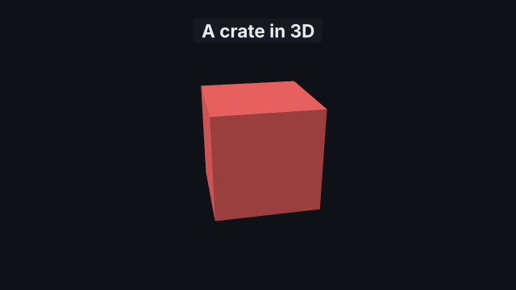
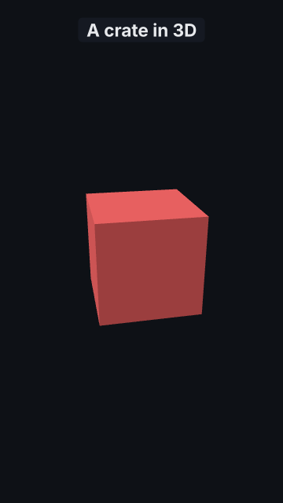
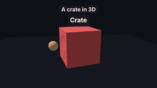
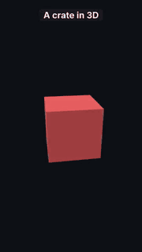

# `3d`

<!-- Generated by `vidgen gallery`; edit the sample in AGENTS.md (or video.yaml), not this file. -->

**Use it for:** simple 3D: objects seen by a camera, turning (needs the `3d` extra).

Objects in 3D (a box for now) seen by a fixed camera with one default light (ambient + sun) over a background colour. The picture fills the frame from the first frame and keeps moving (`spin`) through every beat; beat 1 fades the title in; the scene fades out at the end. Frames are drawn by three.js in headless Chromium (`pip install "schu-video-generator[3d]"` and `python -m playwright install chromium`).

Last beat, 16:9 and 9:16:

 

The scene playing (GIF, up to its last beat):

 

## YAML

From the author guide (`vidgen guide scenes`):

```yaml
- id: crate
  type: 3d
  params:
    title: "A crate in 3D"
    objects:
      - {id: crate, shape: box, size: [1.6, 1.6, 1.6], color: accent, rotation: [0, 20, 0], spin: [0, 30, 0]}
  beats: [{text: "A crate turns slowly in front of the camera."}]
```

## Params

| param | type | default | notes |
|---|---|---|---|
| `title` | `str` |  | Heading over the 3D picture (on a plate at the top). (also: heading) |
| `background` | `color \| None` |  | Colour behind the objects (theme token or #hex; default: the theme's background). |
| `camera` | `Camera3D` | `Camera3D(position=(3.0, 2.5, 5.0), look_at=(0.0, 0.0, 0.0), fov=40.0)` | The fixed camera: {position, look_at, fov}. |
| `camera.position` | `tuple[float, float, float]` | `(3.0, 2.5, 5.0)` | [x, y, z] of the camera (scene units, y up). |
| `camera.look_at` | `tuple[float, float, float]` | `(0.0, 0.0, 0.0)` | [x, y, z] the camera looks at (the middle of the frame). |
| `camera.fov` | `float` | `40.0` | Field of view in degrees across the frame's shorter side (the same subject fills 16:9 and 9:16 alike). |
| `light` | `Light3D` | `Light3D(ambient=0.5, sun=2.5, sun_from=(-2.0, 6.0, 4.0), color='#ffffff')` | The default light: {ambient, sun, sun_from, color}. |
| `light.ambient` | `float` | `0.5` | Strength of the even light from everywhere (0 = none). |
| `light.sun` | `float` | `2.5` | Strength of the sun (0 = none). |
| `light.sun_from` | `tuple[float, float, float]` | `(-2.0, 6.0, 4.0)` | [x, y, z]: the sun shines from this direction towards the origin. |
| `light.color` | `color` | `'#ffffff'` | Colour of both lights. |
| `objects` | `list[Object3D]` |  | The objects: [{id, shape, size, color, position, rotation, spin}]. |
| `objects.id` | `str` | required | Name of the object (letters, digits, _ and -); later actions and guide passes use it. |
| `objects.shape` | `str` | `'box'` | box. |
| `objects.size` | `tuple[float, float, float]` | `(1.0, 1.0, 1.0)` | [width, height, depth] in scene units. |
| `objects.color` | `color` | `'accent'` | Colour (theme token or #hex). |
| `objects.position` | `tuple[float, float, float]` | `(0.0, 0.0, 0.0)` | [x, y, z] of the object's centre. |
| `objects.rotation` | `tuple[float, float, float]` | `(0.0, 0.0, 0.0)` | [x, y, z] rotation in degrees (applied in that order). |
| `objects.spin` | `tuple[float, float, float]` | `(0.0, 0.0, 0.0)` | [x, y, z] degrees per second it keeps turning through the scene (0 = still). |

## Targets

`view`, `title`

## Beats

Any number.

[All scene types](README.md) · `vidgen list-scenes` · `vidgen schema --scene 3d`
