# Scene gallery

<!-- Generated by `vidgen gallery`; do not edit. -->

Every vidgen scene type, rendered from its sample in the author guide (`AGENTS.md`,
`vidgen guide scenes`). The previews are animated: each GIF plays the scene at 16:9 and
9:16 and holds its last beat (viewers who ask for reduced motion see that still instead).
Each page has the YAML, the params, the action targets and the stills. The cartoon sections
end with showcases, small scenes written for the gallery, each a whole `video.yaml`.
Regenerate with `vidgen gallery`.

## Text and structure

| type | preview | use it for |
|---|---|---|
| [`title`](title.md) | <a href="title.md"><picture><source media="(prefers-reduced-motion: reduce)" srcset="media/title-16x9.png">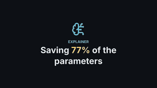</picture></a> <a href="title.md"><picture><source media="(prefers-reduced-motion: reduce)" srcset="media/title-9x16.png">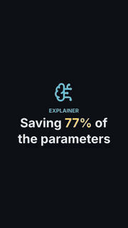</picture></a> | the title, who made it |
| [`chapter`](chapter.md) | <a href="chapter.md"><picture><source media="(prefers-reduced-motion: reduce)" srcset="media/chapter-16x9.png">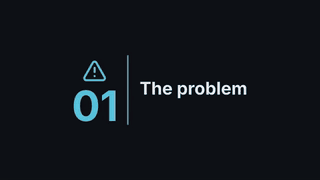</picture></a> <a href="chapter.md"><picture><source media="(prefers-reduced-motion: reduce)" srcset="media/chapter-9x16.png">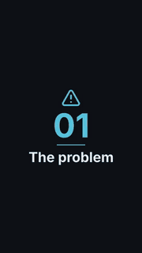</picture></a> | a new section |
| [`text_card`](text_card.md) | <a href="text_card.md"><picture><source media="(prefers-reduced-motion: reduce)" srcset="media/text_card-16x9.png">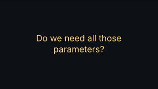</picture></a> <a href="text_card.md"><picture><source media="(prefers-reduced-motion: reduce)" srcset="media/text_card-9x16.png">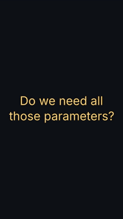</picture></a> | one statement or question, big |
| [`bullets`](bullets.md) | <a href="bullets.md"><picture><source media="(prefers-reduced-motion: reduce)" srcset="media/bullets-16x9.png">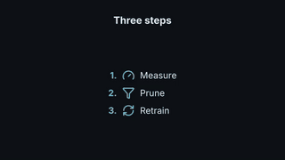</picture></a> <a href="bullets.md"><picture><source media="(prefers-reduced-motion: reduce)" srcset="media/bullets-9x16.png">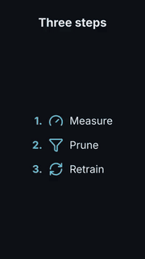</picture></a> | a few points, in order |
| [`icon_grid`](icon_grid.md) | <a href="icon_grid.md"><picture><source media="(prefers-reduced-motion: reduce)" srcset="media/icon_grid-16x9.png">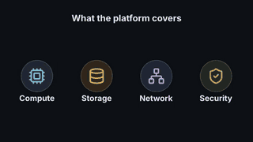</picture></a> <a href="icon_grid.md"><picture><source media="(prefers-reduced-motion: reduce)" srcset="media/icon_grid-9x16.png">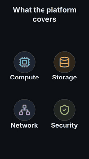</picture></a> | a set of things (features, parts, options) |
| [`comparison`](comparison.md) | <a href="comparison.md"><picture><source media="(prefers-reduced-motion: reduce)" srcset="media/comparison-16x9.png">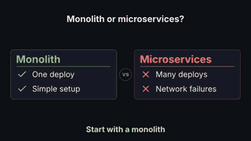</picture></a> <a href="comparison.md"><picture><source media="(prefers-reduced-motion: reduce)" srcset="media/comparison-9x16.png"></picture></a> | A vs B, before / after, pros / cons |
| [`table`](table.md) | <a href="table.md"><picture><source media="(prefers-reduced-motion: reduce)" srcset="media/table-16x9.png">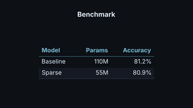</picture></a> <a href="table.md"><picture><source media="(prefers-reduced-motion: reduce)" srcset="media/table-9x16.png">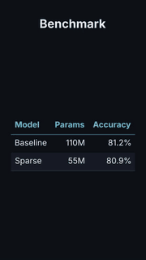</picture></a> | exact values to compare across attributes |
| [`timeline`](timeline.md) | <a href="timeline.md"><picture><source media="(prefers-reduced-motion: reduce)" srcset="media/timeline-16x9.png">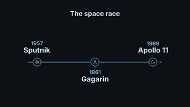</picture></a> <a href="timeline.md"><picture><source media="(prefers-reduced-motion: reduce)" srcset="media/timeline-9x16.png">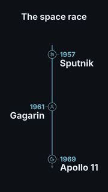</picture></a> | what happened when |
| [`end_card`](end_card.md) | <a href="end_card.md"><picture><source media="(prefers-reduced-motion: reduce)" srcset="media/end_card-16x9.png"></picture></a> <a href="end_card.md"><picture><source media="(prefers-reduced-motion: reduce)" srcset="media/end_card-9x16.png">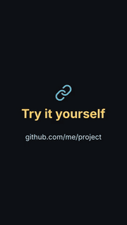</picture></a> | thanks, links, call to action |

## Flows

| type | preview | use it for |
|---|---|---|
| [`diagram`](diagram.md) | <a href="diagram.md"><picture><source media="(prefers-reduced-motion: reduce)" srcset="media/diagram-16x9.png">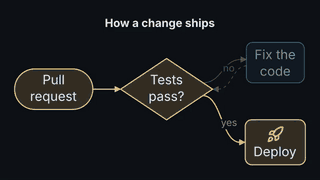</picture></a> <a href="diagram.md"><picture><source media="(prefers-reduced-motion: reduce)" srcset="media/diagram-9x16.png">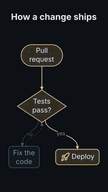</picture></a> | how parts connect, decisions, architecture |
| `flowchart` | same type as [`diagram`](diagram.md) | how parts connect, decisions, architecture |
| [`process`](process.md) | <a href="process.md"><picture><source media="(prefers-reduced-motion: reduce)" srcset="media/process-16x9.png">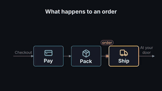</picture></a> <a href="process.md"><picture><source media="(prefers-reduced-motion: reduce)" srcset="media/process-9x16.png">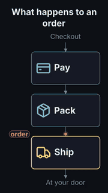</picture></a> | something moving through stages |
| [`network`](network.md) | <a href="network.md"><picture><source media="(prefers-reduced-motion: reduce)" srcset="media/network-16x9.png">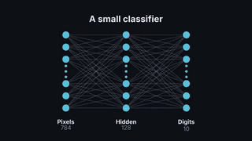</picture></a> <a href="network.md"><picture><source media="(prefers-reduced-motion: reduce)" srcset="media/network-9x16.png">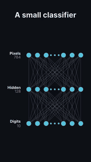</picture></a> | a neural network |
| [`iso_diagram`](iso_diagram.md) | <a href="iso_diagram.md"><picture><source media="(prefers-reduced-motion: reduce)" srcset="media/iso_diagram-16x9.png"></picture></a> <a href="iso_diagram.md"><picture><source media="(prefers-reduced-motion: reduce)" srcset="media/iso_diagram-9x16.png">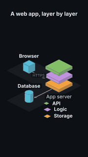</picture></a> | architecture in 3D: servers, databases, layered stacks, data flow (isometric blocks) |

## Data

| type | preview | use it for |
|---|---|---|
| [`stat`](stat.md) | <a href="stat.md"><picture><source media="(prefers-reduced-motion: reduce)" srcset="media/stat-16x9.png">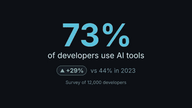</picture></a> <a href="stat.md"><picture><source media="(prefers-reduced-motion: reduce)" srcset="media/stat-9x16.png">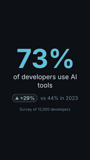</picture></a> | one number that matters |
| [`bar_chart`](bar_chart.md) | <a href="bar_chart.md"><picture><source media="(prefers-reduced-motion: reduce)" srcset="media/bar_chart-16x9.png">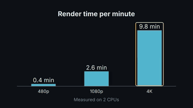</picture></a> <a href="bar_chart.md"><picture><source media="(prefers-reduced-motion: reduce)" srcset="media/bar_chart-9x16.png">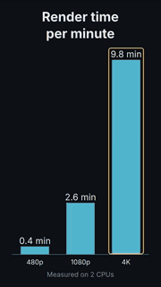</picture></a> | categories compared by size |
| [`line_chart`](line_chart.md) | <a href="line_chart.md"><picture><source media="(prefers-reduced-motion: reduce)" srcset="media/line_chart-16x9.png">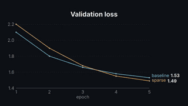</picture></a> <a href="line_chart.md"><picture><source media="(prefers-reduced-motion: reduce)" srcset="media/line_chart-9x16.png">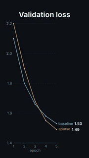</picture></a> | change over time, trends |
| [`scatter`](scatter.md) | <a href="scatter.md"><picture><source media="(prefers-reduced-motion: reduce)" srcset="media/scatter-16x9.png">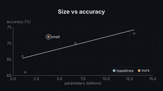</picture></a> <a href="scatter.md"><picture><source media="(prefers-reduced-motion: reduce)" srcset="media/scatter-9x16.png">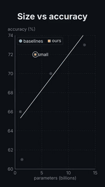</picture></a> | a relationship between two measures |
| [`histogram`](histogram.md) | <a href="histogram.md"><picture><source media="(prefers-reduced-motion: reduce)" srcset="media/histogram-16x9.png">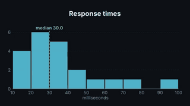</picture></a> <a href="histogram.md"><picture><source media="(prefers-reduced-motion: reduce)" srcset="media/histogram-9x16.png">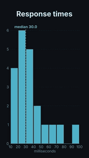</picture></a> | how values are distributed |
| [`pie`](pie.md) | <a href="pie.md"><picture><source media="(prefers-reduced-motion: reduce)" srcset="media/pie-16x9.png">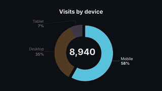</picture></a> <a href="pie.md"><picture><source media="(prefers-reduced-motion: reduce)" srcset="media/pie-9x16.png">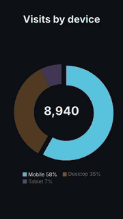</picture></a> | parts of a whole (≤ 6 parts) |
| [`heatmap`](heatmap.md) | <a href="heatmap.md"><picture><source media="(prefers-reduced-motion: reduce)" srcset="media/heatmap-16x9.png">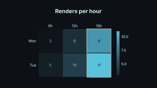</picture></a> <a href="heatmap.md"><picture><source media="(prefers-reduced-motion: reduce)" srcset="media/heatmap-9x16.png">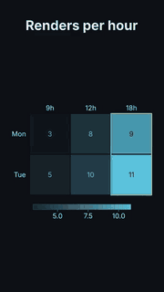</picture></a> | a matrix (correlations, hours x days) |
| [`map`](map.md) | <a href="map.md"><picture><source media="(prefers-reduced-motion: reduce)" srcset="media/map-16x9.png">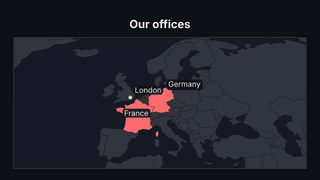</picture></a> <a href="map.md"><picture><source media="(prefers-reduced-motion: reduce)" srcset="media/map-9x16.png">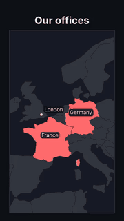</picture></a> | where in the world |

## Pictures and media

| type | preview | use it for |
|---|---|---|
| [`image`](image.md) | <a href="image.md"><picture><source media="(prefers-reduced-motion: reduce)" srcset="media/image-16x9.png">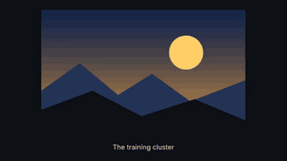</picture></a> <a href="image.md"><picture><source media="(prefers-reduced-motion: reduce)" srcset="media/image-9x16.png">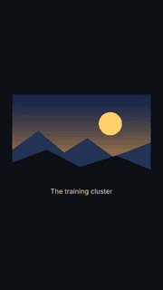</picture></a> | a photo or illustration |
| [`screenshot`](screenshot.md) | <a href="screenshot.md"><picture><source media="(prefers-reduced-motion: reduce)" srcset="media/screenshot-16x9.png">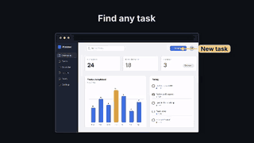</picture></a> <a href="screenshot.md"><picture><source media="(prefers-reduced-motion: reduce)" srcset="media/screenshot-9x16.png">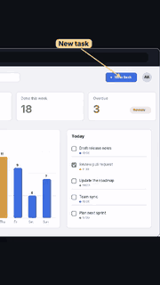</picture></a> | a user interface, a web page |
| [`video_clip`](video_clip.md) | <a href="video_clip.md"><picture><source media="(prefers-reduced-motion: reduce)" srcset="media/video_clip-16x9.png">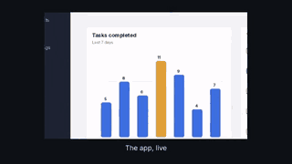</picture></a> <a href="video_clip.md"><picture><source media="(prefers-reduced-motion: reduce)" srcset="media/video_clip-9x16.png">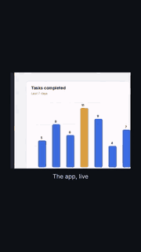</picture></a> | footage, a screen recording |
| [`quote`](quote.md) | <a href="quote.md"><picture><source media="(prefers-reduced-motion: reduce)" srcset="media/quote-16x9.png">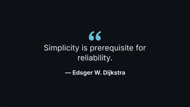</picture></a> <a href="quote.md"><picture><source media="(prefers-reduced-motion: reduce)" srcset="media/quote-9x16.png">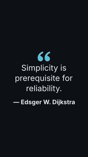</picture></a> | a quotation |

## Maths and code

| type | preview | use it for |
|---|---|---|
| [`equation`](equation.md) | <a href="equation.md"><picture><source media="(prefers-reduced-motion: reduce)" srcset="media/equation-16x9.png">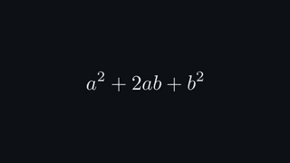</picture></a> <a href="equation.md"><picture><source media="(prefers-reduced-motion: reduce)" srcset="media/equation-9x16.png">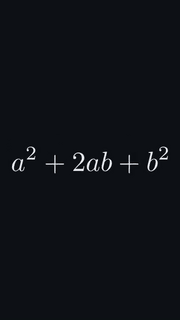</picture></a> | a formula that transforms |
| [`equation_derivation`](equation_derivation.md) | <a href="equation_derivation.md"><picture><source media="(prefers-reduced-motion: reduce)" srcset="media/equation_derivation-16x9.png">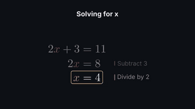</picture></a> <a href="equation_derivation.md"><picture><source media="(prefers-reduced-motion: reduce)" srcset="media/equation_derivation-9x16.png"></picture></a> | a derivation with reasons |
| [`function_plot`](function_plot.md) | <a href="function_plot.md"><picture><source media="(prefers-reduced-motion: reduce)" srcset="media/function_plot-16x9.png"></picture></a> <a href="function_plot.md"><picture><source media="(prefers-reduced-motion: reduce)" srcset="media/function_plot-9x16.png"></picture></a> | a function's graph: slope, tangent, area under a curve |
| [`number_line`](number_line.md) | <a href="number_line.md"><picture><source media="(prefers-reduced-motion: reduce)" srcset="media/number_line-16x9.png"></picture></a> <a href="number_line.md"><picture><source media="(prefers-reduced-motion: reduce)" srcset="media/number_line-9x16.png"></picture></a> | a number line: points, intervals, jumps (+3) |
| [`code`](code.md) | <a href="code.md"><picture><source media="(prefers-reduced-motion: reduce)" srcset="media/code-16x9.png"></picture></a> <a href="code.md"><picture><source media="(prefers-reduced-motion: reduce)" srcset="media/code-9x16.png"></picture></a> | a short listing (≤ 15 lines) |
| [`code_morph`](code_morph.md) | <a href="code_morph.md"><picture><source media="(prefers-reduced-motion: reduce)" srcset="media/code_morph-16x9.png"></picture></a> <a href="code_morph.md"><picture><source media="(prefers-reduced-motion: reduce)" srcset="media/code_morph-9x16.png"></picture></a> | code that changes: before / after, a refactor, a fix |
| [`terminal`](terminal.md) | <a href="terminal.md"><picture><source media="(prefers-reduced-motion: reduce)" srcset="media/terminal-16x9.png"></picture></a> <a href="terminal.md"><picture><source media="(prefers-reduced-motion: reduce)" srcset="media/terminal-9x16.png"></picture></a> | running a command: install, tests, a REPL (output written by you) |
| [`code_walkthrough`](code_walkthrough.md) | <a href="code_walkthrough.md"><picture><source media="(prefers-reduced-motion: reduce)" srcset="media/code_walkthrough-16x9.png"></picture></a> <a href="code_walkthrough.md"><picture><source media="(prefers-reduced-motion: reduce)" srcset="media/code_walkthrough-9x16.png"></picture></a> | a long file, explained part by part |

## 2D cartoons

| type or showcase | preview | use it for |
|---|---|---|
| [`stage`](stage.md) | <a href="stage.md"><picture><source media="(prefers-reduced-motion: reduce)" srcset="media/stage-16x9.png"></picture></a> <a href="stage.md"><picture><source media="(prefers-reduced-motion: reduce)" srcset="media/stage-9x16.png"></picture></a> | characters on a set (a cartoon) |
| [`card`](card.md) | <a href="card.md"><picture><source media="(prefers-reduced-motion: reduce)" srcset="media/card-16x9.png"></picture></a> <a href="card.md"><picture><source media="(prefers-reduced-motion: reduce)" srcset="media/card-9x16.png"></picture></a> | a cartoon's title card, "Later that day…", "The End" |
| [A talk in the living room](talk_in_a_room.md) | <a href="talk_in_a_room.md"><picture><source media="(prefers-reduced-motion: reduce)" srcset="media/talk_in_a_room-16x9.png"></picture></a> <a href="talk_in_a_room.md"><picture><source media="(prefers-reduced-motion: reduce)" srcset="media/talk_in_a_room-9x16.png"></picture></a> | a dialogue on a furnished set, with a close-up on the punchline |
| [Passing in the park](walk_in_depth.md) | <a href="walk_in_depth.md"><picture><source media="(prefers-reduced-motion: reduce)" srcset="media/walk_in_depth-16x9.png"></picture></a> <a href="walk_in_depth.md"><picture><source media="(prefers-reduced-motion: reduce)" srcset="media/walk_in_depth-9x16.png"></picture></a> | characters walking towards and away from the camera, passing in front of each other |
| [Rain at nightfall](rainy_evening.md) | <a href="rainy_evening.md"><picture><source media="(prefers-reduced-motion: reduce)" srcset="media/rainy_evening-16x9.png"></picture></a> <a href="rainy_evening.md"><picture><source media="(prefers-reduced-motion: reduce)" srcset="media/rainy_evening-9x16.png"></picture></a> | weather and evening light outdoors: rain and puddles, the sun going down, a street lamp, an umbrella |
| [A jump for a star](star_jump.md) | <a href="star_jump.md"><picture><source media="(prefers-reduced-motion: reduce)" srcset="media/star_jump-16x9.png"></picture></a> <a href="star_jump.md"><picture><source media="(prefers-reduced-motion: reduce)" srcset="media/star_jump-9x16.png"></picture></a> | a platform level: run to the edge, jump the gap, catch a star |

## Isometric cartoons

A whole isometric story, a village by a stream, a room, rain and a lamp at night: [Hazel and the Lamp by the Bridge](../../examples/iso-story/video.yaml) (`examples/iso-story`).

| showcase | preview | use it for |
|---|---|---|
| [Morning in the village](iso_village.md) | <a href="iso_village.md"><picture><source media="(prefers-reduced-motion: reduce)" srcset="media/iso_village-16x9.png"></picture></a> <a href="iso_village.md"><picture><source media="(prefers-reduced-motion: reduce)" srcset="media/iso_village-9x16.png"></picture></a> | a sunny isometric village where two characters walk to meet |
| [A cut-away room](iso_room.md) | <a href="iso_room.md"><picture><source media="(prefers-reduced-motion: reduce)" srcset="media/iso_room-16x9.png"></picture></a> <a href="iso_room.md"><picture><source media="(prefers-reduced-motion: reduce)" srcset="media/iso_room-9x16.png"></picture></a> | an isometric room seen like a dollhouse: furniture, a thing to pick up |
| [Lighting the lamp](iso_lamp.md) | <a href="iso_lamp.md"><picture><source media="(prefers-reduced-motion: reduce)" srcset="media/iso_lamp-16x9.png"></picture></a> <a href="iso_lamp.md"><picture><source media="(prefers-reduced-motion: reduce)" srcset="media/iso_lamp-9x16.png"></picture></a> | night on an isometric place: a lamp lit, a speaker's name tag |
| [First snow](iso_snow.md) | <a href="iso_snow.md"><picture><source media="(prefers-reduced-motion: reduce)" srcset="media/iso_snow-16x9.png"></picture></a> <a href="iso_snow.md"><picture><source media="(prefers-reduced-motion: reduce)" srcset="media/iso_snow-9x16.png"></picture></a> | snow settling on an isometric village: the ground, roofs and trees turn white |
