# Scene gallery

<!-- Generated by `vidgen gallery`; do not edit. -->

Every vidgen scene type, rendered from its sample in the author guide (`AGENTS.md`,
`vidgen guide scenes`). The previews are animated: each GIF plays the scene at 16:9 and
9:16 and holds its last beat (viewers who ask for reduced motion see that still instead).
Each page has the YAML, the params, the action targets and the stills. The cell-biology and
cartoon sections end with showcases, small scenes written for the gallery, each a whole `video.yaml`.
Regenerate with `vidgen gallery`.

## Text and structure

| type | preview | use it for |
|---|---|---|
| [`title`](title.md) | <a href="title.md"><picture><source media="(prefers-reduced-motion: reduce)" srcset="media/title-16x9.png"></picture></a> <a href="title.md"><picture><source media="(prefers-reduced-motion: reduce)" srcset="media/title-9x16.png"></picture></a> | the title, who made it |
| [`chapter`](chapter.md) | <a href="chapter.md"><picture><source media="(prefers-reduced-motion: reduce)" srcset="media/chapter-16x9.png"></picture></a> <a href="chapter.md"><picture><source media="(prefers-reduced-motion: reduce)" srcset="media/chapter-9x16.png"></picture></a> | a new section |
| [`text_card`](text_card.md) | <a href="text_card.md"><picture><source media="(prefers-reduced-motion: reduce)" srcset="media/text_card-16x9.png"></picture></a> <a href="text_card.md"><picture><source media="(prefers-reduced-motion: reduce)" srcset="media/text_card-9x16.png"></picture></a> | one statement or question, big |
| [`bullets`](bullets.md) | <a href="bullets.md"><picture><source media="(prefers-reduced-motion: reduce)" srcset="media/bullets-16x9.png"></picture></a> <a href="bullets.md"><picture><source media="(prefers-reduced-motion: reduce)" srcset="media/bullets-9x16.png"></picture></a> | a few points, in order |
| [`icon_grid`](icon_grid.md) | <a href="icon_grid.md"><picture><source media="(prefers-reduced-motion: reduce)" srcset="media/icon_grid-16x9.png"></picture></a> <a href="icon_grid.md"><picture><source media="(prefers-reduced-motion: reduce)" srcset="media/icon_grid-9x16.png"></picture></a> | a set of things (features, parts, options) |
| [`comparison`](comparison.md) | <a href="comparison.md"><picture><source media="(prefers-reduced-motion: reduce)" srcset="media/comparison-16x9.png"></picture></a> <a href="comparison.md"><picture><source media="(prefers-reduced-motion: reduce)" srcset="media/comparison-9x16.png"></picture></a> | A vs B, before / after, pros / cons |
| [`table`](table.md) | <a href="table.md"><picture><source media="(prefers-reduced-motion: reduce)" srcset="media/table-16x9.png"></picture></a> <a href="table.md"><picture><source media="(prefers-reduced-motion: reduce)" srcset="media/table-9x16.png"></picture></a> | exact values to compare across attributes |
| [`timeline`](timeline.md) | <a href="timeline.md"><picture><source media="(prefers-reduced-motion: reduce)" srcset="media/timeline-16x9.png"></picture></a> <a href="timeline.md"><picture><source media="(prefers-reduced-motion: reduce)" srcset="media/timeline-9x16.png"></picture></a> | what happened when |
| [`end_card`](end_card.md) | <a href="end_card.md"><picture><source media="(prefers-reduced-motion: reduce)" srcset="media/end_card-16x9.png"></picture></a> <a href="end_card.md"><picture><source media="(prefers-reduced-motion: reduce)" srcset="media/end_card-9x16.png"></picture></a> | thanks, links, call to action |

## Flows

| type | preview | use it for |
|---|---|---|
| [`diagram`](diagram.md) | <a href="diagram.md"><picture><source media="(prefers-reduced-motion: reduce)" srcset="media/diagram-16x9.png"></picture></a> <a href="diagram.md"><picture><source media="(prefers-reduced-motion: reduce)" srcset="media/diagram-9x16.png"></picture></a> | how parts connect, decisions, architecture |
| `flowchart` | same type as [`diagram`](diagram.md) | how parts connect, decisions, architecture |
| [`process`](process.md) | <a href="process.md"><picture><source media="(prefers-reduced-motion: reduce)" srcset="media/process-16x9.png"></picture></a> <a href="process.md"><picture><source media="(prefers-reduced-motion: reduce)" srcset="media/process-9x16.png"></picture></a> | something moving through stages |
| [`network`](network.md) | <a href="network.md"><picture><source media="(prefers-reduced-motion: reduce)" srcset="media/network-16x9.png"></picture></a> <a href="network.md"><picture><source media="(prefers-reduced-motion: reduce)" srcset="media/network-9x16.png"></picture></a> | a neural network |
| [`iso_diagram`](iso_diagram.md) | <a href="iso_diagram.md"><picture><source media="(prefers-reduced-motion: reduce)" srcset="media/iso_diagram-16x9.png"></picture></a> <a href="iso_diagram.md"><picture><source media="(prefers-reduced-motion: reduce)" srcset="media/iso_diagram-9x16.png"></picture></a> | architecture in 3D: servers, databases, layered stacks, data flow (isometric blocks) |

## Cell biology

A whole lecture-style video, a protein's route from its gene to the blood through every scene type here: [From gene to secreted protein](../../examples/gene-to-secreted-protein/README.md) (`examples/gene-to-secreted-protein`). How to make them accurate and well paced: [the cell-biology cookbook](../COOKBOOK-CELL-BIOLOGY.md).

| type or showcase | preview | use it for |
|---|---|---|
| [`cell`](cell.md) | <a href="cell.md"><picture><source media="(prefers-reduced-motion: reduce)" srcset="media/cell-16x9.png">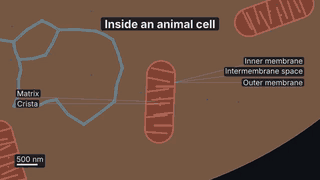</picture></a> <a href="cell.md"><picture><source media="(prefers-reduced-motion: reduce)" srcset="media/cell-9x16.png">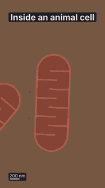</picture></a> | a cell in true scale: organelles, membranes, ribosomes; zooming from tissue to one molecule (cell biology) |
| [`molecule`](molecule.md) | <a href="molecule.md"><picture><source media="(prefers-reduced-motion: reduce)" srcset="media/molecule-16x9.png"></picture></a> <a href="molecule.md"><picture><source media="(prefers-reduced-motion: reduce)" srcset="media/molecule-9x16.png"></picture></a> | molecules up close: DNA, RNAs, nucleosomes, receptors, channels, pumps, ATP synthase, ions (nm, notation checked); transport, diffusion, osmosis, action potentials |
| [`pathway`](pathway.md) | <a href="pathway.md"><picture><source media="(prefers-reduced-motion: reduce)" srcset="media/pathway-16x9.png">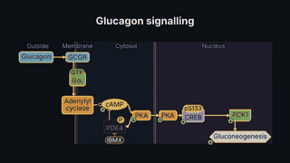</picture></a> <a href="pathway.md"><picture><source media="(prefers-reduced-motion: reduce)" srcset="media/pathway-9x16.png">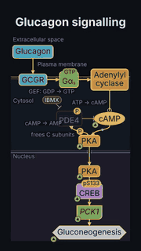</picture></a> | a signalling pathway: ligands, receptors, kinase cascades, second messengers, genes, in compartment bands, SBGN-style (arrows, T-bars, P marks); a signal spreading, inhibitors, knockouts, drugs |
| [`cell_cycle`](cell_cycle.md) | <a href="cell_cycle.md"><picture><source media="(prefers-reduced-motion: reduce)" srcset="media/cell_cycle-16x9.png">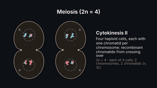</picture></a> <a href="cell_cycle.md"><picture><source media="(prefers-reduced-motion: reduce)" srcset="media/cell_cycle-9x16.png">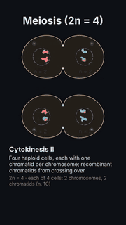</picture></a> | the cell cycle with its checkpoints and cyclin–CDK levels; mitosis and meiosis with counted chromosomes, crossing over and four haploid cells |
| [`metabolism`](metabolism.md) | <a href="metabolism.md"><picture><source media="(prefers-reduced-motion: reduce)" srcset="media/metabolism-16x9.png">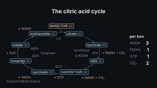</picture></a> <a href="metabolism.md"><picture><source media="(prefers-reduced-motion: reduce)" srcset="media/metabolism-9x16.png">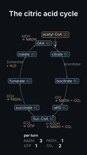</picture></a> | energy metabolism: glycolysis, pyruvate oxidation, the citric acid cycle, the electron transport chain and ATP synthase, the light reactions; flows animated, products counted |
| [Inside a plant cell](plant_cell.md) | <a href="plant_cell.md"><picture><source media="(prefers-reduced-motion: reduce)" srcset="media/plant_cell-16x9.png">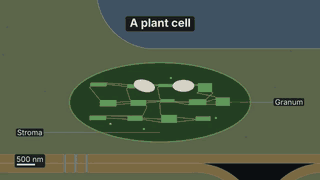</picture></a> <a href="plant_cell.md"><picture><source media="(prefers-reduced-motion: reduce)" srcset="media/plant_cell-9x16.png">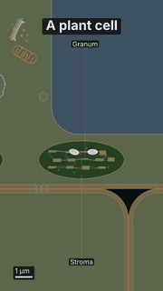</picture></a> | a plant cell's wall, vacuole and chloroplasts, then a zoom into one chloroplast's grana |
| [The sodium pump](sodium_pump.md) | <a href="sodium_pump.md"><picture><source media="(prefers-reduced-motion: reduce)" srcset="media/sodium_pump-16x9.png">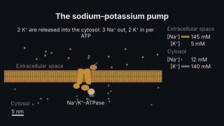</picture></a> <a href="sodium_pump.md"><picture><source media="(prefers-reduced-motion: reduce)" srcset="media/sodium_pump-9x16.png">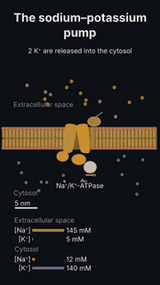</picture></a> | a membrane pump's cycle: 3 Na⁺ out and 2 K⁺ in per ATP, against their gradients |
| [Blocking MEK](mek_inhibitor.md) | <a href="mek_inhibitor.md"><picture><source media="(prefers-reduced-motion: reduce)" srcset="media/mek_inhibitor-16x9.png">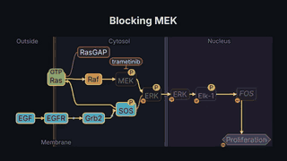</picture></a> <a href="mek_inhibitor.md"><picture><source media="(prefers-reduced-motion: reduce)" srcset="media/mek_inhibitor-9x16.png">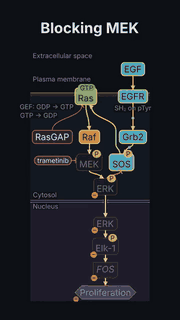</picture></a> | a signal running down the MAPK cascade, then a drug that blocks MEK and its effects downstream |
| [Mitosis](mitosis.md) | <a href="mitosis.md"><picture><source media="(prefers-reduced-motion: reduce)" srcset="media/mitosis-16x9.png">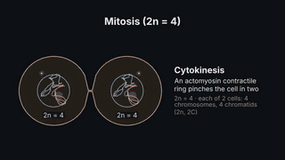</picture></a> <a href="mitosis.md"><picture><source media="(prefers-reduced-motion: reduce)" srcset="media/mitosis-9x16.png">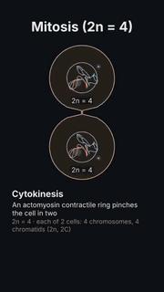</picture></a> | a dividing cell: condensation, the metaphase plate, sister chromatids parting, two daughter cells |
| [The respiratory chain](respiratory_chain.md) | <a href="respiratory_chain.md"><picture><source media="(prefers-reduced-motion: reduce)" srcset="media/respiratory_chain-16x9.png">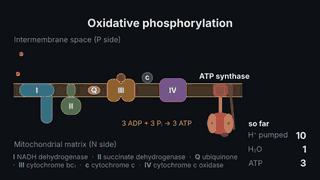</picture></a> <a href="respiratory_chain.md"><picture><source media="(prefers-reduced-motion: reduce)" srcset="media/respiratory_chain-9x16.png">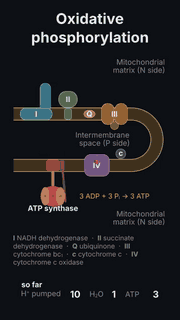</picture></a> | electrons down complexes I–IV with protons pumped, then ATP synthase turning |

## Genetics

A whole medical-genetics video, one inherited disease from a family's pedigree to the variant, a carrier test and the population: [Cystic fibrosis: from a family to a diagnosis](../../examples/cystic-fibrosis/README.md) (`examples/cystic-fibrosis`). Notation, exact numbers and counselling tone: [the genetics cookbook](../COOKBOOK-GENETICS.md).

| type | preview | use it for |
|---|---|---|
| [`cross`](cross.md) | <a href="cross.md"><picture><source media="(prefers-reduced-motion: reduce)" srcset="media/cross-16x9.png">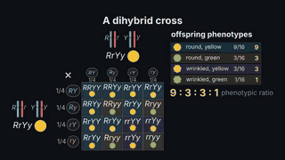</picture></a> <a href="cross.md"><picture><source media="(prefers-reduced-motion: reduce)" srcset="media/cross-9x16.png">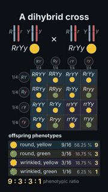</picture></a> | a genetic cross: Punnett square or branch diagram, gametes, genotype and phenotype ratios (mono-, di-, trihybrid, test, reciprocal, P → F1 → F2, dominance, epistasis, lethal 2:1, X-linked, linked genes), a chi-square test |
| [`pedigree`](pedigree.md) | <a href="pedigree.md"><picture><source media="(prefers-reduced-motion: reduce)" srcset="media/pedigree-16x9.png">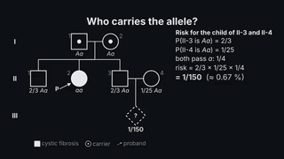</picture></a> <a href="pedigree.md"><picture><source media="(prefers-reduced-motion: reduce)" srcset="media/pedigree-9x16.png">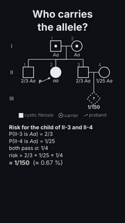</picture></a> | a family pedigree in standard (NSGC) symbols: affected, carriers, deceased, proband, twins, consanguinity; which modes of inheritance fit and why the others are excluded, deduced genotypes, carrier probabilities, the risk for a child |
| [`linkage_map`](linkage_map.md) | <a href="linkage_map.md"><picture><source media="(prefers-reduced-motion: reduce)" srcset="media/linkage_map-16x9.png">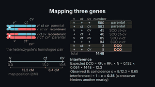</picture></a> <a href="linkage_map.md"><picture><source media="(prefers-reduced-motion: reduce)" srcset="media/linkage_map-9x16.png">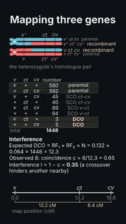</picture></a> | linked genes and genetic maps: crossing over between homologues (coupling / repulsion), a two- or three-point test cross worked out from offspring counts (parental and double-crossover classes, gene order, distances in cM, coincidence and interference), map functions |
| [`karyotype`](karyotype.md) | <a href="karyotype.md"><picture><source media="(prefers-reduced-motion: reduce)" srcset="media/karyotype-16x9.png">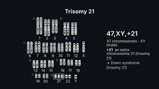</picture></a> <a href="karyotype.md"><picture><source media="(prefers-reduced-motion: reduce)" srcset="media/karyotype-9x16.png">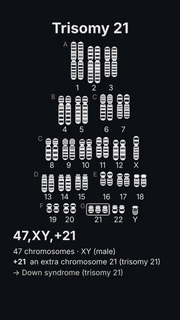</picture></a> | a human karyotype from its ISCN notation (47,XX,+21; 45,X; 46,XY,del(5)(p15.2); t(9;22); rob(14;21)): a karyogram by groups A–G with G-banded ideograms and the change highlighted, or the chromosomes involved with structural changes played as edits |
| [`mutation`](mutation.md) | <a href="mutation.md"><picture><source media="(prefers-reduced-motion: reduce)" srcset="media/mutation-16x9.png">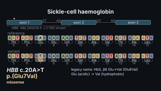</picture></a> <a href="mutation.md"><picture><source media="(prefers-reduced-motion: reduce)" srcset="media/mutation-9x16.png">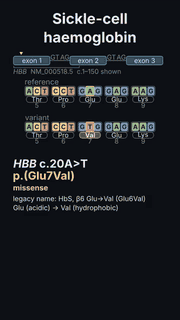</picture></a> | a mutation on a real coding sequence: the reading frame and codons, the variant made from them (substitution, deletion, insertion, frameshift with its premature stop, splice site), the protein change from the genetic code, HGVS c. and p. notation checked |
| [`crispr`](crispr.md) | <a href="crispr.md"><picture><source media="(prefers-reduced-motion: reduce)" srcset="media/crispr-16x9.png">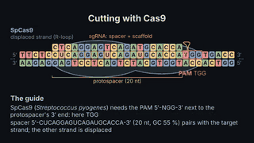</picture></a> <a href="crispr.md"><picture><source media="(prefers-reduced-motion: reduce)" srcset="media/crispr-9x16.png">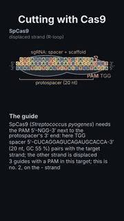</picture></a> | CRISPR–Cas9 editing: the sgRNA's spacer, the PAM, the R-loop, the blunt cut 3 bp from the PAM, and the repair (NHEJ indel or HDR from a donor), written in HGVS on a coding target |
| [`dna_lab`](dna_lab.md) | <a href="dna_lab.md"><picture><source media="(prefers-reduced-motion: reduce)" srcset="media/dna_lab-16x9.png">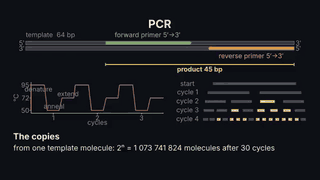</picture></a> <a href="dna_lab.md"><picture><source media="(prefers-reduced-motion: reduce)" srcset="media/dna_lab-9x16.png">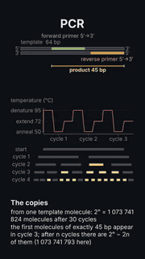</picture></a> | the laboratory: PCR (primers, cycles, 2ⁿ copies), an agarose gel (ladder, migration by size), Sanger sequencing (a chromatogram with called bases) or NGS reads with coverage and a variant call |
| [`population`](population.md) | <a href="population.md"><picture><source media="(prefers-reduced-motion: reduce)" srcset="media/population-16x9.png">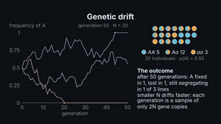</picture></a> <a href="population.md"><picture><source media="(prefers-reduced-motion: reduce)" srcset="media/population-9x16.png">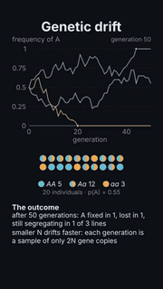</picture></a> | population genetics: Hardy–Weinberg worked with exact numbers (p and q, p² + 2pq + q², carriers from an incidence, a chi-square test of HWE), seeded simulations of drift, selection, mutation, migration, a bottleneck or a founder effect with allele frequencies over generations |
| [`gwas`](gwas.md) | <a href="gwas.md"><picture><source media="(prefers-reduced-motion: reduce)" srcset="media/gwas-16x9.png">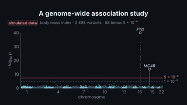</picture></a> <a href="gwas.md"><picture><source media="(prefers-reduced-motion: reduce)" srcset="media/gwas-9x16.png">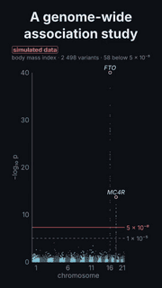</picture></a> | a genome-wide association study: a Manhattan plot with the 5 × 10⁻⁸ line and labelled peaks, a QQ plot with λ_GC, a regional plot of a locus coloured by LD |

## Data

| type | preview | use it for |
|---|---|---|
| [`stat`](stat.md) | <a href="stat.md"><picture><source media="(prefers-reduced-motion: reduce)" srcset="media/stat-16x9.png"></picture></a> <a href="stat.md"><picture><source media="(prefers-reduced-motion: reduce)" srcset="media/stat-9x16.png"></picture></a> | one number that matters |
| [`bar_chart`](bar_chart.md) | <a href="bar_chart.md"><picture><source media="(prefers-reduced-motion: reduce)" srcset="media/bar_chart-16x9.png"></picture></a> <a href="bar_chart.md"><picture><source media="(prefers-reduced-motion: reduce)" srcset="media/bar_chart-9x16.png"></picture></a> | categories compared by size |
| [`line_chart`](line_chart.md) | <a href="line_chart.md"><picture><source media="(prefers-reduced-motion: reduce)" srcset="media/line_chart-16x9.png"></picture></a> <a href="line_chart.md"><picture><source media="(prefers-reduced-motion: reduce)" srcset="media/line_chart-9x16.png"></picture></a> | change over time, trends |
| [`scatter`](scatter.md) | <a href="scatter.md"><picture><source media="(prefers-reduced-motion: reduce)" srcset="media/scatter-16x9.png"></picture></a> <a href="scatter.md"><picture><source media="(prefers-reduced-motion: reduce)" srcset="media/scatter-9x16.png"></picture></a> | a relationship between two measures |
| [`histogram`](histogram.md) | <a href="histogram.md"><picture><source media="(prefers-reduced-motion: reduce)" srcset="media/histogram-16x9.png"></picture></a> <a href="histogram.md"><picture><source media="(prefers-reduced-motion: reduce)" srcset="media/histogram-9x16.png"></picture></a> | how values are distributed |
| [`pie`](pie.md) | <a href="pie.md"><picture><source media="(prefers-reduced-motion: reduce)" srcset="media/pie-16x9.png"></picture></a> <a href="pie.md"><picture><source media="(prefers-reduced-motion: reduce)" srcset="media/pie-9x16.png"></picture></a> | parts of a whole (≤ 6 parts) |
| [`heatmap`](heatmap.md) | <a href="heatmap.md"><picture><source media="(prefers-reduced-motion: reduce)" srcset="media/heatmap-16x9.png"></picture></a> <a href="heatmap.md"><picture><source media="(prefers-reduced-motion: reduce)" srcset="media/heatmap-9x16.png"></picture></a> | a matrix (correlations, hours x days) |
| [`map`](map.md) | <a href="map.md"><picture><source media="(prefers-reduced-motion: reduce)" srcset="media/map-16x9.png"></picture></a> <a href="map.md"><picture><source media="(prefers-reduced-motion: reduce)" srcset="media/map-9x16.png"></picture></a> | where in the world |

## Science charts

A whole physics explainer with plots and calculations, simulated nuclei, counts with a fit, the half-life worked out and carbon-14 dating: [Half-life: how radioactive decay keeps time](../../examples/radioactive-decay/README.md) (`examples/radioactive-decay`). Honest axes, error bars, fits, units and significant figures: [the science-charts cookbook](../COOKBOOK-SCIENCE-CHARTS.md).

| type | preview | use it for |
|---|---|---|
| [`plot`](plot.md) | <a href="plot.md"><picture><source media="(prefers-reduced-motion: reduce)" srcset="media/plot-16x9.png">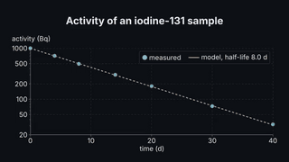</picture></a> <a href="plot.md"><picture><source media="(prefers-reduced-motion: reduce)" srcset="media/plot-9x16.png">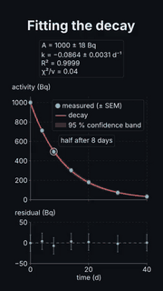</picture></a> | measurements and models on scientific axes: log, symlog, reversed or broken axes with units, 10ⁿ and SI prefixes, panels sharing an axis, orbits at an equal aspect; data inline or from a CSV |
| [`calculation`](calculation.md) | <a href="calculation.md"><picture><source media="(prefers-reduced-motion: reduce)" srcset="media/calculation-16x9.png">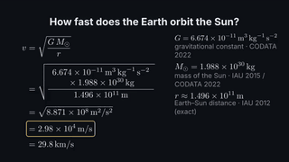</picture></a> <a href="calculation.md"><picture><source media="(prefers-reduced-motion: reduce)" srcset="media/calculation-9x16.png">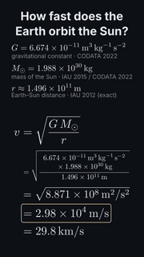</picture></a> | a worked calculation with units and significant figures: a formula, the values put in with their units, the result (orbital speed, half-life, a photon's energy in eV) or an exact probability (2/3 × 1/25 × 1/4 = 1/150); chains of results |

## Orbital mechanics

A whole orbital-mechanics explainer, why a rocket cannot fly straight to Mars, the Hohmann transfer, the transfer time and the departure burn worked out, the planets on a real date: [How to get to Mars](../../examples/mars-transfer/README.md) (`examples/mars-transfer`). Scale honesty, units, approximations to state and pacing: [the orbits cookbook](../COOKBOOK-ORBITS.md).

| type or showcase | preview | use it for |
|---|---|---|
| [`orbit`](orbit.md) | <a href="orbit.md"><picture><source media="(prefers-reduced-motion: reduce)" srcset="media/orbit-16x9.png">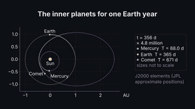</picture></a> <a href="orbit.md"><picture><source media="(prefers-reduced-motion: reduce)" srcset="media/orbit-9x16.png">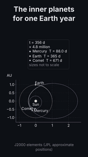</picture></a> | planets, moons, satellites or a comet on their orbits, moving in correct timing (Kepler's laws, the inner planets for a year, the ISS and a geostationary orbit, a flyby); mutual gravity; manoeuvres: burns, Hohmann / bi-elliptic / phasing transfers with their Δv, phase angle and launch windows, a gravity assist; many bodies: Lagrange points and Trojans in the rotating frame, the figure-eight, binary stars, the Io–Europa–Ganymede resonance, tides (a schematic); the Solar System on a date (1800–2050), the next opposition or conjunction, all planets on a log scale, an inset of the inner planets, planet sizes to scale |
| [The Hohmann transfer to Mars](mars_hohmann.md) | <a href="mars_hohmann.md"><picture><source media="(prefers-reduced-motion: reduce)" srcset="media/mars_hohmann-16x9.png">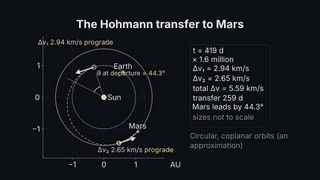</picture></a> <a href="mars_hohmann.md"><picture><source media="(prefers-reduced-motion: reduce)" srcset="media/mars_hohmann-9x16.png">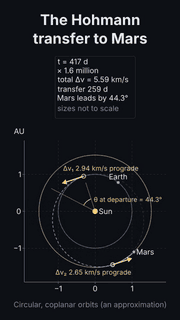</picture></a> | a transfer between two planets: the phase angle at the launch window, two burns on words, the Δv and the time computed |
| [Trojans in the rotating frame](jupiter_trojans.md) | <a href="jupiter_trojans.md"><picture><source media="(prefers-reduced-motion: reduce)" srcset="media/jupiter_trojans-16x9.png">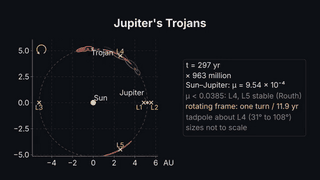</picture></a> <a href="jupiter_trojans.md"><picture><source media="(prefers-reduced-motion: reduce)" srcset="media/jupiter_trojans-9x16.png">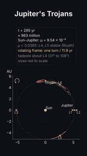</picture></a> | a three-body system in the frame turning with Jupiter: the five Lagrange points standing still, a Trojan's tadpole inside its zero-velocity curve |

## Particle physics

| type | preview | use it for |
|---|---|---|
| [`standard_model`](standard_model.md) | <a href="standard_model.md"><picture><source media="(prefers-reduced-motion: reduce)" srcset="media/standard_model-16x9.png">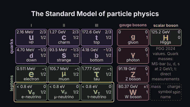</picture></a> <a href="standard_model.md"><picture><source media="(prefers-reduced-motion: reduce)" srcset="media/standard_model-9x16.png">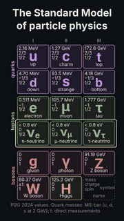</picture></a> | the Standard Model's particles: quarks and leptons in three generations, the gauge bosons and the Higgs boson with their masses (PDG 2024), charges and spins; antiparticles; which bosons couple to which particles |

## Pictures and media

| type | preview | use it for |
|---|---|---|
| [`image`](image.md) | <a href="image.md"><picture><source media="(prefers-reduced-motion: reduce)" srcset="media/image-16x9.png"></picture></a> <a href="image.md"><picture><source media="(prefers-reduced-motion: reduce)" srcset="media/image-9x16.png"></picture></a> | a photo or illustration |
| [`screenshot`](screenshot.md) | <a href="screenshot.md"><picture><source media="(prefers-reduced-motion: reduce)" srcset="media/screenshot-16x9.png"></picture></a> <a href="screenshot.md"><picture><source media="(prefers-reduced-motion: reduce)" srcset="media/screenshot-9x16.png"></picture></a> | a user interface, a web page |
| [`video_clip`](video_clip.md) | <a href="video_clip.md"><picture><source media="(prefers-reduced-motion: reduce)" srcset="media/video_clip-16x9.png"></picture></a> <a href="video_clip.md"><picture><source media="(prefers-reduced-motion: reduce)" srcset="media/video_clip-9x16.png"></picture></a> | footage, a screen recording |
| [`quote`](quote.md) | <a href="quote.md"><picture><source media="(prefers-reduced-motion: reduce)" srcset="media/quote-16x9.png"></picture></a> <a href="quote.md"><picture><source media="(prefers-reduced-motion: reduce)" srcset="media/quote-9x16.png"></picture></a> | a quotation |

## Maths and code

| type | preview | use it for |
|---|---|---|
| [`equation`](equation.md) | <a href="equation.md"><picture><source media="(prefers-reduced-motion: reduce)" srcset="media/equation-16x9.png"></picture></a> <a href="equation.md"><picture><source media="(prefers-reduced-motion: reduce)" srcset="media/equation-9x16.png"></picture></a> | a formula that transforms |
| [`equation_derivation`](equation_derivation.md) | <a href="equation_derivation.md"><picture><source media="(prefers-reduced-motion: reduce)" srcset="media/equation_derivation-16x9.png"></picture></a> <a href="equation_derivation.md"><picture><source media="(prefers-reduced-motion: reduce)" srcset="media/equation_derivation-9x16.png"></picture></a> | a derivation with reasons |
| [`function_plot`](function_plot.md) | <a href="function_plot.md"><picture><source media="(prefers-reduced-motion: reduce)" srcset="media/function_plot-16x9.png"></picture></a> <a href="function_plot.md"><picture><source media="(prefers-reduced-motion: reduce)" srcset="media/function_plot-9x16.png"></picture></a> | a function's graph: slope, tangent, area under a curve |
| [`number_line`](number_line.md) | <a href="number_line.md"><picture><source media="(prefers-reduced-motion: reduce)" srcset="media/number_line-16x9.png"></picture></a> <a href="number_line.md"><picture><source media="(prefers-reduced-motion: reduce)" srcset="media/number_line-9x16.png"></picture></a> | a number line: points, intervals, jumps (+3) |
| [`code`](code.md) | <a href="code.md"><picture><source media="(prefers-reduced-motion: reduce)" srcset="media/code-16x9.png"></picture></a> <a href="code.md"><picture><source media="(prefers-reduced-motion: reduce)" srcset="media/code-9x16.png"></picture></a> | a short listing (≤ 15 lines) |
| [`code_morph`](code_morph.md) | <a href="code_morph.md"><picture><source media="(prefers-reduced-motion: reduce)" srcset="media/code_morph-16x9.png"></picture></a> <a href="code_morph.md"><picture><source media="(prefers-reduced-motion: reduce)" srcset="media/code_morph-9x16.png"></picture></a> | code that changes: before / after, a refactor, a fix |
| [`terminal`](terminal.md) | <a href="terminal.md"><picture><source media="(prefers-reduced-motion: reduce)" srcset="media/terminal-16x9.png"></picture></a> <a href="terminal.md"><picture><source media="(prefers-reduced-motion: reduce)" srcset="media/terminal-9x16.png"></picture></a> | running a command: install, tests, a REPL (output written by you) |
| [`code_walkthrough`](code_walkthrough.md) | <a href="code_walkthrough.md"><picture><source media="(prefers-reduced-motion: reduce)" srcset="media/code_walkthrough-16x9.png"></picture></a> <a href="code_walkthrough.md"><picture><source media="(prefers-reduced-motion: reduce)" srcset="media/code_walkthrough-9x16.png"></picture></a> | a long file, explained part by part |

## 2D cartoons

| type or showcase | preview | use it for |
|---|---|---|
| [`stage`](stage.md) | <a href="stage.md"><picture><source media="(prefers-reduced-motion: reduce)" srcset="media/stage-16x9.png"></picture></a> <a href="stage.md"><picture><source media="(prefers-reduced-motion: reduce)" srcset="media/stage-9x16.png"></picture></a> | characters on a set (a cartoon) |
| [`card`](card.md) | <a href="card.md"><picture><source media="(prefers-reduced-motion: reduce)" srcset="media/card-16x9.png"></picture></a> <a href="card.md"><picture><source media="(prefers-reduced-motion: reduce)" srcset="media/card-9x16.png"></picture></a> | a cartoon's title card, "Later that day…", "The End" |
| [A talk in the living room](talk_in_a_room.md) | <a href="talk_in_a_room.md"><picture><source media="(prefers-reduced-motion: reduce)" srcset="media/talk_in_a_room-16x9.png"></picture></a> <a href="talk_in_a_room.md"><picture><source media="(prefers-reduced-motion: reduce)" srcset="media/talk_in_a_room-9x16.png"></picture></a> | a dialogue on a furnished set, with a close-up on the punchline |
| [Passing in the park](walk_in_depth.md) | <a href="walk_in_depth.md"><picture><source media="(prefers-reduced-motion: reduce)" srcset="media/walk_in_depth-16x9.png"></picture></a> <a href="walk_in_depth.md"><picture><source media="(prefers-reduced-motion: reduce)" srcset="media/walk_in_depth-9x16.png"></picture></a> | characters walking towards and away from the camera, passing in front of each other |
| [Rain at nightfall](rainy_evening.md) | <a href="rainy_evening.md"><picture><source media="(prefers-reduced-motion: reduce)" srcset="media/rainy_evening-16x9.png"></picture></a> <a href="rainy_evening.md"><picture><source media="(prefers-reduced-motion: reduce)" srcset="media/rainy_evening-9x16.png"></picture></a> | weather and evening light outdoors: rain and puddles, the sun going down, a street lamp, an umbrella |
| [A jump for a star](star_jump.md) | <a href="star_jump.md"><picture><source media="(prefers-reduced-motion: reduce)" srcset="media/star_jump-16x9.png"></picture></a> <a href="star_jump.md"><picture><source media="(prefers-reduced-motion: reduce)" srcset="media/star_jump-9x16.png"></picture></a> | a platform level: run to the edge, jump the gap, catch a star |

## Isometric cartoons

A whole isometric story, a village by a stream, a room, rain and a lamp at night: [Hazel and the Lamp by the Bridge](../../examples/iso-story/video.yaml) (`examples/iso-story`).

| showcase | preview | use it for |
|---|---|---|
| [Morning in the village](iso_village.md) | <a href="iso_village.md"><picture><source media="(prefers-reduced-motion: reduce)" srcset="media/iso_village-16x9.png"></picture></a> <a href="iso_village.md"><picture><source media="(prefers-reduced-motion: reduce)" srcset="media/iso_village-9x16.png"></picture></a> | a sunny isometric village where two characters walk to meet |
| [A cut-away room](iso_room.md) | <a href="iso_room.md"><picture><source media="(prefers-reduced-motion: reduce)" srcset="media/iso_room-16x9.png"></picture></a> <a href="iso_room.md"><picture><source media="(prefers-reduced-motion: reduce)" srcset="media/iso_room-9x16.png"></picture></a> | an isometric room seen like a dollhouse: furniture, a thing to pick up |
| [Lighting the lamp](iso_lamp.md) | <a href="iso_lamp.md"><picture><source media="(prefers-reduced-motion: reduce)" srcset="media/iso_lamp-16x9.png"></picture></a> <a href="iso_lamp.md"><picture><source media="(prefers-reduced-motion: reduce)" srcset="media/iso_lamp-9x16.png"></picture></a> | night on an isometric place: a lamp lit, a speaker's name tag |
| [First snow](iso_snow.md) | <a href="iso_snow.md"><picture><source media="(prefers-reduced-motion: reduce)" srcset="media/iso_snow-16x9.png"></picture></a> <a href="iso_snow.md"><picture><source media="(prefers-reduced-motion: reduce)" srcset="media/iso_snow-9x16.png"></picture></a> | snow settling on an isometric village: the ground, roofs and trees turn white |
