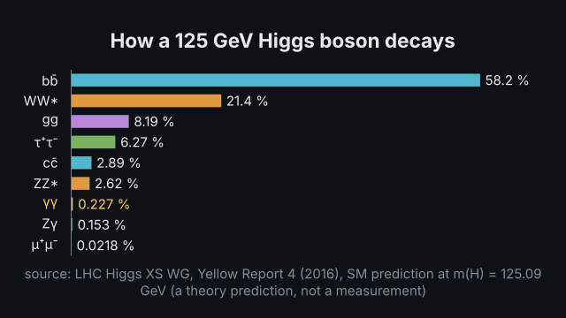
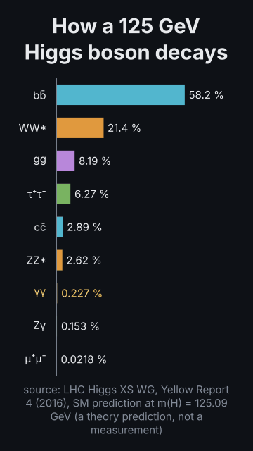
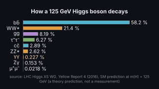
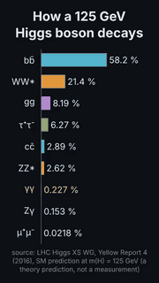

# `branching`

<!-- Generated by `vidgen gallery`; edit the sample in AGENTS.md (or video.yaml), not this file. -->

**Use it for:** branching ratios of a particle from the model (H: SM prediction; Z, W, π, K, μ: PDG 2024), the source in the caption.

A particle's branching ratios as bars (`particle: H`; Z, W±, π±, π⁰, K±, μ±): each decay mode's share in percent from the model, the source in the caption (PDG 2024; for the Higgs boson the LHC Higgs XS WG prediction, labelled a prediction). Sorted largest first, horizontal; the bar chart's reveal, highlight and actions.

Last beat, 16:9 and 9:16:

 

The scene playing (GIF, up to its last beat):

 

## YAML

From the author guide (`vidgen guide scenes`):

```yaml
- id: higgs_decays
  type: branching          # bars from the model (H: LHC Higgs XS WG prediction; Z, W, π, K, μ: PDG 2024)
  params: {particle: H}
  beats:
    - text: "Most Higgs bosons decay to a bottom quark pair; two photons, a quarter of a percent."
      actions: [{highlight: "bar:γγ", at: "@photons"}]
```

## Params

| param | type | default | notes |
|---|---|---|---|
| `title` | `str` |  | Chart title (in the header band at the top). (also: heading) |
| `labels` | `list[str]` |  | Made from the particle (do not set): the products' symbols (bb̄, γγ), hadrons, invisible. |
| `values` | `list[float]` |  | Made from the particle (do not set). |
| `changes` | `list[list[float]]` |  | Values the bars change to, one list per change (one value per label): change N plays in its own step after the bars grow (before the highlight), or on a word with {reveal: changeN, at: '@word'}. One scale for every change, so heights compare. |
| `sort` | `bool` | `False` | Order the bars by value, largest first (at the top when horizontal); they re-sort at each change. |
| `unit` | `str` |  | Appended to every value label, e.g. '%' or ' ms'. |
| `value_format` | `str \| None` |  | Python format for value labels, e.g. '{:.1f}'; default: the decimals the values need. |
| `colors` | `'palette' \| color \| list[color]` | `'primary'` | One color, one color per bar, or 'palette' (theme.palette). |
| `highlight` | `int \| str \| None` |  | Bar to highlight: 0-based index or label. |
| `highlight_color` | `color` | `'highlight'` | Color of the highlighted bar's value label. |
| `horizontal` | `bool \| None` |  | Horizontal bars; default: vertical, horizontal in a portrait frame with more than 5 bars. |
| `reveal` | `'all' \| 'per_beat'` | `'all'` | all: every bar grows in beat 1; per_beat: bar i grows at beat i. |
| `baseline` | `float` | `0.0` | Value the bars start from (e.g. 1.0 for losses). |
| `caption` | `str` |  | Note under the chart (e.g. the data source). |
| `caption_size` | `size` | `'caption'` | Caption text size. |
| `caption_color` | `color` | `'dim'` | Caption color. |
| `title_size` | `size` | `'heading'` | Title size (1.3x in a portrait frame). (also: heading_size) |
| `title_color` | `color` | `'text'` | Title color. (also: heading_color) |
| `label_size` | `size` | `'caption'` | Category label size (never below the readable minimum). |
| `value_size` | `size \| None` |  | Value label size; default body (caption with more than 6 bars). Labels too wide for their bar shrink towards the readable minimum, a word unit (' min') may move under the number, and in a portrait frame the bars turn horizontal when even that does not fit. |
| `particle` | `str` | required | The decaying particle: H, Z, W+ / W-, pi+ / pi-, pi0, K+ / K-, mu- / mu+. |
| `modes` | `int \| None` |  | Show only the largest this many modes (the caption says so). |

## Targets

`title`, `bar<N>`, `bar:<label>`, `change<N>`

## Beats

Any number.

[All scene types](README.md) · `vidgen list-scenes` · `vidgen schema --scene branching`
