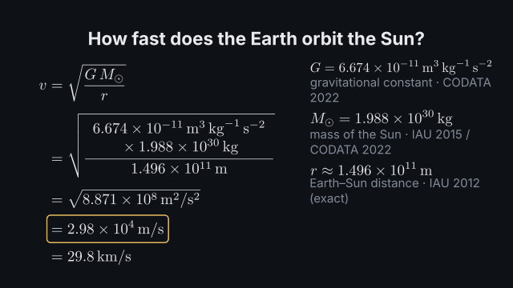
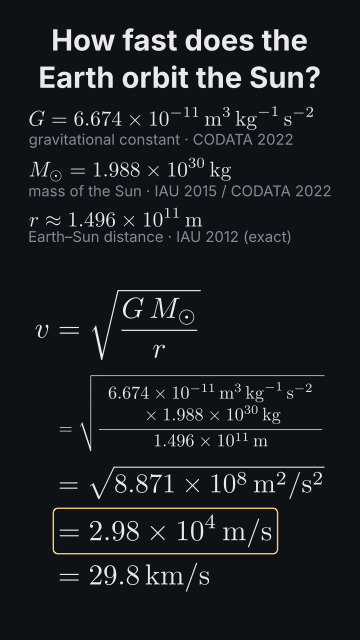

# `calculation`

<!-- Generated by `vidgen gallery`; edit the sample in AGENTS.md (or video.yaml), not this file. -->

**Use it for:** a worked calculation with units and significant figures: a formula, the values put in with their units, the result (orbital speed, half-life, a photon's energy in eV) or an exact probability (2/3 × 1/25 × 1/4 = 1/150); chains of results.

A worked calculation with units: the symbol table (beside the work in 16:9, above it in 9:16), then each calculation step by step — formula, values substituted with units, an intermediate value, the result with its significant figures (exact fractions when every input is exact), conversions — one calculation per beat (more beats: its steps spread over them). Each result joins the table, and later calculations (and other scenes, with `from_scene`) can use it by name. The actions `substitute`, `compute` and `convert` (and `reveal` for a formula) time the steps to words; `highlight` marks a symbol.

Last beat, 16:9 and 9:16:

 

The scene playing (GIF, up to its last beat):

 

## YAML

From the author guide (`vidgen guide scenes`):

```yaml
- id: orbit_speed
  type: calculation   # formula -> values with units -> result with significant figures -> conversion
  params:
    title: "How fast does the Earth orbit the Sun?"
    symbols:   # value: a number with its unit ("29.8 km/s", "1/25", "6.674e-11 m^3 kg^-1 s^-2"), or a constant (CODATA / IAU)
      - {name: G, constant: G}
      - {name: M_sun, constant: M_sun}
      - {name: r, constant: AU, meaning: "Earth–Sun distance"}
    calculations:   # expr uses the symbols' names; a later calculation may use an earlier result's name
      - {name: v, expr: "sqrt(G*M_sun/r)", sig: 3, convert: km/s, meaning: orbital speed}
  beats:
    - text: "Gravity holds the Earth on its orbit, so its speed is the square root of G M over r."
    - text: "Put in the numbers, and the Earth moves at about thirty kilometres per second."
      actions: [{substitute: calc1, at: "@numbers"}, {compute: calc1, at: "@moves"}]
```

## Params

| param | type | default | notes |
|---|---|---|---|
| `title` | `str` |  | Heading above the calculation. (also: heading) |
| `symbols` | `list[CalcSymbol]` |  | The symbol table: [{name, value, unit, meaning, source}, {name: G, constant: G}, {name: v, from_scene: orbit}]. |
| `symbols.name` | `str` | required | The name formulas use (v, M_sun, t_half, lambda): letters, digits and _. |
| `symbols.value` | `str \| int \| float \| None` |  | The value: 29.8, '6.674e-11', '2.5 × 10^3', a fraction '1/25', optionally with its unit ('29.8 km/s'); write a string to keep trailing zeros ('1.50'). |
| `symbols.unit` | `str` |  | Its unit (m/s^2, km h^-1, GeV/c^2, µM, °C), if not written after the value; for a constant, the unit to show it in. |
| `symbols.constant` | `str \| None` |  | A named constant instead of a value: c, G, h, hbar, k_B, N_A, e, R, sigma_SB, m_e, m_p, m_u, epsilon_0, mu_0, g, AU, GM_sun, GM_earth, M_sun, M_earth, R_earth. |
| `symbols.from_scene` | `str \| None` |  | The result of a calculation scene of this video instead of a value: 'scene_id' (the result with this name) or 'scene_id.result'. |
| `symbols.sig` | `int \| None` |  | Significant figures of the value (it is rounded to them); default: counted from its digits (decimals), exact for fractions and whole numbers without a unit. |
| `symbols.exact` | `bool \| None` |  | true: an exact value (a count, a defined quantity) that never limits the result's significant figures. |
| `symbols.digits` | `int \| None` |  | Significant figures to show it with (its full value is used); default: as written, constants with 4. |
| `symbols.tex` | `str` |  | TeX of its symbol; default from the name (M_sun -> M_⊙, k_B -> k_B, lambda -> λ, t_half -> t_1/2) or the constant's. |
| `symbols.meaning` | `str` |  | What it is ('distance from the Sun'), shown under it in the table; a constant's meaning by default. |
| `symbols.source` | `str` |  | Where the value comes from ('NIST', 'measured'), shown after the meaning; a constant's source by default. |
| `symbols.color` | `color \| None` |  | Colour of the symbol in the table and in formulas; default: its concept colour (terms: with tex), else the formula colour. |
| `symbols.show` | `bool` | `True` | false: used in formulas but not listed in the table. |
| `calculations` | `list[CalcStep]` | required | The calculations, in order: [{name, expr, unit, convert, sig, meaning}]; a later one may use an earlier result's name. |
| `calculations.name` | `str` | required | Name of the result (later calculations, and other scenes with from_scene, use it). |
| `calculations.expr` | `str` | required | The formula as an expression of the symbols: sqrt(G*M_sun/r), 2*p*q, ln(2)/k, h*c/lambda; numbers in it are exact, a unit in brackets: 9.81 [m/s^2]. |
| `calculations.meaning` | `str` |  | What the result is ('orbital speed'), shown with it in the table. |
| `calculations.unit` | `str` |  | Unit of the result (km/s, eV, h); default: SI, a named unit where one fits (kg·m²·s⁻² -> J). |
| `calculations.convert` | `str \| list[str]` |  | Units to convert the result into, shown as a last step (km/s, [eV, J]). |
| `calculations.sig` | `int \| None` |  | Significant figures of the result; default: from the inputs (products: the fewest; sums: the coarsest decimal place). |
| `calculations.format` | `'auto' \| 'decimal' \| 'sci' \| 'fraction' \| 'percent'` | `'auto'` | How the result is written: auto (an exact fraction as a fraction and its decimal, else decimals or scientific notation), decimal, sci, fraction, percent. |
| `calculations.tex` | `str` |  | TeX of the formula's right side, if the one written from expr is not wanted (the substitution is still built from expr). |
| `calculations.symbol` | `str` |  | TeX of the result's symbol; default from the name. |
| `calculations.substitute` | `bool` | `True` | Show the values substituted into the formula. |
| `calculations.intermediate` | `bool \| None` |  | Show the argument of an outer square root or power evaluated (default: when it helps). |
| `calculations.units` | `'auto' \| 'always' \| 'never'` | `'auto'` | Units in the substitution: always, never (values in SI), auto (with units unless that makes the line too small). |
| `table` | `'auto' \| 'side' \| 'top' \| 'none'` | `'auto'` | Where the symbol table goes: auto (beside the work in 16:9, above it in a vertical frame), side, top, none. |
| `results_in_table` | `bool` | `True` | Add each result to the table when the next calculation starts. |
| `size` | `size` | `72` | Formula size (the largest; smaller to fit, not below the readable size). |
| `table_size` | `size` | `40` | Size of the table's symbols and values (1.15x in a vertical frame). |
| `color` | `color` | `'text'` | Formula colour. |
| `result_color` | `color` | `'highlight'` | Colour of the box around each result. |
| `meaning_color` | `color` | `'dim'` | Colour of the meanings and sources in the table. |
| `caption` | `str` |  | Note under the calculation. |
| `caption_size` | `size` | `'caption'` | Caption text size. |
| `caption_color` | `color` | `'dim'` | Caption colour. |

## Targets

`title`, `table`, `symbol:<name>`, `row:<name>`, `calc<N>`, `calc:<name>`, `formula<N>`, `substitution<N>`, `result<N>`, `result:<name>`, `conversion<N>`

## Beats

Any number.

[All scene types](README.md) · `vidgen list-scenes` · `vidgen schema --scene calculation`
