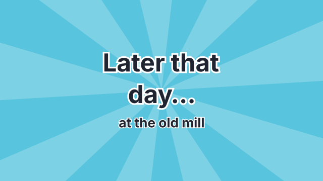
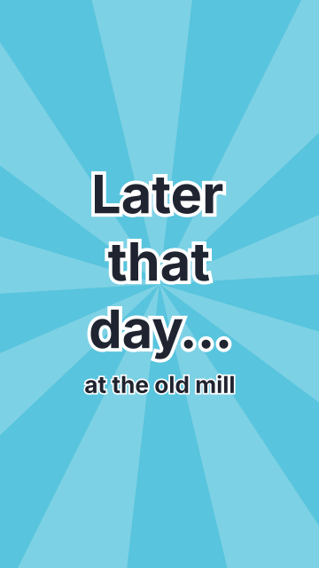

# `card`

<!-- Generated by `vidgen gallery`; edit the sample in AGENTS.md (or video.yaml), not this file. -->

**Use it for:** a cartoon's title card, "Later that day…", "The End".

The card's colour fills the frame behind a burst of rays turning slowly, a double frame or nothing (`style`); the text pops in with a bounce, bold and outlined, and the subtitle rises under it. With two or more beats the subtitle comes in beat 2, else with the text (a silent card with `duration` works the same); further beats hold. `sting` plays a music sting as the text pops in.

Last beat, 16:9 and 9:16:

 

The scene playing (GIF, up to its last beat):

 

## YAML

From the author guide (`vidgen guide scenes`):

```yaml
- id: later
  type: card                  # style: burst (rays turning), frame or plain
  params: {text: "Later that day…", subtitle: "at the old mill", sting: comic}
  duration: 2.5               # silent; or beats: to narrate it
```

## Params

| param | type | default | notes |
|---|---|---|---|
| `text` | `str` | required | The card's words: an episode title, "Later that day…", "The End" (wrapped to fit). |
| `subtitle` | `str` |  | A smaller line under the text. |
| `style` | `'burst' \| 'frame' \| 'plain'` | `'burst'` | burst: rays turning slowly behind the text; frame: a double frame round it; plain: the colour alone. |
| `color` | `color` | `'primary'` | The card's colour (the burst's lighter rays are a tint of it). |
| `text_color` | `color \| None` |  | Fill of the text; default white or the dark ink, whichever reads better on the card (the outline is the other). |
| `outline_color` | `color \| None` |  | Outline of the text and the frame's lines; default the other of white and the dark ink. |
| `spin` | `bool` | `True` | burst only: the rays turn slowly while the card is on. |
| `sting` | `'reveal' \| 'comic' \| 'sad' \| StingCue \| None` |  | A music sting as the text pops in: reveal, comic or sad, or {kind, gain} (a beat's own sting can come after its line instead). |
| `sting.kind` | `'reveal' \| 'comic' \| 'sad'` | required | reveal (a "ta-da" chord), comic (ba-dum-tss) or sad (wah wah wah waaah). |
| `sting.at` | `'start' \| 'end' \| None` |  | start: as the beat starts; end: when its narration ends, in the pause after the line; default start for reveal, end for comic and sad. |
| `sting.gain` | `float` | `0.0` | Level change in dB (0: about 7 dB under the narration before ducking). |

## Targets

`text`, `subtitle`, `burst`, `frame`

## Beats

Any number.

[All scene types](README.md) · `vidgen list-scenes` · `vidgen schema --scene card`
