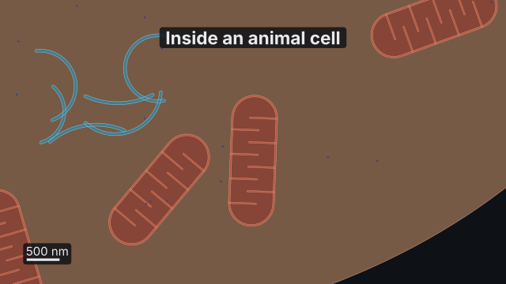
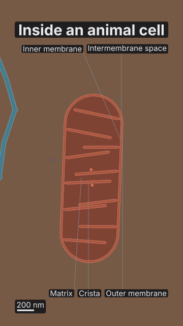

# `cell`

<!-- Generated by `vidgen gallery`; edit the sample in AGENTS.md (or video.yaml), not this file. -->

**Use it for:** a cell in true scale: organelles, membranes, ribosomes; zooming from tissue to one molecule (cell biology).

A cell drawn in physical scale: a cross-section of an animal cell, a plant cell or a bacterium with its compartments (cytosol, nucleoplasm, ER and Golgi lumens, mitochondrial matrix and intermembrane space, stroma and thylakoid lumen, periplasm…), the membranes between them and what is in them, at textbook sizes (`contents: typical` is the textbook cell; `objects` add or replace things, the cytoskeleton and motors too). Every place is checked: a ribosome in the nucleoplasm, a mitochondrion inside the nucleus or a chloroplast in an animal cell is refused with the reason. The camera is in µm: `view` sets the start level (tissue, cell, organelle, complex) and the `zoom_to` action moves between levels; details appear as they grow on screen (double membranes, cristae, thylakoids, nuclear pores, ribosome subunits, coats, lipid bilayers with their lipids). A scale bar and labels keep their size on screen; a zoomed view names the parts it shows.

Last beat, 16:9 and 9:16:

 

The scene playing (GIF, up to its last beat):

 

## YAML

From the author guide (`vidgen guide scenes`):

```yaml
- id: tour
  type: cell
  params:
    title: "Inside an animal cell"
    cell: animal                                   # or plant, bacterium; contents: typical is the textbook cell
    objects:
      - {kind: ribosome, id: mitoribosomes, in: mitochondria, count: 6, label: false}
  beats:
    - text: "A typical animal cell is about twenty micrometres across."
    - text: "Inside one mitochondrion, the inner membrane folds into cristae."
      actions:
        - {zoom_to: mitochondria, at: "@mitochondrion"}   # {zoom_to: rough_er, level: complex}: one ribosome
```

## Params

| param | type | default | notes |
|---|---|---|---|
| `title` | `str` |  | Title (in the header band at the top). (also: heading) |
| `cell` | `str \| CellBody` | `CellBody(kind='animal', size=None, aspect=None, gram=None, capsule=None, wall=None, plasmodesmata=None)` | The cell: 'animal', 'plant', 'bacterium' or {kind, size (µm or '20 um'), aspect, gram, capsule, wall, plasmodesmata}. |
| `cell.kind` | `'animal' \| 'plant' \| 'bacterium'` | `'animal'` | The kind of cell: animal (20 µm), plant (32 µm, a wall, a central vacuole, chloroplasts) or bacterium (a 2 µm rod). |
| `cell.size` | `float \| str \| None` |  | Its long axis: a number of µm or a length ('20 um'); default by kind (animal 20, plant 32, bacterium 2 µm). |
| `cell.aspect` | `float \| None` |  | Its long axis over its short axis (1: round); default by kind (1.25, 1.6, 2.5). |
| `cell.gram` | `'negative' \| 'positive' \| None` |  | Bacterium: negative (an inner and an outer membrane with the periplasm between; default) or positive (a thick peptidoglycan wall). |
| `cell.capsule` | `bool \| None` |  | Bacterium: a polysaccharide capsule outside the wall (default false). |
| `cell.wall` | `float \| str \| None` |  | Plant: the cell wall's thickness (default 250 nm; a primary wall is 0.1–1 µm). |
| `cell.plasmodesmata` | `bool \| None` |  | Plant: channels through the wall to the neighbouring cells (default true). |
| `contents` | `'typical' \| 'none'` | `'typical'` | typical: the textbook cell of its kind (animal: nucleus, ER, Golgi, centrosome, mitochondria, lysosomes, peroxisomes, endosomes, vesicles, ribosomes; plant: also a central vacuole and chloroplasts, no centrosome or lysosomes; bacterium: nucleoid, 70S ribosomes, plasmids, flagella, pili); none: only the objects listed. |
| `objects` | `list[str \| CellObject]` |  | Things in the cell: a kind, or {kind, id, at, size, width, angle, in, on, count, label}; an id of a typical object replaces it. |
| `objects.kind` | `str` | required | What it is: nucleus, nucleolus, rough_er, smooth_er, golgi, mitochondrion, lysosome, peroxisome, endosome, early_endosome, late_endosome, vesicle, centrosome, chloroplast, vacuole, nucleoid, ribosome, proteasome, nuclear_pore, plasmid, microtubule, actin_filament, actin_cortex, stress_fiber, intermediate_filament, flagellum, pilus, kinesin, dynein, myosin; molecules (drawn up close): dna, mrna, trna, rrna, nucleosome, chromatin, protein, kinase, phosphatase, g_protein, gpcr, rtk, ion_channel, carrier, na_k_atpase, atp_synthase, atp, adp, pi, gtp, gdp, camp, glucose, ligand, ion. |
| `objects.id` | `str \| None` |  | Its name for actions and labels (default: the kind; an object with the id of a typical one replaces it). |
| `objects.at` | `tuple[float \| str, float \| str] \| None` |  | Where its middle is (a filament: its minus end): [x, y] in µm from the cell's centre (x right, y up), or lengths ['2 um', '-500 nm']; default: placed automatically. |
| `objects.size` | `float \| str \| None` |  | Its length (µm or '1.5 um'); default: a typical size of its kind (the cortex: its thickness). |
| `objects.width` | `float \| str \| None` |  | Its width for elongated kinds (a mitochondrion: about 0.5–1 µm). |
| `objects.angle` | `float \| None` |  | Turn in degrees (a Golgi stack: the direction its cis face looks, default towards the nucleus; a filament: its direction; a flagellum or pilus: where round the cell it is anchored, 0 = the right pole). |
| `objects.in` | `str \| None` |  | For complexes: the compartment they float in: cytosol (default), nucleoplasm, matrix, stroma, an object's id (its inside) or '<id>.<compartment>'. |
| `objects.on` | `str \| None` |  | For complexes: the object whose membrane they sit on (ribosomes: rough_er or the nucleus; membrane proteins: cell for the plasma membrane, a mitochondrion, a chloroplast…) or the filament a motor walks on (kinesin, dynein: a microtubule object; myosin: actin). |
| `objects.count` | `int` | `1` | How many, scattered where they may be (no at); microtubules radiate from the centrosome. |
| `objects.label` | `str \| bool \| None` |  | Its label (default: its kind's name, when the scene's labels are on); false for none. |
| `objects.sheets` | `int \| None` |  | Rough ER: how many sheets round the nucleus (default 4). |
| `objects.span` | `float \| None` |  | Rough ER: how far round the nucleus the sheets reach (degrees, default 200). |
| `objects.side` | `float \| None` |  | Rough ER: the direction of the sheets' middle from the nucleus (degrees; default away from the Golgi). |
| `objects.cisternae` | `int \| None` |  | Golgi: how many cisternae in the stack (default 5), cis to trans. |
| `objects.tubules` | `int \| None` |  | Smooth ER: about how many tubules in its network (default 10). |
| `objects.pores` | `bool \| None` |  | Nucleus: draw the nuclear pores (default true). |
| `objects.ribosomes` | `bool \| None` |  | Nucleus and rough ER: ribosomes on the cytosolic face (default true). |
| `objects.coat` | `'none' \| 'clathrin' \| 'copi' \| 'copii' \| None` |  | Vesicle: its coat (default none): clathrin (from the plasma membrane and the trans-Golgi), copi (Golgi → ER and within the Golgi), copii (ER → Golgi). |
| `objects.cargo` | `bool \| None` |  | Kinesin, dynein, myosin: carry a cargo vesicle (default false). |
| `objects.grana` | `int \| None` |  | Chloroplast: how many grana (stacks of thylakoids; default about one per µm of length). |
| `objects.style` | `'section' \| 'surface' \| None` |  | Its drawing: section (cut open, as in a thin section) or surface (whole, seen from outside); default the scene's style. |
| `objects.state` | `str \| None` |  | A molecule's state (gpcr: inactive / active; ion_channel: closed / open; carrier: outward / inward; rtk: monomer / dimer…). |
| `objects.faces` | `str \| None` |  | A membrane protein: the compartment its oriented part faces (ATP synthase F₁: matrix; a GPCR's N-terminus: extracellular); checked. |
| `objects.membrane` | `str \| None` |  | A membrane protein on an object: which of its membranes (inner, outer, thylakoid, or a full name); default the first it occurs in. |
| `view` | `str \| CellViewSpec` | `CellViewSpec(level='cell', on=None, width=None)` | Where the camera starts: tissue, cell (default), organelle or complex, or {level, on, width}. |
| `view.level` | `'tissue' \| 'cell' \| 'organelle' \| 'complex'` | `'cell'` | tissue, cell, organelle or complex (molecular). |
| `view.on` | `str \| None` |  | The object to centre on (organelle and complex levels; default the nucleus; complex on the cell: its plasma membrane). |
| `view.width` | `float \| str \| None` |  | What the view spans across the frame's body, shorter side (e.g. '3 um'); default: the level's. |
| `style` | `'section' \| 'surface'` | `'section'` | section: structures cut open, as in a thin section (default); surface: drawn whole, seen from outside (the cell itself stays open). |
| `labels` | `bool` | `True` | Name the structures (screen-sized; shown once a structure is large enough on screen) and the parts a zoom_to view shows. |
| `scale_bar` | `bool` | `True` | A scale bar that follows the zoom (1-2-5 lengths: 5 µm, 200 nm…). |
| `not_to_scale` | `bool` | `False` | Some sizes are drawn larger than real on purpose: a small 'not to scale' note shows in the lower right (and the accuracy lint does not report the sizes). |
| `reveal` | `'all' \| 'per_beat'` | `'all'` | all: the whole cell in the first beat; per_beat: the cell, then one object per beat in order. |
| `seed` | `int` | `1` | Changes where things without at are placed. |
| `title_size` | `size` | `'heading'` | Title size. (also: heading_size) |
| `label_size` | `size` | `'caption'` | Size of the labels and the scale bar's text. |
| `gene` | `GeneParams \| None` |  | A gene whose products the actions transcribe, export, translate, to_golgi and secrete follow through the cell (as in a molecule scene's gene: {signal_peptide: true, glycosylation: true}). |
| `gene.id` | `str` | `'gene'` | Its name for actions (transcribe: gene). |
| `gene.name` | `str \| None` |  | The gene's symbol (italic; checked against the species' nomenclature: human INS, mouse Ins2). |
| `gene.product` | `str \| None` |  | The protein's name (roman; checked like a molecule's protein). |
| `gene.species` | `str \| None` |  | For name and product: human (default: the scene's), mouse, rat, yeast… |
| `gene.sequence` | `str \| None` |  | The coding strand of the transcribed region, 5′→3′ from the transcription start (+1), DNA (ACGT): 5′ UTR, exons and introns, 3′ UTR with the poly(A) signal AATAAA. |
| `gene.introns` | `int \| list[tuple[int, int]] \| None` |  | With a sequence: their positions [[start, end], …] (1-based, inclusive; each must start GT and end AG); with protein or codons: how many (generated: GU…branch A…AG). |
| `gene.protein` | `str \| None` |  | The protein (one-letter MALW… or three-letter Met-Ala-Leu…): the gene is written for it (frequent human codons); with a sequence: checked against what it encodes. |
| `gene.codons` | `int \| None` |  | A generated protein of this many codons (Met included, the stop codon not); default 12 (72 with a signal peptide). |
| `gene.signal_peptide` | `bool` | `False` | Generated: start with a cleavable signal peptide (n-, h- and c-region); written: checked that it has one. |
| `gene.glycosylation` | `bool` | `False` | Generated: an N-glycosylation sequon (Asn-X-Ser/Thr) after the signal peptide; written: checked. |
| `gene.seed` | `int` | `1` | Changes a generated gene's sequence. |
| `gene.start` | `'dna' \| 'mrna'` | `'dna'` | What the scene shows at first: dna (the gene in the nucleus) or mrna (a mature mRNA in the cytosol, ready to be translated). |
| `gene.codes` | `'three' \| 'one'` | `'three'` | Amino acids as three-letter (Met) or one-letter (M) codes. |

## Targets

`title`, `cell`, `tissue`, `scale_bar`, `<id>`

## Beats

Any number.

[All scene types](README.md) · `vidgen list-scenes` · `vidgen schema --scene cell`
