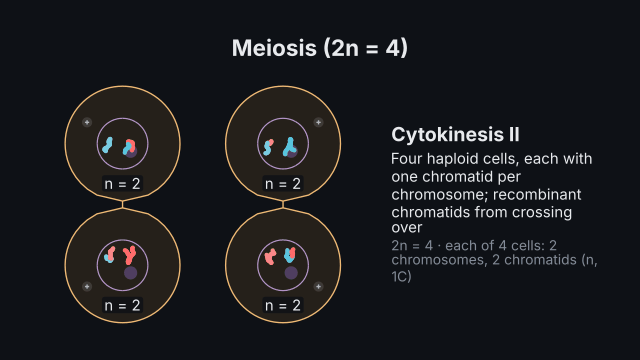
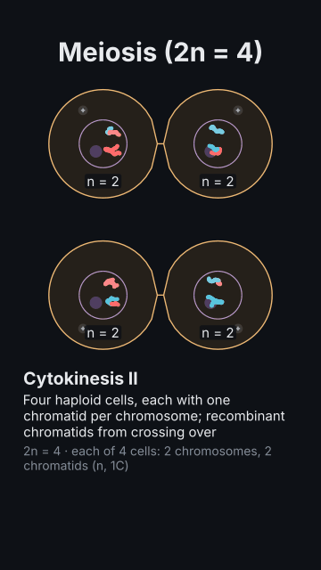

# `cell_cycle`

<!-- Generated by `vidgen gallery`; edit the sample in AGENTS.md (or video.yaml), not this file. -->

**Use it for:** the cell cycle with its checkpoints and cyclin–CDK levels; mitosis and meiosis with counted chromosomes, crossing over and four haploid cells.

The cell cycle and cell division. `mode: cycle` (default): a ring of the phases G1, S, G2 and M (its stages marked) with the exit to G0, the restriction point and the three checkpoints, beside the levels of cyclin D–CDK4/6, cyclin E–CDK2, cyclin A–CDK2 and cyclin B–CDK1 over the cycle (stylised, in the right order of rise and fall), a "now" marker on both. `mode: mitosis` / `meiosis`: a dividing cell with 2n chromosomes (homologues in maternal and paternal colours, sister chromatids joined at the centromere, kinetochores, the spindle), captions and the counts per cell; meiosis shows synapsis, crossing over with the exchanged segments and independent assortment, and ends with four haploid cells. The action `advance` moves the cell to a point of the cycle or a stage of the division; `checkpoint` shows a checkpoint's regulators passing or arresting the cell.

Last beat, 16:9 and 9:16:

 

The scene playing (GIF, up to its last beat):

 

## YAML

From the author guide (`vidgen guide scenes`):

```yaml
- id: meiosis
  type: cell_cycle
  params:
    title: "Meiosis (2n = 4)"
    mode: meiosis                     # or mitosis, or cycle (the cycle with its cyclins and checkpoints)
    assortment: [m, p]                # which homologue faces the first pole at metaphase I, per pair
  beats:
    - text: "Homologues pair, cross over and part; then sisters: four haploid cells."
      actions: [{advance: cell, to: cytokinesis_ii, at: "@pair"}]
```

## Params

| param | type | default | notes |
|---|---|---|---|
| `title` | `str` |  | Title (in the header band at the top). (also: heading) |
| `mode` | `'cycle' \| 'mitosis' \| 'meiosis'` | `'cycle'` | cycle: the cell cycle as a ring with the cyclin levels; mitosis or meiosis: a dividing cell. |
| `start` | `str \| None` |  | Where the cell is at the start: a point of the cycle (g1, g0, restriction_point, s, g2, m, prophase …; default g1) or a stage of the division (default interphase). |
| `hours` | `dict[str, float]` |  | cycle: the phases' lengths in hours (default g1: 11, s: 8, g2: 4, m: 1; M is drawn at least 12 % of the ring). |
| `cyclins` | `bool` | `True` | cycle: draw the cyclin–CDK levels beside the ring. |
| `chromosomes` | `int` | `4` | mitosis / meiosis: 2n, the diploid number (2, 4, 6 or 8; homologues in maternal and paternal colours). |
| `cell` | `'animal' \| 'plant'` | `'animal'` | mitosis: an animal cell (centrosomes, contractile ring) or a plant cell (wall, no centrosomes, preprophase band, cell plate). |
| `crossovers` | `list[list[float]] \| None` |  | meiosis: per homologous pair, where its crossovers are (0 p telomere … 1 q telomere; one or two each); default one per pair, placed by the seed. |
| `assortment` | `list['m' \| 'p'] \| None` |  | meiosis: per pair, the homologue facing the first pole at metaphase I (m maternal, p paternal); default by the seed. |
| `seed` | `int` | `1` | Varies the chromosomes' places and, in meiosis, the default crossovers and assortment. |
| `captions` | `bool` | `True` | mitosis / meiosis: caption each stage (what happens, in key terms). |
| `counts` | `bool` | `True` | mitosis / meiosis: show the counts per cell (chromosomes, chromatids, n / 2n, DNA content C). |
| `title_size` | `size` | `'heading'` | Title size. (also: heading_size) |
| `size` | `size` | `'caption'` | Label size (never below the readable minimum). |

## Targets

`title`, `cycle`, `phase:<key>`, `checkpoint:<key>`, `<checkpoint>`, `plot`, `cyclin:<key>`, `marker`, `cell`, `chromosomes`, `pair<N>`, `spindle`, `caption`

## Beats

Any number.

[All scene types](README.md) · `vidgen list-scenes` · `vidgen schema --scene cell_cycle`
