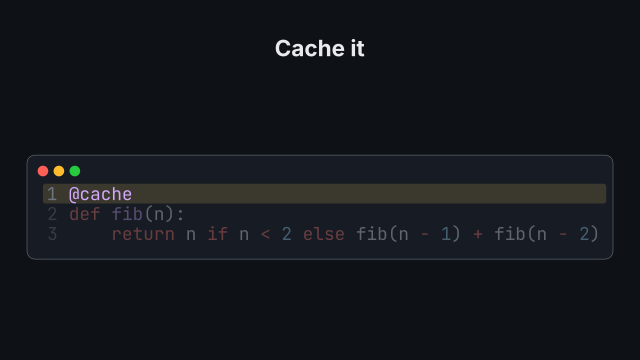
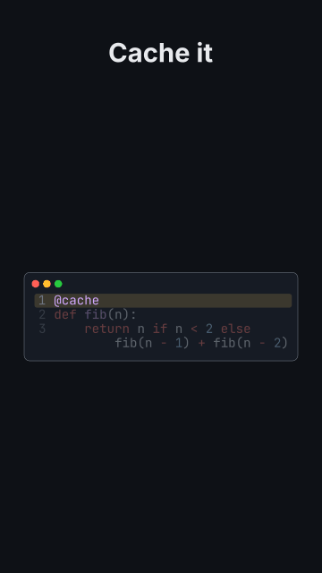

# `code_morph`

<!-- Generated by `vidgen gallery`; edit the sample in AGENTS.md (or video.yaml), not this file. -->

**Use it for:** code that changes: before / after, a refactor, a fix.

Version 1 of the code shows with beat 1; at beat *i* the listing morphs into version *i*: what both versions share glides into place, new lines grow in, removed lines fade out. More versions than beats are spread evenly; later beats hold. `{reveal: version2, at: "@word"}` morphs on a spoken word instead (that version then waits for the action). A version's `highlight` marks its lines once it shows (`changed`: the lines that differ).

Last beat, 16:9 and 9:16:

 

The scene playing (GIF, up to its last beat):

 

## YAML

From the author guide (`vidgen guide scenes`):

```yaml
- id: faster
  type: code_morph       # version i at beat i; the diff is computed for you: shared tokens glide, new lines grow in
  params:
    title: "Cache it"
    versions:
      - "def fib(n):\n    return n if n < 2 else fib(n - 1) + fib(n - 2)"
      - {code: "@cache\ndef fib(n):\n    return n if n < 2 else fib(n - 1) + fib(n - 2)", highlight: changed}
  beats:
    - text: "This version recomputes the same values again and again."
    - text: "One decorator, a cache, and each value is computed once."
      actions: [{reveal: version2, at: "@cache"}]   # morph on the word (1.5 s)
```

## Params

| param | type | default | notes |
|---|---|---|---|
| `versions` | `list[str \| CodeVersion]` | required | The versions in order (at least two): each the code (a string) or {code \| path, highlight}; version i shows at beat i. |
| `versions.code` | `str \| None` |  | The code of this version; give exactly one of code / path. |
| `versions.path` | `str \| None` |  | A code file in the project; give exactly one of code / path. |
| `versions.highlight` | `int \| str \| list[int] \| None` |  | Lines of this version to mark once it shows (the others dim): 3, '2-4', '1, 5-6', [1, 4], or 'changed' (the lines that differ from the version before). |
| `language` | `str \| None` |  | Pygments lexer name; default: from the first file name, else python. |
| `title` | `str` |  | Window title. (also: heading) |
| `line_numbers` | `bool` | `True` | Show line numbers. |
| `style` | `str \| None` |  | Pygments style (monokai, dracula, xcode, ...); default: the theme's code_style. |
| `font` | `str \| None` |  | Font family of the listing; default: the theme's font for the `code` role (font_mono, JetBrains Mono NL). |
| `size` | `size` | `'caption'` | Starting font size (scaled so the largest version fills the frame, up to 1.5x); one size for every version. |
| `highlight_color` | `color` | `'highlight'` | Color of the highlight band. |
| `wrap` | `bool` | `True` | Wrap long lines (hanging indent) when the listing would otherwise be scaled below size (or the readable minimum), mostly in vertical formats. |

## Targets

`title`, `listing`, `version<N>`, `version<N>.line<K>`

## Beats

Any number.

[All scene types](README.md) · `vidgen list-scenes` · `vidgen schema --scene code_morph`
