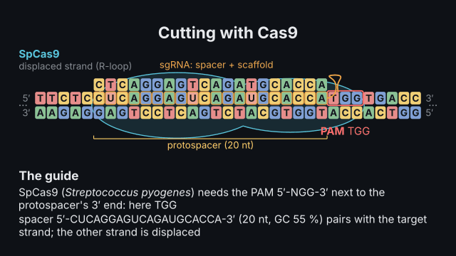
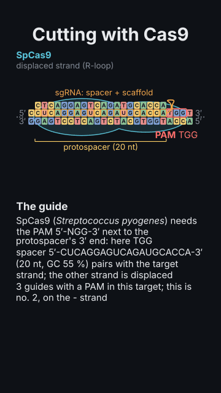

# `crispr`

<!-- Generated by `vidgen gallery`; edit the sample in AGENTS.md (or video.yaml), not this file. -->

**Use it for:** CRISPR–Cas9 editing: the sgRNA's spacer, the PAM, the R-loop, the blunt cut 3 bp from the PAM, and the repair (NHEJ indel or HDR from a donor), written in HGVS on a coding target.

CRISPR–Cas9 editing of a target sequence: both DNA strands with every base, the PAM (5′-NGG-3′ for SpCas9, NNGRRT for SaCas9) right after the protospacer's 3′ end on the non-target strand, the sgRNA's 20-nt spacer paired with the target strand (R-loop), the blunt double-strand break 3 bp upstream of the PAM, and its outcome: NHEJ with a small indel (a frameshift knockout on a coding sequence) or HDR copying a donor's edit — both written in HGVS with their protein change when `coding_first` says where the reading frame is. vidgen finds every guide with a PAM in the target; a spacer without a PAM, with another enzyme's PAM or of the wrong length is refused with the guides that would work.

Last beat, 16:9 and 9:16:

 

The scene playing (GIF, up to its last beat):

 

## YAML

From the author guide (`vidgen guide scenes`):

```yaml
- id: edit
  type: crispr
  params:
    title: "Cutting with Cas9"
    target: "GACTGCATCAGCTGAAGGTCACCATGGTGCATCTGACTCCTGAGGAGAAGTCTGCC"
    repair: nhej                       # or hdr with edit: 25A>T (c.20A>T with coding_first)
  beats:
    - text: "The guide binds beside its PAM, and three base pairs away both strands break."
      actions: [{scan: dna}, {cleave: dna, at: "@break"}]
```

## Params

| param | type | default | notes |
|---|---|---|---|
| `title` | `str` |  | Title (in the header band at the top). (also: heading) |
| `target` | `str` | `'GACTGCATCAGCTGAAGGTCACCATGGTGCATCTGACTCCTGAGGAGAAG'` | The target DNA's top strand 5′→3′ (26–80 bp). |
| `cas` | `'SpCas9' \| 'SaCas9'` | `'SpCas9'` | The nuclease: SpCas9 (PAM NGG, 20-nt spacer) or SaCas9 (PAM NNGRRT, 21–23 nt). |
| `spacer` | `str \| None` |  | The sgRNA's spacer 5′→3′ (U or T): it repeats the protospacer on the non-target strand, and its PAM is checked. Default: a guide vidgen finds. |
| `guide` | `int \| None` |  | Instead of spacer: the n-th guide vidgen finds in the target (by cut position, from 1). |
| `repair` | `'nhej' \| 'hdr' \| 'none'` | `'nhej'` | What follows the break: nhej (a small indel), hdr (a donor template's edit) or none (the break only). |
| `indel` | `int \| None` |  | NHEJ: the indel at the cut (+1 default, the commonest; −4, +2…). |
| `edit` | `str \| None` |  | HDR: the donor's change, at target positions (25A>T, 24_26del) or in c. numbers with coding_first. |
| `coding_first` | `int \| None` |  | The c. number of the target's first base when the top strand is coding: outcomes in HGVS with their protein change. |
| `symbol` | `str \| None` |  | The gene's symbol (italic), for the card. |
| `title_size` | `size` | `'heading'` | Title size. (also: heading_size) |
| `size` | `size` | `'caption'` | Label size (never below the readable minimum). |

## Targets

`title`, `dna`, `pam`, `protospacer`, `cas9`, `sgrna`, `cut`, `repair`, `card`

## Beats

Any number.

[All scene types](README.md) · `vidgen list-scenes` · `vidgen schema --scene crispr`
