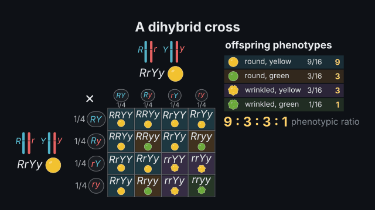
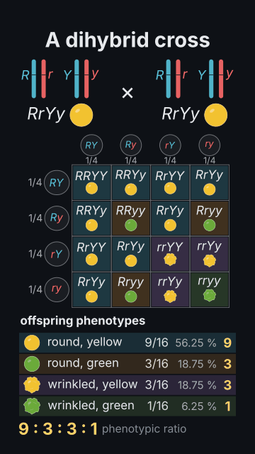

# `cross`

<!-- Generated by `vidgen gallery`; edit the sample in AGENTS.md (or video.yaml), not this file. -->

**Use it for:** a genetic cross: Punnett square or branch diagram, gametes, genotype and phenotype ratios (mono-, di-, trihybrid, test, reciprocal, P → F1 → F2, dominance, epistasis, lethal 2:1, X-linked, linked genes), a chi-square test.

A genetic cross: parents, gametes, a Punnett square or branch diagram, the offspring's genotype and phenotype classes with exact ratios, and an optional chi-square test. Built from a genetic system (`preset` or `loci` / `linkage` / `epistasis` / `sex`) and the parents' genotypes; `kind: test` makes the tester, `kind: reciprocal` swaps the sexes of the lines, `P` crosses a P generation to its F1 and shows the F2. Without cross actions it plays itself beat by beat (gametes, the square, the counts with their ratios, the test); the actions form_gametes, fill, count, ratio and chi_square put each step on a word.

Last beat, 16:9 and 9:16:

 

The scene playing (GIF, up to its last beat):

 

## YAML

From the author guide (`vidgen guide scenes`):

```yaml
- id: dihybrid
  type: cross
  params:
    title: "A dihybrid cross"
    preset: pea_dihybrid               # or loci: [{gene: R, trait: seed shape, alleles: {R: round, r: wrinkled}}, ...]
    parents: [RrYy, RrYy]              # P: [RRYY, rryy] for P → F1 → F2; kind: test with one parent
  beats:
    - text: "Each parent makes four kinds of gametes, in equal numbers."
      actions: [{form_gametes: both, at: "@four"}]
    - text: "Sixteen equally likely combinations fill the square."
      actions: [{fill: square, by: row}]
    - text: "Counted, they give nine to three to three to one."
      actions: [{count: phenotypes}, {ratio: phenotypes, at: "@nine"}]
```

## Params

| param | type | default | notes |
|---|---|---|---|
| `title` | `str` |  | Title (in the header band at the top). (also: heading) |
| `preset` | `str \| None` |  | A textbook system: pea_seed_shape, pea_dihybrid, snapdragon, abo, rabbit_coat, labrador, squash_colour, chicken_feathers, shepherds_purse, sweet_pea, squash_shape, yellow_mouse, drosophila_white, hemophilia_a, drosophila_b_vg. |
| `loci` | `list[dict[str, Any]] \| None` |  | The loci: {gene, trait, alleles (most dominant first), dominance, heterozygotes, chromosome, lethal, penetrance, normal, expressivity}. |
| `linkage` | `list[dict[str, Any]] \| None` |  | Linked loci in map order with the recombination frequency of each interval: [{loci: [A, B], rf: 0.17, rf_male: 0}]. |
| `epistasis` | `list[dict[str, Any]] \| None` |  | Epistasis between two loci: [{kind: recessive, epistatic: E, hypostatic: B}] (recessive, dominant, suppression, duplicate, complementary, cumulative). |
| `sex` | `'XY' \| None` |  | XY: follow the sexes (females XX, males XY) without sex-linked loci. |
| `parents` | `list[str] \| str \| None` |  | The two parents' genotypes ([RrYy, RrYy]; with sex chromosomes in any order); kind: test takes one. |
| `mother` | `str \| None` |  | The mother's (egg / seed parent's) genotype (needed with mitochondrial loci). |
| `father` | `str \| None` |  | The father's (sperm / pollen parent's) genotype. |
| `P` | `list[str] \| None` |  | A true-breeding P generation ([RRYY, rryy]): its F1 is worked out and intercrossed (the F2 is shown). |
| `kind` | `'cross' \| 'test' \| 'reciprocal'` | `'cross'` | cross; test (one parent with the homozygous recessive tester); reciprocal (the sexes of the two lines swapped). |
| `show` | `'auto' \| 'punnett' \| 'branch'` | `'auto'` | punnett: a Punnett square (up to 8 × 8); branch: a branch (forked-line) diagram; auto: a square up to 4 × 4 gametes, branches beyond. |
| `branch` | `'phenotypes' \| 'genotypes'` | `'phenotypes'` | branch diagram: of the phenotypes (by sex, then trait) or of the genotypes (locus by locus). |
| `observed` | `dict[str, int] \| list[int] \| None` |  | Counts of the phenotype classes for a chi-square test ({round yellow: 315, ...}, or a list in class order). |
| `alpha` | `float \| str` | `0.05` | The chi-square test's significance level. |
| `notes` | `bool` | `True` | Show the notes the cross needs (recombinant gametes, a lethal class, the tester, epistasis). |
| `pictures` | `bool` | `True` | Draw the phenotype pictures (peas, flowers, eyes, flies, coats, blood groups…). |
| `animal` | `'auto' \| 'dog' \| 'mouse' \| 'rabbit' \| 'cat' \| 'guinea pig' \| 'none'` | `'auto'` | The animal a coat colour is drawn on; auto: the preset's (labrador: dog) or one named in the title or traits, else a plain patch of fur. |
| `title_size` | `size` | `'heading'` | Title size. (also: heading_size) |
| `size` | `size` | `'caption'` | Label size (never below the readable minimum). |

## Targets

`title`, `generations`, `parents`, `parent<N>`, `mother`, `father`, `gametes`, `gametes<N>`, `square`, `tree`, `row<N>`, `col<N>`, `cell<R>.<C>`, `cells:<class>`, `phenotypes`, `genotypes`, `class<N>`, `class:<label>`, `genotype:<genotype>`, `chi_square`, `notes`

## Beats

Any number.

[All scene types](README.md) · `vidgen list-scenes` · `vidgen schema --scene cross`
