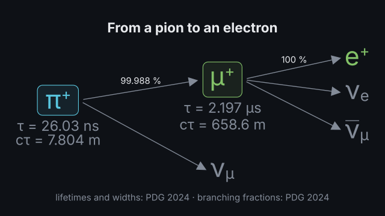
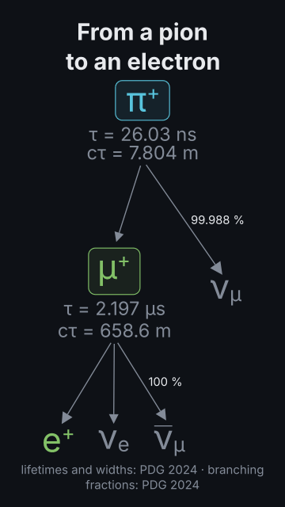
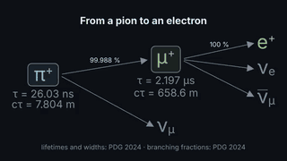
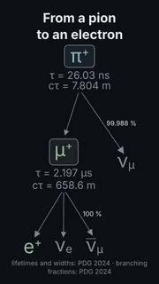

# `decay_chain`

<!-- Generated by `vidgen gallery`; edit the sample in AGENTS.md (or video.yaml), not this file. -->

**Use it for:** a decay chain with lifetimes: π⁺ → μ⁺ ν_μ, μ⁺ → e⁺ ν_e ν̄_μ; H → ZZ* → 4ℓ; τ and cτ (PDG 2024), branching fractions, every decay checked.

A decay chain (`decays: ["pi+ -> mu+ nu_mu", "mu+ -> e+ nu_e anti-nu_mu"]`) as a tree: each unstable particle with its mean life τ and cτ (PDG 2024; a resonance: Γ and τ = ħ/Γ), arrows to its products, the branching fraction of the decay when listed (`branching`), and every decay checked for charge, baryon and lepton numbers and energy (a forbidden decay is an error with the reason). One decay per beat; left to right (16:9) or top to bottom (9:16).

Last beat, 16:9 and 9:16:

 

The scene playing (GIF, up to its last beat):

 

## YAML

From the author guide (`vidgen guide scenes`):

```yaml
- id: pion_chain
  type: decay_chain        # each decay checked; τ and cτ (resonances: Γ) from PDG 2024; branching fractions when listed
  params:
    title: "From a pion to an electron"
    decays: ["pi+ -> mu+ nu_mu", "mu+ -> e+ nu_e anti-nu_mu"]
  beats:
    - text: "A positive pion."
    - text: "It lives twenty-six nanoseconds, then becomes a muon and a neutrino."
    - text: "The muon lives two point two microseconds."
```

## Params

| param | type | default | notes |
|---|---|---|---|
| `decays` | `list[str]` | required | The decays in order: the first one's parent starts the chain, each later decay's parent is a product not yet decayed ("pi+ -> mu+ nu_mu", "mu+ -> e+ nu_e anti-nu_mu"). |
| `title` | `str` |  | Title above the chain. (also: heading) |
| `caption` | `str` |  | Note under the chain; default: the source of the values. |
| `lifetimes` | `bool` | `True` | Write τ and cτ (a resonance: Γ and τ) under each particle that decays. |
| `branching` | `bool` | `True` | Write the branching fraction of each decay the model lists (PDG 2024; the Higgs boson: LHC Higgs XS WG prediction). |
| `stable` | `bool` | `False` | Also mark the final particles that are stable ("stable"). |
| `reveal` | `'decays' \| 'all'` | `'decays'` | decays: the first particle, then one decay per beat; all: everything in beat 1. |
| `title_size` | `size` | `'heading'` | Title size. (also: heading_size) |
| `title_color` | `color` | `'text'` | Title colour. (also: heading_color) |
| `caption_color` | `color` | `'dim'` | Caption colour. |

## Targets

`title`, `caption`, `chain`, `decay<N>`, `particle:<n>`, `particle:<particle>`, `lifetime:<particle>`

## Beats

Any number.

[All scene types](README.md) · `vidgen list-scenes` · `vidgen schema --scene decay_chain`
