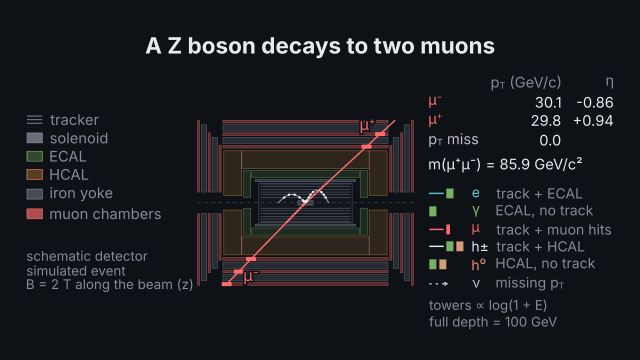
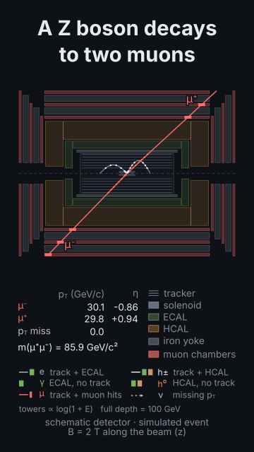
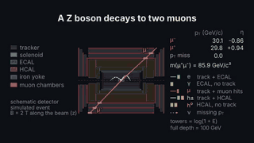
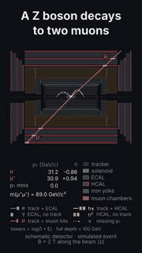

# `detector`

<!-- Generated by `vidgen gallery`; edit the sample in AGENTS.md (or video.yaml), not this file. -->

**Use it for:** an event display in a schematic particle detector (tracker, solenoid, calorimeters, muon chambers): tracks bending in the magnetic field, electron / photon / muon / hadron / neutrino signatures, jets, missing transverse momentum; Z → μμ, H → γγ, H → 4ℓ, W → eν, dijet events.

An event display in a schematic cylindrical detector: `event: z_to_mumu` (presets z_to_mumu, h_to_gammagamma, h_to_4l, w_to_enu, dijet; `{preset, seed}` for another event) or listed particles (`{particles: [{particle: mu+, pt: 40, eta: 0.5, phi: 30}]}`) seen in the transverse (`view: xy`) or longitudinal (`rz`) view. Tracks bend in the solenoid field (`field`, tesla) with the radius p_T = 0.3 B R and the sign of their charge; electrons and photons shower in the ECAL, hadrons in the HCAL, muons cross everything and hit the muon chambers; neutrinos show as missing p_T. Built layer by layer over the beats.

Last beat, 16:9 and 9:16:

 

The scene playing (GIF, up to its last beat):

 

## YAML

From the author guide (`vidgen guide scenes`):

```yaml
- id: z_event
  type: detector           # tracks bend with R = pT / (0.3 B); e, γ shower in the ECAL, hadrons in the HCAL, μ reach the muon chambers
  params:
    title: "A Z boson decays to two muons"
    event: {preset: z_to_mumu, seed: 3, soft: 0}   # z_to_mumu, h_to_gammagamma, h_to_4l, w_to_enu, dijet; same seed, same event; soft: low-pT pions (default 4)
  beats:
    - text: "Tracks curve; calorimeters take the energy; two muons reach the muon chambers."
      actions: [{highlight: "particle:mu+", at: "@muons"}]
    - text: "Seen from the side."
      actions: [{action: switch_view, to: rz}]
```

## Params

| param | type | default | notes |
|---|---|---|---|
| `title` | `str` |  | Title above the display. (also: heading) |
| `caption` | `str` |  | Note under the display. |
| `event` | `str \| DetEvent` | `'z_to_mumu'` | A preset (z_to_mumu, h_to_gammagamma, h_to_4l, w_to_enu, dijet), {preset, seed, soft} or {particles: [...], seed, products}. |
| `event.preset` | `str \| None` |  | z_to_mumu, h_to_gammagamma, h_to_4l, w_to_enu or dijet. |
| `event.seed` | `int` | `1` | The simulation's seed: the same seed, the same event. |
| `event.particles` | `list[DetParticle]` |  | Listed particles instead of a preset. |
| `event.particles.particle` | `str` | required | The particle (e-, mu+, gamma, pi+, K0_L, n, nu_e…) or jet (a cone of hadrons and photons). |
| `event.particles.pt` | `float` | required | Transverse momentum in GeV/c. |
| `event.particles.eta` | `float` | `0.0` | Pseudorapidity η (0: perpendicular to the beam; \|η\| ≤ 3). |
| `event.particles.phi` | `float` | `0.0` | Azimuth in degrees, counter-clockwise from +x (the x–y view's right). |
| `event.particles.leaves` | `list[str] \| None` |  | What you say it leaves (track, ecal, hcal, muon, missing): checked against the particle (a photon leaves no track). |
| `event.soft` | `int \| None` |  | Soft charged pions in back-to-back pairs (low p_T: they curl up in the tracker); default 4 with a preset, 0 with listed particles. |
| `event.products` | `list[int]` |  | Listed particles (1, 2… in order) whose invariant mass the readout states. |
| `view` | `'xy' \| 'rz'` | `'xy'` | xy: across the beam (transverse; B out of the screen); rz: along it (longitudinal). switch_view changes it. |
| `field` | `float` | `2.0` | The solenoid's field in tesla (> 0): R [m] = p_T [GeV/c] / (0.3 B). |
| `return_field` | `float \| None` |  | The return field in the barrel iron (T, opposite; schematic): default half the solenoid's. |
| `energy_scale` | `'linear' \| 'log'` | `'log'` | Tower length: linear (E / tower_max) or log (log(1 + E/GeV) / log(1 + tower_max/GeV)); stated under the legend. |
| `tower_max` | `float` | `100.0` | The energy (GeV) that fills a calorimeter's whole depth (larger deposits are cut at it). |
| `readout` | `bool` | `True` | List the objects (p_T, η), the missing p_T and the decay products' invariant mass. |
| `legend` | `bool` | `True` | The signature legend (what each kind of particle leaves). |
| `layers` | `bool` | `True` | The layer key (tracker, solenoid, ECAL, HCAL, iron yoke, muon chambers). |
| `labels` | `bool` | `True` | Name the objects (μ⁺, γ, jet 1) beside the detector. |
| `reveal` | `'layers' \| 'all'` | `'layers'` | layers: the detector, then the tracks, the calorimeters, the muons, the missing p_T over the beats; all: everything in beat 1. |
| `label` | `str` | `'schematic detector · simulated event'` | The line under the display (say what is schematic and what is simulated). |
| `title_size` | `size` | `'heading'` | Title size. (also: heading_size) |
| `title_color` | `color` | `'text'` | Title colour. (also: heading_color) |
| `caption_color` | `color` | `'dim'` | Caption colour. |

## Targets

`title`, `caption`, `detector`, `layer:<name>`, `layers`, `tracks`, `ecal`, `hcal`, `muon_hits`, `missing_pt`, `readout`, `legend`, `label`, `particle:<n>`, `particle:<particle>`, `jet:<n>`, `soft`

## Beats

Any number.

[All scene types](README.md) · `vidgen list-scenes` · `vidgen schema --scene detector`
