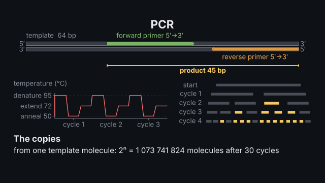
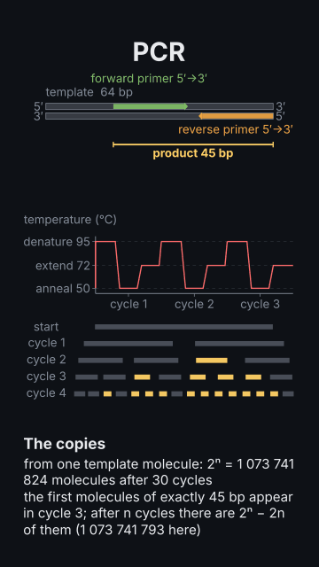

# `dna_lab`

<!-- Generated by `vidgen gallery`; edit the sample in AGENTS.md (or video.yaml), not this file. -->

**Use it for:** the laboratory: PCR (primers, cycles, 2ⁿ copies), an agarose gel (ladder, migration by size), Sanger sequencing (a chromatogram with called bases) or NGS reads with coverage and a variant call.

A laboratory technique of molecular genetics. `method: pcr`: the primers checked against the template (a forward primer repeats the top strand, a reverse primer is the reverse complement downstream), the product's length, melting temperatures and the annealing temperature, a temperature trace of the cycles and the molecules counted (2ⁿ after n cycles, 2ⁿ − 2n of them exactly the product's length; the first appear in cycle 3). `method: gel`: an agarose gel, DNA running from the wells (cathode, −) to the anode (+), the distance log-linear in the fragment size within the gel's resolving range, a ladder, and a band's size read off it. `method: sanger`: chain termination with ddNTPs, the fragments sorted by length and a chromatogram with the called bases (a heterozygous position: two half-height peaks and its IUPAC code). `method: ngs`: seeded reads aligned to a reference with their coverage and a variant call (≈50 % alt reads: heterozygous).

Last beat, 16:9 and 9:16:

 

The scene playing (GIF, up to its last beat):

 

## YAML

From the author guide (`vidgen guide scenes`):

```yaml
- id: pcr
  type: dna_lab
  params:
    title: "PCR"
    method: pcr
    template: "GCTTACCAGTCGATGCCATGACTGCATCAGCTGAAGGTCACCATGGTGCATCTGACTCCTGAGG"
    primers: {forward: "GACTGCATCAGCTGAAGGTC", reverse: "CCTCAGGAGTCAGATGCACC"}
  beats:
    - text: "A template, two primers, and a product of a defined length."
    - text: "The strands separate, the primers anneal, Taq extends them."
      actions: [{run: trace}]
    - text: "The molecules double every cycle."
      actions: [{run: counts}]
```

## Params

| param | type | default | notes |
|---|---|---|---|
| `title` | `str` |  | Title (in the header band at the top). (also: heading) |
| `method` | `'pcr' \| 'gel' \| 'sanger' \| 'ngs'` | `'pcr'` | pcr: cycles and copies; gel: agarose electrophoresis; sanger: chain termination and a chromatogram; ngs: reads, coverage and a variant call. |
| `template` | `str \| None` |  | pcr: the template's top strand 5′→3′ (40–5000 bp). |
| `primers` | `dict[str, str] \| None` |  | pcr: {forward: …, reverse: …}, both 5′→3′ (15–35 nt); checked against the template (the reverse primer is the reverse complement of the top strand). |
| `temperatures` | `dict[str, float] \| None` |  | pcr: {denature: 95, anneal: 58, extend: 72} °C; the annealing default is ~5 °C below the lower primer Tm. |
| `cycles` | `int \| None` |  | pcr: how many cycles (default 30; 25–35 typical). |
| `agarose` | `float \| None` |  | gel: the agarose percentage (0.5–3 %): it sets the sizes the gel resolves. |
| `ladder` | `str \| list[float] \| None` |  | gel: 1kb, 100bp, 50bp or a list of sizes in bp. |
| `lanes` | `dict[str, list[float] \| float] \| list[dict[str, Any]] \| None` |  | gel: the samples, {PCR: [450], digest: [300, 150]} (bp). |
| `sequence` | `str \| None` |  | sanger: the new strand's bases 5′→3′ as the trace reads them (8–40 nt). |
| `heterozygous` | `str \| list[str] \| None` |  | sanger: positions read as two bases, '12A>G' (one or a list). |
| `primer` | `str \| None` |  | sanger: the sequencing primer (15–35 nt), shown before the read. |
| `reference` | `str \| None` |  | ngs: the reference sequence the reads align to (30–120 bp). |
| `variant` | `str \| None` |  | ngs: the variant in the sample, '31C>T' or a deletion '6_8del' (positions in the reference). |
| `zygosity` | `'heterozygous' \| 'homozygous' \| 'absent' \| None` |  | ngs: whether the sample carries the variant on one allele (≈50 % of reads), both, or none. |
| `read_length` | `int \| None` |  | ngs: the reads' length (default 25). |
| `depth` | `int \| None` |  | ngs: the expected coverage (default 20; a clinical call wants ≥ 20). |
| `error_rate` | `float \| None` |  | ngs: the per-base sequencing error rate (default 0.005). |
| `seed` | `int` | `1` | Changes the seeded reads or peak heights. |
| `title_size` | `size` | `'heading'` | Title size. (also: heading_size) |
| `size` | `size` | `'caption'` | Label size (never below the readable minimum). |

## Targets

`title`, `template`, `primers`, `product`, `trace`, `cycle:<n>`, `counts`, `gel`, `ladder`, `lane:<label>`, `sizes`, `sequence`, `fragments`, `chromatogram`, `reference`, `reads`, `coverage`, `call`

## Beats

Any number.

[All scene types](README.md) · `vidgen list-scenes` · `vidgen schema --scene dna_lab`
