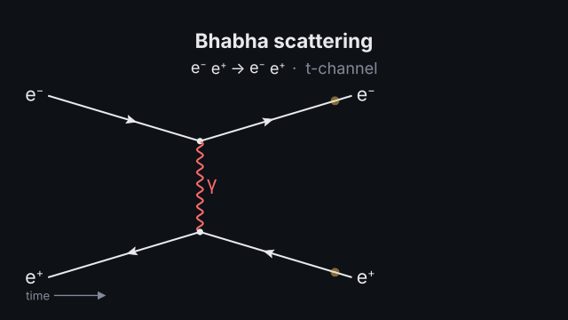
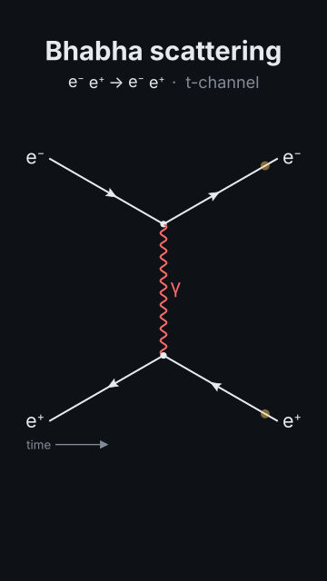
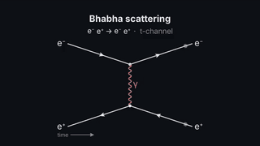
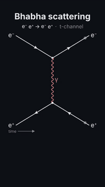

# `feynman`

<!-- Generated by `vidgen gallery`; edit the sample in AGENTS.md (or video.yaml), not this file. -->

**Use it for:** a Feynman diagram in proper notation (e⁺e⁻ → μ⁺μ⁻, Compton, Bhabha, β⁻ and μ⁻ decay, π⁺ → μ⁺ ν_μ, Drell–Yan, gg → H, H → γγ, H → ZZ* → 4ℓ, t → W⁺b) or your own, every vertex checked against the Standard Model; s- and t-channel, decays, loops.

A Feynman diagram from a `preset` (ee_to_mumu, compton, bhabha, moller, beta_decay, muon_decay, pion_decay, drell_yan, gg_to_h, h_to_gammagamma, h_to_zz_4l, top_decay) or `diagrams` written by their lines; checked vertex by vertex against the Standard Model. `reveal: time` (default) draws the incoming lines, then each vertex and the lines leaving it, in time order over the beats; `all` draws everything in the first beat.

Last beat, 16:9 and 9:16:

 

The scene playing (GIF, up to its last beat):

 

## YAML

From the author guide (`vidgen guide scenes`):

```yaml
- id: annihilation
  type: feynman            # fermion arrows (antifermions against time), wavy γ/W/Z, curly g, dashed H
  params:
    title: "Bhabha scattering"
    preset: bhabha         # ee_to_mumu, compton, bhabha, moller, beta_decay, muon_decay, pion_decay, drell_yan,
                           # gg_to_h, h_to_gammagamma, h_to_zz_4l, top_decay
  beats:
    - text: "An electron and a positron annihilate into a photon."
      actions: [{vertex_rule: "vertex:v1", show: [rule, coupling, checks], at: "@photon"}]
    - text: "Or they exchange one: the t channel."
      actions: [{action: swap_channel, to: t, at: "@exchange"}]
    - text: "Follow them through."
      actions: [{travel: diagram}]
```

## Params

| param | type | default | notes |
|---|---|---|---|
| `title` | `str` |  | Title above the diagram. (also: heading) |
| `caption` | `str` |  | Note under the diagram. |
| `preset` | `'ee_to_mumu' \| 'compton' \| 'bhabha' \| 'moller' \| 'beta_decay' \| 'muon_decay' \| 'pion_decay' \| 'drell_yan' \| 'gg_to_h' \| 'h_to_gammagamma' \| 'h_to_zz_4l' \| 'top_decay' \| None` |  | A standard diagram: ee_to_mumu (s-channel γ or Z), compton (s, u), bhabha (s, t), moller (t, u), beta_decay (d → u e⁻ ν̄ₑ), muon_decay, pion_decay (π⁺ → μ⁺ ν_μ), drell_yan (γ* or Z), gg_to_h (top loop), h_to_gammagamma (top or W loop), h_to_zz_4l, top_decay (t → W⁺ b; leptonic). |
| `diagrams` | `list[FeynmanDiagram]` |  | Diagrams written by their lines (instead of a preset); several for swap_channel. |
| `diagrams.name` | `str` |  | Its name (swap_channel to: <name>; default d1, d2…). |
| `diagrams.label` | `str` |  | What to call it on screen after the process (s-channel, t-channel, W loop). |
| `diagrams.lines` | `list[str \| FeynmanLine]` | required | Its lines (vertices are the ends other than in and out). |
| `diagrams.lines.id` | `str \| None` |  | Its id (target `line:<id>`; default l1, l2… in order). |
| `diagrams.lines.particle` | `str` | required | The particle (e-, e+, nu_e, anti-nu_e, u, anti-d, gamma, g, W+, W-, Z, H; Unicode works: ν̄ₑ); a trailing * marks it off-shell (Z*, γ*). |
| `diagrams.lines.from` | `str` | required | Where it starts: a vertex id or in. |
| `diagrams.lines.to` | `str` | required | Where it ends: a vertex id or out. |
| `diagrams.lines.label` | `bool` | `True` | Show its name beside it. |
| `diagrams.groups` | `list[FeynmanGroup]` |  | Hadrons drawn as their quark lines. |
| `diagrams.groups.particle` | `str` | required | The hadron (n, p, pi+, K-...); its quark content must match the lines. |
| `diagrams.groups.side` | `'initial' \| 'final'` | `'initial'` | Which end of the lines it brackets. |
| `diagrams.groups.lines` | `list[str]` | required | The ids of its quark lines (incoming for initial, outgoing for final; spectators are lines from in to out). |
| `diagram` | `str \| None` |  | Which of the preset's (or written) diagrams to show first: e.g. s or t (bhabha), photon or Z (ee_to_mumu, drell_yan), top or W (h_to_gammagamma), leptonic (top_decay). |
| `spectators` | `bool` | `False` | beta_decay: draw the neutron and proton with their spectator quarks. |
| `time` | `'right' \| 'up'` | `'right'` | Direction of time: left → right (the usual convention) or bottom → top. |
| `time_axis` | `bool` | `True` | State the time direction with an arrow. |
| `process` | `bool` | `True` | Write the reaction (with the diagram's label) under the title. |
| `labels` | `bool` | `True` | Name the lines (external lines always carry their names unless false). |
| `reveal` | `'time' \| 'all'` | `'time'` | time: lines drawn in time order over the beats; all: the whole diagram in beat 1. |
| `fermion_color` | `color` | `'text'` | Colour of quark and lepton lines. |
| `boson_color` | `color` | `'accent'` | Colour of photon, gluon, W and Z lines. |
| `higgs_color` | `color` | `'secondary'` | Colour of Higgs lines. |
| `title_size` | `size` | `'heading'` | Title size. (also: heading_size) |
| `title_color` | `color` | `'text'` | Title colour. (also: heading_color) |
| `caption_color` | `color` | `'dim'` | Caption colour. |

## Targets

`title`, `caption`, `process`, `diagram`, `time_axis`, `line:<id>`, `vertex:<id>`, `hadron:<particle>`

## Beats

Any number.

[All scene types](README.md) · `vidgen list-scenes` · `vidgen schema --scene feynman`
