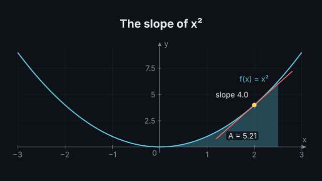
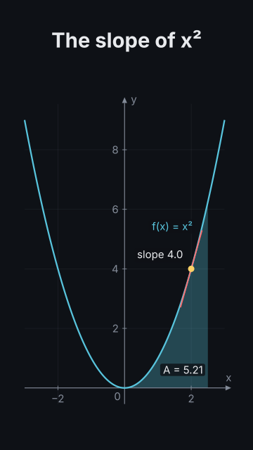

# `function_plot`

<!-- Generated by `vidgen gallery`; edit the sample in AGENTS.md (or video.yaml), not this file. -->

**Use it for:** a function's graph: slope, tangent, area under a curve.

Maths axes with functions f(x) written as expressions (parsed safely, never run as code), dots on the curves with a live value label (and a tangent and guide lines), and shaded areas under a curve. `reveal: per_beat` (default): the axes with function 1 at beat 1, then each further function, dot and area at the next beat (spread evenly when there are more than beats); `all`: everything in beat 1. A `reveal` action shows an item on a word instead (the item's own beat then holds), and `trace` moves a dot along its curve (its label, tangent and guides follow) or an area's right end.

Last beat, 16:9 and 9:16:

 

The scene playing (GIF, up to its last beat):

 

## YAML

From the author guide (`vidgen guide scenes`):

```yaml
- id: slope
  type: function_plot    # f(x) written as maths (parsed safely: x^2, 2x + 1, sin(x), exp(-x^2/2)); one item per beat
  params:
    title: "The slope of x²"
    functions: ["f(x) = x^2"]
    x_range: [-3, 3]
    dots: [{x: -2, tangent: true, label: "slope {slope}"}]   # a live label: {x}, {y}, {slope}
    areas: [{between: [0, 1], label: "A = {area}"}]           # the area under f, its size filled in
  beats:
    - text: "Here is the parabola, f of x equals x squared."
    - text: "A dot on the curve, with its tangent."
    - text: "As the dot moves right, the slope grows steeper."
      actions: [{trace: dot1, to: 2, at: "@moves"}]   # the dot travels along the curve on the word
    - text: "The area under the curve grows as its end moves out."
      actions: [{trace: area1, to: 2.5, at: "@grows"}]
```

## Params

| param | type | default | notes |
|---|---|---|---|
| `title` | `str` |  | Title (in the header band at the top). (also: heading) |
| `functions` | `list[str \| PlotFunction]` | required | The functions: 'x^2', 'f(x) = sin(x)' or {expr, name, label, color, domain, dashed}; a later one may use an earlier one (g(x) = f(x) + 1). |
| `functions.expr` | `str` | required | f(x) written as maths: x^2 - 1, 2x + 1, sin(x), exp(-x^2/2), sqrt(x), abs(x); or 'f(x) = x^2' (the name in front). |
| `functions.name` | `str \| None` |  | Its name (in labels and for on / under / trace); default: the name in expr, else f, g, h... in order. |
| `functions.label` | `str \| None` |  | The label by the curve; default: 'f(x) = x²' from the name and expr; '' for none. |
| `functions.color` | `color \| None` |  | Curve colour; default: the colour of the video's term the name or label is (terms:), else the theme palette in order. |
| `functions.domain` | `tuple[float, float] \| None` |  | [from, to]: draw it only there (default: the whole x range). |
| `functions.dashed` | `bool` | `False` | Draw the curve dashed (e.g. an approximation). |
| `x_range` | `tuple[float, float]` | required | [from, to]: the x axis. |
| `y_range` | `tuple[float, float] \| None` |  | [from, to]: the y axis; default: from the functions' values. |
| `dots` | `list[PlotDot]` |  | Dots on the curves: {on, x, label, tangent, guides}; moved by the trace action. |
| `dots.on` | `str \| None` |  | The function it sits on (its name); default: the first. |
| `dots.x` | `float` | required | Where it starts; the trace action moves it. |
| `dots.label` | `str \| None` |  | Its live value label: {x}, {y}, {slope} and {name} are filled in as it moves ({y:.3f}: a format); default '{name}({x}) = {y}'; '' for none. |
| `dots.tangent` | `bool` | `False` | Draw the tangent line at the dot; it turns as the dot moves. |
| `dots.guides` | `bool` | `False` | Dashed lines from the dot to both axes. |
| `dots.color` | `color` | `'highlight'` | Dot colour. |
| `dots.tangent_color` | `color` | `'accent'` | Tangent colour. |
| `dots.decimals` | `int` | `1` | Decimal places of the numbers in its label. |
| `areas` | `list[PlotArea]` |  | Shaded areas: {under, over, between, label}. |
| `areas.under` | `str \| None` |  | The function above the area (its name); default: the first. |
| `areas.over` | `str \| None` |  | The function below the area; default: the x axis (y = 0). |
| `areas.between` | `tuple[float, float]` | required | [from, to] on the x axis; the trace action moves its right end. |
| `areas.label` | `str` |  | Text in the area: {area} (its signed size, the integral), {from}, {to} and {name} are filled in; e.g. 'A = {area}'. |
| `areas.color` | `color \| None` |  | Fill colour; default: the colour of the function above it. |
| `areas.opacity` | `float` | `0.3` | Fill opacity. |
| `areas.decimals` | `int` | `2` | Decimal places of the numbers in its label. |
| `x_label` | `str` | `'x'` | Name at the end of the x axis ('' for none). |
| `y_label` | `str` | `'y'` | Name at the top of the y axis ('' for none). |
| `grid` | `bool` | `True` | Faint lines at the ticks. |
| `aspect` | `'auto' \| 'equal'` | `'auto'` | auto: the plot fills the space; equal: one unit is as long on both axes (true angles and slopes). |
| `reveal` | `'per_beat' \| 'all'` | `'per_beat'` | per_beat: function 1 with the axes at beat 1, then one function, dot or area per beat; all: everything in beat 1. |
| `title_size` | `size` | `'heading'` | Title size (1.3x in a portrait frame). (also: heading_size) |
| `title_color` | `color` | `'text'` | Title colour. (also: heading_color) |
| `label_size` | `size` | `'caption'` | Size of the tick, axis, curve, dot and area labels (never below the readable minimum). |

## Targets

`title`, `axes`, `function<N>`, `function:<name>`, `dot<N>`, `tangent<N>`, `area<N>`

## Beats

Any number.

[All scene types](README.md) · `vidgen list-scenes` · `vidgen schema --scene function_plot`
