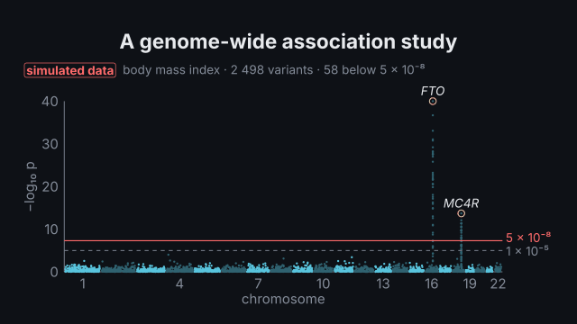
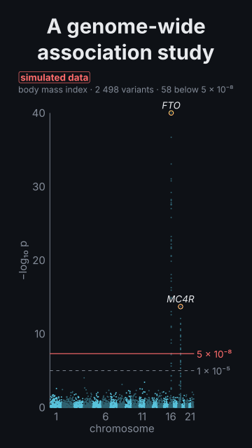

# `gwas`

<!-- Generated by `vidgen gallery`; edit the sample in AGENTS.md (or video.yaml), not this file. -->

**Use it for:** a genome-wide association study: a Manhattan plot with the 5 × 10⁻⁸ line and labelled peaks, a QQ plot with λ_GC, a regional plot of a locus coloured by LD.

A genome-wide association study. `plot: manhattan`: −log₁₀ p of every variant along the genome, chromosomes 1–22 (and X) in alternating colours, the genome-wide significance line at p = 5 × 10⁻⁸ and the suggestive line at 1 × 10⁻⁵, each peak labelled with its gene or lead variant; `qq`: observed against expected −log₁₀ p with the genomic inflation λ_GC; `both`. Data: `data` (a CSV in the project: chromosome, position in bp, p, and optionally variant, gene, r2), `variants` inline, or a seeded synthetic study — a null background with your `peaks`, each with the variants around it in linkage disequilibrium — written "simulated data" on the plot. `regional` (a param or the action) zooms into a peak: its variants coloured by r² with the lead.

Last beat, 16:9 and 9:16:

 

The scene playing (GIF, up to its last beat):

 

## YAML

From the author guide (`vidgen guide scenes`):

```yaml
- id: gwas
  type: gwas
  params:
    title: "A genome-wide association study"
    trait: body mass index
    peaks:                             # synthetic (shown as simulated data); or data: assoc.csv
      - {chromosome: 16, position: 53.8 Mb, p: 1e-40, gene: FTO}
      - {chromosome: 18, position: 60.2 Mb, p: 2e-14, gene: MC4R}
  beats:
    - text: "Every dot is a variant tested for association with body mass index."
    - text: "Two loci pass genome-wide significance, five times ten to the minus eight."
      actions: [{reveal: thresholds}, {reveal: peaks, at: "@loci"}]
```

## Params

| param | type | default | notes |
|---|---|---|---|
| `title` | `str` |  | Title (in the header band at the top). (also: heading) |
| `trait` | `str` |  | The trait studied (body mass index), written on the plot. |
| `plot` | `'manhattan' \| 'qq' \| 'both'` | `'manhattan'` | manhattan, qq (with λ_GC) or both. |
| `data` | `str \| None` |  | A CSV (or TSV) in the project: columns chromosome (CHR), position in bp (BP), p (P), and optionally variant (SNP), gene, r2. |
| `variants` | `list[dict[str, Any]] \| None` |  | Your variants inline: [{chromosome: 16, position: 53800000, p: 1e-40, variant: rs9939609, gene: FTO}, …]. |
| `peaks` | `list[dict[str, Any]] \| None` |  | A synthetic study's peaks: [{chromosome: 16, position: 53.8 Mb, p: 1e-40, gene: FTO, variant: rs9939609}]. |
| `labels` | `dict[str, str] \| None` |  | Your data: genes for lead variants {rs9939609: FTO} (else the variant id is written). |
| `background` | `int \| None` |  | Synthetic: how many null variants (default 2400). |
| `inflation` | `float \| None` |  | Synthetic: λ of the null background (1 = none; 1.2 mimics stratification). |
| `x_chromosome` | `bool` | `False` | Draw chromosome X after 22 (your data with X variants draws it anyway). |
| `clump_kb` | `float \| None` |  | Your data: no second lead within this distance of a lead (default 500 kb). |
| `regional` | `str \| None` |  | A peak's label to zoom into in the scene's own steps (or use the action regional). |
| `y_max` | `float \| None` |  | Top of the −log₁₀ p axis (default: the data's, at most 40; higher points are drawn at the top with their p). |
| `seed` | `int` | `1` | Synthetic: the random seed. |
| `title_size` | `size` | `'heading'` | Title size. (also: heading_size) |
| `size` | `size` | `'caption'` | Label size (never below the readable minimum). |

## Targets

`title`, `manhattan`, `points`, `chromosome:<n>`, `thresholds`, `significance`, `suggestive`, `peaks`, `peak:<label>`, `qq`, `lambda`, `regional`, `simulated`

## Beats

Any number.

[All scene types](README.md) · `vidgen list-scenes` · `vidgen schema --scene gwas`
