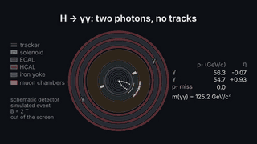
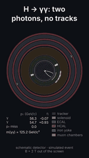
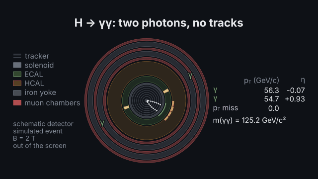
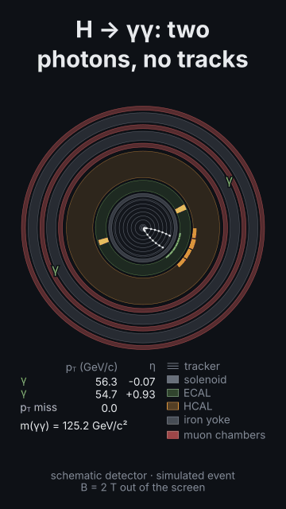

# A Higgs boson in two photons

<!-- Generated by `vidgen gallery`; edit src/vidgen/data/gallery/showcases/higgs_diphoton.yaml, not this file. -->

**Use it for:** a simulated H → γγ event: two ECAL showers and no tracks, the photons' p_T and η and their invariant mass, 125 GeV/c².

A showcase of [`detector`](detector.md): a small scene written for the gallery, a whole `video.yaml`. Copy it into a
project and run `vidgen render`; until `vidgen tts` voices it, its beats are timed by their word count.

The scene playing, 16:9 and 9:16:

<picture><source media="(prefers-reduced-motion: reduce)" srcset="media/higgs_diphoton-16x9.png"></picture> <picture><source media="(prefers-reduced-motion: reduce)" srcset="media/higgs_diphoton-9x16.png"></picture>

Last beat:

 

## YAML

```yaml
title: A Higgs boson in two photons
voice: {provider: kokoro, voice: af_heart}
scenes:
  - id: higgs_diphoton
    type: detector
    params:
      title: "H → γγ: two photons, no tracks"
      event: {preset: h_to_gammagamma, seed: 10, soft: 0}   # simulated; m(γγ) = 125.2 GeV/c², p_T 56.3 and 54.7 GeV/c
      legend: false
    beats:
      - text: "A simulated Higgs boson decays to two photons in a schematic detector."
      - text: "Neutral, they leave no tracks: each one showers in the electromagnetic calorimeter."
        actions: [{highlight: "particle:1", at: "@Neutral"}, {highlight: "particle:2", at: "@showers"}]
```

[All scene types and showcases](README.md) · `vidgen guide particle-physics` · [the particle-physics cookbook](../COOKBOOK-PARTICLES.md)
