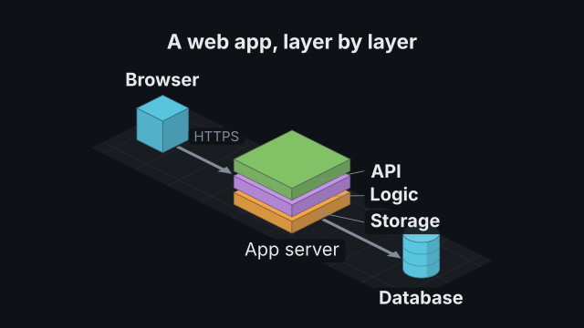
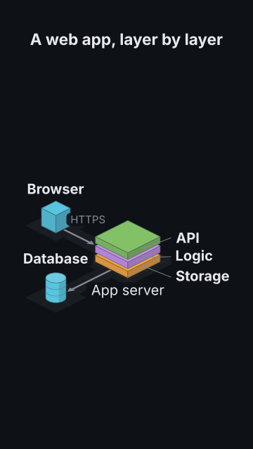

# `iso_diagram`

<!-- Generated by `vidgen gallery`; edit the sample in AGENTS.md (or video.yaml), not this file. -->

**Use it for:** architecture in 3D: servers, databases, layered stacks, data flow (isometric blocks).

A diagram of blocks in the isometric view: boxes, slabs, cylinders and databases, flat tiles, stacks of layers (a layered architecture, a network's layers) and group plates on a grid, joined by connectors along the grid (flat arrows, dashed, or pipes). Labels stay flat and readable: on a block's top when they fit, else beside it on a plate; a stack's layers are labelled at its side. The diagram is fitted to the frame (16:9 and 9:16) and shown in the first beat.

Last beat, 16:9 and 9:16:

 

The scene playing (GIF, up to its last beat):

 

## YAML

From the author guide (`vidgen guide scenes`):

```yaml
- id: arch
  type: iso_diagram
  params:
    heading: "A web app, layer by layer"
    blocks:
      - {id: browser, label: "Browser"}
      - {id: app, label: "App server", layers: [Storage, Logic, API]}   # a stack: layers bottom up
      - {id: db, label: "Database", shape: database}
    edges: ["browser -> app: HTTPS", "app -> db"]
  beats:
    - text: "Requests come in from the browser."
    - text: "The app server handles them layer by layer, and keeps its data in a database."
```

## Params

| param | type | default | notes |
|---|---|---|---|
| `blocks` | `list[str \| IsoBlock]` | required | The blocks, in order: an id string, {id, label?, shape?, at?, size?, height?, color?}, or a stack {id, layers (bottom up), label?, at?, size?, gap?, label_side?, color?} (up to ~12 read well). |
| `blocks.id` | `str` | required | Name used by edges, groups and targets (letters, digits, spaces, _ . -). |
| `blocks.label` | `str` |  | Text shown with the block (default: the id): on its top when it fits, else beside it; a stack's caption under it. |
| `blocks.shape` | `'box' \| 'slab' \| 'cylinder' \| 'database' \| 'tile' \| None` |  | box (default: 1x1, 0.8 high), slab (2x2, 0.3), cylinder (1x1, 0.9), database (a cylinder with bands) or tile (a flat 2x2 platform, 0.12); not on a stack. |
| `blocks.layers` | `list[str \| IsoLayer] \| None` |  | Makes it a stack: its layers FROM THE BOTTOM UP, each an id string or {id, label?, shape?, height?, color?} (a slab by default). |
| `blocks.layers.id` | `str` | required | Name used by edges and targets (letters, digits, spaces, _ . -). |
| `blocks.layers.label` | `str` |  | Text beside the layer (default: the id). |
| `blocks.layers.shape` | `'box' \| 'slab' \| 'cylinder' \| 'database' \| 'tile'` | `'slab'` | slab (default), box, tile, cylinder or database; it covers the stack's footprint. |
| `blocks.layers.height` | `float \| None` |  | Height in cells (default by shape: a slab 0.3). |
| `blocks.layers.color` | `color \| None` |  | Its colour (default: the stack's color, else the scene's block_color, or a term's colour). |
| `blocks.at` | `tuple[float, float] \| None` |  | [column, row] of its back cell on the grid: columns run to the lower right, rows to the lower left (give every block an 'at', or none). |
| `blocks.size` | `tuple[float, float] \| None` |  | [columns, rows] of cells it covers (default by shape, a stack [2, 2]; a cylinder's is square). |
| `blocks.height` | `float \| None` |  | Height in cells (default by shape; not on a stack: give its layers heights). |
| `blocks.gap` | `float \| None` |  | A stack's space between layers (default 0.12 cells). |
| `blocks.label_side` | `'auto' \| 'left' \| 'right' \| None` |  | Where a stack's layer labels go: auto (default: the side away from the diagram's middle), left or right. |
| `blocks.color` | `color \| None` |  | Its colour (a stack's: its layers'; default: the scene's block_color, or a term's colour when its label is a term). |
| `groups` | `list[IsoGroup]` |  | Plates under blocks that belong together: {id, blocks, label?, color?}. |
| `groups.id` | `str` | required | Name used by targets (group:<id>). |
| `groups.blocks` | `list[str]` | required | Ids of the blocks and stacks on the plate (whole stacks, not their layers). |
| `groups.label` | `str` |  | Optional caption by the plate. |
| `groups.color` | `color \| None` |  | Plate tint (default: dim). |
| `edges` | `list[str \| IsoEdge]` |  | Connectors along the grid: 'a -> b', 'a -> b: label', 'a --> b' (dashed), chains 'a -> b -> c', or {from, to, label?, style?, color?}. |
| `edges.from` | `str` | required | Block or stack id the connector starts at. |
| `edges.to` | `str` | required | Block or stack id it points to. |
| `edges.label` | `str` |  | Optional text on the connector. |
| `edges.style` | `'solid' \| 'dashed' \| 'pipe' \| None` |  | solid (a flat arrow), dashed or pipe (a raised channel, no arrowhead); default: the scene's edge_style ('-->' is dashed). |
| `edges.color` | `color \| None` |  | Colour (default: the scene's edge_color). |
| `heading` | `str` |  | Optional heading above the diagram. (also: title) |
| `arrange` | `'auto' \| 'row' \| 'column' \| 'grid' \| 'zigzag'` | `'auto'` | How blocks without 'at' are placed, in the order written: row (along the columns, to the lower right), column (along the rows, to the lower left), grid, zigzag (right, down-left, right...: two columns down a tall frame) or auto (row; zigzag in 9:16). |
| `columns` | `int \| None` |  | Columns of the grid arrangement (default: about the square root of the count). |
| `spacing` | `float \| None` |  | Empty cells between arranged blocks (default: 1; 2 in a zigzag, so labels fit above and below). |
| `floor` | `'grid' \| 'plain' \| 'none'` | `'grid'` | The floor under the diagram: with grid lines, plain, or none. |
| `block_color` | `'palette' \| color` | `'palette'` | Colour of blocks without their own: 'palette' (one theme palette colour each) or one colour. |
| `edge_style` | `'solid' \| 'dashed' \| 'pipe'` | `'solid'` | Connectors without their own style: solid (flat arrow), dashed or pipe. |
| `edge_color` | `color` | `'dim'` | Connector colour. |
| `label_color` | `color` | `'text'` | Label colour (a label on a block's top takes the ink that reads best on it). |
| `edge_label_color` | `color` | `'dim'` | Connector label colour. |
| `heading_color` | `color` | `'text'` | Heading colour. (also: title_color) |
| `size` | `size` | `'body'` | Label size (reduced, not below the readable minimum, when space is short). |
| `edge_label_size` | `size` | `'caption'` | Connector label size (never below the readable minimum). |
| `heading_size` | `size` | `'heading'` | Heading size. (also: title_size) |

## Targets

`heading`, `block<N>`, `block:<id>`, `stack:<id>`, `group:<id>`, `edge:<from>-><to>`

## Beats

Any number.

[All scene types](README.md) · `vidgen list-scenes` · `vidgen schema --scene iso_diagram`
