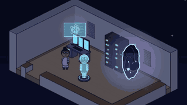
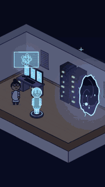
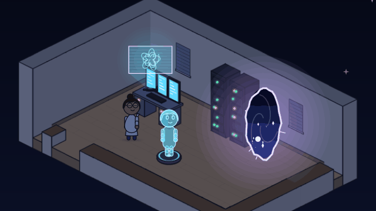
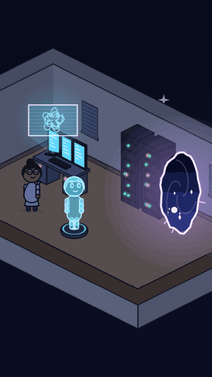

# The night shift

<!-- Generated by `vidgen gallery`; edit src/vidgen/data/gallery/showcases/iso_lab.yaml, not this file. -->

**Use it for:** a lab at night: a hologram materialises, screens and blinking racks, shutters, a rift with a starry sky inside.

A showcase of [`stage`](stage.md): a small scene written for the gallery, a whole `video.yaml`. Copy it into a
project and run `vidgen render`; until `vidgen tts` voices it, its beats are timed by their word count.

The scene playing, 16:9 and 9:16:

<picture><source media="(prefers-reduced-motion: reduce)" srcset="media/iso_lab-16x9.png"></picture> <picture><source media="(prefers-reduced-motion: reduce)" srcset="media/iso_lab-9x16.png"></picture>

Last beat:

 

## YAML

```yaml
title: The Night Shift
voice: {provider: kokoro, voice: bf_emma}
voices:
  lumen_voice: {voice: af_nicole, label: Lumen, color: accent, effect: echo}
characters:
  - name: mira
    look: {body: pear, hair: bun, eyes: oval, outfit: coat, accessories: [glasses]}
    colors: {skin: "#C99A72", clothes: "#F4F6FA", trim: "#3B4A6B", hair: "#3A2418"}
  - name: lumen
    voice: lumen_voice
    hologram: true
    look: {body: tall, hair: short, eyes: oval}
    colors: {skin: "#F0F0F0", clothes: "#C8C8C8", hair: "#E8E8E8"}
scenes:
  - id: iso_lab
    type: stage
    params:
      background: ["#0E1424", "#1B2440"]
      light: night
      ambience: hum
      iso:
        place: indoor
        wide: fill
        map: |
          ##%#####%##
          #.........#
          #.d.....r.#
          #.........#
          #..s.p....#
          #.........#
          ##+########
        spots: {d: desk, s: station, p: pad, r: rift}
        objects:
          - {object: console, at: desk}
          - {object: projector_pad, at: pad}
          - {object: server_rack, at: {column: 6, row: 2}}
          - {object: server_rack, at: {column: 7, row: 2}}
      props:
        - {prop: hologram_display, name: screen, at: desk, "on": true}
        - {prop: portal, name: rift_1, at: rift, scale: 1.3, view: stars}
      characters: [{name: mira, at: station}, {name: lumen, at: pad}]
    beats:
      - text: "At night, the lab's assistant took shape on its pad."
        actions: [{materialise: lumen, at: 0.1}]
      - text: "Then, with a crackle, the air tore open onto the stars."
        actions:
          - {shutters: close, at: 0.05}
          - {switch_on: rift_1, at: 0.3}
```

[All scene types and showcases](README.md) · `vidgen guide cartoons` · `vidgen guide iso` · `vidgen guide platform`
