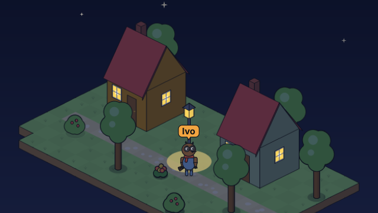
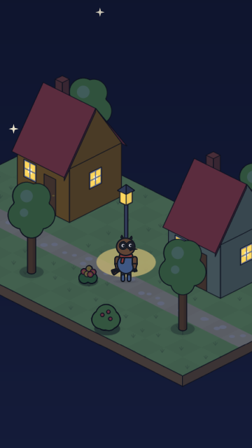

# Lighting the lamp

<!-- Generated by `vidgen gallery`; edit src/vidgen/data/gallery/showcases/iso_lamp.yaml, not this file. -->

**Use it for:** night on an isometric place: a lamp lit, a speaker's name tag.

A showcase of [`stage`](stage.md): a small scene written for the gallery, a whole `video.yaml`. Copy it into a
project and run `vidgen render`; until `vidgen tts` voices it, its beats are timed by their word count.

The scene playing, 16:9 and 9:16:

<picture><source media="(prefers-reduced-motion: reduce)" srcset="media/iso_lamp-16x9.png"></picture> <picture><source media="(prefers-reduced-motion: reduce)" srcset="media/iso_lamp-9x16.png"></picture>

Last beat:

 

## YAML

```yaml
title: Lighting the Lamp
voice: {provider: kokoro, voice: bf_emma}
voices:
  ivo_voice: {voice: bm_george, label: Ivo, color: secondary}
characters:
  - name: ivo
    voice: ivo_voice
    look: {species: owl, body: round, eyes: round, accessories: [scarf]}
    colors: {skin: "#8A6248", clothes: "#5B7DB1", accessory: "#C0504D"}
scenes:
  - id: iso_lamp
    type: stage
    params:
      background: ["#1E2742", "#3A4566"]
      light: night
      iso:
        map: |
          -.@........@....
          ..h.......g.....
          ...............@
          ................
          ...a....l.......
          .:::::::::::::::
          ..&.....*....@..
          ......@.........
          -..........&....
        spots: {h: home, g: neighbour, a: door, l: lamp}
        objects:
          - {object: house, at: home, "on": true}
          - {object: house, at: neighbour, color: "#B5C99A", "on": true}
          - {object: lamp, at: lamp}
      characters: [{name: ivo, at: door}]
    beats:
      - text: "When night fell, old Ivo walked out to the lamp on the lane."
        actions: [{walk_to: ivo, to: lamp, at: 0.1}]
      - text: "There. Now everyone can find the way home."
        voice: ivo_voice
        actions: [{switch_on: lamp, at: 0.05}]
```

[All scene types and showcases](README.md) · `vidgen guide cartoons` · `vidgen guide iso` · `vidgen guide platform`
