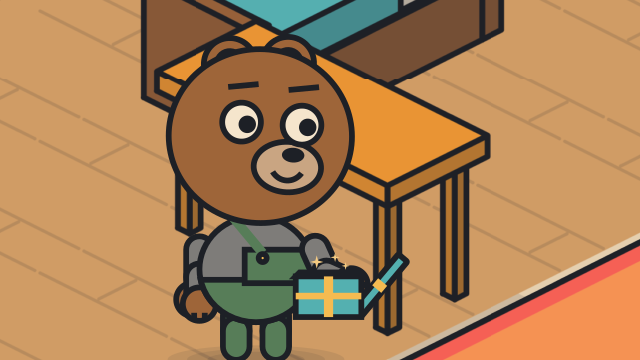
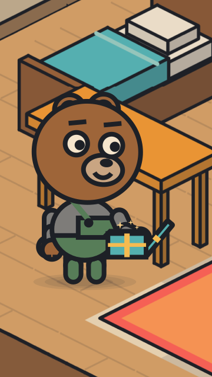

# A cut-away room

<!-- Generated by `vidgen gallery`; edit src/vidgen/data/gallery/showcases/iso_room.yaml, not this file. -->

**Use it for:** an isometric room seen like a dollhouse: furniture, a thing to pick up.

A showcase of [`stage`](stage.md): a small scene written for the gallery, a whole `video.yaml`. Copy it into a
project and run `vidgen render`; until `vidgen tts` voices it, its beats are timed by their word count.

The scene playing, 16:9 and 9:16:

<picture><source media="(prefers-reduced-motion: reduce)" srcset="media/iso_room-16x9.png"></picture> <picture><source media="(prefers-reduced-motion: reduce)" srcset="media/iso_room-9x16.png"></picture>

Last beat:

 

## YAML

```yaml
title: A Cut-away Room
characters:
  - name: milo
    look: {species: bear, proportions: kid, eyes: round, outfit: overalls}
    colors: {skin: "#A47148", clothes: "#5B8C6E"}
scenes:
  - id: iso_room
    type: stage
    params:
      background: ["#3E4A6B", "#5C6A8E"]
      light: indoor
      iso:
        place: indoor
        map: |
          ###%#####%##
          #..........#
          #.b......s.#
          #....::::..#
          #..t.::::..#
          #....::::..#
          #.e.....p..#
          ##+#########
        spots: {b: bed, s: shelf, t: table, e: entry, p: plant}
        objects:
          - {object: bed, at: bed}
          - {object: shelf, at: shelf}
          - {object: table, at: table}
          - {object: plant, at: plant}
          - {object: rug, at: {column: 6, row: 4}, size: [4, 3]}
      props: [{prop: gift, at: table}]
      characters: [{name: milo, at: entry}]
    beats:
      - text: "Milo came into his room, and there was a present on the table."
        actions:
          - {enter: milo, to: entry, side: left, at: 0.05}
          - {walk_to: milo, to: table, at: 0.4}
      - text: "He picked it up, and opened it with a big smile."
        shot: medium milo
        actions:
          - {pick_up: milo, to: gift, at: 0.1}
          - {open: gift, at: 0.5}
          - {emote: milo, to: happy, at: 0.55}
```

[All scene types and showcases](README.md) · `vidgen guide cartoons` · `vidgen guide iso` · `vidgen guide platform`
