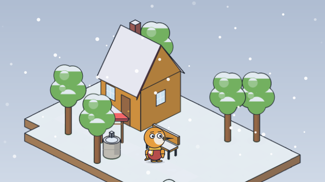
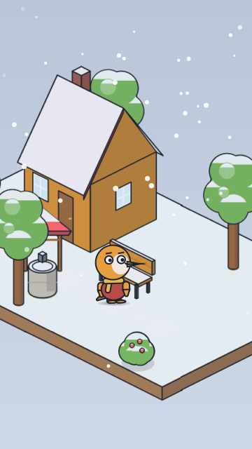

# First snow

<!-- Generated by `vidgen gallery`; edit src/vidgen/data/gallery/showcases/iso_snow.yaml, not this file. -->

**Use it for:** snow settling on an isometric village: the ground, roofs and trees turn white.

A showcase of [`stage`](stage.md): a small scene written for the gallery, a whole `video.yaml`. Copy it into a
project and run `vidgen render`; until `vidgen tts` voices it, its beats are timed by their word count.

The scene playing, 16:9 and 9:16:

<picture><source media="(prefers-reduced-motion: reduce)" srcset="media/iso_snow-16x9.png"></picture> <picture><source media="(prefers-reduced-motion: reduce)" srcset="media/iso_snow-9x16.png"></picture>

Last beat:

 

## YAML

```yaml
title: First Snow
characters:
  - name: suki
    look: {species: penguin, proportions: kid, eyes: round, accessories: [scarf]}
    colors: {clothes: "#C0504D", accessory: "#F2C14E"}
scenes:
  - id: iso_snow
    type: stage
    params:
      background: ["#B8C4D6", "#E4EAF2"]
      light: {tint: "#C9D6E8", strength: 0.25}
      particles: [{kind: snow, density: 1, settle: true}]
      iso:
        map: |
          -.@......@..
          ..h.....@...
          ............
          ............
          ...a..b.....
          .:::::::::..
          ..@..w......
          -....@....&.
        spots: {h: home, a: door, w: well, b: bench}
        objects:
          - {object: house, at: home}
          - {object: well, at: well}
          - {object: bench, at: bench}
      characters: [{name: suki, at: door}]
    beats:
      - text: "In the night, the first snow of winter began to fall on the village."
      - text: "By morning, Suki waddled out to see everything turn white."
        actions: [{walk_to: suki, to: bench, at: 0.05}]
```

[All scene types and showcases](README.md) · `vidgen guide cartoons` · `vidgen guide iso` · `vidgen guide platform`
