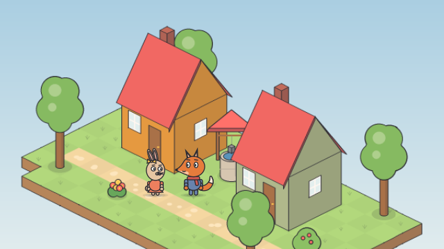
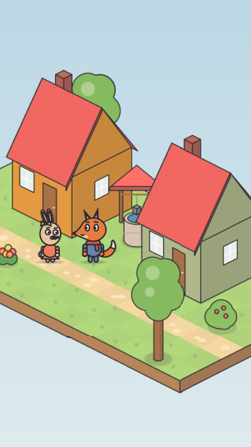

# Morning in the village

<!-- Generated by `vidgen gallery`; edit src/vidgen/data/gallery/showcases/iso_village.yaml, not this file. -->

**Use it for:** a sunny isometric village where two characters walk to meet.

A showcase of [`stage`](stage.md): a small scene written for the gallery, a whole `video.yaml`. Copy it into a
project and run `vidgen render`; until `vidgen tts` voices it, its beats are timed by their word count.

The scene playing, 16:9 and 9:16:

<picture><source media="(prefers-reduced-motion: reduce)" srcset="media/iso_village-16x9.png"></picture> <picture><source media="(prefers-reduced-motion: reduce)" srcset="media/iso_village-9x16.png"></picture>

Last beat:

 

## YAML

```yaml
title: Morning in the Village
voice: {provider: kokoro, voice: bf_emma}
voices:
  bree_voice: {voice: af_bella, label: Bree, color: primary}
  oskar_voice: {voice: am_michael, label: Oskar, color: accent}
characters:
  - name: bree
    voice: bree_voice
    look: {species: rabbit, proportions: kid, eyes: round, outfit: dress, accessories: [bow]}
    colors: {skin: "#D9C2A7", clothes: "#E07A5F", accessory: "#F2C14E"}
  - name: oskar
    voice: oskar_voice
    look: {species: fox, proportions: kid, eyes: oval, accessories: [scarf]}
    colors: {skin: "#D9773B", clothes: "#5B7DB1", accessory: "#C0504D"}
scenes:
  - id: iso_village
    type: stage
    params:
      background: ["#9CCBEA", "#E4F3FB"]
      light: morning
      iso:
        map: |
          -.@.........@.
          ..h.....r.....
          ......w.......
          ..............
          ...a.....b..&.
          .:::::::::::::
          .@..*.........
          -...........@.
        spots: {h: bree_home, r: oskar_home, a: bree_door, b: oskar_door, w: well}
        objects:
          - {object: house, name: bree_house, at: bree_home}
          - {object: house, name: oskar_house, at: oskar_home, color: "#B5C99A"}
          - {object: well, at: well}
      characters:
        - {name: bree, at: bree_door}
        - {name: oskar, at: oskar_door}
    beats:
      - text: "On a sunny morning, Bree and Oskar stepped out at the very same time."
        actions: [{meet: bree, with: oskar, at: 0.2}]
      - text: "Good morning, Oskar!"
        voice: bree_voice
        shot: closeup bree
        actions: [{gesture: bree, to: wave, at: 0.1}]
      - text: "Morning, Bree! To the stream?"
        voice: oskar_voice
        shot: wide                      # back to the village: a name tag shows who speaks
        actions: [{emote: oskar, to: happy, at: 0.1}]
```

[All scene types and showcases](README.md) · `vidgen guide cartoons` · `vidgen guide iso` · `vidgen guide platform`
