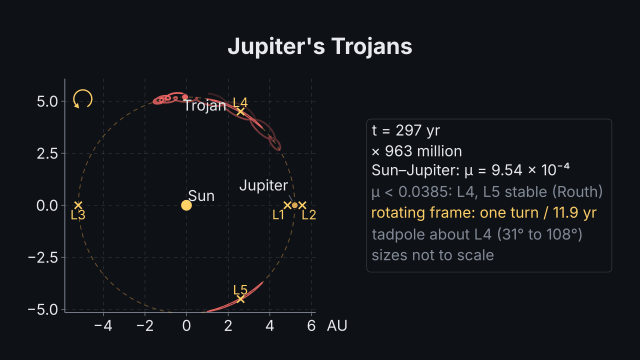
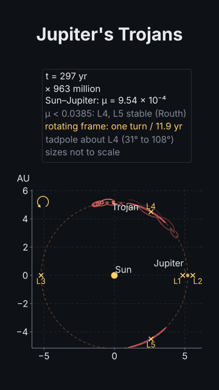

# Trojans in the rotating frame

<!-- Generated by `vidgen gallery`; edit src/vidgen/data/gallery/showcases/jupiter_trojans.yaml, not this file. -->

**Use it for:** a three-body system in the frame turning with Jupiter: the five Lagrange points standing still, a Trojan's tadpole inside its zero-velocity curve.

A showcase of [`orbit`](orbit.md): a small scene written for the gallery, a whole `video.yaml`. Copy it into a
project and run `vidgen render`; until `vidgen tts` voices it, its beats are timed by their word count.

The scene playing, 16:9 and 9:16:

<picture><source media="(prefers-reduced-motion: reduce)" srcset="media/jupiter_trojans-16x9.png"></picture> <picture><source media="(prefers-reduced-motion: reduce)" srcset="media/jupiter_trojans-9x16.png"></picture>

Last beat:

 

## YAML

```yaml
title: Trojans in the rotating frame
voice: {provider: kokoro, voice: af_heart}
scenes:
  - id: jupiter_trojans
    type: orbit
    params:
      title: "Jupiter's Trojans"
      system: sun_jupiter                # the circular restricted three-body problem, μ = 9.54 × 10⁻⁴
      view: rotating                     # the frame turns with Jupiter: the Sun, Jupiter and L1–L5 stand still
      lagrange: true
      zero_velocity: true                # the curve the Trojan cannot cross (its Jacobi constant)
      bodies:
        - {name: Trojan, near: L4, shift: [0.004, 0.0069], trail: "150 yr"}   # shares of the separation
      span: "300 yr"
    beats:
      - text: "In the frame turning with Jupiter, the five Lagrange points stand still."
        actions: [{highlight: "lagrange:L4", at: "@five"}]
      - text: "A Trojan near L4 traces a tadpole around it, and never crosses its zero-velocity curve."
```

[All scene types and showcases](README.md) · `vidgen guide orbits` · [the orbits cookbook](../COOKBOOK-ORBITS.md)
