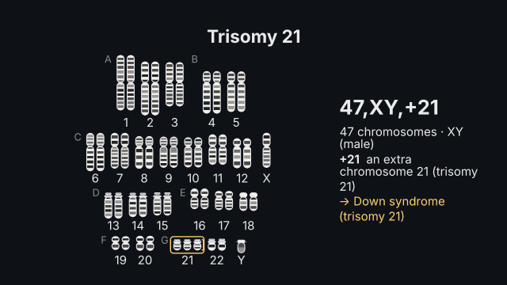
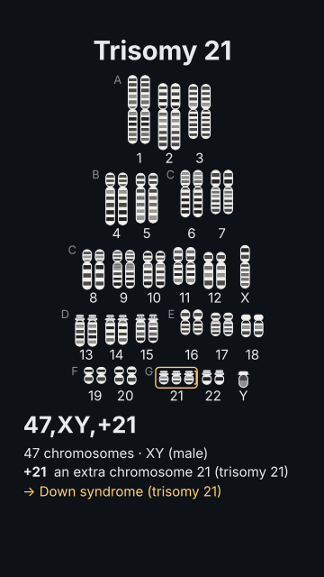

# `karyotype`

<!-- Generated by `vidgen gallery`; edit the sample in AGENTS.md (or video.yaml), not this file. -->

**Use it for:** a human karyotype from its ISCN notation (47,XX,+21; 45,X; 46,XY,del(5)(p15.2); t(9;22); rob(14;21)): a karyogram by groups A–G with G-banded ideograms and the change highlighted, or the chromosomes involved with structural changes played as edits.

A human karyotype from its ISCN notation (46,XX; 47,XY,+21; 45,X; 47,XXY; 46,XY,del(5)(p15.2); 46,XX,t(9;22)(q34;q11.2); 45,XX,rob(14;21)(q10;q10)…), parsed and checked (the count against the chromosomes listed, the bands against each arm's last band). karyogram: the pairs 1–22, X, Y in the Denver groups A–G, schematic G-banded ideograms with correct relative lengths and centromere positions (satellites on 13, 14, 15, 21, 22), the changes highlighted. ideogram: the chromosomes involved, large, p and q arms and the bands named; structural changes play as edits of the normal chromosomes. A card writes the notation and reads it. Band positions are schematic (ISCN names, not measured ideogram positions).

Last beat, 16:9 and 9:16:

 

The scene playing (GIF, up to its last beat):

 

## YAML

From the author guide (`vidgen guide scenes`):

```yaml
- id: karyotype
  type: karyotype
  params:
    title: "Trisomy 21"
    karyotype: "47,XY,+21"             # or 46,XX,t(9;22)(q34;q11.2): its edit plays in an ideogram
  beats:
    - text: "A male karyotype, its chromosomes in pairs by size, three copies of chromosome twenty-one."
    - text: "Forty-seven, X Y, plus twenty-one: Down syndrome."
```

## Params

| param | type | default | notes |
|---|---|---|---|
| `title` | `str` |  | Title (in the header band at the top). (also: heading) |
| `karyotype` | `str` | `'46,XX'` | ISCN: count, sex chromosomes, changes — 46,XY; 47,XX,+21; 45,X; 47,XXY; 46,XY,del(5)(p15.2); 46,XX,dup(1)(q21q32); 46,XY,inv(9)(p12q13); 46,XX,t(9;22)(q34;q11.2); 45,XX,rob(14;21)(q10;q10). |
| `show` | `'auto' \| 'karyogram' \| 'ideogram'` | `'auto'` | karyogram: every chromosome in pairs by group; ideogram: the chromosomes involved (or those in chromosomes:), large, with structural changes played as edits; auto: ideogram when chromosomes is given or every change is structural, else karyogram. |
| `chromosomes` | `list[str \| int] \| None` |  | ideogram: which chromosomes to draw (all their copies), e.g. [7] or [9, 22]; default: those the changes involve. |
| `bands` | `dict[str, str] \| list[str] \| None` |  | Bands to label (ideogram), with an optional text: {7q31.2: CFTR, Xq28: F8} or [21q22]. |
| `notation` | `bool` | `True` | The card with the notation and its reading. |
| `title_size` | `size` | `'heading'` | Title size. (also: heading_size) |
| `size` | `size` | `'caption'` | Label size (never below the readable minimum). |

## Targets

`title`, `chromosomes`, `group:<A…G>`, `chromosome:<name>`, `change:<n>`, `changes`, `notation`, `reading`, `band:<band>`

## Beats

Any number.

[All scene types](README.md) · `vidgen list-scenes` · `vidgen schema --scene karyotype`
