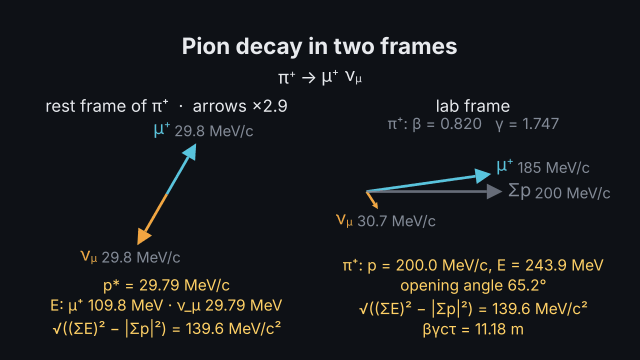
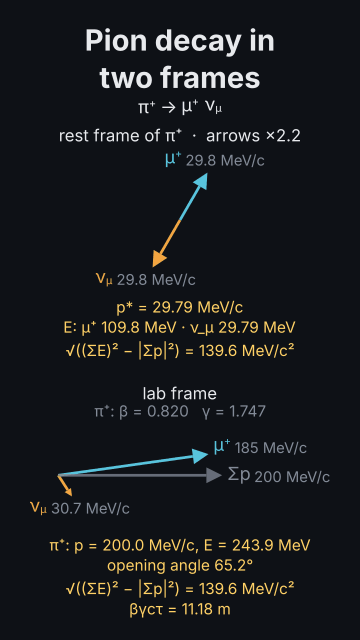
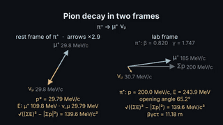
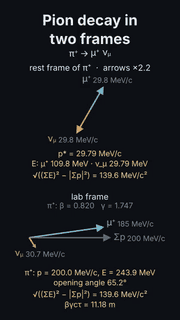

# `kinematics`

<!-- Generated by `vidgen gallery`; edit the sample in AGENTS.md (or video.yaml), not this file. -->

**Use it for:** relativistic kinematics: a two-body decay (π⁺ → μ⁺ ν_μ, K⁺ → π⁺ π⁰, H → γγ) as momentum arrows in the rest frame and the lab, particles with their invariant mass, boosts, opening angles, decay lengths βγcτ.

Momentum vectors in two frames: a two-body `decay` (`"pi+ -> mu+ nu_mu"`) in the parent's rest frame and in the lab (`momentum: 10 GeV/c` of the parent, or `energy`, `kinetic`, `beta`, `gamma`), or `particles` given in the lab with the system's rest frame; `frames: both` (side by side in 16:9, stacked in 9:16), `rest` or `lab`. Each frame shows its arrows to scale (momenta at the tips), the sum vector and its numbers: p*, energies, β, γ, the opening angle, the invariant mass (the same in both), the decay length βγcτ, SI conversions (`si: true`). Values from PDG 2024.

Last beat, 16:9 and 9:16:

 

The scene playing (GIF, up to its last beat):

 

## YAML

From the author guide (`vidgen guide scenes`):

```yaml
- id: pion_decay
  type: kinematics         # arrows to scale in the rest frame and the lab; p*, β, γ, opening angle, invariant mass, βγcτ
  params:
    title: "Pion decay in two frames"
    decay: "pi+ -> mu+ nu_mu"
    momentum: "200 MeV/c"  # the pion in the lab (or energy, kinetic, beta, gamma); frames: both | rest | lab
  beats:
    - text: "At rest, the muon and the neutrino fly apart back to back."
    - text: "In the lab the pion moves, and both are thrown forward."
    - text: "The invariant mass is the same in both frames: the pion's mass."
      actions: [{highlight: values, at: "@invariant"}]
```

## Params

| param | type | default | notes |
|---|---|---|---|
| `title` | `str` |  | Title above the picture. (also: heading) |
| `caption` | `str` |  | Note under the picture. |
| `decay` | `str \| None` |  | A two-body decay: "pi+ -> mu+ nu_mu", "K+ -> pi+ pi0", "Lambda -> p pi-", "H -> gamma gamma" (checked: allowed and above threshold). |
| `particles` | `list[KinParticle]` |  | Particles given in the lab instead of a decay: [{particle: gamma, momentum: 62.6 GeV/c, angle: 30}, ...]. |
| `particles.particle` | `str` | required | The particle (gamma, e-, mu+, pi0, p, Z; Unicode works: π⁰). |
| `particles.momentum` | `str` | required | Its momentum with the unit: 62.6 GeV/c, 200 MeV/c. |
| `particles.angle` | `float` | `0.0` | Its direction in degrees from the x axis (counter-clockwise). |
| `momentum` | `str \| None` |  | The decaying particle's momentum in the lab: 10 GeV/c, 200 MeV/c. |
| `energy` | `str \| None` |  | …or its total energy in the lab: 4 GeV. |
| `kinetic` | `str \| None` |  | …or its kinetic energy in the lab: 1 GeV. |
| `beta` | `float \| None` |  | …or its speed β = v/c (0 ≤ β < 1). |
| `gamma` | `float \| None` |  | …or its Lorentz factor γ (≥ 1). |
| `angle` | `float` | `60.0` | Decay: the first product's direction in the rest frame, degrees from the flight direction (the second goes opposite). |
| `frames` | `'both' \| 'rest' \| 'lab'` | `'both'` | both: the rest frame and the lab side by side (stacked in 9:16); rest or lab: one frame (boost moves it). |
| `values` | `bool` | `True` | Write each frame's numbers (p*, energies, β, γ, opening angle, invariant mass, decay length). |
| `sum` | `bool` | `True` | Draw the sum of the momenta (Σp; zero in the rest frame). |
| `decay_length` | `bool` | `True` | Decay: the parent's mean decay length L = βγcτ in the lab (when it has a lifetime). |
| `si` | `bool` | `False` | Add the SI conversion of the main value (p* in kg·m/s, the parent's energy in J, the invariant mass in kg). |
| `process` | `bool` | `True` | Write the decay or the particles under the title. |
| `reveal` | `'steps' \| 'all'` | `'steps'` | steps: the first frame, then the second, then the sums and numbers over the beats; all: everything in beat 1. |
| `title_size` | `size` | `'heading'` | Title size. (also: heading_size) |
| `title_color` | `color` | `'text'` | Title colour. (also: heading_color) |
| `caption_color` | `color` | `'dim'` | Caption colour. |

## Targets

`title`, `caption`, `process`, `panel:rest`, `panel:lab`, `arrow:<n>`, `arrow:<particle>`, `sum`, `values`

## Beats

Any number.

[All scene types](README.md) · `vidgen list-scenes` · `vidgen schema --scene kinematics`
