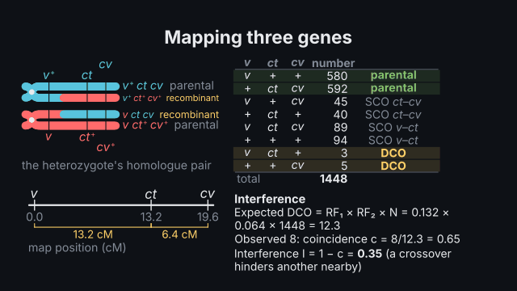
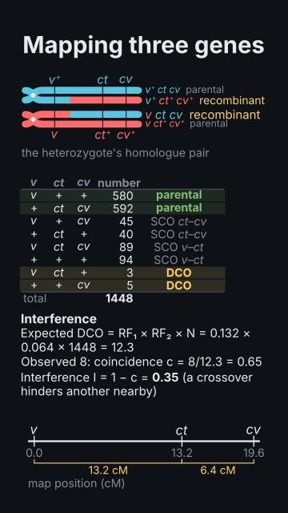

# `linkage_map`

<!-- Generated by `vidgen gallery`; edit the sample in AGENTS.md (or video.yaml), not this file. -->

**Use it for:** linked genes and genetic maps: crossing over between homologues (coupling / repulsion), a two- or three-point test cross worked out from offspring counts (parental and double-crossover classes, gene order, distances in cM, coincidence and interference), map functions.

Linked loci on a chromosome and genetic mapping. The heterozygous parent's homologue pair (sister chromatids joined at the centromere, maternal and paternal colours) carries the alleles in coupling or repulsion; crossing over between non-sister chromatids in an interval swaps the segments beyond the chiasma and gives recombinant chromatids. `counts`: a two- or three-point test cross worked out step by step — the table of offspring classes, the parental (largest) and double-crossover (smallest) classes, the gene order (the locus that differs between them is in the middle), each interval's recombinants, RF and map distance, the expected and observed double crossovers with the coefficient of coincidence and the interference, and the map. `map`: loci at their positions in cM; `measure` shows a distance and the RF it gives. Map functions: none (d = 100 × RF, short distances), Haldane, Kosambi.

Last beat, 16:9 and 9:16:

 

The scene playing (GIF, up to its last beat):

 

## YAML

From the author guide (`vidgen guide scenes`):

```yaml
- id: map
  type: linkage_map
  params:
    title: "Mapping three genes"
    loci: [v, cv, ct]                  # mutant alleles, any order: the order is worked out
    counts: {"v cv+ ct+": 580, "v+ cv ct": 592, "v cv ct+": 45, "v+ cv+ ct": 40, "v cv ct": 89, "v+ cv+ ct+": 94, "v cv+ ct": 3, "v+ cv ct+": 5}
  beats:
    - text: "Crossing over gives recombinant gametes; the rarest classes are double crossovers."
    - text: "So ct lies in the middle, 13.2 and 6.4 centimorgans from its neighbours."
```

## Params

| param | type | default | notes |
|---|---|---|---|
| `title` | `str` |  | Title (in the header band at the top). (also: heading) |
| `loci` | `list[str] \| None` |  | counts: the loci, named by their mutant alleles' symbols ([v, cv, ct]); the order does not matter (it is worked out). |
| `counts` | `dict[str, int] \| None` |  | A two- or three-point test cross: each offspring class and its number ({'v cv+ ct+': 580, '+ cv ct': 592, …}; + or v+ the wild type; every class once). |
| `map` | `dict[str, float] \| None` |  | Instead of counts: loci at their positions in cM ({y: 0, w: 1.5, v: 33, m: 36.1}). |
| `map_function` | `'none' \| 'haldane' \| 'kosambi'` | `'none'` | none: d = 100 × RF (what three-point analyses report; good below ~15 cM); haldane (no interference) or kosambi (with interference) correct for unseen double crossovers. |
| `phase` | `'coupling' \| 'repulsion' \| None` |  | map: the heterozygote's alleles — coupling (mutant alleles on one homologue) or repulsion (alternating); counts show their own. |
| `crossover` | `str \| list[str] \| None` | `'auto'` | The crossing over drawn: an interval between neighbouring loci (v-ct), a list, double (one in each interval of three loci), none; auto: the first interval. |
| `chromosomes` | `bool` | `True` | Draw the homologue pair (with counts it can be left out: the table and the map only). |
| `title_size` | `size` | `'heading'` | Title size. (also: heading_size) |
| `size` | `size` | `'caption'` | Label size (never below the readable minimum). |

## Targets

`title`, `chromosomes`, `table`, `classes`, `order`, `distances`, `interference`, `map`, `locus:<name>`, `interval:<a>-<b>`, `double`

## Beats

Any number.

[All scene types](README.md) · `vidgen list-scenes` · `vidgen schema --scene linkage_map`
