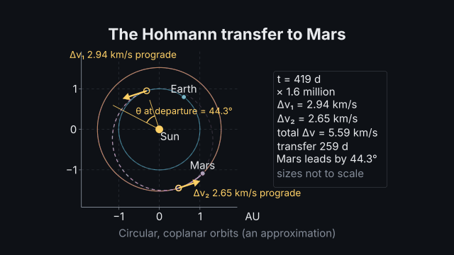
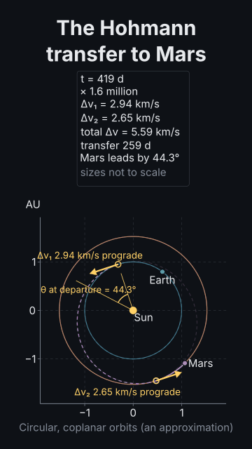

# The Hohmann transfer to Mars

<!-- Generated by `vidgen gallery`; edit src/vidgen/data/gallery/showcases/mars_hohmann.yaml, not this file. -->

**Use it for:** a transfer between two planets: the phase angle at the launch window, two burns on words, the Δv and the time computed.

A showcase of [`orbit`](orbit.md): a small scene written for the gallery, a whole `video.yaml`. Copy it into a
project and run `vidgen render`; until `vidgen tts` voices it, its beats are timed by their word count.

The scene playing, 16:9 and 9:16:

<picture><source media="(prefers-reduced-motion: reduce)" srcset="media/mars_hohmann-16x9.png"></picture> <picture><source media="(prefers-reduced-motion: reduce)" srcset="media/mars_hohmann-9x16.png"></picture>

Last beat:

 

## YAML

```yaml
title: Earth to Mars
voice: {provider: kokoro, voice: af_heart}
scenes:
  - id: mars_hohmann
    type: orbit
    params:
      title: "The Hohmann transfer to Mars"
      bodies:
        - {preset: earth, e: 0, i: 0, raan: 0, argp: 0, trail: false}   # a transfer is between circular, coplanar orbits
        - {preset: mars, e: 0, i: 0, raan: 0, argp: 0, nu: 95, trail: false}
        - {name: Ship, alongside: Earth, trail: 0.15}
      transfer: {ship: Ship, to: Mars}   # Δv₁ 2.94 + Δv₂ 2.65 km/s, 259 d, Mars 44.3° ahead, windows every 780 d
      caption: "Circular, coplanar orbits (an approximation)"
    beats:
      - text: "We leave when Mars leads by forty-four degrees, with a prograde burn."
        actions: [{highlight: phase, at: "@forty-four"}, {burn: "burn:1", at: "@burn"}]
      - text: "Two hundred and fifty-nine days later a second burn matches the speed of Mars."
        actions: [{burn: "burn:2", at: "@second"}]
```

[All scene types and showcases](README.md) · `vidgen guide orbits` · [the orbits cookbook](../COOKBOOK-ORBITS.md)
