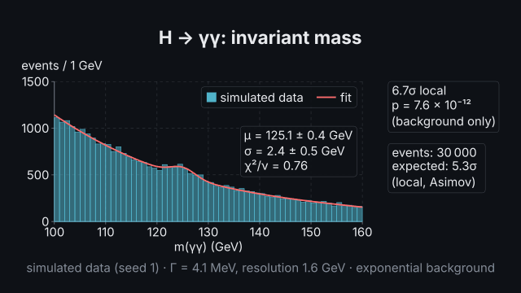
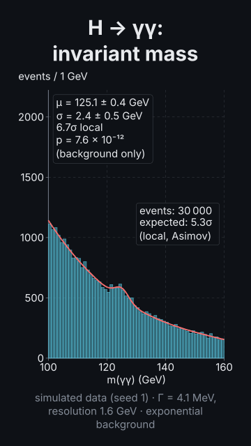
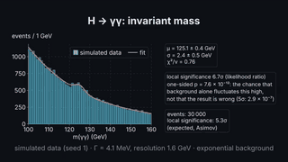

# `mass_spectrum`

<!-- Generated by `vidgen gallery`; edit the sample in AGENTS.md (or video.yaml), not this file. -->

**Use it for:** a resonance emerging from (simulated) data: an invariant-mass histogram filling event by event with a ticker, Z → μμ, H → γγ or H → 4ℓ over a falling background, a peak fit (mass ± error, width), the local significance growing (Asimov) and what 5σ means, data − background.

Simulated invariant-mass spectrum (labelled "simulated data"): events arrive in batches and fill a histogram (bars, not events, are drawn) with a ticker; a resonance — Z → μμ near 91.19 GeV with its PDG width, H → γγ near 125 GeV (a narrow, resolution-dominated bump on a large falling background) or H → ZZ* → 4ℓ (few events) — over a smoothly falling background; the peak fitted with Phase W's Gaussian / Breit–Wigner on a polynomial background (mass ± uncertainty and width); the local significance growing as the data accumulate (Asimov, or observed counting) and, after the fit, a note with the likelihood-ratio significance and what its p-value means; optionally a data − background panel. Steps: fill, fit, note. Actions: `grow` (fill to `to` events), `fit`, `annotate` (`annotation:significance`), `reveal` (`residuals:fit`: subtract the background on a word), `zoom` (`x: [120, 130]`).

Last beat, 16:9 and 9:16:

 

The scene playing (GIF, up to its last beat):

 

## YAML

From the author guide (`vidgen guide scenes`):

```yaml
- id: diphoton
  type: mass_spectrum      # simulated, labelled so; a plot underneath: grow, fit, annotate, reveal and zoom work
  params:
    channel: h_to_gammagamma   # z_to_mumu, h_to_gammagamma, h_to_4l, custom (mass, window…)
    seed: 1
  beats:
    - text: "Events arrive, and a small bump grows near one hundred and twenty-five GeV."
      actions: [{grow: axes}]
    - text: "A fit on a smooth background finds the mass, and how unlikely chance is."
      actions: [{fit: "fit:fit", at: "@fit"}]   # the significance note follows (or annotate: "annotation:significance" on a word)
```

## Params

| param | type | default | notes |
|---|---|---|---|
| `title` | `str` |  | Plot title (in the header band at the top). (also: heading) |
| `data` | `str \| None` |  | A CSV (or TSV) in the project, e.g. assets/decay.csv: the first row names the columns, with units as 'time (s)' or 'E [MeV]'. |
| `series` | `list[Any] \| None` |  | Made by the scene from the channel (do not set; use type: plot for your own data). |
| `panels` | `list[Any] \| None` |  | Not used (one panel, made by the scene). |
| `x` | `PlotAxis` | `PlotAxis(label='', unit='', scale='linear', min=None, max=None, reversed=False, format='auto', linthresh=None, breaks=[])` | The x axis (shared by stacked panels). |
| `x.label` | `str` |  | Axis title (the unit is added in parentheses); default: the name of the first series' data column. |
| `x.unit` | `str` |  | Unit, shown as 'label (unit)'; default: the unit in the first series' column header, e.g. 'time (s)'. |
| `x.scale` | `'linear' \| 'log' \| 'symlog'` | `'linear'` | linear; log (base 10, positive values; ticks at powers of ten with 2-9 minor ticks); symlog (linear near 0, logarithmic beyond ±linthresh: data across zero spanning decades). |
| `x.min` | `float \| None` |  | Lower end of the axis; default: from the data (rounded out to a tick when that is near). |
| `x.max` | `float \| None` |  | Upper end of the axis; default: from the data. |
| `x.reversed` | `bool` | `False` | Run the axis from high to low (e.g. magnitudes in astronomy, depth). |
| `x.format` | `str` | `'auto'` | Tick labels: auto (plain numbers, or a power of ten moved into the title: 'distance (10⁶ km)'), plain, sci (2.5 × 10⁻³ on every tick), si (an SI prefix on the unit: 'time (ms)'; on a log axis each tick: '10 kHz'; needs a base unit such as s, m, Hz, eV), or a pattern such as '{:.1f}'. |
| `x.linthresh` | `float \| None` |  | symlog: the range ±linthresh drawn linearly; default: from the data. |
| `x.breaks` | `list[tuple[float, float]]` |  | Value ranges cut out of a linear axis, [[from, to], ...], drawn with // marks; data on both sides, none inside. |
| `y` | `PlotAxis` | `PlotAxis(label='', unit='', scale='linear', min=None, max=None, reversed=False, format='auto', linthresh=None, breaks=[])` | The y axis (shared by panels side by side; else the default of each panel). |
| `y.label` | `str` |  | Axis title (the unit is added in parentheses); default: the name of the first series' data column. |
| `y.unit` | `str` |  | Unit, shown as 'label (unit)'; default: the unit in the first series' column header, e.g. 'time (s)'. |
| `y.scale` | `'linear' \| 'log' \| 'symlog'` | `'linear'` | linear; log (base 10, positive values; ticks at powers of ten with 2-9 minor ticks); symlog (linear near 0, logarithmic beyond ±linthresh: data across zero spanning decades). |
| `y.min` | `float \| None` |  | Lower end of the axis; default: from the data (rounded out to a tick when that is near). |
| `y.max` | `float \| None` |  | Upper end of the axis; default: from the data. |
| `y.reversed` | `bool` | `False` | Run the axis from high to low (e.g. magnitudes in astronomy, depth). |
| `y.format` | `str` | `'auto'` | Tick labels: auto (plain numbers, or a power of ten moved into the title: 'distance (10⁶ km)'), plain, sci (2.5 × 10⁻³ on every tick), si (an SI prefix on the unit: 'time (ms)'; on a log axis each tick: '10 kHz'; needs a base unit such as s, m, Hz, eV), or a pattern such as '{:.1f}'. |
| `y.linthresh` | `float \| None` |  | symlog: the range ±linthresh drawn linearly; default: from the data. |
| `y.breaks` | `list[tuple[float, float]]` |  | Value ranges cut out of a linear axis, [[from, to], ...], drawn with // marks; data on both sides, none inside. |
| `arrange` | `'rows' \| 'columns'` | `'rows'` | Panels stacked top to bottom (rows) or side by side (columns). |
| `share` | `bool` | `True` | Panels share the axis along which they are arranged (rows: x, columns: y); false: each its own. |
| `aspect` | `'auto' \| 'equal'` | `'auto'` | equal: one unit is as long on x as on y (orbits, trajectories, geometry); one panel, linear axes. |
| `grid` | `'major' \| 'both' \| 'x' \| 'y' \| 'none'` | `'major'` | Gridlines: at the labelled ticks of both axes (major), also at a log axis' minor ticks (both), one axis, or none. |
| `legend` | `bool \| None` |  | Legend of the series and fits (in a free corner, else above); default: with more than one series or a fit in a panel, or error bars with a meaning. |
| `fits` | `list[Any]` |  | Made by the scene (do not set; see fit, peak, background_degree). |
| `annotations` | `list[PlotAnnotation]` |  | Annotations tied to the data: [{type: label \| arrow \| hline \| vline \| xrange \| yrange \| note, text, ...}]. |
| `annotations.type` | `'label' \| 'arrow' \| 'hline' \| 'vline' \| 'xrange' \| 'yrange' \| 'note'` | required | label (text by a point, a ring on it), arrow (text with an arrow to a point), hline / vline (a dashed reference line at y / x), xrange / yrange (a shaded range [from, to]), note (a text box in a free corner). |
| `annotations.text` | `str` |  | The text (optional for lines and ranges). |
| `annotations.x` | `float \| tuple[float, float] \| None` |  | label / arrow: the point's x (with series: the series' point nearest it); vline: where; xrange: [from, to]. |
| `annotations.y` | `float \| tuple[float, float] \| None` |  | label / arrow: the point's y; hline: where; yrange: [from, to]. |
| `annotations.series` | `str \| None` |  | label / arrow: the series whose point is meant (with x: nearest that x; with index; alone: its highest point). |
| `annotations.index` | `int \| None` |  | label / arrow: the series' point by number (1 = first). |
| `annotations.at` | `'auto' \| 'top_left' \| 'top_right' \| 'bottom_right' \| 'bottom_left' \| 'top' \| 'bottom'` | `'auto'` | note: where the box goes (auto: a free corner). |
| `annotations.panel` | `int \| None` |  | The panel (1 = first); default: the series' panel, else the first. |
| `annotations.color` | `color \| None` |  | Colour of the mark, line or range; default: highlight. |
| `annotations.id` | `str \| None` |  | A name for targets annotation:<id>. |
| `reveal` | `'series' \| 'all'` | `'series'` | series: one series per beat, then the fits and annotations; all: everything in beat 1. |
| `models` | `dict[str, PlotModel]` |  | Models generating data, by name: {osc: {kind: ode, equations: {x: v, v: "-k*x"}, initial: {x: 1, v: 0}, params: {k: 4}, t: [0, 10]}}; series name their columns (x: t, y: x) and grow live. |
| `models.kind` | `'ode' \| 'recurrence' \| 'random_walk' \| 'poisson' \| 'function'` | required | ode (differential equations), recurrence (x[n+1] from x[n]), random_walk, poisson (random events in time), function (registered in Python). |
| `models.equations` | `dict[str, str]` |  | ode: the derivative of each variable, {x: v, v: "-k*x - c*v"} (keys x, dx/dt or x'); recurrence: the next value, {x: "r*x*(1 - x)"}. |
| `models.initial` | `dict[str, float]` |  | Starting value of every variable: {x: 1, v: 0}. |
| `models.params` | `dict[str, float]` |  | Named parameters the equations (and quantities) use: {k: 4, c: 0.3}; function: passed to it. |
| `models.t` | `tuple[float, float] \| None` |  | ode, poisson: the time span [start, end]; default [0, 10]. |
| `models.step` | `float \| None` |  | ode: the integration step (rk4, leapfrog; default a thousandth of the span; rk45: the first step); random_walk: the length of a step (default 1). |
| `models.method` | `str` | `'rk4'` | ode: rk4 (fixed step, 4th order), rk45 (adaptive Dormand–Prince, tolerance), leapfrog (velocity Verlet: symplectic, keeps the energy of orbits and oscillators; needs x' = v pairs and forces without velocities). |
| `models.tolerance` | `float` | `1e-06` | ode, rk45: the relative error allowed per step. |
| `models.samples` | `int \| None` |  | ode: how many points to keep for drawing (default 600). |
| `models.steps` | `int \| None` |  | recurrence: how many iterations (default 50); random_walk: how many steps (default 100). |
| `models.seed` | `int` | `1` | random_walk, poisson, function: the random seed (the same seed gives the same numbers). |
| `models.p` | `float` | `0.5` | random_walk (1-D lattice): the chance of a step up. |
| `models.dims` | `1 \| 2` | `1` | random_walk: 1 (x) or 2 (x and y). |
| `models.distribution` | `'lattice' \| 'gaussian'` | `'lattice'` | random_walk: lattice (±step) or gaussian (normal steps). |
| `models.rate` | `float \| None` |  | poisson: events per unit of time. |
| `models.function` | `str \| None` |  | function: the name it was registered under (vidgen.api.register_model). |
| `models.quantities` | `dict[str, str]` |  | Derived columns, expressions of the columns and params: {E: "0.5*v^2 + 0.5*k*x^2"}. |
| `models.conserved` | `list[str]` |  | Quantities that should stay constant (an energy): their drift is checked (vidgen lint). |
| `models.units` | `dict[str, str]` |  | Units of the columns: {t: s, x: m, v: m/s, E: J} (axis titles, readouts). |
| `rescale` | `bool` | `True` | While live series grow, axes without fixed ends start around the first data and widen smoothly as the data reach their edge (a time axis is shown whole); false: the whole range from the start. |
| `point_radius` | `float \| None` |  | Marker radius in Manim units; default: from the number of points. |
| `label_size` | `size \| None` |  | Size of tick labels, axis titles, the legend, fit boxes and annotations (never below the readable minimum); default: body in a landscape frame, caption in a portrait one. |
| `caption` | `str` |  | Note under the plot (e.g. the data source). |
| `caption_size` | `size` | `'caption'` | Caption text size. |
| `caption_color` | `color` | `'dim'` | Caption color. |
| `title_size` | `size` | `'heading'` | Title size (1.3x in a portrait frame). (also: heading_size) |
| `title_color` | `color` | `'text'` | Title color. (also: heading_color) |
| `channel` | `'z_to_mumu' \| 'h_to_gammagamma' \| 'h_to_4l' \| 'custom'` | `'h_to_gammagamma'` | The resonance and decay: z_to_mumu (Z → μ⁺μ⁻, 70–110 GeV), h_to_gammagamma (H → γγ, 100–160 GeV), h_to_4l (H → ZZ* → 4ℓ, few events), custom (give mass, window and the rest). |
| `seed` | `int` | `1` | Random seed of the simulation (the same seed gives the same events). |
| `events` | `int \| None` |  | Events in all (signal and background); default from the channel. |
| `signal` | `float \| None` |  | Expected signal events among them (each event is signal with probability signal/events); default from the channel. |
| `mass` | `float \| None` |  | Resonance mass in GeV; default the PDG 2024 mass of the channel's particle (custom: needed). |
| `width` | `float \| None` |  | Natural width Γ in GeV (Breit–Wigner); default the PDG 2024 width (custom: 0). |
| `resolution` | `float \| None` |  | Detector mass resolution σ in GeV (a Gaussian smearing); default from the channel. |
| `window` | `tuple[float, float] \| None` |  | Mass range [low, high] in GeV; default from the channel. |
| `bin_width` | `float \| None` |  | Histogram bin width in GeV; default from the channel. |
| `background` | `'exponential' \| 'power' \| 'flat' \| None` |  | Background shape: exponential (exp(−m/slope)), power (m^−index) or flat; default from the channel. |
| `slope` | `float \| None` |  | Exponential background: its fall-off length in GeV. |
| `index` | `float \| None` |  | Power-law background: the exponent k of m^−k. |
| `peak` | `'gaussian' \| 'breit_wigner' \| None` |  | Fit model of the peak: gaussian (resolution-dominated, μ and σ) or breit_wigner (M and Γ; the fitted Γ includes the resolution); default from the channel. |
| `background_degree` | `int \| None` |  | Degree of the fit's polynomial background (0: flat); default from the channel. |
| `fit` | `bool` | `True` | Fit the peak once the data are in (Phase W, binned Poisson likelihood): mass ± uncertainty and width. |
| `significance` | `'asimov' \| 'counting' \| 'none' \| None` |  | Readout growing with the data: asimov (expected local significance √(2((s+b)ln(1+s/b) − s)) of the s and b expected in the peak window), counting (observed excess in that window over the expected background), none; default from the channel. |
| `explain` | `bool \| 'short' \| 'long'` | `True` | After the fit, a note with the local significance from the likelihood ratio (background only against signal + background) and its one-sided p-value: true or short — three short lines, "6.7σ local", "p = 7.6 × 10⁻¹²", "(background only)" (the narration says the rest); long — four lines saying what the p-value means and what it does not; false — no note. |
| `subtract` | `bool` | `False` | A data − background panel under the plot (the fitted background subtracted, the fitted peak drawn over it); reveal residuals:fit to show it on a word. |
| `style` | `'bars' \| 'points'` | `'bars'` | bars (a filled histogram) or points (markers with √N error bars, as in papers). |
| `ticker` | `bool` | `True` | Count the events in the readout ("events: 12 400"). |
| `label` | `str` | `'simulated data'` | What the data are called on screen (always says they are simulated). |

## Targets

`title`, `axes`, `panel<N>`, `legend`, `series<N>`, `series:<name>`, `errors:<name>`, `fit<N>`, `fit:<name>`, `residuals<N>`, `residuals:<name>`, `annotation<N>`, `annotation:<id>`

## Beats

Any number.

[All scene types](README.md) · `vidgen list-scenes` · `vidgen schema --scene mass_spectrum`
