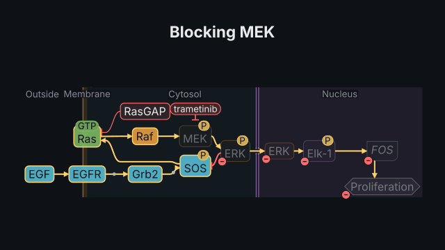
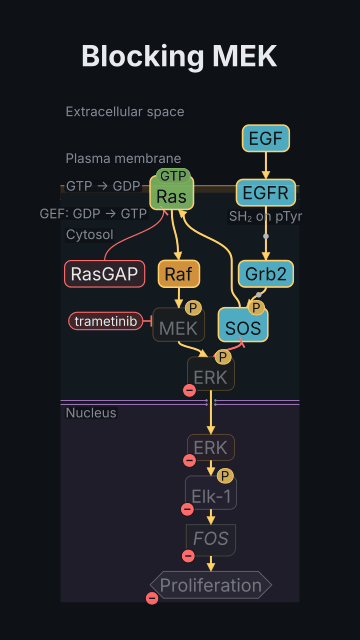

# Blocking MEK

<!-- Generated by `vidgen gallery`; edit src/vidgen/data/gallery/showcases/mek_inhibitor.yaml, not this file. -->

**Use it for:** a signal running down the MAPK cascade, then a drug that blocks MEK and its effects downstream.

A showcase of [`pathway`](pathway.md): a small scene written for the gallery, a whole `video.yaml`. Copy it into a
project and run `vidgen render`; until `vidgen tts` voices it, its beats are timed by their word count.

The scene playing, 16:9 and 9:16:

<picture><source media="(prefers-reduced-motion: reduce)" srcset="media/mek_inhibitor-16x9.png"></picture> <picture><source media="(prefers-reduced-motion: reduce)" srcset="media/mek_inhibitor-9x16.png"></picture>

Last beat:

 

## YAML

```yaml
title: A Drug in the MAPK Pathway
voice: {provider: kokoro, voice: af_heart}
scenes:
  - id: mek_inhibitor
    type: pathway
    params:
      title: "Blocking MEK"
      template: rtk_ras_mapk             # EGF → EGFR → Grb2/SOS → Ras → Raf → MEK → ERK → Elk-1 → FOS
    beats:
      - text: "Growth factor signals pass from Ras through Raf, MEK and ERK to the nucleus."
        actions: [{signal: egf, at: "@signals"}]
      - text: "Trametinib blocks MEK, and everything downstream falls."
        actions: [{drug: mek, name: trametinib, at: "@blocks"}]
```

[All scene types and showcases](README.md) · `vidgen guide scenes` · [the cell-biology cookbook](../COOKBOOK-CELL-BIOLOGY.md)
