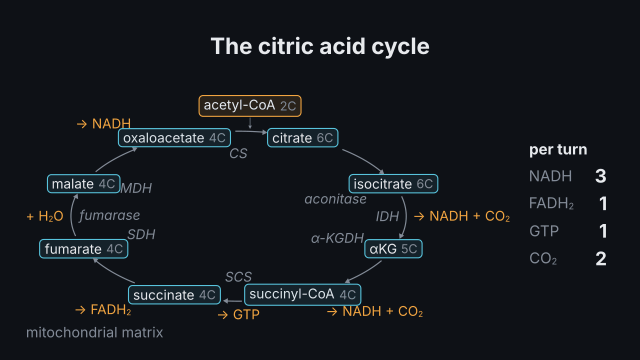
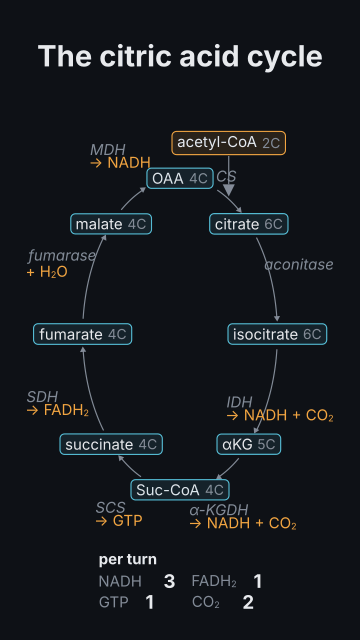

# `metabolism`

<!-- Generated by `vidgen gallery`; edit the sample in AGENTS.md (or video.yaml), not this file. -->

**Use it for:** energy metabolism: glycolysis, pyruvate oxidation, the citric acid cycle, the electron transport chain and ATP synthase, the light reactions; flows animated, products counted.

Energy metabolism: `process: glycolysis` (ten steps from glucose to 2 pyruvate, the investment and payoff phases, ATP used and made, NADH; `link: true` adds pyruvate oxidation in the matrix), `link_reaction`, `tca` (the citric acid cycle as a ring of its eight intermediates with the enzymes, NADH, FADH₂, GTP and CO₂ per turn), `etc` (complexes I–IV, ubiquinone and cytochrome c in the inner mitochondrial membrane, protons pumped into the intermembrane space, O₂ reduced to water, ATP synthase) and `light_reactions` (PSII, water splitting, plastoquinone, cytochrome b₆f, plastocyanin, PSI, ferredoxin, FNR making NADPH, ATP synthase). Tallies count the products. The action `advance` moves a token through the steps, or electrons along the chain with protons crossing, or the gradient through ATP synthase. Checked: the compartment a pathway runs in, the membrane a chain sits in, the side protons are pumped to, the components' order.

Last beat, 16:9 and 9:16:

 

The scene playing (GIF, up to its last beat):

 

## YAML

From the author guide (`vidgen guide scenes`):

```yaml
- id: krebs
  type: metabolism
  params:
    title: "The citric acid cycle"
    process: tca                      # glycolysis, link_reaction, tca, etc, light_reactions
  beats:
    - text: "Acetyl-CoA joins oxaloacetate; two carbons leave as CO2."
      actions: [{advance: tca, to: succinyl_coa, at: "@joins"}]
    - text: "The cycle closes with GTP, FADH2 and NADH."
      actions: [{advance: tca, to: oxaloacetate}]
```

## Params

| param | type | default | notes |
|---|---|---|---|
| `title` | `str` |  | Title (in the header band at the top). (also: heading) |
| `process` | `str` | required | glycolysis, link_reaction, tca (the citric acid cycle), etc (electron transport chain and ATP synthase), light_reactions. |
| `cell` | `'animal' \| 'plant' \| 'bacterium' \| None` |  | Whose metabolism: animal (default), plant (default for light_reactions) or bacterium (no mitochondria: the chain in the plasma membrane, the cycle in the cytosol). |
| `in` | `str \| None` |  | glycolysis / link_reaction / tca: where it runs (checked: glycolysis in the cytosol, the others in the mitochondrial matrix). |
| `membrane` | `str \| None` |  | etc / light_reactions: the membrane (checked: inner_mitochondrial, thylakoid; bacterial for a bacterium). |
| `protons_to` | `str \| None` |  | etc / light_reactions: where protons are pumped (checked: intermembrane_space, thylakoid_lumen, periplasm). |
| `components` | `list[str]` |  | etc / light_reactions: the components drawn, in electron order (default all; ATP synthase may be left out). |
| `link` | `bool` | `False` | glycolysis / tca: add pyruvate oxidation (pyruvate into the matrix, pyruvate dehydrogenase → acetyl-CoA). |
| `tallies` | `bool` | `True` | Count the products (ATP, NADH, FADH₂, GTP, CO₂; protons pumped). |
| `names` | `'auto' \| 'full' \| 'short'` | `'auto'` | Metabolite names: full (glucose 6-phosphate), short (G6P) or auto (full where they fit). |
| `title_size` | `size` | `'heading'` | Title size. (also: heading_size) |
| `size` | `size` | `'caption'` | Label size (never below the readable minimum). |

## Targets

`title`, `<process>`, `<metabolite>`, `step:<key>`, `<component>`, `membrane`, `tally`

## Beats

Any number.

[All scene types](README.md) · `vidgen list-scenes` · `vidgen schema --scene metabolism`
