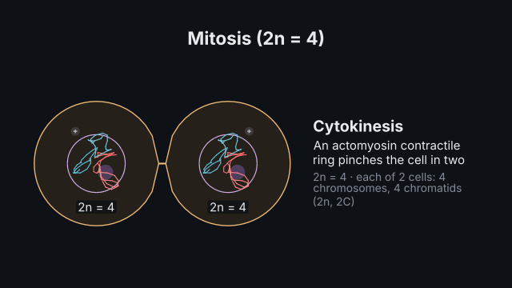
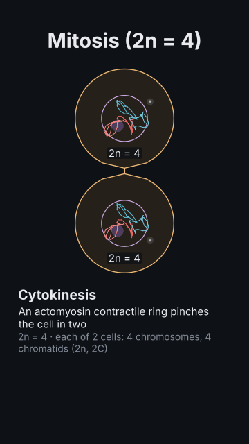

# Mitosis

<!-- Generated by `vidgen gallery`; edit src/vidgen/data/gallery/showcases/mitosis.yaml, not this file. -->

**Use it for:** a dividing cell: condensation, the metaphase plate, sister chromatids parting, two daughter cells.

A showcase of [`cell_cycle`](cell_cycle.md): a small scene written for the gallery, a whole `video.yaml`. Copy it into a
project and run `vidgen render`; until `vidgen tts` voices it, its beats are timed by their word count.

The scene playing, 16:9 and 9:16:

<picture><source media="(prefers-reduced-motion: reduce)" srcset="media/mitosis-16x9.png"></picture> <picture><source media="(prefers-reduced-motion: reduce)" srcset="media/mitosis-9x16.png"></picture>

Last beat:

 

## YAML

```yaml
title: Mitosis
voice: {provider: kokoro, voice: af_heart}
scenes:
  - id: mitosis
    type: cell_cycle
    params:
      title: "Mitosis (2n = 4)"
      mode: mitosis                      # homologues in maternal and paternal colours
      chromosomes: 4
      start: metaphase                   # the chromosomes on the plate, sister kinetochores bi-oriented
    beats:
      - text: "At anaphase the sister chromatids part, and the cell divides in two."
        actions: [{advance: cell, to: cytokinesis, at: "@anaphase", expect: {cells: 2, chromosomes: 4}}]
```

[All scene types and showcases](README.md) · `vidgen guide scenes` · [the cell-biology cookbook](../COOKBOOK-CELL-BIOLOGY.md)
