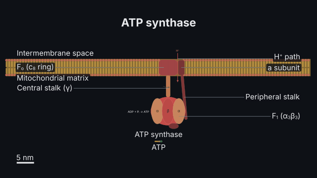
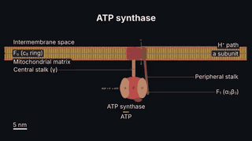
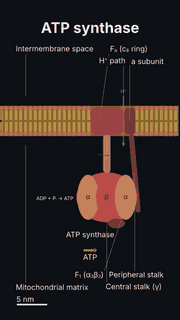

# `molecule`

<!-- Generated by `vidgen gallery`; edit the sample in AGENTS.md (or video.yaml), not this file. -->

**Use it for:** molecules up close: DNA, RNAs, nucleosomes, receptors, channels, pumps, ATP synthase, ions (nm, notation checked).

A molecular close-up in nm: molecules in a solution or a membrane (the lipid bilayer with its two compartments named), each drawn to its textbook size — the DNA double helix with its 5′/3′ ends, base pairs and grooves; mRNA, tRNA, rRNA; a nucleosome, chromatin; proteins with domains; GPCRs, RTKs, gated channels, carriers, the Na⁺/K⁺ pump, ATP synthase; G proteins, kinases; ATP, GTP, cAMP, Pᵢ, glucose, ions — with gene symbols in italics, protein names in roman type, charges as superscripts, modification markers (P, Ub, Ac, Me), labels of their parts and a scale bar. Orientations and places are checked.

Last beat, 16:9 and 9:16:

 

The scene playing (GIF, up to its last beat):

 

## YAML

From the author guide (`vidgen guide scenes`):

```yaml
- id: synthase
  type: molecule
  params:
    title: "ATP synthase"
    membrane: inner_mitochondrial                  # the bilayer between the intermembrane space and the matrix
    molecules:
      - {kind: atp_synthase, parts: true}          # F1 faces the matrix (faces: intermembrane_space is refused)
      - {kind: atp, in: matrix}
  beats:
    - text: "Protons flow back into the matrix through ATP synthase, turning its rotor, and F1 makes ATP."
```

## Params

| param | type | default | notes |
|---|---|---|---|
| `title` | `str` |  | Title (in the header band at the top). (also: heading) |
| `membrane` | `str` | `'none'` | none (a solution) or the membrane across the view: plasma, inner_mitochondrial, thylakoid, er, bacterial, endosomal, lysosomal, golgi, outer_mitochondrial (or a full name: plasma_membrane…). |
| `compartment` | `str` | `'cytosol'` | Without a membrane: the compartment the molecules are in (cytosol, nucleoplasm, matrix…), checked for each. |
| `cell` | `'animal' \| 'plant' \| 'bacterium'` | `'animal'` | The kind of cell (checked: no Na⁺/K⁺ pump in a plant, no nucleosomes in a bacterium); a thylakoid or bacterial membrane sets it. |
| `species` | `str` | `'human'` | Nomenclature for gene and protein names: human, mouse, rat, yeast, fission_yeast, fly, zebrafish, e_coli, arabidopsis. |
| `molecules` | `list[str \| MoleculeItem]` |  | The molecules: a kind, or {kind, id, at, state, label, gene, protein, parts, ...}. |
| `molecules.kind` | `str` | required | dna, mrna, trna, rrna, nucleosome, chromatin, protein, kinase, phosphatase, g_protein, gpcr, rtk, ion_channel, carrier, na_k_atpase, atp_synthase, atp, adp, pi, gtp, gdp, camp, glucose, ligand, ion. |
| `molecules.id` | `str \| None` |  | Its name for actions (default: the kind, kind_2 for a second). |
| `molecules.at` | `float \| tuple[float, float] \| None` |  | Where its middle is, in nm from the view's middle: a membrane protein x along the membrane; others [x, y] (y up: the membrane's exoplasmic side); default laid out in a row. |
| `molecules.angle` | `float \| None` |  | Turn in degrees (not membrane proteins: they keep their orientation). |
| `molecules.in` | `str \| None` |  | A soluble molecule's compartment (extracellular, cytosol, matrix…): the side of the membrane it is on (checked: DNA in the nucleoplasm, cAMP in the cytosol). |
| `molecules.faces` | `str \| None` |  | A membrane protein: the compartment its oriented part faces (ATP synthase F₁: matrix; a GPCR's N-terminus: extracellular); checked. |
| `molecules.state` | `str \| None` |  | gpcr / g_protein: inactive or active; rtk: monomer or dimer; ion_channel: closed or open; carrier: outward or inward; na_k_atpase: e1 or e2; atp_synthase: synthesis or hydrolysis; kinase: active or inactive; chromatin: 10nm or compact. |
| `molecules.label` | `str \| bool \| None` |  | Its name under it (default: the kind's, or the gene / protein given); false for none. Pango markup: <i>, <sup>, <sub>. |
| `molecules.gene` | `str \| None` |  | A gene symbol (italic, checked against the species' nomenclature: human TP53, mouse Trp53, yeast CDC28). |
| `molecules.protein` | `str \| None` |  | A protein name (roman: TP53 or p53; mouse TRP53; yeast Cdc28). |
| `molecules.species` | `str \| None` |  | For gene and protein: human (default: the scene's), mouse, rat, yeast, fission_yeast, fly, zebrafish, e_coli, arabidopsis. |
| `molecules.parts` | `bool \| list[str] \| None` |  | Name its parts with leader lines (true, false or names); default true when it is the only molecule. |
| `molecules.bp` | `int \| None` |  | DNA: base pairs (default 21, two turns). |
| `molecules.sequence` | `str \| None` |  | DNA: the top strand 5′→3′ (its partner is drawn antiparallel); mRNA: its sequence (ACGU). |
| `molecules.letters` | `bool \| None` |  | DNA, mRNA: write the bases (default when a sequence is given). |
| `molecules.anticodon` | `str \| None` |  | tRNA: its anticodon 5′→3′ (CAU reads the codon AUG); checked against amino_acid. |
| `molecules.amino_acid` | `str \| None` |  | tRNA: the amino acid on its 3′ CCA end (Met, Phe…). |
| `molecules.style` | `'cloverleaf' \| 'l_shape' \| None` |  | tRNA: cloverleaf (secondary structure, default) or l_shape (3-D shape). |
| `molecules.rrna` | `str \| None` |  | rRNA: 18S, 28S, 5.8S, 5S, 16S, 23S, 12S. |
| `molecules.marks` | `list[str]` |  | Nucleosome: histone marks (H3K4me3, H3K27ac, H3K9me3, H4K16ac, H2AK119ub, H3S10ph), checked against the histone sequences. |
| `molecules.nucleosomes` | `int \| None` |  | Chromatin: how many nucleosomes. |
| `molecules.domains` | `list[str]` |  | Protein: its domains' names (SH2, kinase…), one lobe each. |
| `molecules.mass` | `float \| None` |  | Protein: its mass in kDa (sets its size; 50 kDa is about 5 nm). |
| `molecules.ligand` | `bool \| None` |  | gpcr: a ligand in its pocket; ion_channel with ligand gating: bound when open. |
| `molecules.gating` | `'voltage' \| 'ligand' \| 'mechanical' \| None` |  | ion_channel: what opens it (default voltage). |
| `molecules.ion` | `str \| None` |  | ion_channel: the ion it passes (K+, Na+, Ca2+, Cl-); ion: which ion (Na+, K+, Ca2+, Cl-, H+, Mg2+). |
| `molecules.mode` | `'uniport' \| 'symport' \| 'antiport' \| None` |  | carrier: one solute, two the same way, two opposite ways. |
| `molecules.substrates` | `list[str]` |  | carrier: its solutes (Na+, glucose, H+, Ca2+…). |
| `molecules.moves` | `list['in' \| 'out']` |  | carrier: the way each solute moves (in: into the cytosol). |
| `molecules.c_subunits` | `int \| None` |  | atp_synthase: c subunits in its ring (default by membrane: 8 mitochondria, 14 chloroplasts, 10 bacteria). |
| `molecules.cap` | `bool \| None` |  | mRNA: the 5′ cap (default true). |
| `molecules.tail` | `bool \| None` |  | mRNA: the poly(A) tail (default true). |
| `molecules.modifications` | `list[str \| Modification]` |  | Markers on a protein: P, Ub, Ac, Me, each with its residue ({mark: P, at: Ser15}). |
| `molecules.modifications.mark` | `'P' \| 'Ub' \| 'Ac' \| 'Me'` | required | P (phosphorylation: Ser, Thr, Tyr), Ub (ubiquitin: Lys), Ac (acetyl: Lys), Me (methyl: Lys, Arg). |
| `molecules.modifications.at` | `str \| None` |  | The residue: Ser15 or S15 (checked: phosphate never on Lys). |
| `molecules.modifications.domain` | `str \| None` |  | A protein's domain the marker sits on (one of its domains), e.g. kinase. |
| `width` | `float \| str \| None` |  | What the view spans across the body's shorter side ('30 nm'); default: fits the molecules. |
| `sides` | `bool` | `True` | Name the compartments on either side of the membrane. |
| `labels` | `bool` | `True` | Name the molecules (under each) and their parts (see parts). |
| `scale_bar` | `bool` | `True` | A scale bar in nm. |
| `reveal` | `'all' \| 'per_beat'` | `'all'` | all: everything in the first beat; per_beat: the membrane, then one molecule per beat. |
| `title_size` | `size` | `'heading'` | Title size. (also: heading_size) |
| `label_size` | `size` | `'caption'` | Size of the labels and the scale bar's text. |

## Targets

`title`, `membrane`, `scale_bar`, `<id>`

## Beats

Any number.

[All scene types](README.md) · `vidgen list-scenes` · `vidgen schema --scene molecule`
