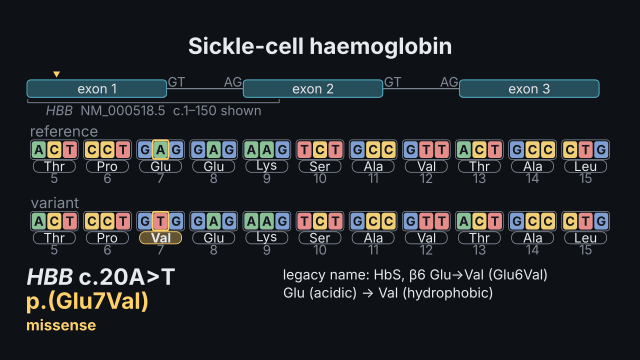
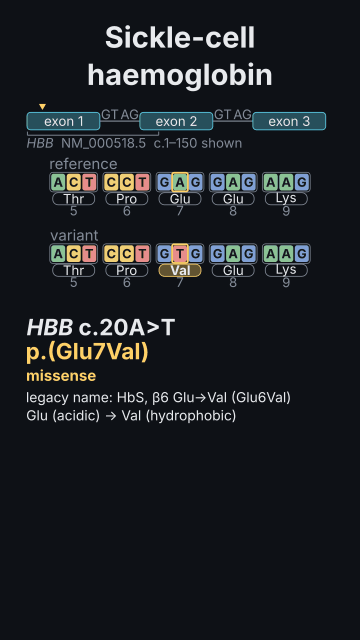

# `mutation`

<!-- Generated by `vidgen gallery`; edit the sample in AGENTS.md (or video.yaml), not this file. -->

**Use it for:** a mutation on a real coding sequence: the reading frame and codons, the variant made from them (substitution, deletion, insertion, frameshift with its premature stop, splice site), the protein change from the genetic code, HGVS c. and p. notation checked.

A sequence variant on a real coding sequence, worked out with the genetic code: the reference codons (reading frame from the ATG, amino acids numbered with the initiator Met as 1) and the variant made from them — substitution (silent, missense, nonsense), deletion, duplication, insertion (in frame, or a frameshift with the new codons and the premature stop), splice-site change (GT…AG; exon skipping or intron retention, predicted) —, the changed bases and amino acids highlighted, and the HGVS notation (c.20A>T p.(Glu7Val); c.1521_1523del p.(Phe508del); c.35del p.(Gly12Valfs*2)) checked against the sequence, with the class, notes and the legacy name. Reference windows: HBB, CFTR, GJB2; or your own sequence, or a gene: like the molecule scene's.

Last beat, 16:9 and 9:16:

 

The scene playing (GIF, up to its last beat):

 

## YAML

From the author guide (`vidgen guide scenes`):

```yaml
- id: sickle
  type: mutation
  params:
    title: "Sickle-cell haemoglobin"
    gene: HBB                                  # or sequence: ATGGTG…, or gene: {protein: …, introns: 1}
    variant: {c: "c.20A>T", p: "p.(Glu7Val)"}  # p. is checked; legacy name Glu6Val
  beats:
    - text: "The start of the beta-globin coding sequence, read in codons."
    - text: "One base changes: A to T in codon seven."
      actions: [{mutate: variant, at: "@changes"}]
    - text: "Glutamic acid becomes valine: sickle-cell haemoglobin."
```

## Params

| param | type | default | notes |
|---|---|---|---|
| `title` | `str` |  | Title (in the header band at the top). (also: heading) |
| `gene` | `str \| dict[str, Any] \| None` |  | A reference window (HBB, CFTR, GJB2: real coding sequence with its exons), or a gene written like the molecule scene's gene: ({sequence: …, introns: [[a, b]]} or {protein: MVHL…, introns: 1}). |
| `sequence` | `str \| None` |  | Instead of gene: your coding DNA (or mRNA) 5′→3′, from c.1 (the A of the ATG) or from first:. |
| `first` | `int \| None` |  | The c. number of the sequence's first base (a window inside a longer CDS). |
| `exons` | `list[list[int]] \| None` |  | The coding exons as c. ranges ([[1, 92], [93, 315], [316, 444]]): the gene strip, splice sites, nonsense-mediated decay. |
| `first_exon` | `int \| None` |  | The number of the first exon in exons (11 for a window from exon 11). |
| `length` | `int \| None` |  | The whole CDS length with its stop codon (judges nonsense-mediated decay). |
| `symbol` | `str \| None` |  | The gene symbol (italic; checked against the species' nomenclature). |
| `species` | `str` | `'human'` | For the symbol: human, mouse, rat, yeast, fly… |
| `variant` | `str \| dict[str, Any] \| list[str \| dict[str, Any]]` | `'c.1A>G'` | The change in HGVS: c.20A>T, c.1521_1523del, c.35del, c.35dup, c.76_77insT, c.76_77delinsTT, c.92+1G>A; or {c: …, p: p.(Glu7Val) (checked), legacy: Glu6Val, splice: skip}; or a list (made one after another). |
| `splice` | `'auto' \| 'skip' \| 'retain'` | `'auto'` | A splice-site change's predicted outcome: exon skipping (auto for an internal exon) or intron retention. |
| `codes` | `'three' \| 'one'` | `'three'` | Amino acids as three-letter (Glu) or one-letter (E) codes. |
| `stop` | `'*' \| 'Ter'` | `'*'` | How a stop is written in p. (p.(Arg553*) or p.(Arg553Ter)). |
| `codons` | `int \| None` |  | Codons shown (default: as many as fit, round the change). |
| `strip` | `bool` | `True` | The gene strip (when exons are known). |
| `title_size` | `size` | `'heading'` | Title size. (also: heading_size) |
| `size` | `size` | `'caption'` | Label size (never below the readable minimum). |

## Targets

`title`, `gene`, `reference`, `variant`, `variant:<n>`, `protein`, `notation`, `codon:<n>`

## Beats

Any number.

[All scene types](README.md) · `vidgen list-scenes` · `vidgen schema --scene mutation`
