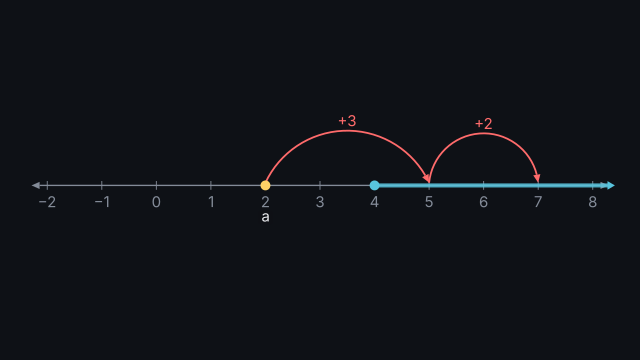
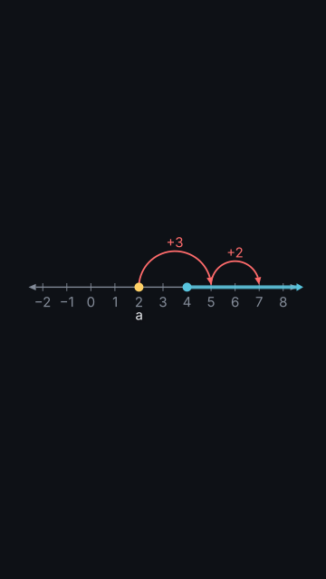

# `number_line`

<!-- Generated by `vidgen gallery`; edit the sample in AGENTS.md (or video.yaml), not this file. -->

**Use it for:** a number line: points, intervals, jumps (+3).

One number line across the frame (horizontal in 16:9 and 9:16, fewer ticks in a vertical frame) with `points`, `intervals` (closed or open ends, shaded, to infinity) and `jumps` (arcs with a label such as +3). `reveal: per_beat` (default): the line with the first item at beat 1, then points, intervals and jumps, one per beat; `all`: everything in beat 1. `trace` moves a point along the line (its label's {x} follows).

Last beat, 16:9 and 9:16:

 

The scene playing (GIF, up to its last beat):

 

## YAML

From the author guide (`vidgen guide scenes`):

```yaml
- id: hops
  type: number_line
  params:
    range: [-2, 8]
    points: [{at: 2, name: a}]
    intervals: ["[4, inf)"]                        # interval notation: [ ] closed, ( ) open, inf
    jumps: [[2, 5], [5, 7]]                        # arcs labelled +3, +2
  beats:
    - text: "Start at two."
    - text: "Every number from four on."
    - text: "Jump three to five."
    - text: "And two more to seven."
```

## Params

| param | type | default | notes |
|---|---|---|---|
| `title` | `str` |  | Title (in the header band at the top). (also: heading) |
| `range` | `tuple[float, float]` | required | [from, to]: the numbers the line shows. |
| `step` | `float \| None` |  | Distance between ticks (1: every whole number); default: a round step for the frame. |
| `points` | `list[float \| LinePoint]` |  | Points: a number or {at, name, label, color}; moved by the trace action. |
| `points.at` | `float` | required | Where it is; the trace action moves it. |
| `points.name` | `str \| None` |  | Its name (its label by default; target point:<name>). |
| `points.label` | `str \| None` |  | Its label: {x} and {name} are filled in as it moves; default: its name; '' for none. |
| `points.color` | `color \| None` |  | Dot colour; default: the colour of the first term its label says, else highlight. |
| `points.decimals` | `int` | `1` | Decimal places of {x}. |
| `intervals` | `list[str \| LineInterval]` |  | Intervals: '[-1, 3)', '(2, inf)' or {from, to, ends, label, color}. |
| `intervals.from` | `float \| str` | required | Its left end (-inf, as text too: to the left end of the line). |
| `intervals.to` | `float \| str` | required | Its right end (inf, as text too: to the right end of the line). |
| `intervals.ends` | `'[]' \| '[)' \| '(]' \| '()'` | `'[]'` | Which ends belong to it: [ ] closed (a filled dot), ( ) open (a ring); an infinite end is always open. |
| `intervals.label` | `str` |  | Text above it (e.g. 'x ≥ −1'). |
| `intervals.color` | `color \| None` |  | Its colour; default: the colour of the first term its label says, else the theme palette in order. |
| `jumps` | `list[list \| LineJump]` |  | Jumps: [from, to] or {from, to, label, color}: an arc with '+3' above it. |
| `jumps.from` | `float` | required | Where it starts. |
| `jumps.to` | `float` | required | Where it lands. |
| `jumps.label` | `str \| None` |  | Text above the arc: {by} (the step, signed: +3, −2), {from} and {to} are filled in; default '{by}'; '' for none. |
| `jumps.color` | `color \| None` |  | Arc colour; default: the colour of the first term its label says, else accent. |
| `reveal` | `'per_beat' \| 'all'` | `'per_beat'` | per_beat: the line with the first item at beat 1, then one point, interval or jump per beat; all: everything in beat 1. |
| `title_size` | `size` | `'heading'` | Title size (1.3x in a portrait frame). (also: heading_size) |
| `title_color` | `color` | `'text'` | Title colour. (also: heading_color) |
| `label_size` | `size` | `'caption'` | Size of the numbers and labels (never below the readable minimum). |

## Targets

`title`, `line`, `point<N>`, `point:<name>`, `interval<N>`, `jump<N>`

## Beats

Any number.

[All scene types](README.md) · `vidgen list-scenes` · `vidgen schema --scene number_line`
