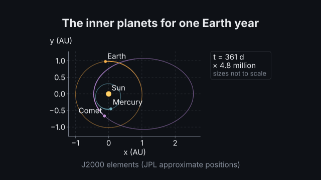
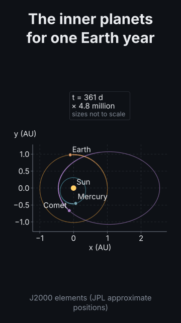

# `orbit`

<!-- Generated by `vidgen gallery`; edit the sample in AGENTS.md (or video.yaml), not this file. -->

**Use it for:** planets, moons, satellites or a comet on their orbits, moving in correct timing (Kepler's laws, the inner planets for a year, the ISS and a geostationary orbit, a flyby); mutual gravity.

Orbits in correct timing: a central body (`central`: a preset or your own) and `bodies` on Kepler orbits (presets, elements, or a position and velocity), drawn as conics with the bodies moving along them through the whole scene at one speed-up (`span` or `orbits` of simulated time), fading trails, an equal-aspect frame in AU or km (`frame`: axes, a scale bar or none), a readout of the time and speed-up, `follow` to move with a body, `dynamics: nbody` for mutual gravity (leapfrog, with the energy error shown).

Last beat, 16:9 and 9:16:

 

The scene playing (GIF, up to its last beat):

 

## YAML

From the author guide (`vidgen guide scenes`):

```yaml
- id: inner_planets
  type: orbit   # bodies move by Kepler's equation at one speed-up from the first beat to the scene's end
  params:
    title: "The inner planets for one Earth year"
    central: sun   # a preset (sun, earth, mars, jupiter...) or {name, gm or mass, radius}
    bodies:        # presets: mercury ... neptune (JPL J2000 elements), moon, iss, geo, halley
      - {preset: mercury}
      - {preset: earth}
      - {name: Comet, a: "1.5 AU", e: 0.7, argp: 180, nu: 180, trail: 0.15}   # values carry units; angles in degrees
    span: "1 yr"   # or orbits: 2 (periods of the first body)
    caption: "J2000 elements (JPL approximate positions)"
  beats:
    - text: "Mercury races around the Sun in eighty-eight days."
    - text: "The comet crawls far out and sweeps past the Sun."
```

## Params

| param | type | default | notes |
|---|---|---|---|
| `title` | `str` |  | Title (in the header band at the top). (also: heading) |
| `central` | `str \| OrbitCentral` | `'sun'` | The central body: a preset (sun, earth, mars, jupiter, moon...) or {name, gm or mass, radius}. |
| `central.preset` | `str \| None` |  | A preset body: sun, mercury, venus, earth, moon, mars, jupiter, saturn, uranus, neptune (GM and radius from IAU / JPL). |
| `central.name` | `str \| None` |  | Its name (default: the preset's); bodies' around and the scene's follow use it. |
| `central.label` | `str` |  | Text shown next to it (default: its name). |
| `central.show_label` | `bool` | `True` | Show its label. |
| `central.gm` | `str \| float \| None` |  | Gravitational parameter GM with its unit ('3.986e14 m^3/s^2'); or give mass. |
| `central.mass` | `str \| float \| None` |  | Mass with its unit ('5.97e24 kg'); GM = G × mass (CODATA 2022 G). |
| `central.radius` | `str \| float \| None` |  | Radius with its unit ('6371 km'): drawn to scale when it is large enough to see; a periapsis inside it is refused. |
| `central.color` | `color \| None` |  | Colour (default: the preset's, else highlight). |
| `bodies` | `list[OrbitBody]` | required | The orbiting bodies: [{preset: earth}, {name: Probe, a: '1.5 AU', e: 0.4}, {name: Ship, r: ['7000 km', 0], v: [0, '8 km/s']}]. |
| `bodies.name` | `str \| None` |  | Its name (default: the preset's); targets body:<name> and orbit:<name>, around and follow use it. |
| `bodies.preset` | `str \| None` |  | A preset orbit: mercury … neptune (JPL J2000 elements), moon, iss (420 km, 51.6°), geo (geostationary), halley; elements you give override the preset's. |
| `bodies.around` | `str \| None` |  | The body it orbits (another body's name; default: the central body, or the preset's primary). |
| `bodies.a` | `str \| float \| None` |  | Semi-major axis with its unit ('1.52 AU'); for a hyperbola \|a\|. |
| `bodies.e` | `float \| None` |  | Eccentricity: 0 a circle, below 1 an ellipse, 1 a parabola (escape), above 1 a hyperbola (default 0). |
| `bodies.periapsis` | `str \| float \| None` |  | Closest distance to the centre of what it orbits ('6778 km'); with apoapsis, or e. |
| `bodies.apoapsis` | `str \| float \| None` |  | Farthest distance (an ellipse); with periapsis, or e. |
| `bodies.altitude` | `str \| float \| None` |  | Height of the periapsis above the surface ('420 km'); a circle unless e is given. |
| `bodies.i` | `str \| float \| None` |  | Inclination (degrees, or '0.9 rad'); the picture shows the orbit seen from above its reference plane. |
| `bodies.raan` | `str \| float \| None` |  | Longitude of the ascending node Ω (degrees). |
| `bodies.argp` | `str \| float \| None` |  | Argument of periapsis ω (degrees): where the periapsis lies, measured from the node (from +x when i = 0). |
| `bodies.nu` | `str \| float \| None` |  | True anomaly at the start (degrees from periapsis; default 0: it starts at periapsis). |
| `bodies.mean_anomaly` | `str \| float \| None` |  | Mean anomaly at the start (degrees), instead of nu. |
| `bodies.r` | `list[str \| float] \| None` |  | Start position relative to what it orbits, instead of elements: ['1 AU', 0] or [x, y, z] with units. |
| `bodies.v` | `list[str \| float] \| None` |  | Start velocity with r: [0, '29.8 km/s']. |
| `bodies.gm` | `str \| float \| None` |  | Its own gravitational parameter (matters for n-body and adds to its parent's in μ = G(M + m)); default 0 (a probe) or the preset's. |
| `bodies.mass` | `str \| float \| None` |  | Its mass instead of gm ('7.35e22 kg'). |
| `bodies.radius` | `str \| float \| None` |  | Its radius ('1737 km'); drawn to scale when large enough. |
| `bodies.label` | `str` |  | Text shown next to it (default: its name). |
| `bodies.show_label` | `bool` | `True` | Show its label. |
| `bodies.color` | `color \| None` |  | Colour (default: the palette by position). |
| `bodies.trail` | `bool \| float \| str` | `True` | A fading trail behind it: true (a quarter of its orbit), a share of its orbit (0.5), a time ('30 d') or false. |
| `bodies.orbit` | `bool` | `True` | Draw its orbit (the conic of its Kepler orbit, dashed for an open one). |
| `span` | `str \| float \| None` |  | Simulated time the scene shows ('1 yr', '92 min', '30 d'); or orbits. |
| `orbits` | `float \| None` |  | Simulated time in periods of the first body (default 1 when span is not given; a closed orbit). |
| `dynamics` | `'kepler' \| 'nbody'` | `'kepler'` | kepler: each body on its two-body orbit (exact, Kepler's equation); nbody: every body with mass pulls on every other (integrated). |
| `method` | `str` | `'leapfrog'` | n-body method: leapfrog (velocity Verlet, symplectic: energy error bounded) or rk45 (adaptive; drifts over long runs). |
| `step` | `str \| float \| None` |  | n-body leapfrog step ('1 h'); default 1/1000 of the shortest orbital time scale. |
| `frame` | `'axes' \| 'scale_bar' \| 'none'` | `'axes'` | axes: x and y axes with AU or km ticks (equal aspect); scale_bar: a bar of a round length; none. |
| `unit` | `'auto' \| 'AU' \| 'km'` | `'auto'` | Unit of the axes and scale bar; auto: AU when the view spans more than 0.05 AU, else km. |
| `extent` | `str \| float \| None` |  | Half-width of the view around its centre ('2 AU'); default: every orbit with a margin. |
| `follow` | `str \| None` |  | A body the view moves with (its satellites' orbits stay still around it); default: the central body stays at the centre. |
| `readout` | `bool` | `True` | Show the simulated time and the speed-up (and the energy error with nbody). |
| `energy` | `bool \| None` |  | Show the n-body energy error ΔE/E (default: on with dynamics: nbody). |
| `label_size` | `size \| None` |  | Size of tick labels, body labels and the readout (never below the readable minimum); default: caption (the picture gets the room). |
| `caption` | `str` |  | Note under the picture (e.g. the source of the elements). |
| `caption_size` | `size` | `'caption'` | Caption text size. |
| `caption_color` | `color` | `'dim'` | Caption color. |
| `title_size` | `size` | `'heading'` | Title size. (also: heading_size) |
| `title_color` | `color` | `'text'` | Title color. (also: heading_color) |

## Targets

`title`, `frame`, `central`, `body:<name>`, `orbit:<name>`, `readout`

## Beats

Any number.

[All scene types](README.md) · `vidgen list-scenes` · `vidgen schema --scene orbit`
