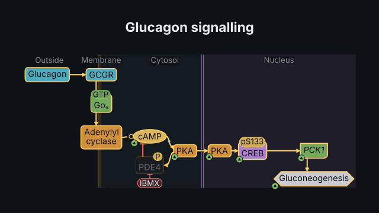
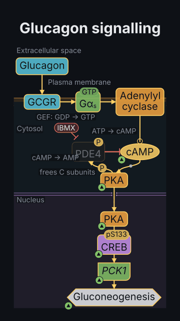

# `pathway`

<!-- Generated by `vidgen gallery`; edit the sample in AGENTS.md (or video.yaml), not this file. -->

**Use it for:** a signalling pathway: ligands, receptors, kinase cascades, second messengers, genes, in compartment bands, SBGN-style (arrows, T-bars, P marks); a signal spreading, inhibitors, knockouts, drugs.

A signalling pathway in SBGN-inspired notation, laid out automatically in compartment bands (extracellular space, plasma membrane, cytosol, ER, mitochondrion, nucleus: columns left to right in landscape frames, rows top to bottom in portrait ones). Nodes are drawn by kind (proteins as rounded boxes, complexes with cut corners, small molecules as ellipses, genes with an italic symbol, outcomes as hexagons) with their state (GDP / GTP, pS133); arcs activate (arrow), inhibit (T-bar), catalyse (circle), (de)phosphorylate (P on the arc), bind (dot), translocate (dashed, e.g. into the nucleus), regulate transcription. Built-in templates (gpcr_camp_pka, rtk_ras_mapk, pi3k_akt) can be used as they are or changed. Everything is checked: unknown nodes, arcs against declared effects, nodes in impossible compartments, names in the wrong case for the species. The actions signal, inhibit, knockout, drug and amplify animate the graph's logic; focus moves the camera.

Last beat, 16:9 and 9:16:

 

The scene playing (GIF, up to its last beat):

 

## YAML

From the author guide (`vidgen guide scenes`):

```yaml
- id: camp
  type: pathway
  params:
    title: "Glucagon signalling"
    template: gpcr_camp_pka                        # or rtk_ras_mapk, pi3k_akt; or nodes + edges
  beats:
    - text: "Glucagon binds its receptor, and the signal runs through cyclic AMP and PKA to the nucleus."
      actions: [{signal: glucagon, at: "@signal"}]
    - text: "A phosphodiesterase inhibitor keeps cyclic AMP high."
      actions: [{drug: pde, name: IBMX}]
```

## Params

| param | type | default | notes |
|---|---|---|---|
| `title` | `str` |  | Title (in the header band at the top). (also: heading) |
| `template` | `'gpcr_camp_pka' \| 'rtk_ras_mapk' \| 'pi3k_akt' \| None` |  | A built-in pathway to start from: gpcr_camp_pka (glucagon → GCGR → Gαs → adenylyl cyclase → cAMP → PKA → CREB → PCK1, PDE4), rtk_ras_mapk (EGF → EGFR → Grb2/SOS → Ras → Raf → MEK → ERK → Elk-1 → FOS, RasGAP, ERK ⊣ SOS), pi3k_akt (RTK → PI3K → PIP3 ⊣ PTEN → PDK1/mTORC2 → Akt ⊣ TSC2 ⊣ Rheb → mTORC1; ⊣ GSK3β, ⊣ FOXO). |
| `nodes` | `list[str \| PathwayNode]` |  | The nodes: an id, or {id, kind, label, in, gene, state, marks, role}; with a template, a node of a template id changes it. |
| `nodes.id` | `str` | required | Its name for arcs and actions (letters, digits, _ . -). |
| `nodes.kind` | `str \| None` |  | ligand, receptor, protein (default), kinase, phosphatase, g_protein, gtpase, gef, gap, adaptor, enzyme, transcription_factor, complex, small_molecule, gene, phenotype, drug. |
| `nodes.label` | `str \| None` |  | What it is called (default: the id): a gene's symbol (italic, checked for the species), a protein name (roman; Gα_s writes s as a subscript), a molecule (Ca2+, PIP3, cAMP). |
| `nodes.in` | `str \| None` |  | Its compartment (band): extracellular, plasma_membrane (membrane), cytosol, er, mitochondrion, nucleus (nucleoplasm); default by kind (ligand: extracellular, receptor and g_protein: plasma_membrane, gene and transcription_factor: nucleus, else cytosol). |
| `nodes.gene` | `str \| None` |  | A protein's gene symbol (checked for the species; a protein written like its gene is refused: mouse TRP53 is the protein of Trp53). |
| `nodes.state` | `str \| None` |  | Its state at the start: inactive / active, gdp / gtp (G proteins and GTPases), silent / transcribed (genes). |
| `nodes.marks` | `list[str \| Modification]` |  | Modifications shown from the start: {mark: P, at: Ser133} (P, Ub, Ac, Me; the residue checked). |
| `nodes.marks.mark` | `'P' \| 'Ub' \| 'Ac' \| 'Me'` | required | P (phosphorylation: Ser, Thr, Tyr), Ub (ubiquitin: Lys), Ac (acetyl: Lys), Me (methyl: Lys, Arg). |
| `nodes.marks.at` | `str \| None` |  | The residue: Ser15 or S15 (checked: phosphate never on Lys). |
| `nodes.marks.domain` | `str \| None` |  | A protein's domain the marker sits on (one of its domains), e.g. kinase. |
| `nodes.role` | `'activator' \| 'inhibitor' \| None` |  | Its declared role: its arcs must agree (an inhibitor's arc that activates is refused). |
| `edges` | `list[str \| PathwayEdge]` |  | The arcs: 'a -> b', 'a -\| b', 'a -o b', 'a => b', or {from, to, type, effect, site, feedback, label, indirect}; with a template, an arc between the same nodes replaces it. |
| `edges.from` | `str` | required | The node it starts at. |
| `edges.to` | `str` | required | The node it acts on. |
| `edges.type` | `str` | `'activates'` | activates, inhibits, catalyses, phosphorylates, dephosphorylates, binds, translocates, transcribes, expresses, converts. |
| `edges.effect` | `'activates' \| 'inhibits' \| None` |  | Whether it activates or inhibits its target, where the type allows both (an inhibitory phosphorylation: Akt → GSK3β; repression: transcribes); a contradiction with the type is refused. |
| `edges.site` | `str \| None` |  | (De)phosphorylation: the residue (Ser133, T308, Y1068), checked; shown as pS133 on the target. |
| `edges.feedback` | `bool` | `False` | It closes a feedback loop (drawn and laid out against the flow; loops not declared are warned about). |
| `edges.label` | `str \| None` |  | A short note on the arc (GEF: GDP → GTP, cAMP → AMP). |
| `edges.indirect` | `bool` | `False` | Through steps not drawn (dashed). |
| `remove` | `list[str]` |  | Template nodes (ids) or arcs ('a->b') to leave out. |
| `species` | `str` | `'human'` | Nomenclature of gene and protein names: human, mouse, rat, yeast, fission_yeast, fly, zebrafish, e_coli, arabidopsis. |
| `direction` | `'auto' \| 'LR' \| 'TB'` | `'auto'` | LR: bands as columns, the signal left to right; TB: bands as rows, top to bottom; auto: LR in landscape frames, TB in portrait ones (the other if it keeps text much larger). |
| `reveal` | `'all' \| 'bands' \| 'nodes'` | `'all'` | all: the whole pathway in the first beat; bands: one compartment per step; nodes: one rank (layer) per step, arcs with their nodes. |
| `bands` | `bool` | `True` | Draw and name the compartment bands (the plasma membrane as a bilayer, the nuclear envelope as a double membrane with pores). |
| `edge_labels` | `bool \| 'auto'` | `'auto'` | Show the arcs' labels: true, false, or auto (when they leave the text nearly as large; in a long left-to-right pathway they are left out). |
| `title_size` | `size` | `'heading'` | Title size. (also: heading_size) |
| `size` | `size` | `'body'` | Node label size (up to 1.3x larger when there is room; smaller, not below the readable minimum, when the pathway is large). |

## Targets

`title`, `<id>`, `edge:<from>-><to>`, `band:<name>`, `pathway`

## Beats

Any number.

[All scene types](README.md) · `vidgen list-scenes` · `vidgen schema --scene pathway`
