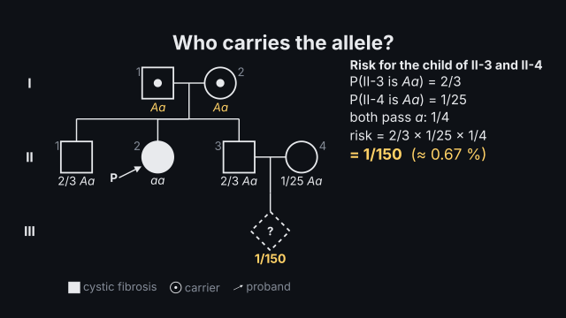
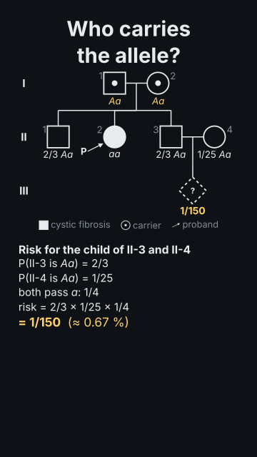

# `pedigree`

<!-- Generated by `vidgen gallery`; edit the sample in AGENTS.md (or video.yaml), not this file. -->

**Use it for:** a family pedigree in standard (NSGC) symbols: affected, carriers, deceased, proband, twins, consanguinity; which modes of inheritance fit and why the others are excluded, deduced genotypes, carrier probabilities, the risk for a child.

A family chart in NSGC notation (squares, circles, diamonds; affected filled, carriers dotted, deceased struck, proband arrowed, consanguinity double lines, twins, adoption) laid out by generation, with its genetic analysis: which modes of inheritance fit and why the others are excluded, the genotypes the chart forces, carrier probabilities and the risk for a proposed child, all computed exactly. Without pedigree actions it plays itself generation by generation (then the analysis, genotypes and risk when asked); the actions deduce, analyse and risk put each step on a word, reveal brings in generations or people.

Last beat, 16:9 and 9:16:

 

The scene playing (GIF, up to its last beat):

 

## YAML

From the author guide (`vidgen guide scenes`):

```yaml
- id: family
  type: pedigree
  params:
    title: "Who carries the allele?"
    condition: cystic fibrosis
    carrier_frequency: 1/25            # for people marrying in; mode: AR is the only mode that fits
    individuals:
      - "I-1: male"
      - "I-2: female"
      - "II-1: male of I-1 + I-2"
      - "II-2: female affected proband of I-1 + I-2"
      - "II-3: male of I-1 + I-2"
      - "II-4: female"                 # married in, beside II-3
      - "III-1: unknown proposed of II-3 + II-4"
  beats:
    - text: "Unaffected parents, an affected daughter: only a recessive mode fits."
      actions: [{analyse: modes}]
    - text: "Her brother is a carrier with probability two thirds; the risk is one in 150."
      actions: [{deduce: genotypes}, {risk: risk, at: "@risk"}]
```

## Params

| param | type | default | notes |
|---|---|---|---|
| `title` | `str` |  | Title (in the header band at the top). (also: heading) |
| `individuals` | `list[dict[str, Any] \| str]` | required | The people: {id, sex (female, male, unknown), affected, carrier, deceased, proband, consultand, adopted (in, out), loss (miscarriage, stillbirth), proposed, parents: [I-1, I-2], spouse, twin: {with, kind: MZ \| DZ}, age, label}, or a line "II-3: female affected of I-1 + I-2". |
| `couples` | `list[dict[str, Any] \| str] \| None` |  | Couples without children, or with marks: [{partners: [II-1, II-2], consanguineous: true, separated: true}] (shared ancestors are found by themselves). |
| `condition` | `str` |  | The condition's name (the legend's 'affected'). |
| `mode` | `str \| None` |  | The mode of inheritance for genotypes and risk (AD, AR, XD, XR, YL, MT or their names); default: the only one that fits. |
| `analyse` | `bool \| list[str]` | `False` | Show the analysis of the modes (true: all six; or a list: [AD, AR, XR]). |
| `genotypes` | `bool` | `False` | Show the deduced genotypes (and carrier probabilities) when the scene plays itself. |
| `penetrance` | `float \| str \| None` |  | P(affected \| disease genotype), e.g. 0.8 (reduced penetrance); default 1. |
| `rare` | `bool` | `True` | The allele is rare: people marrying into the family do not carry it (unless the chart shows it). |
| `carrier_frequency` | `float \| str \| None` |  | An unaffected person's chance of carrying a recessive allele (1/25 for cystic fibrosis): for people marrying in. |
| `alleles` | `list[str] \| None` |  | Allele symbols, dominant first ([A, a], [H, h]). |
| `preset` | `str \| None` |  | A one-locus preset for the alleles and mode (hemophilia_a, drosophila_white…). |
| `loci` | `list[dict[str, Any]] \| None` |  | One locus ({gene, trait, alleles, chromosome}) for the alleles and mode. |
| `carrier_style` | `'dot' \| 'half'` | `'dot'` | dot: a dot in the centre (NSGC carrier); half: the half-shaded heterozygote of many textbooks. |
| `numbers` | `bool` | `True` | Number the individuals under their symbols (Roman generation numerals at the left). |
| `legend` | `bool` | `True` | A legend of the marks used. |
| `title_size` | `size` | `'heading'` | Title size. (also: heading_size) |
| `size` | `size` | `'caption'` | Label size (never below the readable minimum). |

## Targets

`title`, `chart`, `legend`, `generation:<R>`, `person:<id>`, `proband`, `consultand`, `affected`, `carriers`, `child`, `genotypes`, `modes`, `analysis`, `mode:<code>`, `risk`

## Beats

Any number.

[All scene types](README.md) · `vidgen list-scenes` · `vidgen schema --scene pedigree`
