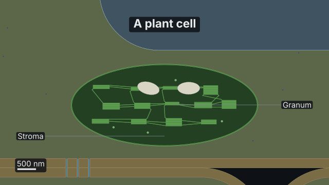
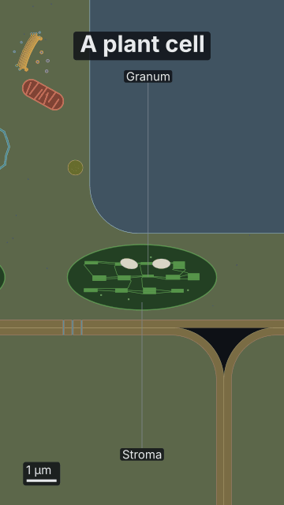

# Inside a plant cell

<!-- Generated by `vidgen gallery`; edit src/vidgen/data/gallery/showcases/plant_cell.yaml, not this file. -->

**Use it for:** a plant cell's wall, vacuole and chloroplasts, then a zoom into one chloroplast's grana.

A showcase of [`cell`](cell.md): a small scene written for the gallery, a whole `video.yaml`. Copy it into a
project and run `vidgen render`; until `vidgen tts` voices it, its beats are timed by their word count.

The scene playing, 16:9 and 9:16:

<picture><source media="(prefers-reduced-motion: reduce)" srcset="media/plant_cell-16x9.png"></picture> <picture><source media="(prefers-reduced-motion: reduce)" srcset="media/plant_cell-9x16.png"></picture>

Last beat:

 

## YAML

```yaml
title: Inside a Plant Cell
voice: {provider: kokoro, voice: af_heart}
scenes:
  - id: plant_cell
    type: cell
    params:
      title: "A plant cell"
      cell: plant                        # a wall, plasmodesmata, the central vacuole, chloroplasts
    beats:
      - text: "A plant cell is mostly vacuole, with its chloroplasts pressed against the wall."
      - text: "Inside a chloroplast, thylakoids stack into grana."
        actions: [{zoom_to: chloroplasts, at: "@chloroplast", labels: [granum, stroma]}]
```

[All scene types and showcases](README.md) · `vidgen guide scenes` · [the cell-biology cookbook](../COOKBOOK-CELL-BIOLOGY.md)
