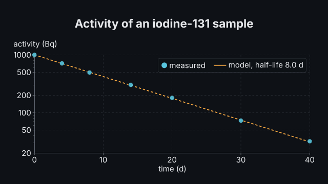
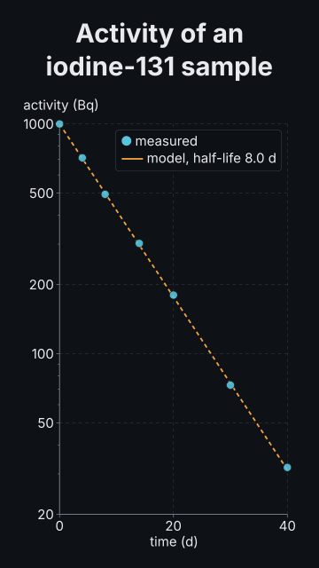

# `plot`

<!-- Generated by `vidgen gallery`; edit the sample in AGENTS.md (or video.yaml), not this file. -->

**Use it for:** measurements and models on scientific axes: log, symlog, reversed or broken axes with units, 10ⁿ and SI prefixes, panels sharing an axis, orbits at an equal aspect; data inline or from a CSV.

Scientific plot: line, point and histogram series from inline numbers or a CSV, on linear, log, symlog, reversed or broken axes with units, with error bars, fitted curves (parameters ± errors, R², bands, residual panels) and annotations, in one panel or several sharing an axis. `reveal: series` (default): the axes with the first series, then one series per beat (lines grow left to right, points pop in, bars rise), then each fit, then each annotation; `all`: everything in the first beat. The actions `fit` and `annotate` (and `reveal`) time a fit, an annotation, a series or its error bars to a word.

Last beat, 16:9 and 9:16:

 

The scene playing (GIF, up to its last beat):

 

## YAML

From the author guide (`vidgen guide scenes`):

```yaml
- id: decay_fit
  type: plot
  params:
    title: "Fitting the decay"
    x: {label: time, unit: d}
    y: {label: activity, unit: Bq}
    series:   # error bars: y_err (number, list, column, {minus, plus} or sqrt) and what they mean (sd, sem, ci95, range)
      - {name: measured, style: points, x: [0, 4, 8, 14, 20, 30, 40], y: [1000, 712, 494, 302, 180, 73, 32], y_err: 20, error: sem}
    fits:     # linear, poly, exponential, power, logistic, gaussian, breit_wigner (background: n), custom (expr + params)
      - {series: measured, model: exponential, name: decay, band: confidence, residuals: true}
    annotations:   # label, arrow, hline, vline, xrange, yrange, note
      - {type: label, series: measured, x: 8, text: "half after 8 days", id: half}
  beats:
    - text: "The measured activity, with its error bars."
    - text: "An exponential fits the points, with its parameters and their errors."
      actions: [{fit: "fit:decay", at: "@exponential"}]
    - text: "After eight days, half is left."
      actions: [{annotate: "annotation:half", at: "@half"}]
```

## Params

| param | type | default | notes |
|---|---|---|---|
| `title` | `str` |  | Plot title (in the header band at the top). (also: heading) |
| `data` | `str \| None` |  | A CSV (or TSV) in the project, e.g. assets/decay.csv: the first row names the columns, with units as 'time (s)' or 'E [MeV]'. |
| `series` | `list[PlotSeries] \| None` |  | The series of a one-panel plot. |
| `series.name` | `str` | required | Series name (legend, targets series:<name>, fits: series: <name>). |
| `series.x` | `str \| list[float] \| None` |  | X values: a column of the data file (by name, e.g. 'time') or a list of numbers. |
| `series.y` | `str \| list[float] \| None` |  | Y values: a column of the data file or a list of numbers (null for a gap). |
| `series.points` | `list[tuple[float, float]] \| None` |  | Inline points [[x, y], ...] instead of x and y. |
| `series.values` | `str \| list[float] \| None` |  | Raw values to bin into a histogram (a column or a list) instead of x and y. |
| `series.bins` | `int \| 'auto' \| 'sturges' \| 'fd' \| 'scott' \| 'sqrt' \| 'integers' \| list[float]` | `'auto'` | Histogram bins: a rule (auto: the narrower of sturges and fd; sturges; fd: Freedman-Diaconis; scott; sqrt; integers: one bin per whole number), a number of equal bins, or the edges [e0, e1, ...]. |
| `series.bin_width` | `float \| None` |  | Histogram bin width (edges on its multiples, or from bin_range's start); overrides a rule. |
| `series.bin_range` | `tuple[float, float] \| None` |  | Histogram range [low, high]; default: the values' range. Values outside are left out. |
| `series.nice_bins` | `bool` | `True` | Round a rule's bin width to 1, 2, 2.5 or 5 x 10^k with edges on its multiples; false: the rule's exact width from the lowest value. |
| `series.density` | `bool` | `False` | Histogram heights as a probability density (area 1) instead of counts. |
| `series.data` | `str \| None` |  | A CSV for this series (default: the plot's data). |
| `series.style` | `'line' \| 'points' \| 'both' \| 'bars' \| 'step' \| None` |  | line (joined in data order), points (markers), both; a histogram: bars (default), step (outline) or points (a marker at each bin's centre, e.g. with y_err: sqrt). Default: line, bars for a histogram. |
| `series.color` | `color \| None` |  | Colour; default: the theme palette colour at the series' position. |
| `series.marker` | `'auto' \| 'circle' \| 'square' \| 'triangle' \| 'diamond'` | `'auto'` | Marker shape of points; auto: by series position. |
| `series.dashed` | `bool` | `False` | Dashed line (e.g. a model next to measurements). |
| `series.width` | `float` | `4.0` | Line width (pixels at 1080p). |
| `series.y_err` | `float \| str \| list[float \| None] \| PlotErrorPair \| None` |  | Error bars in y: a number (the same for every point), a column, a list, {minus, plus} for asymmetric bars, or sqrt (Poisson: √y; a histogram's √N). |
| `series.y_err.minus` | `float \| str \| list[float \| None]` | required | How far the bar reaches below (left of) each point. |
| `series.y_err.plus` | `float \| str \| list[float \| None]` | required | How far it reaches above (right of) each point. |
| `series.x_err` | `float \| str \| list[float \| None] \| PlotErrorPair \| None` |  | Error bars in x: a number, a column, a list or {minus, plus}. |
| `series.x_err.minus` | `float \| str \| list[float \| None]` | required | How far the bar reaches below (left of) each point. |
| `series.x_err.plus` | `float \| str \| list[float \| None]` | required | How far it reaches above (right of) each point. |
| `series.error` | `'sd' \| 'sem' \| 'ci95' \| 'range' \| 'poisson' \| 'other' \| None` |  | What the error bars mean, shown in the legend: sd (standard deviation), sem (standard error of the mean), ci95 (95 % confidence interval), range (min to max), poisson (√N), other. Default with y_err: sqrt: poisson. |
| `series.model` | `str \| None` |  | A model of the plot's models whose columns x and y name (default: the plot's only model, when there is no data file). |
| `series.live` | `bool \| None` |  | Grow the series over its beat (from its first point to its last, in the model's time or the data's order) with a moving head; a histogram fills as its values arrive, in their order; default: true for a model's series. |
| `series.head` | `bool` | `True` | live: a marker at the growing end. |
| `series.readout` | `bool \| str` | `False` | live: show the current value (and the model's time) in a box while it grows: true (labelled by the y column), or the label to use. |
| `series.trail` | `float \| None` |  | live: only the last stretch (this long, in the model's time or points) is drawn strongly, the older part faint (phase-space plots). |
| `panels` | `list[PlotPanel] \| None` |  | Several panels instead of series, stacked (arrange: rows, sharing x) or side by side (columns, sharing y). |
| `panels.series` | `list[PlotSeries]` | required | The panel's series. |
| `panels.series.name` | `str` | required | Series name (legend, targets series:<name>, fits: series: <name>). |
| `panels.series.x` | `str \| list[float] \| None` |  | X values: a column of the data file (by name, e.g. 'time') or a list of numbers. |
| `panels.series.y` | `str \| list[float] \| None` |  | Y values: a column of the data file or a list of numbers (null for a gap). |
| `panels.series.points` | `list[tuple[float, float]] \| None` |  | Inline points [[x, y], ...] instead of x and y. |
| `panels.series.values` | `str \| list[float] \| None` |  | Raw values to bin into a histogram (a column or a list) instead of x and y. |
| `panels.series.bins` | `int \| 'auto' \| 'sturges' \| 'fd' \| 'scott' \| 'sqrt' \| 'integers' \| list[float]` | `'auto'` | Histogram bins: a rule (auto: the narrower of sturges and fd; sturges; fd: Freedman-Diaconis; scott; sqrt; integers: one bin per whole number), a number of equal bins, or the edges [e0, e1, ...]. |
| `panels.series.bin_width` | `float \| None` |  | Histogram bin width (edges on its multiples, or from bin_range's start); overrides a rule. |
| `panels.series.bin_range` | `tuple[float, float] \| None` |  | Histogram range [low, high]; default: the values' range. Values outside are left out. |
| `panels.series.nice_bins` | `bool` | `True` | Round a rule's bin width to 1, 2, 2.5 or 5 x 10^k with edges on its multiples; false: the rule's exact width from the lowest value. |
| `panels.series.density` | `bool` | `False` | Histogram heights as a probability density (area 1) instead of counts. |
| `panels.series.data` | `str \| None` |  | A CSV for this series (default: the plot's data). |
| `panels.series.style` | `'line' \| 'points' \| 'both' \| 'bars' \| 'step' \| None` |  | line (joined in data order), points (markers), both; a histogram: bars (default), step (outline) or points (a marker at each bin's centre, e.g. with y_err: sqrt). Default: line, bars for a histogram. |
| `panels.series.color` | `color \| None` |  | Colour; default: the theme palette colour at the series' position. |
| `panels.series.marker` | `'auto' \| 'circle' \| 'square' \| 'triangle' \| 'diamond'` | `'auto'` | Marker shape of points; auto: by series position. |
| `panels.series.dashed` | `bool` | `False` | Dashed line (e.g. a model next to measurements). |
| `panels.series.width` | `float` | `4.0` | Line width (pixels at 1080p). |
| `panels.series.y_err` | `float \| str \| list[float \| None] \| PlotErrorPair \| None` |  | Error bars in y: a number (the same for every point), a column, a list, {minus, plus} for asymmetric bars, or sqrt (Poisson: √y; a histogram's √N). |
| `panels.series.y_err.minus` | `float \| str \| list[float \| None]` | required | How far the bar reaches below (left of) each point. |
| `panels.series.y_err.plus` | `float \| str \| list[float \| None]` | required | How far it reaches above (right of) each point. |
| `panels.series.x_err` | `float \| str \| list[float \| None] \| PlotErrorPair \| None` |  | Error bars in x: a number, a column, a list or {minus, plus}. |
| `panels.series.x_err.minus` | `float \| str \| list[float \| None]` | required | How far the bar reaches below (left of) each point. |
| `panels.series.x_err.plus` | `float \| str \| list[float \| None]` | required | How far it reaches above (right of) each point. |
| `panels.series.error` | `'sd' \| 'sem' \| 'ci95' \| 'range' \| 'poisson' \| 'other' \| None` |  | What the error bars mean, shown in the legend: sd (standard deviation), sem (standard error of the mean), ci95 (95 % confidence interval), range (min to max), poisson (√N), other. Default with y_err: sqrt: poisson. |
| `panels.series.model` | `str \| None` |  | A model of the plot's models whose columns x and y name (default: the plot's only model, when there is no data file). |
| `panels.series.live` | `bool \| None` |  | Grow the series over its beat (from its first point to its last, in the model's time or the data's order) with a moving head; a histogram fills as its values arrive, in their order; default: true for a model's series. |
| `panels.series.head` | `bool` | `True` | live: a marker at the growing end. |
| `panels.series.readout` | `bool \| str` | `False` | live: show the current value (and the model's time) in a box while it grows: true (labelled by the y column), or the label to use. |
| `panels.series.trail` | `float \| None` |  | live: only the last stretch (this long, in the model's time or points) is drawn strongly, the older part faint (phase-space plots). |
| `panels.x` | `PlotAxis \| None` |  | Its x axis (arrange: columns, or share: false); default: the plot's x. |
| `panels.x.label` | `str` |  | Axis title (the unit is added in parentheses); default: the name of the first series' data column. |
| `panels.x.unit` | `str` |  | Unit, shown as 'label (unit)'; default: the unit in the first series' column header, e.g. 'time (s)'. |
| `panels.x.scale` | `'linear' \| 'log' \| 'symlog'` | `'linear'` | linear; log (base 10, positive values; ticks at powers of ten with 2-9 minor ticks); symlog (linear near 0, logarithmic beyond ±linthresh: data across zero spanning decades). |
| `panels.x.min` | `float \| None` |  | Lower end of the axis; default: from the data (rounded out to a tick when that is near). |
| `panels.x.max` | `float \| None` |  | Upper end of the axis; default: from the data. |
| `panels.x.reversed` | `bool` | `False` | Run the axis from high to low (e.g. magnitudes in astronomy, depth). |
| `panels.x.format` | `str` | `'auto'` | Tick labels: auto (plain numbers, or a power of ten moved into the title: 'distance (10⁶ km)'), plain, sci (2.5 × 10⁻³ on every tick), si (an SI prefix on the unit: 'time (ms)'; on a log axis each tick: '10 kHz'; needs a base unit such as s, m, Hz, eV), or a pattern such as '{:.1f}'. |
| `panels.x.linthresh` | `float \| None` |  | symlog: the range ±linthresh drawn linearly; default: from the data. |
| `panels.x.breaks` | `list[tuple[float, float]]` |  | Value ranges cut out of a linear axis, [[from, to], ...], drawn with // marks; data on both sides, none inside. |
| `panels.y` | `PlotAxis \| None` |  | Its y axis (arrange: rows, or share: false); default: the plot's y. |
| `panels.y.label` | `str` |  | Axis title (the unit is added in parentheses); default: the name of the first series' data column. |
| `panels.y.unit` | `str` |  | Unit, shown as 'label (unit)'; default: the unit in the first series' column header, e.g. 'time (s)'. |
| `panels.y.scale` | `'linear' \| 'log' \| 'symlog'` | `'linear'` | linear; log (base 10, positive values; ticks at powers of ten with 2-9 minor ticks); symlog (linear near 0, logarithmic beyond ±linthresh: data across zero spanning decades). |
| `panels.y.min` | `float \| None` |  | Lower end of the axis; default: from the data (rounded out to a tick when that is near). |
| `panels.y.max` | `float \| None` |  | Upper end of the axis; default: from the data. |
| `panels.y.reversed` | `bool` | `False` | Run the axis from high to low (e.g. magnitudes in astronomy, depth). |
| `panels.y.format` | `str` | `'auto'` | Tick labels: auto (plain numbers, or a power of ten moved into the title: 'distance (10⁶ km)'), plain, sci (2.5 × 10⁻³ on every tick), si (an SI prefix on the unit: 'time (ms)'; on a log axis each tick: '10 kHz'; needs a base unit such as s, m, Hz, eV), or a pattern such as '{:.1f}'. |
| `panels.y.linthresh` | `float \| None` |  | symlog: the range ±linthresh drawn linearly; default: from the data. |
| `panels.y.breaks` | `list[tuple[float, float]]` |  | Value ranges cut out of a linear axis, [[from, to], ...], drawn with // marks; data on both sides, none inside. |
| `panels.weight` | `float` | `1.0` | Its size relative to the other panels. |
| `x` | `PlotAxis` | `PlotAxis(label='', unit='', scale='linear', min=None, max=None, reversed=False, format='auto', linthresh=None, breaks=[])` | The x axis (shared by stacked panels). |
| `x.label` | `str` |  | Axis title (the unit is added in parentheses); default: the name of the first series' data column. |
| `x.unit` | `str` |  | Unit, shown as 'label (unit)'; default: the unit in the first series' column header, e.g. 'time (s)'. |
| `x.scale` | `'linear' \| 'log' \| 'symlog'` | `'linear'` | linear; log (base 10, positive values; ticks at powers of ten with 2-9 minor ticks); symlog (linear near 0, logarithmic beyond ±linthresh: data across zero spanning decades). |
| `x.min` | `float \| None` |  | Lower end of the axis; default: from the data (rounded out to a tick when that is near). |
| `x.max` | `float \| None` |  | Upper end of the axis; default: from the data. |
| `x.reversed` | `bool` | `False` | Run the axis from high to low (e.g. magnitudes in astronomy, depth). |
| `x.format` | `str` | `'auto'` | Tick labels: auto (plain numbers, or a power of ten moved into the title: 'distance (10⁶ km)'), plain, sci (2.5 × 10⁻³ on every tick), si (an SI prefix on the unit: 'time (ms)'; on a log axis each tick: '10 kHz'; needs a base unit such as s, m, Hz, eV), or a pattern such as '{:.1f}'. |
| `x.linthresh` | `float \| None` |  | symlog: the range ±linthresh drawn linearly; default: from the data. |
| `x.breaks` | `list[tuple[float, float]]` |  | Value ranges cut out of a linear axis, [[from, to], ...], drawn with // marks; data on both sides, none inside. |
| `y` | `PlotAxis` | `PlotAxis(label='', unit='', scale='linear', min=None, max=None, reversed=False, format='auto', linthresh=None, breaks=[])` | The y axis (shared by panels side by side; else the default of each panel). |
| `y.label` | `str` |  | Axis title (the unit is added in parentheses); default: the name of the first series' data column. |
| `y.unit` | `str` |  | Unit, shown as 'label (unit)'; default: the unit in the first series' column header, e.g. 'time (s)'. |
| `y.scale` | `'linear' \| 'log' \| 'symlog'` | `'linear'` | linear; log (base 10, positive values; ticks at powers of ten with 2-9 minor ticks); symlog (linear near 0, logarithmic beyond ±linthresh: data across zero spanning decades). |
| `y.min` | `float \| None` |  | Lower end of the axis; default: from the data (rounded out to a tick when that is near). |
| `y.max` | `float \| None` |  | Upper end of the axis; default: from the data. |
| `y.reversed` | `bool` | `False` | Run the axis from high to low (e.g. magnitudes in astronomy, depth). |
| `y.format` | `str` | `'auto'` | Tick labels: auto (plain numbers, or a power of ten moved into the title: 'distance (10⁶ km)'), plain, sci (2.5 × 10⁻³ on every tick), si (an SI prefix on the unit: 'time (ms)'; on a log axis each tick: '10 kHz'; needs a base unit such as s, m, Hz, eV), or a pattern such as '{:.1f}'. |
| `y.linthresh` | `float \| None` |  | symlog: the range ±linthresh drawn linearly; default: from the data. |
| `y.breaks` | `list[tuple[float, float]]` |  | Value ranges cut out of a linear axis, [[from, to], ...], drawn with // marks; data on both sides, none inside. |
| `arrange` | `'rows' \| 'columns'` | `'rows'` | Panels stacked top to bottom (rows) or side by side (columns). |
| `share` | `bool` | `True` | Panels share the axis along which they are arranged (rows: x, columns: y); false: each its own. |
| `aspect` | `'auto' \| 'equal'` | `'auto'` | equal: one unit is as long on x as on y (orbits, trajectories, geometry); one panel, linear axes. |
| `grid` | `'major' \| 'both' \| 'x' \| 'y' \| 'none'` | `'major'` | Gridlines: at the labelled ticks of both axes (major), also at a log axis' minor ticks (both), one axis, or none. |
| `legend` | `bool \| None` |  | Legend of the series and fits (in a free corner, else above); default: with more than one series or a fit in a panel, or error bars with a meaning. |
| `fits` | `list[PlotFit]` |  | Fitted curves: [{series, model, ...}], drawn with their parameters ± standard errors. |
| `fits.series` | `str` | required | The series to fit (its name). |
| `fits.model` | `str` | `'linear'` | linear, poly (degree), exponential (A·exp(k·x)), power (A·xᵏ), logistic, gaussian, breit_wigner (also cauchy, lorentzian), custom (expr); for a histogram also the distributions normal, exponential, poisson (fitted to the raw values). |
| `fits.degree` | `int` | `2` | poly: the degree. |
| `fits.background` | `int \| None` |  | gaussian / breit_wigner: a polynomial background of this degree under the peak (0: constant, 1: a line). |
| `fits.expr` | `str \| None` |  | custom: the model as an expression of x and named parameters, e.g. 'a*exp(-x/tau) + c'. |
| `fits.params` | `dict[str, float \| PlotFitParam]` |  | Starting values (needed for custom, optional otherwise): {a: 1000, tau: {value: 8, unit: d}}. |
| `fits.params.value` | `float` | `1.0` | Starting value. |
| `fits.params.unit` | `str` |  | Its unit, shown after the fitted value. |
| `fits.name` | `str` |  | The fit's name (legend, targets fit:<name>); default: '<model> fit'. |
| `fits.range` | `tuple[float, float] \| None` |  | Fit only the points with x in [low, high]. |
| `fits.weighted` | `bool` | `True` | Weight by the series' y errors (and use its x errors) when it has them; a histogram by √N. |
| `fits.band` | `'none' \| 'confidence' \| 'prediction'` | `'none'` | Shade the confidence band (where the true curve lies) or the prediction band (where a new measurement would lie). |
| `fits.level` | `float` | `0.95` | The band's confidence level. |
| `fits.residuals` | `bool \| 'normalized'` | `False` | A residual panel under the plot (y − fit), sharing x; normalized: (y − fit)/σ. |
| `fits.show` | `'auto' \| 'none' \| list['formula' \| 'params' \| 'r2' \| 'chi2' \| 'n']` | `'auto'` | What the box beside the curve says: auto (parameters ± standard errors, R², χ²/ν when the points have errors), none, or a list of formula, params, r2, chi2, n. The legend names the fit by its name, else its formula. |
| `fits.extend` | `bool` | `False` | Draw the curve across the whole x axis (default: over the fitted points). |
| `fits.color` | `color \| None` |  | Curve colour; default: accent for one fit, the series' colour with several. |
| `fits.dashed` | `bool` | `False` | Dashed curve. |
| `fits.width` | `float` | `4.0` | Curve width (pixels at 1080p). |
| `annotations` | `list[PlotAnnotation]` |  | Annotations tied to the data: [{type: label \| arrow \| hline \| vline \| xrange \| yrange \| note, text, ...}]. |
| `annotations.type` | `'label' \| 'arrow' \| 'hline' \| 'vline' \| 'xrange' \| 'yrange' \| 'note'` | required | label (text by a point, a ring on it), arrow (text with an arrow to a point), hline / vline (a dashed reference line at y / x), xrange / yrange (a shaded range [from, to]), note (a text box in a free corner). |
| `annotations.text` | `str` |  | The text (optional for lines and ranges). |
| `annotations.x` | `float \| tuple[float, float] \| None` |  | label / arrow: the point's x (with series: the series' point nearest it); vline: where; xrange: [from, to]. |
| `annotations.y` | `float \| tuple[float, float] \| None` |  | label / arrow: the point's y; hline: where; yrange: [from, to]. |
| `annotations.series` | `str \| None` |  | label / arrow: the series whose point is meant (with x: nearest that x; with index; alone: its highest point). |
| `annotations.index` | `int \| None` |  | label / arrow: the series' point by number (1 = first). |
| `annotations.at` | `'auto' \| 'top_left' \| 'top_right' \| 'bottom_right' \| 'bottom_left' \| 'top' \| 'bottom'` | `'auto'` | note: where the box goes (auto: a free corner). |
| `annotations.panel` | `int \| None` |  | The panel (1 = first); default: the series' panel, else the first. |
| `annotations.color` | `color \| None` |  | Colour of the mark, line or range; default: highlight. |
| `annotations.id` | `str \| None` |  | A name for targets annotation:<id>. |
| `reveal` | `'series' \| 'all'` | `'series'` | series: one series per beat, then the fits and annotations; all: everything in beat 1. |
| `models` | `dict[str, PlotModel]` |  | Models generating data, by name: {osc: {kind: ode, equations: {x: v, v: "-k*x"}, initial: {x: 1, v: 0}, params: {k: 4}, t: [0, 10]}}; series name their columns (x: t, y: x) and grow live. |
| `models.kind` | `'ode' \| 'recurrence' \| 'random_walk' \| 'poisson' \| 'function'` | required | ode (differential equations), recurrence (x[n+1] from x[n]), random_walk, poisson (random events in time), function (registered in Python). |
| `models.equations` | `dict[str, str]` |  | ode: the derivative of each variable, {x: v, v: "-k*x - c*v"} (keys x, dx/dt or x'); recurrence: the next value, {x: "r*x*(1 - x)"}. |
| `models.initial` | `dict[str, float]` |  | Starting value of every variable: {x: 1, v: 0}. |
| `models.params` | `dict[str, float]` |  | Named parameters the equations (and quantities) use: {k: 4, c: 0.3}; function: passed to it. |
| `models.t` | `tuple[float, float] \| None` |  | ode, poisson: the time span [start, end]; default [0, 10]. |
| `models.step` | `float \| None` |  | ode: the integration step (rk4, leapfrog; default a thousandth of the span; rk45: the first step); random_walk: the length of a step (default 1). |
| `models.method` | `str` | `'rk4'` | ode: rk4 (fixed step, 4th order), rk45 (adaptive Dormand–Prince, tolerance), leapfrog (velocity Verlet: symplectic, keeps the energy of orbits and oscillators; needs x' = v pairs and forces without velocities). |
| `models.tolerance` | `float` | `1e-06` | ode, rk45: the relative error allowed per step. |
| `models.samples` | `int \| None` |  | ode: how many points to keep for drawing (default 600). |
| `models.steps` | `int \| None` |  | recurrence: how many iterations (default 50); random_walk: how many steps (default 100). |
| `models.seed` | `int` | `1` | random_walk, poisson, function: the random seed (the same seed gives the same numbers). |
| `models.p` | `float` | `0.5` | random_walk (1-D lattice): the chance of a step up. |
| `models.dims` | `1 \| 2` | `1` | random_walk: 1 (x) or 2 (x and y). |
| `models.distribution` | `'lattice' \| 'gaussian'` | `'lattice'` | random_walk: lattice (±step) or gaussian (normal steps). |
| `models.rate` | `float \| None` |  | poisson: events per unit of time. |
| `models.function` | `str \| None` |  | function: the name it was registered under (vidgen.api.register_model). |
| `models.quantities` | `dict[str, str]` |  | Derived columns, expressions of the columns and params: {E: "0.5*v^2 + 0.5*k*x^2"}. |
| `models.conserved` | `list[str]` |  | Quantities that should stay constant (an energy): their drift is checked (vidgen lint). |
| `models.units` | `dict[str, str]` |  | Units of the columns: {t: s, x: m, v: m/s, E: J} (axis titles, readouts). |
| `rescale` | `bool` | `True` | While live series grow, axes without fixed ends start around the first data and widen smoothly as the data reach their edge (a time axis is shown whole); false: the whole range from the start. |
| `point_radius` | `float \| None` |  | Marker radius in Manim units; default: from the number of points. |
| `label_size` | `size \| None` |  | Size of tick labels, axis titles, the legend, fit boxes and annotations (never below the readable minimum); default: body in a landscape frame, caption in a portrait one. |
| `caption` | `str` |  | Note under the plot (e.g. the data source). |
| `caption_size` | `size` | `'caption'` | Caption text size. |
| `caption_color` | `color` | `'dim'` | Caption color. |
| `title_size` | `size` | `'heading'` | Title size (1.3x in a portrait frame). (also: heading_size) |
| `title_color` | `color` | `'text'` | Title color. (also: heading_color) |

## Targets

`title`, `axes`, `panel<N>`, `legend`, `series<N>`, `series:<name>`, `errors:<name>`, `fit<N>`, `fit:<name>`, `annotation<N>`, `annotation:<id>`

## Beats

Any number.

[All scene types](README.md) · `vidgen list-scenes` · `vidgen schema --scene plot`
