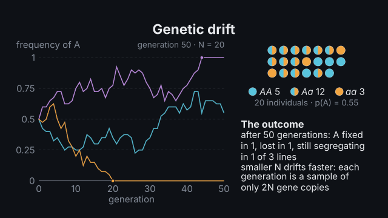
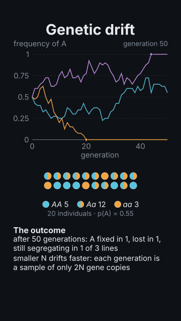

# `population`

<!-- Generated by `vidgen gallery`; edit the sample in AGENTS.md (or video.yaml), not this file. -->

**Use it for:** population genetics: Hardy–Weinberg worked with exact numbers (p and q, p² + 2pq + q², carriers from an incidence, a chi-square test of HWE), seeded simulations of drift, selection, mutation, migration, a bottleneck or a founder effect with allele frequencies over generations.

Population genetics. `model: hardy_weinberg`: the population as dots by genotype and the working — p and q from genotype `counts` (p = (2n_AA + n_Aa) / 2N), genotype `frequencies`, `p` or the `incidence` of a recessive condition (q = √incidence: 1/2500 gives q = 1/50 and carriers 2pq = 49/1250 ≈ 1 in 25.5), the expected p², 2pq, q² (with `inbreeding` F), and from counts the chi-square test of Hardy–Weinberg proportions with df = 1. `model: drift` (and `selection`, `mutation`, `migration`, `bottleneck`, `founder`): seeded Wright–Fisher simulations of N diploids — several replicate lines of the allele frequency over generations (smaller N drifts faster; fixation and loss marked), the deterministic recursion of selection (`fitness` or `s` and `h`), mutation (`mu`, `nu`) or migration (`m` between two `populations`), the individuals of the first line as dots, and the heterozygosity through a bottleneck or after a founder event.

Last beat, 16:9 and 9:16:

 

The scene playing (GIF, up to its last beat):

 

## YAML

From the author guide (`vidgen guide scenes`):

```yaml
- id: drift
  type: population
  params:
    title: "Genetic drift"
    model: drift                       # or hardy_weinberg with counts / incidence, selection, migration, bottleneck, founder
    N: 20
    p0: 0.5
    generations: 50
    replicates: 3
    seed: 36
  beats:
    - text: "Three populations of twenty individuals start at one half."
    - text: "Each generation samples only forty gene copies: some lines fix the allele, others lose it."
      actions: [{simulate: lines}]
```

## Params

| param | type | default | notes |
|---|---|---|---|
| `title` | `str` |  | Title (in the header band at the top). (also: heading) |
| `model` | `'hardy_weinberg' \| 'drift' \| 'selection' \| 'mutation' \| 'migration' \| 'bottleneck' \| 'founder'` | `'hardy_weinberg'` | hardy_weinberg (worked numbers) or a seeded simulation: drift, selection, mutation, migration, bottleneck, founder. |
| `alleles` | `list[str] \| None` |  | The two alleles, [A, a] by default; p is the frequency of the first. |
| `counts` | `dict[str, int] \| None` |  | hardy_weinberg: genotype counts {AA: 360, Aa: 480, aa: 160} (gives the chi-square test of HWE). |
| `frequencies` | `dict[str, Any] \| None` |  | hardy_weinberg: genotype frequencies {AA: 0.36, Aa: 0.48, aa: 0.16} (adding up to 1). |
| `p` | `Any` |  | hardy_weinberg: the frequency of the first allele (0–1, 0.6, '3/5', '60%'). |
| `incidence` | `Any` |  | hardy_weinberg: the incidence of the recessive condition (q² = incidence: 1/2500). |
| `condition` | `str` |  | hardy_weinberg: the condition's name for the incidence (cystic fibrosis). |
| `inbreeding` | `Any` |  | hardy_weinberg: the inbreeding coefficient F (genotypes p² + Fpq, 2pq(1 − F), q² + Fpq). |
| `total` | `int \| None` |  | hardy_weinberg: the number sampled, checked against the counts' sum. |
| `N` | `int \| None` |  | Simulations: the population size (diploid individuals: 2N gene copies); needed for drift, bottleneck, founder. |
| `p0` | `Any` |  | Simulations: the starting frequency of the first allele. |
| `generations` | `int \| None` |  | Simulations: how many generations (default 100). |
| `replicates` | `int \| None` |  | Simulations with N: how many independent lines (default 6, at most 20). |
| `fitness` | `dict[str, float] \| None` |  | selection: relative fitnesses {AA: 1, Aa: 1, aa: 0.8} (none negative). |
| `s` | `Any` |  | selection: the selection coefficient against the second allele's homozygote (w = 1, 1 − hs, 1 − s). |
| `h` | `Any` |  | selection: the dominance coefficient (0 recessive, 0.5 additive, 1 dominant; default 0.5). |
| `mu` | `Any` |  | The mutation rate from the first allele to the second, per copy per generation. |
| `nu` | `Any` |  | The back-mutation rate (second to first). |
| `populations` | `list[Any] \| None` |  | migration: two populations [{name: mainland, p0: 0.9}, {name: island, p0: 0.1}]. |
| `m` | `Any` |  | migration: the share of each generation's parents that are migrants (0–1). |
| `direction` | `'both' \| 'one_way' \| None` |  | migration: both (the populations exchange migrants) or one_way (from the first to the second: continent → island). |
| `bottleneck` | `dict[str, int] \| None` |  | bottleneck: {at: 20, N: 10, generations: 5} — when it starts, its size, how long it lasts. |
| `founders` | `int \| None` |  | founder: how many individuals found the new population (from a source at p0); it then has N. |
| `heterozygosity` | `bool \| None` |  | Draw the heterozygosity under the allele frequencies (drift, bottleneck, founder; default: bottleneck and founder). |
| `seed` | `int` | `1` | The random seed: the same seed gives the same lines and dots. |
| `title_size` | `size` | `'heading'` | Title size. (also: heading_size) |
| `size` | `size` | `'caption'` | Label size (never below the readable minimum). |

## Targets

`title`, `population`, `alleles`, `expected`, `carriers`, `chi_square`, `plot`, `lines`, `line:<n>`, `deterministic`, `fixed`, `lost`, `heterozygosity`, `generation:<t>`

## Beats

Any number.

[All scene types](README.md) · `vidgen list-scenes` · `vidgen schema --scene population`
