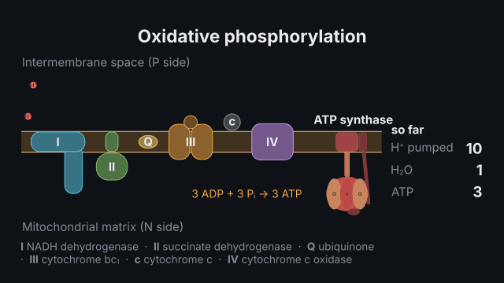
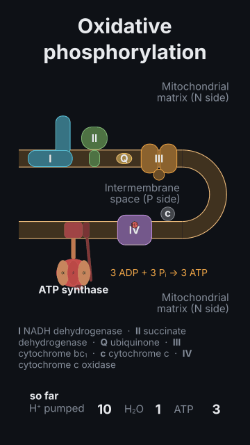

# The respiratory chain

<!-- Generated by `vidgen gallery`; edit src/vidgen/data/gallery/showcases/respiratory_chain.yaml, not this file. -->

**Use it for:** electrons down complexes I–IV with protons pumped, then ATP synthase turning.

A showcase of [`metabolism`](metabolism.md): a small scene written for the gallery, a whole `video.yaml`. Copy it into a
project and run `vidgen render`; until `vidgen tts` voices it, its beats are timed by their word count.

The scene playing, 16:9 and 9:16:

<picture><source media="(prefers-reduced-motion: reduce)" srcset="media/respiratory_chain-16x9.png"></picture> <picture><source media="(prefers-reduced-motion: reduce)" srcset="media/respiratory_chain-9x16.png"></picture>

Last beat:

 

## YAML

```yaml
title: The Respiratory Chain
voice: {provider: kokoro, voice: af_heart}
scenes:
  - id: respiratory_chain
    type: metabolism
    params:
      title: "Oxidative phosphorylation"
      process: etc                       # complexes I–IV, Q, cytochrome c, ATP synthase
    beats:
      - text: "Electrons from NADH pass complexes one, three and four, pumping ten protons."
        actions: [{advance: etc, to: complex_iv, at: "@pass"}]
      - text: "The protons flow back through ATP synthase, which makes ATP."
        actions: [{advance: etc, to: atp_synthase}]
```

[All scene types and showcases](README.md) · `vidgen guide scenes` · [the cell-biology cookbook](../COOKBOOK-CELL-BIOLOGY.md)
