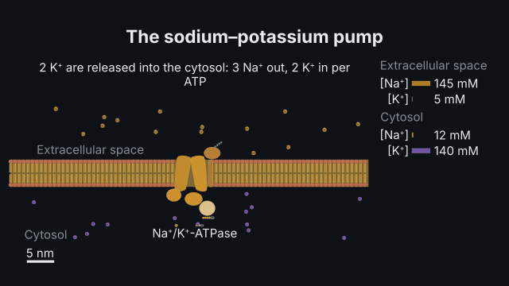
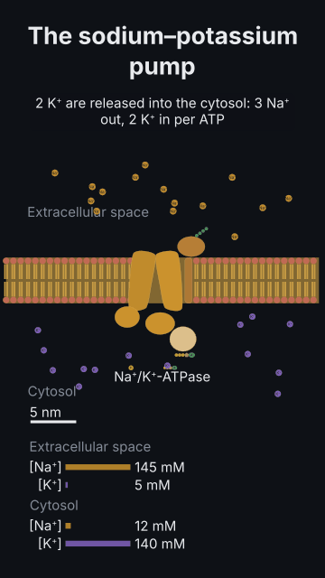

# The sodium pump

<!-- Generated by `vidgen gallery`; edit src/vidgen/data/gallery/showcases/sodium_pump.yaml, not this file. -->

**Use it for:** a membrane pump's cycle: 3 Na⁺ out and 2 K⁺ in per ATP, against their gradients.

A showcase of [`molecule`](molecule.md): a small scene written for the gallery, a whole `video.yaml`. Copy it into a
project and run `vidgen render`; until `vidgen tts` voices it, its beats are timed by their word count.

The scene playing, 16:9 and 9:16:

<picture><source media="(prefers-reduced-motion: reduce)" srcset="media/sodium_pump-16x9.png"></picture> <picture><source media="(prefers-reduced-motion: reduce)" srcset="media/sodium_pump-9x16.png"></picture>

Last beat:

 

## YAML

```yaml
title: The Sodium Pump
voice: {provider: kokoro, voice: af_heart}
scenes:
  - id: sodium_pump
    type: molecule
    params:
      title: "The sodium–potassium pump"
      membrane: plasma                   # extracellular above, cytosol below
      solutes: [Na+, K+]                 # typical concentrations on each side
      molecules: [{kind: na_k_atpase, id: pump}]
    beats:
      - text: "Each cycle the pump spends one ATP to move three sodium ions out and two potassium ions in, against their gradients."
        actions: [{transport: pump, at: "@spends"}]
```

[All scene types and showcases](README.md) · `vidgen guide scenes` · [the cell-biology cookbook](../COOKBOOK-CELL-BIOLOGY.md)
