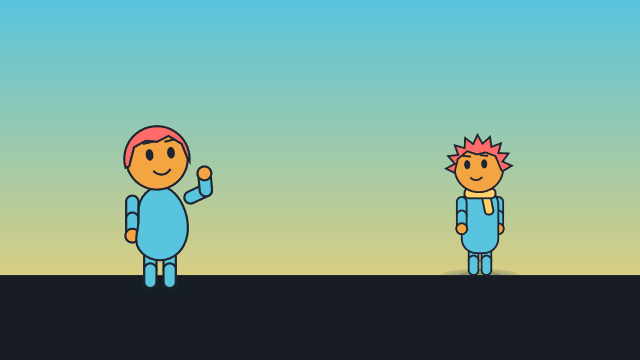
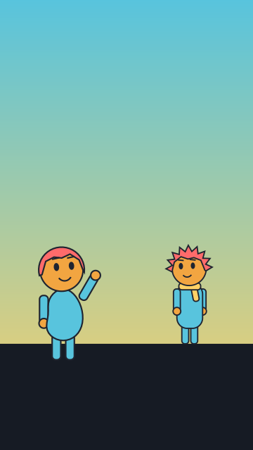

# `stage`

<!-- Generated by `vidgen gallery`; edit the sample in AGENTS.md (or video.yaml), not this file. -->

**Use it for:** characters on a set (a cartoon).

A cartoon set: a background (`image` file, `generate:` picture, or a theme colour or gradient), a ground line and the video's characters standing on named marks.

Last beat, 16:9 and 9:16:

 

The scene playing (GIF, up to its last beat):

 

## YAML

From the author guide (`vidgen guide scenes`):

```yaml
characters:              # top level of video.yaml: declared once, used by any stage
  - {name: pip, look: {body: bean, hair: short}}
  - {name: kit, look: {body: tall, hair: spiky, accessories: [scarf]}}
scenes:
  - id: park
    type: stage
    params:
      background: [primary, highlight]   # a gradient sky; or image: / generate: for a picture
      characters:
        - {name: pip, at: left, pose: waving, expression: happy}
        - {name: kit, at: right, depth: 0.3}   # further back: smaller, drawn behind
    beats: [{text: "Pip waves at an old friend across the park."}]
```

## Params

| param | type | default | notes |
|---|---|---|---|
| `image` | `str \| None` |  | Background picture relative to the project folder, e.g. assets/park.png (fills the frame, cropped). |
| `generate` | `str \| GenerateImage \| None` |  | A generated background instead of a file: {prompt, negative, style, aspect, seed, format} or the prompt (the video's cartoon_style is added); made by `vidgen imagegen`, a placeholder until then. |
| `generate.prompt` | `str` | required | What the picture shows, e.g. "a lighthouse on a cliff at dawn" (keep words out of it: generators draw text poorly). |
| `generate.negative` | `str` |  | What the picture should not show (added to the prompt as "Avoid: ..."), e.g. "people, text". |
| `generate.style` | `str \| None` |  | Style words added to the prompt: a preset (photo, illustration, flat, isometric, watercolor, line_art, render_3d, cinematic), your own words, or none; default imagegen.style. |
| `generate.aspect` | `'auto' \| 'landscape' \| 'portrait' \| 'square'` | `'auto'` | Shape of the picture: auto (the video's: landscape for 16:9, portrait for 9:16, square), landscape, portrait or square. |
| `generate.seed` | `int \| None` |  | Another number asks for another picture of the same prompt (part of the cache key; OpenAI takes no seed, so it does not make a picture reproducible). |
| `generate.format` | `'png' \| 'svg'` | `'png'` | png: a raster picture; svg: a vector picture drawn as shapes (provider openrouter with an SVG model, e.g. imagegen.svg_model: recraft/recraft-v4.1-vector; good for flat illustrations, not photos). |
| `background` | `color \| list[color] \| None` |  | Without a picture: a colour, or a list of colours for a gradient from the top down; none: the theme's background. |
| `ground` | `float` | `0.2` | Height of the ground line (where the characters' feet are) above the bottom edge, as a fraction of the frame height. |
| `ground_color` | `color \| False \| None` |  | Fill below the ground line, up to where the deepest character or prop on the ground stands; none: surface on a colour background, nothing on a picture; false: nothing. |
| `marks` | `dict[str, float]` |  | Own marks: name -> x from 0 (left edge) to 1 (right edge), besides far_left 0.1, left 0.25, centre 0.5, right 0.75, far_right 0.9. |
| `characters` | `list[str \| StageCharacter]` |  | The characters on the stage: a name, or {name, at, depth, scale, facing, pose, expression}. |
| `characters.name` | `str` | required | A character of the video's characters: list. |
| `characters.at` | `str \| float` | `'centre'` | Where it stands: a mark (far_left, left, centre, right, far_right, or the stage's own marks) or an x position from 0 (left edge) to 1 (right edge). |
| `characters.depth` | `float` | `0.0` | 0 = on the ground line at full size; up to 1 = at the back of the stage, higher up and 0.55 x the size; deeper characters are drawn behind. |
| `characters.scale` | `float` | `1.0` | Its size relative to the stage's size (e.g. 0.8 for a child). |
| `characters.facing` | `'auto' \| 'right' \| 'left'` | `'auto'` | Which way it looks; auto: towards the middle of the stage (right on the left half, left on the right half). |
| `characters.pose` | `str \| None` |  | The pose it starts in (stand, pointing, waving, thinking, shrug, arms_crossed, sitting, or its own); none: at rest. |
| `characters.expression` | `str \| None` |  | The expression it starts with (neutral, happy, sad, angry, surprised, worried, thinking, or its own); none: at rest. |
| `size` | `float` | `0.45` | Height of a character at depth 0, as a fraction of the frame's shorter side. |
| `idle` | `bool` | `True` | false: the characters do not breathe, sway or blink in this scene. |
| `foley` | `bool \| None` |  | Sounds for the characters' actions (footsteps, whoosh on enter / exit, boing on jump, pop on a surprised face): false for none in this scene; default: the video's foley (on). |
| `auto_direct` | `bool \| AutoDirect \| None` |  | Automatic directing in this scene: listeners look at whoever speaks and react after lines, speakers gesture on stressed words, short punchy lines get a close-up (true, false or {looks, reactions, gestures, closeups}); a beat's own setting wins; default: the video's (off). Actions written in a beat always win. |
| `auto_direct.looks` | `bool` | `True` | Listeners turn and look at whoever speaks; the speaker looks at the one it talks to. |
| `auto_direct.reactions` | `bool` | `True` | Listeners react in the pause after a line with an expression chosen from its punctuation and words (! surprised or happy, ? thinking, a negation worried). |
| `auto_direct.gestures` | `bool` | `True` | The speaker gestures on a line's stressed word (*word*, an all-capitals word, else a long one): at most one per line, from the gestures its parts allow. |
| `auto_direct.closeups` | `bool` | `True` | A short punchy line right after a long one gets a close-up (a zoom on the speaker, or a closeup shot when the line is too short for the zoom's moves): never two beats in a row, never during a walk, a camera move or a written shot. |
| `cartoon_motion` | `'lively' \| 'calm' \| 'none' \| None` |  | Animation principles for the characters in this scene (anticipation, squash and stretch, overshoot and settle, follow-through): lively, calm or none; a character's own setting wins; default: the video's (lively). |
| `width` | `float` | `1.0` | Width of the stage in frame widths (marks and x positions are fractions of it; while it reframes in a frame narrower than 16:9, in 16:9 frame widths); wider than 1: the camera pans across it (pan, follow). |
| `camera_at` | `str \| float` | `'centre'` | Where the camera looks at the start, on a stage wider than the frame: a mark or an x from 0 to 1 of the stage. |
| `reframe` | `'speaker' \| 'none' \| None` |  | On a stage wider than the frame: speaker moves the camera to whoever speaks (easing between speakers, holding during short replies; a 9:16 frame then crops the stage laid out as wide as the 16:9 one); none: only the beats' own pan / follow / zoom / shot move it; default: the video's, else speaker when the characters do not fit in one view. |
| `layers` | `list[StageLayer]` |  | Parallax layers: {place: background \| middle \| foreground, factor, image \| shapes}. |
| `layers.name` | `str \| None` |  | Its name in the layout dump; default <place>_layer (then _2, _3...). |
| `layers.place` | `'background' \| 'middle' \| 'foreground'` | `'background'` | background and middle are drawn behind the ground band (in that order), foreground in front of the characters. |
| `layers.factor` | `float \| None` |  | How far it moves for a camera move of one unit: 1 = with the stage and its characters, 0 = fixed on screen; default background 0.3, middle 0.6, foreground 1.4. |
| `layers.image` | `str \| None` |  | A picture relative to the project folder (a PNG with transparency, or an SVG), as wide as the layer, standing on bottom. |
| `layers.bottom` | `float` | `0.0` | With image: the height of its bottom edge above the frame's bottom edge, as a fraction of the frame height. |
| `layers.shapes` | `list[LayerShape]` |  | Instead of image: filled shapes, e.g. [{shape: hills, y: 0.2, height: 0.15, color: secondary}]. |
| `layers.shapes.shape` | `'rect' \| 'ellipse' \| 'triangle' \| 'hills'` | required | rect, ellipse, triangle, or hills: a row of rounded hills across the whole layer (x is not used). |
| `layers.shapes.x` | `float` | `0.5` | Its middle: an x from 0 (left edge) to 1 (right edge) of the stage. |
| `layers.shapes.y` | `float` | `0.0` | Its bottom, as a fraction of the frame height above the bottom edge (hills: their foot; they are filled down from there). |
| `layers.shapes.width` | `float` | `0.3` | Its width as a fraction of the frame's shorter side (hills: the width of one hill). |
| `layers.shapes.height` | `float` | `0.2` | Its height as a fraction of the frame's shorter side. |
| `layers.shapes.color` | `color` | `'secondary'` | Fill colour (a theme token or #hex). |
| `props` | `list[str \| StageProp]` |  | Props: a built-in prop's name, or {prop \| svg, name, at, depth, scale, lift, facing, color, detail, recolor, open}. |
| `props.prop` | `'table' \| 'chair' \| 'tree' \| 'bush' \| 'house' \| 'door' \| 'lamp' \| 'sign' \| 'box' \| 'ball' \| 'cloud' \| 'sun' \| 'moon' \| 'rock' \| 'plant' \| 'laptop' \| 'cup' \| 'basket' \| 'umbrella' \| 'napkin' \| None` |  | A built-in prop: table, chair, tree, bush, house, door, lamp, sign, box, ball, cloud, sun, moon, rock, plant, laptop, cup, basket, umbrella, napkin. |
| `props.svg` | `str \| None` |  | Instead of prop: an SVG file relative to the project folder (sanitised like any SVG), standing on the bottom edge of its viewBox. |
| `props.name` | `str \| None` |  | Its name for actions and the layout dump; default: the prop's name (an SVG: the file name), then _2, _3... |
| `props.at` | `str \| float` | `'centre'` | Where it stands: a mark or an x position from 0 (left edge) to 1 (right edge) of the stage. |
| `props.depth` | `float` | `0.0` | 0 = on the ground line at full size; up to 1 = at the back, higher up and smaller; at the same depth characters are drawn in front of props. |
| `props.scale` | `float` | `1.0` | Its size relative to its usual size next to a character (a tree is 1.7 characters tall, a cup 0.09; an SVG 0.5). |
| `props.lift` | `float \| None` |  | How far above the ground line it hangs, as a fraction of the frame height; default 0.5 for cloud, sun and moon, else 0 (on the ground). |
| `props.facing` | `'right' \| 'left'` | `'right'` | left: mirrored. |
| `props.color` | `color \| None` |  | Its main colour (a theme token or #hex); default per prop (a tree's leaves tertiary, a chair accent...). |
| `props.detail` | `color \| None` |  | Its second colour (a tree's trunk, a house's roof, a laptop's screen...); default per prop. |
| `props.recolor` | `'none' \| 'theme'` | `'none'` | With svg: theme maps the picture's colours to the nearest theme colours; none keeps them. |
| `props.open` | `bool` | `False` | An umbrella: true starts it open (the open / close actions change it later). |
| `particles` | `list[str \| StageParticles]` |  | Particles over the whole scene, in front of everything: a kind (rain, snow, sparkles, dust, confetti, smoke, bubbles) or {kind, density, area, color, seed}; for one beat use the particles action. |
| `particles.density` | `float` | `1.0` | How many: 1 = the kind's usual amount for a whole frame, 2 = twice as many (at most 300 in all; half at preview quality). |
| `particles.area` | `list[float] \| None` |  | Where they are: [x, y, w, h] fractions 0-1 of the visible frame from its top-left corner; default the whole frame. |
| `particles.color` | `color \| list[color] \| None` |  | A colour or a list (each particle picks one); default per kind (rain light blue, snow white, sparkles highlight, confetti the theme's colours...). |
| `particles.seed` | `int` | `1` | Another number gives other positions; the same number gives the same particles in every render. |
| `particles.kind` | `'rain' \| 'snow' \| 'sparkles' \| 'dust' \| 'confetti' \| 'smoke' \| 'bubbles'` | required | rain, snow, sparkles, dust, confetti, smoke or bubbles. |
| `light` | `'day' \| 'morning' \| 'sunset' \| 'night' \| 'indoor' \| CustomLight` | `'day'` | The light on the set: day (as drawn), morning, sunset, night (dark blue, with stars on a colour background) or indoor, or {tint, strength}: a colour grade of the background, layers, props and characters (never of speech bubbles, captions or other text); the light action changes it during the scene. |
| `light.tint` | `color` | required | The light's colour (a theme token or #hex): the set's colours are multiplied towards it. |
| `light.strength` | `float` | `0.5` | How strongly: 0 = no change, 1 = the colours multiplied by the tint. |
| `shadows` | `bool` | `True` | Soft shadows on the ground under the characters and the props standing on it (smaller when they jump, none under a held prop); false: none. |
| `wind` | `float \| 'calm' \| 'breeze' \| 'windy' \| 'gale'` | `0.0` | Wind from the start, in gusts: 0 calm (nothing moves) .. 1 a gale blowing to the right (negative: to the left), or calm, breeze (0.3), windy (0.6), gale (1); trees, bushes, plants, signs and lamps sway, scarves, long hair, floppy or pointy ears and hats trail, particles drift; the wind action changes it during the scene. |

## Targets

`<character>`, `<prop>`, `<character>.<part>`

## Beats

Any number.

[All scene types](README.md) · `vidgen list-scenes` · `vidgen schema --scene stage`
