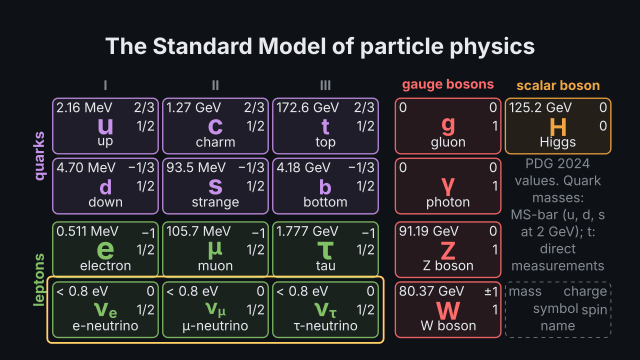
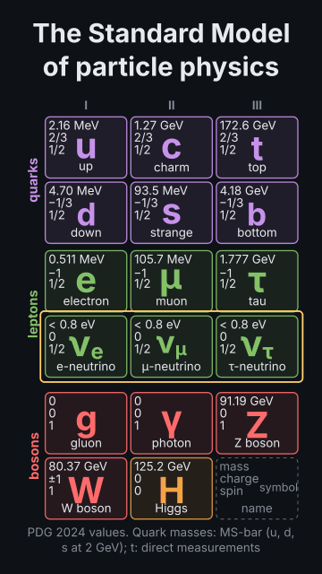

# `standard_model`

<!-- Generated by `vidgen gallery`; edit the sample in AGENTS.md (or video.yaml), not this file. -->

**Use it for:** the Standard Model's particles: quarks and leptons in three generations, the gauge bosons and the Higgs boson with their masses (PDG 2024), charges and spins; antiparticles; which bosons couple to which particles.

The Standard Model chart. `reveal: groups` (default) brings in the quarks, the leptons, the gauge bosons and the Higgs boson one after another over the beats; `all` shows the whole chart in the first beat.

Last beat, 16:9 and 9:16:

 

The scene playing (GIF, up to its last beat):

 

## YAML

From the author guide (`vidgen guide scenes`):

```yaml
- id: standard_model
  type: standard_model   # quarks and leptons in three generations, gauge bosons, Higgs; mass, charge, spin per cell
  params:
    title: "The Standard Model of particle physics"
    reveal: groups       # quarks, leptons, gauge bosons, Higgs over the beats (all: the whole chart in beat 1)
  beats:
    - text: "Six quarks, in three generations."
    - text: "Six leptons: the electron, the muon, the tau and three neutrinos."
      actions: [{highlight: "row:neutrinos", style: box, at: "@neutrinos"}]
    - text: "The gauge bosons carry the forces."
    - text: "And the Higgs boson, found in twenty twelve."
```

## Params

| param | type | default | notes |
|---|---|---|---|
| `title` | `str` |  | Title above the chart. (also: heading) |
| `caption` | `str` |  | Note under the chart. |
| `source` | `bool` | `True` | Print where the values come from (PDG 2024, the quark-mass scheme). |
| `show` | `list['mass' \| 'charge' \| 'spin' \| 'name']` | `['mass', 'charge', 'spin', 'name']` | What each cell shows besides the symbol: mass, charge, spin, name. |
| `antiparticles` | `bool` | `False` | Start with the quarks and leptons shown as their antiparticles. |
| `reveal` | `'groups' \| 'all'` | `'groups'` | groups: quarks, leptons, gauge bosons, Higgs one after another over the beats; all: the whole chart in beat 1. |
| `layout` | `'auto' \| 'wide' \| 'tall'` | `'auto'` | wide: the classic grid (bosons in columns on the right); tall: the bosons in two rows under the fermions; auto: by the frame. |
| `key` | `bool` | `True` | A key cell naming what each position in a cell shows. |
| `quark_color` | `color \| None` |  | Colour of the quarks (default: the theme's third palette colour). |
| `lepton_color` | `color` | `'tertiary'` | Colour of the leptons. |
| `gauge_color` | `color` | `'accent'` | Colour of the gauge bosons. |
| `higgs_color` | `color` | `'secondary'` | Colour of the Higgs boson. |
| `title_size` | `size` | `'heading'` | Title size. (also: heading_size) |
| `title_color` | `color` | `'text'` | Title colour. (also: heading_color) |
| `caption_color` | `color` | `'dim'` | Caption and source note colour. |

## Targets

`title`, `chart`, `header`, `labels`, `key`, `source`, `caption`, `particle:<name>`, `generation:<N>`, `group:<group>`, `row:<row>`

## Beats

Any number.

[All scene types](README.md) · `vidgen list-scenes` · `vidgen schema --scene standard_model`
