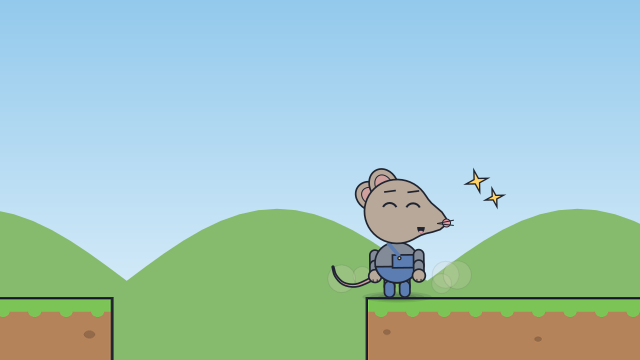
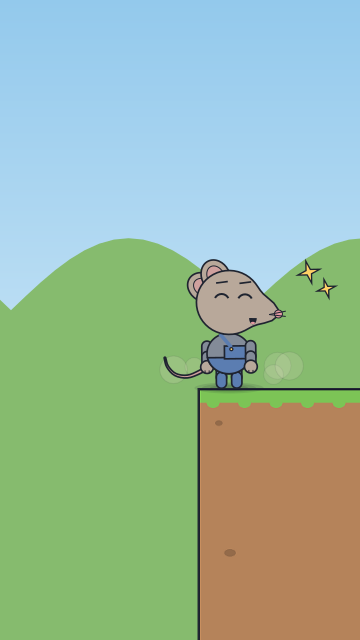

# A jump for a star

<!-- Generated by `vidgen gallery`; edit src/vidgen/data/gallery/showcases/star_jump.yaml, not this file. -->

**Use it for:** a platform level: run to the edge, jump the gap, catch a star.

A showcase of [`stage`](stage.md): a small scene written for the gallery, a whole `video.yaml`. Copy it into a
project and run `vidgen render`; until `vidgen tts` voices it, its beats are timed by their word count.

The scene playing, 16:9 and 9:16:

<picture><source media="(prefers-reduced-motion: reduce)" srcset="media/star_jump-16x9.png"></picture> <picture><source media="(prefers-reduced-motion: reduce)" srcset="media/star_jump-9x16.png"></picture>

Last beat:

 

## YAML

```yaml
title: A Jump for a Star
characters:
  - name: pell
    look: {species: mouse, proportions: kid, eyes: round, outfit: overalls}
    colors: {skin: "#B8A89A", clothes: "#5B7DB1"}
scenes:
  - id: star_jump
    type: stage
    set: park
    params:
      character_size: large
      level:
        map: |
          ........................
          .............*..........
          ..a...$$$.b....c.....d..
          ###########....#########
        spots: {a: start, b: brink, c: landing, d: end}
        follow: pell
      characters: [{name: pell, at: start}]
    beats:
      - text: "Pell ran for the edge, picking up coins."
        actions: [{run_to: pell, to: brink, at: 0.05}]
      - text: "One big jump, and she caught the star!"
        actions:
          - {jump: pell, to: landing, at: 0.15, react: {when: land, expression: laughing, effect: sparkle}}
```

[All scene types and showcases](README.md) · `vidgen guide cartoons` · `vidgen guide iso` · `vidgen guide platform`
