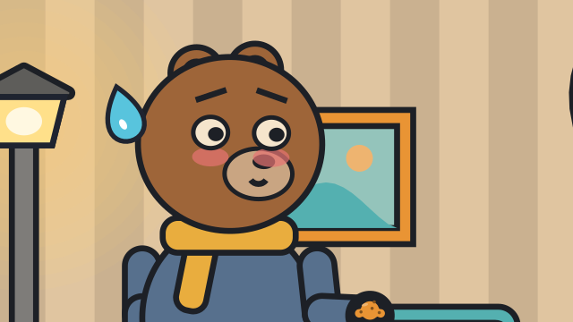
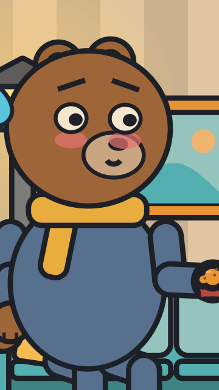

# A talk in the living room

<!-- Generated by `vidgen gallery`; edit src/vidgen/data/gallery/showcases/talk_in_a_room.yaml, not this file. -->

**Use it for:** a dialogue on a furnished set, with a close-up on the punchline.

A showcase of [`stage`](stage.md): a small scene written for the gallery, a whole `video.yaml`. Copy it into a
project and run `vidgen render`; until `vidgen tts` voices it, its beats are timed by their word count.

The scene playing, 16:9 and 9:16:

<picture><source media="(prefers-reduced-motion: reduce)" srcset="media/talk_in_a_room-16x9.png"></picture> <picture><source media="(prefers-reduced-motion: reduce)" srcset="media/talk_in_a_room-9x16.png"></picture>

Last beat:

 

## YAML

```yaml
title: The Last Muffin
voice: {provider: kokoro, voice: bf_emma, speed: 0.8}
voices:
  wren_voice: {voice: af_heart, label: Wren, speed: 0.85, color: primary}
  tobble_voice: {voice: am_michael, label: Tobble, speed: 0.85, color: accent}
characters:
  - name: wren
    voice: wren_voice
    look: {body: pear, eyes: oval, hair: ponytail, outfit: apron}
    colors: {skin: "#F2C9A0", clothes: "#E07A5F", trim: "#F4F6FA", hair: "#8A4B2A"}
  - name: tobble
    voice: tobble_voice
    look: {species: bear, body: round, eyes: round, accessories: [scarf]}
    colors: {skin: "#A47148", clothes: "#5B7DB1", accessory: "#F2C14E"}
scenes:
  - id: talk_in_a_room
    type: stage
    set: living_room
    params:
      props: [{prop: muffin, at: sofa}]
      characters:
        - {name: wren, at: stand_left, facing: left}
        - {name: tobble, at: sofa, depth: 0.4}
    beats:
      - text: "Tobble, did you see the last muffin?"
        voice: wren_voice
        actions:
          - {sit_on: tobble, to: sofa, at: 0}
          - {hold: tobble, to: muffin, at: 0}
          - {gesture: wren, to: point, at: 0.3}
      - text: "Muffin? Never seen one in my life."
        voice: tobble_voice
        actions:
          - {look_at: wren, to: tobble, at: 0}
          - {react: wren, expression: thinking, at: 0.7}
      - text: "It is in your paw."
        voice: wren_voice
        shot: closeup tobble
        actions:
          - {react: tobble, expression: blushing, at: 0.4}
          - {effect: tobble, to: sweat, at: 0.4}
```

[All scene types and showcases](README.md) · `vidgen guide cartoons` · `vidgen guide iso` · `vidgen guide platform`
