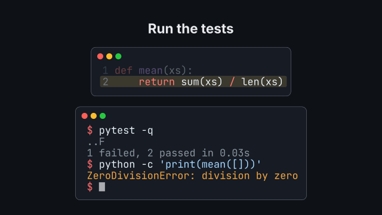
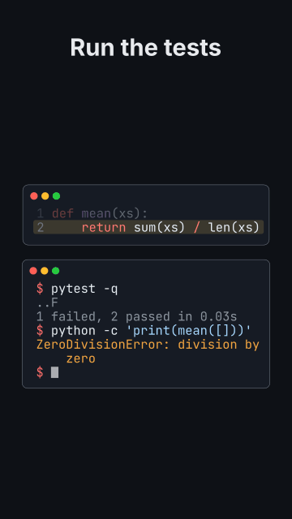

# `terminal`

<!-- Generated by `vidgen gallery`; edit the sample in AGENTS.md (or video.yaml), not this file. -->

**Use it for:** running a command: install, tests, a REPL (output written by you).

A terminal window: step *i* plays at beat *i*: its command is typed at the prompt (a block cursor moves along), then its output appears row by row and the prompt comes back. More steps than beats are spread evenly; later beats hold. `{reveal: output2, at: "@passes"}` shows an output on a spoken word (`command2` types a command on one): the scene then leaves it to the action. `code` puts a code listing beside the terminal (above it in a vertical frame); a `code` scene before can carry its listing into it (`carry: ["listing -> code"]`).

Last beat, 16:9 and 9:16:

 

The scene playing (GIF, up to its last beat):

 

## YAML

From the author guide (`vidgen guide scenes`):

```yaml
- id: shell
  type: terminal         # step i at beat i: the command is typed, then its output appears (you write it: nothing runs)
  params:
    title: "Run the tests"
    code: {code: "def mean(xs):\n    return sum(xs) / len(xs)", highlight: 2}   # optional: the code beside it
    steps:
      - {command: "pytest -q", output: "..F\n1 failed, 2 passed in 0.03s"}
      - {command: "python -c 'print(mean([]))'", output: "ZeroDivisionError: division by zero", output_color: secondary}
  beats:
    - text: "We run the tests, and one of them fails."
      actions: [{reveal: output1, at: "@fails"}]   # the output on the word
    - text: "An empty list divides by zero."
```

## Params

| param | type | default | notes |
|---|---|---|---|
| `steps` | `list[str \| TerminalStep]` | required | The session in order: each a command (a string) or {command, output, clear, output_color}; step i plays at beat i. |
| `steps.command` | `str \| None` |  | What is typed at the prompt (several lines are typed one after the other). |
| `steps.output` | `str \| None` |  | What the command prints, written by you (schu-video-generator runs nothing); shown after the command. |
| `steps.clear` | `bool` | `False` | Clear the screen before this step: it starts a new page at the top of the window. |
| `steps.output_color` | `color \| None` |  | Colour of the output (e.g. an error); default: the style's colour for program output. |
| `prompt` | `str` | `'$'` | The prompt before each command ('' for none), e.g. '>>>' or 'PS C:\>'. |
| `language` | `str` | `'bash'` | Pygments lexer of the commands (bash, powershell, pycon, text, ...). |
| `typing_speed` | `float` | `18.0` | Characters typed per second (a command too long for its beat is typed faster). |
| `code` | `TerminalCode \| None` |  | A code listing beside the terminal (above it in a vertical frame): {code \| path, language, highlight}. |
| `code.code` | `str \| None` |  | Inline code; give exactly one of code / path. |
| `code.path` | `str \| None` |  | Code file in the project; give exactly one of code / path. |
| `code.language` | `str \| None` |  | Pygments lexer name; default: from the file name, else python. |
| `code.highlight` | `int \| str \| list[int] \| None` |  | Lines to mark (the others dim): 3, '2-4', '1, 5-6' or [1, 4]. |
| `title` | `str` |  | Title above the window(s). (also: heading) |
| `prompt_color` | `color` | `'accent'` | Colour of the prompt. |
| `line_numbers` | `bool` | `True` | Line numbers of the code beside the terminal. |
| `style` | `str \| None` |  | Pygments style (monokai, dracula, xcode, ...) of the terminal and the code; default: the theme's code_style. |
| `font` | `str \| None` |  | Font family; default: the theme's font for the `code` role (font_mono, JetBrains Mono NL). |
| `size` | `size` | `'caption'` | Starting font size (scaled to fill the frame, up to 1.5x); the terminal and the code share one size. |
| `highlight_color` | `color` | `'highlight'` | Colour of the band behind the code's highlighted lines. |
| `wrap` | `bool` | `True` | Wrap long lines (hanging indent) instead of shrinking the text below size / the readable minimum. |

## Targets

`title`, `terminal`, `code`, `code.line<K>`, `command<N>`, `output<N>`, `output<N>.line<K>`

## Beats

Any number.

[All scene types](README.md) · `vidgen list-scenes` · `vidgen schema --scene terminal`
